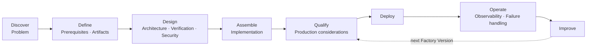

# FDLC Build Guides

## What is it

A build guide walks a Factory Engineer through designing, assembling, qualifying, and operating one specialized factory. Every guide uses the same thirteen sections, the same artifact vocabulary, the same [Factory Manifest](/specification/v1/factory-manifest) schema, and the same honesty rule for [Mission Control](/mission-control): every capability claim carries its ledger status (Available / Experimental / Planned / Proposed) and its limitation.

Guides are vendor-neutral. Where a Coding Harness plugs in, the guide names the boundary and the contract, not a product. Claude Code, Codex, or any harness that implements the factory's harness contract fits the same slot.

## Why it matters

Reading the [Delivery Loop](/framework/delivery-loop) tells you what a factory must do. A guide tells you what to write down, in which order, and which record proves each step happened. The difference between a coding agent and a factory is the set of records around it; the guides are where those records get built.

## How it works

Every guide has exactly these sections in this order: **Problem · Architecture · Prerequisites · Lifecycle · Artifacts · Implementation · Security · Verification · Observability · Failure handling · Production considerations · Mission Control mapping · Related.** The Artifacts section always carries a complete Factory Manifest for the factory being built; the Implementation section always shows a Work Order, a verification contract, a sandbox policy, and model routes.

## The guides

| Guide | Difficulty | Prerequisites | Time (illustrative) | Factory type (catalog) | Targets maturity |
|---|---|---|---|---|---|
| [Build your first factory](/guides/build-your-first-factory) | Beginner | One repository with a test suite; a control plane (Mission Control demo or equivalent); one Coding Harness | 1–2 days | Code Generation (bounded fix) | FDLC-L2 → L3 |
| [Issue tracker to PR factory](/guides/jira-to-pr-factory) | Practitioner | First factory done; tracker API access; GitHub App or equivalent publication identity | 1 week | Code Generation | FDLC-L3 |
| [Code review factory](/guides/code-review-factory) | Practitioner | Read access to pull requests; a verifier factory identity | 3–5 days | Code Review (purpose VERIFICATION) | FDLC-L3 |
| [Testing factory](/guides/testing-factory) | Practitioner | Coverage and mutation tooling in CI; criterion ids in specifications | 1 week | Test Generation | FDLC-L3 |
| [Security remediation factory](/guides/security-remediation-factory) | Advanced | SAST/SCA finding feed; security engineer as Policy Owner; HIGH-tier approval policy | 2 weeks | Security Remediation | FDLC-L4 |
| [Documentation factory](/guides/documentation-factory) | Beginner | Docs-as-code repository; doc test or link checker | 3 days | Documentation | FDLC-L2 → L3 |
| [Dependency upgrade factory](/guides/dependency-upgrade-factory) | Practitioner | Dependency scanner; contract and integration suites; canary release path | 1 week | Dependency Upgrade | FDLC-L4 |
| [Multi-repository factory](/guides/multi-repository-factory) | Advanced | Repository registry with code scopes; per-repository qualification cohorts; budget tree | 2–3 weeks | Migration / API Modernization | FDLC-L4 |
| [Multi-factory workflow](/guides/multi-factory-workflow) | Architect | Two or more qualified factories; Objective Planner; verification factory | 3–4 weeks | Factory Ecosystem (Code Generation + Security Remediation + Verification + Release) | FDLC-L5 |
| [Enterprise factory platform](/guides/enterprise-factory-platform) | Platform | Enterprise identity, tenancy, model gateway, sandbox pools | One quarter | Factory Platform (shared Release factory as the worked example) | FDLC-L5 |

Times are illustrative planning estimates for a team that already operates CI and a Git provider. They are not benchmarks.

## Reading order

Start with the first factory whatever your target level. The dependency-upgrade guide reuses the specification's worked example (`INT-104`, `FV-depmod-1.0`) end to end and is the fastest way to see every artifact in one place. The multi-factory and platform guides assume the Delivery Loop and Factory Lifecycle are familiar and spend their length on registries, routing, integration verification, and fleet operation.

## Conventions

| Convention | Rule |
|---|---|
| Identifiers | Canon instance scheme: `INT-<n>`, `SPEC-<n>-r<k>`, `PLAN-<n>-r<k>`, `WO-<n>-<seq>`, `FV-<factory>-<semver>`, `EP-<factory>-<semver>-<profile>`, `ATT-<n>-<seq>-p<k>` (producer) / `-v<k>` (verifier), `CAND-…`, `EV-…`, `VER-…`, `DEC-…`, `REL-…`, `OUT-…`, `LS-…`, `IC-…`, `QUAL-…`. |
| Manifests | Every manifest validates against `https://fdlc.ai/schemas/v1/factory-manifest.schema.json`; digests and timestamps are illustrative. |
| Harness | "Coding Harness" names the boundary. The manifest binds a harness Capability Manifest (`kind: harness`); the vendor is an implementation of that manifest. |
| Model routes | Logical routes `architecture-reasoning`, `implementation-workhorse`, `transformation-small`, `verification-independent` (canon §18). Providers are named by gateway route, never by product. |
| Mission Control | "FDLC requires X. Mission Control implements this through Y (file or table, status)." Never the reverse. |
| Numbers | Any count, cost, or rate is illustrative unless it cites a retained Mission Control evidence package. |

## Related

- Framework: [/framework/delivery-loop](/framework/delivery-loop) · [/framework/factory-lifecycle](/framework/factory-lifecycle) · [/framework/maturity](/framework/maturity)
- Specification: [/specification](/specification) · [/specification/v1/factory-manifest](/specification/v1/factory-manifest) · [/specification/v1/work-order](/specification/v1/work-order)
- Case studies: [/examples](/examples)
- Patterns: [/patterns](/patterns) · Anti-patterns: [/anti-patterns](/anti-patterns)
- Tutorials (Mission Control-connected): [/tutorials](/tutorials)
- Reference implementation: [/mission-control](/mission-control) · Glossary: [/glossary](/glossary)
