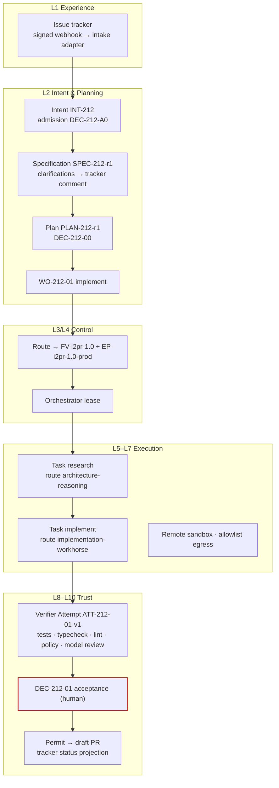

# Issue tracker to PR factory

**Difficulty** Practitioner · **Time** 1 week (illustrative) · **Factory type** Code Generation · **Targets** FDLC-L3

## Problem

Feature and bug tickets arrive in an issue tracker written for humans: a title, a paragraph, sometimes acceptance criteria, often a link to a design. Teams bolt a coding agent onto the tracker and get pull requests that nobody can trace back to an approved scope, that the agent's own tests "verified," and that carry the tracker's optimistic status ("In Review") long before anything was reviewed.

This factory, `issue-to-pr`, treats the tracker as an entry point (Layer 1) and nothing more. An issue becomes an Intent only after admission checks; the Intent becomes a Specification with stable criterion ids; a planner proposes bounded Work Orders; each is executed in a sandbox by a Coding Harness, verified independently, accepted by a human, and published as a draft pull request under a permit. The tracker receives status as a projection of control-plane records. It never grants authority.

## Architecture



## Prerequisites

| Need | Minimum |
|---|---|
| A working first factory | [/guides/build-your-first-factory](/guides/build-your-first-factory) completed: control plane, Coding Harness adapter manifest, verifier identity, sandbox image. |
| Tracker access | Read issues and post comments through a service identity; a signed webhook for issue events. Jira, Linear, GitHub Issues, or equivalent. |
| Publication identity | A Git-provider App with Contents write and Pull requests write, held by the control plane. |
| Repository facts | Code scopes for `acme/orders-api`; protected paths (`auth/**`, `schema/**`, `payments/**`); test suites tagged `UT-`, `IT-`, `CT-`. |
| Roles | Factory Owner (engineering lead), Policy Owner, and a Builder per issue (the ticket owner). |

## Lifecycle

| Stage / step | This factory | Artifacts |
|---|---|---|
| Discover | Baseline: tickets per month, median cycle time from "Ready" to merged PR, review minutes, reopen rate. | Opportunity record |
| Define / Design | Manifest below; verification contract with judgment criteria mapped to an independent model reviewer. | `FM-i2pr` |
| Assemble / Qualify / Deploy | `FV-i2pr-1.0` with two agents, three routes, remote sandbox; qualified for `feature-change × staging, production × MEDIUM × L3`. | `FV-i2pr-1.0`, `EP-i2pr-1.0-prod`, `QUAL-i2pr-1.0-01` |
| 1 Receive | Intake adapter converts issue `ORD-2211` into `INT-212`; admission checks well-formedness, owner, scope, budget. A ticket without an outcome gets a clarification comment, not an Intent. | `INT-212`, `DEC-212-A0` |
| 2 Specify | Requirement and criterion ids assigned; deterministic quality checks; clarifications posted to the tracker and answered by the Builder. | `SPEC-212-r1` |
| 3 Plan | Planner proposes one or more Work Orders and a verifier blueprint; lead approves. | `PLAN-212-r1`, `DEC-212-00`, `WO-212-01` |
| 4 Route | Eligibility, then ranking; bound to the qualified version. | `DEC-212-R1` |
| 5 Execute | Research task (frontier route) then implement task (workhorse route) in one Attempt. | `CTX-212-01-p1`, `ATT-212-01-p1`, `CAND-212-01-p1`, `EV-212-01..02` |
| 6 Verify | Independent verifier Attempt: deterministic checks plus model review for spec alignment. | `ATT-212-01-v1`, `VER-212-01`, `EV-212-03..07` |
| 7 Approve | Ticket owner accepts on the decision packet. | `DEC-212-01` |
| 8 Release | Permit-gated draft PR; tracker moves to "In Review" as a projection; human merge. | `DEC-212-PUB1`, `REL-212-01` |
| 9–10 Observe / Learn | Staging window; reviewer edits become signals. | `OUT-212-01`, `LS-212-01` |

## Artifacts

| Artifact | Id |
|---|---|
| Factory Manifest / Version / Profiles | `FM-i2pr`, `FV-i2pr-1.0`, `EP-i2pr-1.0-prod`, `EP-i2pr-1.0-qual` |
| Capability Manifests | `CAP-harness-coding-adapter-1.0.0`, `CAP-agent-repo-researcher-1.2.0`, `CAP-agent-feature-implementer-2.0.0`, `CAP-skill-orders-domain-1.1.0`, `CAP-tool-git-1.4.0`, `CAP-tool-test-runner-3.0.1`, `CAP-tool-tracker-read-1.0.0`, `CAP-verifier-test-runner-3.0.1`, `CAP-verifier-static-rules-2.2.0`, `CAP-verifier-model-review-1.3.0`, `CAP-verifier-scope-reconciler-1.0.0` |
| Qualification Record | `QUAL-i2pr-1.0-01` |
| Delivery Loop records | `INT-212` … `LS-212-01` (see [/examples/code-generation-factory](/examples/code-generation-factory)) |

```yaml
# Factory Manifest — issue-to-pr (illustrative digests)
schemaVersion: "1.0"
type: fdlc://v1/factory-manifest
id: FM-i2pr
namespace: https://acme.example/factories/orders
name: issue-to-pr
version: 1.0.0
displayName: Issue-to-PR Code Generation Factory
description: >-
  Admits tracker issues as Intents, plans bounded Work Orders, implements them in a remote
  sandbox, verifies them independently, and publishes draft pull requests under a permit.
purpose: SOFTWARE
specialization: code-generation
owner:
  factoryOwner: {kind: human, id: "user:jonas.hale", identitySource: authenticated, displayName: Jonas Hale}
  policyOwner: {kind: human, id: "user:sam.reyes", identitySource: authenticated, displayName: Sam Reyes}
  team: orders-platform
  costCenter: CC-ORD-01
risk_class: HIGH
autonomy_ceiling: L3

capabilities: [issue-intake, repository-research, feature-implementation, run-tests, propose-candidate]

inputs:
  - kind: tracker-issue
    description: A tracker issue with title, outcome, acceptance criteria, owner, and repository label; ingested through a signed webhook.
  - kind: work-order
    description: A released Work Order of kind SOFTWARE_CHANGE from an approved Plan.
    artifactType: fdlc://v1/work-order
outputs:
  - kind: candidate
    description: Unpublished Git candidate bound to the Work Order revision; published as a draft PR only under a permit.
    artifactType: fdlc://v1/candidate
  - kind: evidence
    description: Producer logs and diff (non-independent).
    artifactType: fdlc://v1/evidence
  - kind: tracker-status-projection
    description: Read-only status comment on the source issue; carries no authority.

planner: {capabilityId: CAP-planner-objective-1.3.0, kind: planner, versionConstraint: "~1.3"}
work_graph: {workflowId: issue-to-pr, versionConstraint: "2", roles: [researcher, implementer]}

execution_profiles:
  - key: prod
    description: Remote sandbox, two-route Attempt (research then implement), production-eligible.
    backend: remote-sandbox
    autonomyCeiling: L3
    environments: [staging, production]
    modelRouteId: implementation-workhorse
  - key: qual
    description: Isolated container with replayed transcripts; qualification only.
    backend: isolated-container
    autonomyCeiling: L2
    environments: [qualification]

model_routes:
  - routeId: architecture-reasoning
    role: PLAN
    tier: FRONTIER
    qualifiedProviders: [acme-gateway/frontier-a]
  - routeId: implementation-workhorse
    role: IMPLEMENT
    tier: WORKHORSE
    qualifiedProviders: [acme-gateway/workhorse-a, acme-gateway/workhorse-b]
    constraints: [temperature<=0.2]
  - routeId: verification-independent
    role: REVIEW
    tier: WORKHORSE
    qualifiedProviders: [acme-gateway/workhorse-c]
    independentFromProducer: true

agents:
  - {capabilityId: CAP-agent-repo-researcher-1.2.0, kind: agent, versionConstraint: "1.2.x", role: researcher}
  - {capabilityId: CAP-agent-feature-implementer-2.0.0, kind: agent, versionConstraint: "2.0.x", role: implementer}
skills:
  - {capabilityId: CAP-skill-orders-domain-1.1.0, kind: skill, versionConstraint: "^1.1"}
  - {capabilityId: CAP-skill-test-first-change-1.0.2, kind: skill, versionConstraint: "^1.0"}
tools:
  - {capabilityId: CAP-tool-git-1.4.0, versionConstraint: "1.4.x", operations: [status, diff, commit, branch], grantPolicy: PER_OPERATION_EXPIRING, maxSideEffectClass: WRITE_LOCAL}
  - {capabilityId: CAP-tool-test-runner-3.0.1, versionConstraint: "3.0.x", operations: [run], grantPolicy: PER_ATTEMPT, maxSideEffectClass: WRITE_LOCAL}
  - {capabilityId: CAP-tool-tracker-read-1.0.0, versionConstraint: "1.0.x", operations: [get-issue, list-comments], grantPolicy: PER_OPERATION_EXPIRING, maxSideEffectClass: READ_ONLY}
context_sources:
  - {capabilityId: CAP-context-source-repository-1.0.0, versionConstraint: "1.0.x", freshnessMaxAgeHours: 24, authorization: SUBJECT_IDENTITY, provenanceRequired: true, classificationCeiling: INTERNAL}
  - {capabilityId: CAP-context-source-design-docs-1.0.0, versionConstraint: "1.0.x", freshnessMaxAgeHours: 168, authorization: FACTORY_IDENTITY, provenanceRequired: true, classificationCeiling: INTERNAL}

runtime:
  backend: remote-sandbox
  harness: {capabilityId: CAP-harness-coding-adapter-1.0.0, kind: harness, versionConstraint: "1.0.x"}
  artifactConstraint: CONTAINER_IMAGE
  leaseDurationMs: 300000
  checkpointPolicy: STEP
sandbox:
  isolation: WORKSPACE_WRITE
  provider: acme-sandbox
  imageConstraint: "acme/factory-runtime@sha256:*"
  filesystem: WORKTREE_ONLY
  processIsolation: true
  resourceLimits: {cpu: 4, memoryMb: 8192, diskGb: 40, maxRuntimeMs: 7200000}
  publicIngress: false
  resourceAbsenceRequiredBeforePublication: true
network_policy:
  egress: RESTRICTED_ALLOWLIST
  allowlist: [registry.acme.example, gateway.acme.example]
  classificationGated: true
credential_policy:
  classes: [inference:attempt-scoped, tracker:read:attempt-scoped]
  scoping: ATTEMPT_SCOPED
  longLivedInSandbox: false
  publicationIdentityInSandbox: false
  revokeBeforePublication: true

verification:
  contract:
    - {criterionClass: functional-tests, verifierCapabilityId: CAP-verifier-test-runner-3.0.1, evidenceCategory: TEST_RESULT, mandatory: true, independence: INDEPENDENT_REQUIRED}
    - {criterionClass: static-quality, verifierCapabilityId: CAP-verifier-static-rules-2.2.0, evidenceCategory: STATIC_ANALYSIS, mandatory: true, independence: INDEPENDENT_REQUIRED}
    - {criterionClass: spec-alignment, verifierCapabilityId: CAP-verifier-model-review-1.3.0, evidenceCategory: REVIEW_OUTPUT, mandatory: true, independence: INDEPENDENT_REQUIRED}
    - {criterionClass: scope, verifierCapabilityId: CAP-verifier-scope-reconciler-1.0.0, evidenceCategory: FILE_DIFF, mandatory: true, independence: ANY_VERIFICATION}
  independence: {required: true, minimumBoundary: SEPARATE_FACTORY, verifierFactoryName: verification-factory}
  levels: [WORK_ORDER, RELEASE]
  currentnessRule: newest-candidate-newest-exact-verification
evidence:
  requiredCategories: [TEST_RESULT, STATIC_ANALYSIS, REVIEW_OUTPUT, FILE_DIFF, COMMAND_LOG, PROVENANCE]
  statementFormat: in-toto/v1
  retentionDays: 730
  traceContext: w3c-traceparent

approval_policy:
  - {riskClass: LOW, execution: AUTO, verification: AUTO_DETERMINISTIC, acceptance: POLICY, releaseAuthorization: POLICY}
  - {riskClass: MEDIUM, execution: AUTO, verification: INDEPENDENT, acceptance: HUMAN, releaseAuthorization: POLICY}
  - {riskClass: HIGH, execution: AUTO, verification: INDEPENDENT, acceptance: HUMAN, releaseAuthorization: HUMAN}
  - {riskClass: CRITICAL, execution: HUMAN_AUTHORIZED, verification: INDEPENDENT_PLUS_HUMAN, acceptance: HUMAN, releaseAuthorization: HUMAN}

observability:
  requiredSpans: [intake, attempt, step, tool-call, model-request, verification, decision, publication]
  metrics: [verified-completion-rate, first-pass-verification-rate, cycle-time-ticket-to-accepted, human-review-minutes, cost-per-accepted-outcome, clarification-rate]
  costAttribution: true
economics:
  budgets: {maxCostPerWorkOrder: {amount: 40, currency: USD}, maxAttemptsPerWorkOrder: 3, maxRuntimeMinutes: 120}
  costCoverageRule: unknown-cost-is-null
  denominators: [VERIFIED, ACCEPTED, RELEASED]
  includeFailedAttempts: true
qualification:
  standardVersion: fdlc-qualification-standard/1.0
  requiredScopes:
    - {workloadClass: feature-change, environment: staging, riskTier: MEDIUM, autonomyLevel: L3}
    - {workloadClass: feature-change, environment: production, riskTier: MEDIUM, autonomyLevel: L3}
    - {workloadClass: bug-fix, environment: production, riskTier: MEDIUM, autonomyLevel: L3}
  expiryDays: 90
  hardGates: [security, sandbox-isolation, policy-compliance, credential-handling, unsupported-actions, evidence-completeness]
release_policy:
  environments: [staging, production]
  rollout: CANARY
  rollbackRequired: true
  publicationAuthority: CONTROL_PLANE_ONLY
  mergeAuthority: HUMAN
  observationWindowDays: 7
outcome_metrics: [verified-completion-rate, cycle-time-ticket-to-accepted, human-review-minutes, cost-per-accepted-outcome, reopen-rate, escaped-defects]

state: DESIGNED
reviewedBy:
  - {kind: human, id: "user:jonas.hale", identitySource: authenticated}
  - {kind: human, id: "user:sam.reyes", identitySource: authenticated}
factoryVersionIds: [FV-i2pr-1.0]
digest: sha256:3b7e9d1c5a2f8e4b6d0c9a7e1f3b5d8c2a4e6f0b9d1c3e5a7f2b4d6c8e0a1f3b
createdAt: "2026-09-04T10:00:00Z"
createdBy: {kind: human, id: "user:jonas.hale", identitySource: authenticated}
updatedAt: "2026-09-08T16:00:00Z"
```

## Implementation

**Step 1 — Intake adapter (L1).** Subscribe to issue events with a signed webhook (HMAC over the untouched body; delivery-id replay ledger). Map issue fields to an Intent draft: title → `title`; description → `goal` and `rationale`; acceptance-criteria section → `constraints` and a draft of acceptance expectations; assignee → `owner`; repository label → `scope.repositories`. Admission is a policy Decision (`DEC-212-A0`): the Intent MUST have an owner, an outcome, at least one testable expectation, a repository in scope, and a budget. Otherwise the adapter posts a clarification comment and stops. A ticket label never sets `riskClass`; the control plane classifies from the touched scopes and the policy floor.

**Step 2 — Specify.** Freeze `SPEC-212-r1` with requirement ids (`REQ-212-*`), acceptance expectations (`AE-212-*`), verification expectations, non-goals, and the repository scope. Post the finalized Specification link to the issue. Clarifications answered in the tracker create a new revision; they never edit r1.

**Step 3 — Plan.** The Objective Planner (frontier route) proposes `PLAN-212-r1` with one producer blueprint and one verifier blueprint. It may propose two producer Work Orders when the change spans the API layer and the persistence layer; the dependency edge and the join are Plan records. The engineering lead approves (`DEC-212-00`); Work Orders materialize.

```json
{
  "id": "WO-212-01", "type": "fdlc://v1/work-order", "namespace": "https://acme.example/factories/orders",
  "intentId": "INT-212", "planId": "PLAN-212-r1", "revisionNumber": 1, "kind": "SOFTWARE_CHANGE", "role": "PRODUCER", "isMutating": true,
  "title": "Add idempotent order cancellation endpoint",
  "desiredOutcome": "POST /orders/{id}/cancel is idempotent, returns 409 for non-cancelable states, and is covered by IT-ORD-CANCEL-*.",
  "repository": {"repositoryId": "repo:orders-api", "name": "acme/orders-api", "baseRef": "main", "dataClassification": "INTERNAL",
                 "codeScopes": [{"id": "scope:orders-api/deploy", "includePaths": ["services/orders-api/**"], "excludePaths": ["services/orders-api/auth/**", "services/orders-api/schema/**", "services/orders-api/payments/**"]}]},
  "riskClass": "MEDIUM", "riskReasons": ["new-public-endpoint"], "autonomyLevel": "L3",
  "authorityEnvelope": {"allowedActions": ["READ_REPOSITORY", "MODIFY_WORKTREE", "RUN_TESTS", "RUN_BUILD", "PROPOSE_CANDIDATE", "REQUEST_HUMAN_DECISION"],
                        "prohibitedActions": ["PUBLISH_BRANCH", "OPEN_PULL_REQUEST", "MERGE", "DEPLOY", "APPROVE", "ACCEPT", "MODIFY_VERIFICATION_CONFIG", "ACCESS_PRODUCTION", "ACCESS_SECRETS", "WIDEN_SCOPE"],
                        "allowedCapabilityIds": ["CAP-skill-orders-domain-1.1.0", "CAP-skill-test-first-change-1.0.2", "CAP-tool-git-1.4.0", "CAP-tool-test-runner-3.0.1", "CAP-tool-tracker-read-1.0.0"],
                        "publicationAuthority": "CONTROL_PLANE_ONLY",
                        "requiredDecisions": [{"kind": "admission", "actorKind": "policy"}, {"kind": "acceptance", "actorKind": "human", "role": "work-order-owner"}],
                        "escalationConditions": ["Any change under auth/, schema/, payments/", "Cancellation semantics not defined by SPEC-212-r1"]},
  "acceptanceCriteria": [
    {"id": "AC-212-01", "title": "IT-ORD-CANCEL-* pass", "verificationMethod": "TEST", "requiredEvidence": [{"category": "TEST_RESULT", "minimumCount": 1, "independenceLevel": "INDEPENDENT_REQUIRED"}], "waiverAllowed": false, "status": "PENDING"},
    {"id": "AC-212-02", "title": "Existing UT-/IT- suites pass; typecheck and lint clean", "verificationMethod": "TEST", "requiredEvidence": [{"category": "TEST_RESULT", "minimumCount": 1, "independenceLevel": "INDEPENDENT_REQUIRED"}, {"category": "STATIC_ANALYSIS", "minimumCount": 1, "independenceLevel": "INDEPENDENT_REQUIRED"}], "waiverAllowed": false, "status": "PENDING"},
    {"id": "AC-212-03", "title": "Endpoint behavior matches SPEC-212-r1 §cancellation", "verificationMethod": "ANALYSIS", "requiredEvidence": [{"category": "REVIEW_OUTPUT", "minimumCount": 1, "independenceLevel": "INDEPENDENT_REQUIRED"}], "waiverAllowed": true, "status": "PENDING"},
    {"id": "AC-212-04", "title": "Scope and budget respected", "verificationMethod": "ANALYSIS", "requiredEvidence": [{"category": "FILE_DIFF", "minimumCount": 1, "independenceLevel": "ANY_VERIFICATION"}], "waiverAllowed": false, "status": "PENDING"}
  ],
  "negativeConstraints": [
    {"id": "NC-212-01", "type": "PROTECTED_PATH", "description": "auth, schema, payments out of bounds", "paths": ["services/orders-api/auth/**", "services/orders-api/schema/**", "services/orders-api/payments/**"]},
    {"id": "NC-212-02", "type": "NO_SCHEMA_CHANGES", "description": "Cancellation uses existing order state columns."},
    {"id": "NC-212-03", "type": "NO_TEST_REMOVAL", "description": "No test deleted or skipped."},
    {"id": "NC-212-04", "type": "NO_VERIFICATION_CONFIG_CHANGES", "description": "Runner, CI, lint config frozen."}
  ],
  "changeBudget": {"maxFilesChanged": 25, "maxLinesChanged": 900, "allowedPaths": ["services/orders-api/**"], "deniedPaths": ["services/orders-api/auth/**", "services/orders-api/schema/**", "services/orders-api/payments/**"],
                   "allowedCommandClasses": ["BUILD", "TYPECHECK", "TEST", "LINT"], "prohibitedCommandClasses": ["MIGRATION", "INFRASTRUCTURE", "PRODUCTION_ACCESS", "SECRETS_ACCESS", "DESTRUCTIVE", "PUBLISH"],
                   "allowDependencyChanges": false, "allowSchemaChanges": false, "allowMigrations": false, "allowInfrastructureChanges": false},
  "budgets": {"maxCost": {"amount": 40, "currency": "USD"}, "maxAttempts": 3, "maxRuntimeMinutes": 120, "stopCondition": "Stop after three Attempts, when the change budget would be exceeded, or on any escalation condition."},
  "state": "READY", "verificationStatus": "PENDING", "approvalStatus": "PENDING"
}
```

**Step 4 — Verification contract.** Judgment criteria (`AC-212-03`) get an independent model reviewer with its own route, prompt, and context; it never sees the producer's transcript. Deterministic checks come first.

```yaml
# verification/contract.yaml — issue-to-pr
contractVersion: 2
enforcementMode: ENFORCED
checks:
  - {id: CHK-FEATURE-TESTS, category: INTEGRATION_TEST, verifierCapabilityId: CAP-verifier-test-runner-3.0.1, mandatory: true, evidenceCategory: TEST_RESULT,
     command: {executable: pnpm, args: [test, "--filter", orders-api, "--", "--grep", "${FEATURE_TEST_PREFIX}"], commandClass: TEST, timeoutMs: 1200000}}
  - {id: CHK-SUITE, category: UNIT_TEST, verifierCapabilityId: CAP-verifier-test-runner-3.0.1, mandatory: true, evidenceCategory: TEST_RESULT,
     command: {executable: pnpm, args: [test, "--filter", orders-api], commandClass: TEST, timeoutMs: 1800000}}
  - {id: CHK-STATIC, category: TYPECHECK, verifierCapabilityId: CAP-verifier-static-rules-2.2.0, mandatory: true, evidenceCategory: STATIC_ANALYSIS,
     command: {executable: pnpm, args: [typecheck, "&&", pnpm, lint], commandClass: LINT, timeoutMs: 600000}}
  - {id: CHK-SPEC-REVIEW, category: INDEPENDENT_REVIEW, verifierCapabilityId: CAP-verifier-model-review-1.3.0, mandatory: true, evidenceCategory: REVIEW_OUTPUT}
  - {id: CHK-SCOPE, category: CHANGE_BUDGET, verifierCapabilityId: CAP-verifier-scope-reconciler-1.0.0, mandatory: true, evidenceCategory: FILE_DIFF}
independence: {required: true, minimumBoundary: SEPARATE_FACTORY}
requireHumanReview: false
authorityPolicy: {allowedSurfaceMutations: [TEST_SOURCE], reason: A feature adds tests; it may not change runner, CI, or lint configuration.}
verificationLevels: [WORK_ORDER, RELEASE]
```

**Step 5 — Sandbox and routes.** Remote sandbox with allowlist egress (package registry, model gateway); no tracker credential inside the sandbox except an attempt-scoped read token for the issue text, which is also frozen into the Context Package.

```yaml
# policies/sandbox.yaml — issue-to-pr
profileId: SBX-i2pr-remote-2
isolation: WORKSPACE_WRITE
filesystem: WORKTREE_ONLY
network: {egress: RESTRICTED_ALLOWLIST, allowlist: [registry.acme.example, gateway.acme.example], enforcedAt: [provider, guest]}
credentials:
  inference: {scope: ATTEMPT, injection: broker, ttlSeconds: 7200}
  tracker: {scope: ATTEMPT, operations: [get-issue, list-comments], ttlSeconds: 7200}
  git: NONE
  publication: NONE
resourceLimits: {cpu: 4, memoryMb: 8192, diskGb: 40, maxRuntimeMs: 7200000}
teardown: {revokeCredentialsBeforePublication: true, proveResourceAbsence: true}
```

```yaml
# routes/models.yaml — issue-to-pr
routes:
  - {routeId: architecture-reasoning, role: PLAN, tier: FRONTIER, qualifiedProviders: [acme-gateway/frontier-a]}
  - {routeId: implementation-workhorse, role: IMPLEMENT, tier: WORKHORSE, qualifiedProviders: [acme-gateway/workhorse-a, acme-gateway/workhorse-b], fallbackOrder: [workhorse-a, workhorse-b]}
  - {routeId: verification-independent, role: REVIEW, tier: WORKHORSE, qualifiedProviders: [acme-gateway/workhorse-c], independentFromProducer: true, mustDifferFrom: [implementation-workhorse]}
```

**Step 6 — Where the Coding Harness plugs in.** The Attempt's frozen execution manifest names the harness Capability Manifest, the two workflow steps (`research` on `architecture-reasoning`, `implement` on `implementation-workhorse`), the prompt bundle digests, the skills, and the tool grants. The harness adapter receives the manifest, the Context Package, and the sandbox handle; it returns `factory-result/v1`. Whether the adapter wraps Claude Code, Codex, or another harness changes the adapter's digest, not the factory's contract.

**Step 7 — Publish and project.** After acceptance, the control plane issues `DEC-212-PUB1` (a single-use permit bound to Candidate, lease, and receipt), pushes the branch under the App identity, opens a draft pull request whose body carries the lineage (Intent, Plan, Work Order, Attempt, subject digest, evidence links), and posts a status comment on the issue. The comment is a projection of `WO-212-01.state`; a human moving the ticket column changes nothing in the control plane.

## Security

| Concern | Rule |
|---|---|
| Webhook ingress | HMAC-verified over the untouched body; replay ledger by delivery id; issue text is untrusted data. |
| Prompt injection via tickets | Issue text enters only through the Context Package with `trust: UNTRUSTED_DATA`; nothing in a ticket can grant a tool, widen scope, or change risk class. |
| Identities | Intake adapter, producer, verifier, publisher: four workload identities with separate delegations. |
| Credentials | Attempt-scoped inference and tracker-read tokens, broker-injected, revoked before publication. Publication identity only in the control plane. |
| Sandbox | Remote, allowlist egress enforced at provider and guest, worktree-only, resource-absence proof. |
| Tool grants | Tracker tool is READ_ONLY; git limited to local operations; no `push`. |
| Risk classification | Server-owned; touching `auth/`, `schema/`, `payments/` raises HIGH and requires human release authorization. |

## Verification

| Criterion | Verifier | Independence | Level |
|---|---|---|---|
| AC-212-01 feature tests | `CAP-verifier-test-runner-3.0.1` | INDEPENDENT_REQUIRED, separate factory | Work Order |
| AC-212-02 suite, typecheck, lint | test runner + `CAP-verifier-static-rules-2.2.0` | INDEPENDENT_REQUIRED | Work Order |
| AC-212-03 spec alignment | `CAP-verifier-model-review-1.3.0` on `verification-independent` (different provider from the producer) | INDEPENDENT_REQUIRED; independence by standard: reviewer sees Specification + diff, never the producer transcript | Work Order |
| AC-212-04 scope and budget | `CAP-verifier-scope-reconciler-1.0.0` | ANY_VERIFICATION | Work Order |
| Release smoke and health | environment validation in staging | — | Release |

A model review verdict never overrides a failed deterministic check. Disagreement between the model reviewer and the human is recorded per criterion and trended.

## Observability

Spans: `intake.admit`, `spec.finalize`, `plan.approve`, `routing.decide`, `attempt` (producer; child spans `gen_ai.chat`, `tool.execute`, `checkpoint`), `candidate.freeze`, `attempt` (verifier), `verifier.run` per check, `decision.acceptance`, `publication.permit`, `tracker.project`. Every span carries issue key, Intent id, Work Order id, and Factory Version digest.

**Primary metric:** cycle time from admitted Intent to accepted Work Order, against the manual baseline. Guardrails: verified completion rate, first-pass verification rate, clarification rate (Intents that needed a tracker round-trip), human review minutes, cost per accepted outcome with coverage, reopen rate.

## Failure handling

| Failure | Behavior |
|---|---|
| Ticket lacks an outcome or criteria | Admission denied; clarification comment; no Intent. |
| Specification ambiguous mid-execution | Attempt reports `unknownAcceptanceCriterionIds`; Work Order AWAITING_APPROVAL; Builder answers in the tracker; new Specification revision, new Plan revision, new Work Order revision. |
| Producer touches a protected path | Scope FAIL; corrective Attempt; escalation if the change requires the path. |
| Model reviewer disagrees with tests | WAIVER_REQUIRED or AWAITING_HUMAN; never ELIGIBLE by averaging. |
| PR head moved by a human push | Currentness STALE; acceptance blocked until re-verification of the new subject. |
| Provider outage on the workhorse route | Prequalified fallback `workhorse-b`; if none, Attempt BLOCKED with reason PROVIDER; no silent route widening. |
| Webhook replay | Ledger rejects the delivery id; no duplicate Intent. |

## Production considerations

- **Qualification scope:** `feature-change` and `bug-fix` × staging and production × MEDIUM × L3. Cohort: at least 20 representative issues, including negative controls (a ticket that instructs deleting tests; a ticket that names a protected path).
- **Risk tier:** MEDIUM default; HIGH when protected scopes are touched; CRITICAL never auto-routed.
- **Autonomy:** Human accepts at MEDIUM; policy acceptance only at LOW after the first observation window shows reopen rate at or below baseline.
- **Rollout:** One repository, one team, tickets labeled `factory-eligible`. Widen by label, then by repository, each with its own qualification scope.
- **Cost:** Two model routes per Attempt plus an independent reviewer; expect cost per accepted outcome to exceed the first factory's. Report it with coverage; missing tracker or sandbox cost stays null.

## Mission Control mapping

| Step | Mission Control | Status | Not yet |
|---|---|---|---|
| Intake | `missions` with Business Justification; context router chooses clarification, deferral, one Task, or coordinator decomposition (`convex/missions.ts`) | Available | No tracker webhook adapter; issue ingestion is manual or scripted |
| Specify | `missionSpecRevisions`, Spec Quality evaluator (`convex/missionSpecs.ts`) | Experimental, default off | — |
| Plan | `missionPlans`, `validationAssertions`, Quality Contract projection (`convex/lib/qualityContract.ts`), idempotent Work Order release | Available | Bidirectional completeness gate partial |
| Route | `executionRouting.ts`, `factoryExecutionProfiles` | Experimental | Advisory/gated; Guarded Auto off |
| Execute | `workflowRuns`, fenced leases, execution manifest; Remote Sandbox | Available / Experimental | Sandbox: provider-enforced egress not proven; preview cohort |
| Verify | `verificationRuns`, receipts, Quality Gate; independence and currentness | Available | Model-review verifier: review intelligence tables are advisory (`acceptanceAuthority:false`) |
| Approve | `workOrders.accept` | Available | Human-only |
| Publish | GitHub App publisher, permits, head-SHA currentness, signed webhooks (`convex/github.ts`) | Available | Merge human; tracker status projection not implemented |
| Observe / Learn | `factoryReleases` (Experimental/Partial); `learningSignals` (advisory) | Experimental | — |

## Related

- Previous: [/guides/build-your-first-factory](/guides/build-your-first-factory) · Next: [/guides/code-review-factory](/guides/code-review-factory) · Case study: [/examples/code-generation-factory](/examples/code-generation-factory)
- Framework: [/framework/delivery-loop](/framework/delivery-loop) steps 1–3, 8
- Specification: [/specification/v1/intent](/specification/v1/intent) · [/specification/v1/specification](/specification/v1/specification) · [/specification/v1/plan](/specification/v1/plan) · [/specification/v1/work-order](/specification/v1/work-order) · [/specification/v1/candidate](/specification/v1/candidate)
- Patterns: [/patterns/objective-decomposition](/patterns/objective-decomposition) · [/patterns/context-package](/patterns/context-package) · [/patterns/publication-permit](/patterns/publication-permit) · [/patterns/model-routing](/patterns/model-routing)
- Anti-patterns: [/anti-patterns/the-mega-agent](/anti-patterns/the-mega-agent) · [/anti-patterns/invisible-context](/anti-patterns/invisible-context) · [/anti-patterns/agent-has-production-credentials](/anti-patterns/agent-has-production-credentials)
- Glossary: [/glossary](/glossary) · Mission Control: [/mission-control](/mission-control)
