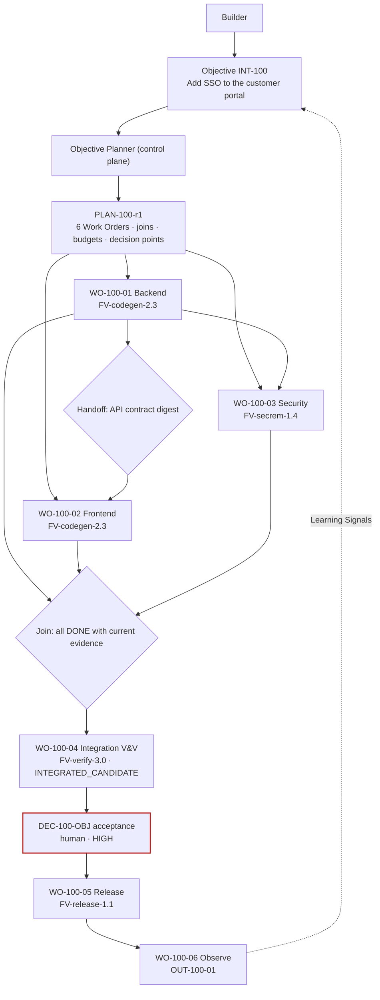

# Multi-factory workflow

**Difficulty** Architect · **Time** 3–4 weeks (illustrative) · **Factory type** Factory Ecosystem: Code Generation + Security Remediation + Verification + Release · **Targets** FDLC-L5

## Problem

"Add single sign-on to the customer portal" is not one change. It is a backend change (OIDC integration, session model), a frontend change (login flow, token handling), a security review (threat model, scans, policy checks), an integration proof that the three fit, a release with rollback, and an observation window. Four specialized factories are qualified for four of those. The tempting design is a supervisor agent that calls each factory in turn and holds the plan in its context. When that agent's session dies, the objective dies with it; when it succeeds, nobody can list the graph it walked.

This guide builds the workflow FDLC requires instead: **the control plane orchestrates the objective; factories execute bounded work; factories do not orchestrate one another.** One Objective, one approved Plan with a dependency graph, one Work Order per factory, control-plane-owned handoffs and joins, Objective-level verification on an integrated Candidate, and a Release factory that promotes the accepted artifact. The factory this guide assembles in detail is the **Verification factory** (`FM-verify`), because integration V&V is the capability the single-factory guides did not need.

## Architecture



## Prerequisites

| Need | Minimum |
|---|---|
| Qualified producer factories | `FV-codegen-2.3` (Code Generation, [/guides/jira-to-pr-factory](/guides/jira-to-pr-factory) shape) and `FV-secrem-1.4` ([/guides/security-remediation-factory](/guides/security-remediation-factory)), each with a current Qualification Record. |
| Factory Registry | Manifests discoverable by `capabilities[]` with qualification scopes ([/guides/enterprise-factory-platform](/guides/enterprise-factory-platform)). |
| Objective Planner | A control-plane planner that maps required capabilities to factories and emits a dependency graph. |
| Verification factory | `FM-verify` (built below) able to verify an integrated Candidate across two repositories in a staging environment. |
| Release factory | `FV-release-1.1`: promotes an exact accepted artifact set with rollback readiness. |
| Roles | Objective owner (Builder, product engineering lead), Factory Owners of each factory, Security Policy Owner, Verification Engineer. |

## Lifecycle

| Stage / step | This workflow | Artifacts |
|---|---|---|
| Discover / Define / Design / Assemble / Qualify / Deploy | Each factory independently; the Verification factory is assembled and qualified for `integration-vv × staging × HIGH × L3`. | `FM-verify`, `FV-verify-3.0`, `QUAL-verify-3.0-01` |
| 1 Receive | Objective with fleet scope (`portal-api`, `portal-web`), risk HIGH, budget, stop condition. | `INT-100`, `DEC-100-A0` |
| 2 Specify | Objective criteria: OIDC login works end to end; sessions expire per policy; threat model closed; no HIGH findings; rollback rehearsed. | `SPEC-100-r1` |
| 3 Plan | Planner emits six blueprints: 01 backend, 02 frontend (depends on 01's API contract), 03 security (depends on 01), 04 integration V&V (join), 05 release, 06 observe. | `PLAN-100-r1`, `DEC-100-00`, `WO-100-01..06` |
| 4 Route | Level 1 (Objective → factories) recorded in the Plan; level 2 per Work Order to a qualified version; level 3 inside each factory. | `DEC-100-nn-R1` |
| 5 Execute | Backend first; frontend after the API-contract handoff; security in parallel with frontend. | `ATT-100-01-p1`, `CAND-100-01-p1`; `ATT-100-02-p1`, `CAND-100-02-p1`; `ATT-100-03-p1`, `CAND-100-03-p1` |
| 6 Verify | Work Order verification per factory; then Objective verification on the integrated Candidate. | `VER-100-01..03`; `ATT-100-04-v1`, `VER-100-04` (level OBJECTIVE) |
| 7 Approve | Per Work Order by each owner; Objective acceptance by the Builder at HIGH. | `DEC-100-01..03`, `DEC-100-OBJ` |
| 8 Release | Release factory promotes both repositories' artifacts as one release with a shared rollback. | `DEC-100-REL`, `REL-100-01` |
| 9 Observe | Login success rate, session errors, auth latency over the window. | `OUT-100-01` |
| 10 Learn | Handoff friction (frontend waited on an unstable contract) → planner Improvement Candidate. | `LS-100-01`, `IC-planner-01` |

## Artifacts

| Artifact | Id |
|---|---|
| Verification factory | `FM-verify`, `FV-verify-3.0`, `EP-verify-3.0-staging`, `QUAL-verify-3.0-01` |
| Other factories (referenced) | `FM-codegen` / `FV-codegen-2.3`; `FM-secrem` / `FV-secrem-1.4`; `FM-release` / `FV-release-1.1` |
| Objective records | `INT-100`, `SPEC-100-r1`, `PLAN-100-r1`, `WO-100-01..06`, handoff records `HO-100-01→02`, `HO-100-01→03`, join record `JOIN-100-04` |
| Verification | `VER-100-01`, `VER-100-02`, `VER-100-03` (WORK_ORDER); `VER-100-04` (OBJECTIVE, subject `INTEGRATED_CANDIDATE`); `VER-100-05` (RELEASE) |
| Decisions | `DEC-100-00` plan-approval · `DEC-100-nn-R1` routing · `DEC-100-01..03` acceptance · `DEC-100-OBJ` acceptance (objective) · `DEC-100-REL` release-authorization |

```yaml
# Factory Manifest — verification-factory (purpose VERIFICATION; illustrative digests)
schemaVersion: "1.0"
type: fdlc://v1/factory-manifest
id: FM-verify
namespace: https://acme.example/factories/platform
name: verification-factory
version: 3.0.0
displayName: Verification Factory
description: >-
  Independently verifies Candidates from producer factories at Work Order and Objective level:
  frozen Verification Subject and Plan, deterministic checks first, independent model review where
  judgment is required, integrated-candidate verification across repositories in staging.
purpose: VERIFICATION
specialization: verification
owner:
  factoryOwner: {kind: human, id: "user:lee.park", identitySource: authenticated, displayName: Lee Park}
  policyOwner: {kind: human, id: "user:nadia.okoro", identitySource: authenticated, displayName: Nadia Okoro}
  team: platform-verification
  costCenter: CC-PLAT-07
risk_class: CRITICAL
autonomy_ceiling: L4

capabilities: [independent-verification, run-tests, dependency-scan, static-analysis, security-scan, contract-test, integration-verification, adversarial-probe, model-review]

inputs:
  - kind: work-order
    description: A released Work Order of kind VERIFICATION naming the subject (Candidate or INTEGRATED_CANDIDATE), the contract digest, and the verification level.
    artifactType: fdlc://v1/work-order
  - kind: verification-subject
    description: Frozen subject identity from the control plane; never an artifact the verifier fetches on its own.
outputs:
  - kind: verification
    description: Verification record with result, receipt, independence proof, coverage, and Quality Gate input; never acceptance.
    artifactType: fdlc://v1/verification
  - kind: evidence
    description: Per-check evidence bound to the subject digest, in-toto statement.
    artifactType: fdlc://v1/evidence

planner: {capabilityId: CAP-planner-verification-2.0.0, kind: planner, versionConstraint: "2.0.x"}
work_graph: {workflowId: verify, versionConstraint: "5", roles: [verifier]}

execution_profiles:
  - key: work-order
    description: Fresh clone per Attempt; deterministic checks and independent model review.
    backend: isolated-container
    autonomyCeiling: L4
    environments: [staging, production]
    modelRouteId: verification-independent
  - key: staging
    description: Integrated-candidate verification in a staging environment with a browser runner.
    backend: remote-sandbox
    autonomyCeiling: L4
    environments: [staging]
    modelRouteId: verification-independent
  - key: qual
    description: Seeded-defect subjects with known verdicts.
    backend: isolated-container
    autonomyCeiling: L2
    environments: [qualification]

model_routes:
  - {routeId: verification-independent, role: VERIFY, tier: WORKHORSE, qualifiedProviders: [acme-gateway/workhorse-familyB], independentFromProducer: true, constraints: [model-family!=producer]}
  - {routeId: transformation-small, role: TRANSFORM, tier: SMALL, qualifiedProviders: [acme-gateway/small-c]}

agents:
  - {capabilityId: CAP-agent-verifier-2.2.0, kind: agent, versionConstraint: "2.2.x", role: verifier}
skills:
  - {capabilityId: CAP-skill-verification-plan-authoring-1.3.0, kind: skill, versionConstraint: "^1.3"}
  - {capabilityId: CAP-skill-adversarial-probe-1.0.0, kind: skill, versionConstraint: "^1.0"}
tools:
  - {capabilityId: CAP-tool-git-1.4.0, versionConstraint: "1.4.x", operations: [status, diff, log], grantPolicy: PER_OPERATION_EXPIRING, maxSideEffectClass: READ_ONLY}
  - {capabilityId: CAP-tool-test-runner-3.0.1, versionConstraint: "3.0.x", operations: [run], grantPolicy: PER_ATTEMPT, maxSideEffectClass: WRITE_LOCAL}
  - {capabilityId: CAP-tool-browser-runner-1.0.0, versionConstraint: "1.0.x", operations: [run-scenario], grantPolicy: PER_ATTEMPT, maxSideEffectClass: WRITE_LOCAL}
  - {capabilityId: CAP-tool-staging-deploy-ephemeral-1.0.0, versionConstraint: "1.0.x", operations: [deploy-ephemeral, teardown], grantPolicy: PER_ATTEMPT, maxSideEffectClass: WRITE_REMOTE}
context_sources:
  - {capabilityId: CAP-context-source-specification-1.0.0, versionConstraint: "1.0.x", freshnessMaxAgeHours: 1, authorization: FACTORY_IDENTITY, provenanceRequired: true, classificationCeiling: CONFIDENTIAL}
  - {capabilityId: CAP-context-source-candidate-diff-1.0.0, versionConstraint: "1.0.x", freshnessMaxAgeHours: 1, authorization: FACTORY_IDENTITY, provenanceRequired: true, classificationCeiling: CONFIDENTIAL}

runtime:
  backend: isolated-container
  harness: {capabilityId: CAP-harness-verifier-adapter-2.0.0, kind: harness, versionConstraint: "2.0.x"}
  artifactConstraint: CONTAINER_IMAGE
  leaseDurationMs: 300000
  checkpointPolicy: STEP
sandbox:
  isolation: WORKSPACE_WRITE
  provider: acme-sandbox
  imageConstraint: "acme/verifier-runtime@sha256:*"
  filesystem: EPHEMERAL
  processIsolation: true
  resourceLimits: {cpu: 8, memoryMb: 16384, diskGb: 80, maxRuntimeMs: 7200000}
  publicIngress: false
  resourceAbsenceRequiredBeforePublication: true
network_policy:
  egress: RESTRICTED_ALLOWLIST
  allowlist: [gateway.acme.example, staging-ephemeral.acme.example]
  classificationGated: true
credential_policy:
  classes: [inference:attempt-scoped, staging-ephemeral:attempt-scoped]
  scoping: ATTEMPT_SCOPED
  longLivedInSandbox: false
  publicationIdentityInSandbox: false
  revokeBeforePublication: true

verification:
  contract:
    - {criterionClass: verifier-lineage-independent, verifierCapabilityId: CAP-verifier-independence-check-1.0.0, evidenceCategory: PROVENANCE, mandatory: true, independence: ANY_VERIFICATION}
    - {criterionClass: subject-exact, verifierCapabilityId: CAP-verifier-subject-check-1.0.0, evidenceCategory: PROVENANCE, mandatory: true, independence: ANY_VERIFICATION}
    - {criterionClass: checks-complete, verifierCapabilityId: CAP-verifier-coverage-check-1.0.0, evidenceCategory: PROVENANCE, mandatory: true, independence: ANY_VERIFICATION}
  independence: {required: true, minimumBoundary: SEPARATE_ATTEMPT}
  levels: [WORK_ORDER, OBJECTIVE, RELEASE]
  currentnessRule: newest-candidate-newest-exact-verification
evidence:
  requiredCategories: [TEST_RESULT, CONTRACT_TEST, INTEGRATION_TEST, SECURITY_SCAN, STATIC_ANALYSIS, REVIEW_OUTPUT, BROWSER_RUN, PROVENANCE]
  statementFormat: in-toto/v1
  retentionDays: 1095
  traceContext: w3c-traceparent

approval_policy:
  - {riskClass: LOW, execution: AUTO, verification: AUTO_DETERMINISTIC, acceptance: POLICY, releaseAuthorization: POLICY}
  - {riskClass: MEDIUM, execution: AUTO, verification: AUTO_DETERMINISTIC, acceptance: POLICY, releaseAuthorization: POLICY}
  - {riskClass: HIGH, execution: AUTO, verification: AUTO_DETERMINISTIC, acceptance: HUMAN, releaseAuthorization: HUMAN}
  - {riskClass: CRITICAL, execution: HUMAN_AUTHORIZED, verification: INDEPENDENT_PLUS_HUMAN, acceptance: HUMAN, releaseAuthorization: HUMAN}

observability:
  requiredSpans: [attempt, verification-plan, verifier-run, isolation-attestation, integration-deploy, verification-result]
  metrics: [verifications-per-day, first-pass-rate-by-producer-factory, verifier-disagreement-rate, integration-verification-latency, cost-per-verified-outcome]
  costAttribution: true
economics:
  budgets: {maxCostPerWorkOrder: {amount: 60, currency: USD}, maxAttemptsPerWorkOrder: 2, maxRuntimeMinutes: 120}
  costCoverageRule: unknown-cost-is-null
  denominators: [VERIFIED]
  includeFailedAttempts: true
qualification:
  standardVersion: fdlc-qualification-standard/1.0
  requiredScopes:
    - {workloadClass: work-order-verification, environment: production, riskTier: HIGH, autonomyLevel: L4}
    - {workloadClass: integration-vv, environment: staging, riskTier: HIGH, autonomyLevel: L3}
  expiryDays: 90
  hardGates: [security, sandbox-isolation, policy-compliance, credential-handling, unsupported-actions, evidence-completeness, determinism]
release_policy:
  environments: [staging, production]
  rollout: FULL
  rollbackRequired: false
  publicationAuthority: CONTROL_PLANE_ONLY
  mergeAuthority: HUMAN
  observationWindowDays: 1
outcome_metrics: [verifier-disagreement-rate, escaped-defects-after-verified, integration-verification-latency, cost-per-verified-outcome]

state: DESIGNED
reviewedBy:
  - {kind: human, id: "user:lee.park", identitySource: authenticated}
  - {kind: human, id: "user:nadia.okoro", identitySource: authenticated}
factoryVersionIds: [FV-verify-2.3, FV-verify-3.0]
digest: sha256:c5e7a9b1d3f5a7c9e1b3d5f7a9c1e3b5d7f9a1c3e5b7d9f1a3c5e7b9d1f3a5c7
createdAt: "2026-06-10T09:00:00Z"
createdBy: {kind: human, id: "user:lee.park", identitySource: authenticated}
updatedAt: "2026-08-30T10:00:00Z"
```

A verification factory's own `verification.contract` verifies the verifier: lineage independence proven, subject exact, every required check present. Its `risk_class: CRITICAL` reflects what depends on it, not what it mutates (nothing). Its `approval_policy` has no producer path; a Verification is never "accepted," it is recorded.

## Implementation

**Step 1 — Register factories by capability.** The Factory Registry holds each manifest's `capabilities[]` and each version's qualified scopes. The Objective Planner reads it; nothing else does. In the SSO objective the registry answers: `oidc-backend-change` → `FV-codegen-2.3`; `frontend-change` → `FV-codegen-2.3`; `threat-model`, `security-scan` → `FV-secrem-1.4`; `integration-verification` → `FV-verify-3.0`; `release-promotion` → `FV-release-1.1`.

**Step 2 — Plan the graph.** The planner emits the Plan; approval binds one revision. Every edge is a record.

```json
{
  "id": "PLAN-100-r1", "type": "fdlc://v1/plan", "intentId": "INT-100", "revisionNumber": 1,
  "workGraph": {"nodes": [
    {"id": "N1", "kind": "WORK_ORDER", "blueprintId": "BP-100-01", "dependsOn": [], "onFailure": "BLOCK_DESCENDANTS"},
    {"id": "N2", "kind": "WORK_ORDER", "blueprintId": "BP-100-02", "dependsOn": ["N1"], "handoff": {"from": "N1", "artifacts": ["api-contract:openapi"], "policy": "DIGEST_PINNED"}},
    {"id": "N3", "kind": "WORK_ORDER", "blueprintId": "BP-100-03", "dependsOn": ["N1"], "handoff": {"from": "N1", "artifacts": ["candidate"], "policy": "DIGEST_PINNED"}},
    {"id": "N4", "kind": "VERIFY", "blueprintId": "BP-100-04", "dependsOn": ["N1", "N2", "N3"], "joinPolicy": "ALL_CURRENT", "onFailure": "BLOCK"},
    {"id": "N5", "kind": "HUMAN_WAIT", "dependsOn": ["N4"], "decisionPointId": "DP-100-OBJ"},
    {"id": "N6", "kind": "WORK_ORDER", "blueprintId": "BP-100-05", "dependsOn": ["N5"]},
    {"id": "N7", "kind": "WORK_ORDER", "blueprintId": "BP-100-06", "dependsOn": ["N6"]}
  ], "maxConcurrency": 2},
  "workOrderBlueprints": [
    {"id": "BP-100-01", "title": "Backend: OIDC integration and session model", "role": "PRODUCER", "kind": "SOFTWARE_CHANGE", "riskClass": "HIGH", "requiredCapabilities": ["oidc-backend-change", "run-tests", "propose-candidate"], "factoryManifestId": "FM-codegen", "repositoryId": "repo:portal-api", "estimatedCost": {"amount": 60, "currency": "USD"}},
    {"id": "BP-100-02", "title": "Frontend: login flow and token handling", "role": "PRODUCER", "kind": "SOFTWARE_CHANGE", "riskClass": "MEDIUM", "requiredCapabilities": ["frontend-change", "run-tests", "propose-candidate"], "factoryManifestId": "FM-codegen", "repositoryId": "repo:portal-web", "dependsOnBlueprintIds": ["BP-100-01"], "estimatedCost": {"amount": 45, "currency": "USD"}},
    {"id": "BP-100-03", "title": "Security: threat model, scans, policy checks on the backend candidate", "role": "PRODUCER", "kind": "SOFTWARE_CHANGE", "riskClass": "HIGH", "requiredCapabilities": ["threat-model", "security-scan", "security-remediation"], "factoryManifestId": "FM-secrem", "repositoryId": "repo:portal-api", "dependsOnBlueprintIds": ["BP-100-01"], "estimatedCost": {"amount": 45, "currency": "USD"}},
    {"id": "BP-100-04", "title": "Integration V&V of the integrated candidate", "role": "VERIFIER", "kind": "VERIFICATION", "riskClass": "HIGH", "requiredCapabilities": ["integration-verification"], "factoryManifestId": "FM-verify", "subjectKind": "INTEGRATED_CANDIDATE", "dependsOnBlueprintIds": ["BP-100-01", "BP-100-02", "BP-100-03"], "estimatedCost": {"amount": 60, "currency": "USD"}},
    {"id": "BP-100-05", "title": "Release portal-api + portal-web as one release", "role": "PRODUCER", "kind": "AUTOMATION", "riskClass": "HIGH", "requiredCapabilities": ["release-promotion"], "factoryManifestId": "FM-release", "dependsOnBlueprintIds": ["BP-100-04"]},
    {"id": "BP-100-06", "title": "Observe login success, session errors, auth latency", "role": "PRODUCER", "kind": "AUTOMATION", "riskClass": "LOW", "requiredCapabilities": ["outcome-observation"], "factoryManifestId": "FM-release", "dependsOnBlueprintIds": ["BP-100-05"]}
  ],
  "budgets": {"maxCost": {"amount": 300, "currency": "USD"}, "maxAttemptsPerWorkOrder": 3, "maxRuntimeMinutes": 120},
  "verificationStrategy": {"levels": ["WORK_ORDER", "OBJECTIVE", "RELEASE"], "independence": {"required": true, "minimumBoundary": "SEPARATE_FACTORY"}, "verifierFactoryManifestId": "FM-verify", "integrationVerification": true},
  "decisionPoints": [
    {"id": "DP-100-PLAN", "kind": "plan-approval", "riskClass": "HIGH", "requiredActorKind": "human", "requiredRole": "engineering-lead"},
    {"id": "DP-100-OBJ", "kind": "acceptance", "riskClass": "HIGH", "requiredActorKind": "human", "requiredRole": "objective-owner", "afterNodeId": "N4"},
    {"id": "DP-100-REL", "kind": "release-authorization", "riskClass": "HIGH", "requiredActorKind": "human", "requiredRole": "release-owner", "afterNodeId": "N5"}
  ]
}
```

**Step 3 — Handoffs carry digests, not messages.** When `WO-100-01` reaches DONE, the control plane writes `HO-100-01→02` with the producing Work Order, Attempt, Factory Version, Execution Profile, the API contract artifact id and digest, input lineage, verification state and evidence references, and the policy digests. `WO-100-02` becomes READY only when the handoff exists. If `WO-100-01` is reopened and produces a new candidate, the handoff is invalidated and `WO-100-02` returns to BLOCKED with reason `UPSTREAM_CHANGED`.

**Step 4 — The integration Work Order (verification factory).**

```json
{
  "id": "WO-100-04", "type": "fdlc://v1/work-order", "intentId": "INT-100", "planId": "PLAN-100-r1", "revisionNumber": 1,
  "kind": "VERIFICATION", "role": "VERIFIER", "isMutating": false,
  "title": "Integration V&V: SSO across portal-api and portal-web",
  "desiredOutcome": "The integrated candidate (CAND-100-01-p1 + CAND-100-02-p1, with CAND-100-03-p1's security changes) satisfies SPEC-100-r1 objective criteria in an ephemeral staging environment.",
  "repository": {"repositoryId": "repo:portal-api", "name": "acme/portal-api", "baseRef": "main", "dataClassification": "CONFIDENTIAL", "codeScopes": [{"id": "scope:portal-api/all", "includePaths": ["**"]}]},
  "x-additional-repositories": [{"repositoryId": "repo:portal-web", "candidateId": "CAND-100-02-p1"}],
  "riskClass": "HIGH", "autonomyLevel": "L3",
  "authorityEnvelope": {"allowedActions": ["READ_REPOSITORY", "RUN_TESTS", "RUN_BUILD", "NETWORK_EGRESS_ALLOWLIST", "PROPOSE_CANDIDATE"],
                        "prohibitedActions": ["MODIFY_VERIFICATION_CONFIG", "PUBLISH_BRANCH", "OPEN_PULL_REQUEST", "MERGE", "DEPLOY", "APPROVE", "ACCEPT", "ACCESS_PRODUCTION", "ACCESS_SECRETS", "WIDEN_SCOPE"],
                        "allowedCapabilityIds": ["CAP-skill-verification-plan-authoring-1.3.0", "CAP-skill-adversarial-probe-1.0.0", "CAP-tool-git-1.4.0", "CAP-tool-test-runner-3.0.1", "CAP-tool-browser-runner-1.0.0", "CAP-tool-staging-deploy-ephemeral-1.0.0"],
                        "publicationAuthority": "CONTROL_PLANE_ONLY",
                        "requiredDecisions": [{"kind": "admission", "actorKind": "policy"}]},
  "acceptanceCriteria": [
    {"id": "AC-100-04-01", "title": "OIDC login end to end in ephemeral staging (browser scenario)", "verificationMethod": "BROWSER", "requiredEvidence": [{"category": "BROWSER_RUN", "minimumCount": 1, "independenceLevel": "INDEPENDENT_REQUIRED"}], "waiverAllowed": false, "status": "PENDING"},
    {"id": "AC-100-04-02", "title": "Session expiry per policy; refresh and logout scenarios", "verificationMethod": "TEST", "requiredEvidence": [{"category": "INTEGRATION_TEST", "minimumCount": 1, "independenceLevel": "INDEPENDENT_REQUIRED"}], "waiverAllowed": false, "status": "PENDING"},
    {"id": "AC-100-04-03", "title": "API contract of portal-api matches the handoff digest consumed by portal-web", "verificationMethod": "TEST", "requiredEvidence": [{"category": "CONTRACT_TEST", "minimumCount": 1, "independenceLevel": "INDEPENDENT_REQUIRED"}], "waiverAllowed": false, "status": "PENDING"},
    {"id": "AC-100-04-04", "title": "No HIGH security finding on the integrated set; threat-model items closed", "verificationMethod": "COMMAND", "requiredEvidence": [{"category": "SECURITY_SCAN", "minimumCount": 1, "independenceLevel": "INDEPENDENT_REQUIRED"}], "waiverAllowed": false, "status": "PENDING"},
    {"id": "AC-100-04-05", "title": "Adversarial probe of token handling finds no bypass", "verificationMethod": "ANALYSIS", "requiredEvidence": [{"category": "REVIEW_OUTPUT", "minimumCount": 1, "independenceLevel": "INDEPENDENT_REQUIRED"}], "waiverAllowed": true, "status": "PENDING"}
  ],
  "negativeConstraints": [{"id": "NC-100-04-01", "type": "CUSTOM", "description": "Ephemeral staging only; no shared staging or production access.", "x-type": "EPHEMERAL_ENVIRONMENT_ONLY"}],
  "changeBudget": {"maxFilesChanged": 0, "maxLinesChanged": 0, "allowedPaths": [], "deniedPaths": ["**"], "allowedCommandClasses": ["BUILD", "TEST", "SECURITY_SCAN"], "prohibitedCommandClasses": ["MIGRATION", "INFRASTRUCTURE", "PRODUCTION_ACCESS", "SECRETS_ACCESS", "DESTRUCTIVE", "PUBLISH"],
                   "allowDependencyChanges": false, "allowSchemaChanges": false, "allowMigrations": false, "allowInfrastructureChanges": false},
  "budgets": {"maxCost": {"amount": 60, "currency": "USD"}, "maxAttempts": 2, "maxRuntimeMinutes": 120, "stopCondition": "Stop after two Attempts or when any member candidate changes."},
  "dependsOnWorkOrderIds": ["WO-100-01", "WO-100-02", "WO-100-03"],
  "state": "READY", "verificationStatus": "PENDING", "approvalStatus": "NOT_REQUIRED"
}
```

The multi-repository subject is expressed through an `x-additional-repositories` extension; the canonical single `repository` names the primary. This is an extension point the specification names for exactly this case.

**Step 5 — Verification contract for the integrated candidate.**

```yaml
# verification/contract.yaml — integration V&V (FM-verify, level OBJECTIVE)
contractVersion: 1
enforcementMode: ENFORCED
subject: {kind: INTEGRATED_CANDIDATE, members: [CAND-100-01-p1, CAND-100-02-p1, CAND-100-03-p1], digest: "sha256:…"}   # digest over member digests + handoff digests
checks:
  - {id: CHK-INT-DEPLOY, category: BUILD, verifierCapabilityId: CAP-verifier-integration-suite-1.0.0, mandatory: true, evidenceCategory: INTEGRATION_TEST,
     command: {executable: acme-ephemeral, args: [deploy, "--api", "${CAND_01_SHA}", "--web", "${CAND_02_SHA}", "--ttl", "2h"], commandClass: BUILD, timeoutMs: 1200000}}
  - {id: CHK-INT-LOGIN, category: ACCEPTANCE, verifierCapabilityId: CAP-verifier-browser-1.0.0, mandatory: true, evidenceCategory: BROWSER_RUN,
     command: {executable: acme-browser, args: [run, "scenarios/sso-login.yaml", "--env", "${EPHEMERAL_URL}"], commandClass: TEST, timeoutMs: 900000}}
  - {id: CHK-INT-SESSION, category: INTEGRATION_TEST, verifierCapabilityId: CAP-verifier-test-runner-3.0.1, mandatory: true, evidenceCategory: INTEGRATION_TEST,
     command: {executable: pnpm, args: [test:integration, "--", "--grep", "SESSION-"], commandClass: TEST, timeoutMs: 900000}}
  - {id: CHK-INT-CONTRACT, category: CONTRACT_TEST, verifierCapabilityId: CAP-verifier-contract-tests-1.2.0, mandatory: true, evidenceCategory: CONTRACT_TEST,
     command: {executable: acme-contract, args: [verify, "--provider", "${CAND_01_SHA}", "--consumer", "${CAND_02_SHA}", "--expect-digest", "${HANDOFF_01_02_DIGEST}"], commandClass: TEST, timeoutMs: 600000}}
  - {id: CHK-INT-SECURITY, category: SECURITY, verifierCapabilityId: CAP-verifier-sast-5.2.0, mandatory: true, evidenceCategory: SECURITY_SCAN,
     command: {executable: acme-sast, args: [scan, "--fail-on", HIGH, "--threat-model", "TM-100-01"], commandClass: SECURITY_SCAN, timeoutMs: 1800000}}
  - {id: CHK-INT-ADVERSARIAL, category: INDEPENDENT_REVIEW, verifierCapabilityId: CAP-verifier-adversarial-probe-1.0.0, mandatory: true, evidenceCategory: REVIEW_OUTPUT}
independence: {required: true, minimumBoundary: SEPARATE_FACTORY}
requireHumanReview: true
verificationLevels: [OBJECTIVE]
```

**Step 6 — Sandbox and routes for the verifier.**

```yaml
# policies/sandbox.yaml — verification factory, staging profile
profileId: SBX-verify-staging-2
isolation: WORKSPACE_WRITE
filesystem: EPHEMERAL
network: {egress: RESTRICTED_ALLOWLIST, allowlist: [gateway.acme.example, staging-ephemeral.acme.example], enforcedAt: [provider, guest]}
credentials:
  inference: {scope: ATTEMPT, injection: broker, ttlSeconds: 7200}
  staging-ephemeral: {scope: ATTEMPT, operations: [deploy-ephemeral, teardown], ttlSeconds: 7200}
  git: NONE
  publication: NONE
resourceLimits: {cpu: 8, memoryMb: 16384, diskGb: 80, maxRuntimeMs: 7200000}
teardown: {revokeCredentialsBeforePublication: true, proveResourceAbsence: true, ephemeralEnvironmentTornDown: true}
```

```yaml
# routes/models.yaml — verification factory
routes:
  - {routeId: verification-independent, role: VERIFY, tier: WORKHORSE, qualifiedProviders: [acme-gateway/workhorse-familyB], independentFromProducer: true, modelFamilyMustDiffer: true}
  - {routeId: transformation-small, role: TRANSFORM, tier: SMALL, qualifiedProviders: [acme-gateway/small-c]}
```

**Step 7 — Where the Coding Harness plugs in.** The producer factories use their own harness adapters. The verification factory binds a verifier adapter (`CAP-harness-verifier-adapter-2.0.0`) whose manifest prohibits every mutating authority; a Coding Harness in read-only mode qualifies for the adversarial probe step, nothing else.

**Step 8 — Accept, release, observe.** Each producer Work Order is accepted by its owner on its own evidence. `VER-100-04` makes the Objective eligible; the Builder records `DEC-100-OBJ`. The Release factory's Work Order `WO-100-05` promotes both artifacts as `REL-100-01` with one rollback plan; `WO-100-06` closes `OUT-100-01` after the window.

## Security

| Concern | Rule |
|---|---|
| No factory-to-factory credentials | Each factory's sandbox reaches the control plane and its own repository; n factories need n trust relationships, not n². |
| Handoff integrity | Every handoff carries artifact digests and the producer's Factory Version; a consumer verifies the digest before use. |
| Ephemeral staging | The integration environment is created and torn down per Attempt with attempt-scoped credentials; no shared staging state. |
| Objective authority | The Objective's risk tier (HIGH) floors every Work Order; a Work Order may be stricter, never looser. |
| Verifier authority | The verification factory has no acceptance, publication, merge, or deploy authority; `mustDifferFrom` producer routes and model families. |
| Compensation | Undoing a released change is a Release-factory Work Order with its own authority; no factory undoes another's work. |

## Verification

| Level | Subject | Verifier | What it proves |
|---|---|---|---|
| Work Order (×3) | `CAND-100-01-p1`, `CAND-100-02-p1`, `CAND-100-03-p1` | `FV-verify-3.0`, `work-order` profile | Each factory satisfied its contract on pinned inputs |
| Objective | `INTEGRATED_CANDIDATE` over the three member digests and two handoff digests | `FV-verify-3.0`, `staging` profile | The integrated result achieves the Objective's criteria |
| Release | Released artifact set in production canary | Release factory + telemetry | The release holds under real traffic |

Local PASS is necessary for the join and insufficient for Objective acceptance. The integrated Candidate is a new Verification Subject; no Work Order's receipt is reused.

## Observability

One trace rooted at `INT-100`; spans per Work Order, Attempt, handoff (`handoff.write`, `handoff.consume`), join (`join.evaluate`), integration deploy, verification, decision, release, and outcome window. Cost attributes roll up Work Order → Objective, with failed and retried Attempts included.

**Primary metric:** Objective cycle time from admission to Objective acceptance. Guardrails: handoff wait time, join failures with reason, integration first-pass rate, verifier disagreement rate, cost per accepted Objective with coverage, release rollback.

## Failure handling

| Failure | Behavior |
|---|---|
| Backend candidate changes after frontend consumed its contract | `HO-100-01→02` invalidated; `WO-100-02` BLOCKED `UPSTREAM_CHANGED`; re-run against the new digest; prior evidence kept as history. |
| Security Work Order finds a HIGH issue in the backend candidate | `WO-100-03` produces a remediation candidate under its own budget; join waits; `WO-100-01` is not un-accepted. |
| Integration V&V fails | No Work Order changes state; a remediation Work Order targets the integrated candidate under `INT-100`; Objective stays open. |
| One factory Suspended mid-objective | In-flight Attempts finish or cancel per the incident Decision; new Work Orders route to another qualified version or block; restoration is a separate Decision. |
| Objective budget exhausted | Objective BLOCKED with owner; no child continues. |
| Supervisor-agent temptation | A factory that attempts to dispatch another factory is a policy violation and an incident. |

## Production considerations

- **Qualification scope:** the verification factory's `integration-vv × staging × HIGH × L3` plus each producer's own scope; an Objective is routable only when every required capability has a qualified version.
- **Risk tier:** HIGH for the Objective; plan approval, Objective acceptance, and release authorization are human.
- **Autonomy:** L3 across the Objective; L4 for the verification factory's own Work Orders (recorded, not accepted).
- **Rollout:** First objective with two producer factories; add the security factory once handoff records are stable; add the release factory once rollback has been rehearsed in staging.
- **Cost:** Objective cost is the budget-tree total; integration V&V is the largest single item; report per Work Order and per Objective with coverage.

## Mission Control mapping

| Requirement | Mission Control | Status | Not yet |
|---|---|---|---|
| Producer and verifier factories separated by purpose | `factoryDefinitions.purpose` SOFTWARE / VERIFICATION; verifier selection (`convex/factory/attempts.ts`) | Available | The cleanest existing multi-factory pattern |
| Many Work Orders under one Mission with dependencies | `missionPlans` blueprints, `dependsOn` | Available | Handoff records with digests are Proposed |
| Work Order routing | `executionRouting.ts` (repository-scoped) | Available (single repository) | Factory Registry and Objective Planner across factories: Planned |
| Integration verification (`INTEGRATED_CANDIDATE`) | none; "multi-repository Missions" is a revisit trigger in the verification ADR | Planned | — |
| Budget conservation parent → child | Mission budget → Work Order cap → reservation | Experimental | Inference accounting default off |
| Release factory | `factoryReleases` state machines | Experimental / Partial | Multi-artifact release with shared rollback: Proposed |
| Suspension and restoration | `factoryIncidents` pause, `DISPATCH_DENIED`, separately authorized restoration | Available (one exact repository operation) | Fleet-scale containment Planned |

## Related

- Previous: [/guides/multi-repository-factory](/guides/multi-repository-factory) · Next: [/guides/enterprise-factory-platform](/guides/enterprise-factory-platform)
- Architecture: [/architecture/multi-factory](/architecture/multi-factory) · [/architecture/routing](/architecture/routing) (three levels) · [/architecture/verification](/architecture/verification) (hierarchy)
- Specification: [/specification/v1/plan](/specification/v1/plan) · [/specification/v1/work-order](/specification/v1/work-order) · [/specification/v1/verification](/specification/v1/verification) · [/specification/v1/release](/specification/v1/release)
- Patterns: [/patterns/multi-factory-orchestration](/patterns/multi-factory-orchestration) · [/patterns/objective-decomposition](/patterns/objective-decomposition) · [/patterns/independent-verifier](/patterns/independent-verifier)
- Anti-patterns: [/anti-patterns/agent-to-agent-spaghetti](/anti-patterns/agent-to-agent-spaghetti) · [/anti-patterns/the-mega-agent](/anti-patterns/the-mega-agent)
- Enterprise: [/enterprise/reference-architecture](/enterprise/reference-architecture) · Glossary: [/glossary](/glossary) · Mission Control: [/mission-control](/mission-control)
