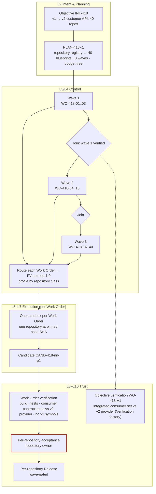

# Multi-repository factory

**Difficulty** Advanced · **Time** 2–3 weeks (illustrative) · **Factory type** Migration / API Modernization · **Targets** FDLC-L4

## Problem

A platform team deprecates the v1 customer API. Forty service repositories consume it through a client library. The change per repository is small and mechanical; the change across the fleet is a program: forty owners, four languages, three classification tiers, and a provider that must keep serving v1 until the last consumer moves. One agent session per repository produces forty pull requests nobody can track, forty different ideas of "done," and no evidence that the fleet as a whole works against v2.

The `api-modernization` factory lands one bounded change across many repositories under one Objective. The control plane holds the graph: one Plan, one Work Order per repository, one budget tree, per-repository acceptance by the repository owner, Objective-level integration verification against the v2 provider, and rollout in waves. The factory executes bounded work in one repository at a time. It never sees two repositories in one sandbox.

## Architecture



## Prerequisites

| Need | Minimum |
|---|---|
| Repository registry | Every consumer repository registered with owner, language, classification, code scopes, and the v1 client version in use. |
| Repository classes | Named classes (for example `ts-service`, `py-service`, `jvm-service`) with a qualification cohort per class. |
| Consumer contract tests | Each repository runs contract tests against a pinned v2 provider stub; the platform team owns the stub's version. |
| Objective Planner | A planner that emits one Work Order blueprint per registry entry with wave assignment and dependencies. |
| Verification factory | `FV-verify-*` able to run the integrated consumer set against the v2 provider in a staging environment. |
| Dependency-upgrade factory | Optional: [/guides/dependency-upgrade-factory](/guides/dependency-upgrade-factory) handles the client-library bump when the repository needs only that. |
| Roles | Factory Owner (platform API lead), Policy Owner, forty repository owners as Builders and acceptors, Verification Engineer. |

## Lifecycle

| Stage / step | This factory | Artifacts |
|---|---|---|
| Discover | Baseline: repositories on v1, owner response time, historical migration duration, breakage rate. | Opportunity record |
| Define / Design | Manifest with `inputs: repository-registry-selection`; per-class Execution Profiles; contract with consumer-contract-test criterion; Objective-level verification. | `FM-apimod` |
| Assemble / Qualify / Deploy | `FV-apimod-1.0`; qualification per repository class (cohort of 6 per class); negative controls: repo with a v1 usage in generated code, repo with a custom retry wrapper. | `FV-apimod-1.0`, `EP-apimod-1.0-ts-service`, `EP-apimod-1.0-py-service`, `EP-apimod-1.0-jvm-service`, `QUAL-apimod-1.0-{ts,py,jvm}` |
| 1 Receive | Objective admitted with a fleet scope and a total budget. | `INT-418`, `DEC-418-A0` |
| 2 Specify | Fleet criteria: every consumer builds and passes tests on v2; no v1 symbol remains; integrated consumer set passes provider contract; v1 provider decommission is out of scope. | `SPEC-418-r1` |
| 3 Plan | 40 producer blueprints in 3 waves; one Objective verification blueprint; budget tree; per-wave joins. | `PLAN-418-r1`, `DEC-418-00`, `WO-418-01..40`, `WO-418-V1` |
| 4 Route | Each Work Order routed by repository class and classification; CONFIDENTIAL repositories to local profiles. | `DEC-418-nn-R1` |
| 5 Execute | One Attempt per Work Order in its own sandbox. | `CTX-418-nn-p1`, `ATT-418-nn-p1`, `CAND-418-nn-p1` |
| 6 Verify | Work Order verification per repository; Objective verification after each wave join. | `ATT-418-nn-v1`, `VER-418-nn-01`; `VER-418-V1-w1..w3` |
| 7 Approve | Repository owner accepts each Work Order; platform lead accepts the Objective at the end. | `DEC-418-nn-01`; `DEC-418-OBJ` |
| 8 Release | Per-repository PR and deployment, gated by wave; v1 traffic share observed per wave. | `REL-418-nn-01` |
| 9–10 Observe / Learn | v1 call volume trending to zero; per-class failure patterns. | `OUT-418-01`, `LS-418-*` |

## Artifacts

| Artifact | Id |
|---|---|
| Manifest / Version / Profiles | `FM-apimod`, `FV-apimod-1.0`, `EP-apimod-1.0-ts-service`, `EP-apimod-1.0-py-service`, `EP-apimod-1.0-jvm-service`, `EP-apimod-1.0-local` |
| Capability Manifests | `CAP-harness-coding-adapter-1.0.0`, `CAP-agent-api-migrator-1.3.0`, `CAP-skill-customer-api-v2-migration-1.0.0`, `CAP-skill-codemod-{ts,py,jvm}-*`, `CAP-tool-git-1.4.0`, `CAP-tool-test-runner-3.0.1`, `CAP-tool-codemod-2.0.0`, `CAP-verifier-test-runner-3.0.1`, `CAP-verifier-contract-tests-1.2.0`, `CAP-verifier-symbol-scan-1.0.0`, `CAP-verifier-scope-reconciler-1.0.0`, `CAP-verifier-integration-suite-1.0.0` |
| Qualification Records | `QUAL-apimod-1.0-ts`, `QUAL-apimod-1.0-py`, `QUAL-apimod-1.0-jvm` |
| Delivery Loop records | `INT-418`, `PLAN-418-r1`, `WO-418-01..40`, `WO-418-V1`, per-Work-Order lineage (see [/examples/migration-factory](/examples/migration-factory) for `WO-418-07`) |

```yaml
# Factory Manifest — api-modernization (illustrative digests)
schemaVersion: "1.0"
type: fdlc://v1/factory-manifest
id: FM-apimod
namespace: https://acme.example/factories/platform-api
name: api-modernization
version: 1.0.0
displayName: API Modernization Factory
description: >-
  Replaces a deprecated internal API client with its successor in one consumer repository per
  Work Order, proven by build, tests, consumer contract tests against the successor provider,
  and absence of deprecated symbols. Designed to run across many repositories under one Objective.
purpose: SOFTWARE
specialization: migration-api-modernization
owner:
  factoryOwner: {kind: human, id: "user:ravi.menon", identitySource: authenticated, displayName: Ravi Menon}
  policyOwner: {kind: human, id: "user:sam.reyes", identitySource: authenticated, displayName: Sam Reyes}
  team: platform-api
  costCenter: CC-PLAT-04
risk_class: HIGH
autonomy_ceiling: L3

capabilities: [repository-research, api-client-migration, codemod, run-tests, consumer-contract-test, propose-candidate]

inputs:
  - kind: repository-registry-selection
    description: A registry query (label, language, v1 usage) resolved by the planner into one blueprint per repository.
  - kind: work-order
    description: A released Work Order of kind SOFTWARE_CHANGE scoped to exactly one repository.
    artifactType: fdlc://v1/work-order
  - kind: provider-contract
    description: The v2 provider contract and stub at a pinned version, shared by every Work Order in the Objective.
outputs:
  - kind: candidate
    description: One Git candidate per repository.
    artifactType: fdlc://v1/candidate
  - kind: evidence
    description: Producer logs, codemod report, local test run (non-independent).
    artifactType: fdlc://v1/evidence

planner: {capabilityId: CAP-planner-fleet-1.0.0, kind: planner, versionConstraint: "1.0.x"}
work_graph: {workflowId: api-migration, versionConstraint: "2", roles: [researcher, migrator]}

execution_profiles:
  - {key: ts-service, description: TypeScript services; remote sandbox., backend: remote-sandbox, autonomyCeiling: L3, environments: [staging, production], modelRouteId: implementation-workhorse}
  - {key: py-service, description: Python services; remote sandbox., backend: remote-sandbox, autonomyCeiling: L3, environments: [staging, production], modelRouteId: implementation-workhorse}
  - {key: jvm-service, description: JVM services; remote sandbox with larger limits., backend: remote-sandbox, autonomyCeiling: L3, environments: [staging, production], modelRouteId: implementation-workhorse}
  - {key: local, description: Local isolated container for CONFIDENTIAL repositories., backend: isolated-container, autonomyCeiling: L3, environments: [staging, production], modelRouteId: implementation-workhorse}
  - {key: qual, description: Qualification per repository class., backend: isolated-container, autonomyCeiling: L2, environments: [qualification]}

model_routes:
  - {routeId: architecture-reasoning, role: PLAN, tier: FRONTIER, qualifiedProviders: [acme-gateway/frontier-a]}
  - {routeId: implementation-workhorse, role: IMPLEMENT, tier: WORKHORSE, qualifiedProviders: [acme-gateway/workhorse-a, acme-gateway/workhorse-b], constraints: [temperature<=0.2]}
  - {routeId: transformation-small, role: TRANSFORM, tier: SMALL, qualifiedProviders: [acme-gateway/small-a]}
  - {routeId: verification-independent, role: VERIFY, tier: WORKHORSE, qualifiedProviders: [acme-gateway/workhorse-familyB], independentFromProducer: true}

agents:
  - {capabilityId: CAP-agent-repo-researcher-1.2.0, kind: agent, versionConstraint: "1.2.x", role: researcher}
  - {capabilityId: CAP-agent-api-migrator-1.3.0, kind: agent, versionConstraint: "1.3.x", role: migrator}
skills:
  - {capabilityId: CAP-skill-customer-api-v2-migration-1.0.0, kind: skill, versionConstraint: "^1.0"}
  - {capabilityId: CAP-skill-codemod-ts-1.4.0, kind: skill, versionConstraint: "^1.4"}
  - {capabilityId: CAP-skill-codemod-py-1.1.0, kind: skill, versionConstraint: "^1.1"}
  - {capabilityId: CAP-skill-codemod-jvm-1.0.2, kind: skill, versionConstraint: "^1.0"}
tools:
  - {capabilityId: CAP-tool-git-1.4.0, versionConstraint: "1.4.x", operations: [status, diff, commit, branch], grantPolicy: PER_OPERATION_EXPIRING, maxSideEffectClass: WRITE_LOCAL}
  - {capabilityId: CAP-tool-codemod-2.0.0, versionConstraint: "2.0.x", operations: [apply, report], grantPolicy: PER_ATTEMPT, maxSideEffectClass: WRITE_LOCAL}
  - {capabilityId: CAP-tool-test-runner-3.0.1, versionConstraint: "3.0.x", operations: [run], grantPolicy: PER_ATTEMPT, maxSideEffectClass: WRITE_LOCAL}
context_sources:
  - {capabilityId: CAP-context-source-repository-1.0.0, versionConstraint: "1.0.x", freshnessMaxAgeHours: 24, authorization: SUBJECT_IDENTITY, provenanceRequired: true, classificationCeiling: CONFIDENTIAL}
  - {capabilityId: CAP-context-source-provider-contract-1.0.0, versionConstraint: "1.0.x", freshnessMaxAgeHours: 24, authorization: FACTORY_IDENTITY, provenanceRequired: true, classificationCeiling: INTERNAL}
  - {capabilityId: CAP-context-source-migration-docs-1.1.0, versionConstraint: "1.1.x", freshnessMaxAgeHours: 168, authorization: FACTORY_IDENTITY, provenanceRequired: true, classificationCeiling: INTERNAL}

runtime:
  backend: remote-sandbox
  harness: {capabilityId: CAP-harness-coding-adapter-1.0.0, kind: harness, versionConstraint: "1.0.x"}
  artifactConstraint: CONTAINER_IMAGE
  leaseDurationMs: 300000
  checkpointPolicy: STEP
sandbox:
  isolation: WORKSPACE_WRITE
  provider: acme-sandbox
  imageConstraint: "acme/factory-runtime-polyglot@sha256:*"
  filesystem: WORKTREE_ONLY
  processIsolation: true
  resourceLimits: {cpu: 4, memoryMb: 12288, diskGb: 60, maxRuntimeMs: 5400000}
  publicIngress: false
  resourceAbsenceRequiredBeforePublication: true
network_policy:
  egress: RESTRICTED_ALLOWLIST
  allowlist: [registry.acme.example, gateway.acme.example, contract-stub.staging.acme.example]
  classificationGated: true
credential_policy:
  classes: [inference:attempt-scoped, contract-stub:attempt-scoped]
  scoping: ATTEMPT_SCOPED
  longLivedInSandbox: false
  publicationIdentityInSandbox: false
  revokeBeforePublication: true

verification:
  contract:
    - {criterionClass: builds-and-tests, verifierCapabilityId: CAP-verifier-test-runner-3.0.1, evidenceCategory: TEST_RESULT, mandatory: true, independence: INDEPENDENT_REQUIRED}
    - {criterionClass: consumer-contract-v2, verifierCapabilityId: CAP-verifier-contract-tests-1.2.0, evidenceCategory: CONTRACT_TEST, mandatory: true, independence: INDEPENDENT_REQUIRED}
    - {criterionClass: no-v1-symbols, verifierCapabilityId: CAP-verifier-symbol-scan-1.0.0, evidenceCategory: STATIC_ANALYSIS, mandatory: true, independence: INDEPENDENT_REQUIRED}
    - {criterionClass: scope, verifierCapabilityId: CAP-verifier-scope-reconciler-1.0.0, evidenceCategory: FILE_DIFF, mandatory: true, independence: ANY_VERIFICATION}
    - {criterionClass: integrated-consumers, verifierCapabilityId: CAP-verifier-integration-suite-1.0.0, evidenceCategory: INTEGRATION_TEST, mandatory: true, independence: INDEPENDENT_REQUIRED}
  independence: {required: true, minimumBoundary: SEPARATE_FACTORY, verifierFactoryName: verification-factory}
  levels: [WORK_ORDER, OBJECTIVE, RELEASE]
  currentnessRule: newest-candidate-newest-exact-verification
evidence:
  requiredCategories: [TEST_RESULT, CONTRACT_TEST, INTEGRATION_TEST, STATIC_ANALYSIS, FILE_DIFF, COMMAND_LOG, PROVENANCE]
  statementFormat: in-toto/v1
  retentionDays: 730
  traceContext: w3c-traceparent

approval_policy:
  - {riskClass: LOW, execution: AUTO, verification: AUTO_DETERMINISTIC, acceptance: POLICY, releaseAuthorization: POLICY}
  - {riskClass: MEDIUM, execution: AUTO, verification: INDEPENDENT, acceptance: POLICY_WITHIN_ENVELOPE, releaseAuthorization: POLICY}
  - {riskClass: HIGH, execution: AUTO, verification: INDEPENDENT, acceptance: HUMAN, releaseAuthorization: HUMAN}
  - {riskClass: CRITICAL, execution: HUMAN_AUTHORIZED, verification: INDEPENDENT_PLUS_HUMAN, acceptance: HUMAN, releaseAuthorization: HUMAN}

observability:
  requiredSpans: [objective, wave, attempt, step, tool-call, model-request, verification, integration-verification, decision, release]
  metrics: [repositories-migrated-verified, wave-completion-time, first-pass-verification-rate-by-class, v1-call-volume, blocked-repositories, cost-per-accepted-outcome-by-class]
  costAttribution: true
economics:
  budgets: {maxCostPerWorkOrder: {amount: 30, currency: USD}, maxAttemptsPerWorkOrder: 3, maxRuntimeMinutes: 90}
  costCoverageRule: unknown-cost-is-null
  denominators: [VERIFIED, ACCEPTED, RELEASED]
  includeFailedAttempts: true
qualification:
  standardVersion: fdlc-qualification-standard/1.0
  requiredScopes:
    - {workloadClass: api-migration-ts, environment: production, riskTier: MEDIUM, autonomyLevel: L3}
    - {workloadClass: api-migration-py, environment: production, riskTier: MEDIUM, autonomyLevel: L3}
    - {workloadClass: api-migration-jvm, environment: production, riskTier: MEDIUM, autonomyLevel: L3}
  expiryDays: 90
  hardGates: [security, sandbox-isolation, policy-compliance, credential-handling, unsupported-actions, evidence-completeness]
release_policy:
  environments: [staging, production]
  rollout: PERCENTAGE
  rollbackRequired: true
  publicationAuthority: CONTROL_PLANE_ONLY
  mergeAuthority: HUMAN
  observationWindowDays: 7
outcome_metrics: [repositories-migrated-verified, v1-call-volume, breakage-incidents, cost-per-accepted-outcome-by-class, owner-review-minutes]

state: DESIGNED
reviewedBy:
  - {kind: human, id: "user:ravi.menon", identitySource: authenticated}
  - {kind: human, id: "user:sam.reyes", identitySource: authenticated}
factoryVersionIds: [FV-apimod-1.0]
digest: sha256:b3d5f7a9c1e3b5d7f9a1c3e5b7d9f1a3c5e7b9d1f3a5c7e9b1d3f5a7c9e1b3d5
createdAt: "2026-08-18T09:00:00Z"
createdBy: {kind: human, id: "user:ravi.menon", identitySource: authenticated}
updatedAt: "2026-08-29T15:00:00Z"
```

## Implementation

**Step 1 — The registry is the scope.** The Objective names a registry query, not a list typed by hand: `label=customer-api-v1-consumer AND classification<=CONFIDENTIAL`. The planner resolves it at planning time into forty blueprints and records the registry snapshot digest in `planningProvenance`. A repository added later is a new Plan revision.

**Step 2 — Plan with waves and a budget tree.** Each blueprint carries the repository id, class, owner, classification, and wave. Wave 1 is three low-traffic repositories across the three classes; wave 2 twelve; wave 3 the rest. The Objective budget is the ceiling: `Σ maxCost(WO-418-nn) + maxCost(WO-418-V1) ≤ budget(INT-418)`. Joins are Plan nodes: wave 2 starts only when every wave-1 Work Order is DONE with current evidence and the wave-1 Objective verification passed.

```json
{
  "id": "PLAN-418-r1", "type": "fdlc://v1/plan", "intentId": "INT-418", "revisionNumber": 1,
  "planningProvenance": {"planner": {"capabilityId": "CAP-planner-fleet-1.0.0", "version": "1.0.0"}, "registrySnapshotDigest": "sha256:…", "repositoryCount": 40},
  "workGraph": {"nodes": [
    {"id": "W1", "kind": "WORK_ORDER", "blueprintId": "BP-418-01", "dependsOn": [], "onFailure": "BLOCK_DESCENDANTS"},
    {"id": "W2", "kind": "WORK_ORDER", "blueprintId": "BP-418-02", "dependsOn": []}, {"id": "W3", "kind": "WORK_ORDER", "blueprintId": "BP-418-03", "dependsOn": []},
    {"id": "J1", "kind": "VERIFY", "blueprintId": "BP-418-V1", "dependsOn": ["W1", "W2", "W3"], "onFailure": "BLOCK", "joinPolicy": "ALL_CURRENT"},
    {"id": "W4", "kind": "WORK_ORDER", "blueprintId": "BP-418-04", "dependsOn": ["J1"]}, "…",
    {"id": "J2", "kind": "VERIFY", "blueprintId": "BP-418-V1", "dependsOn": ["W4", "…", "W15"], "joinPolicy": "ALL_CURRENT"}, "…"
  ], "maxConcurrency": 6},
  "budgets": {"maxCost": {"amount": 1400, "currency": "USD"}, "maxAttemptsPerWorkOrder": 3, "maxRuntimeMinutes": 90},
  "verificationStrategy": {"levels": ["WORK_ORDER", "OBJECTIVE", "RELEASE"], "independence": {"required": true, "minimumBoundary": "SEPARATE_FACTORY"}, "verifierFactoryManifestId": "FM-verify", "integrationVerification": true},
  "decisionPoints": [
    {"id": "DP-418-PLAN", "kind": "plan-approval", "riskClass": "HIGH", "requiredActorKind": "human", "requiredRole": "platform-api-lead"},
    {"id": "DP-418-ACCEPT-nn", "kind": "acceptance", "riskClass": "MEDIUM", "requiredActorKind": "human", "requiredRole": "repository-owner"},
    {"id": "DP-418-OBJ", "kind": "acceptance", "riskClass": "HIGH", "requiredActorKind": "human", "requiredRole": "platform-api-lead"}
  ]
}
```

**Step 3 — One Work Order per repository.** Every Work Order is the same shape with a different repository, owner, class, and classification. The repository's own code scopes and protected paths come from the registry, not from the planner's imagination.

```json
{
  "id": "WO-418-07", "type": "fdlc://v1/work-order", "intentId": "INT-418", "planId": "PLAN-418-r1", "revisionNumber": 1, "kind": "SOFTWARE_CHANGE", "role": "PRODUCER", "isMutating": true,
  "title": "billing-service: customer API client v1 → v2",
  "desiredOutcome": "billing-service builds, passes its suites and consumer contract tests against customer-api v2 stub 2.4.0, and references no v1 symbol.",
  "repository": {"repositoryId": "repo:billing-service", "name": "acme/billing-service", "baseRef": "main", "dataClassification": "INTERNAL",
                 "codeScopes": [{"id": "scope:billing/deploy", "includePaths": ["services/billing/**"], "excludePaths": ["services/billing/auth/**", "services/billing/schema/**"]}]},
  "riskClass": "MEDIUM", "riskReasons": ["billing-adjacent", "wave-2"], "autonomyLevel": "L3",
  "authorityEnvelope": {"allowedActions": ["READ_REPOSITORY", "MODIFY_WORKTREE", "RUN_TESTS", "RUN_BUILD", "INSTALL_DEPENDENCIES", "NETWORK_EGRESS_ALLOWLIST", "PROPOSE_CANDIDATE", "REQUEST_HUMAN_DECISION"],
                        "prohibitedActions": ["PUBLISH_BRANCH", "OPEN_PULL_REQUEST", "MERGE", "DEPLOY", "APPROVE", "ACCEPT", "MODIFY_VERIFICATION_CONFIG", "ACCESS_PRODUCTION", "ACCESS_SECRETS", "WIDEN_SCOPE"],
                        "allowedCapabilityIds": ["CAP-skill-customer-api-v2-migration-1.0.0", "CAP-skill-codemod-ts-1.4.0", "CAP-tool-git-1.4.0", "CAP-tool-codemod-2.0.0", "CAP-tool-test-runner-3.0.1"],
                        "publicationAuthority": "CONTROL_PLANE_ONLY",
                        "requiredDecisions": [{"kind": "admission", "actorKind": "policy"}, {"kind": "acceptance", "actorKind": "human", "role": "repository-owner"}],
                        "escalationConditions": ["v1 usage in generated code", "Custom retry or pagination wrapper around the v1 client", "Any change under auth/ or schema/"]},
  "acceptanceCriteria": [
    {"id": "AC-418-07-01", "title": "Build and suites pass", "verificationMethod": "TEST", "requiredEvidence": [{"category": "TEST_RESULT", "minimumCount": 1, "independenceLevel": "INDEPENDENT_REQUIRED"}], "waiverAllowed": false, "status": "PENDING"},
    {"id": "AC-418-07-02", "title": "Consumer contract tests pass against v2 stub 2.4.0", "verificationMethod": "TEST", "requiredEvidence": [{"category": "CONTRACT_TEST", "minimumCount": 1, "independenceLevel": "INDEPENDENT_REQUIRED"}], "waiverAllowed": false, "status": "PENDING"},
    {"id": "AC-418-07-03", "title": "No customer-api v1 symbol referenced", "verificationMethod": "ANALYSIS", "requiredEvidence": [{"category": "STATIC_ANALYSIS", "minimumCount": 1, "independenceLevel": "INDEPENDENT_REQUIRED"}], "waiverAllowed": false, "status": "PENDING"},
    {"id": "AC-418-07-04", "title": "Scope and budget respected", "verificationMethod": "ANALYSIS", "requiredEvidence": [{"category": "FILE_DIFF", "minimumCount": 1, "independenceLevel": "ANY_VERIFICATION"}], "waiverAllowed": false, "status": "PENDING"}
  ],
  "negativeConstraints": [
    {"id": "NC-418-07-01", "type": "PROTECTED_PATH", "paths": ["services/billing/auth/**", "services/billing/schema/**"], "description": "Registry-declared protected paths."},
    {"id": "NC-418-07-02", "type": "NO_NEW_DEPENDENCIES", "description": "Only customer-api-client may change; v2 pinned to 2.4.x."},
    {"id": "NC-418-07-03", "type": "NO_TEST_REMOVAL", "description": "No test deleted or skipped."},
    {"id": "NC-418-07-04", "type": "NO_VERIFICATION_CONFIG_CHANGES", "description": "Runner, CI, contract-test config frozen."},
    {"id": "NC-418-07-05", "type": "NO_PUBLIC_API_CHANGES", "description": "billing-service's own API unchanged."}
  ],
  "changeBudget": {"maxFilesChanged": 30, "maxLinesChanged": 800, "allowedPaths": ["services/billing/**"], "deniedPaths": ["services/billing/auth/**", "services/billing/schema/**", "services/billing/config/secrets/**"],
                   "allowedCommandClasses": ["BUILD", "TYPECHECK", "TEST", "LINT", "DEPENDENCY_SCAN"], "prohibitedCommandClasses": ["MIGRATION", "INFRASTRUCTURE", "PRODUCTION_ACCESS", "SECRETS_ACCESS", "DESTRUCTIVE", "PUBLISH"],
                   "allowDependencyChanges": true, "allowSchemaChanges": false, "allowMigrations": false, "allowInfrastructureChanges": false},
  "budgets": {"maxCost": {"amount": 30, "currency": "USD"}, "maxAttempts": 3, "maxRuntimeMinutes": 90, "stopCondition": "Stop after three Attempts or on any escalation condition."},
  "dependsOnWorkOrderIds": [],
  "state": "READY", "verificationStatus": "PENDING", "approvalStatus": "PENDING"
}
```

**Step 4 — Verification at two levels.** Work Order verification runs per repository. Objective verification runs the integrated consumer set of a wave against the v2 provider in staging; its subject is the set of candidate digests, so a changed candidate invalidates the wave's verification.

```yaml
# verification/contract.yaml — api-modernization (per Work Order) + objective-level block
contractVersion: 2
enforcementMode: ENFORCED
checks:
  - {id: CHK-BUILD-TEST, category: UNIT_TEST, verifierCapabilityId: CAP-verifier-test-runner-3.0.1, mandatory: true, evidenceCategory: TEST_RESULT,
     command: {executable: "${CLASS_TEST_CMD}", args: [], commandClass: TEST, timeoutMs: 1800000}}
  - {id: CHK-CONTRACT, category: CONTRACT_TEST, verifierCapabilityId: CAP-verifier-contract-tests-1.2.0, mandatory: true, evidenceCategory: CONTRACT_TEST,
     command: {executable: acme-contract, args: [verify, "--consumer", "${REPOSITORY}", "--provider", "customer-api@2.4.0", "--stub", "${STUB_DIGEST}"], commandClass: TEST, timeoutMs: 900000}}
  - {id: CHK-V1-SYMBOLS, category: POLICY, verifierCapabilityId: CAP-verifier-symbol-scan-1.0.0, mandatory: true, evidenceCategory: STATIC_ANALYSIS,
     command: {executable: acme-symbols, args: [deny, "--package", "customer-api-client@1", "--include-generated"], commandClass: LINT, timeoutMs: 300000}}
  - {id: CHK-SCOPE, category: CHANGE_BUDGET, verifierCapabilityId: CAP-verifier-scope-reconciler-1.0.0, mandatory: true, evidenceCategory: FILE_DIFF}
independence: {required: true, minimumBoundary: SEPARATE_FACTORY}
requireHumanReview: false
authorityPolicy: {allowedSurfaceMutations: [PACKAGE_MANIFEST, LOCKFILE, TEST_SOURCE], reason: The migration may update the client pin and adapt consumer tests; runner and CI frozen.}
verificationLevels: [WORK_ORDER]
objectiveVerification:                       # compiled into WO-418-V1 (kind VERIFICATION)
  subject: {kind: INTEGRATED_CANDIDATE, members: "all DONE Work Orders of the wave, by candidate digest"}
  checks:
    - {id: CHK-WAVE-INTEGRATION, category: INTEGRATION_TEST, verifierCapabilityId: CAP-verifier-integration-suite-1.0.0, mandatory: true, evidenceCategory: INTEGRATION_TEST}
    - {id: CHK-WAVE-PROVIDER, category: CONTRACT_TEST, verifierCapabilityId: CAP-verifier-contract-tests-1.2.0, mandatory: true, evidenceCategory: CONTRACT_TEST}
  joinPolicy: ALL_CURRENT
```

**Step 5 — Sandbox and routes.** One sandbox per Work Order at the repository's pinned base SHA; the v2 contract stub is reachable on the allowlist with an attempt-scoped token. Profiles differ by class in image and limits only.

```yaml
# policies/sandbox.yaml — api-modernization (class ts; py and jvm differ in image and limits)
profileId: SBX-apimod-ts-1
isolation: WORKSPACE_WRITE
filesystem: WORKTREE_ONLY
image: acme/factory-runtime-polyglot@sha256:…
network: {egress: RESTRICTED_ALLOWLIST, allowlist: [registry.acme.example, gateway.acme.example, contract-stub.staging.acme.example], enforcedAt: [provider, guest]}
credentials:
  inference: {scope: ATTEMPT, injection: broker, ttlSeconds: 5400}
  contract-stub: {scope: ATTEMPT, ttlSeconds: 5400}
  git: NONE
  publication: NONE
resourceLimits: {cpu: 4, memoryMb: 12288, diskGb: 60, maxRuntimeMs: 5400000}
teardown: {revokeCredentialsBeforePublication: true, proveResourceAbsence: true}
```

```yaml
# routes/models.yaml — api-modernization
routes:
  - {routeId: architecture-reasoning, role: PLAN, tier: FRONTIER, qualifiedProviders: [acme-gateway/frontier-a]}          # planner + research
  - {routeId: implementation-workhorse, role: IMPLEMENT, tier: WORKHORSE, qualifiedProviders: [acme-gateway/workhorse-a, acme-gateway/workhorse-b]}
  - {routeId: transformation-small, role: TRANSFORM, tier: SMALL, qualifiedProviders: [acme-gateway/small-a]}              # codemod residue cleanup
  - {routeId: verification-independent, role: VERIFY, tier: WORKHORSE, qualifiedProviders: [acme-gateway/workhorse-familyB], independentFromProducer: true}
```

**Step 6 — Where the Coding Harness plugs in.** Per Work Order, the harness runs `research` (inventory of v1 call sites, checkpointed), `codemod` (deterministic tool for the mechanical part), and `migrate` (agent handles what the codemod could not). The class-specific codemod skill is selected by the Execution Profile, not by the agent.

**Step 7 — Accept per repository, release per wave.** Each repository owner accepts their Work Order on its own decision packet. Publication and merge are per repository. Release per wave: the release system deploys wave members and the Objective observes v1 call volume for the wave before the next join fires.

## Security

| Concern | Rule |
|---|---|
| Isolation between repositories | One sandbox, one repository, one Work Order; no shared workspace; the contract stub is the only shared resource and it is read-only. |
| Classification | Per-repository classification chooses the profile; CONFIDENTIAL repositories route to `local` and never to a remote sandbox. |
| Credentials | Attempt-scoped inference and stub tokens; no cross-repository credential exists. |
| Registry integrity | The registry snapshot digest is in the Plan; a tampered registry entry is a new Plan revision, not a silent scope change. |
| Owner authority | Each repository owner's acceptance delegation is scoped to their repositories; the platform lead cannot accept a repository Work Order on their behalf. |
| Fan-out abuse | `maxConcurrency` in the Plan and per-wave joins bound blast radius; a compromised skill affects one wave. |

## Verification

| Criterion | Verifier | Independence | Level |
|---|---|---|---|
| AC-418-nn-01 build and suites | `CAP-verifier-test-runner-3.0.1` | INDEPENDENT_REQUIRED | Work Order |
| AC-418-nn-02 consumer contract vs v2 stub | `CAP-verifier-contract-tests-1.2.0` | INDEPENDENT_REQUIRED | Work Order |
| AC-418-nn-03 no v1 symbols (including generated code) | `CAP-verifier-symbol-scan-1.0.0` | INDEPENDENT_REQUIRED | Work Order |
| AC-418-nn-04 scope | scope reconciler | ANY_VERIFICATION | Work Order |
| Wave integration: integrated consumer set vs v2 provider in staging | `CAP-verifier-integration-suite-1.0.0` in `FV-verify-*` | INDEPENDENT_REQUIRED; new subject `INTEGRATED_CANDIDATE` | Objective |
| Per-repository deployment health; v1 call volume | release system, telemetry | — | Release |

A local PASS admits a repository to the wave join; the Objective PASS admits the wave to release. Neither implies the other.

## Observability

One trace per Objective with a span per wave, per Work Order, per Attempt. Attributes carry repository id, class, wave, and owner. Objective-level dashboards show repositories by state (READY / IN_PROGRESS / BLOCKED / AWAITING_VERIFICATION / DONE / RELEASED) and v1 call volume by wave.

**Primary metric:** repositories migrated and verified ÷ repositories in scope, by wave and by class. Guardrails: first-pass verification rate by class, blocked repositories with reason, owner review minutes, breakage incidents, cost per accepted outcome by class with coverage.

## Failure handling

| Failure | Behavior |
|---|---|
| One repository blocks (custom wrapper, escalation) | That Work Order BLOCKED with owner action; siblings continue; the wave join waits or the Plan is revised to move the repository to a later wave. |
| Wave integration fails | No Work Order is un-accepted; a remediation Work Order targets the integrated candidate; the next wave does not start. |
| Candidate changes after the wave verification | Wave verification STALE; re-run on the new member digest. |
| Provider stub version changes mid-Objective | Every Work Order's contract evidence binds the stub digest; a new stub is a Plan revision. |
| Budget tree exhausted | Objective BLOCKED with owner; no Work Order continues silently. |
| Sandbox capacity saturated by fan-out | Scheduling, not routing, delays Work Orders; `maxConcurrency` holds. |
| Repository removed from registry | Its Work Order CANCELED with reason; Plan revision. |

## Production considerations

- **Qualification scope:** per repository class (`api-migration-ts`, `-py`, `-jvm`) × production × MEDIUM × L3; a class with no cohort is ineligible, so its repositories block at routing rather than run unqualified.
- **Risk tier:** MEDIUM per repository by default; HIGH for CONFIDENTIAL or payments repositories (human release authorization); the Objective itself is HIGH (platform lead approves the Plan and accepts the Objective).
- **Autonomy:** L3; policy acceptance within envelope for LOW/MEDIUM repositories in wave 3 only after waves 1–2 show first-pass rates at the qualification threshold.
- **Rollout:** Waves 3 / 12 / 25; v1 call volume must fall as expected after each wave before the next join.
- **Cost:** Forty producer Attempts, forty verifier Attempts, three wave integrations, and retries; report per class; failed Attempts stay in the denominator.

## Mission Control mapping

| Step | Mission Control | Status | Not yet |
|---|---|---|---|
| Repository registry and code scopes | `Company → Workspace → Repository → Code Scope`, repository classification, `workspaceRepositories`, `repositoryCodeScopes` | Available | No registry query as Plan input |
| One Objective, many Work Orders | `missions` with multiple `workOrders`; `dependsOn` edges | Available | Cross-repository Missions: "multi-repository Missions" is a revisit trigger in the verification ADR (`docs/decisions/verification-first-architecture-decisions.md`) |
| Routing across repositories | `executionRouting.ts` loads Factory Version candidates for the Work Order's repository | Available (per repository) | Cross-repository routing not implemented (Planned) |
| One active mutating Attempt per repository | dispatch enforces one active mutating Attempt per repository across Missions | Available | — |
| Objective-level integration verification | none | Planned | Verification is per Work Order and candidate |
| Budget tree | Mission budget → Work Order cap → routing reservation | Experimental | Inference accounting default off |
| Wave joins | Plan `dependsOn` and `GATE` nodes | Partial | Shared-state and branch-failure policy on edges not fully first class |

## Related

- Previous: [/guides/dependency-upgrade-factory](/guides/dependency-upgrade-factory) · Next: [/guides/multi-factory-workflow](/guides/multi-factory-workflow) · Case study: [/examples/migration-factory](/examples/migration-factory)
- Architecture: [/architecture/multi-factory](/architecture/multi-factory) (joins, partial failure, budgets) · [/architecture/routing](/architecture/routing) · [/architecture/economics](/architecture/economics) (budget hierarchy) · [/architecture/verification](/architecture/verification) (Objective level)
- Specification: [/specification/v1/plan](/specification/v1/plan) · [/specification/v1/work-order](/specification/v1/work-order) · [/specification/v1/verification](/specification/v1/verification)
- Patterns: [/patterns/objective-decomposition](/patterns/objective-decomposition) · [/patterns/sandbox-per-work-order](/patterns/sandbox-per-work-order) · [/patterns/capability-based-routing](/patterns/capability-based-routing)
- Anti-patterns: [/anti-patterns/shared-mutable-workspace](/anti-patterns/shared-mutable-workspace) · [/anti-patterns/the-mega-agent](/anti-patterns/the-mega-agent) · [/anti-patterns/no-outcome-metrics](/anti-patterns/no-outcome-metrics)
- Glossary: [/glossary](/glossary) · Mission Control: [/mission-control](/mission-control)
