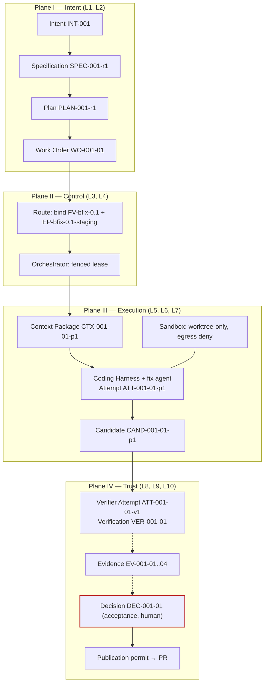

# Production bounded-fix factory blueprint

**Difficulty** Practitioner / Advanced · **Time** Multi-day, team-dependent · **Factory type** Code Generation, bounded fix · **Targets** FDLC-L2 → L3

This is the implementation reference for teams that have completed the [guided first-factory quickstart](/guides/build-your-first-factory) and are ready to assemble a real pilot. It is not a copy-and-run sample application. It specifies the control plane, identities, sandbox, verification boundary, qualification cases, and publication controls a production candidate needs.

## Problem

You have a coding agent that fixes bugs when asked. You do not have a factory: nothing records what it was allowed to do, nothing other than the agent judged its output, and a green CI check is the only evidence. This blueprint describes the smallest thing that is still an AI Software Factory: one factory, one repository, one class of work (a bounded bug fix with a failing regression test), and one accepted Work Order whose evidence a stranger could audit.

The factory is `bounded-fix`. It takes an Intent naming a failing test, produces a Candidate that makes the test pass inside a change budget, and hands the Candidate to an independent verifier. A human accepts. Nothing merges on the agent's word.

## Architecture



Two Attempts, one Candidate, one Decision. The producer never runs the verifier; the verifier never edits the Candidate; the human never reconstructs evidence from logs.

## Prerequisites

| Need | Minimum |
|---|---|
| Target repository | One repository with a deterministic test suite that runs headless. The example uses `acme/inventory-api`. |
| Control plane | Something that holds Intent, Plan, Work Order, Attempt, Evidence, Verification, and Decision as durable records. Mission Control's deterministic demo (`pnpm run dev:demo`) is enough; a spreadsheet is not. |
| Coding Harness | A harness that can run headless in a sandbox, make commits, and report a structured result. Claude Code, Codex, or an equivalent that implements the harness Capability Manifest you register in Assemble. |
| Verifier | A separate process identity that can clone a commit and run the suite. It MUST NOT share the producer's worktree or lease. |
| Sandbox | A container image with the repository toolchain and no publication credentials. |
| Publication identity | A Git-provider App or bot with Contents write and Pull requests write, held by the control plane only. |
| Two humans | A Factory Owner and a Policy Owner. For a first factory they may be the same team, not the same person. |

## Lifecycle

Part A runs the [Factory Lifecycle](/framework/factory-lifecycle) once to produce an Active Factory Version. Part B runs the [Delivery Loop](/framework/delivery-loop) once inside it.

| Stage / step | What you do | Artifact produced |
|---|---|---|
| Discover | Pick "bounded fix with a failing regression test" as the workload; record the manual baseline (minutes per fix, reopen rate). | Opportunity record (prose) |
| Define | Write the manifest's definition part: owner, risk class, acceptance criteria classes, approval policy. | `FM-bfix` (DEFINED) |
| Design | Map each criterion class to a verifier; write sandbox, network, credential policy; pick model routes. | `FM-bfix` (DESIGNED) |
| Assemble | Register capabilities, build the sandbox image, freeze the composition. | `FV-bfix-0.1`, `EP-bfix-0.1-staging`, `EP-bfix-0.1-qual` |
| Qualify | Run the golden and negative-control cases in the offline profile. | `QUAL-bfix-0.1-01` |
| Deploy | Activate `FV-bfix-0.1` for staging with a promotion Decision. | Active Factory Version |
| 1 Receive | Admit the Intent. | `INT-001`, `DEC-001-A0` (admission) |
| 2 Specify | Freeze criteria and verification requirements. | `SPEC-001-r1` |
| 3 Plan | One producer blueprint, one verifier blueprint; approve. | `PLAN-001-r1`, `DEC-001-00` (plan-approval), `WO-001-01` |
| 4 Route | Bind the Work Order to the qualified version and profile. | `DEC-001-R1` (routing) |
| 5 Execute | Producer Attempt under a fenced lease. | `CTX-001-01-p1`, `ATT-001-01-p1`, `CAND-001-01-p1`, `EV-001-01`, `EV-001-02` |
| 6 Verify | Verifier Attempt on the frozen subject. | `ATT-001-01-v1`, `VER-001-01`, `EV-001-03`, `EV-001-04` |
| 7 Approve | Human accepts on current evidence. | `DEC-001-01` (acceptance) |
| 8 Release | Permit-gated publication; human merge. | `DEC-001-PUB1`, `REL-001-01` (staging) |
| 9 Observe | Staging window closes. | `OUT-001-01` |
| 10 Learn | Record what the reviewer changed. | `LS-001-01` |

## Artifacts

| Artifact | Id | Notes |
|---|---|---|
| Factory Manifest | `FM-bfix` | Below; validates against the v1 schema |
| Factory Version | `FV-bfix-0.1` | Composition digest over the resolved identities |
| Execution Profiles | `EP-bfix-0.1-staging`, `EP-bfix-0.1-qual` | Staging profile production-pilot eligible after Qualify; qual profile deterministic |
| Capability Manifests | `CAP-harness-coding-adapter-1.0.0`, `CAP-agent-bounded-fixer-0.1.0`, `CAP-tool-git-1.4.0`, `CAP-tool-test-runner-3.0.1`, `CAP-verifier-test-runner-3.0.1`, `CAP-verifier-scope-reconciler-1.0.0` | Six entries; the verifier runner is a separate identity from the producer runner even when the binary is the same |
| Qualification Record | `QUAL-bfix-0.1-01` | Scope: bounded-fix × staging × LOW/MEDIUM × L3 |
| Delivery Loop records | `INT-001` … `LS-001-01` | As listed in Lifecycle |

```yaml
# Factory Manifest — bounded-fix (first factory; illustrative digests)
schemaVersion: "1.0"
type: fdlc://v1/factory-manifest
id: FM-bfix
namespace: https://acme.example/factories/lighthouse
name: bounded-fix
version: 0.1.0
displayName: Bounded Fix Factory
description: >-
  Produces an independently verified fix for one failing regression test in one
  repository, inside a declared change budget, without publication authority.
purpose: SOFTWARE
specialization: code-generation
owner:
  factoryOwner: {kind: human, id: "user:mira.chen", identitySource: authenticated, displayName: Mira Chen}
  policyOwner: {kind: human, id: "user:sam.reyes", identitySource: authenticated, displayName: Sam Reyes}
  team: inventory-platform
risk_class: MEDIUM
autonomy_ceiling: L3

capabilities: [repository-research, bounded-fix, run-tests, propose-candidate]

inputs:
  - kind: work-order
    description: A released Work Order of kind SOFTWARE_CHANGE naming one failing regression test id.
    artifactType: fdlc://v1/work-order
  - kind: repository-snapshot
    description: Repository at the Plan's base SHA with the failing test present.
outputs:
  - kind: candidate
    description: Unpublished Git candidate (commit + tree + diff digest) bound to the Work Order revision.
    artifactType: fdlc://v1/candidate
  - kind: evidence
    description: Producer command logs and diff; never verification evidence.
    artifactType: fdlc://v1/evidence

planner: {capabilityId: CAP-planner-single-work-order-1.0.0, kind: planner, versionConstraint: "1.0.x"}
work_graph: {workflowId: bounded-fix, versionConstraint: "1", roles: [fixer]}

execution_profiles:
  - key: staging
    description: Isolated container, workhorse route, staging-eligible after qualification.
    backend: isolated-container
    autonomyCeiling: L3
    environments: [staging]
    modelRouteId: implementation-workhorse
  - key: qual
    description: Deterministic profile with a replayed model transcript; qualification only.
    backend: isolated-container
    autonomyCeiling: L2
    environments: [qualification]

model_routes:
  - routeId: implementation-workhorse
    role: IMPLEMENT
    tier: WORKHORSE
    qualifiedProviders: [acme-gateway/workhorse-a]
    constraints: [temperature<=0.2]
  - routeId: verification-independent
    role: VERIFY
    tier: WORKHORSE
    qualifiedProviders: [acme-gateway/workhorse-b]
    independentFromProducer: true

agents:
  - {capabilityId: CAP-agent-bounded-fixer-0.1.0, kind: agent, versionConstraint: "0.1.x", role: fixer}
skills:
  - {capabilityId: CAP-skill-regression-fix-1.0.0, kind: skill, versionConstraint: "^1.0"}
tools:
  - capabilityId: CAP-tool-git-1.4.0
    versionConstraint: "1.4.x"
    operations: [status, diff, commit]
    grantPolicy: PER_OPERATION_EXPIRING
    maxSideEffectClass: WRITE_LOCAL
  - capabilityId: CAP-tool-test-runner-3.0.1
    versionConstraint: "3.0.x"
    operations: [run]
    grantPolicy: PER_ATTEMPT
    maxSideEffectClass: WRITE_LOCAL
context_sources:
  - capabilityId: CAP-context-source-repository-1.0.0
    versionConstraint: "1.0.x"
    freshnessMaxAgeHours: 24
    authorization: SUBJECT_IDENTITY
    provenanceRequired: true
    classificationCeiling: INTERNAL

runtime:
  backend: isolated-container
  harness: {capabilityId: CAP-harness-coding-adapter-1.0.0, kind: harness, versionConstraint: "1.0.x"}
  artifactConstraint: CONTAINER_IMAGE
  leaseDurationMs: 300000
  checkpointPolicy: STEP
sandbox:
  isolation: WORKSPACE_WRITE
  provider: local-container
  imageConstraint: "acme/factory-runtime@sha256:*"
  filesystem: WORKTREE_ONLY
  processIsolation: true
  resourceLimits: {cpu: 2, memoryMb: 4096, diskGb: 20, maxRuntimeMs: 2700000}
  publicIngress: false
  resourceAbsenceRequiredBeforePublication: true
network_policy:
  egress: DENY_ALL
  classificationGated: true
credential_policy:
  classes: [inference:attempt-scoped]
  scoping: ATTEMPT_SCOPED
  longLivedInSandbox: false
  publicationIdentityInSandbox: false
  revokeBeforePublication: true

verification:
  contract:
    - {criterionClass: regression-test-passes, verifierCapabilityId: CAP-verifier-test-runner-3.0.1, evidenceCategory: TEST_RESULT, mandatory: true, independence: INDEPENDENT_REQUIRED}
    - {criterionClass: suite-passes, verifierCapabilityId: CAP-verifier-test-runner-3.0.1, evidenceCategory: TEST_RESULT, mandatory: true, independence: INDEPENDENT_REQUIRED}
    - {criterionClass: scope, verifierCapabilityId: CAP-verifier-scope-reconciler-1.0.0, evidenceCategory: FILE_DIFF, mandatory: true, independence: ANY_VERIFICATION}
    - {criterionClass: no-test-weakening, verifierCapabilityId: CAP-verifier-scope-reconciler-1.0.0, evidenceCategory: FILE_DIFF, mandatory: true, independence: ANY_VERIFICATION}
  independence: {required: true, minimumBoundary: SEPARATE_FACTORY, verifierFactoryName: verification-factory}
  levels: [WORK_ORDER]
  currentnessRule: newest-candidate-newest-exact-verification
evidence:
  requiredCategories: [TEST_RESULT, FILE_DIFF, COMMAND_LOG, PROVENANCE]
  statementFormat: in-toto/v1
  retentionDays: 400
  traceContext: w3c-traceparent

approval_policy:
  - {riskClass: LOW, execution: AUTO, verification: AUTO_DETERMINISTIC, acceptance: HUMAN, releaseAuthorization: HUMAN}
  - {riskClass: MEDIUM, execution: AUTO, verification: INDEPENDENT, acceptance: HUMAN, releaseAuthorization: HUMAN}
  - {riskClass: HIGH, execution: AUTO, verification: INDEPENDENT, acceptance: HUMAN, releaseAuthorization: HUMAN}
  - {riskClass: CRITICAL, execution: HUMAN_AUTHORIZED, verification: INDEPENDENT_PLUS_HUMAN, acceptance: HUMAN, releaseAuthorization: HUMAN}

observability:
  requiredSpans: [attempt, step, tool-call, model-request, verification, decision]
  metrics: [verified-completion-rate, first-pass-verification-rate, cost-per-verified-outcome, human-review-minutes, cycle-time]
  costAttribution: true
economics:
  budgets: {maxCostPerWorkOrder: {amount: 10, currency: USD}, maxAttemptsPerWorkOrder: 2, maxRuntimeMinutes: 45}
  costCoverageRule: unknown-cost-is-null
  denominators: [VERIFIED, ACCEPTED]
  includeFailedAttempts: true
qualification:
  standardVersion: fdlc-qualification-standard/1.0
  requiredScopes:
    - {workloadClass: bounded-fix, environment: staging, riskTier: MEDIUM, autonomyLevel: L3}
  expiryDays: 60
  hardGates: [security, sandbox-isolation, policy-compliance, credential-handling, evidence-completeness]
release_policy:
  environments: [staging]
  rollout: FULL
  rollbackRequired: true
  publicationAuthority: CONTROL_PLANE_ONLY
  mergeAuthority: HUMAN
  observationWindowDays: 3
outcome_metrics: [verified-completion-rate, cost-per-verified-outcome, human-review-minutes, first-pass-verification-rate]

state: DESIGNED
reviewedBy:
  - {kind: human, id: "user:mira.chen", identitySource: authenticated}
  - {kind: human, id: "user:sam.reyes", identitySource: authenticated}
factoryVersionIds: [FV-bfix-0.1]
digest: sha256:0f5c1a9e6b2d4c8e7a3f1b6d9c2e5a8f4b7d0c3e6a9f2b5d8c1e4a7f0b3d6c9e
createdAt: "2026-09-10T09:00:00Z"
createdBy: {kind: human, id: "user:mira.chen", identitySource: authenticated}
updatedAt: "2026-09-10T15:00:00Z"
```

The approval policy is stricter than the specification requires: a first factory accepts nothing by policy, even at LOW risk. Loosen it only after the qualification cohort shows a stable first-pass verification rate.

## Implementation

Start with an empty factory repository. It holds the factory, not the code the factory changes.

```text
factory-bounded-fix/
├── manifest.yaml                 # FM-bfix (above)
├── policies/
│   ├── sandbox.yaml
│   ├── network.yaml
│   └── credentials.yaml
├── verification/
│   └── contract.yaml
├── routes/
│   └── models.yaml
├── capabilities/                 # Capability Manifests registered in Assemble
│   ├── harness-coding-adapter.yaml
│   ├── agent-bounded-fixer.yaml
│   └── verifier-test-runner.yaml
└── qualification/
    ├── golden/                   # 5 fixes with known-good candidates
    └── negative-controls/        # 3 cases that MUST fail (weakened test, out-of-scope edit, secret read)
```

**Step 1 — Define.** Fill the manifest's identity, owner, risk class, autonomy ceiling, capabilities, inputs, outputs, approval policy, qualification, and release policy. Both owners review (`reviewedBy`). State: DEFINED.

**Step 2 — Design the verification contract.** Every criterion class maps to a verifier capability before any agent is chosen. The Plan compiles this template into each Work Order's `verificationContract`.

```yaml
# verification/contract.yaml — bounded-fix verification contract template
contractVersion: 1
enforcementMode: ENFORCED
checks:
  - id: CHK-REGRESSION
    category: UNIT_TEST
    verifierCapabilityId: CAP-verifier-test-runner-3.0.1
    mandatory: true
    evidenceCategory: TEST_RESULT
    command: {executable: pnpm, args: [test, "--", "--grep", "${REGRESSION_TEST_ID}"], commandClass: TEST, timeoutMs: 600000}
  - id: CHK-SUITE
    category: UNIT_TEST
    verifierCapabilityId: CAP-verifier-test-runner-3.0.1
    mandatory: true
    evidenceCategory: TEST_RESULT
    command: {executable: pnpm, args: [test], commandClass: TEST, timeoutMs: 1200000}
  - id: CHK-SCOPE
    category: CHANGE_BUDGET
    verifierCapabilityId: CAP-verifier-scope-reconciler-1.0.0
    mandatory: true
    evidenceCategory: FILE_DIFF
independence: {required: true, minimumBoundary: SEPARATE_FACTORY}
requireHumanReview: false
authorityPolicy:
  allowedSurfaceMutations: []          # the fix may not touch test config, runner config, or CI
  reason: A bounded fix never edits the surfaces that decide its own verdict.
verificationLevels: [WORK_ORDER]
```

**Step 3 — Design (sandbox, network, credentials, routes).**

```yaml
# policies/sandbox.yaml
profileId: SBX-bfix-local-1
isolation: WORKSPACE_WRITE
filesystem: WORKTREE_ONLY
mounts:
  - {path: /work/attempt, mode: rw, source: attempt-worktree}
  - {path: /work/toolchain, mode: ro, source: image}
processIsolation: true
resourceLimits: {cpu: 2, memoryMb: 4096, diskGb: 20, maxRuntimeMs: 2700000}
network: {egress: DENY_ALL}
credentials:
  inference: {scope: ATTEMPT, injection: broker, ttlSeconds: 3600}
  git: NONE                              # commits are local; publication happens outside the sandbox
  publication: NONE
teardown: {revokeCredentialsBeforePublication: true, proveResourceAbsence: true}
```

```yaml
# routes/models.yaml — logical routes; providers are gateway aliases
routes:
  - {routeId: implementation-workhorse, role: IMPLEMENT, tier: WORKHORSE, qualifiedProviders: [acme-gateway/workhorse-a], fallbacks: []}
  - {routeId: verification-independent, role: VERIFY, tier: WORKHORSE, qualifiedProviders: [acme-gateway/workhorse-b], independentFromProducer: true}
```

No fallbacks on the first version: an unqualified fallback is a route the factory may not take.

**Step 4 — Assemble.** Register the harness adapter as a Capability Manifest. This is where a Coding Harness plugs in. The factory binds the manifest, not the product.

```yaml
# capabilities/harness-coding-adapter.yaml (abbreviated)
type: fdlc://v1/capability-manifest
id: CAP-harness-coding-adapter-1.0.0
kind: harness
name: coding-adapter
version: 1.0.0
spec:
  lifecycle: [prepare, execute, cancel, collectResult, cleanup]
  supports: {headless: SUPPORTED, git.commit: SUPPORTED, filesystem.changedFileCapture: SUPPORTED, tools.structuredOutput: SUPPORTED, cancellation: PARTIAL}
  completionContract: factory-result/v1
  prohibitedAuthorities: [PUBLISH_BRANCH, OPEN_PULL_REQUEST, MERGE, DEPLOY, APPROVE, ACCEPT, MODIFY_VERIFICATION_CONFIG]
  runtimeArtifact: {kind: CONTAINER_IMAGE, digest: "sha256:…"}
  effectiveConfigDigest: "sha256:…"
```

Any harness — Claude Code, Codex, or another — is admitted when its installed executable and configuration digests match this manifest; a different binary or image is a different harness. The adapter runs the compiled prompt bundle and skill in the sandbox worktree, invokes only granted tool operations, returns a structured `factory-result/v1` (completed and incomplete criterion ids, commands run, known risks, candidate SHA), and stops on budget, timeout, or cancel.

Resolve every reference to an exact version and digest, build the sandbox image, compute the composition digest, and register `FV-bfix-0.1` (Candidate) with its two Execution Profiles (DISABLED).

**Step 5 — Qualify.** Run eight cases through `EP-bfix-0.1-qual`: five golden fixes MUST verify; three negative controls MUST block (weakened assertion → `NO_ASSERTION_WEAKENING`; edit outside `services/inventory-api/**` → scope FAIL; read of `config/secrets/**` → sandbox denial). Record all dimensions in `QUAL-bfix-0.1-01` (`determinism` NOT_APPLICABLE for the staging profile). Hard gates fail closed. Advance `EP-bfix-0.1-staging` to PRODUCTION_PILOT_ELIGIBLE.

**Step 6 — Deploy.** The Factory Owner records `DEC-FV-bfix-0.1-P1` (promotion); bind `FV-bfix-0.1` to staging; name the restoration target ("none — deactivate" is valid for a first version).

**Step 7 — Receive and Specify.** The Builder files the Intent with the failing test id, owner, budget, and stop condition. Finalize `SPEC-001-r1` with four acceptance expectations mirroring the contract's criterion classes. Finalized means planning-ready, not approved.

**Step 8 — Plan.** A deterministic one-blueprint planner proposes `PLAN-001-r1`; the engineering lead approves (`DEC-001-00`). The control plane materializes `WO-001-01`:

```json
{
  "id": "WO-001-01", "type": "fdlc://v1/work-order", "namespace": "https://acme.example/factories/lighthouse",
  "intentId": "INT-001", "planId": "PLAN-001-r1", "revisionNumber": 1,
  "kind": "SOFTWARE_CHANGE", "role": "PRODUCER", "isMutating": true,
  "title": "Fix SKU lookup 500 on slash-containing SKUs",
  "desiredOutcome": "IT-SKU-017 passes and the full suite stays green with no test modified.",
  "repository": {"repositoryId": "repo:inventory-api", "name": "acme/inventory-api", "baseRef": "main", "dataClassification": "INTERNAL",
                 "codeScopes": [{"id": "scope:inventory-api/deploy", "includePaths": ["services/inventory-api/**"], "excludePaths": ["services/inventory-api/test/**"]}]},
  "riskClass": "MEDIUM", "autonomyLevel": "L3",
  "authorityEnvelope": {
    "allowedActions": ["READ_REPOSITORY", "MODIFY_WORKTREE", "RUN_TESTS", "RUN_BUILD", "PROPOSE_CANDIDATE", "REQUEST_HUMAN_DECISION"],
    "prohibitedActions": ["PUBLISH_BRANCH", "OPEN_PULL_REQUEST", "MERGE", "DEPLOY", "APPROVE", "ACCEPT", "MODIFY_VERIFICATION_CONFIG", "ACCESS_PRODUCTION", "ACCESS_SECRETS", "WIDEN_SCOPE"],
    "allowedCapabilityIds": ["CAP-skill-regression-fix-1.0.0", "CAP-tool-git-1.4.0", "CAP-tool-test-runner-3.0.1"],
    "publicationAuthority": "CONTROL_PLANE_ONLY",
    "requiredDecisions": [{"kind": "admission", "actorKind": "policy"}, {"kind": "acceptance", "actorKind": "human", "role": "work-order-owner"}]
  },
  "acceptanceCriteria": [
    {"id": "AC-001-01", "title": "Regression test IT-SKU-017 passes", "verificationMethod": "TEST", "requiredEvidence": [{"category": "TEST_RESULT", "minimumCount": 1, "independenceLevel": "INDEPENDENT_REQUIRED"}], "waiverAllowed": false, "status": "PENDING"},
    {"id": "AC-001-02", "title": "Full unit suite passes", "verificationMethod": "TEST", "requiredEvidence": [{"category": "TEST_RESULT", "minimumCount": 1, "independenceLevel": "INDEPENDENT_REQUIRED"}], "waiverAllowed": false, "status": "PENDING"},
    {"id": "AC-001-03", "title": "Change inside budget and scope", "verificationMethod": "ANALYSIS", "requiredEvidence": [{"category": "FILE_DIFF", "minimumCount": 1, "independenceLevel": "ANY_VERIFICATION"}], "waiverAllowed": false, "status": "PENDING"},
    {"id": "AC-001-04", "title": "No test removed or weakened", "verificationMethod": "ANALYSIS", "requiredEvidence": [{"category": "FILE_DIFF", "minimumCount": 1, "independenceLevel": "ANY_VERIFICATION"}], "waiverAllowed": false, "status": "PENDING"}
  ],
  "negativeConstraints": [
    {"id": "NC-001-01", "type": "NO_TEST_REMOVAL", "description": "No test may be deleted or skipped."},
    {"id": "NC-001-02", "type": "NO_ASSERTION_WEAKENING", "description": "No assertion may be loosened."},
    {"id": "NC-001-03", "type": "NO_VERIFICATION_CONFIG_CHANGES", "description": "Runner, CI, and lint config are verification authority surfaces."},
    {"id": "NC-001-04", "type": "NO_NEW_DEPENDENCIES", "description": "A bug fix adds no packages."}
  ],
  "changeBudget": {"maxFilesChanged": 5, "maxLinesChanged": 150, "allowedPaths": ["services/inventory-api/**"], "deniedPaths": ["services/inventory-api/test/**", "services/inventory-api/config/secrets/**"],
                   "allowedCommandClasses": ["BUILD", "TYPECHECK", "TEST", "LINT"], "prohibitedCommandClasses": ["MIGRATION", "INFRASTRUCTURE", "PRODUCTION_ACCESS", "SECRETS_ACCESS", "DESTRUCTIVE", "PUBLISH"],
                   "allowDependencyChanges": false, "allowSchemaChanges": false, "allowMigrations": false, "allowInfrastructureChanges": false},
  "verificationContract": {"contractVersion": 1, "enforcementMode": "ENFORCED", "checks": ["…compiled from verification/contract.yaml with REGRESSION_TEST_ID=IT-SKU-017…"],
                           "independence": {"required": true, "minimumBoundary": "SEPARATE_FACTORY"}, "requireHumanReview": false, "verificationLevels": ["WORK_ORDER"]},
  "budgets": {"maxCost": {"amount": 10, "currency": "USD"}, "maxAttempts": 2, "maxRuntimeMinutes": 45, "stopCondition": "Stop after two Attempts or when the change budget would be exceeded."},
  "state": "READY", "verificationStatus": "PENDING", "approvalStatus": "PENDING"
}
```

**Step 9 — Route.** The Factory Router filters eligibility first (repository scope, qualification scope `bounded-fix × staging × MEDIUM × L3`, grants present, cost estimable), then ranks. Record `DEC-001-R1`; freeze `binding`. State: ROUTED.

**Step 10 — Execute.** The orchestrator admits the Attempt (`DEC-001-A1`), issues a fenced lease, allocates the sandbox at the base SHA, freezes `CTX-001-01-p1`, and starts the harness with the compiled manifest. The harness loop reads the test, proposes a change, runs `pnpm test -- --grep IT-SKU-017` locally, iterates, commits, and returns `factory-result/v1`. The producer's own test run is `EV-001-01` with `independent: false`: context for the reviewer, satisfying no criterion. The control plane freezes `CAND-001-01-p1` and reconciles scope from the diff.

**Step 11 — Verify.** `ATT-001-01-v1` in the verification factory clones the exact commit into a fresh worktree under its own lease and runs the three checks. `EV-001-03` (tests) and `EV-001-04` (scope) bind to the subject digest. Independence holds by lineage (separate Attempt, lease, invocation, worktree, Factory Version) and by standard (`allowedSurfaceMutations: []`, and the diff touched none). `VER-001-01`: VERIFIED; Quality Gate ELIGIBLE.

**Step 12 — Approve.** The Work Order owner reads the decision packet (outcome, diff, criteria with evidence links, risk, subject digest) and records `DEC-001-01`. Acceptance recomputes currentness at decision time.

**Step 13 — Release, Observe, Learn.** The control plane issues a single-use publication permit bound to the Candidate and lease, revokes the sandbox credential, proves the sandbox resource is gone, and opens the pull request under the App identity. Merge is a human action. `REL-001-01` records merge and staging deployment; `OUT-001-01` closes after three days; whatever the reviewer changed by hand becomes `LS-001-01`.

### Definition of Done

The factory exists when every line is true and each has a record you can open.

- [ ] `FM-bfix` is DESIGNED, reviewed by two named humans, and every criterion class maps to a verifier capability.
- [ ] `FV-bfix-0.1` has a composition digest; every agent, skill, tool, harness, route, image, and policy is pinned by version and digest. No "latest".
- [ ] `QUAL-bfix-0.1-01` records all 18 dimensions with PASS, NOT_APPLICABLE, or a hard-gate failure that blocked activation; three negative controls were blocked.
- [ ] A promotion Decision activated the version for staging and names a restoration target.
- [ ] `INT-001` has an owner, a stop condition, a budget, and an admission Decision.
- [ ] `PLAN-001-r1` was approved by someone other than its author, and approval did not dispatch anything.
- [ ] `WO-001-01` carries an authority envelope, four criteria, negative constraints, a change budget, and a contract digest.
- [ ] A routing Decision records eligibility filtering before ranking.
- [ ] `ATT-001-01-p1` has a lease with worker, session, generation, and fence; its manifest digest is frozen.
- [ ] `CAND-001-01-p1` is identified by commit + tree + diff digest + contract digest + source Attempt.
- [ ] `ATT-001-01-v1` is a separate Attempt with `independence.passed: true` by lineage and by standard.
- [ ] Every mandatory check is PASS on evidence bound to the Candidate's subject digest; nothing SKIPPED, ERROR, or NOT_CONFIGURED.
- [ ] `DEC-001-01` is a server-authorized human acceptance that recomputed currentness.
- [ ] The pull request was opened by the control plane under a permit; the sandbox never held a publication credential.
- [ ] Merge, deployment, and observation are separate records; none was inferred from the one before it.
- [ ] Cost per verified outcome is reported with coverage; unknown components are null, not zero.

## Security

| Concern | bounded-fix rule |
|---|---|
| Identity | Producer, verifier, control plane, and publisher are four workload identities. The harness process runs as the producer identity and nothing else. |
| Credentials | One attempt-scoped inference token, broker-injected, revoked before publication. No Git credential in the sandbox (commits are local; the control plane extracts the patch). No publication identity anywhere the agent can read. |
| Sandbox | Worktree-only filesystem, deny-all egress, process isolation, resource limits, resource-absence proof before publication. |
| Tool grants | Two tools, four operations, per-operation or per-Attempt grants with receipts. Absence of a grant means no capability. |
| Data | `dataClassification: INTERNAL`; `config/secrets/**` is a denied path and a data boundary. |
| Verification authority | The producer may not touch test, runner, CI, or lint configuration. A diff that does fails independence by standard. |

## Verification

| Criterion | Verifier | Independence | Level |
|---|---|---|---|
| AC-001-01 regression test passes | `CAP-verifier-test-runner-3.0.1` in `FV-verify-*` | INDEPENDENT_REQUIRED (separate factory) | Work Order |
| AC-001-02 full suite passes | same | INDEPENDENT_REQUIRED | Work Order |
| AC-001-03 scope and budget | `CAP-verifier-scope-reconciler-1.0.0` (control plane, from the frozen diff) | ANY_VERIFICATION | Work Order |
| AC-001-04 no test weakening | same | ANY_VERIFICATION | Work Order |

Task-level checks (the producer's own test run) steer the Agent Loop and appear as non-independent Evidence. Work Order verification is the unit of acceptance. There is no Objective or Release level in the first factory; add them when the factory earns production scope.

## Observability

Each Work Order emits one trace rooted at the Intent with spans `routing.decide`, `attempt` (producer), `sandbox.allocate`, `gen_ai.chat`, `tool.execute`, `candidate.freeze`, `attempt` (verifier), `verifier.run`, `verification.result`, `decision.acceptance`, and `publication.permit`. Every span carries the Work Order id, Factory Version digest, and Attempt id; cost spans carry `cost.class` (MEASURED / ESTIMATED / UNKNOWN).

**Primary metric:** verified completion rate = accepted bounded fixes ÷ admitted bounded-fix Intents, against the manual baseline. Guardrails: first-pass verification rate, human review minutes, cost per verified outcome (with coverage), reopen rate.

## Failure handling

| Failure | Behavior |
|---|---|
| Producer cannot make the test pass in budget | Attempt completes with `incompleteAcceptanceCriterionIds` non-empty; Work Order BLOCKED with `requiredHumanAction`; no Candidate is verified. |
| Producer edits a test or runner config | Scope reconciliation FAIL and independence-by-standard FAIL; Work Order returns to IN_PROGRESS for a corrective Attempt; the first Attempt is preserved. |
| Lease lost (worker crash, heartbeat expiry) | Attempt disposition LOST; workspace preserved; a new Attempt is created; the old fence cannot report. |
| Verifier ERROR (toolchain missing) | Check status ERROR; Quality Gate INELIGIBLE; never rounded to PASS. Fix the verifier image; re-run the verifier Attempt on the same subject. |
| PR head moved after verification | Currentness fails; acceptance blocked until a new exact subject and verification pass. |
| Budget exhausted | Spending fence; BLOCKED with owner; nothing retried silently. |

## Production considerations

- **Qualification scope:** `bounded-fix × staging × {LOW, MEDIUM} × L3`. Production requires a new scope and a new Qualification Record; the cohort should include real fixes from the staging period.
- **Risk tier:** MEDIUM by default; a fix touching auth, schema, or payments is HIGH and routes to a factory qualified for it, or blocks.
- **Autonomy:** Human approves (L3 ladder: human supervises execution, human accepts). Do not enable policy acceptance until first-pass verification is stable across at least the qualification cohort size.
- **Rollout:** Staging only for `0.1`; `FV-bfix-1.0` adds production after a canary cohort of repositories.
- **Cost:** Two Attempts per Work Order is the ceiling; the verifier doubles execution cost by design. Report cost per verified outcome with coverage before comparing to the baseline.

## Mission Control mapping

| Step | Mission Control | Status | What MC does not yet do |
|---|---|---|---|
| Define / Design / Assemble | `factoryDefinitions`, `factoryDefinitionVersions` with digests (`convex/factory/configuration.ts`); harness manifests (`packages/workflow-engine/src/harnessManifests.ts`) | Available | No single manifest document; sections are spread across versions, sandbox profiles, governance policies, workflow YAML |
| Qualify | `factoryReadinessAssessments` (readiness) | Available | Readiness ≠ behavioral qualification; the golden/negative-control suite is an FDLC requirement; eval control plane is `releaseBlocking:false` |
| Deploy | `activate` with derived readiness | Available | — |
| Receive / Specify | `missions` (Available); `missionSpecRevisions` (Experimental, default off) | Available / Experimental | Spec quality enforcement mostly at Plan level on `main` |
| Plan | `missionPlans`, Quality Contract projection, idempotent Work Order release (`convex/workOrders.ts`) | Available | — |
| Route | `executionRouting.ts`, `factoryExecutionProfiles` | Experimental | Advisory and gated; Guarded Auto off; no `ROUTED` state (Proposed) |
| Execute | `workflowRuns` with fenced leases (`convex/factory/attempts.ts`), execution manifest, `factoryContextPackages` (advisory) | Available | Remote Sandbox is Experimental (preview cohort); governed MCP qualifies one read operation |
| Verify | `verificationRuns`, `verificationReceipts`, `qualityGateDecisions`; independence and currentness as deterministic functions | Available | — |
| Approve | `workOrders.accept`, `approvalDecisions` | Available | Human-only; policy acceptance is Proposed |
| Release | GitHub App publisher with permits and head-SHA currentness (`apps/orchestration-server/src/githubAppPublisher.ts`) | Available | Merge is human; `factoryReleases` Experimental / Partial |
| Observe / Learn | outcome records (Experimental); `learningSignals` (Available, advisory) | Experimental | Promotion is manual (`autoPromote:false`) |

The retained golden path (`docs/testing/evidence/real-codex-github-pr-golden-path/README.md`) is the closest real run to this tutorial: Mission → approved Plan → Work Order → Task → Attempt → branch, commit, changed file, pull request → verification receipt → human acceptance; PR #62 shows cancel, two failed retries, and a fourth successful Attempt without a duplicate PR. The legacy Workflows quickstart (`docs/WORKFLOWS_QUICKSTART.md`) runs the standalone `workflow-executor` and parses `STATUS: done` from agent output; it is not the governed path and produces no Verification or acceptance record.

## Related

- Quickstart: [/guides/build-your-first-factory](/guides/build-your-first-factory) · Next guide: [/guides/jira-to-pr-factory](/guides/jira-to-pr-factory) · Case study: [/examples/code-generation-factory](/examples/code-generation-factory)
- Framework: [/framework/delivery-loop](/framework/delivery-loop) · [/framework/factory-lifecycle](/framework/factory-lifecycle)
- Specification: [/specification/v1/factory-manifest](/specification/v1/factory-manifest) · [/specification/v1/work-order](/specification/v1/work-order) · [/specification/v1/attempt](/specification/v1/attempt) · [/specification/v1/verification](/specification/v1/verification) · [/specification/v1/decision](/specification/v1/decision)
- Patterns: [/patterns/independent-verifier](/patterns/independent-verifier) · [/patterns/verification-contract](/patterns/verification-contract) · [/patterns/sandbox-per-work-order](/patterns/sandbox-per-work-order) · [/patterns/publication-permit](/patterns/publication-permit)
- Anti-patterns: [/anti-patterns/self-verifying-agent](/anti-patterns/self-verifying-agent) · [/anti-patterns/prompt-as-governance](/anti-patterns/prompt-as-governance) · [/anti-patterns/no-candidate-identity](/anti-patterns/no-candidate-identity)
- Glossary: [/glossary](/glossary) · Mission Control: [/mission-control](/mission-control)
