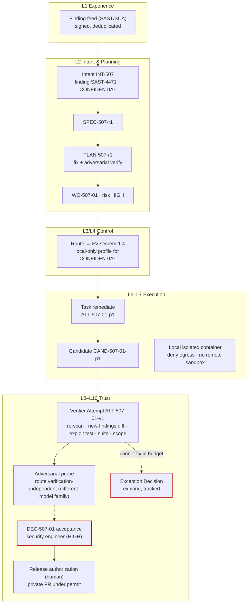

# Security remediation factory

**Difficulty** Advanced · **Time** 2 weeks (illustrative) · **Factory type** Security Remediation · **Targets** FDLC-L4

## Problem

Scanner findings pile up faster than teams fix them. An agent that "fixes the finding" often fixes the scanner instead: it suppresses the rule, rewrites the code until the pattern no longer matches, or adds a dependency that hides the problem behind a wrapper. The finding closes; the vulnerability stays.

The `security-remediation` factory takes a finding, produces a fix, and proves four things independently: the exact finding is closed by re-scanning the candidate with the same rule version; no new finding of MEDIUM or higher appears; an exploit regression test fails on the base commit and passes on the candidate; and nothing outside the change budget moved. Risk is HIGH by default, acceptance is human, the acceptor is a security engineer, and a finding that cannot be fixed inside the budget becomes a tracked exception Decision with an expiry, not a silent suppression.

## Architecture



## Prerequisites

| Need | Minimum |
|---|---|
| Finding feed | SAST and SCA results with stable finding ids, rule ids and versions, file and line, severity; delivered through a signed webhook or a pull with provenance. |
| Scanner as a verifier | The same scanner, pinned by version, runnable in the verifier sandbox as `CAP-verifier-sast-*` / `CAP-verifier-sca-*`. |
| Exploit-test harness | A way to run a targeted test that demonstrates the vulnerability (request fixture, fuzz seed, or unit probe). |
| Security engineer | Named Policy Owner and HIGH-tier acceptor; a rotation, not a person. |
| Classification | Repository and finding classification in the control plane; CONFIDENTIAL findings force local execution. |
| Two factories | This producer factory and a verification factory with an independent model family available on `verification-independent`. |

## Lifecycle

| Stage / step | This factory | Artifacts |
|---|---|---|
| Discover | Baseline: open findings by severity and age, mean time to remediate, reopen rate, suppressions per quarter. | Opportunity record |
| Define / Design | Manifest with `risk_class: HIGH`, `autonomy_ceiling: L3`; contract with re-scan, new-findings, exploit test, adversarial probe. | `FM-secrem` |
| Assemble / Qualify / Deploy | `FV-secrem-1.4`; cohort of seeded vulnerabilities across classes (injection, traversal, deserialization, SSRF, dependency CVE) plus negative controls (rule suppression, wrapper dependency, test deletion). | `FV-secrem-1.4`, `EP-secrem-1.4-local`, `QUAL-secrem-1.4-01` |
| 1 Receive | Finding → Intent; admission requires owner, severity, rule version, and classification. Duplicates by finding id are rejected. | `INT-507`, `DEC-507-A0` |
| 2 Specify | Criteria: finding closed, no new findings ≥ MEDIUM, exploit test, suite passes, scope. | `SPEC-507-r1` |
| 3 Plan | Producer blueprint (remediate) + verifier blueprint with `adversarial.enabled: true`. Plan approval by the security lead. | `PLAN-507-r1`, `DEC-507-00`, `WO-507-01` |
| 4 Route | Eligibility excludes any remote-sandbox profile for CONFIDENTIAL; bound to the local profile. | `DEC-507-R1` |
| 5 Execute | Remediation Attempt; the finding record is in the Context Package as CONFIDENTIAL untrusted data. | `CTX-507-01-p1`, `ATT-507-01-p1`, `CAND-507-01-p1`, `EV-507-01` |
| 6 Verify | Independent verifier: re-scan, diff findings, run the exploit test on base and candidate, run the suite, reconcile scope, adversarial probe. | `ATT-507-01-v1`, `VER-507-01`, `EV-507-02..08` |
| 7 Approve | Security engineer accepts (HIGH). | `DEC-507-01` |
| 8 Release | Human release authorization; private PR under permit; merge human. | `DEC-507-03`, `REL-507-01` |
| 9–10 Observe / Learn | Finding stays closed on the next scheduled scan; no related incident in the window; signals about rule classes that recur. | `OUT-507-01`, `LS-507-01` |

## Artifacts

| Artifact | Id |
|---|---|
| Manifest / Version / Profiles | `FM-secrem`, `FV-secrem-1.4`, `EP-secrem-1.4-local`, `EP-secrem-1.4-qual` |
| Capability Manifests | `CAP-harness-coding-adapter-1.0.0`, `CAP-agent-remediator-1.5.0`, `CAP-skill-secure-coding-owasp-4.0.0`, `CAP-skill-exploit-test-authoring-1.1.0`, `CAP-tool-git-1.4.0`, `CAP-tool-test-runner-3.0.1`, `CAP-tool-sast-local-5.2.0`, `CAP-verifier-sast-5.2.0`, `CAP-verifier-sca-2.4.0`, `CAP-verifier-test-runner-3.0.1`, `CAP-verifier-adversarial-probe-1.0.0`, `CAP-verifier-scope-reconciler-1.0.0` |
| Qualification Record | `QUAL-secrem-1.4-01` |
| Delivery Loop records | `INT-507` … `LS-507-01` (see [/examples/security-factory](/examples/security-factory)) |

```yaml
# Factory Manifest — security-remediation (illustrative digests)
schemaVersion: "1.0"
type: fdlc://v1/factory-manifest
id: FM-secrem
namespace: https://acme.example/factories/security
name: security-remediation
version: 1.4.0
displayName: Security Remediation Factory
description: >-
  Remediates scanner findings with a bounded fix and proves closure independently: same-rule
  re-scan, no new findings, exploit regression test, adversarial probe. HIGH risk; human acceptance.
purpose: SOFTWARE
specialization: security-remediation
owner:
  factoryOwner: {kind: human, id: "user:lee.park", identitySource: authenticated, displayName: Lee Park}
  policyOwner: {kind: human, id: "user:nadia.okoro", identitySource: authenticated, displayName: Nadia Okoro}
  team: product-security
  costCenter: CC-SEC-02
risk_class: HIGH
autonomy_ceiling: L3

capabilities: [finding-triage, security-remediation, exploit-test-authoring, run-tests, propose-candidate]

inputs:
  - kind: security-finding
    description: A scanner finding with stable id, rule id and version, location, severity, and classification.
  - kind: work-order
    description: A released Work Order of kind SOFTWARE_CHANGE, risk HIGH, from an approved Plan.
    artifactType: fdlc://v1/work-order
outputs:
  - kind: candidate
    description: Unpublished Git candidate; published only as a private pull request under a permit.
    artifactType: fdlc://v1/candidate
  - kind: evidence
    description: Producer-side local scan and test logs (non-independent).
    artifactType: fdlc://v1/evidence
  - kind: exception-request
    description: A request for an exception Decision when the finding cannot be closed inside the budget.

planner: {capabilityId: CAP-planner-remediation-1.2.0, kind: planner, versionConstraint: "1.2.x"}
work_graph: {workflowId: security-remediation, versionConstraint: "4", roles: [remediator]}

execution_profiles:
  - key: local
    description: Local isolated container; the only profile eligible for CONFIDENTIAL or RESTRICTED repositories.
    backend: isolated-container
    autonomyCeiling: L3
    environments: [staging, production]
    modelRouteId: implementation-workhorse
  - key: qual
    description: Seeded-vulnerability cohort with replayed transcripts.
    backend: isolated-container
    autonomyCeiling: L2
    environments: [qualification]

model_routes:
  - {routeId: architecture-reasoning, role: PLAN, tier: FRONTIER, qualifiedProviders: [acme-gateway/frontier-a]}
  - {routeId: implementation-workhorse, role: IMPLEMENT, tier: WORKHORSE, qualifiedProviders: [acme-gateway/workhorse-a], constraints: [temperature<=0.1]}
  - routeId: verification-independent
    role: VERIFY
    tier: WORKHORSE
    qualifiedProviders: [acme-gateway/workhorse-familyB]
    independentFromProducer: true
    constraints: [model-family!=implementation-workhorse]

agents:
  - {capabilityId: CAP-agent-remediator-1.5.0, kind: agent, versionConstraint: "1.5.x", role: remediator}
skills:
  - {capabilityId: CAP-skill-secure-coding-owasp-4.0.0, kind: skill, versionConstraint: "^4.0"}
  - {capabilityId: CAP-skill-exploit-test-authoring-1.1.0, kind: skill, versionConstraint: "^1.1"}
tools:
  - {capabilityId: CAP-tool-git-1.4.0, versionConstraint: "1.4.x", operations: [status, diff, commit], grantPolicy: PER_OPERATION_EXPIRING, maxSideEffectClass: WRITE_LOCAL}
  - {capabilityId: CAP-tool-test-runner-3.0.1, versionConstraint: "3.0.x", operations: [run], grantPolicy: PER_ATTEMPT, maxSideEffectClass: WRITE_LOCAL}
  - {capabilityId: CAP-tool-sast-local-5.2.0, versionConstraint: "5.2.x", operations: [scan-path], grantPolicy: PER_ATTEMPT, maxSideEffectClass: READ_ONLY}
context_sources:
  - {capabilityId: CAP-context-source-finding-1.0.0, versionConstraint: "1.0.x", freshnessMaxAgeHours: 24, authorization: FACTORY_IDENTITY, provenanceRequired: true, classificationCeiling: CONFIDENTIAL}
  - {capabilityId: CAP-context-source-repository-1.0.0, versionConstraint: "1.0.x", freshnessMaxAgeHours: 24, authorization: SUBJECT_IDENTITY, provenanceRequired: true, classificationCeiling: CONFIDENTIAL}
  - {capabilityId: CAP-context-source-secure-patterns-2.0.0, versionConstraint: "2.0.x", freshnessMaxAgeHours: 720, authorization: FACTORY_IDENTITY, provenanceRequired: true, classificationCeiling: INTERNAL}

runtime:
  backend: isolated-container
  harness: {capabilityId: CAP-harness-coding-adapter-1.0.0, kind: harness, versionConstraint: "1.0.x"}
  artifactConstraint: CONTAINER_IMAGE
  leaseDurationMs: 300000
  checkpointPolicy: STEP
sandbox:
  isolation: WORKSPACE_WRITE
  provider: local-container
  imageConstraint: "acme/factory-runtime-sec@sha256:*"
  filesystem: WORKTREE_ONLY
  processIsolation: true
  resourceLimits: {cpu: 4, memoryMb: 8192, diskGb: 40, maxRuntimeMs: 5400000}
  publicIngress: false
  resourceAbsenceRequiredBeforePublication: true
network_policy:
  egress: DENY_ALL
  classificationGated: true
credential_policy:
  classes: [inference:attempt-scoped]
  scoping: ATTEMPT_SCOPED
  longLivedInSandbox: false
  publicationIdentityInSandbox: false
  revokeBeforePublication: true

verification:
  contract:
    - {criterionClass: finding-closed, verifierCapabilityId: CAP-verifier-sast-5.2.0, evidenceCategory: SECURITY_SCAN, mandatory: true, independence: INDEPENDENT_REQUIRED}
    - {criterionClass: no-new-findings, verifierCapabilityId: CAP-verifier-sast-5.2.0, evidenceCategory: SECURITY_SCAN, mandatory: true, independence: INDEPENDENT_REQUIRED}
    - {criterionClass: no-new-vulnerable-dependency, verifierCapabilityId: CAP-verifier-sca-2.4.0, evidenceCategory: DEPENDENCY_SCAN, mandatory: true, independence: INDEPENDENT_REQUIRED}
    - {criterionClass: exploit-regression, verifierCapabilityId: CAP-verifier-test-runner-3.0.1, evidenceCategory: TEST_RESULT, mandatory: true, independence: INDEPENDENT_REQUIRED}
    - {criterionClass: suite-passes, verifierCapabilityId: CAP-verifier-test-runner-3.0.1, evidenceCategory: TEST_RESULT, mandatory: true, independence: INDEPENDENT_REQUIRED}
    - {criterionClass: adversarial-probe, verifierCapabilityId: CAP-verifier-adversarial-probe-1.0.0, evidenceCategory: REVIEW_OUTPUT, mandatory: true, independence: INDEPENDENT_REQUIRED}
    - {criterionClass: scope, verifierCapabilityId: CAP-verifier-scope-reconciler-1.0.0, evidenceCategory: FILE_DIFF, mandatory: true, independence: ANY_VERIFICATION}
  independence: {required: true, minimumBoundary: SEPARATE_MODEL_FAMILY, verifierFactoryName: verification-factory}
  levels: [WORK_ORDER, RELEASE]
  currentnessRule: newest-candidate-newest-exact-verification
evidence:
  requiredCategories: [SECURITY_SCAN, DEPENDENCY_SCAN, TEST_RESULT, REVIEW_OUTPUT, FILE_DIFF, COMMAND_LOG, PROVENANCE]
  statementFormat: in-toto/v1
  retentionDays: 1095
  traceContext: w3c-traceparent

approval_policy:
  - {riskClass: LOW, execution: AUTO, verification: INDEPENDENT, acceptance: POLICY_WITHIN_ENVELOPE, releaseAuthorization: POLICY}
  - {riskClass: MEDIUM, execution: AUTO, verification: INDEPENDENT, acceptance: HUMAN, releaseAuthorization: POLICY}
  - {riskClass: HIGH, execution: AUTO, verification: INDEPENDENT_PLUS_HUMAN, acceptance: HUMAN, releaseAuthorization: HUMAN}
  - {riskClass: CRITICAL, execution: HUMAN_AUTHORIZED, verification: INDEPENDENT_PLUS_HUMAN, acceptance: HUMAN, releaseAuthorization: HUMAN}

observability:
  requiredSpans: [intake, attempt, step, model-request, tool-call, verification, adversarial-probe, decision, exception, publication]
  metrics: [findings-closed-verified-rate, time-to-verified-remediation, reopen-rate-next-scan, new-findings-introduced, exception-rate, cost-per-accepted-outcome]
  costAttribution: true
economics:
  budgets: {maxCostPerWorkOrder: {amount: 45, currency: USD}, maxAttemptsPerWorkOrder: 3, maxRuntimeMinutes: 120}
  costCoverageRule: unknown-cost-is-null
  denominators: [VERIFIED, ACCEPTED, RELEASED]
  includeFailedAttempts: true
qualification:
  standardVersion: fdlc-qualification-standard/1.0
  requiredScopes:
    - {workloadClass: security-remediation, environment: staging, riskTier: HIGH, autonomyLevel: L3}
    - {workloadClass: security-remediation, environment: production, riskTier: HIGH, autonomyLevel: L3}
  expiryDays: 60
  hardGates: [security, sandbox-isolation, policy-compliance, credential-handling, unsupported-actions, evidence-completeness, failure-behavior]
release_policy:
  environments: [staging, production]
  rollout: CANARY
  rollbackRequired: true
  publicationAuthority: CONTROL_PLANE_ONLY
  mergeAuthority: HUMAN
  observationWindowDays: 14
outcome_metrics: [findings-closed-verified-rate, reopen-rate-next-scan, time-to-verified-remediation, incidents-linked, exception-rate, cost-per-accepted-outcome]

state: DESIGNED
reviewedBy:
  - {kind: human, id: "user:lee.park", identitySource: authenticated}
  - {kind: human, id: "user:nadia.okoro", identitySource: authenticated}
factoryVersionIds: [FV-secrem-1.2, FV-secrem-1.3, FV-secrem-1.4]
digest: sha256:7a9c1e3f5b7d9f1a3c5e7b9d1f3a5c7e9b1d3f5a7c9e1b3d5f7a9c1e3b5d7f9a
createdAt: "2026-05-02T09:00:00Z"
createdBy: {kind: human, id: "user:lee.park", identitySource: authenticated}
updatedAt: "2026-08-28T14:00:00Z"
```

## Implementation

**Step 1 — Admit findings as Intents.** One finding, one Intent. Admission requires a stable finding id, rule id and version, location at a known commit, severity, an owner (the code owner of the path), and classification. The finding text enters the Context Package as CONFIDENTIAL untrusted data. A scanner message never sets the change budget or the fix approach.

**Step 2 — Work Order (HIGH risk).**

```json
{
  "id": "WO-507-01", "type": "fdlc://v1/work-order", "namespace": "https://acme.example/factories/security",
  "intentId": "INT-507", "planId": "PLAN-507-r1", "revisionNumber": 1, "kind": "SOFTWARE_CHANGE", "role": "PRODUCER", "isMutating": true,
  "title": "Remediate SAST-4471 path traversal in file download handler",
  "desiredOutcome": "SAST-4471 closed by same-rule re-scan; exploit test ET-4471 fails on base and passes on candidate; no new findings >= MEDIUM.",
  "repository": {"repositoryId": "repo:portal-api", "name": "acme/portal-api", "baseRef": "main", "dataClassification": "CONFIDENTIAL",
                 "codeScopes": [{"id": "scope:portal-api/files", "includePaths": ["services/portal-api/files/**", "services/portal-api/test/files/**"], "excludePaths": ["services/portal-api/auth/**"]}]},
  "riskClass": "HIGH", "riskReasons": ["security-finding", "confidential-repository"], "autonomyLevel": "L3",
  "authorityEnvelope": {"allowedActions": ["READ_REPOSITORY", "MODIFY_WORKTREE", "RUN_TESTS", "RUN_BUILD", "PROPOSE_CANDIDATE", "REQUEST_HUMAN_DECISION"],
                        "prohibitedActions": ["PUBLISH_BRANCH", "OPEN_PULL_REQUEST", "MERGE", "DEPLOY", "APPROVE", "ACCEPT", "MODIFY_VERIFICATION_CONFIG", "ACCESS_PRODUCTION", "ACCESS_SECRETS", "WIDEN_SCOPE"],
                        "allowedCapabilityIds": ["CAP-skill-secure-coding-owasp-4.0.0", "CAP-skill-exploit-test-authoring-1.1.0", "CAP-tool-git-1.4.0", "CAP-tool-test-runner-3.0.1", "CAP-tool-sast-local-5.2.0"],
                        "credentialClasses": ["inference:attempt-scoped"],
                        "publicationAuthority": "CONTROL_PLANE_ONLY",
                        "requiredDecisions": [{"kind": "admission", "actorKind": "policy"}, {"kind": "acceptance", "actorKind": "human", "role": "security-engineer"}, {"kind": "release-authorization", "actorKind": "human", "role": "security-lead"}],
                        "escalationConditions": ["Fix requires a change under auth/", "Fix requires a new dependency", "Finding cannot be closed without an API change"]},
  "acceptanceCriteria": [
    {"id": "AC-507-01", "title": "SAST-4471 absent on re-scan with rule PT-001@5.2", "verificationMethod": "COMMAND", "requiredEvidence": [{"category": "SECURITY_SCAN", "minimumCount": 1, "independenceLevel": "INDEPENDENT_REQUIRED"}], "waiverAllowed": false, "status": "PENDING"},
    {"id": "AC-507-02", "title": "No new SAST or SCA finding >= MEDIUM relative to base", "verificationMethod": "COMMAND", "requiredEvidence": [{"category": "SECURITY_SCAN", "minimumCount": 1, "independenceLevel": "INDEPENDENT_REQUIRED"}, {"category": "DEPENDENCY_SCAN", "minimumCount": 1, "independenceLevel": "INDEPENDENT_REQUIRED"}], "waiverAllowed": false, "status": "PENDING"},
    {"id": "AC-507-03", "title": "Exploit test ET-4471 fails on base, passes on candidate", "verificationMethod": "TEST", "requiredEvidence": [{"category": "TEST_RESULT", "minimumCount": 2, "independenceLevel": "INDEPENDENT_REQUIRED"}], "waiverAllowed": false, "status": "PENDING"},
    {"id": "AC-507-04", "title": "Existing suite passes", "verificationMethod": "TEST", "requiredEvidence": [{"category": "TEST_RESULT", "minimumCount": 1, "independenceLevel": "INDEPENDENT_REQUIRED"}], "waiverAllowed": false, "status": "PENDING"},
    {"id": "AC-507-05", "title": "Adversarial probe finds no bypass of the fix", "verificationMethod": "ANALYSIS", "requiredEvidence": [{"category": "REVIEW_OUTPUT", "minimumCount": 1, "independenceLevel": "INDEPENDENT_REQUIRED"}], "waiverAllowed": true, "status": "PENDING"},
    {"id": "AC-507-06", "title": "Scope and budget respected; no suppression comments", "verificationMethod": "ANALYSIS", "requiredEvidence": [{"category": "FILE_DIFF", "minimumCount": 1, "independenceLevel": "ANY_VERIFICATION"}], "waiverAllowed": false, "status": "PENDING"}
  ],
  "negativeConstraints": [
    {"id": "NC-507-01", "type": "NO_NEW_DEPENDENCIES", "description": "A fix that adds a package is an escalation, not a fix."},
    {"id": "NC-507-02", "type": "NO_AUTH_CHANGES", "description": "Authorization code is out of bounds."},
    {"id": "NC-507-03", "type": "NO_VERIFICATION_CONFIG_CHANGES", "description": "Scanner config, suppressions, runner, CI frozen."},
    {"id": "NC-507-04", "type": "CUSTOM", "description": "No inline scanner suppression annotations.", "pattern": "(nosec|nosemgrep|NOSONAR|eslint-disable.*security)", "x-type": "NO_SCANNER_SUPPRESSION"},
    {"id": "NC-507-05", "type": "NO_TEST_REMOVAL", "description": "No test deleted or skipped."}
  ],
  "dataBoundaries": [{"id": "DB-507-01", "kind": "SECRET", "description": "Service credentials never read.", "paths": ["services/portal-api/config/secrets/**"]},
                     {"id": "DB-507-02", "kind": "PROTECTED_FILE", "description": "Finding details are CONFIDENTIAL; never copied into PR body or commit message."}],
  "changeBudget": {"maxFilesChanged": 8, "maxLinesChanged": 300, "allowedPaths": ["services/portal-api/files/**", "services/portal-api/test/files/**"], "deniedPaths": ["services/portal-api/auth/**", "services/portal-api/config/**", ".semgrep/**", ".github/**"],
                   "allowedCommandClasses": ["BUILD", "TYPECHECK", "TEST", "LINT", "SECURITY_SCAN"], "prohibitedCommandClasses": ["MIGRATION", "INFRASTRUCTURE", "PRODUCTION_ACCESS", "SECRETS_ACCESS", "DESTRUCTIVE", "PUBLISH"],
                   "allowDependencyChanges": false, "allowSchemaChanges": false, "allowMigrations": false, "allowInfrastructureChanges": false},
  "budgets": {"maxCost": {"amount": 45, "currency": "USD"}, "maxAttempts": 3, "maxRuntimeMinutes": 120, "stopCondition": "Stop after three Attempts, on any escalation condition, or when the exception path is opened."},
  "state": "READY", "verificationStatus": "PENDING", "approvalStatus": "PENDING"
}
```

**Step 3 — Verification contract.** The scanner that found the issue re-verifies it, pinned by version, in the verifier's own clone. New findings are computed as a set difference against a base-commit scan produced in the same verifier Attempt, so the baseline cannot be shaped by the candidate.

```yaml
# verification/contract.yaml — security-remediation
contractVersion: 2
enforcementMode: ENFORCED
checks:
  - {id: CHK-RESCAN, category: SECURITY, verifierCapabilityId: CAP-verifier-sast-5.2.0, mandatory: true, evidenceCategory: SECURITY_SCAN,
     command: {executable: acme-sast, args: [scan, "--rule", "${RULE_ID}@${RULE_VERSION}", "--expect-absent", "${FINDING_ID}"], commandClass: SECURITY_SCAN, timeoutMs: 900000}}
  - {id: CHK-NEW-FINDINGS, category: SECURITY, verifierCapabilityId: CAP-verifier-sast-5.2.0, mandatory: true, evidenceCategory: SECURITY_SCAN,
     command: {executable: acme-sast, args: [diff, "--base", "${BASE_SHA}", "--head", "${CANDIDATE_SHA}", "--fail-on", "MEDIUM"], commandClass: SECURITY_SCAN, timeoutMs: 1800000}}
  - {id: CHK-SCA, category: DEPENDENCY, verifierCapabilityId: CAP-verifier-sca-2.4.0, mandatory: true, evidenceCategory: DEPENDENCY_SCAN,
     command: {executable: acme-sca, args: [diff, "--base", "${BASE_SHA}", "--fail-on-new"], commandClass: DEPENDENCY_SCAN, timeoutMs: 600000}}
  - {id: CHK-EXPLOIT-BASE, category: SECURITY, verifierCapabilityId: CAP-verifier-test-runner-3.0.1, mandatory: true, evidenceCategory: TEST_RESULT,
     command: {executable: pnpm, args: [test, "--", "--grep", "${EXPLOIT_TEST_ID}", "--expect", "fail", "--at", "${BASE_SHA}"], commandClass: TEST, timeoutMs: 600000}}
  - {id: CHK-EXPLOIT-HEAD, category: SECURITY, verifierCapabilityId: CAP-verifier-test-runner-3.0.1, mandatory: true, evidenceCategory: TEST_RESULT,
     command: {executable: pnpm, args: [test, "--", "--grep", "${EXPLOIT_TEST_ID}"], commandClass: TEST, timeoutMs: 600000}}
  - {id: CHK-SUITE, category: UNIT_TEST, verifierCapabilityId: CAP-verifier-test-runner-3.0.1, mandatory: true, evidenceCategory: TEST_RESULT,
     command: {executable: pnpm, args: [test], commandClass: TEST, timeoutMs: 1800000}}
  - {id: CHK-ADVERSARIAL, category: INDEPENDENT_REVIEW, verifierCapabilityId: CAP-verifier-adversarial-probe-1.0.0, mandatory: true, evidenceCategory: REVIEW_OUTPUT}
  - {id: CHK-SCOPE, category: CHANGE_BUDGET, verifierCapabilityId: CAP-verifier-scope-reconciler-1.0.0, mandatory: true, evidenceCategory: FILE_DIFF}
requiredRisks:
  - {id: RISK-507-01, description: "Encoded traversal sequences (%2e%2e, overlong UTF-8) bypass normalization", severity: HIGH, source: POLICY, requiredEvidenceIds: [CHK-ADVERSARIAL, CHK-EXPLOIT-HEAD]}
independence: {required: true, minimumBoundary: SEPARATE_MODEL_FAMILY}
requireHumanReview: true
authorityPolicy: {allowedSurfaceMutations: [TEST_SOURCE], reason: The exploit test is new test source; scanner config and suppressions are frozen.}
verificationLevels: [WORK_ORDER, RELEASE]
```

**Step 4 — Sandbox and routes.** CONFIDENTIAL classification excludes remote sandboxes at routing; the local isolated container has deny-all egress and the scanner in the image.

```yaml
# policies/sandbox.yaml — security-remediation
profileId: SBX-secrem-local-3
isolation: WORKSPACE_WRITE
filesystem: WORKTREE_ONLY
classificationCeiling: CONFIDENTIAL
network: {egress: DENY_ALL}
credentials: {inference: {scope: ATTEMPT, injection: broker, ttlSeconds: 5400}, git: NONE, scanner: NONE, publication: NONE}
resourceLimits: {cpu: 4, memoryMb: 8192, diskGb: 40, maxRuntimeMs: 5400000}
teardown: {revokeCredentialsBeforePublication: true, proveResourceAbsence: true, scrubScratch: true}
```

```yaml
# routes/models.yaml — security-remediation
routes:
  - {routeId: architecture-reasoning, role: PLAN, tier: FRONTIER, qualifiedProviders: [acme-gateway/frontier-a]}
  - {routeId: implementation-workhorse, role: IMPLEMENT, tier: WORKHORSE, qualifiedProviders: [acme-gateway/workhorse-a], fallbacks: []}
  - {routeId: verification-independent, role: VERIFY, tier: WORKHORSE, qualifiedProviders: [acme-gateway/workhorse-familyB], independentFromProducer: true, mustDifferFrom: [implementation-workhorse], modelFamilyMustDiffer: true}
```

**Step 5 — Where the Coding Harness plugs in.** The harness runs one step, `remediate`, with the secure-coding and exploit-test skills. The skill requires the agent to write the exploit test *first* and confirm it fails locally before changing the handler. The local scan tool is READ_ONLY and its output is producer evidence only.

**Step 6 — Exceptions.** When the Attempt reports an escalation condition (a real fix needs a new dependency or an auth change), the Work Order pauses. The security engineer either revises the Plan (new blueprint with a wider budget and a higher tier) or records a Decision of kind `exception` with an expiry, a compensating control, and the finding id. The finding stays open in the feed; the exception is the only thing that suppresses it, and it expires.

**Step 7 — Publish privately.** Release authorization is human (`DEC-507-03`). The permit-gated pull request is private, its body references the finding id only, and the commit message carries no vulnerability detail. Merge and deploy remain human; the canary and the next scheduled scan feed the Outcome.

## Security

| Concern | Rule |
|---|---|
| Classification | CONFIDENTIAL repository and finding: local execution only; remote profiles ineligible at routing, not merely unpreferred. |
| Disclosure | Finding details never enter the PR body, commit message, tracker comment, or trace attributes; the data boundary is verified by the scope reconciler. |
| Scanner integrity | Scanner config, rule files, and suppression lists are denied paths; inline suppression annotations are a custom negative constraint. |
| Model independence | Verifier and adversarial probe on a different model family from the producer (`SEPARATE_MODEL_FAMILY`), so correlated blind spots do not pass. |
| Credentials | One attempt-scoped inference token; no scanner cloud token; no Git credential; publication identity only in the control plane. |
| Egress | Deny-all; the sandbox cannot fetch a "fixed" library or exfiltrate the finding. |
| Authority | HIGH tier: human acceptance by a security engineer and human release authorization by the security lead; the factory can never lower the tier. |

## Verification

| Criterion | Verifier | Independence | Level |
|---|---|---|---|
| AC-507-01 finding closed | `CAP-verifier-sast-5.2.0`, same rule version | INDEPENDENT_REQUIRED | Work Order |
| AC-507-02 no new findings | SAST diff + `CAP-verifier-sca-2.4.0` | INDEPENDENT_REQUIRED; baseline scan produced by the verifier | Work Order |
| AC-507-03 exploit regression | test runner at base (expect fail) and at candidate (expect pass) | INDEPENDENT_REQUIRED | Work Order |
| AC-507-04 suite | test runner | INDEPENDENT_REQUIRED | Work Order |
| AC-507-05 adversarial probe | `CAP-verifier-adversarial-probe-1.0.0` on a different model family | INDEPENDENT_REQUIRED by lineage and model family | Work Order |
| AC-507-06 scope, no suppression | scope reconciler | ANY_VERIFICATION | Work Order |
| Canary, next scheduled scan | release system, scanner | — | Release |

`requireHumanReview: true` at HIGH: the Quality Gate reaches AWAITING_HUMAN, never ELIGIBLE on its own.

## Observability

Spans: `intake.admit`, `attempt` (producer) with `step.remediate`, `gen_ai.chat`, `tool.execute` (scan-path, test), `candidate.freeze`, `attempt` (verifier) with `verifier.run` per check and `adversarial.probe`, `verification.result`, `decision.acceptance`, `decision.release-authorization`, `decision.exception`, `publication.permit`. Trace attributes carry finding id and rule version but never finding text.

**Primary metric:** findings closed and verified per month ÷ findings admitted, by severity, against the manual baseline. Guardrails: reopen rate on the next scheduled scan, new findings introduced per accepted fix, exception rate, time to verified remediation, cost per accepted outcome.

## Failure handling

| Failure | Behavior |
|---|---|
| Fix suppresses the rule instead of the flaw | `CHK-SCOPE` FAIL on the suppression pattern; NOT_VERIFIED; corrective Attempt; signal `SUPPRESSION_ATTEMPT`. |
| Exploit test passes on base (does not demonstrate the flaw) | `CHK-EXPLOIT-BASE` FAIL; the test is not a regression test; corrective Attempt. |
| Fix introduces a new MEDIUM finding | `CHK-NEW-FINDINGS` FAIL; corrective Attempt with the new finding in context. |
| Adversarial probe finds a bypass | AC-507-05 FAIL; treated as a new required risk; corrective Attempt; the probe transcript is evidence. |
| Cannot fix inside budget | Exception path: Decision kind `exception` with expiry and compensating control; finding remains open. |
| Remote sandbox requested for a CONFIDENTIAL repo | Routing eligibility excludes it; no fallback; Work Order BLOCKED if no local capacity. |
| Scanner version drift between producer and verifier | Verifier pins the rule version from the Work Order; mismatch is ERROR, not PASS. |

## Production considerations

- **Qualification scope:** `security-remediation × staging, production × HIGH × L3`; 60-day expiry because rule sets change. Cohort: seeded vulnerabilities per class; negative controls: suppression, wrapper dependency, deleted test, exploit test that passes on base.
- **Risk tier:** HIGH default; CRITICAL (auth, crypto, RESTRICTED data) is human-authorized before execution and never auto-routed.
- **Autonomy:** L3 ceiling; policy acceptance only for LOW findings (informational) after one clean quarter.
- **Rollout:** One repository per classification tier; RESTRICTED repositories only after a dedicated qualification.
- **Cost:** Two scans, two exploit runs, the suite, and an adversarial probe per candidate; budget accordingly and report coverage. Cheap and unverified is not a remediation.

## Mission Control mapping

| Step | Mission Control | Status | Not yet |
|---|---|---|---|
| Classification-gated execution | Repository `dataClassification` frozen into the Factory Version and manifest; sensitive repositories fail closed on Remote Sandbox (`docs/OVERVIEW.md` §1, §6) | Available | — |
| HIGH-tier human acceptance | `workOrders.accept` human-only; Work Order governance blocks acceptance on missing, failed, stale, expired, or unapproved evidence (`convex/lib/workOrderGovernance.ts`) | Available | Role-specific acceptor (security engineer) is policy configuration, not enforced by role |
| Security checks | `SECURITY`, `SECRETS`, `DEPENDENCY` check categories; `requiredRisks` in verification contract v2 | Available | Same-rule re-scan and base-vs-head finding diff are FDLC verifier requirements; not shipped |
| Adversarial verification | `verificationPlan.adversarial` field | Available (field) | No adversarial probe verifier; `SEPARATE_MODEL_FAMILY` boundary not implemented (MC v2 supports `SEPARATE_ATTEMPT`) |
| Exception Decisions | waivers with expiry on receipts; Quality Gate `WAIVER_REQUIRED` | Available | Finding-scoped exception with compensating control is Proposed |
| Security workflow | `workflows/security-audit.yaml`; `pnpm run release:security` gates | Available (legacy workflow / repo gate) | Not a remediation factory |
| Threat models | `docs/security/verification-plane-threat-model.md`, `remote-sandbox-threat-model.md` | Available (documents) | — |

## Related

- Previous: [/guides/testing-factory](/guides/testing-factory) · Next: [/guides/documentation-factory](/guides/documentation-factory) · Case study: [/examples/security-factory](/examples/security-factory)
- Architecture: [/architecture/verification](/architecture/verification) (strategies 7, 10) · [/architecture/authority](/architecture/authority) (risk tiers) · [/architecture/sandboxing](/architecture/sandboxing)
- Specification: [/specification/v1/work-order](/specification/v1/work-order) · [/specification/v1/decision](/specification/v1/decision) (kind `exception`) · [/specification/v1/verification](/specification/v1/verification)
- Patterns: [/patterns/human-authority-gate](/patterns/human-authority-gate) · [/patterns/sandbox-per-work-order](/patterns/sandbox-per-work-order) · [/patterns/verification-contract](/patterns/verification-contract) · [/patterns/progressive-autonomy](/patterns/progressive-autonomy)
- Anti-patterns: [/anti-patterns/agent-has-production-credentials](/anti-patterns/agent-has-production-credentials) · [/anti-patterns/no-sandbox](/anti-patterns/no-sandbox) · [/anti-patterns/prompt-as-governance](/anti-patterns/prompt-as-governance)
- Glossary: [/glossary](/glossary) · Mission Control: [/mission-control](/mission-control)
