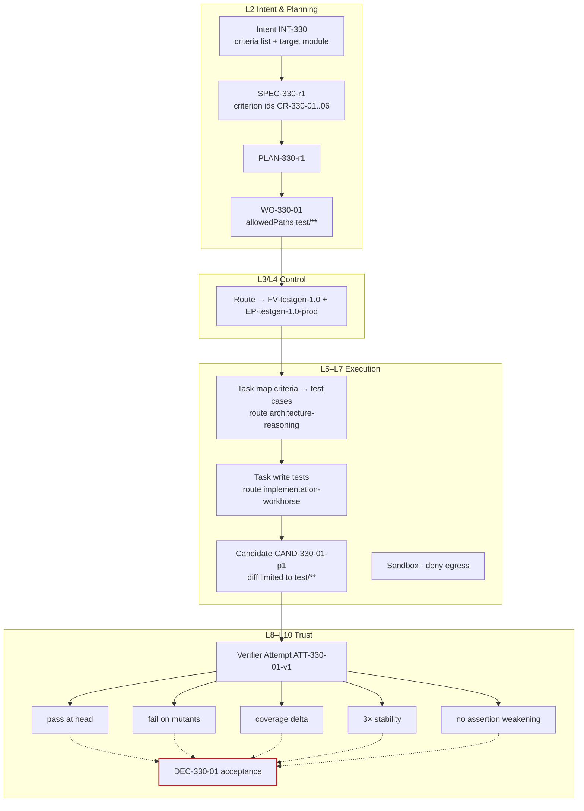

# Testing factory

**Difficulty** Practitioner · **Time** 1 week (illustrative) · **Factory type** Test Generation · **Targets** FDLC-L3

## Problem

Asking an agent to "add tests" produces tests that pass. That is the problem. A test that asserts the current behavior of a bug is green; a test with no assertion is green; a test that mocks the unit under test is green. Coverage goes up and nothing is proven. Worse, an agent allowed to edit tests can quietly loosen the assertion that would have caught its own mistake.

The `test-generation` factory turns "add tests" into a verifiable contract: tests for **named criteria** that pass at the head commit, **fail against mutants** of the code under test, raise **independently measured** coverage, run **stably** across repeated executions, and touch **no existing assertion**. The producer writes only under `test/**`; the verifier proves every claim in a separate Attempt.

## Architecture



## Prerequisites

| Need | Minimum |
|---|---|
| First factory | Control plane, harness adapter, verifier identity, sandbox image. |
| Coverage tooling | Per-file branch coverage in machine-readable form (for example LCOV or Cobertura). |
| Mutation tooling | A mutation tester for the repository language, runnable on a file subset with a time cap. |
| Criterion ids | Specifications in this repository name criteria (`CR-*`) that tests can reference in their names or metadata. |
| Roles | Factory Owner (QA lead or engineering lead), Policy Owner, Verification Engineer. |

## Lifecycle

| Stage / step | This factory | Artifacts |
|---|---|---|
| Discover | Baseline: untested criteria per module, escaped defects per release, human minutes per accepted test PR. | Opportunity record |
| Define / Design | Manifest; verification contract with five criterion classes; mutation and stability thresholds set by the Verification Engineer. | `FM-testgen` |
| Assemble / Qualify / Deploy | `FV-testgen-1.0`; cohort of 15 modules with known-untested criteria and 5 negative controls (tautological tests, mocked unit, loosened assertion). | `FV-testgen-1.0`, `EP-testgen-1.0-prod`, `QUAL-testgen-1.0-01` |
| 1–2 Receive, Specify | Intent names the module, the criteria, and the coverage target; Specification fixes criterion ids. | `INT-330`, `SPEC-330-r1` |
| 3 Plan | One producer blueprint (map, then write) and one verifier blueprint. | `PLAN-330-r1`, `DEC-330-00`, `WO-330-01` |
| 4 Route | Bound to `FV-testgen-1.0`. | `DEC-330-R1` |
| 5 Execute | Producer maps criteria to test cases, writes tests, runs them locally. | `CTX-330-01-p1`, `ATT-330-01-p1`, `CAND-330-01-p1`, `EV-330-01` |
| 6 Verify | Verifier runs tests at head, against mutants, measures coverage, repeats three times, diffs existing assertions. | `ATT-330-01-v1`, `VER-330-01`, `EV-330-02..06` |
| 7 Approve | Module owner accepts. | `DEC-330-01` |
| 8–10 Release, Observe, Learn | Permit-gated PR; flakiness observed over the window; signals about unstable patterns. | `REL-330-01`, `OUT-330-01`, `LS-330-01` |

## Artifacts

| Artifact | Id |
|---|---|
| Manifest / Version / Profiles | `FM-testgen`, `FV-testgen-1.0`, `EP-testgen-1.0-prod`, `EP-testgen-1.0-qual` |
| Capability Manifests | `CAP-harness-coding-adapter-1.0.0`, `CAP-agent-test-author-1.0.0`, `CAP-skill-criteria-to-cases-1.0.0`, `CAP-skill-test-style-billing-1.2.0`, `CAP-tool-git-1.4.0`, `CAP-tool-test-runner-3.0.1`, `CAP-tool-coverage-1.1.0`, `CAP-verifier-test-runner-3.0.1`, `CAP-verifier-mutation-1.0.0`, `CAP-verifier-coverage-1.1.0`, `CAP-verifier-assertion-diff-1.0.0`, `CAP-verifier-scope-reconciler-1.0.0` |
| Qualification Record | `QUAL-testgen-1.0-01` |
| Delivery Loop records | `INT-330` … `LS-330-01` |

```yaml
# Factory Manifest — test-generation (illustrative digests)
schemaVersion: "1.0"
type: fdlc://v1/factory-manifest
id: FM-testgen
namespace: https://acme.example/factories/billing
name: test-generation
version: 1.0.0
displayName: Test Generation Factory
description: >-
  Adds or repairs tests for named criteria in one module. Proof: tests pass at head, fail on
  mutants, raise independently measured coverage, run stably, and weaken no existing assertion.
purpose: SOFTWARE
specialization: test-generation
owner:
  factoryOwner: {kind: human, id: "user:ana.silva", identitySource: authenticated, displayName: Ana Silva}
  policyOwner: {kind: human, id: "user:sam.reyes", identitySource: authenticated, displayName: Sam Reyes}
  team: billing-quality
risk_class: MEDIUM
autonomy_ceiling: L3

capabilities: [criteria-mapping, test-authoring, run-tests, propose-candidate]

inputs:
  - kind: work-order
    description: A released Work Order naming a module, criterion ids, and a coverage target; allowed paths restricted to test/**.
    artifactType: fdlc://v1/work-order
  - kind: repository-snapshot
    description: Repository at the base SHA with the coverage baseline recorded.
outputs:
  - kind: candidate
    description: Git candidate whose diff touches only test/** and test fixtures.
    artifactType: fdlc://v1/candidate
  - kind: evidence
    description: Producer-side test run and criteria map (non-independent).
    artifactType: fdlc://v1/evidence

planner: {capabilityId: CAP-planner-single-work-order-1.0.0, kind: planner, versionConstraint: "1.0.x"}
work_graph: {workflowId: test-generation, versionConstraint: "1", roles: [author]}

execution_profiles:
  - key: prod
    description: Isolated container, two routes (map, then write); production-eligible.
    backend: isolated-container
    autonomyCeiling: L3
    environments: [staging, production]
    modelRouteId: implementation-workhorse
  - key: qual
    description: Replayed transcripts over the qualification cohort.
    backend: isolated-container
    autonomyCeiling: L2
    environments: [qualification]

model_routes:
  - {routeId: architecture-reasoning, role: PLAN, tier: FRONTIER, qualifiedProviders: [acme-gateway/frontier-a]}
  - {routeId: implementation-workhorse, role: IMPLEMENT, tier: WORKHORSE, qualifiedProviders: [acme-gateway/workhorse-a], constraints: [temperature<=0.2]}
  - {routeId: verification-independent, role: VERIFY, tier: WORKHORSE, qualifiedProviders: [acme-gateway/workhorse-b], independentFromProducer: true}

agents:
  - {capabilityId: CAP-agent-test-author-1.0.0, kind: agent, versionConstraint: "1.0.x", role: author}
skills:
  - {capabilityId: CAP-skill-criteria-to-cases-1.0.0, kind: skill, versionConstraint: "^1.0"}
  - {capabilityId: CAP-skill-test-style-billing-1.2.0, kind: skill, versionConstraint: "^1.2"}
tools:
  - {capabilityId: CAP-tool-git-1.4.0, versionConstraint: "1.4.x", operations: [status, diff, commit], grantPolicy: PER_OPERATION_EXPIRING, maxSideEffectClass: WRITE_LOCAL}
  - {capabilityId: CAP-tool-test-runner-3.0.1, versionConstraint: "3.0.x", operations: [run], grantPolicy: PER_ATTEMPT, maxSideEffectClass: WRITE_LOCAL}
  - {capabilityId: CAP-tool-coverage-1.1.0, versionConstraint: "1.1.x", operations: [measure], grantPolicy: PER_ATTEMPT, maxSideEffectClass: WRITE_LOCAL}
context_sources:
  - {capabilityId: CAP-context-source-repository-1.0.0, versionConstraint: "1.0.x", freshnessMaxAgeHours: 24, authorization: SUBJECT_IDENTITY, provenanceRequired: true, classificationCeiling: INTERNAL}
  - {capabilityId: CAP-context-source-specification-1.0.0, versionConstraint: "1.0.x", freshnessMaxAgeHours: 24, authorization: FACTORY_IDENTITY, provenanceRequired: true, classificationCeiling: INTERNAL}

runtime:
  backend: isolated-container
  harness: {capabilityId: CAP-harness-coding-adapter-1.0.0, kind: harness, versionConstraint: "1.0.x"}
  artifactConstraint: CONTAINER_IMAGE
  leaseDurationMs: 300000
  checkpointPolicy: STEP
sandbox:
  isolation: WORKSPACE_WRITE
  provider: local-container
  imageConstraint: "acme/factory-runtime@sha256:*"
  filesystem: WORKTREE_ONLY
  processIsolation: true
  resourceLimits: {cpu: 4, memoryMb: 8192, diskGb: 30, maxRuntimeMs: 3600000}
  publicIngress: false
  resourceAbsenceRequiredBeforePublication: true
network_policy:
  egress: DENY_ALL
  classificationGated: true
credential_policy:
  classes: [inference:attempt-scoped]
  scoping: ATTEMPT_SCOPED
  longLivedInSandbox: false
  publicationIdentityInSandbox: false
  revokeBeforePublication: true

verification:
  contract:
    - {criterionClass: tests-pass-at-head, verifierCapabilityId: CAP-verifier-test-runner-3.0.1, evidenceCategory: TEST_RESULT, mandatory: true, independence: INDEPENDENT_REQUIRED}
    - {criterionClass: tests-kill-mutants, verifierCapabilityId: CAP-verifier-mutation-1.0.0, evidenceCategory: TEST_RESULT, mandatory: true, independence: INDEPENDENT_REQUIRED}
    - {criterionClass: coverage-delta, verifierCapabilityId: CAP-verifier-coverage-1.1.0, evidenceCategory: COVERAGE, mandatory: true, independence: INDEPENDENT_REQUIRED}
    - {criterionClass: stability, verifierCapabilityId: CAP-verifier-test-runner-3.0.1, evidenceCategory: TEST_RESULT, mandatory: true, independence: INDEPENDENT_REQUIRED}
    - {criterionClass: no-assertion-weakening, verifierCapabilityId: CAP-verifier-assertion-diff-1.0.0, evidenceCategory: FILE_DIFF, mandatory: true, independence: ANY_VERIFICATION}
    - {criterionClass: scope, verifierCapabilityId: CAP-verifier-scope-reconciler-1.0.0, evidenceCategory: FILE_DIFF, mandatory: true, independence: ANY_VERIFICATION}
  independence: {required: true, minimumBoundary: SEPARATE_FACTORY, verifierFactoryName: verification-factory}
  levels: [WORK_ORDER]
  currentnessRule: newest-candidate-newest-exact-verification
evidence:
  requiredCategories: [TEST_RESULT, COVERAGE, FILE_DIFF, COMMAND_LOG, PROVENANCE]
  statementFormat: in-toto/v1
  retentionDays: 400
  traceContext: w3c-traceparent

approval_policy:
  - {riskClass: LOW, execution: AUTO, verification: AUTO_DETERMINISTIC, acceptance: POLICY, releaseAuthorization: POLICY}
  - {riskClass: MEDIUM, execution: AUTO, verification: INDEPENDENT, acceptance: HUMAN, releaseAuthorization: POLICY}
  - {riskClass: HIGH, execution: AUTO, verification: INDEPENDENT, acceptance: HUMAN, releaseAuthorization: HUMAN}
  - {riskClass: CRITICAL, execution: HUMAN_AUTHORIZED, verification: INDEPENDENT_PLUS_HUMAN, acceptance: HUMAN, releaseAuthorization: HUMAN}

observability:
  requiredSpans: [attempt, step, model-request, tool-call, verification, decision]
  metrics: [criteria-covered-rate, mutation-score, coverage-delta, flaky-test-rate, first-pass-verification-rate, cost-per-verified-outcome]
  costAttribution: true
economics:
  budgets: {maxCostPerWorkOrder: {amount: 15, currency: USD}, maxAttemptsPerWorkOrder: 2, maxRuntimeMinutes: 60}
  costCoverageRule: unknown-cost-is-null
  denominators: [VERIFIED, ACCEPTED]
  includeFailedAttempts: true
qualification:
  standardVersion: fdlc-qualification-standard/1.0
  requiredScopes:
    - {workloadClass: test-generation, environment: production, riskTier: MEDIUM, autonomyLevel: L3}
  expiryDays: 90
  hardGates: [security, sandbox-isolation, policy-compliance, credential-handling, evidence-completeness]
release_policy:
  environments: [staging, production]
  rollout: FULL
  rollbackRequired: true
  publicationAuthority: CONTROL_PLANE_ONLY
  mergeAuthority: HUMAN
  observationWindowDays: 14
outcome_metrics: [criteria-covered-rate, mutation-score, flaky-test-rate, escaped-defects, human-review-minutes, cost-per-accepted-outcome]

state: DESIGNED
reviewedBy:
  - {kind: human, id: "user:ana.silva", identitySource: authenticated}
  - {kind: human, id: "user:sam.reyes", identitySource: authenticated}
factoryVersionIds: [FV-testgen-1.0]
digest: sha256:5d7f9b1e3a5c7e9f1b3d5f7a9c1e3b5d7f9a1c3e5b7d9f1a3c5e7b9d1f3a5c7e
createdAt: "2026-08-30T09:00:00Z"
createdBy: {kind: human, id: "user:ana.silva", identitySource: authenticated}
updatedAt: "2026-09-05T12:00:00Z"
```

## Implementation

**Step 1 — Criteria, not coverage numbers.** The Intent names the module and the criteria to cover (`CR-330-01 proration rounds half-up`, `CR-330-02 zero-day proration returns 0`, …). A coverage target is a guardrail, not the goal. Tests reference criterion ids in their names or a tag so the verifier can map coverage to criteria.

**Step 2 — Work Order.**

```json
{
  "id": "WO-330-01", "type": "fdlc://v1/work-order", "namespace": "https://acme.example/factories/billing",
  "intentId": "INT-330", "planId": "PLAN-330-r1", "revisionNumber": 1, "kind": "SOFTWARE_CHANGE", "role": "PRODUCER", "isMutating": true,
  "title": "Tests for proration criteria CR-330-01..06",
  "desiredOutcome": "Each criterion CR-330-01..06 has at least one test that passes at head and fails on mutants of invoicing/proration.ts; branch coverage of the file >= 0.90.",
  "repository": {"repositoryId": "repo:billing-service", "name": "acme/billing-service", "baseRef": "main", "dataClassification": "INTERNAL",
                 "codeScopes": [{"id": "scope:billing/tests", "includePaths": ["services/billing/test/**", "services/billing/test-fixtures/**"], "excludePaths": []}]},
  "riskClass": "MEDIUM", "riskReasons": ["billing-adjacent"], "autonomyLevel": "L3",
  "authorityEnvelope": {"allowedActions": ["READ_REPOSITORY", "MODIFY_WORKTREE", "RUN_TESTS", "RUN_BUILD", "PROPOSE_CANDIDATE", "REQUEST_HUMAN_DECISION"],
                        "prohibitedActions": ["PUBLISH_BRANCH", "OPEN_PULL_REQUEST", "MERGE", "DEPLOY", "APPROVE", "ACCEPT", "MODIFY_VERIFICATION_CONFIG", "ACCESS_PRODUCTION", "ACCESS_SECRETS", "WIDEN_SCOPE"],
                        "allowedCapabilityIds": ["CAP-skill-criteria-to-cases-1.0.0", "CAP-skill-test-style-billing-1.2.0", "CAP-tool-git-1.4.0", "CAP-tool-test-runner-3.0.1", "CAP-tool-coverage-1.1.0"],
                        "publicationAuthority": "CONTROL_PLANE_ONLY",
                        "requiredDecisions": [{"kind": "admission", "actorKind": "policy"}, {"kind": "acceptance", "actorKind": "human", "role": "module-owner"}],
                        "escalationConditions": ["A criterion cannot be tested without changing src/**", "A criterion contradicts observed behavior (possible defect)"]},
  "acceptanceCriteria": [
    {"id": "AC-330-01", "title": "New tests pass at head", "verificationMethod": "TEST", "requiredEvidence": [{"category": "TEST_RESULT", "minimumCount": 1, "independenceLevel": "INDEPENDENT_REQUIRED"}], "waiverAllowed": false, "status": "PENDING"},
    {"id": "AC-330-02", "title": "Mutation score on proration.ts >= 0.80 with new tests", "verificationMethod": "TEST", "requiredEvidence": [{"category": "TEST_RESULT", "minimumCount": 1, "independenceLevel": "INDEPENDENT_REQUIRED"}], "waiverAllowed": false, "status": "PENDING"},
    {"id": "AC-330-03", "title": "Branch coverage of proration.ts >= 0.90; every CR-330-* mapped to a test", "verificationMethod": "COMMAND", "requiredEvidence": [{"category": "COVERAGE", "minimumCount": 1, "independenceLevel": "INDEPENDENT_REQUIRED"}], "waiverAllowed": false, "status": "PENDING"},
    {"id": "AC-330-04", "title": "New tests pass 3 of 3 repeated runs", "verificationMethod": "TEST", "requiredEvidence": [{"category": "TEST_RESULT", "minimumCount": 3, "independenceLevel": "INDEPENDENT_REQUIRED"}], "waiverAllowed": false, "status": "PENDING"},
    {"id": "AC-330-05", "title": "No existing assertion removed or weakened; diff limited to test paths", "verificationMethod": "ANALYSIS", "requiredEvidence": [{"category": "FILE_DIFF", "minimumCount": 1, "independenceLevel": "ANY_VERIFICATION"}], "waiverAllowed": false, "status": "PENDING"}
  ],
  "negativeConstraints": [
    {"id": "NC-330-01", "type": "PROTECTED_PATH", "description": "Source under test is read-only.", "paths": ["services/billing/src/**"]},
    {"id": "NC-330-02", "type": "NO_TEST_REMOVAL", "description": "No existing test deleted or skipped."},
    {"id": "NC-330-03", "type": "NO_ASSERTION_WEAKENING", "description": "No existing assertion loosened."},
    {"id": "NC-330-04", "type": "NO_VERIFICATION_CONFIG_CHANGES", "description": "Runner, coverage, and mutation config frozen."},
    {"id": "NC-330-05", "type": "CUSTOM", "description": "No mocking of the unit under test.", "pattern": "jest.mock\\(['\"].*proration", "x-type": "NO_MOCK_UNIT_UNDER_TEST"}
  ],
  "changeBudget": {"maxFilesChanged": 6, "maxLinesChanged": 600, "allowedPaths": ["services/billing/test/**", "services/billing/test-fixtures/**"], "deniedPaths": ["services/billing/src/**", "services/billing/jest.config.*", "services/billing/stryker.conf.*", ".github/**"],
                   "allowedCommandClasses": ["BUILD", "TYPECHECK", "TEST", "LINT"], "prohibitedCommandClasses": ["MIGRATION", "INFRASTRUCTURE", "PRODUCTION_ACCESS", "SECRETS_ACCESS", "DESTRUCTIVE", "PUBLISH"],
                   "allowDependencyChanges": false, "allowSchemaChanges": false, "allowMigrations": false, "allowInfrastructureChanges": false},
  "budgets": {"maxCost": {"amount": 15, "currency": "USD"}, "maxAttempts": 2, "maxRuntimeMinutes": 60, "stopCondition": "Stop after two Attempts or on any escalation condition."},
  "state": "READY", "verificationStatus": "PENDING", "approvalStatus": "PENDING"
}
```

**Step 3 — Verification contract.** The producer's product is test source, which is normally a verification authority surface. The contract resolves this by never using the candidate's tests as the sole verdict: the verifier runs them, then attacks them.

```yaml
# verification/contract.yaml — test-generation
contractVersion: 1
enforcementMode: ENFORCED
checks:
  - {id: CHK-HEAD, category: UNIT_TEST, verifierCapabilityId: CAP-verifier-test-runner-3.0.1, mandatory: true, evidenceCategory: TEST_RESULT,
     command: {executable: pnpm, args: [test, "--", "--testPathPattern", "${NEW_TEST_FILES}"], commandClass: TEST, timeoutMs: 600000}}
  - {id: CHK-MUTANTS, category: UNIT_TEST, verifierCapabilityId: CAP-verifier-mutation-1.0.0, mandatory: true, evidenceCategory: TEST_RESULT,
     command: {executable: pnpm, args: [mutate, "--files", "services/billing/src/invoicing/proration.ts", "--threshold", "0.80"], commandClass: TEST, timeoutMs: 1800000}}
  - {id: CHK-COVERAGE, category: ACCEPTANCE, verifierCapabilityId: CAP-verifier-coverage-1.1.0, mandatory: true, evidenceCategory: COVERAGE,
     command: {executable: pnpm, args: [coverage, "--file", "services/billing/src/invoicing/proration.ts", "--criteria", "CR-330-01,CR-330-02,CR-330-03,CR-330-04,CR-330-05,CR-330-06"], commandClass: TEST, timeoutMs: 600000}}
  - {id: CHK-STABILITY, category: UNIT_TEST, verifierCapabilityId: CAP-verifier-test-runner-3.0.1, mandatory: true, evidenceCategory: TEST_RESULT,
     command: {executable: pnpm, args: [test, "--", "--testPathPattern", "${NEW_TEST_FILES}", "--repeat", "3"], commandClass: TEST, timeoutMs: 900000}}
  - {id: CHK-ASSERTIONS, category: POLICY, verifierCapabilityId: CAP-verifier-assertion-diff-1.0.0, mandatory: true, evidenceCategory: FILE_DIFF}
  - {id: CHK-EXISTING, category: UNIT_TEST, verifierCapabilityId: CAP-verifier-test-runner-3.0.1, mandatory: true, evidenceCategory: TEST_RESULT,
     command: {executable: pnpm, args: [test], commandClass: TEST, timeoutMs: 1800000}}
  - {id: CHK-SCOPE, category: CHANGE_BUDGET, verifierCapabilityId: CAP-verifier-scope-reconciler-1.0.0, mandatory: true, evidenceCategory: FILE_DIFF}
independence: {required: true, minimumBoundary: SEPARATE_FACTORY}
requireHumanReview: false
authorityPolicy: {allowedSurfaceMutations: [TEST_SOURCE], reason: Test source is the product; the mutation and coverage checks are the independent standard.}
verificationLevels: [WORK_ORDER]
```

**Step 4 — Sandbox and routes.** Deny-all egress; the mutation tester and coverage tool ship in the image. Routes: `architecture-reasoning` for the criteria map, `implementation-workhorse` for writing tests, `verification-independent` reserved for an optional model check of criterion-to-test mapping quality (advisory, never a gate).

```yaml
# policies/sandbox.yaml — test-generation
profileId: SBX-testgen-local-1
isolation: WORKSPACE_WRITE
filesystem: WORKTREE_ONLY
network: {egress: DENY_ALL}
credentials: {inference: {scope: ATTEMPT, injection: broker, ttlSeconds: 3600}, git: NONE, publication: NONE}
resourceLimits: {cpu: 4, memoryMb: 8192, diskGb: 30, maxRuntimeMs: 3600000}
teardown: {revokeCredentialsBeforePublication: true, proveResourceAbsence: true}
```

**Step 5 — Where the Coding Harness plugs in.** The harness adapter runs two steps from the frozen manifest: `map` (criteria → cases table, checkpointed) and `write` (test files). The skill `criteria-to-cases` instructs the agent to state, per criterion, the input, the expected output, and the mutant it expects the test to kill. That table is producer evidence (`EV-330-01`) and a useful review artifact; it satisfies nothing.

**Step 6 — Escalate defects, do not encode them.** If a criterion contradicts observed behavior, the agent MUST NOT write a test asserting the observed behavior. The Attempt reports the criterion as unknown with the escalation reason; the Work Order waits for the Builder, who either corrects the Specification or opens a bug-fix Intent for another factory.

## Security

| Concern | Rule |
|---|---|
| Source under test | `src/**` is a protected path; the producer cannot "fix" code to make a test pass. |
| Verification config | Runner, coverage, and mutation configuration are denied paths and `NO_VERIFICATION_CONFIG_CHANGES`. |
| Mocking the unit | `NO_MOCK_UNIT_UNDER_TEST` custom constraint, enforced by the static assertion-diff verifier. |
| Egress | Deny-all; test data cannot leave; fixtures with production-like data are excluded by data boundary. |
| Credentials | One attempt-scoped inference token; nothing else. |
| Identities | Producer and verifier are separate workload identities; the verifier's mutation run cannot be shaped by the candidate. |

## Verification

| Criterion | Verifier | Independence | Level |
|---|---|---|---|
| AC-330-01 pass at head | `CAP-verifier-test-runner-3.0.1` | INDEPENDENT_REQUIRED | Work Order |
| AC-330-02 mutants killed | `CAP-verifier-mutation-1.0.0` | INDEPENDENT_REQUIRED; the standard the candidate cannot shape | Work Order |
| AC-330-03 coverage and criterion mapping | `CAP-verifier-coverage-1.1.0` | INDEPENDENT_REQUIRED | Work Order |
| AC-330-04 stability | test runner, three runs | INDEPENDENT_REQUIRED | Work Order |
| AC-330-05 assertions and scope | `CAP-verifier-assertion-diff-1.0.0`, scope reconciler | ANY_VERIFICATION | Work Order |

Mutation testing is what makes independence by standard real for a testing factory: a green test proves little, a test that turns red when the code is broken proves it observes the code.

## Observability

Spans: `attempt` (producer) with `step.map`, `step.write`, `gen_ai.chat`, `tool.execute`; `candidate.freeze`; `attempt` (verifier) with `verifier.run` per check, including per-mutant results as span events; `verification.result`; `decision.acceptance`.

**Primary metric:** criteria-covered rate = criteria with an independently verified killing test ÷ criteria requested. Guardrails: mutation score, coverage delta, flaky-test rate over the observation window, first-pass verification rate, human review minutes, cost per verified outcome.

## Failure handling

| Failure | Behavior |
|---|---|
| Tests pass but mutation score below threshold | `CHK-MUTANTS` FAIL; NOT_VERIFIED; corrective Attempt with the surviving mutants in the Context Package. |
| Test flaky (2 of 3) | `CHK-STABILITY` FAIL; never accepted; signal `FLAKY_PATTERN` for the test-style skill. |
| Criterion contradicts behavior | Escalation; Work Order AWAITING_APPROVAL; no test asserting the observed behavior is accepted. |
| Producer edits `src/**` | Scope FAIL; corrective Attempt; if unavoidable, the Builder opens a separate bug-fix Intent. |
| Mutation run exceeds time cap | ERROR, not PASS; verifier re-run with a narrowed mutant set recorded in the plan. |
| Existing suite broken by fixtures | `CHK-EXISTING` FAIL; corrective Attempt. |

## Production considerations

- **Qualification scope:** `test-generation × production × MEDIUM × L3`. Cohort: 15 modules; negative controls: tautological test, mocked unit, loosened assertion, test asserting a seeded bug.
- **Risk tier:** MEDIUM (tests only); a module under `payments/` or `auth/` is HIGH for the human-acceptance requirement even though `src/**` is never touched.
- **Autonomy:** Human accepts; policy acceptance at LOW for modules outside regulated scopes after one clean observation window.
- **Rollout:** Module by module; the flaky-test rate over 14 days gates each widening.
- **Cost:** Mutation testing dominates verifier time; cap mutants per file and record the cap in the Verification Plan.

## Mission Control mapping

| Step | Mission Control | Status | Not yet |
|---|---|---|---|
| Negative constraints | `NO_TEST_REMOVAL`, `NO_ASSERTION_WEAKENING`, `NO_VERIFICATION_CONFIG_CHANGES` typed constraints (`convex/lib/workOrderSpecificationValidators.ts`) | Available | Custom `NO_MOCK_UNIT_UNDER_TEST` is an `x-type` extension |
| Authority surfaces | `authorityPolicy.allowedSurfaceMutations` incl. `TEST_SOURCE`; independence-by-standard check (`verificationIndependence.ts`) | Available | — |
| Verifier Attempt | separate verifier Attempt in a VERIFICATION-purpose factory | Available | Mutation and coverage verifier capabilities are FDLC requirements; not shipped |
| Repeated-run stability | none | Proposed | — |
| Criteria mapping | Quality Contract assertions with `sourceRequirementIds` | Available | Coverage-to-criterion mapping tool not implemented |
| Test-generation factory | none | Planned | Generic Work Order path applies |

## Related

- Previous: [/guides/code-review-factory](/guides/code-review-factory) · Next: [/guides/security-remediation-factory](/guides/security-remediation-factory)
- Architecture: [/architecture/verification](/architecture/verification) (strategies 1–6; independence by standard)
- Specification: [/specification/v1/work-order](/specification/v1/work-order) (negative constraints, authority policy) · [/specification/v1/evidence](/specification/v1/evidence)
- Patterns: [/patterns/verification-contract](/patterns/verification-contract) · [/patterns/independent-verifier](/patterns/independent-verifier) · [/patterns/bounded-agent](/patterns/bounded-agent)
- Anti-patterns: [/anti-patterns/self-verifying-agent](/anti-patterns/self-verifying-agent) · [/anti-patterns/no-evidence-lineage](/anti-patterns/no-evidence-lineage)
- Glossary: [/glossary](/glossary) · Mission Control: [/mission-control](/mission-control)
