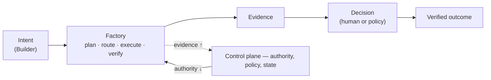
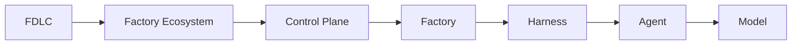
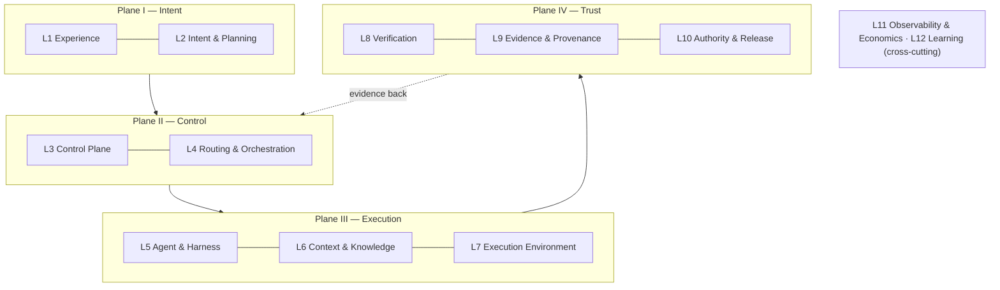
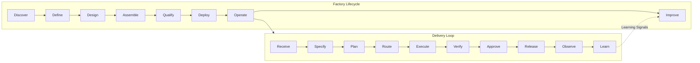
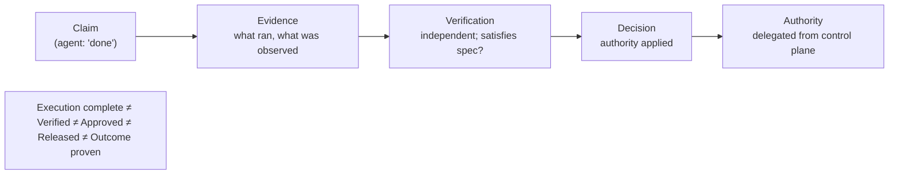

# FDLC in 5 Minutes

Ten questions. Each answer is short and has one figure. Every term links to its definition.

## 1. What changed?

Code generation became cheap. Accountability did not. A coding agent can produce a plausible change in minutes, but nothing about that change tells you who authorized it, what it may touch, whether it is correct, or whether it delivered value. Adding an agent to an unchanged process moves the bottleneck downstream: more code, slower review, weaker evidence, more escaped defects. The scarce resource is no longer implementation. It is trustworthy proof and the authority to act on it.

| Before | After |
|---|---|
| Implementation is scarce | Generation is abundant |
| Review carries verification, context, and governance for free | Those must be explicit records |
| One person owns each step | Humans own intent and consequences; systems own execution |
| Value is measured in shipped features | Value is measured in verified outcomes |

## 2. What is a software factory?

An **AI Software Factory** is a governed production system that converts intent into independently verified software outcomes. It composes agents, models, skills, tools, context, harnesses, execution environments, verification, evidence, policy, human authority, delivery, and learning under a control plane. A factory is more durable than any model, agent, or harness inside it. The output is not code; it is an accepted outcome with known quality, cost, effort, and risk, plus the evidence that proves it.



## 3. Why agents alone are insufficient

A coding agent is a reasoning loop: model, tools, context. It is a worker inside a factory; it is not a factory. It can act quickly and repeatedly, but it cannot hold identity, authority, or accountability. It cannot prove its own work, because it shares assumptions with that work. It cannot be qualified for a scope, because it changes with every prompt. A sophisticated agent with a sandbox, worktrees, and pull-request creation is a stronger worker. It still lacks an authority model, an independent acceptance system, production feedback, and outcome measurement.

```
Coding Agent ≠ AI Software Factory
```

| System | Unit | Authority and acceptance | Outcome boundary |
|---|---|---|---|
| Coding assistant | Prompt or edit | Stays with the user | Suggested code |
| Coding agent | Delegated task | Task-level permissions, run state | Proposed change |
| Agent platform | Agent and run | Governs agents, not the lifecycle | Reliable execution |
| AI Software Factory | Governed outcome | Explicit authority, evidence, audit, human accountability | Verified outcome |

## 4. What FDLC governs

**FDLC (Factory Development Lifecycle)** is the lifecycle, architecture, vocabulary, artifact model, governance model, and learning model for designing, assembling, qualifying, operating, and continuously improving autonomous AI software factories. SDLC governs the lifecycle of software. FDLC governs the lifecycle of the factory that builds it. It sits above agent SDKs, harnesses, and coding assistants, and it is vendor-neutral: your organization may use any agent, any model, any harness. FDLC is the durable operating layer around them.



| | SDLC | Agentic SDLC | FDLC |
|---|---|---|---|
| Object | Software | Software + AI workflow | The factory |
| Unit of value | Shipped feature | Generated change | Verified outcome |

## 5. Core architecture

Twelve layers in four planes. Authority flows down from the control plane; evidence flows back up. Intelligence supply (models, agents, skills, prompts) is expected to change. Intent, identity, authority, state, evidence, decisions, and outcomes are required to persist. "Allow intelligence to vary. Always bound authority." Six responsibility areas cut across the layers: Intent, Execution, Capability, Model, Trust, Learning, with Govern, Secure, Observe, and Measure as continuous controls.



## 6. Core lifecycle

FDLC has exactly two lifecycles. The **Delivery Loop** (inner, ten steps) is how one unit of intent becomes a verified outcome. The **Factory Lifecycle** (outer, eight stages) is how a factory comes to exist, earns trust, and changes. The inner loop runs only inside an Active Factory Version; the outer loop changes behavior only by producing a new one. Deploy promotes a Factory Version; Release promotes a software artifact. Neither creates its own authority.



## 7. Example execution

Dependency modernization: upgrade a payments SDK from v3 to v4 in one repository without changing public API behavior. Illustrative records, not a case study. Four acceptance criteria: tests pass on the exact candidate; no v3 imports remain; no public API or authorization change; the release record names rollback conditions and an owner. The factory version `FV-depmod-1.0` was discovered, defined, designed, assembled, qualified for moderate-risk upgrades, and deployed before the first Intent arrived.

| Step | Record | What happened |
|---|---|---|
| Receive → Specify | `INT-104`, `SPEC-104-r1` | Outcome, owner, risk; four criteria frozen |
| Plan → Route | `PLAN-104-r2`, `WO-104-01` bound to `FV-depmod-1.0` | Revision r1 rejected (missing negative test); r2 approved; eligible version selected |
| Execute | `ATT-104-03`, `CAND-104-03`, `EV-104-09` | Third leased Attempt produced the candidate; test, type, lint, scan, diff evidence |
| Verify | `ATT-104-04` (verifier), `VER-104-02` | Independent Attempt; gate: eligible |
| Approve → Release | `DEC-104-03`, `REL-104-01` | Named human accepted; exact-current gate passed; promoted with rollback |
| Observe → Learn | `OUT-104-01`, `LS-104-01` | No regression in window; reviewer friction became a proposed skill revision |

Full trace: [/framework/delivery-loop#worked-example](/framework/delivery-loop#worked-example-dependency-modernization).

## 8. Why verification matters

Generation scales faster than review. The only way to scale trust without collapsing judgment into generation is independent verification: a separate Verification Attempt, on the exact candidate, against criteria fixed before the work began. The producer is never the sole judge. Evidence proves what ran; verification judges whether it satisfies the specification; a decision applies authority. Only a current PASS satisfies a mandatory check. Missing, stale, skipped, conflicting, or insufficiently independent proof cannot become success, and a moved pull-request head invalidates the old pass.



## 9. What Mission Control demonstrates

Mission Control is the open-source reference implementation. It demonstrates the operating model with its limits visible. It does not claim production certification, fleet scale, zero-touch delivery, or autonomous self-improvement. FDLC is defined by the framework, not by Mission Control.

| Capability | Status | Limitation |
|---|---|---|
| Governed Missions, Plans, and Work Orders | Available | One-repository golden path |
| Attempts, fenced leases, recovery | Available | Fleet-scale provider failure not claimed |
| Independent verification and Quality Gates | Available | Establishes eligibility; never accepts or releases |
| GitHub App publication and currentness | Available | Merge is human-owned |
| Factory Versions and readiness | Available | Readiness, not behavioral qualification |
| Incident pause and restoration | Available | One exact repository operation |
| Spec-driven intake | Experimental | Default off; finalized ≠ approved |
| Model and backend routing | Experimental | Advisory, gated |
| Release and production feedback | Experimental | Full observe-and-improve loop unproven |
| Factory Learning | Experimental | Proposals only; no automatic promotion |
| Governed MCP runtime | Experimental | One read operation qualified |
| Cross-factory registry and routing | Planned | FDLC requirement; not implemented |

Ledger and quickstart: [/mission-control](/mission-control).

## 10. How to start

Pick the path for your role. Each is an ordered reading list with a "you can now" outcome at [/start](/start). Then assess where you are ([/framework/maturity](/framework/maturity)) and take the one next move it names.

| Role | Path | First page |
|---|---|---|
| Executive | Understand Autonomous Software Factories in 15 Minutes | [/framework](/framework) |
| Engineering leader | Adopting Software Factories in Your Organization | [/framework/factory-lifecycle](/framework/factory-lifecycle) |
| Architect | Designing an Enterprise Factory Platform | [/architecture](/architecture) |
| Platform engineer | Building the Factory Control Plane | [/framework/delivery-loop](/framework/delivery-loop) |
| Developer / Builder | Working With a Software Factory | [/architecture/builders](/architecture/builders) |
| Security | Securing Autonomous Software Execution | [/architecture/authority](/architecture/authority) |
| Factory engineer | Building and Qualifying Your First Factory | [/framework/factory-lifecycle](/framework/factory-lifecycle) |

Verified delivery, not merely generated code. Autonomy without evidence is just faster guessing.

## Related

- Framework: [/framework](/framework) · [/framework/delivery-loop](/framework/delivery-loop) · [/framework/factory-lifecycle](/framework/factory-lifecycle) · [/framework/principles](/framework/principles)
- Architecture: [/architecture](/architecture) · [/architecture/verification](/architecture/verification) · [/architecture/agents-skills-tools-harnesses](/architecture/agents-skills-tools-harnesses)
- Learning paths: [/start](/start) · Maturity: [/framework/maturity](/framework/maturity)
- Reference implementation: [/mission-control](/mission-control)
- Glossary: [/glossary](/glossary) · Landscape: [/compare](/compare)
