# Mission Control

Reference page. Mission Control statuses on this page are pinned to the study of runtime contract v58 (2026-09-11) and to Mission Control's own capability maturity ledger (`docs/product/software-factory-capability-maturity.md`). The ledger is canonical; this page compresses its vocabulary into **Available / Experimental / Planned / Proposed** and pairs every status with its limitation.

## What is it

Mission Control is the **open-source reference implementation of the Factory Development Lifecycle**. It is a governed control plane, written as a Convex and TypeScript monorepo, that turns intent, execution, evidence, decisions, and outcomes into durable operating records. It is licensed under MIT and developed in public.

Its role in the ecosystem is precise: **Mission Control demonstrates FDLC; it does not define it.** FDLC is the specification; Mission Control is one implementation, with a ledger that separates "code exists" from "qualified at revision X." Where the two disagree, the specification records the divergence and the implementation carries the gap. Mission Control is a control plane; it does not supply every component of a complete AI software factory, and it does not claim to.

Not another coding agent. The system that decides what agents may do, and what evidence must return before work advances.

## Why it matters

A category needs a working implementation with its constraints visible, not only diagrams. Every artifact in the [specification](/specification) carries a Mission Control mapping; every architecture page says "FDLC requires X; Mission Control implements this through Y (file, status)." That discipline is only possible because Mission Control's own documentation refuses to round "implemented" up to "qualified." The reference implementation is also how the [conformance program](/specification/conformance) was tested against something real: its worked self-assessment is Mission Control's.

## How it works

```mermaid
%% D02 Delivery Loop — Mission Control admission timeline (labeled compression, MC view)
flowchart LR
  I["Intent<br/>missions"] --> P["Plan<br/>missionPlans"]
  P --> FV["Factory Version<br/>factoryDefinitionVersions"]
  FV --> WO["Work Order<br/>workOrders"]
  WO --> T["Task<br/>tasks"]
  T --> PA["Producer Attempt<br/>workflowRuns"]
  PA --> C["Unpublished Candidate<br/>verificationSubject"]
  C --> VS["Verification Subject<br/>frozen tuple"]
  VS --> VA["Verifier Attempt<br/>verificationRuns"]
  VA --> D["Human decision<br/>workOrders.accept"]
  D --> R["Release + outcome<br/>factoryReleases"]
```

The governing hierarchy, from the repository's own overview: Company → Workspace → Repository, each repository holding a Project Constitution revision, an Active Factory Version, and Missions; each Mission holding Mission Spec revisions and an approved Plan with a Quality Contract; each Plan releasing Work Orders; each Work Order containing Tasks; each Task executed by Attempts against a frozen execution manifest and Context Package, producing an immutable candidate and ordered events and artifacts. A candidate becomes a Verification Subject, a frozen Verification Plan is bound to it, a verifier Attempt produces evidence envelopes and receipts, a Quality Gate decision is derived, and a human accepts the Work Order against the exact current pull-request head. Merge, deployment, activation, and production verification follow as separate states.

The single invariant repeated in doctrine and enforced in code, which extends FDLC's non-collapsible state boundary:

> execution completed ≠ verification passed ≠ gate eligible ≠ Work Order accepted ≠ PR merged ≠ production verified

`workOrders.accept` is the canonical Work Order acceptance boundary and the only implementation that writes the acceptance transition; a test asserts that no other file does (`convex/workOrders.ts`; `convex/__tests__/governedHardeningAuthority.test.ts`).

### Admission timeline mapped to canon artifacts

The eleven-item Mission Control timeline is kept as the reference implementation's view of the Delivery Loop. Each item maps to a canonical artifact id.

| # | Mission Control item | Canon artifact | Delivery Loop step |
|---|---|---|---|
| 1 | Intent | `fdlc://v1/intent` (alias: Mission) | 1 Receive |
| 2 | Plan | `fdlc://v1/plan` (+ Quality Contract projection) | 3 Plan |
| 3 | Factory Version | `fdlc://v1/factory-version` | 4 Route (binding) |
| 4 | WorkOrder | `fdlc://v1/work-order` | 3 Plan → 4 Route |
| 5 | Task | Task sub-record of Work Order (no separate artifact) | 5 Execute |
| 6 | Producer Attempt | `fdlc://v1/attempt` (role: producer) | 5 Execute |
| 7 | Unpublished Candidate | `fdlc://v1/candidate` | 5 Execute |
| 8 | Verification Subject | Candidate identity tuple + `verification.subject` | 6 Verify |
| 9 | Verifier Attempt | `fdlc://v1/attempt` (role: verifier) → `fdlc://v1/verification` | 6 Verify |
| 10 | Human decision | `fdlc://v1/decision` (kind: acceptance) | 7 Approve |
| 11 | Release + outcome | `fdlc://v1/release`, `fdlc://v1/outcome` | 8 Release, 9 Observe |

Steps 2 Specify (Mission Spec revisions, Experimental) and 10 Learn (learning signals, Available and advisory) exist in Mission Control but are not on the eleven-item timeline; they appear in the concept map below.

## Components

### Canonical admission model (eleven objects)

Preserved verbatim from the reference implementation's public model.

| # | Object | Definition |
|---|---|---|
| 01 | Factory Version | An immutable, qualified composition of Agent Definitions, Harness Versions, Capability Implementations, Model Profiles, Runtime Artifacts, Sandbox Profiles, Work Graphs, verification requirements, and policy references. Qualification alone does not activate it. |
| 02 | Execution Profile | The governed composition that keeps Model, Agent, Harness, Work Graph, Runtime, Sandbox, Capability Implementation, and policy identities distinct for an Attempt. |
| 03 | WorkOrder | The canonical governed unit of approved work, bound to an exact revision and Factory Version. |
| 04 | Readiness | A derived determination that required identities, qualifications, authorities, resources, and policies are satisfied. It is never a manually asserted READY flag. |
| 05 | Task | A bounded executable portion of an admitted WorkOrder; completion does not accept the WorkOrder. |
| 06 | Attempt | One authoritative execution of a Task with durable identity, authority, runtime, evidence, and outcome lineage. |
| 07 | Unpublished Candidate | An exact producer output that has not received independent verification or publication authority. |
| 08 | Verification Subject | The frozen identity and verification contract describing exactly what a verifier evaluates. |
| 09 | Verifier Attempt | A separate canonical Attempt that independently evaluates a Verification Subject. |
| 10 | Evidence | Durable, attributable records of what was authorized, executed, observed, verified, or decided. |
| 11 | Human Authority | Explicit authority retained for consequential decisions such as acceptance, publication, release, restoration, or policy promotion. |

Spelling note: Mission Control's code and public model write `WorkOrder`; FDLC prose writes Work Order (canon §14).

### Capability ledger (sixteen capabilities)

Status belongs to each capability, not to the product. Preserved verbatim from the site's public capability data; the repository ledger remains canonical.

| # | Capability | Status | Supported | Current boundary |
|---|---|---|---|---|
| 01 | Governed Missions, Plans, and WorkOrders | Available | Versioned Plans can be reviewed and approved before releasing bounded WorkOrders. | Qualified for the documented one-repository V1 golden path. |
| 02 | Attempts, leases, and recovery | Available | Execution is admitted against frozen configuration, fenced by a lease, and retained as immutable Attempt lineage. | Fleet-scale provider-failure operation is not claimed. |
| 03 | Independent verification and Quality Gates | Available | Exact candidates are checked by logically separate verifier Attempts and bound to evidence receipts. | Verification establishes eligibility; it does not accept, merge, or release. |
| 04 | GitHub App publication and currentness | Available | Publication can be permit-gated and reconciled to the exact pull-request head and evidence lineage. | Merge remains human-owned. |
| 05 | Factory Memory and Context Packages | Available | Provenance-backed context can be frozen to an exact Attempt and inspected. | Advisory and phase-gated; cannot satisfy acceptance. |
| 06 | Observability, traces, and evals | Available | Runs can produce traces, scores, datasets, and experiments for diagnostic comparison. | Diagnostic only; no acceptance authority. |
| 07 | Spec-driven Mission intake | Experimental | Immutable Mission Spec revisions and deterministic spec-quality checks are implemented. | Default off; finalized means planning-ready, not approved. |
| 08 | Model and backend routing | Experimental | Policy-aware routing records capability selection against qualification and execution constraints. | Advisory and gated; complete outcome economics and broader live fallback qualification remain incomplete. |
| 09 | Governed inference accounting | Experimental | Aggregate reservations, bounded dispatch allowance, immutable observations, settlement correction, and durable recovery are qualified offline. | Default off. Live provider billing, comparison of two exact routes, and real accepted-workload economics remain unqualified. |
| 10 | Remote Sandbox | Experimental | A bounded live cohort is qualified for production-pilot evaluation. | Preview only; provider-enforced egress and sustained real-work evidence remain open. |
| 11 | Factory Learning | Experimental | Evidence can produce bounded learning signals and human-reviewed proposals. | No automatic promotion; real production signals are limited. |
| 12 | Governed MCP runtime | Experimental | One exact Context7 query-docs read was qualified through versioned authority, brokered execution, durable receipts, and independent verification. | One fixed public React query only; writes, arbitrary servers and operations, broad credentials, and harness-native MCP remain unsupported. |
| 13 | Canonical Factory admission | Experimental | One deterministic synthetic path qualified exact Factory Versions, derived WorkOrder readiness, producer and verifier Attempts, an unpublished candidate, and current verification evidence. | No external model calls, publication, acceptance, or Production mutation occurred; live autonomous delivery remains unqualified. |
| 14 | Factory incident pause and restoration | Available | Incident Command qualified pause and separately authorized restoration of dispatch admission for the Mission Control repository, with independently observed effects. | One exact repository operation using a synthetic qualification incident; other controls, arbitrary repositories, customer incidents, and autonomous emergency authority remain unqualified. |
| 15 | Release and production feedback | Experimental | Release records and advisory learning provide foundations for connecting delivery to observed outcomes. | A complete real release, observation, rollback, and governed improvement loop remains unproven. |
| 16 | Broader containment controls | Planned | Extend qualified containment to additional capability versions, control actions, and targets as workload needs justify them. | Each control and target requires separate qualification and authority; the existing pause operation grants no broader permission. |

Counts: seven Available, eight Experimental, one Planned. A public benchmark program is **Proposed** (see [/benchmarks](/benchmarks)); Mission Control exposes measurements useful for it, and no public result series exists.

### Concept map: FDLC artifact → Mission Control

Condensed from the implementation study. "A/E/P" is the public status compression of Mission Control's ledger term.

| FDLC concept | Mission Control object(s) | Primary file(s) | Status |
|---|---|---|---|
| Intent / Objective | `missions` | `convex/missions.ts` | A |
| Specification | `missionSpecRevisions`, `missionSpecQualityEvaluations`, `missionSpecDecisions`, `projectConstitutionRevisions` | `convex/missionSpecs.ts` | E (default off) |
| Plan | `missionPlans`, `validationAssertions`, `missionPlanningRuns` | `convex/missionPlanning.ts` | A |
| Plan → verification strategy (Quality Contract) | `missionPlans.qualityContractProjection` → `workOrders.qualityContractDigest` | `convex/lib/qualityContract.ts` | A |
| Work Order | `workOrders` + revisions, reopen, supersession | `convex/workOrders.ts` | A |
| Task (sub-record) | `tasks` + transition matrix | `packages/state-machine` | A (legacy) |
| Attempt | `workflowRuns` with fenced lease | `convex/factory/attempts.ts` | A |
| Candidate | `workflowRuns.verificationSubject` (commit + tree + diff + contract) | `packages/workflow-engine/src/verificationSubject.ts` | A |
| Execution manifest (frozen per Attempt) | `workflowRuns.executionManifest` (`factory-execution-manifest/v1..v4`) | `convex/lib/executionManifest.ts` | A |
| Context Package | `factoryContextPackages` (`acceptanceAuthority: false`) | `convex/factoryMemory.ts` | E (flag-gated, advisory) |
| Capability Manifest — skills / context sources | `contextPackages`, `contextPackageVersions`, manifests and locks | `packages/context-tools` | A/E |
| Capability Manifest — agent | `agentTemplates`, `agentTemplateVersions`, `agentInstances` | `convex/schema.ts` | A |
| Capability Manifest — harness | harness manifests and adapters (`codex/v1` production; others experimental) | `packages/workflow-engine/src/harnessManifests.ts` | A (Codex) / E |
| Capability Manifest — model route | `modelCatalog` (`factory-model-route/v2`) | `convex/lib/modelRouteAdmission.ts` | A |
| Capability Manifest — tool | `mcpToolVersions`, `mcpToolGrants`, `mcpToolCallReceipts` | `convex/lib/governedMcp.ts`; `apps/orchestration-server/src/governedMcpBroker.ts` | E (one real read) |
| Execution Profile | `factoryExecutionProfiles` (DISABLED → OFFLINE_ELIGIBLE / PRODUCTION_PILOT_ELIGIBLE → REVOKED) | `convex/factory/executionProfiles.ts` | A/E (gated) |
| Factory Manifest / Factory Version | `factoryDefinitions`, `factoryDefinitionVersions` | `convex/factory/configuration.ts` | A |
| Qualification Record | `factoryReadinessAssessments` (configuration readiness, PASS/BLOCKED, expiring); behavioral qualification | `convex/factory/configuration.ts` | A (readiness) / P (behavioral) |
| Routing Decision | `modelRoutingPolicies`, `modelRoutingDecisions`, `executionRoutingSnapshot`; Guarded Auto off | `convex/lib/executionRouting.ts` | E (gated) |
| Sandbox | `factorySandboxProfiles`, `sandboxAllocations`, `sandboxCredentialGrants` | `convex/schema.ts`; sandbox providers in `apps/orchestration-server/src` | E (Preview) |
| Lease | `workflowRuns.lease` claim / renew; LOST disposition | `convex/factory/attempts.ts` | A |
| Verification (Attempt + Result) | `verificationRuns`, frozen `verificationPlan`, `verificationIndependence` | `packages/workflow-engine/src/verificationIndependence.ts` | A |
| Evidence | `evidenceEnvelopes`, `runArtifacts`, `runEvents`, `verificationReceipts` | `convex/schema.ts` | A |
| Quality Gate | `qualityGateDecisions` (append-only; modes OBSERVE_ONLY / SHADOW / ENFORCED / EMERGENCY_BYPASS) | `convex/lib/qualityGateDecision.ts` | A |
| Currentness | `evaluateCurrentVerificationEligibility` | `packages/workflow-engine/src/verificationCurrentness.ts`; `convex/lib/currentVerification.ts` | A |
| Decision — plan approval, acceptance | Plan approval fields; `approvalDecisions`; `workOrders.accept` (human-only) | `convex/workOrders.ts` | A |
| Decision — publication permit | `authorizePublicationInternal`, human-review continuation | `convex/factory/attempts.ts` | A |
| Publication | GitHub App publisher, `subjectPublicationBinding`, PR checks | `apps/orchestration-server/src/githubAppPublisher.ts` | A |
| Release | `factoryReleases`, `factoryReleaseEvidence`, `deployments` | `convex/lib/factoryRelease.ts` | E (Partial) |
| Outcome | `factoryOutcomeEvents`, `factoryOutcomeProjections` | `convex/schema.ts` | E |
| Recovery | dispositions, checkpoints, quarantine, reconciliation | `convex/lib/executionRecovery.ts` | A |
| Observability | traces and observations | `convex/observability.ts`; `convex/lib/observabilityPersistence.ts` | A (diagnostic) |
| Evaluation | eval definitions, scores, control plane (`releaseBlocking: false`) | `convex/lib/evalControlPlaneSchema.ts` | A (diagnostic) |
| Learning Signal | `learningSignals`, `learningSignalClusters` | `convex/lib/factoryLearning.ts` | A (advisory) |
| Improvement Candidate | `metaLoopSuggestions` → submitted Mission Plan (`autoPromote: false`) | `convex/lib/factoryLearning.ts` | A (manual promotion) |
| Incident | `factoryIncidents` and controls (command / ack / effect) | `convex/lib/factoryIncident.ts` | A (one operation) |
| Identity / tenancy | `tenants`, `projects`, workspace and repository scoping, RBAC | `convex/lib/companyAccess.ts` | A (partial) |
| Cost / economics | inference reservation → receipt → reconciliation | `convex/schema.ts` | E (default off) |
| Factory registry, cross-factory routing | — (routing is repository-scoped) | `convex/lib/executionRouting.ts` | P |
| Objective Planner across factories | — | — | P |

## Worked flows

The five strongest flows in the repository, each with what it proves and where the evidence lives. Paths are under the Mission Control repository root.

| # | Flow | What it proves | Evidence path |
|---|---|---|---|
| 1 | **Real Codex → GitHub PR golden path** | Intent → Plan → Work Order → Task → Attempt → evidence → PR → human acceptance with exact lineage; cancel, two failed retries, and a fourth successful Attempt with immutable retry history and no duplicate PR; a signature-valid `pull_request.edited` webhook correlated to the exact head. The best single example of the Delivery Loop in one repository. | `docs/testing/evidence/real-codex-github-pr-golden-path/README.md` |
| 2 | **Independent verification and currentness (policy v2)** | Independence enumerated as fail-closed reasons (separate Attempt, lease, invocation, worktree; candidate did not shape its own verdict) and currentness as an ordered deterministic check; retained evidence records 15/15 first-pass independent verifications and 17 fail-closed injections. | `packages/workflow-engine/src/verificationIndependence.ts`; `packages/workflow-engine/src/verificationCurrentness.ts`; `docs/testing/evidence/system-factory-e2e-v2`; `docs/testing/evidence/production-factory-pilot-v3/README.md` |
| 3 | **Human review continuation and permit-gated publication** | `REQUIRES_HUMAN_REVIEW` pauses the Attempt; a human decision issues a single-use publication permit bounded by lease, approval, and receipt; publication cannot occur without it. | `docs/software-factory/verification-and-gate-state-machines.md`; `convex/factory/attempts.ts`; `docs/testing/evidence/pr-72-human-review-resume/README.md`; `docs/testing/evidence/human-review-live-exercise-v2` |
| 4 | **Governed MCP capability (fixture, then one real read)** | Tool Version → Grant → authorization receipt → brokered call → completion receipt, with revocation, replay, and late-completion semantics; one exact public read qualified end to end. | `docs/decisions/governed-mcp-tool-capability.md`; `docs/testing/evidence/governed-mcp-phase4-recovery/README.md` |
| 5 | **Factory Incident Command production drill** | Pause with a live dispatch denial, a separately authorized resume, an independent restoration observation, measurement, and resolution; command, acknowledgement, and observed effect are distinct records. | `docs/testing/evidence/factory-incident-command-production-v55/README.md`; `docs/software-factory/factory-incident-command.md` |

Honorable mention: the Context & Skills canonical Factory admission path (`docs/testing/evidence/context-skills-factory-admission-v1/README.md`), a deterministic no-model path from Factory Version → readiness → Work Order → producer Attempt → unpublished candidate → verifier Attempt. It is useful precisely because it isolates the control plane from model behavior.

The [tutorials](/tutorials) exercise the same control-plane path step by step: flow 1 corresponds to tutorials 09–10 (execute a Work Order; capture evidence), flow 2 to tutorial 06 (define verification rules), flow 3 to tutorial 11 (configure approval policy), and flow 4 to tutorial 03 (add a tool). Flow 5 has no tutorial; its evidence directory is the walkthrough.

## State machines Mission Control implements

Listed with the specification page that carries the canonical machine. Where Mission Control's states differ from the specification's, the spec page records the divergence.

| Mission Control machine | Canonical page | Diagram |
|---|---|---|
| Mission (DRAFT … DONE, CANCELED, SUPERSEDED) | [/specification/v1/intent](/specification/v1/intent) (ADMITTED state is a recorded divergence) | — |
| Mission Spec revision (revision → evaluated → FINALIZED) | [/specification/v1/specification](/specification/v1/specification) | — |
| Mission Plan (DRAFT → PROPOSED → APPROVED, REJECTED, SUPERSEDED) and Quality Contract projection | [/specification/v1/plan](/specification/v1/plan) | — |
| WorkOrder lifecycle, verificationStatus, approvalStatus, revision materiality | [/specification/v1/work-order](/specification/v1/work-order) (ROUTED state is a recorded divergence) | D27 |
| Attempt status, executionPhase, runtimeDisposition; execution recovery | [/specification/v1/attempt](/specification/v1/attempt) | D31 |
| Human-review continuation (AWAITING_HUMAN_REVIEW → READY_TO_PUBLISH → PUBLICATION_AUTHORIZED → PUBLISHED) | [/specification/v1/decision](/specification/v1/decision); [/patterns/publication-permit](/patterns/publication-permit) | — |
| Verification Run, check result, verdict, receipt | [/specification/v1/verification](/specification/v1/verification) | D15 |
| Evidence lifecycle (doctrine only; not a schema column) | [/specification/v1/evidence](/specification/v1/evidence) | D14 |
| Quality Gate decision and modes | [/specification/v1/verification](/specification/v1/verification) | D32 |
| Factory Definition and Factory Version (created → assessed → active → superseded); readiness check | [/specification/v1/factory-version](/specification/v1/factory-version) | D12 |
| Execution Profile admission and qualification | [/specification/v1/execution-profile](/specification/v1/execution-profile) | — |
| Sandbox profile admission, allocation, credential grant | [/architecture/sandboxing](/architecture/sandboxing) | D25 |
| Model catalog admission; routing decision mode (SHADOW, ENFORCED, KILLED, EXHAUSTED; ADVISORY → GUARDED_AUTO) | [/specification/v1/capability-manifest](/specification/v1/capability-manifest); [/architecture/routing](/architecture/routing) | D10 |
| Tool Version, Grant, call receipt | [/specification/v1/capability-manifest](/specification/v1/capability-manifest); [/patterns/tool-grant-and-receipt](/patterns/tool-grant-and-receipt) | — |
| Worker readiness, host binding, operator control | [/patterns/lease-based-worker](/patterns/lease-based-worker) | — |
| Factory outcome stage; Factory Release (staging, production) | [/specification/v1/release](/specification/v1/release); [/specification/v1/outcome](/specification/v1/outcome) | D29 |
| Learning cluster; Improvement Candidate; experiment recommendation | [/specification/v1/learning-signal](/specification/v1/learning-signal); [/specification/v1/improvement-candidate](/specification/v1/improvement-candidate) | D21 |
| Factory Incident phases, status, containment, control receipts | [/enterprise/operations](/enterprise/operations) | D33 |

Mission Control inlines most transitions per mutation; there is no declarative transition table for Mission, Work Order, or Attempt comparable to its legacy Task matrix. The specification's state diagrams were reconstructed from schema, code, and doctrine, and the study notes documented drift between doctrine and schema for the sandbox and verification-run machines.

## What Mission Control does not implement yet

From the implementation study, stated as FDLC requirements the reference implementation has not met.

1. **Behavioral qualification of a Factory Version.** Readiness assessment proves a composition is admissible (repository, workflow, executor, profile, MCP, model route, scopes, agent manifests, policy, budget, verifiers, sandbox, host, recovery). It does not prove the version performs on a workload cohort. Behavioral qualification exists for sub-components and as out-of-band evidence packages, not as a control-plane record bound to the version. The eval control plane is explicitly `releaseBlocking: false`. (Planned.)
2. **Factory registry and capability-based routing across factories.** Routing is repository-scoped and selects among versions of the same repository. No registry of factories with declared capabilities; no objective-to-factory matching. (Planned.)
3. **Objective Planner above Missions.** Planning runs plan one Mission for one repository; portfolio decomposition across factories is manual. (Planned.)
4. **Learning → candidate Factory Version → qualification → promotion.** The loop stops at a submitted Mission Plan; there is no step that creates, qualifies, and activates a new Factory Version from an accepted improvement. Automatic promotion is typed `false`. (Planned; by design for now.)
5. **Multi-factory integration verification.** Verification is per Work Order and candidate; no integration-level Verification Subject spans candidates, repositories, or factories. (Planned.)
6. **Deploy, activate, and production-verify as a governed stage.** Release records and state machines exist; merge is human and outside authority; production observation does not yet feed learning. (Experimental, Partial.)
7. **Generalized tool authority.** One MCP fixture and one real read are qualified; harness-native tools lack the same canonical authority; no write-capable tool contract. (Experimental.)
8. **Evidence lifecycle states as a schema column.** The six-state machine is documented, not stored; only receipt-level invalidation and provenance class exist. (Gap recorded in the self-assessment, item T-4.)
9. **Fleet-scale workers.** One outbound-polling worker per host; no remote compute provisioning, inbound ports, or internet worker enrollment. (Not claimed.)
10. **Complete cost attribution.** Cost per accepted outcome is `null` in retained pilot evidence; governed inference accounting is default off. (Experimental.)
11. **Cross-company tenancy proof.** Scoping exists; live cross-company denial tests are a pending gate. (Experimental.)
12. **Declarative state-machine specification.** Transitions are inlined per mutation. (Gap.)

Two recorded divergences from the specification: the composition digest is a short non-cryptographic hash rather than SHA-256 over canonical JSON; and `workOrders.accept` is human-only where the specification permits policy acceptance for low and medium risk inside a delegated envelope (Mission Control is stricter).

## Conformance self-assessment

Against the [FDLC conformance criteria](/specification/conformance), Mission Control's worked self-assessment at runtime contract v58 is:

| Track | Level earned | Blocking items for the next level |
|---|---|---|
| Intent | FDLC-L3 (exception: no explicit admission Decision) | Objective planner across factories (L5) |
| Execution | FDLC-L2 | Post-run changed-file enforcement; generalized tool authority (L3); SHA-256 digest; behavioral qualification and restoration target (L4) |
| Trust | FDLC-L3 (exceptions: evidence-state column; pending security slice) | Release-authorization Decision and rollout model; behavioral Qualification Record (L4) |
| Learning | FDLC-L3 | Measurement contract and cost coverage; learning-to-version pipeline (L4) |
| **Overall** | **FDLC-L2** (minimum over tracks) | — |

This is an illustrative self-assessment by the specification authors, not a certification. It grants nothing the ledger does not claim: no production certification, no fleet scale, no zero-touch delivery, no autonomous self-improvement. The full item-by-item table is on the [conformance page](/specification/conformance#worked-self-assessment-mission-control).

## Implementation architecture

Intelligence can vary; authority remains explicit. The browser, agents, harnesses, and providers do not create their own permission to act or advance state.

| Layer | Technology | Role |
|---|---|---|
| Operator surfaces | React + TypeScript | Exceptions, decisions, Plans, Work Orders, traces, evidence — human attention |
| Authoritative control plane | Convex | State, policy, identity, admission, decisions, immutable lineage — source of authority |
| Orchestration | Hono + worker runtime | Signed service commands, harness admission, leases, checkpoints, recovery — bounded coordination |
| Execution | Codex adapter + bounded backends | Frozen manifest, isolated worktree or Preview Remote Sandbox, exact candidate — replaceable intelligence |
| Verification + publication | Independent Attempt + GitHub App | Evidence receipts, currentness, Quality Gate, permit-gated publication — proof before promotion |

Operating rule: allow intelligence to change; never allow authority to become implicit.

## Quickstart

The exact commands live in the repository and are the only source for them: the README's [Quickstart](https://github.com/jaydubya818/MissionControl#quickstart) and [Software Factory demo](https://github.com/jaydubya818/MissionControl#software-factory-demo-local-end-to-end) sections, and `docs/software-factory/DEMO.md`. The demo is deterministic and runs without live model providers. Screenshots on this page show deterministic demo data and the documented one-repository V1 path; they are not a claim of fleet-scale autonomous production.

A guided first run starts with [Build your first software factory](/tutorials/build-your-first-software-factory); the tutorials use only commands that exist in the repository.

## Public copy rules

Preserved from the public capability matrix; they bind every page that mentions Mission Control.

1. Use "open-source reference implementation of the Factory Development Lifecycle."
2. Describe Mission Control as a governed control plane; do not imply it supplies every component of a complete AI software factory.
3. Label screenshot data as deterministic demo data where applicable.
4. Keep Available statements narrow and pair them with their material limitation.
5. Do not claim general production certification, fleet scale, zero-touch delivery, full MCP support, automatic self-improvement, or enterprise availability.
6. Link the public page to the repository README, capability ledger, and exact quickstart.

Added by the canon: never present Mission Control as the definition of FDLC; every capability claim carries its ledger status; in external copy, write "Mission Control (FDLC reference implementation)" to distinguish it from other products described as "mission control".

## Governance

This page is re-pinned on every Mission Control revision that changes the ledger, and on every PATCH release of the specification that updates Mission Control mappings. The capability table is generated from the same data the site tests pin, so a status cannot change on this page without changing in the data.

## How you know it worked

A reader can, for any FDLC artifact, find the Mission Control table that implements it, its status, and its limitation, and can open the evidence directory for each worked flow. The self-assessment level moves only when the ledger moves.

## What can go wrong

- **Status inflation.** "Code exists" reported as Available. Mitigated by the ledger, the limitation column, and text-pinned tests.
- **Reference implementation mistaken for the standard.** Mitigated by the "demonstrates, does not define" rule and by recorded divergences.
- **Stale pins.** Mission Control moves faster than this page. Mitigated by the revision pin and PATCH releases.

## How it scales

Mission Control is one implementation. The conformance program lets other control planes, harness vendors, and verification services claim per-track conformance without adopting Mission Control. Adapters that emit FDLC artifacts from other platforms are on the [project roadmap](/project).

## Related

- [/specification](/specification) · [/specification/conformance](/specification/conformance) — criteria and the full self-assessment
- [/framework/delivery-loop](/framework/delivery-loop) — the ten steps the timeline compresses
- [/architecture/verification](/architecture/verification) · [/architecture/factory-versioning](/architecture/factory-versioning) · [/architecture/authority](/architecture/authority)
- [/patterns/publication-permit](/patterns/publication-permit) · [/patterns/tool-grant-and-receipt](/patterns/tool-grant-and-receipt) · [/patterns/independent-verifier](/patterns/independent-verifier)
- [/enterprise/operations](/enterprise/operations) — incident command lifecycle (D33)
- [/tutorials](/tutorials) — Mission Control-connected tutorials
- [/project](/project) — roadmap, contributing
- Repository: [github.com/jaydubya818/MissionControl](https://github.com/jaydubya818/MissionControl) · capability ledger: `docs/product/software-factory-capability-maturity.md`
