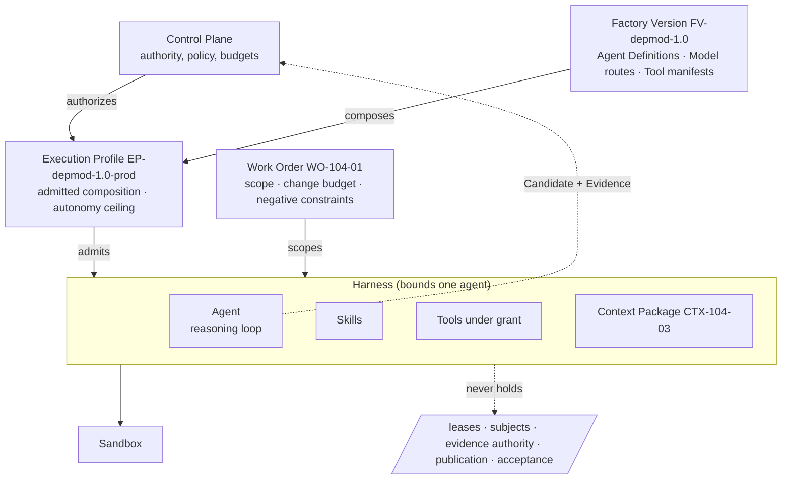

# Bounded Agent

> An agent is a worker inside a factory. The factory decides what the agent may see, call, spend, change, and never decide.

## Problem

A coding agent given a goal, a shell, a repository, and a model will act until it believes it is done. Nothing in the agent limits which files it changes, which tools it calls, how much it spends, when it stops, or which decisions it treats as its own. When it finishes, no record says which prompt, model, tool set, or context produced the result, so nothing can be attributed, reproduced, or rolled back.

## Context

Use this pattern whenever an agent executes inside a Delivery Loop step (Execute, Verify) on behalf of a Work Order. It applies to every Agentic SDK and every harness. It is the foundation the other execution patterns assume: a sandbox, a lease, a context package, and a tool grant all bind to *something*, and that something is the bounded agent.

## Forces

| Force | Pull |
|---|---|
| Agents are most useful with broad capability | Broad capability without bounds becomes unbounded authority |
| Prompts are cheap to change | Unversioned prompts make behavior unattributable |
| Loops should run to completion | Loops need external stop conditions and budgets |
| Models improve monthly | The factory must outlive the model it runs |
| Local enforcement in the harness is fast | Local enforcement is not enterprise authority |

## Solution

Bind every agent execution to an **Agent Definition** and run it inside a **Harness** under an admitted **Execution Profile**. The binding freezes six things before the first token is generated:

| Bound element | What is frozen | Where it lives |
|---|---|---|
| Identity and sponsor | Agent identity, the Builder or policy that delegated the work, the Work Order it serves | Attempt record |
| Composition | Model route, prompt bundle digest, skill versions, tool manifest digest, harness version | Agent Definition inside the Factory Version |
| Permissions | Tool grants, filesystem paths, network policy, credential classes | Execution Profile + sandbox policy |
| Scope | Change budget (files, lines, paths, command classes), negative constraints (no auth changes, no test removal, no verification-config changes) | Work Order |
| Economics | Cost, runtime, and attempt caps | Work Order and Factory Version budget |
| Prohibited authorities | Leases, verification subjects, evidence authority, publication, acceptance | Harness manifest |

The harness enforces these locally and reports; the control plane owns them and decides. The agent may propose (a candidate, a plan, a learning signal). It may not accept, verify, publish, or widen its own grants.

## Architecture

Solid arrows carry authority downward; the dashed arrow carries evidence back. The box on the right lists authorities the harness declares it cannot hold.

## When to Use

- Any agent that can write to a repository, call a network tool, or spend money.
- Any multi-agent workflow: each role (planner, developer, verifier, reviewer) is a separately bounded agent.
- Any factory targeting maturity L2 (Governed Agents) or above; L2 requires bounded identities, permissions, and sandboxes.

## When Not to Use

- Interactive IDE assistance where a human executes every change and no artifact leaves the developer's machine (maturity L0–L1). Bound the tool, not a factory.
- Read-only research that produces no candidate and calls no tool. A context package and a budget still apply, but the full binding is overhead.

## Failure Modes

| Failure | Symptom | Guard |
|---|---|---|
| Bound on paper only | Prompt says "do not delete tests"; nothing enforces it | Negative constraints checked by the verifier, not the producer |
| Composition drift | Same Agent Definition, different prompt file on disk | Prompt bundle digest and tool manifest digest in the Factory Version; readiness fails on mismatch |
| Silent widening | Agent installs a new MCP server mid-run | Absent grant means no capability, never a default |
| Budget as suggestion | Cost cap read by the agent, not enforced by the runtime | Runtime enforces cost and attempt caps; the control plane fences further spend |
| Harness as authority | Harness "approves" its own publication | Harness manifest lists publication and acceptance as prohibited authorities |

## Security Considerations

- The binding is the unit of least privilege. Every grant expires and is revocable; a revoked profile does not rewrite an in-flight Attempt, but a retry must pass current admission.
- Tool output and retrieved context are untrusted data. They cannot grant identity, permission, or authority (see [context-package](/patterns/context-package)).
- The agent identity must be distinct from the sponsor's identity and from the publication identity. An agent that holds the repository push token is not bounded (see [agent-has-production-credentials](/anti-patterns/agent-has-production-credentials)).
- Server-owned risk classification: the minimum risk of a Work Order is set by policy, not inferred from the agent's description of its work.

## Example

`WO-104-01` authorizes one bounded repository change: upgrade the Acme Payments SDK in `checkout-api`. Its change budget allows edits under `src/payments/**` and `package.json`, forbids `NO_AUTH_CHANGES`, `NO_TEST_REMOVAL`, and `NO_VERIFICATION_CONFIG_CHANGES`, and caps cost, runtime, and attempts.

`FV-depmod-1.0` binds the developer agent to a versioned Agent Definition: model route `implementation-workhorse`, prompt bundle digest, skill `sdk-migration@2.3`, and a tool manifest containing exactly two operations (read package registry metadata; run the repository test command). `EP-depmod-1.0-prod` admits that composition for workload class `SOFTWARE_CHANGE` at risk tiers Low and Medium.

`ATT-104-03` records all of it. When the agent attempts `git push`, the sandbox has no publication credential and the harness manifest lists `github-publication` as prohibited; the candidate `CAND-104-03` is frozen unpublished and handed to the control plane. Publication, if it happens, is a separate permitted step ([publication-permit](/patterns/publication-permit)).

## Mission Control Implementation

FDLC requires that every agent execution be bound to a frozen composition, a scoped Work Order, an admitted Execution Profile, and an explicit list of prohibited authorities. Mission Control implements this through:

| Element | Mission Control | Status |
|---|---|---|
| Versioned agent composition | `agentVersions.genome {modelConfig, promptBundleHash, toolManifestHash}` + `genomeHash` (`convex/schema.ts:734`); Factory Versions bind `agentBindings[]`; readiness requires every workflow agent bound to an `APPROVED` version with non-empty prompt and tool hashes (`convex/factory/configuration.ts:1388-1399`) | Available |
| Prohibited authorities | `PROHIBITED_AUTHORITIES = [worker-leases, verification-subjects, verification-plans, evidence-authority, github-publication, acceptance]` and `REQUIRED_EXTERNAL_CONTROLS` in `packages/workflow-engine/src/harnessManifests.ts:62-77` | Available (Codex adapter production admission; other adapters Experimental) |
| Scope and negative constraints | `workOrders.changeBudget`, `negativeConstraints[]` (typed, e.g. `NO_TEST_REMOVAL`, `NO_VERIFICATION_CONFIG_CHANGES`), `autonomyLevel`, `riskLevel` (`convex/schema.ts:2422`; validators `convex/lib/workOrderSpecificationValidators.ts`) | Available |
| Budget caps | `factoryDefinitionVersions.budget {maxCostUsd, maxRuntimeMinutes, maxAttempts}` (`convex/schema.ts:1434`); `workOrders.inferenceSpendingFence` | Available; measured cost attribution Partial |
| Policy envelope | `policyEnvelopes` (`convex/schema.ts:798`) | Available |

Divergence: Mission Control's native harness tools "still lack the same canonical authority" as governed MCP operations (capability ledger, `docs/product/software-factory-capability-maturity.md`), so tool binding is fully enforced only for the governed MCP path. FDLC requires the binding for every tool class.

## Related Patterns

- [tool-grant-and-receipt](/patterns/tool-grant-and-receipt) — how the bound tool set is granted and evidenced
- [sandbox-per-work-order](/patterns/sandbox-per-work-order) — where the bounded agent runs
- [context-package](/patterns/context-package) — what the bounded agent sees
- [lease-based-worker](/patterns/lease-based-worker) — who owns the Attempt
- [objective-decomposition](/patterns/objective-decomposition) — how bounded Work Orders are produced
- [immutable-factory-version](/patterns/immutable-factory-version) — where the Agent Definition is frozen

## Related Anti-patterns

- [the-mega-agent](/anti-patterns/the-mega-agent)
- [unlimited-tool-access](/anti-patterns/unlimited-tool-access)
- [agent-as-authorization-system](/anti-patterns/agent-as-authorization-system)
- [hidden-agent-state](/anti-patterns/hidden-agent-state)

## Specification references

- [/specification/v1/work-order](/specification/v1/work-order) — scope, change budget, negative constraints, authority envelope
- [/specification/v1/execution-profile](/specification/v1/execution-profile) — admitted composition and autonomy ceiling
- [/specification/v1/capability-manifest](/specification/v1/capability-manifest) — agent, skill, tool, harness kinds
- [/specification/v1/attempt](/specification/v1/attempt) — frozen execution manifest
- [/architecture/agents-skills-tools-harnesses](/architecture/agents-skills-tools-harnesses) · [/architecture/authority](/architecture/authority)
- Design principles 1, 2, 8, 9 ([/framework/principles](/framework/principles))
