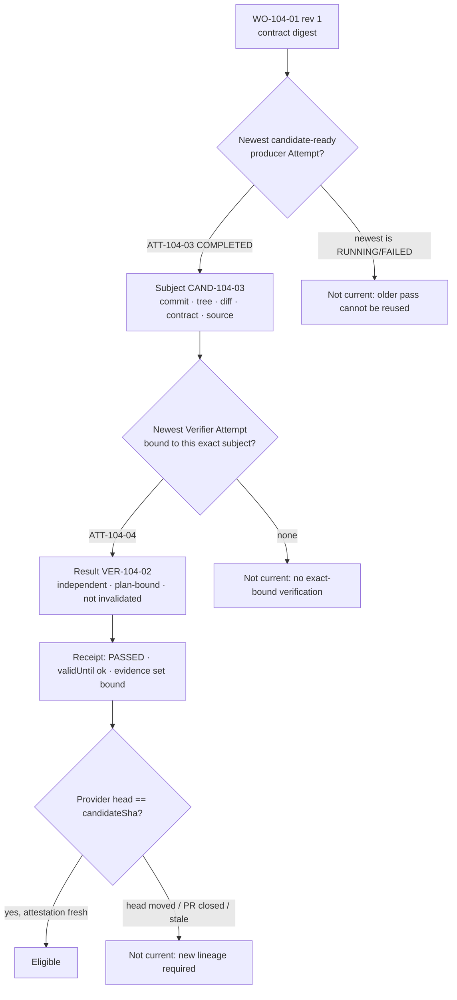

# Candidate Currentness

> Newest candidate first. Newest exact-bound verification second. Only then look at the verdict. Never fall back to an older pass.

## Problem

"The branch passed CI" is true of some commit on the branch at some time. Between the pass and the merge, the agent pushed a fix-up, a reviewer asked for a change, or a retry produced a different candidate. The green check is now evidence about a candidate that no longer exists. Systems that key evidence by branch name, PR number, or Work Order id — anything coarser than the exact content — will eventually accept unverified code on the strength of a stale pass.

## Context

Apply wherever verification evidence is consumed: acceptance (Delivery Loop step 7), publication, release authorization, and Factory Version promotion. The pattern defines the identity that [independent-verifier](/patterns/independent-verifier) verifies and the rule that [evidence-bound-acceptance](/patterns/evidence-bound-acceptance) evaluates.

## Forces

| Force | Pull |
|---|---|
| Re-verifying every push is expensive | Accepting a stale pass is a defect with a signature |
| Branch names and PR numbers are convenient | They are mutable references, not identities |
| Older evidence is still true about its subject | It is not evidence about the newer subject |
| Providers report heads asynchronously | Provider projections must be trusted, fresh, and attributable |
| Multiple Attempts race | Exactly one is "current"; the rule must be deterministic |

## Solution

**Identity.** A Candidate is identified by a Verification Subject: `{ workOrderId, workOrderRevisionNumber, verificationContractDigest, sourceAttemptId, repositoryId, candidateSha (commit), treeSha, rawDiffSha256 (for pre-publication subjects), digest }`. The subject digest is computed over these fields. For automation outputs, the subject is the output snapshot content hash plus adapter identity. A pull request identity, when one exists, is bound *to* the subject; it is never the subject.

**Currentness function.** A deterministic, server-side function computes eligibility for a purpose (acceptance or pre-publication):

1. Require the Work Order's current Quality Contract digest and verification contract digest.
2. Select the **newest candidate-ready producer Attempt** by candidate-ready time. If it is not completed, stop: older passing candidates cannot be reused.
3. Require its subject to be canonical and bound to the same Work Order revision and contract digest.
4. Select the **newest non-superseded Verifier Attempt** whose binding tuple matches that exact subject. If none, or not completed, stop.
5. Require a matching Verification Result: not invalidated, completed, independence valid, frozen plan identity present, decision-input digest present.
6. Require a matching Work-Order-scope receipt: same run, attempt, plan, subject; status consistent with the verdict; independence valid; not invalidated; `validUntil` in the future; decision-input digest equal; evidence set present, deduplicated, every envelope bound to the same lineage.
7. Require a **trusted provider projection** that the published head still equals `candidateSha` (open PR, same number and URL, attestation unexpired), or for local candidates a trusted verifier observation within a short window.
8. Only then map verdict → eligible.

Every denial returns a reason. A moved head, a new Attempt, a revised Work Order, or an expired receipt all yield "not current" until a new exact lineage passes.

## Architecture

## When to Use

- Every acceptance, publication, and release decision on a code candidate.
- Any decision consuming CI or provider check results: re-derive the subject from the exact head, never from the branch.
- Multi-Attempt Work Orders (retries, corrections, human-review resumption).
- Automation factories whose outputs are snapshots rather than commits: the same rule with content hashes.

## When Not to Use

- There is no context in which a decision should consume evidence for a subject other than the current one. The pattern may be simplified for single-Attempt, single-candidate Work Orders, but the identity fields still apply.

## Failure Modes

| Failure | Symptom | Guard |
|---|---|---|
| Branch-keyed evidence | Pass on commit A accepted for commit B | Subject includes commit + tree + diff hash |
| Fallback to older pass | Newest Attempt failed; previous pass reused | Newest candidate first; stop if not completed |
| Unbound verifier | Verifier ran on the right commit but its binding tuple differs | Binding tuple match required |
| Receipt outlives subject | Receipt valid, subject superseded by revision | Revision in the tuple; invalidation on revision |
| Untrusted head | Head reported by the worker, not the provider | Provider projection through a signed webhook or trusted App read with expiry |
| Late evidence promoted | Verification for old subject arrives after new subject exists | Late evidence remains history; cannot advance the new subject |

## Security Considerations

- The head projection must come from a trusted source (signed webhooks with replay ledger, or authenticated provider reads with attestation expiry). A worker-reported head is untrusted.
- The subject digest is the anchor for publication binding: a publication permit is issued for a candidate revision and must match the subject the permit consumer presents.
- Diff hash matters for pre-publication subjects: two commits with the same tree but different parents are different candidates for review purposes.
- Denial reasons are audit records; expose them to humans without leaking secrets.

## Example

`ATT-104-03` freezes `CAND-104-03` = `{ WO-104-01, rev 1, contract sha256:c…, ATT-104-03, checkout-api, commit 7f3…, tree a91…, diff sha256:d… }`. `ATT-104-04` verifies it; `VER-104-02` PASSED with receipt valid for 48 hours. The GitHub App projection shows PR #418 open with head `7f3…`. Eligible; `DEC-104-03` accepts.

Alternative branch: a reviewer requests a comment fix. The agent pushes commit `8c0…` on the same branch. The provider projection now shows head `8c0…` ≠ `7f3…`. `WO-104-01` is immediately "not current: GitHub pull-request identity or head is stale for the verified subject". `VER-104-02` stays in history. Acceptance is refused until `ATT-104-05` freezes `CAND-104-05` and `ATT-104-06` verifies it. Nobody had to remember to re-run anything; the function said no.

## Mission Control Implementation

FDLC requires an exact candidate identity and a deterministic, newest-first, never-fall-back currentness function that consumes trusted provider head projections. Mission Control implements this through:

| Element | Mission Control | Status |
|---|---|---|
| Verification Subject | `packages/workflow-engine/src/verificationSubject.ts` (v1 published Git subject with PR identity; v2 pre-publication `{baseSha, candidateSha, treeSha, rawDiffSha256, baseRef, headRef}`; automation subject with output snapshot hash); constructor enforces "exact lowercase commit/tree SHA lineage and a matching bound head" (lines 103-105) | Available (Qualified) |
| Currentness function | `evaluateCurrentVerificationEligibility` / `evaluatePrepublicationVerification` in `packages/workflow-engine/src/verificationCurrentness.ts:146-383`: newest candidate-ready source Attempt (line 158-169, "older passing candidates cannot be reused"), newest exact-bound Verifier Attempt (208-230), Result checks (232-263), receipt checks (265-296), evidence-set lineage (297-316), local observation ≤60 s (318-340), GitHub head projection with `headSha === candidateSha` and unexpired attestation (342-363) | Available |
| Design intent | "This intentionally chooses the newest candidate and newest exact-bound Verification Attempt before it looks at a verdict. It never falls back to an older pass." (lines 122-127) | Available |
| Trusted head projection | `harnessPrChecks` (`headSha`, `prState`, `attestationExpiresAt`, `installationId`); signed webhooks with replay ledger `githubWebhookDeliveries` | Available |
| Moved head rule | "A moved pull-request head invalidates current eligibility until a new exact subject and verification lineage pass." (`docs/OVERVIEW.md`) | Available |
| Late evidence | "Late evidence remains history and cannot advance the new subject" (VF-004, `docs/decisions/verification-first-architecture-decisions.md`) | Available |

Divergence: Mission Control's function is specific to Git and automation snapshot subjects and to GitHub as provider. FDLC states the rule for any candidate kind and provider. Mission Control's 60-second local observation window is an implementation parameter, not an FDLC constant.

## Related Patterns

- [independent-verifier](/patterns/independent-verifier) — what binds to the subject
- [evidence-bound-acceptance](/patterns/evidence-bound-acceptance) — consumer of the function
- [publication-permit](/patterns/publication-permit) — permit bound to candidate revision
- [verification-contract](/patterns/verification-contract) — contract digest in the tuple

## Related Anti-patterns

- [no-candidate-identity](/anti-patterns/no-candidate-identity)
- [no-evidence-lineage](/anti-patterns/no-evidence-lineage)

## Specification references

- [/specification/v1/candidate](/specification/v1/candidate) — identity fields
- [/specification/v1/evidence](/specification/v1/evidence) — validity conditions; states Current / Stale / Superseded
- [/specification/v1/verification](/specification/v1/verification) — receipts and invalidation
- [/architecture/evidence](/architecture/evidence) · [/architecture/verification](/architecture/verification) (currentness)
- Design principle 5 ([/framework/principles](/framework/principles))
