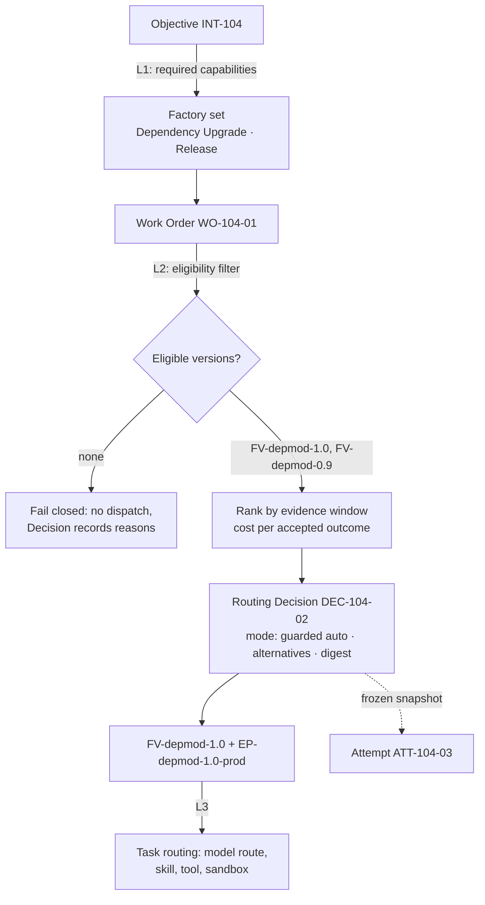

# Capability-Based Routing

> Filter by eligibility first. Rank by evidence second. Schedule third. An ineligible candidate never receives a score.

## Problem

Work is sent to whichever agent or pipeline is at hand. A "migration" task lands in a code-generation factory that has never been qualified for migrations. A Critical-risk change is auto-routed because the router only compares cost. A fallback path, never qualified, silently takes over when the primary provider is rate-limited. Nobody can say why a given factory got a given Work Order.

## Context

Apply at Delivery Loop step 4 (Route) at two of the three canonical routing levels: Level 1 (Objective → required capabilities → factory set) and Level 2 (Work Order → qualified Factory Version + Execution Profile). Level 3 (Task → model/skill/tool/runtime) is [model-routing](/patterns/model-routing). This pattern depends on [immutable-factory-version](/patterns/immutable-factory-version) as the routed unit and on Capability Manifests in the registry.

## Forces

| Force | Pull |
|---|---|
| Cheapest or fastest option is attractive | Cheapest ineligible option is a policy breach |
| Many factories overlap | Overlap needs declared capabilities and qualification scopes, not guesswork |
| Fallbacks keep throughput up | Unqualified fallbacks weaken the guarantee |
| Unknown cost estimates are common | A hard budget with unknown cost must fail closed |
| Auto-routing scales | Critical work must never be auto-routed without explicit policy |

## Solution

Implement routing as three separate decisions, each recorded:

| Level | Input → Output | Owner |
|---|---|---|
| 1 Objective routing | Objective → required capabilities → set of factories + dependency graph across Work Orders | Objective Planner in the control plane |
| 2 Work Order routing | Work Order → one active, qualified Factory Version + Execution Profile | Factory Router |
| 3 Task routing | Task → model / skill / tool / runtime / sandbox | Capability Router inside the factory |

At each level, run **eligibility before ranking**:

1. **Eligibility filter** (hard, boolean): policy allows; actor authorized; workload class, environment, risk tier, and autonomy level within the version's qualification scope; repository access and data classification satisfied; harness and sandbox capabilities present; worker available; budget not exceeded. Any unknown fails the filter.
2. **Ranking** (soft, evidence-based): among eligible candidates, score by verified-outcome evidence over a window, cost per accepted outcome, latency, reliability. Unknown components contribute no favorable score.
3. **Scheduling** (separate): when and on which worker the selected version runs.

Record a **Routing Decision** (Decision kind routing) with alternatives considered, eligibility outcomes, scores, policy version, and a digest; freeze it onto the Attempt. Support three modes: *advisory* (recommend, human selects), *guarded auto* (auto-select within evidence thresholds, human-promoted, kill switch), *pinned* (Work Order pins a version).

## Architecture

## When to Use

- Any control plane with more than one factory or more than one Factory Version active.
- Any factory whose Work Orders span risk tiers.
- Enterprise ecosystems where factories are owned by different teams and qualified for different scopes.
- Whenever fallback or canary routing is needed: fallbacks must be prequalified, and canaries must be recorded as experiments.

## When Not to Use

- A single local factory with one active version and one repository. Level 2 collapses to "the active version"; still record the Routing Decision so the Attempt carries a frozen snapshot.
- Level 1 is unnecessary until an Objective needs more than one specialized factory.

## Failure Modes

| Failure | Symptom | Guard |
|---|---|---|
| Ranking before filtering | A cheaper, unqualified version wins | Ineligible candidates never receive a score |
| Cartesian assembly | Router composes model + harness + runtime at dispatch | Routed unit is a whole Factory Version |
| Unknown-as-favorable | Missing evidence treated as neutral or good | Unknown contributes no favorable score; unknown cost with hard budget fails closed |
| Auto-routing Critical work | RED Work Order dispatched without policy | Critical never auto-routed without explicit policy |
| Silent fallback | Rate limit triggers an unqualified path | Fallbacks must be in the eligible set |
| Unrecorded decision | Attempt cannot say why it ran where it ran | Routing Decision frozen onto the Attempt |

## Security Considerations

- Eligibility is a policy boundary: data classification (for example, a confidential repository may not use a remote sandbox without provider-enforced egress proof) belongs in the filter, not the score.
- Routing must not be influenced by candidate content, retrieved context, or tool output; those are untrusted inputs.
- Guarded-auto promotion is itself a Decision that cites reviewed evidence decisions and can be disabled by incident containment.
- Pinning is an authority: only a Work Order revision approved by a human may pin a version.

## Example

`INT-104` is admitted as an Objective. Level 1 finds it requires `dependency-upgrade` and `release` capabilities; the registry returns the Dependency Upgrade factory (versions `FV-depmod-1.0` active, `FV-depmod-0.9` deprecated) and the Release factory.

Level 2 for `WO-104-01` (workload `SOFTWARE_CHANGE`, risk Medium, production environment): `FV-depmod-0.9` is filtered out (deprecated; qualification expired). `FV-depmod-1.0` passes: qualification scope covers Medium risk, repository access verified, worker with the required harness capabilities is ready, estimated cost within the Work Order cap. Ranking over the last 30 days (illustrative: 42 verified attempts, 0.71 evidence coverage) exceeds guarded-auto thresholds. `DEC-104-02` records the choice, the excluded alternative and its reasons, policy version, and mode `GUARDED_AUTO`. `ATT-104-03` carries the frozen routing snapshot.

A hypothetical `WO-104-02` at Critical risk would stop at the filter with "critical-risk not auto-routable" and wait for a human routing decision.

## Mission Control Implementation

FDLC requires three routing levels, eligibility before ranking, fail-closed unknowns, recorded Routing Decisions frozen onto Attempts, and prequalified fallbacks. Mission Control implements this through:

| Element | Mission Control | Status |
|---|---|---|
| Level 2 routing to versions | `convex/lib/executionRouting.ts` builds per-version candidates with an `eligibility` block (`factoryActive`, `factoryVersionActive`, `readinessCurrent`, `readinessDigestMatches`, `repositoryMatches`, `workerEligible`, `harnessCapabilitiesSatisfied`, `backendSupported`, `networkPolicySatisfied`, `credentialPolicySatisfied`, `modelApproved`, `modelAvailable`, `productionCertified`, lines 561-606) then `resolveExecutionRoute` (line 656) | Available (Implemented, gated) |
| Eligibility before score | "An ineligible candidate never receives a score"; "an unknown component contributes no favorable score"; "A hard budget with unknown estimated cost fails closed" (`docs/architecture/execution-routing-v1.md`) | Available |
| Modes | `ADVISORY` (default), `GUARDED_AUTO` (separate promotion mutation + default-off flag `execution-routing.guarded-auto`), `PINNED` via `workOrders.executionRoutingPin` | Guarded Auto Experimental (disabled) |
| Critical never auto-routed | "RED/critical WorkOrders are never auto-routed in V1" | Available |
| Recorded decision | `modelRoutingDecisions` (`convex/schema.ts:1904`) with `alternativesConsidered[]`, `decisionDigest`; `workflowRuns.routingDecisionId/Digest`, `executionRoutingSnapshot` | Available |
| Level 1 (Objective → factories) and factory registry | — | Planned (Missing): routing is repository-scoped, loading at most 25 active Factory Versions for the Work Order's repository (`executionRouting.ts:376-378`); no cross-factory capability registry |

Divergence: Mission Control routes among Factory Versions of the *same repository* and separates producer/verifier factories by a `purpose` axis. FDLC's Level 1 routing across specialized factories with declared capabilities is a requirement Mission Control does not yet implement; see [multi-factory-orchestration](/patterns/multi-factory-orchestration).

## Related Patterns

- [model-routing](/patterns/model-routing) — Level 3
- [immutable-factory-version](/patterns/immutable-factory-version) — the routed unit
- [fail-closed-qualification](/patterns/fail-closed-qualification) — the scope that defines eligibility
- [multi-factory-orchestration](/patterns/multi-factory-orchestration) — Level 1 in an ecosystem
- [decision-record](/patterns/decision-record) — the Routing Decision
- [degraded-mode](/patterns/degraded-mode) — what happens when nothing is eligible

## Related Anti-patterns

- [agent-to-agent-spaghetti](/anti-patterns/agent-to-agent-spaghetti)
- [no-qualification](/anti-patterns/no-qualification)
- [the-mega-agent](/anti-patterns/the-mega-agent)

## Specification references

- [/specification/v1/factory-version](/specification/v1/factory-version) — qualification scope used by the filter
- [/specification/v1/capability-manifest](/specification/v1/capability-manifest) — declared capabilities
- [/specification/v1/decision](/specification/v1/decision) — kind routing
- [/specification/v1/work-order](/specification/v1/work-order) — bound Factory Version + Execution Profile
- [/architecture/multi-factory](/architecture/multi-factory) — three-level routing invariants
- Design principle 3 ([/framework/principles](/framework/principles))
