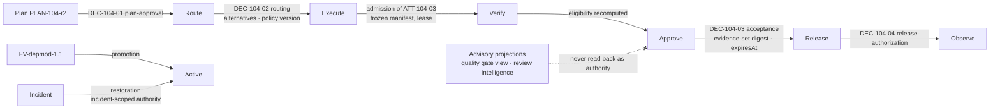

# Decision Record

> The model proposes. The system decides what becomes real. A Decision is the record of the system deciding.

## Problem

"Who approved this?" is answered by scrolling a chat, checking a Slack emoji, or reading a `metadata.approvedBy` string an agent wrote about itself. Routing was decided by code with no record of alternatives. A promotion happened because a deploy script ran. Six decisions live in six stores with six shapes, and none of them says what evidence was in front of the decider, when it expires, or what it invalidated.

## Context

Apply at every authority-exercising transition in both lifecycles: plan approval, routing, admission of an Attempt, acceptance, release authorization, Factory Version promotion, restoration after an incident, exceptions and waivers. The pattern is the artifact that [human-authority-gate](/patterns/human-authority-gate), [capability-based-routing](/patterns/capability-based-routing), [evidence-bound-acceptance](/patterns/evidence-bound-acceptance), and [governed-learning](/patterns/governed-learning) all produce.

## Forces

| Force | Pull |
|---|---|
| Decisions are made in many places | One record type keeps them auditable |
| Automation decides fast | Automated decisions need the same record as human ones |
| Approvals should be reusable | They must expire and be invalidated on change |
| Advisory scores are useful | They must never be read back as decisions |
| Idempotent retries are needed | A replayed decision must not double-apply |

## Solution

One artifact type, **Decision**, with typed kinds: `plan-approval`, `routing`, `admission`, `acceptance`, `release-authorization`, `promotion`, `restoration`, `exception`. Every Decision records:

| Field | Purpose |
|---|---|
| `kind` | Which transition this authorizes |
| `subject` + `priorVersion` | Exact record and version acted on (Work Order revision, candidate digest, Factory Version digest) |
| `actor` + `identitySource` | Human or policy actor; `AUTHENTICATED`, `SERVICE_COMMAND`, or a visibly labeled development fallback |
| `permission` | The named permission exercised, resolved server-side |
| `reason` | Human rationale or policy rule id |
| `policyVersion` / `contractVersion` | Which policy or contract governed |
| `evidenceSetDigest` + `requiredEvidenceIds` | What was in front of the decider |
| `alternativesConsidered` | For routing and promotion |
| `idempotencyKey` | Replay-safe |
| `decidedAt`, `expiresAt` | Bounded validity |
| `beforeState`, `afterState` | The transition |
| `invalidates[]` | Dependent records this decision invalidates (receipts, prior approvals) |
| `status` | `PENDING → APPROVED | CONDITIONAL | REJECTED | REVISION_REQUESTED`; `→ EXPIRED | SUPERSEDED | REVOKED` |

Rules:

- **Server-authorized.** A Decision is written only by a server mutation that authenticates and authorizes the actor; clients and agents submit requests, not Decisions.
- **Non-transitive.** A Decision authorizes exactly its kind. Plan approval does not dispatch; acceptance does not merge; merge does not deploy.
- **Ineligibility is recorded.** A refused request is a durable event with reasons.
- **Projections are not decisions.** A computed eligibility view (a "quality gate" projection) is append-only, marked non-authoritative, and never read back as authority; the real Decision recomputes.
- **Advisory records carry `acceptanceAuthority: false`.**

## Architecture

## When to Use

- Every transition listed in the kinds table, human or policy.
- Waivers and exceptions: an exception is a Decision with a reason and an expiry, never a config flag.
- Incident containment and restoration: restoration is a new consequential action with its own Decision.
- Learning promotions and autonomy changes.

## When Not to Use

- Internal state derivations (Work Order state derived from Attempt status) are not Decisions; they are computed and logged as events.
- Advisory outputs (review suggestions, eval scores, routing previews) are not Decisions; they may be cited by one.

## Failure Modes

| Failure | Symptom | Guard |
|---|---|---|
| Decision by client | Browser writes `approved: true` | Server mutation with permission check; client labels ignored |
| Decision by agent | Agent's tool call "approves" the Work Order | Agents have no permission on decision kinds |
| Untyped decisions | "Approved" with no kind | Kind required; each kind has its own required fields |
| Transitive authority | Plan approval triggers deploy | Non-transitive rule; each kind separate |
| Eternal decision | Approval from a previous revision still applied | `expiresAt`; `invalidates[]` on revision |
| Projection as authority | Dashboard "ELIGIBLE" read by acceptance | Projection marked non-authoritative; acceptance recomputes |
| Silent refusal | Refused acceptance leaves no trace | Ineligibility event with reasons |

## Security Considerations

- Decisions are the audit trail regulators and incident responders read first. Make them tamper-evident (append-only, hashed, with the evidence-set digest).
- Identity source matters: a development fallback identity must be impossible in production and obvious wherever it appears.
- Replayed requests must return the original outcome, not create a second Decision.
- Separation of duties is expressed here: author ≠ approver; incident commander ≠ restorer where policy requires.

## Example

`DEC-104-01` (plan-approval) — subject `PLAN-104-r2`, actor a Builder with `factory.approve`, identity `AUTHENTICATED`, evidence-set digest over the Specification digest and quality evaluation, `invalidates: []`, `afterState: APPROVED`, Quality Contract digest compiled.

`DEC-104-02` (routing) — subject `WO-104-01` rev 1, policy actor, policy version 7, `alternativesConsidered: [FV-depmod-0.9: deprecated, qualification expired]`, mode `GUARDED_AUTO`, decision digest frozen onto `ATT-104-03`.

`DEC-104-03` (acceptance) — subject `WO-104-01` rev 1 + `CAND-104-03`, human actor, permissions `factory.approve` + `delivery.approve`, `evidenceSetDigest` over `VER-104-02`'s receipt and `EV-104-09` envelopes, `expiresAt` +72h, reason "shim removal reviewed; matches migration guide §4".

`DEC-104-04` (release-authorization) — subject `REL-104-01`, separate human, depends on `DEC-104-03` being current, rollback conditions recorded. An earlier attempt to accept while `ATT-104-04` was still running produced an ineligibility event, not a Decision.

## Mission Control Implementation

FDLC requires one typed, server-authorized, expiring, non-transitive Decision record with evidence binding and recorded ineligibility. Mission Control implements this through several stores that FDLC unifies:

| Element | Mission Control | Status |
|---|---|---|
| Work Order approval decisions | `approvalDecisions` (`convex/schema.ts:2695`): actions `APPROVE|APPROVE_WITH_CONDITIONS|REJECT|REQUEST_REVISION`; statuses `PENDING|APPROVED|CONDITIONAL|REJECTED|REVISION_REQUESTED|EXPIRED|SUPERSEDED|REVOKED`; `expiresAt`, `invalidatedByRevisionId`, `workOrderRevisionNumber` | Available (Qualified) |
| Acceptance | `workOrders.accept` writes `WORK_ORDER_ACCEPTED` with `acceptedRevisionNumber`; idempotent; logs `WORK_ORDER_ACCEPTANCE_INELIGIBLE` / `_REJECTED` on refusal (`convex/workOrders.ts:5313-5410`) | Available |
| Plan approval | `missionPlans.approvedBy/At`, `decidedBy/At/ActorSource`, `releaseIdempotencyKey` | Available |
| Routing decisions | `modelRoutingDecisions` with `source`, `mode`, `alternativesConsidered[]`, `algorithmVersion`, `decisionDigest` (`convex/schema.ts:1904`) | Available |
| Transition audit contract | "Every authoritative transition records subject and prior version, actor and identity source, reason, policy/contract version, idempotency key, timestamp, required evidence IDs, before/after state, and invalidated dependent records." (`docs/software-factory/verification-and-gate-state-machines.md`) | Available (doctrine; realized per store) |
| Non-authoritative projection | `qualityGateDecisions` append-only with `metadata.authoritative: false`; "Acceptance must never read this projection back as authority" (`convex/lib/currentVerification.ts:190-192`) | Available |
| Advisory fenced by type | `acceptanceAuthority: v.literal(false)` on review intelligence, memory, evals, learning tables | Available |
| Incident restoration authority | `factoryIncidentControlAuthorizations` (`convex/schema.ts:8827`), expiring, incident-scoped `RESUME_REPOSITORY_DISPATCH` | Available (one operation production-qualified) |

Divergence: Mission Control has five approval-like stores (`approvalDecisions`, legacy `approvals`, `approvalRecords`, plan approval fields, intent contribution decisions) and records routing and incident authority in separate tables. FDLC's single `Decision` artifact with kinds is a normalization over these; the field set above is the union that Mission Control's transition audit contract already demands.

## Related Patterns

- [human-authority-gate](/patterns/human-authority-gate) — human-actor Decisions
- [evidence-bound-acceptance](/patterns/evidence-bound-acceptance) — the acceptance Decision's inputs
- [capability-based-routing](/patterns/capability-based-routing) — routing Decisions
- [publication-permit](/patterns/publication-permit) — the short-lived permit a Decision enables
- [governed-learning](/patterns/governed-learning) — promotion Decisions

## Related Anti-patterns

- [agent-as-authorization-system](/anti-patterns/agent-as-authorization-system)
- [prompt-as-governance](/anti-patterns/prompt-as-governance)
- [no-evidence-lineage](/anti-patterns/no-evidence-lineage)

## Specification references

- [/specification/v1/decision](/specification/v1/decision) — kinds, required fields, states
- [/specification/v1/evidence](/specification/v1/evidence) — evidence-set digest
- [/specification/v1/plan](/specification/v1/plan) · [/specification/v1/work-order](/specification/v1/work-order) · [/specification/v1/release](/specification/v1/release)
- [/architecture/authority](/architecture/authority) · [/architecture/evidence](/architecture/evidence)
- Design principle 2; Manifesto principle 6 ([/framework/principles](/framework/principles))
