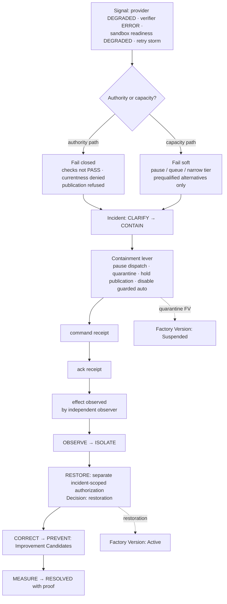

# Degraded Mode

> An acknowledgment is diagnostic evidence; it cannot certify containment. Restoration is a new consequential action and requires its own current authority.

## Problem

The model provider starts returning rate limits. The router falls back to an unqualified model. The sandbox provider degrades, so Attempts run on the persistent worker with weaker isolation. The verifier's scanner endpoint is down, so checks come back `ERROR` and a dashboard shows them as "pending". A retry storm follows. When the provider recovers, everything resumes automatically — including the Attempts that were half-verified under the weaker path. Nobody declared an incident because no single component failed completely.

## Context

Apply at Factory Lifecycle stage 7 (Operate) as part of the operating contract, and at design time (stage 3) where degraded behaviors are declared per dependency. The pattern binds incident command to the factory's authority model: containment narrows scope through the same mechanisms that [progressive-autonomy](/patterns/progressive-autonomy), [fail-closed-qualification](/patterns/fail-closed-qualification), and [model-routing](/patterns/model-routing) already provide, and restoration uses [decision-record](/patterns/decision-record).

## Forces

| Force | Pull |
|---|---|
| Throughput must continue | Continuing on weaker guarantees hides risk |
| Fallbacks keep the factory alive | Fallbacks that widen authority or skip verification are worse than stopping |
| Automation recovers fast | Automatic restoration re-enables the thing that failed |
| Partial failures are ambiguous | Ambiguity must resolve to the safer state |
| Operators need levers | Levers must be authorized, receipted, and observed |

## Solution

**Declare degraded behaviors per dependency** in the Factory Manifest: for each of model routes, sandbox provider, verifier services, context sources, tool servers, delivery provider, and the control plane itself, state what the factory does when the dependency is `DEGRADED` or `UNAVAILABLE`.

Two rules decide the answer:

- **Fail closed on authority.** Anything that gates a consequential transition (verification checks, currentness inputs, approvals, publication, qualification) does not degrade; it blocks. An `ERROR` or `NOT_CONFIGURED` check is not pending — it fails the criterion. A missing provider head projection is not "probably fine" — it is not current.
- **Fail soft on capacity.** Dispatch may pause, queue, or narrow scope (lower risk tiers only, fewer concurrent Attempts, advisory routing instead of guarded auto), but only to prequalified, in-scope alternatives. Never to an unqualified route, a weaker isolation mode outside the qualification scope, or a wider authority.

**Containment levers** are typed actions with their own authorization: pause dispatch (repository or workspace), cancel Attempt, revoke Attempt credentials, quarantine (worker, harness, model route, tool, Factory Version), disable guarded auto, hold publication, hold release. Each lever produces a command receipt, an acknowledgment receipt, and — from an independent observer — an effect-observed receipt. Only the observed effect counts as containment.

**Incident phases** are sequential: Clarify → Contain → Observe → Isolate → Restore → Correct → Prevent → Measure → Resolved. Restoration requires a separate, expiring, incident-scoped authorization; resuming dispatch is a new consequential action. Correction and prevention produce Improvement Candidates, not live edits. Measure closes with proof.

**Kill switches** for auto modes (guarded auto routing, policy acceptance) are reachable by incident command without a policy cycle.

## Architecture

## When to Use

- Every production factory: degraded behaviors are declared before the first Work Order.
- Fleet operations where a provider outage affects many factories at once.
- Any auto mode (guarded auto routing, policy acceptance, auto-release): each needs a kill switch and a restoration path.
- Repeated stale-recovery on a worker: quarantine, do not keep retrying.

## When Not to Use

- Do not treat a single failed check as an incident; that is normal verification. An incident is a dependency or pattern failure that affects the factory's guarantees.
- Do not use degraded mode as a permanent operating mode; a factory that runs narrowed for weeks needs a new qualified version, not a standing exception.

## Failure Modes

| Failure | Symptom | Guard |
|---|---|---|
| Fallback widens | Rate limit → unqualified model | Fallback chain restricted to qualified routes in scope |
| Error as pending | `ERROR` checks render neutral | `ERROR` fails the criterion; only PASS satisfies |
| Ack as containment | "Pause acknowledged" → assumed paused | Effect-observed receipt from independent observer required |
| Auto-restore | Provider healthy → dispatch resumes | Restoration needs its own expiring authority |
| Retry storm | Every Attempt retries into the outage | Retry budgets; quarantine after repeated stale loss; pause dispatch |
| Standing bypass | `EMERGENCY_BYPASS` left on | Bypass is an exception Decision with expiry |
| Isolation downgrade | Sandbox degraded → persistent worker for confidential repo | Isolation mode is a qualification scope; out-of-scope is ineligible |

## Security Considerations

- Degradation is an attacker's opportunity: a forced provider outage that triggers a weaker path is a bypass. The "never widen" rule is the defense.
- Containment levers are privileged operations with named permissions (`factory.incident.control`); their receipts are audit records.
- The independent observer that produces effect-observed receipts must not be the component being contained.
- Restoration authority is incident-scoped and expiring so that a stale "resume" cannot be replayed later.
- Kill switches should be testable in drills; an untested kill switch is a hypothesis.

## Example

`FV-depmod-1.0` declares: model route `implementation-workhorse` `DEGRADED` → continue with reduced concurrency; `UNAVAILABLE` → pause dispatch for Medium tier, continue Low tier on `transformation-small` only where the contract allows; verifier scanner `UNAVAILABLE` → `DEPENDENCY` checks `ERROR`, verdicts `BLOCKED`, no acceptance; sandbox provider `DEGRADED` → no new remote allocations, Attempts on Internal repositories may use the persistent worker (in scope), Confidential may not.

During `ATT-104-03`, the dependency scanner endpoint fails. `ATT-104-04`'s `DEPENDENCY` check returns `ERROR`; verdict `BLOCKED`; `WO-104-01` is not eligible. A second Work Order in the same repository hits the same error. Incident `INC-…` opens: Clarify (two `BLOCKED` verdicts, one provider); Contain with `PAUSE_REPOSITORY_DISPATCH` on `checkout-api` — command receipt, worker acknowledgment, and an observer sees the next dispatch return `DISPATCH_DENIED`: contained. Observe and Isolate confirm the scanner vendor outage. When the vendor recovers, a Builder with incident-control permission requests restoration; an incident-scoped, 30-minute authorization is issued; `RESUME_REPOSITORY_DISPATCH` runs; the observer sees a dispatch succeed. `ATT-104-06` re-verifies `CAND-104-03` as a new Verifier Attempt; `VER-104-03` `VERIFIED`. Correct/Prevent produce `IC-104-03` (add a second qualified scanner route). Measure records time-to-contain and time-to-restore; Resolved.

## Mission Control Implementation

FDLC requires declared per-dependency degraded behaviors, fail-closed authority paths, fail-soft capacity with prequalified alternatives, typed containment levers with command/ack/effect receipts, sequential incident phases, separate restoration authority, and kill switches. Mission Control implements this through:

| Element | Mission Control | Status |
|---|---|---|
| Incident phases | `FACTORY_INCIDENT_PHASES = CLARIFY, CONTAIN, OBSERVE, ISOLATE, RESTORE, CORRECT, PREVENT, MEASURE, RESOLVED`, strictly sequential (`convex/lib/factoryIncident.ts:3-13, 111-130`); `factoryIncidents` (`convex/schema.ts:8765`), severity `SEV1..SEV4`, `containmentState` | Available (Production-qualified; one exact repository operation, `PAUSE_REPOSITORY_DISPATCH`) |
| Containment levers | `PAUSE_REPOSITORY_DISPATCH, PAUSE_WORKSPACE_DISPATCH, CANCEL_ATTEMPT, REVOKE_ATTEMPT_CREDENTIALS, QUARANTINE_WORKER|HARNESS|MODEL_ROUTE|TOOL|FACTORY_VERSION, DISABLE_GUARDED_AUTO, HOLD_PUBLICATION, HOLD_RELEASE` (`factoryIncident.ts:22-26`) | Available (enumerated; one operation live-qualified) |
| Command / ack / effect | `factoryIncidentControlReceipts` `COMMAND_REQUESTED → COMMAND_ISSUED → ACKNOWLEDGED → EFFECT_OBSERVED (+ DISPATCH_DENIED)`; "Only the independent observer may produce EFFECT_OBSERVED rows" (`convex/schema.ts:8846-8847`); "An acknowledgment is diagnostic evidence; it cannot certify containment" | Available |
| Restoration authority | `factoryIncidentControlAuthorizations` (expiring, incident-scoped `RESUME_REPOSITORY_DISPATCH`); "Restoration is a new consequential action and requires its own current, incident-scoped authority" | Available |
| Availability signals | `modelCatalog.availability: HEALTHY|DEGRADED|RATE_LIMITED|UNAVAILABLE`; sandbox profile `readinessState: READY|DEGRADED|BLOCKED`; worker `readiness: STARTING|READY|DRAINING|BLOCKED`; `operatorControls.mode: NORMAL|PAUSED|DRAINING|KILLED|QUARANTINED` | Available |
| Kill switch | `modelRoutingPolicies.killSwitch`; `DISABLE_GUARDED_AUTO` | Available |
| Fail closed on errors | Check `ERROR` and `NOT_CONFIGURED` never satisfy; currentness denies on missing head projection | Available |
| Quarantine after repeated stale loss | `executionQuarantine`, `staleRecoveryLimit` | Available |
| Drill evidence | `docs/testing/evidence/factory-incident-command-production-v55/README.md` (pause → live `DISPATCH_DENIED` → separately authorized resume → observed restoration → measure → resolve) | Available |
| Declared per-dependency degraded behaviors in the Factory Manifest | — | Proposed: Mission Control's degraded behaviors are emergent from routing eligibility, readiness, and incident levers rather than declared per dependency in the Factory Version |

Divergence: FDLC requires the Factory Manifest to declare degraded behavior per dependency so that the fail-closed/fail-soft split is reviewable at design time; Mission Control achieves fail-closed behavior structurally (eligibility, readiness, check semantics) and provides levers, but does not carry a per-dependency degraded-mode declaration. The `EMERGENCY_BYPASS` gate mode exists in Mission Control's schema; FDLC requires any use of it to be an exception Decision with expiry.

## Related Patterns

- [progressive-autonomy](/patterns/progressive-autonomy) — demotion under incidents
- [model-routing](/patterns/model-routing) — prequalified fallbacks and kill switches
- [fail-closed-qualification](/patterns/fail-closed-qualification) — quarantine removes admission
- [recovery-checkpoint](/patterns/recovery-checkpoint) — retry budgets and quarantine
- [immutable-factory-version](/patterns/immutable-factory-version) — Suspended and restoration states
- [decision-record](/patterns/decision-record) — restoration and exception Decisions

## Related Anti-patterns

- [infinite-retry-loop](/anti-patterns/infinite-retry-loop)
- [frontier-model-everywhere](/anti-patterns/frontier-model-everywhere) (fallback that weakens qualification)
- [hidden-agent-state](/anti-patterns/hidden-agent-state)
- [no-sandbox](/anti-patterns/no-sandbox) (isolation downgrade)

## Specification references

- [/specification/v1/factory-manifest](/specification/v1/factory-manifest) — degraded behaviors per dependency (FDLC requirement)
- [/specification/v1/factory-version](/specification/v1/factory-version) — Suspended, Restricted, restoration
- [/specification/v1/decision](/specification/v1/decision) — kinds restoration and exception
- [/enterprise/operations](/enterprise/operations) — SLOs, DR, incidents
- [/architecture/observability](/architecture/observability) — signals that trigger degraded mode
- Design principles 5, 7 ([/framework/principles](/framework/principles))
