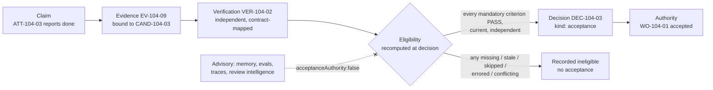

# Evidence-Bound Acceptance

> Claim → Evidence → Verification → Decision → Authority. Nothing in that chain is skipped, and nothing in it is borrowed.

## Problem

Systems accept work on the strength of a report: the agent says "done", a CI badge is green, a reviewer clicked approve last Tuesday. None of those is bound to the exact candidate in front of the decision-maker. The PR head has moved since the check ran. The test result belongs to a previous attempt. The security scan was skipped and recorded as "not configured", which the dashboard renders as a neutral gray that looks like pass.

## Context

Apply at Delivery Loop step 7 (Approve) and at every consequential transition that consumes verification: acceptance of a Work Order, release authorization, promotion of a Factory Version. The pattern is the consumer of [independent-verifier](/patterns/independent-verifier) and [candidate-currentness](/patterns/candidate-currentness) and the producer of a [decision-record](/patterns/decision-record).

## Forces

| Force | Pull |
|---|---|
| Decision-makers want a single status | A single status hides which criterion lacks proof |
| Dashboards render missing as neutral | Missing must fail closed |
| Evidence is expensive to regenerate | Reusing stale evidence is cheaper and wrong |
| Approvals are given once | The subject changes after the approval |
| Averaging scores feels fair | A failed hard gate averaged into a pass is a defect |

## Solution

Make acceptance a server-side function of evidence, evaluated at the moment of decision:

1. **Bind.** Every piece of evidence carries the subject tuple (Work Order, revision, contract digest, source Attempt, subject digest), producer identity, verifier identity and independence result, integrity hash, provenance class, and validity conditions.
2. **Map.** The verification contract maps each mandatory acceptance criterion to at least one evidence category and a required independence level.
3. **Evaluate.** For each mandatory criterion: exists → bound to the current subject → produced by an independent verifier → status is PASS → not invalidated → not expired. Any other state (missing, pending, stale, skipped, not configured, errored, conflicting, superseded, insufficiently independent) fails that criterion, and one failed mandatory criterion fails acceptance.
4. **Recompute at decision time.** Do not trust a cached "eligible" flag. Re-evaluate currentness inside the acceptance transaction.
5. **Record either way.** An ineligible acceptance attempt is logged as an event with reasons; a successful one produces a Decision of kind acceptance bound to the evidence set digest.

Evidence never accepts work. It supports or refutes a claim that policy or a human evaluates. Advisory systems (memory, traces, evaluation scores, review intelligence) carry an explicit `acceptanceAuthority: false` and cannot enter step 3.

## Architecture

## When to Use

- Every Work Order acceptance, at every risk tier. At Low risk the decision actor is policy; the evidence rules are the same.
- Release authorization and Factory Version promotion: the same function with release-level or qualification-level evidence.
- Any dashboard or API that displays "verified" or "eligible": the value must be the output of this evaluation, never a stored flag.

## When Not to Use

- Advisory summaries and review assistants. They may *cite* evidence; they may not *be* evidence.
- Informal experiments with no accepted outcome. Bind evidence anyway if the experiment might be promoted later.

## Failure Modes

| Failure | Symptom | Guard |
|---|---|---|
| Cached eligibility | Work accepted from a stale "eligible" flag after the head moved | Recompute inside the acceptance transaction |
| Neutral-as-pass | `NOT_CONFIGURED` or `SKIPPED` renders as satisfied | Only `PASS` satisfies a mandatory check |
| Borrowed evidence | Receipt from a prior Attempt or another PR head | Evidence must carry the exact subject tuple; mismatch fails |
| Score averaging | Failed security gate averaged into 0.85 "quality" | Hard gates are min-gated; no averaging across mandatory criteria |
| Evidence from the producer | Producer's own test log counted as verification | Independence result required on the receipt |
| Silent rejection | Ineligible acceptance returns an error and nothing is stored | Log ineligibility with reasons as a durable event |

## Security Considerations

- Acceptance is the last point before a candidate can become real. It must be idempotent (keyed) so retries cannot double-accept, and it must refuse while any Attempt on the Work Order is still active.
- Evidence integrity: content hashes on envelopes and artifacts; provenance class (`LIVE` vs synthetic, demo, imported, legacy) must be checked — only live evidence counts toward acceptance.
- Advisory records with `acceptanceAuthority: false` must be enforced by schema type, not convention, so that a reviewer-intelligence score cannot be read back as authority.
- The decision input digest (the set of evidence ids and their hashes) is stored on the Decision so the basis of acceptance can be audited later.

## Example

`WO-104-01` has four acceptance criteria from `SPEC-104-r1`. The verification contract maps them: contract/integration tests → `TEST_RESULT` (independent required); no v3 imports or shims → `STATIC_ANALYSIS` (independent required); no public API, schema, or auth changes → `FILE_DIFF` + `POLICY_RESULT`; release record includes rollback and owner → `POLICY_RESULT` at release.

`VER-104-02` from `ATT-104-04` produced `EV-104-09` containing the first three categories, all `PASS`, bound to `CAND-104-03`. At acceptance time, the control plane recomputes: newest candidate-ready Attempt is `ATT-104-03`; newest exact-bound Verifier Attempt is `ATT-104-04`; receipt valid until tomorrow; independence valid; PR head still equals `candidateSha`. Eligible. A named human records `DEC-104-03` (acceptance) with the evidence-set digest.

If `ATT-104-03` had been retried as `ATT-104-05` after a reviewer comment, `CAND-104-05` would be the newest candidate, `VER-104-02` would not bind to it, and acceptance would be recorded ineligible until `ATT-104-06` (verifier) produced `VER-104-03`.

## Mission Control Implementation

FDLC requires acceptance to be a server-side evaluation of current, independent, exact-subject evidence, recomputed at decision time, with only PASS satisfying mandatory checks. Mission Control implements this through:

| Element | Mission Control | Status |
|---|---|---|
| Single acceptance boundary | `workOrders.accept` (`convex/workOrders.ts:5279-5589`) — the only writer of `WORK_ORDER_ACCEPTED`; idempotent by key; refuses while runs are active (line 5355) | Available (Qualified) |
| Recompute at decision | For policy-v2 `ENFORCED` contracts, `accept` calls `getCurrentVerificationResult` and appends a Quality Gate decision; on ineligibility logs `WORK_ORDER_ACCEPTANCE_INELIGIBLE` and `WORK_ORDER_ACCEPTANCE_REJECTED` (lines 5359-5410) | Available |
| Currentness function | `evaluateCurrentVerificationEligibility` (`packages/workflow-engine/src/verificationCurrentness.ts:146-383`) | Available |
| Only PASS | Check status `PASS|FAIL|SKIPPED|NOT_CONFIGURED|ERROR`; "Only `PASS` satisfies a mandatory check" (`docs/software-factory/verification-and-gate-state-machines.md`) | Available |
| Advisory fenced by type | `acceptanceAuthority: v.literal(false)` on ten tables in `convex/schema.ts` (lines 2997, 3026, 3064, 6639, 6672, 6862, 6904, 6936, 7525, 7594) | Available |
| Live-only evidence | `provenance === "LIVE"` required (`convex/lib/currentVerification.ts:143-148`) | Available |

Divergence: Mission Control's documented evidence lifecycle (`RECORDED → USABLE → STALE | SUPERSEDED | REVOKED | CONFLICTED`) is not a schema column; the schema tracks `result`, `provenance`, and receipt-level invalidation. FDLC adopts the six evidence states (Missing · Pending · Current · Stale · Conflicting · Superseded) as normative.

## Related Patterns

- [independent-verifier](/patterns/independent-verifier) — where valid receipts come from
- [candidate-currentness](/patterns/candidate-currentness) — the "newest exact-bound" rule
- [verification-contract](/patterns/verification-contract) — the criterion → evidence mapping
- [decision-record](/patterns/decision-record) — the record acceptance produces
- [human-authority-gate](/patterns/human-authority-gate) — who may decide at each tier

## Related Anti-patterns

- [no-evidence-lineage](/anti-patterns/no-evidence-lineage)
- [self-verifying-agent](/anti-patterns/self-verifying-agent)
- [no-candidate-identity](/anti-patterns/no-candidate-identity)

## Specification references

- [/specification/v1/evidence](/specification/v1/evidence) — binding fields and six states
- [/specification/v1/verification](/specification/v1/verification) — receipts, verdicts
- [/specification/v1/decision](/specification/v1/decision) — kind acceptance, evidence-set digest
- [/architecture/evidence](/architecture/evidence) · [/architecture/verification](/architecture/verification)
- Design principle 5; Manifesto principle 6 ([/framework/principles](/framework/principles))
