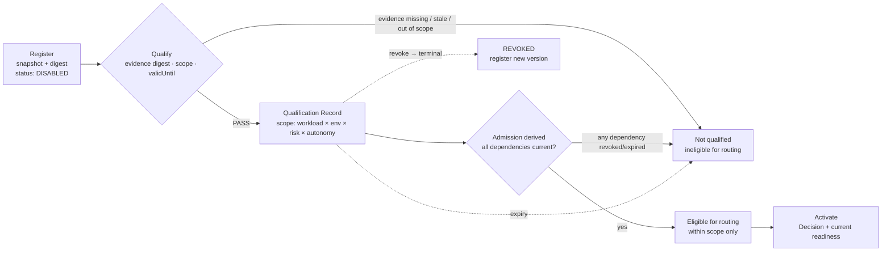

# Fail-Closed Qualification

> Registration is descriptive and disabled. Qualification is the only path to admission. A hard gate with unknown evidence fails.

## Problem

A new model, tool server, sandbox provider, or factory configuration is added to the catalog and immediately routable. "It worked in the demo" is the qualification. Nobody recorded which workloads, environments, risk tiers, or autonomy levels it was tested for, so it is used for all of them. Six months later the evidence is stale, the provider has changed its behavior, and the entry is still admitted because nothing ever un-admits it.

## Context

Apply at Factory Lifecycle stage 5 (Qualify) for Factory Versions, and at the Capability lifecycle's Evaluate → Admit step for every Capability Implementation (model route, tool version, harness adapter, sandbox profile, execution profile). The Qualification Record is the artifact; [capability-based-routing](/patterns/capability-based-routing) consumes its scope; [progressive-autonomy](/patterns/progressive-autonomy) consumes its autonomy level.

## Forces

| Force | Pull |
|---|---|
| New capabilities should be easy to add | Easy to add must not mean admitted |
| Qualification suites are expensive | A stale qualification is cheaper and wrong |
| One qualification for everything is simple | Qualification is only meaningful per scope |
| Revocation is disruptive | Revocation must not rewrite in-flight work, only block new admission |
| Readiness looks like a flag | Readiness must be derived from evidence |

## Solution

Separate **registration** from **qualification** from **admission** from **activation**:

| Step | Effect | Reversible by |
|---|---|---|
| Register | Component exists in a registry, disabled, with its immutable snapshot and digest | Nothing to reverse |
| Qualify | A Qualification Record binds the exact digest to evidence (reference + digest), a **scope** (workload class × environment × risk tier × autonomy level), an approver, and `validUntil` | Expiry; revocation |
| Admit | Admission status derived from current qualification and dependency admission (a profile is admissible only if its route, harness, sandbox, and tool grant are) | Any dependency revoked or expired |
| Activate | An environment pointer to a qualified version with a current readiness assessment | New activation; suspension |

Rules:

- **Unknown fails.** Missing evidence, missing scope, expired validity, mismatched digest, or an unreported qualification dimension yields not-qualified.
- **Scope is a filter, not a hint.** Work outside the declared scope is ineligible.
- **Qualification never activates.** Qualification alone does not activate a version or authorize a Work Order.
- **Revocation is terminal for that identity.** A revoked profile or route cannot be requalified; register a new version. Revocation does not rewrite an Attempt holding a valid lease; a retry must pass current admission.
- **Readiness is derived and expiring.** Every readiness check has an id, a status (`VERIFIED | MISSING | STALE | WAIVED | NOT_APPLICABLE`), and a remediation; readiness PASS requires every non-applicable check to be justified.
- **The qualification standard is enumerated.** Functional correctness, task success, regression, security, isolation, policy compliance, tool permissions, credential handling, unsupported actions and hallucinated effects, route compatibility, cost, latency, reliability, determinism where required, evidence completeness, recovery behavior, failure behavior, observability coverage.

## Architecture

## When to Use

- Every Factory Version before it becomes Active in any environment.
- Every model route, tool version, harness adapter, sandbox profile, and execution profile before it can be routed.
- Any scope expansion: a version qualified for Low risk that will handle Medium risk needs a new Qualification Record for the new scope.
- Fallback routes and canary variants: they must be qualified before they can be selected.

## When Not to Use

- Never skip it for production. For a qualification-only environment (offline, synthetic repository), use a narrower qualification target that explicitly prohibits production activation.
- Do not use qualification as a substitute for Work Order verification: qualification verifies the factory, verification verifies the work.

## Failure Modes

| Failure | Symptom | Guard |
|---|---|---|
| Registration = admission | New MCP server callable on discovery | Registered entries are disabled until qualified |
| Unscoped qualification | "Qualified" used for Critical risk | Scope required; work outside scope is ineligible |
| Eternal qualification | Evidence from a year ago still admits | `validUntil` required; expiry → not qualified |
| Requalifying a revoked identity | Revoked profile re-enabled | Revocation terminal; new version required |
| Operator-set readiness | Ready flag flipped by hand | Readiness derived from checks with expiry |
| Waiver as pass | `WAIVED` counted silently | Waivers recorded with actor and reason; hard-gate dimensions cannot be waived |
| Configuration readiness mistaken for behavior | Composition admissible but never run on a workload cohort | Behavioral qualification suite with regression, adversarial, and recovery cases |

## Security Considerations

- Qualification is where security, isolation, credential handling, and unsupported-action tests are enforced; a component that passes accuracy tests but not these is not qualified.
- Evidence references must be content-addressed (evidence digest), and the Qualification Record must bind the exact component digest; a digest mismatch is a substitution attempt.
- Qualification approval is a named-permission human Decision; the approver must not be the component's author where policy requires separation.
- Incident containment can quarantine a component (worker, harness, model route, tool, Factory Version), which removes admission without waiting for expiry.

## Example

`EP-depmod-1.0-prod` is registered `DISABLED` with an immutable snapshot (harness `codex/v1` manifest digest, runtime artifact digest, sandbox profile digest, model route digest, tool grant digest). A qualification run executes the dependency-upgrade suite on a synthetic cohort of 40 repositories (illustrative): functional and regression cases, a hallucinated-package-name injection, a credential-leak probe, a lease-loss drill, and cost/latency capture. Evidence bundle `sha256:…` is reviewed; a Builder with `factory.approve` records the Qualification Record with scope `SOFTWARE_CHANGE` × `staging, production` × `LOW, MEDIUM` × autonomy Level 3, `validUntil` 90 days out.

`FV-depmod-1.0` binds that profile. Its readiness assessment derives 20 checks; all `VERIFIED` except `governed-mcp`, which is `NOT_APPLICABLE` because the profile's harness declares MCP unsupported and no grant exists. Readiness PASS; activation in production by `DEC` of kind promotion.

At day 91 the profile's qualification expires. `FV-depmod-1.0`'s readiness turns `STALE` on the `execution-profile` check; routing filters it out; `WO-104-07` (hypothetical) waits with the reason "execution-profile qualification expired". Nobody flips a flag; someone requalifies or registers `EP-depmod-1.1-prod`.

## Mission Control Implementation

FDLC requires registration ≠ qualification ≠ admission ≠ activation, scoped and expiring Qualification Records, unknown-fails-closed, terminal revocation, and derived readiness. Mission Control implements this through:

| Element | Mission Control | Status |
|---|---|---|
| Register disabled | `executionProfiles.registerVersion` → `admissionStatus: "DISABLED"` (`convex/factory/executionProfiles.ts:254`); "Registration is descriptive and disabled; qualification is the only path to admission" (`convex/schema.ts:1334-1335`, tool versions) | Available (Implemented, gated) |
| Scoped, expiring qualification | `executionProfiles.qualify` (`executionProfiles.ts:280-394`): requires `expectedProfileDigest` match, evidence reference + digest, `workloadClasses[]`, `riskClasses[]`, `validUntil`; scope must stay within the route's and sandbox's admitted scope (lines 338-351); sets `EVIDENCE_QUALIFIED` and `OFFLINE_ELIGIBLE` or `PRODUCTION_PILOT_ELIGIBLE` | Available |
| Terminal revocation | `revoke` (`executionProfiles.ts:396-436`); "Revoked Execution Profiles cannot be requalified; register a new version." (line 311) | Available |
| Model route and tool qualification | `modelCatalog.qualificationStatus: UNQUALIFIED|EVIDENCE_QUALIFIED`, `admissionStatus`; `mcpToolVersions.qualificationStatus`, `qualificationExpiresAt`, `revokedAt` (`convex/schema.ts:1763, 1336`) | Available (routes) / Experimental (tools) |
| Derived readiness | `factoryReadinessAssessments` with check statuses `VERIFIED|MISSING|STALE|WAIVED|NOT_APPLICABLE`, `expiresAt` (`convex/schema.ts:1507`; `convex/factory/configuration.ts:1346-1425`) | Available |
| Qualification ≠ activation | "Qualification alone does not activate the version or authorize a particular WorkOrder." (`docs/FACTORY_VOCABULARY.md`) | Available |
| Behavioral qualification of a Factory Version | — | Planned: readiness proves the composition is admissible; workload-cohort performance exists only for sub-components (route/profile qualification with `workloadClasses`) and as out-of-band evidence packages under `docs/testing/evidence/`; the eval control plane is `releaseBlocking: false` |

Divergence: Mission Control uses "qualification" for four things (evidence packages at a revision, `EVIDENCE_QUALIFIED` status, the offline `QUALIFICATION` activation target, and a synthetic repository mode). FDLC pins one meaning — the Qualification Record — and treats Mission Control's readiness assessment as the configuration half of it. The behavioral half (a suite run against a workload cohort with a receipt bound to the Factory Version digest) is an FDLC requirement Mission Control does not yet hold in the control plane.

## Related Patterns

- [immutable-factory-version](/patterns/immutable-factory-version) — the thing being qualified
- [capability-based-routing](/patterns/capability-based-routing) — consumes the scope
- [progressive-autonomy](/patterns/progressive-autonomy) — consumes the autonomy level
- [degraded-mode](/patterns/degraded-mode) — quarantine and suspension
- [tool-grant-and-receipt](/patterns/tool-grant-and-receipt) — tool version qualification

## Related Anti-patterns

- [no-qualification](/anti-patterns/no-qualification)
- [no-versioning](/anti-patterns/no-versioning)
- [frontier-model-everywhere](/anti-patterns/frontier-model-everywhere)

## Specification references

- [/specification/v1/qualification-record](/specification/v1/qualification-record) — scope, evidence, expiry, revocation
- [/specification/v1/factory-version](/specification/v1/factory-version) — state machine transitions requiring a current record
- [/specification/v1/execution-profile](/specification/v1/execution-profile) — admission states
- [/architecture/factory-versioning](/architecture/factory-versioning) — Qualification Standard dimensions
- [/framework/factory-lifecycle](/framework/factory-lifecycle) — stage 5 Qualify
- Design principle 7 ([/framework/principles](/framework/principles))
