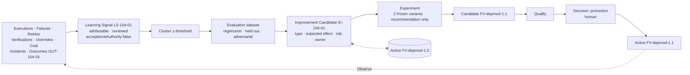

# Governed Learning

> Learning can be autonomous. Promotion should be governed. The system improving the factory is subject to the same policy, verification, and acceptance controls as the work the factory performs.

## Problem

A factory "learns" by appending to a memory file, auto-tuning a prompt after each failure, or letting an optimizer adjust routing weights nightly. Behavior drifts with no version, no test, and no owner. A prompt change that fixed last week's failure introduces this week's regression. Nobody can say what the factory learned, from what, or whether it helped. Model confidence is treated as evidence of improvement.

## Context

Apply at Delivery Loop step 10 (Learn) and Factory Lifecycle stage 8 (Improve). The pattern consumes Outcomes and every other artifact as signal sources and produces Improvement Candidates that enter [immutable-factory-version](/patterns/immutable-factory-version) and [fail-closed-qualification](/patterns/fail-closed-qualification) as candidate versions. It applies equally to a local factory and to cross-factory learning in an ecosystem.

## Forces

| Force | Pull |
|---|---|
| Fast feedback improves the factory | Fast mutation destabilizes it |
| Memory is easy | Memory is not learning |
| Automated optimization scales | Automated promotion self-authorizes |
| Statistical significance takes samples | Low-sample recommendations must say so |
| The learning loop is software | It can become a token sink and a bypass |

## Solution

Run learning as a pipeline of governed artifacts:

```
Sources → Learning Signal → Evaluation dataset → Improvement Candidate → Candidate Factory Version → Qualify → Decision(promotion) → Active
```

| Stage | Artifact | Rules |
|---|---|---|
| Capture | **Learning Signal** | Attributable to a source record (execution, failure, retry, verification, override, cost, latency, incident, accepted/rejected outcome); typed; reviewed; `acceptanceAuthority: false` by type |
| Aggregate | Signal cluster | Threshold-based; a cluster below threshold is not actionable |
| Evaluate | Evaluation dataset | Regression cases, held-out cases, adversarial cases; failures become eval cases |
| Propose | **Improvement Candidate** | Type (routing, skill, evaluator, policy, prompt, config, replace-agent-with-code), expected effect, regression cases, risk classification, owner |
| Compare | Experiment | Two frozen variants, human-approved; recommendation only; low-sample labeled; never claims significance it lacks |
| Assemble | Candidate Factory Version | The change is a new immutable version |
| Qualify + Promote | Qualification Record + Decision | Same gates as any version; human Decision of kind promotion |
| Observe | Outcome | Post-promotion window feeds the next signal |

Invariants: learning never mutates or activates production behavior; the learning subsystem has no acceptance, verification, routing, Factory Version, or repository mutation authority; any evidence that it exercised one is a release blocker; the loop has a budget and a stop condition; memory is context, not learning; model confidence is not evidence.

## Architecture



The crossed dashed edge is the invariant: no path from an Improvement Candidate to the active version except through Qualify and a Decision.

## When to Use

- Any factory at maturity L3 or above; L4 requires governed learning as a capability.
- Any change to prompts, skills, routing weights, evaluator thresholds, context policy, or approval policy in a production factory.
- Cross-factory learning in an ecosystem: shared evaluation datasets, promotion per Factory Version.
- Replacing an agent step with deterministic code once a pattern is stable.

## When Not to Use

- Per-Attempt adaptation inside a single execution (an agent replanning after a failed test) is the Agent Loop, not learning; it produces no factory change.
- Memory retrieval for context is [context-package](/patterns/context-package), not learning.

## Failure Modes

| Failure | Symptom | Guard |
|---|---|---|
| Live prompt tuning | Prompt file edited in production after a failure | Prompts are in the Factory Version; change = new version |
| Memory as learning | "The factory learned" = a memory chunk exists | Memory is context; learning produces Improvement Candidates |
| Confidence as evidence | Improvement claimed from higher model self-scores | Signals bind to outcomes, verifications, and human decisions |
| Auto-promotion | Optimizer activates the winning variant | Recommendation returns `autoPromote: false`; promotion is a Decision |
| Significance theater | "Winner" declared on 8 samples | Low-sample label; significance never claimed |
| Token sink | Learning loop reruns experiments without budget | Loop budget and stop condition |
| Learning with authority | Learning subsystem writes a routing policy | Type-level `acceptanceAuthority: false`; authority audit is a release blocker |

## Security Considerations

- The learning subsystem reads everything and must write only proposals. Its service identity has no permission on acceptance, verification, routing, versions, or repositories; audit that regularly.
- Signals derived from human decisions and overrides are sensitive (they reveal reviewer behavior); scope access.
- Adversarial cases in evaluation datasets must include prompt-injection and hallucinated-effect probes so that a "better" variant is not one that is easier to hijack.
- An Improvement Candidate of type policy or approval is a governance change and follows the highest-tier approval path.

## Example

Over 30 days, 14 dependency-modernization Work Orders (illustrative) produced verifier findings clustered as "compatibility shim left in place after v4 migration". `LS-104-01` binds one instance to `VER-104-02`, `CAND-104-03`, and reviewer override `DEC-104-03`'s note. The cluster crosses threshold; five verifier findings become regression cases in the evaluation dataset.

`IC-104-01` (type: skill) proposes a change to `sdk-migration@2.3` → `2.4` that adds a shim-detection pass, with expected effect "first-pass verification rate up; no change in escaped defects", risk Low, owner the Skill Author. A human approves an experiment with two frozen variants; the recommendation after 36 samples is `PROMOTION_RECOMMENDED`, labeled `OBSERVED_COMPARISON`, `statisticallySignificant: false`, `autoPromote: false`. The Factory Engineer assembles `FV-depmod-1.1`, which is qualified for the same scope and promoted by a human Decision. `FV-depmod-1.0` is deprecated and remains the restoration target. `OUT-104-0x` records over the next window feed the next cycle.

## Mission Control Implementation

FDLC requires attributable, authority-free Learning Signals; Improvement Candidates; human-approved experiments with honest recommendations; and promotion only through a new qualified Factory Version and a Decision. Mission Control implements this through:

| Element | Mission Control | Status |
|---|---|---|
| Signals and clusters | `learningSignals` (17 types; sources `VERIFICATION_RECEIPT|QUALITY_GATE_DECISION|WORKFLOW_RUN|RUN_EVENT|TRACE|HUMAN_DECISION|REVIEW_JUDGMENT|CONFIGURATION_REGISTRY|MISSION_SPEC_QUALITY`), `learningSignalClusters` (`BELOW_THRESHOLD|ACTIVE|CANDIDATE_CREATED|SNOOZED|CLOSED`) (`convex/schema.ts:7457, 7538`); "`LearningSignalInput.acceptanceAuthority` is typed as the literal `false`" (`docs/FACTORY_VOCABULARY.md`) | Available (Qualified; advisory) |
| Improvement Candidates | `metaLoopSuggestions` (`convex/schema.ts:8270`): 12 candidate types incl. `REPLACE_AGENT_WITH_CODE`; status `OPEN → ACCEPTED → WORK_ORDERED → IMPLEMENTED → VERIFIED → EFFECTIVE` plus `DISMISSED|SNOOZED|REJECTED|ROLLED_BACK|RETIRED`; `buildImprovementCandidate` (`convex/lib/factoryLearning.ts:530`) | Available |
| Honest recommendation | `recommendImprovementPromotion` (`convex/lib/factoryLearning.ts:567-633`): always `statisticallySignificant: false`, `autoPromote: false`; `< 30` samples → `LOW_SAMPLE` | Available |
| Experiments | Two-variant, human-approved (`experiments`, `experimentVariants`, `convex/schema.ts:7410`); `validateExecutionRoutingExperimentVariants` grants no execution or acceptance authority (`convex/lib/executionRouting.ts:693-698`) | Available |
| Pipeline | `Evidence → Signals → Clusters → Candidates → Human review → frozen Experiment → Recommendation → Mission + submitted Plan → separate human Plan approval` (`docs/OVERVIEW.md`); no LLM calls in V1; scanner budget 30 days / 200 rows | Available |
| Recursive-improvement boundary | "The system improving the factory is subject to the same policy, verification, and acceptance controls as the work the factory performs"; "Any evidence of acceptance, verification, routing, Factory Version, or repository mutation from the learning subsystem is a release blocker" (`docs/architecture/factory-learning-continuous-improvement.md`; `docs/decisions/factory-self-improvement-governance.md`) | Available (invariant) |
| Improvement Candidate → new qualified Factory Version → activation | — | Planned: Mission Control stops at a submitted Mission Plan that follows the ordinary Work Order path; `experimentVariants.factoryDefinitionVersionId` is optional and unrouted; `inferenceRouteComparisons.automaticPromotionAuthorized: v.literal(false)` |

Divergence: FDLC requires the last mile — an accepted Improvement Candidate becomes a candidate Factory Version, is qualified, and is promoted by a Decision. Mission Control routes the improvement as ordinary delivery work (a Mission Plan with Work Orders), which is a valid realization for code-shaped changes but leaves configuration-shaped changes (routing, policy) without an automatic version-assembly step.

## Related Patterns

- [immutable-factory-version](/patterns/immutable-factory-version) — the candidate version
- [fail-closed-qualification](/patterns/fail-closed-qualification) — the gate the candidate passes
- [progressive-autonomy](/patterns/progressive-autonomy) — autonomy changes as candidates
- [decision-record](/patterns/decision-record) — the promotion Decision
- [context-package](/patterns/context-package) — memory ≠ learning

## Related Anti-patterns

- [hidden-learning](/anti-patterns/hidden-learning)
- [mutable-production-factory](/anti-patterns/mutable-production-factory)
- [no-outcome-metrics](/anti-patterns/no-outcome-metrics)
- [prompt-as-governance](/anti-patterns/prompt-as-governance)

## Specification references

- [/specification/v1/learning-signal](/specification/v1/learning-signal) — attribution, review, `acceptanceAuthority: false`
- [/specification/v1/improvement-candidate](/specification/v1/improvement-candidate) — types, expected effect, regression cases
- [/specification/v1/outcome](/specification/v1/outcome) — observation window, attribution
- [/specification/v1/factory-version](/specification/v1/factory-version) — promotion pipeline
- [/architecture/learning](/architecture/learning) · [/framework/factory-lifecycle](/framework/factory-lifecycle) (stage 8 Improve)
- Design principle 6; Manifesto principle 9 ([/framework/principles](/framework/principles))
