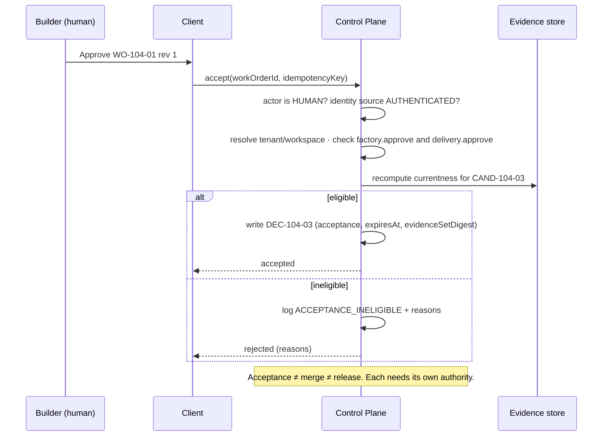

# Human Authority Gate

> Capability ≠ Permission ≠ Authority. A human gate is where delegated authority is exercised by a person, and the server is what makes it real.

## Problem

"Human in the loop" is implemented as a button. The button sets a flag in the browser, or the agent's prompt says "ask the user before merging", or a Slack reaction counts as sign-off. None of it is bound to a subject, none of it expires, none of it names the permission exercised, and any client that can set the flag has the authority. Meanwhile humans are asked to approve everything, so they approve without reading.

## Context

Apply at Delivery Loop steps 3 (Plan Approval), 7 (Approve), and 8 (Release), at Factory Lifecycle stage 6 (Deploy — promotion), during incident restoration, and at any Critical-tier execution. The pattern defines *how* a human decision is captured; [progressive-autonomy](/patterns/progressive-autonomy) defines *when* a human is required.

## Forces

| Force | Pull |
|---|---|
| Humans must be able to override | Override must be attributable and bounded |
| Approvals should be fast | Fast approvals become rubber stamps |
| The browser knows who is logged in | The browser must never decide what that person may act on |
| Approval granted once should hold | The subject changes; approvals must expire and invalidate |
| Agents can be told to ask permission | An agent asking itself is not a gate |

## Solution

Model every human decision as a **Decision** record produced by a server-side mutation that:

1. **Authenticates the actor** as a human (not a service, not an agent) with an identity source recorded (`AUTHENTICATED`, never a browser label).
2. **Authorizes by named permission** resolved on the server against the record's tenant, workspace, and repository — for example `factory.approve` plus `delivery.approve`. The client's selected project is a hint, never authority.
3. **Binds the subject**: Work Order id and revision, candidate digest, evidence-set digest, plan revision.
4. **Bounds validity**: an expiry derived from risk-tier policy, and invalidation triggers (revision, reopen, code change, environment change).
5. **Separates author from approver**: the submitter of a plan or candidate cannot approve it.
6. **Records ineligibility**: a human authorized to approve who tries to approve an ineligible subject produces a durable rejection event, not silence.
7. **Grants nothing downstream**: plan approval does not dispatch; acceptance does not merge; merge does not deploy. Each later consequence needs its own current authority.

Human attention is routed to decisions and exceptions, not activity feeds.

## Architecture

## When to Use

- Plan approval (binds one exact revision).
- Work Order acceptance at High and Critical risk; release authorization at High and Critical.
- Critical-tier execution authorization before any Attempt starts.
- Factory Version promotion and incident restoration (a new consequential action with its own incident-scoped authority).
- Publication of a candidate the verifier flagged `REQUIRES_HUMAN_REVIEW`.

## When Not to Use

- Low-risk Work Orders with deterministic verification and a demonstrated operating history: policy accepts within its envelope. Putting a human here trains rubber-stamping ([human-approval-everywhere](/anti-patterns/human-approval-everywhere)).
- Routine activity (each tool call, each file edit). Route exceptions to humans, not activity.

## Failure Modes

| Failure | Symptom | Guard |
|---|---|---|
| Client-side authority | UI flag or browser role decides | Server resolves permission; client labels ignored for attribution |
| Approval without subject | "Approved" with no revision or digest | Decision binds Work Order revision + candidate digest + evidence-set digest |
| Eternal approval | Approval from last month still valid after a rewrite | Expiry by risk tier; invalidation on material revision |
| Author approves self | Planner submits and approves its own plan | Author ≠ approver enforced |
| Approval implies dispatch | Approving a plan starts execution | Approval writes a Decision only; dispatch is a separate admitted step |
| Service pretending to be human | Automation calls the acceptance mutation | Mutation rejects non-human actor types |

## Security Considerations

- The gate is an authorization boundary and belongs in the threat model. A compromised client must not be able to mint a Decision; a compromised agent must not be able to call the mutation.
- Record the identity source. A development fallback identity must be visibly distinct and disallowed in production.
- Delegation chains: when a policy actor approves within an envelope, record which human delegated that envelope and when it expires.
- Two-person rules for Critical tier are a policy configuration of this pattern, not a separate mechanism.

## Example

`PLAN-104-r2` is submitted by the planning run. A Builder with `factory.approve` records `DEC-104-01` (plan-approval), which freezes the Quality Contract projection and releases `WO-104-01`. Approval dispatches nothing.

`WO-104-01` is Medium risk, so acceptance may be policy-decided within envelope — but its verifier returned `REQUIRES_HUMAN_REVIEW` on the shim-removal diff. The Attempt pauses. A Builder with `factory.approve` and `delivery.approve` reviews the exact diff and evidence and records `DEC-104-03` (acceptance) bound to `CAND-104-03`, `EV-104-09`, and `WO-104-01` revision 1, expiring in 72 hours per Medium-tier policy. The release step later requires `DEC-104-04` (release-authorization) separately; `DEC-104-03` does not merge anything.

## Mission Control Implementation

FDLC requires human decisions to be server-authorized, permission-named, subject-bound, expiring, author-separated, and non-transitive. Mission Control implements this through:

| Element | Mission Control | Status |
|---|---|---|
| Human-only acceptance | `workOrders.accept` rejects `actorType !== "HUMAN"` (`convex/workOrders.ts:5289-5291`); requires workspace `factory.approve` and company `delivery.approve` (lines 5295-5309) | Available (Qualified) |
| Named permissions | `COMPANY_PERMISSIONS`, `FACTORY_PERMISSIONS` in `convex/lib/companyAccess.ts:8-28`; matrix in `docs/security/human-service-authorization-matrix.md` | Available for company/workspace admin and Factory paths; Mission/Work Order human-vs-service split awaits the golden-path security slice (Experimental) |
| Server-side scope resolution | "Resolve `projectId` to its tenant and authorize that relationship on the server; never infer authority from a client-selected project alone" (authorization matrix) | Available |
| Expiring, invalidating approvals | `approvalDecisions` (`convex/schema.ts:2695`): `expiresAt`, `invalidatedByRevisionId`, statuses `PENDING|APPROVED|CONDITIONAL|REJECTED|REVISION_REQUESTED|EXPIRED|SUPERSEDED|REVOKED`; `governancePolicies` validity hours by risk (`convex/schema.ts:2595`) | Available |
| Author ≠ approver | Plan: "a submitted plan cannot be approved by its author" (`docs/architecture/factory-learning-continuous-improvement.md`) | Available |
| Approval ≠ dispatch | "Approval never dispatches an agent, starts a WorkflowRun, satisfies a WorkOrder risk approval, merges code, or deploys software." (`docs/software-factory/governed-missions-contract.md`) | Available |
| Human review continuation | `REQUIRES_HUMAN_REVIEW` → paused Attempt → approval → permit (`convex/factory/attempts.ts:1136-1328`) | Available |

Divergence: Mission Control retains a demo-mode acceptance path gated by an environment flag (`MC_ALLOW_LOCAL_OPERATOR_GOVERNED_ACCEPTANCE`) with actor id `development:local-operator`; FDLC requires that such fallbacks be disabled in production and visibly labeled in every record they touch, which Mission Control does. Merge remains human-only and outside Mission Control's V1 authority.

## Related Patterns

- [decision-record](/patterns/decision-record) — the record the gate produces
- [progressive-autonomy](/patterns/progressive-autonomy) — which tiers require the gate
- [evidence-bound-acceptance](/patterns/evidence-bound-acceptance) — what the human is shown and what the server checks
- [publication-permit](/patterns/publication-permit) — the short-lived permit that follows human approval

## Related Anti-patterns

- [agent-as-authorization-system](/anti-patterns/agent-as-authorization-system)
- [human-approval-everywhere](/anti-patterns/human-approval-everywhere)
- [prompt-as-governance](/anti-patterns/prompt-as-governance)

## Specification references

- [/specification/v1/decision](/specification/v1/decision) — kinds, actor, identity source, expiry
- [/specification/v1/work-order](/specification/v1/work-order) — approval status axis, revision materiality
- [/specification/v1/plan](/specification/v1/plan) — approval binds one revision
- [/architecture/authority](/architecture/authority) — capability/permission/authority; roles; HITL spectrum
- Design principle 2; Manifesto principle 8 ([/framework/principles](/framework/principles))
