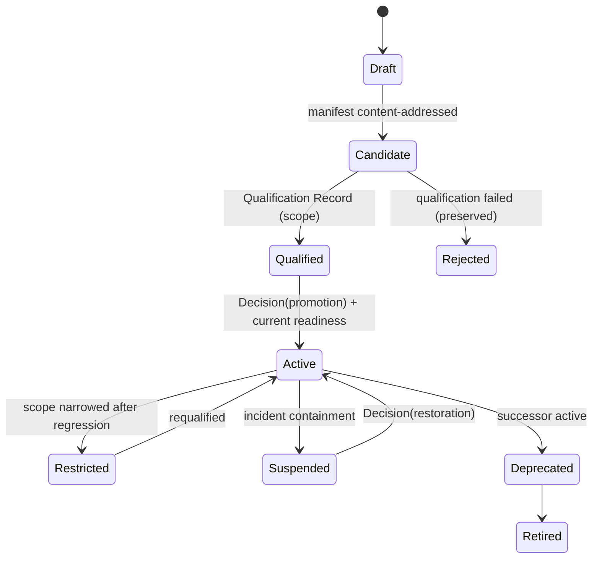

# Immutable Factory Version

> A factory is more durable than the model operating inside it — because the factory is a version, and the version never changes.

## Problem

A factory whose prompts, model choice, tool list, or policy can be edited in place has no attributable behavior. When a result is wrong, nobody can state which composition produced it. When a change regresses quality, there is no previous version to restore. When someone widens a tool grant, no qualification is invalidated. Cross-tenant blast radius is unbounded because every tenant shares one moving target.

## Context

Apply in Factory Lifecycle stages Assemble, Qualify, Deploy, and Improve. The pattern is the unit that routing selects ([capability-based-routing](/patterns/capability-based-routing)), that qualification scopes ([fail-closed-qualification](/patterns/fail-closed-qualification)), and that learning proposes to replace ([governed-learning](/patterns/governed-learning)). It applies to local factories and factory ecosystems alike; it is required at maturity L4 (Qualified Factory).

## Forces

| Force | Pull |
|---|---|
| Factory engineers want to tune prompts quickly | Every tune is a behavior change with no test |
| Models are replaced often | Replacement must be a versioned, qualified event |
| One factory serves many repositories | Shared mutable state means shared blast radius |
| Rollback must be possible | Rollback needs a separately identified target |
| Readiness changes as the world changes | Readiness must be derived from evidence, not set by an operator |

## Solution

Freeze the complete composition into a **Factory Version** identified by a content digest over its canonical manifest. The composition lists exact identities and digests: planner version, Agent Definitions, harness versions and runtime artifacts, skills, tool manifests and grants, model routes, context configuration, sandbox image, network and credential policy, verification contract, approval policy, Execution Profiles, economics, and qualification evidence.

Rules:

- **No mutation.** Any material change creates a new version. The previous version remains auditable.
- **Activation is a pointer, not an edit.** A factory's active version per environment is a reference to a qualified version plus a current readiness assessment for that exact digest.
- **Readiness is derived.** Readiness is computed from current repository, worker, runtime, policy, and qualification evidence, with an expiry. It is never an operator-set flag.
- **Routing targets versions.** Production work is routed to an active, qualified Factory Version — never to "the factory" and never to a composition assembled at dispatch time.
- **Reclassification is a new version.** Changing a repository's data classification, a sandbox boundary, or a model route requires a new version and a new qualification.

State machine (canonical): `Draft → Candidate → Qualified(scope) → Active(env) → Deprecated → Retired`, with `Restricted`, `Suspended`, and `Rejected` side states. Transitions require a Decision of kind promotion or restoration and a current Qualification Record.

## Architecture

Composition (D11) is authored on the factory-versioning page; the digest covers every line of it.

## When to Use

- Any factory that runs unattended on production repositories.
- Any factory shared across teams, repositories, or tenants.
- Any time a Learning Signal proposes a change: the change becomes a candidate version, not an edit.
- Any regulated context where "which configuration produced this" must be answerable after the fact.

## When Not to Use

- Exploratory prototypes that never touch a governed repository and produce no accepted outcome. Version them anyway when they graduate.
- Per-Work-Order parameters (target repository, branch, budget remaining) — these belong on the Work Order and the Attempt, not in the version.

## Failure Modes

| Failure | Symptom | Guard |
|---|---|---|
| Digest that misses fields | Prompt file changes; digest unchanged | Digest over the full canonical manifest, including prompt bundle and tool manifest hashes |
| Operator-set readiness | "Ready" checkbox flipped with a stale assessment | Readiness derived and expiring; activation requires current PASS for the exact digest |
| Dispatch-time assembly | Router picks model A, harness B, runtime C ad hoc | Router selects a whole version; no Cartesian product at dispatch |
| Activation without qualification | Version activated because it "should work" | Activation checks qualification scope × environment |
| Rollback to nothing | Previous version deleted | Versions are retained; deprecation is a state, not deletion |
| Weak digest algorithm | Collisions or unverifiable content addressing | Use SHA-256 over canonical JSON |

## Security Considerations

- The Factory Version is the supply-chain unit. Carry SLSA/in-toto-compatible provenance for its runtime artifacts (harness executable or image digests) and an agent bill of materials for its skills, tools, and model routes.
- A revoked component (tool version, model route, execution profile, sandbox profile) must fail the readiness of every version that includes it; incident containment can quarantine a version.
- Version manifests are governed records: creating and activating one requires named permissions and produces a Decision.
- Never embed secrets in the version. Credential *classes* and *policies* are versioned; credentials are issued per Attempt.

## Example

`FV-depmod-1.0` freezes the dependency-modernization factory: planner `depmod-planner@1`, developer and verifier Agent Definitions, harness adapter `codex/v1` with its runtime artifact digest, skill `sdk-migration@2.3`, two tool operations, model routes `implementation-workhorse` and `verification-independent`, sandbox image digest, network policy `RESTRICTED_ALLOWLIST` (package registry only), verification contract mapping `SPEC-104-r1`'s four criteria to verifiers, approval policy (Medium risk → policy accepts within envelope; High → human), budget caps, and Qualification Record scope (`SOFTWARE_CHANGE` × staging/production × Low–Medium × Level 3).

`WO-104-01` is routed to `FV-depmod-1.0` by `DEC-104-02`. `ATT-104-03` records `configurationDigest = sha256:…`. Three months later `LS-104-01` shows reviewers repeatedly rejecting shim removals; `IC-104-01` proposes a skill change. The change is assembled as `FV-depmod-1.1`, qualified, and promoted; `FV-depmod-1.0` becomes Deprecated and remains the restoration target. No prompt in production was ever edited.

## Mission Control Implementation

FDLC requires an immutable, content-addressed Factory Version, derived readiness, activation as a pointer, and routing to versions only. Mission Control implements this through:

| Element | Mission Control | Status |
|---|---|---|
| Immutable version | `factoryDefinitionVersions` (`convex/schema.ts:1434`) freezes repository, purpose, workflow, executor, harness digests, execution profile identity + qualification, model route + qualification, backend, sandbox profile, code scopes, agent bindings, policy envelope, budget, verifiers, risk boundary, recovery; `configurationDigest` in `convex/lib/factoryConfiguration.ts:79-95` | Available (Qualified) |
| Derived readiness | `factoryReadinessAssessments` (`convex/schema.ts:1507`) with 20 checks (`convex/factory/configuration.ts:1346-1406`), `PASS|BLOCKED`, `expiresAt`; "not an operator-set status" | Available |
| Activation as pointer | `activate` (`convex/factory/configuration.ts:1427-1495`): requires current `PASS` assessment with matching `configurationDigest`; sets `factoryDefinitions.activeVersionId` | Available |
| Routing to versions | `convex/lib/executionRouting.ts` loads active Factory Version candidates and evaluates eligibility per version (lines 538-608) | Available (Implemented, gated) |
| Reclassification → new version | Readiness check `repository-classification` remediation: "create a new immutable Factory version" (`configuration.ts:1366`) | Available |

Divergences: (1) Mission Control's Factory Version has no status column — activity is the definition pointer and versions are `created → assessed → active → superseded`; FDLC's canonical state machine adds Qualified, Restricted, Suspended, Deprecated, Retired. (2) Mission Control's digest is FNV-1a over canonical JSON (`factory-v1-<8hex>`); FDLC requires SHA-256. (3) Mission Control readiness proves the composition is *admissible*, not that it *performs*; behavioral qualification of a Factory Version is Planned (see [fail-closed-qualification](/patterns/fail-closed-qualification)).

## Related Patterns

- [fail-closed-qualification](/patterns/fail-closed-qualification) — how a version earns a scope
- [capability-based-routing](/patterns/capability-based-routing) — how work reaches a version
- [governed-learning](/patterns/governed-learning) — how a new version is proposed
- [degraded-mode](/patterns/degraded-mode) — suspension and restoration
- [bounded-agent](/patterns/bounded-agent) — what the version freezes per agent

## Related Anti-patterns

- [mutable-production-factory](/anti-patterns/mutable-production-factory)
- [no-versioning](/anti-patterns/no-versioning)
- [prompt-as-governance](/anti-patterns/prompt-as-governance)
- [hidden-learning](/anti-patterns/hidden-learning)

## Specification references

- [/specification/v1/factory-version](/specification/v1/factory-version) — composition, digest, states
- [/specification/v1/factory-manifest](/specification/v1/factory-manifest) — declarative definition
- [/specification/v1/qualification-record](/specification/v1/qualification-record) — scope, expiry, revocation
- [/architecture/factory-versioning](/architecture/factory-versioning) · [/framework/factory-lifecycle](/framework/factory-lifecycle) (Assemble, Qualify, Deploy, Improve)
- Design principles 8, 9 ([/framework/principles](/framework/principles))
