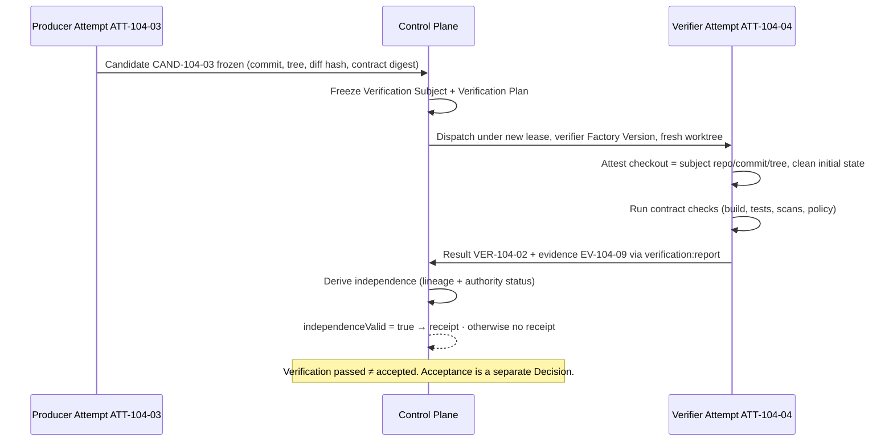

# Independent Verifier

> The producer should not be the sole judge of its own work. Independence is proven twice: by lineage and by standard.

## Problem

An agent that writes code and then runs the tests shares every assumption with the code. If it misunderstood the requirement, the tests it wrote encode the misunderstanding. If it edited `package.json#scripts.test` to skip a failing suite, its own "tests pass" is true and worthless. A completion message from the producer is an assertion, not evidence.

## Context

Apply at Delivery Loop step 6 (Verify) for every Work Order whose risk tier requires independent verification (Medium and above under the canonical risk-tier table) and at Objective and Release verification levels. The pattern assumes a frozen candidate identity ([candidate-currentness](/patterns/candidate-currentness)) and a verification contract that names what to check ([verification-contract](/patterns/verification-contract)).

## Forces

| Force | Pull |
|---|---|
| Producers already know the test command | Reusing the producer's process reuses its blind spots |
| Verification costs a second execution | Skipping it turns "verified" into "self-reported" |
| Isolation is easy to claim | Isolation must be server-reproducible, not asserted |
| A different process is not a different standard | The candidate can rewrite what "pass" means |
| Independent models add signal | A second opinion is still advisory until bound to evidence |

## Solution

Run verification as a **Verifier Attempt**: a distinct Attempt with `role = verifier`, executed by a Factory Version whose purpose is verification, under its own lease, in its own worktree or sandbox, through a separate executor invocation, against the frozen Verification Subject. Derive an **independence result** on the server from lineage facts the verifier cannot forge, and require it to pass before any receipt counts.

Independence has two halves:

1. **Lineage independence** — separate Attempt, Factory Version purpose, executor invocation, lease, worktree, and an isolation attestation whose digest the server can reproduce and whose checkout matches the subject's repository, commit, and tree.
2. **Standard independence** — the candidate did not modify files that determine its own verdict (test scripts, CI config, verification config). A verification-authority check reports PASS or FAIL; absent is treated as not proven.

Only a Verifier Attempt whose evidence arrives through the verification report capability may produce a receipt. Verification makes the Work Order *eligible*; it never accepts it.

## Architecture

## When to Use

- Every Work Order at risk tier Medium or above.
- Every Objective-level integration verification and every Release verification.
- Any factory at maturity L3 (Orchestrated Delivery) or above; L3 requires independent verifier attempts on at least one workflow.
- Factory qualification: the qualification suite is itself run by an independent verifier factory.

## When Not to Use

- Low-risk Work Orders whose verification is fully deterministic and whose verification config is outside the producer's change budget; deterministic checks in a fresh sandbox satisfy independence by construction, but still record lineage.
- Pure documentation changes with no executable acceptance criteria; use policy checks and human review instead of a second execution.

## Failure Modes

| Failure | Symptom | Guard |
|---|---|---|
| Same-process verification | Verifier runs inside the producer's worktree or invocation | Server rejects: reused worktree, same lease, same invocation |
| Standard capture | Candidate edits `scripts.test` or CI config; isolated verifier passes | Verification-authority check FAILs; `NO_VERIFICATION_CONFIG_CHANGES` constraint |
| Unattested isolation | Verifier claims "fresh clone" with no reproducible digest | Isolation binding digest recomputed server-side |
| Verifier drift | Verifier checks a different commit than the candidate | Checkout attestation must match repository, commit, and tree |
| Advisory promoted | LLM reviewer's opinion becomes a receipt | Only `verification:report` capability from a verification-purpose Factory Version may produce receipts |
| Silent non-report | Authority status absent, treated as pass | Absent is "self-certification not ruled out"; independence fails |

## Security Considerations

- The verifier is a second bounded agent, not a privileged one. It needs read access to the candidate and the ability to run checks; it needs no publication credential.
- Verifier and producer must not share a credential class or a sandbox allocation.
- A verifier that can be instructed by candidate content (for example, a README telling the reviewer to approve) is a prompt-injection surface; treat candidate files as untrusted input to the verifier and pin the verification plan before the verifier reads the candidate.
- Independence results are derived on the server from stored lineage, never from the verifier's own claims.

## Example

`ATT-104-03` produces `CAND-104-03` for `WO-104-01`. The control plane freezes the Verification Subject (repository, `candidateSha`, `treeSha`, diff hash, `WO-104-01` revision 1, contract digest, source `ATT-104-03`) and a Verification Plan from `SPEC-104-r1`'s acceptance criteria.

`ATT-104-04` runs under `EP-depmod-verify-1.0` in a detached worktree with its own lease. It attests `initialClean = true`, checks out exactly `candidateSha`, runs contract tests, typecheck, lint, and dependency scan, and reports `VER-104-02` with `EV-104-09`. The server derives independence: separate Attempt, invocation, lease, worktree; checkout matches; authority status PASS because `CAND-104-03` touched nothing under `scripts/**` or `.github/**`. `independenceValid = true`; a receipt is issued; `WO-104-01` becomes acceptance-eligible. `DEC-104-03` (acceptance) is still a separate human decision.

Had `ATT-104-03` edited `package.json#scripts.test`, the authority check would FAIL and no receipt would exist, regardless of the green test run.

## Mission Control Implementation

FDLC requires proven lineage independence and proven standard independence before verification evidence can make work eligible. Mission Control implements this through:

| Element | Mission Control | Status |
|---|---|---|
| Independence derivation | `deriveVerificationIndependence` in `packages/workflow-engine/src/verificationIndependence.ts:93-198`: rejects same Attempt, non-`VERIFICATION` purpose, wrong Factory Version purpose, same executor invocation, same lease, reused worktree, non-reproducible isolation digest, mismatched checkout, and `authorityStatus !== "PASS"` ("The candidate modified files that determine its own verification verdict; isolation cannot make that independent.", lines 137-141) | Available (Qualified; 15/15 first-pass independent verification in the retained V3 evidence package) |
| Verification Subject | `packages/workflow-engine/src/verificationSubject.ts` — exact lowercase commit/tree lineage, matching bound head (lines 103-105) | Available |
| Verifier Factory selection | Factory Versions with `purpose: VERIFICATION`; verifier selection in `convex/factory/attempts.ts` | Available |
| Isolation modes | `DETACHED_GIT_WORKTREE`, `FRESH_CLONE`, `REMOTE_SANDBOX`, `ISOLATED_CONTAINER`; `LOCAL_DOCKER_CANARY` explicitly cannot establish independence (line 142) | Available |
| Receipts and eligibility | `verificationReceipts.independenceValid` (`convex/schema.ts:2727`); acceptance recomputes currentness (`convex/workOrders.ts:5359-5410`) | Available |

Divergence: Mission Control's independence policy is `verification-independence/v1` and is Git- and automation-snapshot-specific. FDLC states the rule generically for any candidate kind. Mission Control documents the same rule in `docs/software-factory/verification-first-domain-contracts.md` and `docs/software-factory/verification-and-gate-state-machines.md`.

## Related Patterns

- [verification-contract](/patterns/verification-contract) — what the verifier checks
- [candidate-currentness](/patterns/candidate-currentness) — which candidate the verifier checked
- [evidence-bound-acceptance](/patterns/evidence-bound-acceptance) — what happens after a valid receipt
- [sandbox-per-work-order](/patterns/sandbox-per-work-order) — the verifier's isolation
- [lease-based-worker](/patterns/lease-based-worker) — the verifier's separate lease

## Related Anti-patterns

- [self-verifying-agent](/anti-patterns/self-verifying-agent)
- [no-candidate-identity](/anti-patterns/no-candidate-identity)
- [no-evidence-lineage](/anti-patterns/no-evidence-lineage)

## Specification references

- [/specification/v1/verification](/specification/v1/verification) — Verification Attempt, Result, independence rules
- [/specification/v1/candidate](/specification/v1/candidate) — subject identity
- [/specification/v1/evidence](/specification/v1/evidence) — producer identity + independence fields
- [/architecture/verification](/architecture/verification) — hierarchy, strategies, currentness
- Design principle 4; Manifesto principle 5 ([/framework/principles](/framework/principles))
