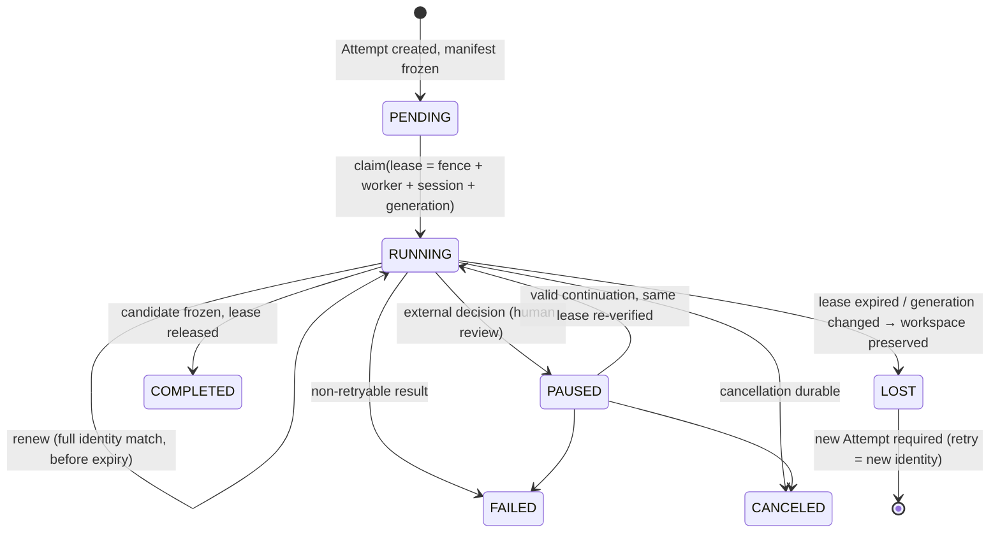

# Lease-Based Worker

> A lease is a random fence bound to a worker, a session, and a generation. It is not a credential, and it does not survive a restart.

## Problem

A worker crashes mid-Attempt. The orchestrator restarts the work on another worker. The first worker comes back and finishes — now two processes are writing to the same branch, and the first one reports "done" for a candidate the second one has already replaced. Or a worker's network partition heals after five minutes and it pushes evidence for an Attempt that was canceled. Distributed systems solved this with fencing tokens; agent frameworks mostly forgot.

## Context

Apply at Delivery Loop step 5 (Execute) and step 6 (Verify) for every Attempt, and for any long-running control-plane job (planning runs, verification runs, inference reservations). The pattern is the Runtime's ownership mechanism and the anchor for [recovery-checkpoint](/patterns/recovery-checkpoint), [publication-permit](/patterns/publication-permit), and [tool-grant-and-receipt](/patterns/tool-grant-and-receipt), each of which bounds its authority by the lease.

## Forces

| Force | Pull |
|---|---|
| Workers must survive restarts | A restarted worker is not the same owner |
| Heartbeats keep leases alive | A heartbeat from a stale generation must be rejected |
| Recovery should be automatic | Automatic reclaim must not create two owners |
| Late results are informative | Late results are history, never current evidence |
| Workers report their own load | Self-reported load is observational; the server counts leases |

## Solution

Model Attempt ownership as a **lease** with four parts: a random fencing id, the worker's stable id, the worker's ephemeral session id, and a server-derived generation. Rules:

1. **Claim atomically.** The claim transaction checks worker registration, heartbeat freshness, readiness (not draining), repository access, required harness and sandbox capabilities, the frozen execution manifest against the Factory Version, Execution Profile qualification, and the server-counted lease total. Any failure means no claim.
2. **Renew only the complete identity.** Renewal extends the lease only when fence, owner, worker, session, and generation all match and the lease has not expired.
3. **Re-check on every hardened mutation.** Every evidence write, checkpoint, tool authorization, and publication request re-verifies the active lease and the worker's current registration in the same transaction.
4. **Expire to LOST, not to retry.** When a lease expires with no renewal, the Attempt's disposition becomes `LOST` (or `RECOVERABLE` when a checkpoint exists); the workspace is preserved; continuing requires a new Attempt with a new lease.
5. **Never adopt a process by PID.** After a restart, a manifest's process id is never used to adopt or kill a process.
6. **Bound downstream authority by the lease.** Permits, grants, and credentials expire no later than the lease.

## Architecture

Late reports from a stale lease are rejected at every transition; they are recorded as history where useful, never as current evidence.

## When to Use

- Every Attempt, including verifier Attempts and automation Attempts.
- Planning runs and other long-running control-plane jobs that could be duplicated.
- Inference reservations and sandbox allocations that hold spend or resources.
- Any worker fleet larger than one, and any single worker that can restart.

## When Not to Use

- Pure request/response calls that complete inside one transaction. There is nothing to own.
- Human-owned tasks with no automated executor. Ownership is the assignment record.

## Failure Modes

| Failure | Symptom | Guard |
|---|---|---|
| Two owners | Two workers push the same branch | Fenced claim; single active mutating Attempt per repository |
| Zombie report | Restarted worker submits evidence for a canceled Attempt | Full-identity match on every write; generation changed → reject |
| Heartbeat without identity | Renewal by lease id alone | Renewal requires fence + worker + session + generation |
| Trusting self-reported load | Worker says `currentRuns: 0` while holding three | Server counts leases; the report is observational |
| Retry as resume | Expired lease re-claimed as the same Attempt | Expiry → `LOST`; new Attempt for every retry |
| Permit outlives lease | Publication after the worker lost ownership | Permit validity ≤ lease expiry minus safety window |

## Security Considerations

- A lease is not a credential: possession of the fence grants nothing without the server-side registration match. This limits what a leaked fence id can do.
- Worker registration is fail-closed; a worker that cannot prove its identity, session, and generation cannot claim.
- Service commands from workers are signed envelopes with expiry and a replay ledger; a replayed claim or renewal is denied.
- Cancellation is durable: once requested, no renewal succeeds and no evidence from that lease is current.

## Example

`ATT-104-03` is claimed by worker `w-17`, session `s-…`, generation 4, fence `lease-…`. The claim verifies the frozen manifest against `FV-depmod-1.0` and `EP-depmod-1.0-prod`, the worker's harness capabilities, and that no other mutating Attempt is active on `checkout-api`.

Mid-run, `w-17` restarts; its new session starts generation 5. Renewals from generation 4 fail. At expiry, `ATT-104-03`'s disposition becomes `RECOVERABLE` (a checkpoint exists); the workspace is preserved. The control plane creates `ATT-104-05` with a new lease bound to generation 5, which resumes from the checkpoint per [recovery-checkpoint](/patterns/recovery-checkpoint). When the old process's final "done" arrives fifteen seconds later, it is rejected: generation mismatch. It is stored as a late event on `ATT-104-03`, never as evidence for `CAND-104-05`.

(For the rest of the worked example, `ATT-104-03` completed without a restart; this scenario illustrates the LOST path.)

## Mission Control Implementation

FDLC requires fenced leases bound to worker, session, and generation; atomic admission-checked claims; full-identity renewal; re-verification on every hardened mutation; expiry to LOST with workspace preservation; and lease-bounded downstream authority. Mission Control implements this through:

| Element | Mission Control | Status |
|---|---|---|
| Lease tuple | `workflowRuns.lease {leaseId, ownerId, workerId, workerSessionId, workerGeneration, claimedAt, heartbeatAt, expiresAt}` (`convex/schema.ts:5287-5296`); "a random fencing ID bound to worker ID, session, and generation. It is not a credential" (`docs/software-factory/worker-runtime-operations.md`) | Available (Qualified) |
| Atomic claim with admission checks | `claimInternal` (`convex/factory/attempts.ts:531`): cancellation check, immutable binding presence, configuration digest match, frozen harness/model-route/backend/source binding validation, execution profile resolution | Available |
| Full-identity match | `activeLeaseMatches` (`convex/lib/factoryAttempt.ts:504-518`): lease id, owner, worker identity, unexpired; used by `renewInternal` (`attempts.ts:1330`) and every hardened mutation (for example `attempts.ts:1150`, `1480`, `2008`) | Available |
| Registration re-check | `factoryLeaseRegistrationIsCurrent` alongside lease match (`attempts.ts:1157`) | Available |
| LOST / RECOVERABLE | `runtimeDisposition: RETRYABLE|LOST|CANCELLED|FAILED|RECOVERABLE`; `staleExecutionRecovery` and `buildExecutionRecoverySummary` (`convex/lib/executionRecovery.ts`) | Available |
| Never adopt by PID | "A manifest PID is never used to adopt or kill a process after restart" (worker-runtime-operations.md) | Available |
| Lease-bounded permit | Publication validity = `min(approval.expiresAt, receipt.validUntil, lease.expiresAt)` minus `PUBLICATION_SAFETY_WINDOW_MS` (`attempts.ts:1298-1304`; `convex/lib/factoryHumanReview.ts:9`) | Available |
| Server-counted leases | Claim uses server-counted leases; "the reported `currentRuns` value is observational only" | Available |

Divergence: Mission Control operates a single outbound-polling worker per host and does not claim fleet-scale enrollment; FDLC states the lease rules for fleets of any size. `checkpointLease` in Mission Control is a historical record at a pause, explicitly "never an active lease or authority" (`convex/schema.ts:5281-5286`), which matches FDLC's distinction between checkpoint and lease.

## Related Patterns

- [recovery-checkpoint](/patterns/recovery-checkpoint) — what happens after LOST
- [sandbox-per-work-order](/patterns/sandbox-per-work-order) — credentials that expire with the lease
- [publication-permit](/patterns/publication-permit) — permits bounded by the lease
- [tool-grant-and-receipt](/patterns/tool-grant-and-receipt) — tool authorization checks the lease
- [bounded-agent](/patterns/bounded-agent) — the agent the worker hosts

## Related Anti-patterns

- [hidden-agent-state](/anti-patterns/hidden-agent-state)
- [shared-mutable-workspace](/anti-patterns/shared-mutable-workspace)
- [infinite-retry-loop](/anti-patterns/infinite-retry-loop)

## Specification references

- [/specification/v1/attempt](/specification/v1/attempt) — lease fields, dispositions, "retries create new Attempts"
- [/architecture/execution-vocabulary](/architecture/execution-vocabulary) — Runtime, Orchestrator, leases, queues
- [/enterprise/execution-fleet](/enterprise/execution-fleet) — worker admission at scale
- Manifesto principle 4 ([/framework/principles](/framework/principles))
