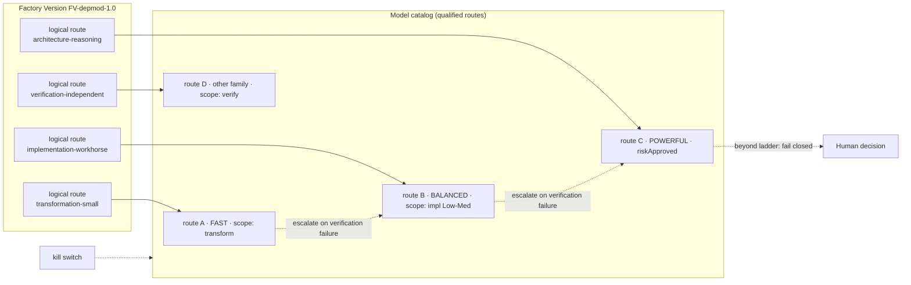

# Model Routing

> Models reason. Control planes govern. A logical route names the kind of reasoning a task needs; a qualified provider supplies it; an escalation ladder says what happens when it is not enough.

## Problem

Factories hard-code a model. When the provider deprecates it, every prompt breaks at once. When a cheaper model appears, nobody can adopt it without editing every agent. When a task is harder than expected, the agent either fails or someone manually reruns it "on the big model". Verification runs on the same model as production, so both share the same blind spots. Cost is optimized per token, which rewards volume, not accepted outcomes.

## Context

Apply at routing Level 3 (Task → model) inside a Factory Version. The pattern is the Model area's core mechanism: provider abstraction, capability matching, fallback control, and cost attribution. It composes with [capability-based-routing](/patterns/capability-based-routing) (which selected the version) and [fail-closed-qualification](/patterns/fail-closed-qualification) (which qualified each route).

## Forces

| Force | Pull |
|---|---|
| Frontier models are best at hard reasoning | They are slow and expensive for transformation work |
| Small models are cheap and fast | They fail silently on architecture decisions |
| Providers change weekly | The factory version must not |
| Escalation improves success | Uncontrolled escalation is a cost sink and a qualification bypass |
| Independent verification wants a different model | Different is not automatically qualified |

## Solution

Separate three identities:

| Identity | What it is | Who owns it |
|---|---|---|
| **Logical route** | A named reasoning class the factory needs: `architecture-reasoning`, `implementation-workhorse`, `transformation-small`, `verification-independent` | Factory Version |
| **Model route** | A qualified binding of a logical route to `provider + modelId + parameters + cost policy`, with a digest and a qualification scope | Model catalog (registry) |
| **Runtime identity** | Harness + runtime artifact + execution backend that invokes the route | Execution Profile |

Task routing resolves a logical route to exactly one admitted model route per Attempt and freezes it into the execution manifest. Neither the router nor the harness may substitute a different route mid-Attempt.

**Escalation ladder.** Each logical route declares an ordered, prequalified ladder (for example `transformation-small → implementation-workhorse → architecture-reasoning`). Escalation is triggered only by verification evidence (a failed independent check, an explicit blocked verdict), never by the agent's self-assessment. Each rung is a new Attempt with its own cost attribution. Escalation beyond the ladder, or into an unqualified route, fails closed. A kill switch disables a route fleet-wide.

**Verification route.** The `verification-independent` route must resolve to a model route with a different provider or model family from the producer's route where policy requires it, and must itself be qualified for verification workloads.

**Economics.** Every routing decision carries an estimated cost; every Attempt carries measured cost or an explicit `UNKNOWN`. The optimization target is cost per accepted outcome, including failed and escalated Attempts in the denominator.

## Architecture

## When to Use

- Any factory with more than one kind of task (research, implementation, transformation, review).
- Any factory whose Work Orders span risk tiers: High and Critical tiers require risk-approved routes.
- Independent verification with model-based checks.
- Cost governance: budgets are enforced per Work Order and per route.

## When Not to Use

- Deterministic Work Orders that need no inference (offline, isolated-container execution). Declare `inference: DENIED` and no route.
- A single-route prototype with no verification. Still name the logical route so the version is portable later.

## Failure Modes

| Failure | Symptom | Guard |
|---|---|---|
| Hard-coded provider | Provider deprecation breaks the factory | Logical route indirection; routes replaceable by new Factory Version |
| Self-triggered escalation | Agent "decides" it needs the bigger model | Escalation only on verification evidence; each rung a new Attempt |
| Fallback weakens qualification | Rate limit routes to an unqualified model | Fallback chain restricted to qualified routes in scope |
| Same model verifies itself | Producer and verifier share blind spots | Verification route policy requires a different family where required |
| Token-price optimization | Cheapest route everywhere; rework explodes | Optimize cost per accepted outcome, failed Attempts included |
| Silent zeros | Missing cost recorded as 0 | Cost is `MEASURED`, `ESTIMATED`, or `UNKNOWN`; never invented |

## Security Considerations

- Model routes carry credential classes (attempt-scoped provider keys, never long-lived keys in the sandbox).
- A model route's provider endpoint is part of the egress allowlist; routing to a new provider is a network-policy change and therefore a new Factory Version.
- Provider "availability" signals are untrusted operational inputs; they may pause a route but never widen a scope.
- Route qualification evidence must include unsupported-action and hallucinated-effect tests, not only accuracy.

## Example

`FV-depmod-1.0` declares four logical routes. `WO-104-01`'s Tasks route: SDK migration edits → `implementation-workhorse` (route B, BALANCED, qualified for `SOFTWARE_CHANGE` at Low–Medium); import rewrites → `transformation-small` (route A); independent review of the diff → `verification-independent` (route D, a different model family, qualified for verification).

`ATT-104-01` ran the migration on route A first (illustrative ladder choice); the independent verifier failed the contract tests. Per ladder, `ATT-104-02` escalated to route B and failed on a type error; `ATT-104-03` on route B with the corrected context passed. All three Attempts' costs — measured for the two provider-attributed runs, `UNKNOWN` for one where the provider omitted usage — sit in the denominator of cost per accepted outcome for `WO-104-01`. A hypothetical escalation to route C would require Medium-tier policy to allow it; route C is `riskApproved` and in scope, so it would be permitted; a fifth rung does not exist and would fail closed to a human decision.

## Mission Control Implementation

FDLC requires logical-route indirection, qualified model routes with digests, frozen per-Attempt route binding, evidence-triggered escalation along prequalified ladders, a kill switch, and honest cost attribution. Mission Control implements this through:

| Element | Mission Control | Status |
|---|---|---|
| Model catalog and route identity | `modelCatalog` (`convex/schema.ts:1763`): `tier: FAST|BALANCED|POWERFUL`, `capabilities[]`, `riskApproved`, `availability`, exact-route lifecycle `providerRoute`, `routeSnapshot`, `routeDigest` (`factory-model-route/v2`), `qualificationStatus`, `admissionStatus`, `costPolicyDigest`; admission in `convex/lib/modelRouteAdmission.ts` | Available (Implemented) |
| Route ↔ runtime separation | ADR `docs/decisions/model-route-runtime-identity-separation.md`; four-part identity (model route / harness / runtime artifact / execution backend) | Available |
| Policies, lanes, fallback, kill switch | `modelRoutingPolicies` (`convex/schema.ts:1819`): `rules[] {taskType, operatingLane: PLAN|EXECUTE|REVIEW|LOCAL|LONG_RUNNING, riskLevel, complexity, requiredCapabilities, modelId}`, `lanePools`, `fallbackChain`, `killSwitch`, `canaryPercent` | Available |
| Frozen per-Attempt binding | `claimInternal` verifies the manifest's route digest and qualification digest against the version (`convex/factory/attempts.ts:592-642`); "Neither the router nor the profile can substitute another profile, model route, harness, runtime artifact, backend, or adapter" (`docs/architecture/execution-routing-v1.md`) | Available |
| High/Critical requires risk-approved route | `modelApproved` requires `catalogModel.riskApproved` for `HIGH|CRITICAL` (`convex/lib/executionRouting.ts:515-524`) | Available |
| Cost honesty | `workflowRuns.actualCost.status: MEASURED|UNAVAILABLE`; "Mission Control never invents zeroes"; "failed and retried Attempt spend remains part of the denominator cost" | Partial (governed inference accounting Experimental, default off) |
| Route comparison / promotion | `inferenceRouteComparisons.automaticPromotionAuthorized: v.literal(false)` | Available (advisory only) |

Divergences: (1) Mission Control's escalation is expressed through policy `fallbackChain` and lane pools, not as a named per-logical-route ladder with evidence-only triggers; FDLC states the ladder and trigger rule normatively. (2) Logical route names (`architecture-reasoning`, `implementation-workhorse`, `transformation-small`, `verification-independent`) are FDLC's; Mission Control uses `operatingLane` and `tier`. (3) Different-family verification is an FDLC policy option; Mission Control separates producer and verifier by Factory Version purpose, not by model family.

## Related Patterns

- [capability-based-routing](/patterns/capability-based-routing) — Levels 1–2
- [fail-closed-qualification](/patterns/fail-closed-qualification) — route qualification scope
- [immutable-factory-version](/patterns/immutable-factory-version) — where logical routes live
- [independent-verifier](/patterns/independent-verifier) — the verification route
- [degraded-mode](/patterns/degraded-mode) — provider degradation and kill switches

## Related Anti-patterns

- [model-lock-in](/anti-patterns/model-lock-in)
- [cheapest-model-everywhere](/anti-patterns/cheapest-model-everywhere)
- [frontier-model-everywhere](/anti-patterns/frontier-model-everywhere)

## Specification references

- [/specification/v1/capability-manifest](/specification/v1/capability-manifest) — kind `model-route`
- [/specification/v1/execution-profile](/specification/v1/execution-profile) — admitted route per Attempt
- [/specification/v1/attempt](/specification/v1/attempt) — frozen route in the execution manifest
- [/architecture/economics](/architecture/economics) — cost denominators
- Design principles 9, 10 ([/framework/principles](/framework/principles))
