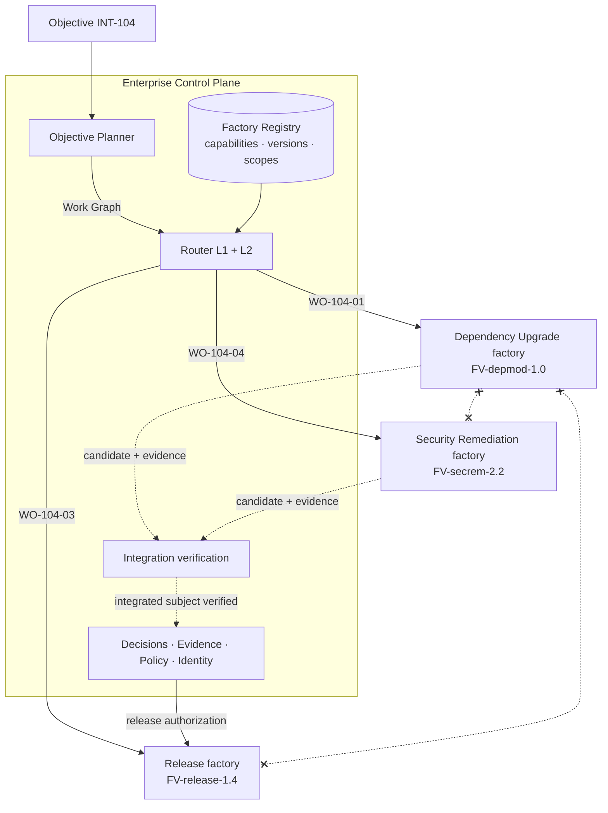

# Multi-Factory Orchestration

> Organizations operate many specialized factories, not one universal factory. Factories execute bounded work. Factories do not orchestrate one another.

## Problem

An organization builds a code-generation factory. It works, so someone adds a "call the security factory" step to it, then a "call the release factory" step. Now the code factory holds the objective, the security factory's credentials, and the release factory's authority. When the security factory changes its interface, the code factory breaks. When a release fails, three factories' logs must be correlated by hand. Nobody can say which factory version was responsible, and the blast radius of any one factory's compromise is all of them.

## Context

Apply when an Objective needs more than one specialized factory (code generation + security remediation + release; migration + test generation + documentation) or when factories are owned by different teams. This is the Factory Ecosystem shape and the home of routing Level 1. It composes [objective-decomposition](/patterns/objective-decomposition) (the Plan spans factories), [capability-based-routing](/patterns/capability-based-routing) (which factories), and [independent-verifier](/patterns/independent-verifier) (integration verification).

## Forces

| Force | Pull |
|---|---|
| Specialized factories are better at their job | They must compose without coupling |
| Direct factory-to-factory calls are simple | They move authority sideways and hide the objective |
| One universal factory avoids integration | It cannot be qualified, owned, or governed as a unit |
| Each factory verifies its own Work Order | Nobody verifies the integrated result |
| Federated ownership scales | It needs a shared control plane for identity, policy, routing, evidence |

## Solution

**One control plane holds the Objective.** An Objective Planner in the control plane decomposes the Objective into a dependency graph of Work Orders and, via Level 1 routing, assigns each Work Order to a factory that declares the required capability in the **Factory Registry**. Each factory receives only its Work Order, executes under its own qualified Factory Version, and returns a candidate and evidence to the control plane.

Rules:

- **No lateral calls.** A factory never dispatches work to another factory, never holds another factory's credentials, and never consumes another factory's output except through the control plane's Work Graph.
- **Shared services, not shared authority.** Identity, policy, routing, verification, evidence, observability, and organizational authority are shared control-plane services. Execution authority is per factory version per Work Order.
- **Integration verification is a control-plane step.** After dependent Work Orders complete, an integration Verification Subject is formed over the combined candidates (across repositories where needed) and verified by an independent verifier factory. Objective-level acceptance consumes this, not the sum of Work Order verifications.
- **Registry with scopes.** The Factory Registry lists factories, their active versions, declared capabilities, qualification scopes, owners, and tenancy; the Capability Registry lists implementations. Discovery is descriptive; admission is qualification.
- **Creation test.** Create a separate factory only when outcome semantics, ownership, qualification, governance, authority, or lifecycle materially differ.

Why: governance (one place to say no), composability (factories are replaceable), observability (one trace tree per Objective), recovery (the control plane knows what is outstanding), security (no lateral credential flow), determinism (the graph is explicit), auditability (every hop is a Decision).

## Architecture

Crossed edges are prohibited paths: factories do not call factories.

## When to Use

- Any Objective requiring capabilities owned by different factories or teams.
- Enterprise ecosystems at maturity L5 (Factory Ecosystem) and the path to it from L4.
- Cross-repository changes (an API change plus its consumers).
- Any situation where a factory has grown "call other factory" steps.

## When Not to Use

- A single local factory serving one bounded context. Level 1 routing is trivial; do not build a registry for one entry.
- Do not split a factory only to create parallelism; split on the creation test.

## Failure Modes

| Failure | Symptom | Guard |
|---|---|---|
| Lateral orchestration | Factory A's workflow has a "dispatch to B" step | Prohibited by policy; factories have no dispatch permission |
| Credential sharing | Factory A holds B's tool grant | Grants are per Factory Version per Work Order |
| Missing integration verification | Every Work Order verified; integrated change untested | Objective-level Verification Subject and verifier |
| Universal factory | One factory with 40 capabilities and no owner | Creation test; registry requires owner and scope per factory |
| Hidden objective | Nobody can list outstanding work for `INT-104` | Work Graph in the control plane; one trace tree |
| Version ambiguity | "The security factory" ran, version unknown | Routing Decision binds the exact Factory Version |

## Security Considerations

- Tenancy boundaries are enforced in the control plane, not in factories: a factory receives Work Orders only for scopes its version is qualified and authorized for.
- Cross-factory data flow (candidate A into factory B's context) passes through the control plane with per-item authorization ([context-package](/patterns/context-package)).
- Workload identity per factory version; delegation chains recorded so that a compromised factory's blast radius is its own Work Orders.
- The registry is a governed record: adding a factory or a capability is a Decision with an owner; discovery does not admit.

## Example

`INT-104` needs three capabilities: `dependency-upgrade`, `security-scan-remediation` (the v4 SDK changes a TLS default), and `release`. The Objective Planner produces a graph: `WO-104-01` → Dependency Upgrade factory (`FV-depmod-1.0`); `WO-104-04` → Security Remediation factory (`FV-secrem-2.2`), depends on 01; `WO-104-03` → Release factory (`FV-release-1.4`), depends on integration verification.

Each factory sees only its Work Order. `CAND-104-03` (from 01) and `CAND-104-08` (from 04, illustrative) are combined into an integration Verification Subject over `checkout-api` at the merged head; an independent verifier factory runs contract and integration tests plus the security policy suite and returns `VER-104-05`. Objective-level acceptance `DEC-104-05` consumes `VER-104-05`, not merely `VER-104-02` and the security factory's own receipt. Only then does `DEC-104-04` (release-authorization) let `WO-104-03` run. At no point did the dependency factory talk to the security factory.

## Mission Control Implementation

FDLC requires a Factory Registry with declared capabilities and qualification scopes, an Objective Planner and Level 1 routing in the control plane, prohibition of factory-to-factory dispatch, and integration verification across Work Orders and factories. Mission Control implements this through:

| Element | Mission Control | Status |
|---|---|---|
| Multiple factories per workspace | `factoryDefinitions` indexed `by_repository_purpose_status` (`convex/schema.ts:1219`); one definition per repository × purpose (`SOFTWARE|VERIFICATION|INTELLIGENT_AUTOMATION`) | Available |
| Purpose-separated producer/verifier factories | Verifier Factory selection by `purpose: VERIFICATION` with `activeVersionId` (`convex/factory/attempts.ts`) — a two-factory orchestration through the control plane, never lateral | Available (Qualified) |
| Control plane holds the Objective | `missions` and `missionPlans`; dispatch and acceptance are control-plane mutations; harness `prohibitedAuthorities` prevent lateral authority | Available |
| Factory Registry with capabilities | — | Planned (Missing): the only "factory registry" hit is a harness-adapter registry; no capability declarations or cross-workspace discovery |
| Objective Planner across factories | — | Planned (Missing): `missionPlanningRuns` plan one Mission for one repository; portfolio decomposition is manual |
| Level 1 routing | — | Planned: `convex/lib/executionRouting.ts:376-378` loads at most 25 active Factory Versions for the Work Order's repository |
| Integration verification | — | Planned: verification is per Work Order/candidate; "multi-repository Missions" is a revisit trigger in `docs/decisions/verification-first-architecture-decisions.md` |
| External factory package import | `factoryPackageImports` (`fdlc.factory-deployment-package/v1`, `convex/schema.ts:2142-2192`) imports a package into a Mission/Plan draft — an intake receipt, not orchestration | Experimental |

Divergence: Mission Control demonstrates the *principle* (the control plane, not a factory, selects the verifier factory and holds acceptance) but not the *ecosystem* (registry, Objective Planner, Level 1 routing, integration V&V). FDLC must specify these itself; this page and [/architecture/multi-factory](/architecture/multi-factory) do so as requirements, not as Mission Control features.

## Related Patterns

- [capability-based-routing](/patterns/capability-based-routing) — Levels 1–2
- [objective-decomposition](/patterns/objective-decomposition) — the Plan that spans factories
- [immutable-factory-version](/patterns/immutable-factory-version) — the registry entries
- [independent-verifier](/patterns/independent-verifier) — integration verification
- [decision-record](/patterns/decision-record) — every hop is a Decision

## Related Anti-patterns

- [agent-to-agent-spaghetti](/anti-patterns/agent-to-agent-spaghetti)
- [the-mega-agent](/anti-patterns/the-mega-agent)
- [agent-has-production-credentials](/anti-patterns/agent-has-production-credentials)

## Specification references

- [/specification/v1/plan](/specification/v1/plan) — Work Graph across factories
- [/specification/v1/factory-manifest](/specification/v1/factory-manifest) — declared capabilities, inputs/outputs
- [/specification/v1/verification](/specification/v1/verification) — Objective / integration level
- [/architecture/multi-factory](/architecture/multi-factory) — the principle and its seven reasons
- [/enterprise/reference-architecture](/enterprise/reference-architecture) — ecosystem at scale
- Design principle 3; canon §4.4 ([/framework/principles](/framework/principles))
