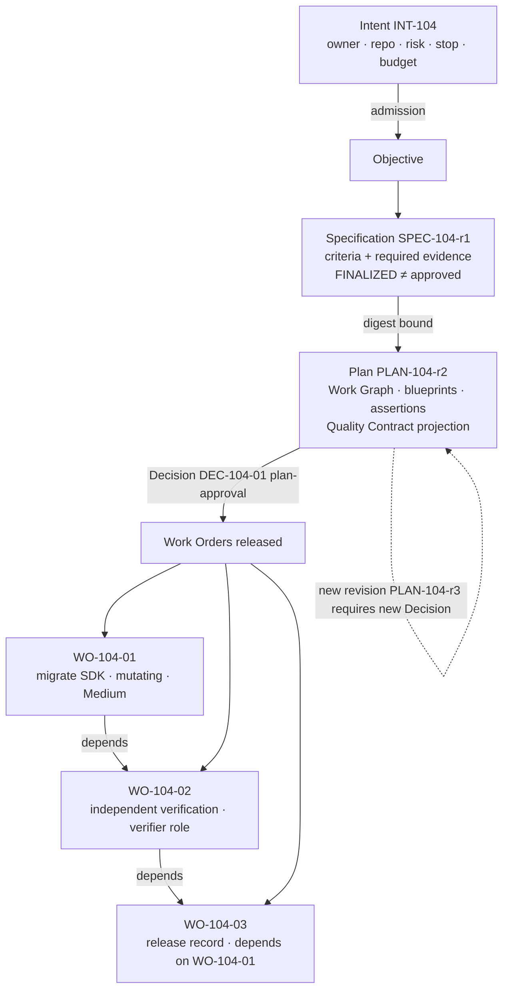

# Objective Decomposition

> Builders define the what. Factories determine the how. The Plan is where the how is written down, approved as one revision, and turned into bounded Work Orders.

## Problem

An objective ("upgrade the payments SDK") is handed to an agent as a single task. The agent decides scope, sequence, risk, and verification on the fly, inside its context window. Half the work touches things nobody expected. There is no dependency graph, so parallel runs collide. There is no revision, so "the plan changed" means the chat scrolled. Approval, if it happened, approved a summary, not the plan that ran.

## Context

Apply at Delivery Loop steps 1–3 (Receive, Specify, Plan) and as the input to step 4 (Route). The pattern produces the Work Orders that [bounded-agent](/patterns/bounded-agent) executes and the verification strategy that [verification-contract](/patterns/verification-contract) binds. In an ecosystem, Level 1 routing ([multi-factory-orchestration](/patterns/multi-factory-orchestration)) decomposes across factories; this pattern decomposes within one Plan.

## Forces

| Force | Pull |
|---|---|
| Agents plan well | Agent plans are disposable unless made artifacts |
| Small Work Orders are safer | Too many Work Orders fragment verification |
| Plans change | Change must be a new revision with a new approval |
| Parallelism is throughput | Concurrent mutation of one repository is a race |
| Approval is a bottleneck | Approval of the exact revision is the only meaningful approval |

## Solution

Decompose in three governed artifacts:

**Intent** — the requested outcome with owner, constraints, repository scope, risk class, stop condition, and budget. Admission checks it is well-formed and owned. An admitted Intent is the Objective.

**Specification** — an immutable revision stating what must be true: requirements (MUST/SHOULD), acceptance criteria (given/when/then) each with required evidence, non-goals, constraints, risks, verification expectations. A deterministic quality evaluation gates finalization. Finalized means planning-ready; it is not approved and carries no execution authority.

**Plan** — a versioned revision that binds the exact Specification digest and contains:

| Element | Content |
|---|---|
| Work Graph | Nodes (Work Order blueprints), dependencies, gates, joins, terminal states |
| Work Order blueprints | Role (worker / verifier), `isMutating`, risk level, implementation policy (allowed command classes, max files/lines/cost/attempts, timeout, stop condition), independent verification requirement, dependency edges, linked assertions |
| Assertions | Verification method (`COMMAND`, `TEST`, `BROWSER`, `MANUAL`, `CHECKLIST`), independence requirement, waiver policy; traced to Specification requirement ids |
| Strategy | Sequence, candidate strategy, rollback approach, estimated cost |
| Quality Contract | A compiled projection (with digest) of the Plan's assertions and blueprints; not a separate aggregate |

Rules: the Plan is editable only in draft; submission freezes it; the author cannot approve; approval (`Decision` kind plan-approval) binds one exact revision, compiles the Quality Contract, and releases Work Orders idempotently; approval dispatches nothing; a newer Specification never silently rebinds a Plan; one repository-mutating Work Order active per Objective (serial mutations) unless the graph proves disjoint scopes; Task completion does not accept a Work Order and Work Order completion does not accept the Objective.

## Architecture

## When to Use

- Every Objective that will produce a mutating Work Order.
- Any work spanning more than one bounded change, more than one repository, or more than one factory.
- Any regulated context where "what was approved" must equal "what ran".
- Improvement Candidates entering delivery: they become Plans too.

## When Not to Use

- Read-only research Intents that produce no candidate may use a single-node Plan; still record the revision.
- Do not decompose below the level at which verification is meaningful: a Work Order must be independently verifiable against its acceptance criteria.

## Failure Modes

| Failure | Symptom | Guard |
|---|---|---|
| Plan as chat | The plan is a message in the agent transcript | Plan is a versioned artifact with digest |
| Approval of a summary | Human approved prose; Work Orders differ | Approval binds revision digest; Work Orders released from that revision |
| Silent rebind | Specification edited after Plan approval | Specification is immutable revisions; Plan binds a digest |
| Concurrent mutation | Two Work Orders edit the same repository | Serial mutation policy; one active mutating Attempt per repository |
| Author approves | Planner agent submits and approves | Author ≠ approver |
| Approval dispatches | Approving a Plan starts execution | Approval writes a Decision; dispatch is separate admission |
| Unverifiable criteria | "Should feel faster" | Each criterion maps to evidence category and verifier ([verification-contract](/patterns/verification-contract)) |

## Security Considerations

- Blueprints carry the authority envelope that bounds the agent: allowed command classes, data boundaries, and negative constraints must be present at planning, not invented at execution.
- A planning agent is a bounded agent: its planning run has a lease, a budget, and no authority to submit, approve, dispatch, publish, verify, or accept.
- Risk classification on blueprints is a server-owned minimum; the planner may raise it, not lower it.
- Multi-repository or cross-tenant Plans need scope authorization for each repository at approval.

## Example

`INT-104` is received: "Upgrade the Acme Payments SDK from v3 to v4 in `checkout-api` without changing public API behavior", owner the payments team lead, risk Medium, stop condition "any public API or auth behavior change", budget cap. Admission passes.

`SPEC-104-r1` states four acceptance criteria with required evidence (tests pass on the exact candidate; no v3 imports or shims; no public API/schema/auth changes; release record has rollback and owner). Quality evaluation PASS; finalized.

A planning run drafts `PLAN-104-r1`; a Builder edits the rollback approach, producing `PLAN-104-r2`, and submits. The Work Graph has three blueprints: `WO-104-01` (worker, mutating, Medium, files ≤ 40, commands `BUILD|TEST|LINT|DEPENDENCY_SCAN`, independent verification required), `WO-104-02` (verifier role, depends on 01), `WO-104-03` (release record, depends on 02). Assertions trace each criterion to `SPEC-104-r1` requirement ids. A different human records `DEC-104-01`; the Quality Contract projection is compiled and digested; three Work Orders are released; nothing is dispatched yet. Route then binds `WO-104-01` to `FV-depmod-1.0`.

## Mission Control Implementation

FDLC requires an admitted Intent, immutable Specification revisions with FINALIZED ≠ approved, a versioned Plan with Work Graph and blueprints bound to the Specification digest, author ≠ approver, approval ≠ dispatch, idempotent release of Work Orders, and serial mutation. Mission Control implements this through:

| Element | Mission Control | Status |
|---|---|---|
| Intent / Objective | `missions` (`convex/schema.ts:1969`): `objective`, `constraints[]`, `sourceOfTruthRefs[]`, `repositoryId`, `codeScopeIds[]`, `executionPolicy: "SERIAL_MUTATIONS"`, `stopCondition`, `budgetUsd`; 11 states from `DRAFT` to `DONE|CANCELED|SUPERSEDED` | Available (Qualified) |
| Specification | `missionSpecRevisions` (insert-only, `baseRevisionId`, `digest`), `missionSpecQualityEvaluations` (`PASS|FAIL`, ruleset version), `missionSpecDecisions` with `decisionType: v.literal("FINALIZED")` — "planning-ready only ... not APPROVED" (`convex/schema.ts:2292-2350`) | Experimental (Qualified; default off behind `missions.spec-intake-v1`) |
| Plan | `missionPlans` (`convex/schema.ts:2029`): `revisionNumber`, `status: DRAFT|PROPOSED|APPROVED|REJECTED|SUPERSEDED`, `missionSpecDigest`, `assertions[]` with `sourceRequirementIds`, `workOrderBlueprints[]` (role `WORKER|VALIDATOR`, `isMutating`, `riskLevel`, `implementationPolicy`, `dependsOnBlueprintIds`, `assertionIds`), `qualityContractProjection` + `qualityContractDigest`, `releaseIdempotencyKey`, `releasedWorkOrderIds[]` | Available (Qualified) |
| Planning run | `missionPlanningRuns` (`QUEUED → RESEARCHING → GENERATING → VALIDATING → SUCCEEDED|FAILED|CANCELED`, leased); "cannot submit, approve, dispatch, publish, verify, or accept delivery work" (`convex/schema.ts:2194-2196`) | Available |
| Rules | Editable only in `DRAFT`; author cannot approve; approval compiles the Quality Contract and releases Work Orders idempotently (VF-002); "Approval never dispatches an agent..." (`docs/software-factory/governed-missions-contract.md`); "A newer Spec never silently rebinds an existing Plan" (`docs/OVERVIEW.md`); "Task completion does not accept a WorkOrder, and WorkOrder completion does not accept a Mission" | Available |
| Serial mutation | `executionPolicy: SERIAL_MUTATIONS` (only value); one active mutating Attempt per repository across Missions | Available |

Divergence: Mission Control binds a Mission to one repository; multi-repository Objectives are a listed revisit trigger. FDLC's Plan may span repositories and factories (Level 1 routing). Mission Control's Work Graph is expressed through blueprint dependency edges and the workflow step kinds (`AGENT|REDUCE|ROUTER|VERIFY|GATE|DETERMINISTIC`); FDLC's Work Graph vocabulary (nodes, gates, joins, terminal states) maps onto these.

## Related Patterns

- [bounded-agent](/patterns/bounded-agent) — executes the released Work Orders
- [verification-contract](/patterns/verification-contract) — the assertions and required evidence
- [capability-based-routing](/patterns/capability-based-routing) — routes each Work Order
- [multi-factory-orchestration](/patterns/multi-factory-orchestration) — decomposition across factories
- [human-authority-gate](/patterns/human-authority-gate) · [decision-record](/patterns/decision-record) — plan approval

## Related Anti-patterns

- [the-mega-agent](/anti-patterns/the-mega-agent)
- [agent-to-agent-spaghetti](/anti-patterns/agent-to-agent-spaghetti)
- [prompt-as-governance](/anti-patterns/prompt-as-governance)

## Specification references

- [/specification/v1/intent](/specification/v1/intent) — admission, Objective role
- [/specification/v1/specification](/specification/v1/specification) — immutable revisions, FINALIZED ≠ approved
- [/specification/v1/plan](/specification/v1/plan) — Work Graph, blueprints, Quality Contract projection, approval binds one revision
- [/specification/v1/work-order](/specification/v1/work-order) — released from an approved Plan
- [/framework/delivery-loop](/framework/delivery-loop) — steps 1–4
- Design principle 3; Manifesto principles 1, 2 ([/framework/principles](/framework/principles))
