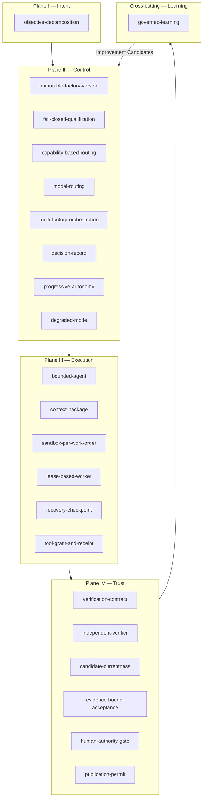

# FDLC Pattern Library

## What is it

A pattern is a named, reusable solution to a recurring design problem in an AI software factory. Each pattern in this library states the problem, the forces that make it hard, the solution, a diagram, when to use it and when not to, its failure modes, its security considerations, a concrete example from the dependency-modernization worked scenario, and how Mission Control (the FDLC reference implementation) implements it today, with ledger status.

Patterns are not requirements. The FDLC specification states what a conforming factory MUST do; patterns describe proven ways to do it. Where a pattern is the only known way to satisfy a MUST, the pattern page says so.

## Why it matters

The failure modes of autonomous delivery are not novel. They are the failure modes of distributed systems (lost ownership, duplicate side effects, stale reads), of supply chains (unpinned dependencies, unattributable builds), and of governance (authority inferred from capability) — now triggered by an actor that can act faster than a human can review. The patterns here are the distributed-systems, supply-chain, and governance answers applied to the factory.

The design principle each pattern serves is listed in its page. Two principles recur most: *The model proposes. The system decides what becomes real.* and *Evidence enables authority. Missing, stale, or unrelated evidence cannot become success.*

## How it works

Authority flows down the planes; evidence flows back up. Patterns in Plane II hold authority; patterns in Plane III execute under it; patterns in Plane IV exercise it on candidates; the Learning pattern proposes changes that re-enter Plane II as a new Factory Version.

## Pattern index

| Pattern | Problem it solves | Layer / area | Related anti-patterns |
|---|---|---|---|
| [bounded-agent](/patterns/bounded-agent) | Agents act with open-ended goals, tools, budgets, and no attributable identity | L5 Agent & Harness · Execution | the-mega-agent, unlimited-tool-access, agent-as-authorization-system, hidden-agent-state |
| [independent-verifier](/patterns/independent-verifier) | The producer judges its own work, so correlated errors pass | L8 Verification · Trust | self-verifying-agent, no-candidate-identity |
| [immutable-factory-version](/patterns/immutable-factory-version) | Nobody can say which composition produced a result or roll it back | L3 Control Plane · Trust | mutable-production-factory, no-versioning, prompt-as-governance |
| [evidence-bound-acceptance](/patterns/evidence-bound-acceptance) | Completion reports are accepted as proof | L8–L10 · Trust | no-evidence-lineage, self-verifying-agent |
| [human-authority-gate](/patterns/human-authority-gate) | Approval is a UI state, not an enforced authority boundary | L10 Authority & Release · Trust | agent-as-authorization-system, human-approval-everywhere, prompt-as-governance |
| [capability-based-routing](/patterns/capability-based-routing) | Work goes to whichever agent is handy, not a qualified factory | L4 Routing & Orchestration · Control | agent-to-agent-spaghetti, no-qualification, the-mega-agent |
| [model-routing](/patterns/model-routing) | One model for everything, or ad hoc model choice with no evidence | L5 model routes · Model | model-lock-in, cheapest-model-everywhere, frontier-model-everywhere |
| [sandbox-per-work-order](/patterns/sandbox-per-work-order) | Effects escape; credentials leak; workspaces collide | L7 Execution Environment · Execution | no-sandbox, shared-mutable-workspace, agent-has-production-credentials |
| [lease-based-worker](/patterns/lease-based-worker) | Two workers own one Attempt; a zombie reports late | L4 leases · Execution | hidden-agent-state, shared-mutable-workspace, infinite-retry-loop |
| [fail-closed-qualification](/patterns/fail-closed-qualification) | Unknown qualification is treated as pass | L3 registries · Trust | no-qualification, no-versioning |
| [candidate-currentness](/patterns/candidate-currentness) | An old pass is reused for a newer candidate | L9 Evidence & Provenance · Trust | no-candidate-identity, no-evidence-lineage |
| [context-package](/patterns/context-package) | Nobody knows what the agent saw; context grants authority by implication | L6 Context & Knowledge · Capability | invisible-context, context-dumping |
| [recovery-checkpoint](/patterns/recovery-checkpoint) | Retries repeat unknown external effects and rewrite history | L4/L7 runtime · Execution | infinite-retry-loop, hidden-agent-state |
| [progressive-autonomy](/patterns/progressive-autonomy) | Autonomy is a global toggle instead of an earned, risk-tiered scope | L3 policy · Trust | human-approval-everywhere, no-qualification, hidden-learning |
| [governed-learning](/patterns/governed-learning) | The factory rewrites its own controls from model confidence | L12 Learning | hidden-learning, mutable-production-factory, no-outcome-metrics |
| [objective-decomposition](/patterns/objective-decomposition) | One opaque task hides scope, risk, and dependencies | L2 Intent & Planning · Intent | the-mega-agent, agent-to-agent-spaghetti |
| [multi-factory-orchestration](/patterns/multi-factory-orchestration) | Factories call each other; no one holds the objective | L3/L4 · Control | agent-to-agent-spaghetti, the-mega-agent |
| [decision-record](/patterns/decision-record) | Decisions live in chat logs and browser state | L3/L10 · Trust | agent-as-authorization-system, prompt-as-governance, no-evidence-lineage |
| [tool-grant-and-receipt](/patterns/tool-grant-and-receipt) | Tool discovery is treated as tool authority | L5 tools · Capability | unlimited-tool-access, agent-has-production-credentials |
| [publication-permit](/patterns/publication-permit) | A verified candidate is pushed by whoever holds the token | L10 publication · Trust | agent-has-production-credentials, no-candidate-identity |
| [verification-contract](/patterns/verification-contract) | Acceptance criteria have no verifier; "tests pass" means nothing specific | L2/L8 · Trust | no-evidence-lineage, prompt-as-governance, self-verifying-agent |
| [degraded-mode](/patterns/degraded-mode) | A provider outage silently widens authority or weakens qualification | L3/L11 · Govern · Observe | infinite-retry-loop, frontier-model-everywhere, hidden-agent-state |

22 patterns above are fully authored to the canon page template. Enterprise, architecture, and economics pages reference additional named patterns not yet written up in full — see [Proposed Patterns (Unwritten)](/patterns/proposed) for the honest list.

## Worked-example key

Every pattern example uses the dependency-modernization scenario (upgrade the Acme Payments SDK from v3 to v4 in `checkout-api`; illustrative, not a benchmark). Identifiers follow the canon scheme.

| Artifact | Example id | Note |
|---|---|---|
| Intent | `INT-104` | Owner, repository, constraints, risk class |
| Specification | `SPEC-104-r1` | Finalized, not approved |
| Plan | `PLAN-104-r2` | Approved revision; binds `SPEC-104-r1` digest |
| Work Order | `WO-104-01` | Bounded repository change; risk tier Medium |
| Factory Version | `FV-depmod-1.0` | Immutable composition; next candidate `FV-depmod-1.1` |
| Execution Profile | `EP-depmod-1.0-prod` | Admitted composition; verifier profile `EP-depmod-verify-1.0` |
| Context Package | `CTX-104-03` | Frozen, digested, advisory |
| Producer Attempt | `ATT-104-03` | Third try; `ATT-104-01`/`-02` failed and are preserved |
| Verifier Attempt | `ATT-104-04` | Separate lease, worktree, invocation |
| Candidate | `CAND-104-03` | commit + tree + diff hash + contract digest + `ATT-104-03` |
| Evidence | `EV-104-09` | Test, typecheck, lint, dependency scan, diff |
| Verification | `VER-104-02` | Independent result against `CAND-104-03` |
| Decision | `DEC-104-01` plan-approval · `DEC-104-02` routing · `DEC-104-03` acceptance · `DEC-104-04` release-authorization | One record type, typed kinds |
| Release | `REL-104-01` | Promoted artifact with rollback readiness |
| Outcome | `OUT-104-01` | Observation window result |
| Learning Signal | `LS-104-01` | Attributable, reviewed |
| Improvement Candidate | `IC-104-01` | Proposes `FV-depmod-1.1` |

The site's earlier ids `EVD-104-09` and `APR-104-01` map to `EV-104-09` and `DEC-104-03`.

## How to read a pattern page

Each page has exactly these sections: Problem · Context · Forces · Solution · Architecture · When to Use · When Not to Use · Failure Modes · Security Considerations · Example · Mission Control Implementation · Related Patterns · Related Anti-patterns · Specification references.

The Mission Control section names the files and tables, gives the ledger status (Available / Experimental / Planned / Proposed) with its limitation, and states any divergence between FDLC's requirement and what Mission Control does. Mission Control is an implementation of FDLC, not its definition.

## Related

- [Anti-pattern library](/anti-patterns) · [Top 10 Factory Failure Modes](/anti-patterns/top-10)
- [Reference architecture](/architecture) · [Delivery Loop](/framework/delivery-loop) · [Factory Lifecycle](/framework/factory-lifecycle)
- [Specification v1](/specification) · [Glossary](/glossary) · [Mission Control](/mission-control)
