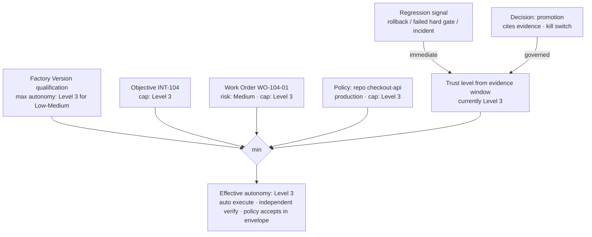

# Progressive Autonomy

> Autonomy should increase only as verification confidence increases. It is earned per scope, held at the minimum across every authority in the chain, and lost immediately when evidence regresses.

## Problem

Autonomy is a product setting: "auto-merge on" or "human review required". Turned on, it applies to the schema migration and the typo fix alike. Turned off, humans approve every typo fix and stop reading. Neither setting knows whether the factory has ever demonstrated reliable verification on this class of work, and neither responds when a regression appears.

## Context

Apply across the Delivery Loop at Route (which tier), Execute (may this start without a human), Verify (what independence is required), Approve (who decides), and Release (who authorizes). Apply across the Factory Lifecycle at Qualify (autonomy level in the Qualification Record scope) and Improve (autonomy changes are Improvement Candidates). The pattern is the policy that decides when [human-authority-gate](/patterns/human-authority-gate) is required.

## Forces

| Force | Pull |
|---|---|
| Autonomy is the point of a factory | Autonomy without evidence is faster guessing |
| One global setting is simple | Risk is not uniform across work |
| Humans want control | Humans reviewing everything review nothing |
| Trust builds over time | Trust must be measured, not assumed, and must decay |
| Many parties hold authority | The most restrictive one wins |

## Solution

**Risk tiers.** Every Work Order carries a server-owned minimum risk tier (`Low`, `Medium`, `High`, `Critical`) with reasons. Risk can be raised by policy, planner, or human; it cannot be lowered by the agent.

| Tier | Execution | Verification | Approval |
|---|---|---|---|
| Low | Auto | Auto (deterministic) | Policy accepts |
| Medium | Auto | Independent verification required | Policy accepts within envelope |
| High | Auto | Independent verification | Human acceptance required |
| Critical | Human-authorized before execution | Independent + human review | Human acceptance + release authorization |

**Autonomy levels.** A scope's autonomy level is a position on the HITL spectrum: Human executes → Human reviews → Human approves → Human supervises → Human handles exceptions → Policy governs autonomously.

**Effective autonomy = min(factory, objective, Work Order, policy, trust level).** The Factory Version's Qualification Record declares the maximum autonomy it is qualified for per scope; the Objective may cap it; the Work Order may cap it; policy may cap it per repository, environment, or classification; the current trust level (evidence-based) may cap it. The lowest wins.

**Earning.** Autonomy for a scope rises only through a Decision that cites evidence: verified-outcome rate over a window, first-pass verification rate, reopen and rollback rate, verifier disagreement, incident history. The promotion is itself governed (a new policy version, human-approved, with a kill switch).

**Demotion.** Evidence regression (a failed hard gate in production, an incident, a rollback, verifier disagreement above threshold) demotes immediately and automatically to the next-lower level; restoration requires a Decision.

## Architecture

## When to Use

- Any factory operating on more than one risk class of work.
- Any organization moving from L2 (human approves) toward L3–L5 autonomy: the ladder is how autonomy expands safely.
- Any auto-routing, auto-acceptance, or auto-release policy: each is an autonomy level for a scope and must be earned.
- Fleet operations: per-repository and per-environment caps let one incident narrow one scope without pausing everything.

## When Not to Use

- Critical-tier work never reaches "policy governs autonomously"; the table is a ceiling, not a target.
- Do not apply autonomy levels to the learning subsystem as if it were production work; learning proposes, and its promotions go through the same gates (see [governed-learning](/patterns/governed-learning)).

## Failure Modes

| Failure | Symptom | Guard |
|---|---|---|
| Global toggle | Same autonomy for migrations and typos | Per-tier, per-scope levels; min rule |
| Agent lowers its own risk | Work Order labeled Low by the agent | Risk is server-owned minimum with reasons |
| Autonomy by assertion | "We trust it now" with no evidence window | Promotion requires cited evidence Decisions |
| Sticky autonomy | Rollback last week; auto-accept still on | Immediate demotion on regression signals |
| Envelope creep | Policy "accepts within envelope" with no envelope defined | Envelope is explicit: change budget, categories, cost |
| Learning widens autonomy | Improvement Candidate auto-applies a policy change | Autonomy changes are new policy versions with human Decisions |

## Security Considerations

- Autonomy is an authorization policy. Its promotion path is a high-value target; require named permissions, two-person rules where policy demands, and audit every change.
- Kill switches for auto modes must be reachable by incident command without waiting for a policy cycle.
- Demotion signals must come from trusted evidence (verification results, outcome records, incident records), not from agent self-reports.
- Data classification caps autonomy: confidential repositories may never exceed "human approves" regardless of evidence.

## Example

`FV-depmod-1.0` is qualified for autonomy Level 3 (Human supervises: auto execute, independent verify, policy accepts within envelope) on Low and Medium risk in staging and production. `WO-104-01` is Medium (reasons: dependency change; payments module). Policy for `checkout-api` production caps at Level 3. Trust level for the scope, computed over the last 30 days, is Level 3. Effective: Level 3. `ATT-104-03` executes without a human; `ATT-104-04` verifies independently; the acceptance envelope (files ≤ 40, no schema or auth changes, cost ≤ cap) is satisfied — but the verifier returned `REQUIRES_HUMAN_REVIEW` on the shim removal, which is an exception, so a human records `DEC-104-03`. Exceptions route to humans; routine work does not.

Two weeks later `OUT-104-01` shows a rollback in a sibling Work Order of the same scope. Trust level demotes to Level 2 (Human approves) immediately; every Medium Work Order in `checkout-api` now requires human acceptance until a promotion Decision, citing a clean evidence window, restores Level 3. `IC-104-02` (hypothetical) proposes the policy change as a versioned artifact.

## Mission Control Implementation

FDLC requires server-owned risk tiers, per-scope autonomy levels, min-rule effective autonomy, evidence-cited promotion with a kill switch, and immediate demotion on regression. Mission Control implements this through:

| Element | Mission Control | Status |
|---|---|---|
| Risk and autonomy fields | `workOrders.riskLevel: LOW|MEDIUM|HIGH|CRITICAL`, `riskReasons[]`, `autonomyLevel: LEVEL_0..LEVEL_5` (`convex/schema.ts:2422`); "Risk is a server-owned minimum classification" (`docs/software-factory/verification-first-workorder-contract.md`); `convex/lib/riskClassifier.ts` | Available (Qualified) |
| Approval by risk | `requiredApprovalTypes({riskLevel, requiredApprovals, isMutating})` in publication and acceptance paths; `governancePolicies` approval validity hours by risk | Available |
| Model risk approval | High/Critical require `riskApproved` model routes (`convex/lib/executionRouting.ts:515-524`) | Available |
| Critical never auto-routed | `docs/architecture/execution-routing-v1.md` | Available |
| Earned auto mode with kill switch | Routing `mode: ADVISORY → GUARDED_AUTO` requires `evidenceWindowDays` (30), `minimumVerifiedAttempts` (5), `minimumEvidenceCoverage` (0.6), `minimumScoreMargin` (5) defaults (`convex/lib/executionRouting.ts:34-44`); promotion is a separate mutation citing reviewed decision ids plus a default-off flag; `killSwitch`; incident action `DISABLE_GUARDED_AUTO` (`convex/lib/factoryIncident.ts:26`) | Experimental (Guarded Auto disabled) |
| Factory Version risk boundary | `factoryDefinitionVersions.riskBoundary: GREEN|YELLOW|RED` | Available |
| Automatic demotion on regression | — | Proposed: Mission Control demotes through incident containment (quarantine, pause dispatch, disable Guarded Auto) and through Quality Gate `STALE`/`INELIGIBLE` outcomes; an automatic trust-level demotion computed from outcome records is not implemented |

Divergence: Mission Control's autonomy is expressed as routing mode (advisory / guarded auto / pinned) plus per-Work-Order `autonomyLevel`, not as a computed `min(...)` across factory, objective, Work Order, policy, and trust. FDLC states the min rule normatively; Mission Control satisfies its spirit by requiring every layer's approval independently. Guarded Auto's evidence thresholds are the closest implemented example of "autonomy earned by evidence".

## Related Patterns

- [human-authority-gate](/patterns/human-authority-gate) — how a human decides at the required tiers
- [fail-closed-qualification](/patterns/fail-closed-qualification) — the autonomy level in the qualification scope
- [governed-learning](/patterns/governed-learning) — autonomy changes as Improvement Candidates
- [capability-based-routing](/patterns/capability-based-routing) — tier as an eligibility filter
- [degraded-mode](/patterns/degraded-mode) — demotion under incidents

## Related Anti-patterns

- [human-approval-everywhere](/anti-patterns/human-approval-everywhere)
- [no-qualification](/anti-patterns/no-qualification)
- [hidden-learning](/anti-patterns/hidden-learning)
- [no-outcome-metrics](/anti-patterns/no-outcome-metrics)

## Specification references

- [/specification/v1/work-order](/specification/v1/work-order) — risk class, autonomy level, authority envelope
- [/specification/v1/execution-profile](/specification/v1/execution-profile) — autonomy ceiling
- [/specification/v1/qualification-record](/specification/v1/qualification-record) — scope includes autonomy level
- [/architecture/authority](/architecture/authority) — risk-tier table, HITL spectrum, min rule
- [/framework/maturity](/framework/maturity) — autonomy dimension per level
- Design principle 7; Manifesto principle 7 ([/framework/principles](/framework/principles))
