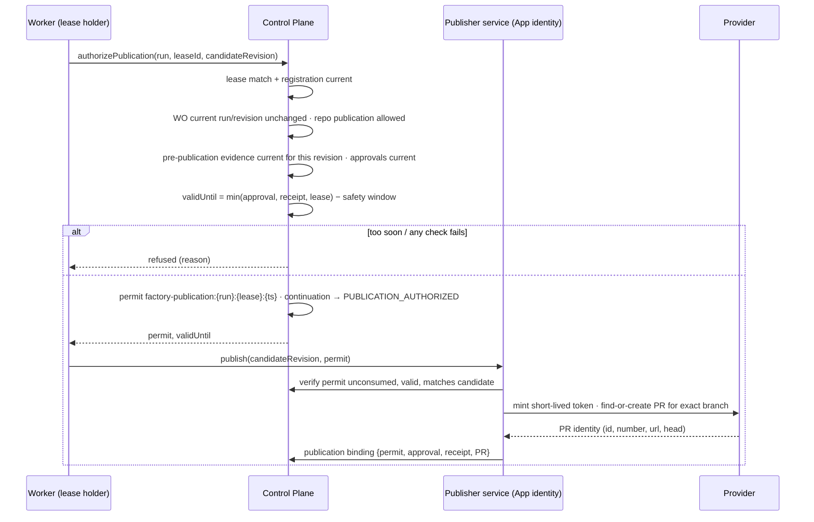

# Publication Permit

> Verification eligibility does not itself authorize a provider write. Publication requires a short-lived, candidate-bound, lease-bound permit consumed immediately before mutation.

## Problem

A candidate passes verification, so the agent pushes it and opens a pull request. But the agent held the push token the whole time — it could have pushed anything, verified or not. Or the orchestrator holds a long-lived token and publishes whatever is marked "verified", including a candidate whose approval expired an hour ago, whose worker lost its lease, or whose head has since moved. Publication is the moment a candidate becomes visible and mergeable; it deserves its own authority.

## Context

Apply at the boundary between Delivery Loop step 6 (Verify) or 7 (Approve) and the provider write that makes a candidate public (branch push, pull request creation, artifact publish). The pattern is the exercise of authority on an exact candidate; it consumes [candidate-currentness](/patterns/candidate-currentness), [human-authority-gate](/patterns/human-authority-gate), and [lease-based-worker](/patterns/lease-based-worker). Release authorization ([decision-record](/patterns/decision-record) kind release-authorization) is a separate, later authority.

## Forces

| Force | Pull |
|---|---|
| Publishing from the sandbox is convenient | A token in the sandbox is agent-controlled |
| Long-lived tokens are operationally simple | They publish stale or unauthorized candidates |
| Verification takes time | Authority can expire between verification and write |
| Recovery needs to republish | Recovery must not mint new authority |
| Providers are slow | A permit must be valid for the whole write plus a safety margin |

## Solution

Split publication into an **authorization** (control plane) and a **write** (a publisher service with its own identity):

1. **Precondition check inside one transaction.** The active lease matches (fence, owner, worker, session, generation) and the worker's registration is current; the repository allows publication; the Work Order's current execution run is this Attempt and its revision is unchanged; for enforced contracts, current independent pre-publication evidence exists for exactly this candidate revision and, where the verifier required human review, a human-resolved receipt; every required approval for the risk tier is current for this revision.
2. **Compute bounded validity.** `validUntil = min(approval.expiresAt, receipt.validUntil, lease.expiresAt)`. If `validUntil ≤ now + safetyWindow`, refuse: authority expires too soon for a safe provider write.
3. **Issue a single-use permit** identified by `(run, lease, timestamp)`, record it on the Attempt's continuation state (`READY_TO_PUBLISH → PUBLICATION_AUTHORIZED`), and log an event with candidate revision and validity.
4. **Write with a separate identity.** A publisher service (for example, a source-control App with least-privilege installation scope) mints a short-lived provider token, finds or creates the pull request for the exact branch (idempotent), and records the resulting PR identity into the candidate's **publication binding** (permit + approval + receipt + PR identity).
5. **Consume once.** A second authorization for the same permit is refused; a recovery permit is a distinct kind, also single-use, and cannot publish a candidate that differs from the durable source checkpoint.

The sandbox and the agent never see the publisher's credentials. The permit is not a credential either; it is a control-plane record the publisher checks before it mints one.

## Architecture

## When to Use

- Every push, PR creation, or artifact publish originating from factory work.
- Human-review continuation: the permit is what turns "approved" into "published" without giving the approver or the agent a token.
- Recovery publication after a lost producer Attempt: a distinct single-use recovery permit.
- Release steps that write to a registry or deployment system: the same model with a release permit.

## When Not to Use

- Local-only candidates in qualification environments that are never published; record that publication authority is `NONE`.
- Do not reuse the permit for merge. Merge is a separate consequence with its own authority (human-only in many policies).

## Failure Modes

| Failure | Symptom | Guard |
|---|---|---|
| Token in sandbox | Agent pushes directly | Sandbox has no publication identity; publisher is a separate service |
| Stale authority | Publish after approval expired | `validUntil` computed from approval, receipt, lease |
| Race with revision | Work Order revised between verify and publish | Transaction checks current run and revision |
| Permit reuse | Same permit publishes twice | Single-use; consumed flag on continuation |
| Recovery mints authority | Recovery Attempt publishes a different commit | Recovery permit bound to the durable source checkpoint |
| Long write | Provider slow; authority expires mid-write | Safety window before issuance; short-lived provider token |
| Unbound PR | PR opened but not linked to the candidate | Publication binding recorded with PR identity; currentness checks it |

## Security Considerations

- The publisher identity is a high-value credential; its private key and installation tokens never enter product records or sandboxes, and its scope is least-privilege (contents write, pull requests write, checks read, metadata read).
- Signed webhooks with a replay ledger provide the trusted head projection after publication; the worker's own report of the PR is untrusted.
- Merge authority is separate and, where policy says so, human-only.
- Permit issuance is logged with the candidate revision so that an audit can tie every provider write to an exact permit, lease, approval, and receipt.

## Example

`ATT-104-03` froze `CAND-104-03` (pre-publication subject with `rawDiffSha256`). `ATT-104-04` verified it; the verifier returned `REQUIRES_HUMAN_REVIEW` for the shim removal. The Attempt paused (`AWAITING_HUMAN_REVIEW`); a Builder reviewed the exact diff and recorded an approval; continuation moved to `READY_TO_PUBLISH`.

The worker, still holding its lease (generation 5, expiring in 20 minutes), requests authorization for candidate revision `7f3…`. The control plane confirms lease and registration, `WO-104-01` rev 1 unchanged and current run `ATT-104-03`, pre-publication evidence current and human-resolved, Medium-tier approvals current. `validUntil = min(approval +72h, receipt +48h, lease +20m) = lease +20m`, which exceeds the 60-second safety window. Permit `factory-publication:ATT-104-03:lease-…:t` is issued and recorded.

The publisher service mints a short-lived App token, finds no open PR for branch `factory/wo-104-01`, creates PR #418 with `maintainer_can_modify: false`, and records the publication binding. A signed `pull_request` webhook later projects head `7f3…` = `candidateSha`; `WO-104-01` is acceptance-eligible. The agent never held a token; `DEC-104-03` and later `DEC-104-04` remain separate.

## Mission Control Implementation

FDLC requires transaction-checked preconditions, bounded validity with a safety window, a single-use candidate- and lease-bound permit, a separate publisher identity, and a recorded publication binding. Mission Control implements this through:

| Element | Mission Control | Status |
|---|---|---|
| Authorization mutation | `authorizePublicationInternal` (`convex/factory/attempts.ts:1136-1328`): requires active matching lease and current registration (1149-1158), repository publication allowed (1161), Work Order current run and revision (1163-1167), policy-v2 pre-publication currentness for the exact candidate and human-resolved receipt (1175-1183), required approvals current (1286-1297) | Available (Qualified; PRs #61/#62/#63 evidence) |
| Bounded validity | `publicationValidUntil = min(approval.expiresAt, receipt.validUntil, lease.expiresAt for v2 subjects)`; refused if `≤ now + PUBLICATION_SAFETY_WINDOW_MS` (60 s, `convex/lib/factoryHumanReview.ts:9`) (`attempts.ts:1298-1304`) | Available |
| Single-use permit | `publicationPermitId = factory-publication:{runId}:{leaseId}:{now}`; continuation `READY_TO_PUBLISH → PUBLICATION_AUTHORIZED` with `publicationPermitLeaseId`, `publicationValidUntil`; event `COMMAND_APPROVED` (`attempts.ts:1305-1326`) | Available |
| Recovery permit | `factory-recovery-publication:…`, refused if already consumed or candidate differs from the durable source checkpoint (`attempts.ts:1168-1244`) | Available |
| Publisher identity | `GithubAppPublisher` (`apps/orchestration-server/src/githubAppPublisher.ts`): JWT-minted installation token bounded to the repository, `findOrCreatePullRequest` idempotent on branch, `maintainer_can_modify: false`; secrets never stored in product records | Available |
| Publication binding | `workflowRuns.subjectPublicationBinding` (permit + approval + receipt + PR identity); currentness verifies it (`verificationCurrentness.ts:342-347`) | Available |
| Doctrine | VF-008: "Verification eligibility does not itself authorize GitHub writes ... Publication requires a short-lived, candidate-bound, lease-bound permit immediately before mutation." (`docs/decisions/verification-first-architecture-decisions.md`) | Available |
| Merge | Human-only, outside V1 authority | Available (by exclusion) |

Divergence: Mission Control's publisher is GitHub-specific; FDLC states the permit model for any provider (source control, artifact registry, deployment system). Mission Control's V1 subjects (already-published PR subjects) compute validity from approval and receipt only; v2 pre-publication subjects add the lease bound, which FDLC requires for all.

## Related Patterns

- [sandbox-per-work-order](/patterns/sandbox-per-work-order) — why the sandbox cannot publish
- [lease-based-worker](/patterns/lease-based-worker) — permit validity bounded by lease
- [candidate-currentness](/patterns/candidate-currentness) — the candidate the permit binds
- [human-authority-gate](/patterns/human-authority-gate) — the approval that precedes the permit
- [recovery-checkpoint](/patterns/recovery-checkpoint) — recovery publication
- [decision-record](/patterns/decision-record) — release-authorization is separate

## Related Anti-patterns

- [agent-has-production-credentials](/anti-patterns/agent-has-production-credentials)
- [no-candidate-identity](/anti-patterns/no-candidate-identity)
- [hidden-agent-state](/anti-patterns/hidden-agent-state)

## Specification references

- [/specification/v1/candidate](/specification/v1/candidate) — "unpublished until permitted"; publication binding
- [/specification/v1/decision](/specification/v1/decision) — release-authorization as a separate kind
- [/specification/v1/release](/specification/v1/release) — publication permits under Release
- [/specification/v1/attempt](/specification/v1/attempt) — continuation states
- [/architecture/authority](/architecture/authority) — exercising authority on candidates (L10)
- Design principle 2; Manifesto principle 3 ([/framework/principles](/framework/principles))
