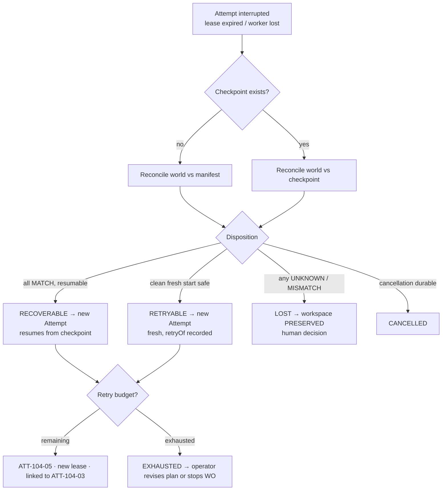

# Recovery Checkpoint

> Inability to prove absence is not permission to retry. A mismatch is a preservation signal, not a repair instruction.

## Problem

An Attempt fails halfway. Did the pull request get opened? Did the package publish? Did the migration run? The orchestrator does not know, so it retries — and opens a second PR, publishes twice, or runs the migration on an already-migrated schema. Or it does not retry, and a half-finished workspace with a live credential sits forever. Or it "resumes" by re-running the same Attempt id, so the trace now contains two contradictory executions with one identity.

## Context

Apply at Delivery Loop step 5 (Execute) and step 6 (Verify) whenever an Attempt can be interrupted, and at Factory Lifecycle stage 7 (Operate) as the runtime's recovery contract. The pattern assumes [lease-based-worker](/patterns/lease-based-worker) has already turned interruption into an unambiguous `LOST` or `RECOVERABLE` disposition.

## Forces

| Force | Pull |
|---|---|
| Retrying is the simplest recovery | Retrying an unknown external effect duplicates it |
| Resuming saves cost | Resuming under the same identity rewrites history |
| Cleanup frees resources | Cleanup on ambiguity destroys evidence |
| Bounded retries limit spend | Retry counts without new evidence are still loops |
| Recovery should be automatic | Some recovery is a human decision |

## Solution

Three mechanisms, applied in order:

**1. Checkpoint durable progress.** At phase boundaries (prepared, executing, validating, awaiting review, publishing) the worker records a checkpoint on the Attempt: phase, summary, workspace ownership, base commit, and any external identifiers already created (branch, PR number). The checkpoint is a fact record, not a lease and not authority.

**2. Reconcile before retry.** Before any new Attempt is created for the same Work Order, the runtime reconciles the world against the last checkpoint and the frozen manifest: does the workspace exist and match; is the branch at the expected head; does a PR with the recorded lineage exist; is the sandbox resource absent; are credentials revoked. Each answer is `MATCH`, `MISMATCH`, or `UNKNOWN`. A disposition follows: `RECOVERABLE` (resume from checkpoint in a new Attempt), `RETRYABLE` (start fresh), `LOST` (preserve, human decision), `CANCELLED`, `FAILED`. Unknown never maps to retry.

**3. Retry as a new Attempt.** Every retry, correction, or recovery is a new Attempt with a new lease, linked to the prior one (`retryOf`), with a retry reason. Prior events, evidence, receipts, and traces are never rewritten. Retry budget is bounded per Work Order; exhausting it yields `EXHAUSTED` and a human decision. Repeating the same failed action without new evidence (a changed input, a different route, a corrected context) is prohibited.

**Fail-closed cleanup.** Workspace cleanup runs only after a list of proofs (manifest match, process terminated, worktree registered, clean and at the published head, PR lineage matches, remote matches). Ambiguity fails closed to `PRESERVED`.

**Read-only candidate recovery.** When a producer Attempt is lost after freezing a candidate, a new fenced Attempt may attest the existing commit and diff and hand it to verification — it may not publish.

## Architecture

## When to Use

- Every Attempt that performs external side effects (branch push, PR open, package publish, deploy, ticket update).
- Long-running Attempts across worker restarts and deploys of the control plane itself.
- Verifier Attempts: a lost verifier is re-run as a new Verifier Attempt; its partial evidence is history.
- Sandbox lifecycles: orphan detection and reconciliation are this pattern applied to resources.

## When Not to Use

- Idempotent, side-effect-free steps that can be re-executed at will (a digest computation). Still create a new Attempt; skip reconciliation.
- Do not use checkpoints as a substitute for candidate identity; the candidate is identified by content, the checkpoint by phase.

## Failure Modes

| Failure | Symptom | Guard |
|---|---|---|
| Blind retry | Duplicate PR or double publish | Reconcile before retry; unknown ≠ retry |
| Resume under same identity | One Attempt id, two executions | Retry = new Attempt with `retryOf` |
| Checkpoint as lease | Old worker resumes because it "has the checkpoint" | Checkpoint is a fact; ownership is the lease |
| Cleanup on guess | Worktree deleted; unmerged work lost | Proof list; ambiguity → PRESERVED |
| Infinite loop | Retries until budget with no change | Same failed action without new evidence prohibited |
| Recovery publishes | Recovery Attempt pushes a branch | Read-only candidate recovery cannot publish |

## Security Considerations

- Recovery is a privilege escalation surface: a recovery Attempt that could publish would bypass the human-review continuation. Recovery Attempts are read-only by construction.
- Reconciliation reads provider state; use the trusted provider projection, not the worker's claim.
- Preserved workspaces may contain attempt-scoped credentials; revocation runs regardless of disposition.
- Retry reasons and dispositions are audit records; they explain spend and duplicate-effect risk after the fact.

## Example

`ATT-104-02` (the second producer try) is running on worker `w-17` when the host reboots. Its lease expires; disposition computes: checkpoint at phase `EXECUTING` ("SDK v4 installed; 9/12 files migrated"), workspace registered, branch head matches the checkpoint's recorded commit, no PR recorded, sandbox resource absent (persistent-worker backend: worktree only). All `MATCH` → `RECOVERABLE`. Retry budget for `WO-104-01` is 3; one used. `ATT-104-03` is created with `retryOf = ATT-104-02`, reason "lease expired during EXECUTING; resumed from checkpoint", a new lease under generation 5, and the same frozen manifest. It completes and freezes `CAND-104-03`.

Counter-case: had the reconciler found a PR on the branch with a head that matched no recorded lineage, the answer would be `MISMATCH` → `LOST`; the workspace is `PRESERVED`; `WO-104-01` blocks with a reason; a Builder decides. No automatic second PR.

## Mission Control Implementation

FDLC requires durable checkpoints, reconcile-before-retry with unknown-fails-closed dispositions, retry as a new linked Attempt with bounded budget, fail-closed cleanup, and read-only candidate recovery. Mission Control implements this through:

| Element | Mission Control | Status |
|---|---|---|
| Checkpoints | `workflowRuns.executionCheckpoint`, `checkpointLease` ("historical workspace owner at a pause, never an active lease or authority", `convex/schema.ts:5281-5286`); run events `CHECKPOINT_CREATED` | Available (Qualified) |
| Recovery state summary | `buildExecutionRecoverySummary` (`convex/lib/executionRecovery.ts:54-113`): `WAITING, ACTIVE, CANCELING, RECOVERABLE, EXHAUSTED, RECOVERED, TERMINAL`; `staleExecutionRecovery` increments `staleRecoveryCount` and records a retry reason (lines 24-52) | Available |
| Dispositions | `runtimeDisposition: RETRYABLE|LOST|CANCELLED|FAILED|RECOVERABLE`; disposition table in `docs/software-factory/worker-runtime-operations.md` | Available |
| Reconcile before retry | `convex/lib/preExecutionRecovery.ts`, `apps/orchestration-server/src/factoryWorkspaceOwnership.ts`, `sandboxReconciler.ts`; "Inability to prove absence is not permission to retry" (`docs/software-factory/operating-contract-evidence-map.md`) | Available |
| Fail-closed cleanup | Six proofs (manifest match, PID terminated, worktree registered, clean + HEAD == published PR head, exact PR URL with matching lineage, exact remote); "ambiguity fails closed to `PRESERVED`" (`docs/OVERVIEW.md`) | Available |
| Retry as new Attempt | "Retries, corrections, and recovery create new Attempts rather than rewriting history" (`docs/FACTORY_VOCABULARY.md`); `executionRetryOfClaimId`, `executionRetryReason`; run events `RETRY_STARTED`, `RETRY_COMPLETED`, `STALE_RUN_RECOVERED`, `RUN_QUARANTINED` | Available |
| Read-only candidate recovery | `convex/lib/localCandidateRecovery.ts`; recovery publication path in `convex/factory/attempts.ts:1168-1244` requires the exact durable source checkpoint and a single-use recovery permit | Available |
| Quarantine after repeated stale loss | `executionQuarantine`; `operatorControls.staleRecoveryLimit` | Available |
| Evidence | PR #62 chain (cancel → two failed retries → success) in `docs/testing/evidence/real-codex-github-pr-golden-path/README.md`; 17 failure injections in the V3 pilot package | Available |

Divergence: Mission Control's persistent-worker backend recovers a *worktree* with a stale-recovery counter; FDLC generalizes the same rules to any execution backend and requires the disposition vocabulary on every Attempt. The "same failed action without new evidence is prohibited" rule is doctrine in Mission Control (`docs/product/mission-control-north-star.md`) rather than an enforced check.

## Related Patterns

- [lease-based-worker](/patterns/lease-based-worker) — produces the interruption disposition
- [sandbox-per-work-order](/patterns/sandbox-per-work-order) — resource reconciliation and teardown
- [publication-permit](/patterns/publication-permit) — why recovery cannot publish
- [degraded-mode](/patterns/degraded-mode) — quarantine and pause when recovery repeats

## Related Anti-patterns

- [infinite-retry-loop](/anti-patterns/infinite-retry-loop)
- [hidden-agent-state](/anti-patterns/hidden-agent-state)
- [shared-mutable-workspace](/anti-patterns/shared-mutable-workspace)

## Specification references

- [/specification/v1/attempt](/specification/v1/attempt) — dispositions, checkpoints, `retryOf`, immutability
- [/specification/v1/work-order](/specification/v1/work-order) — retry budget, stop condition
- [/architecture/execution-vocabulary](/architecture/execution-vocabulary) — Runtime, recovery
- [/enterprise/operations](/enterprise/operations) — DR and incident procedures
- Manifesto principle 4 ([/framework/principles](/framework/principles))
