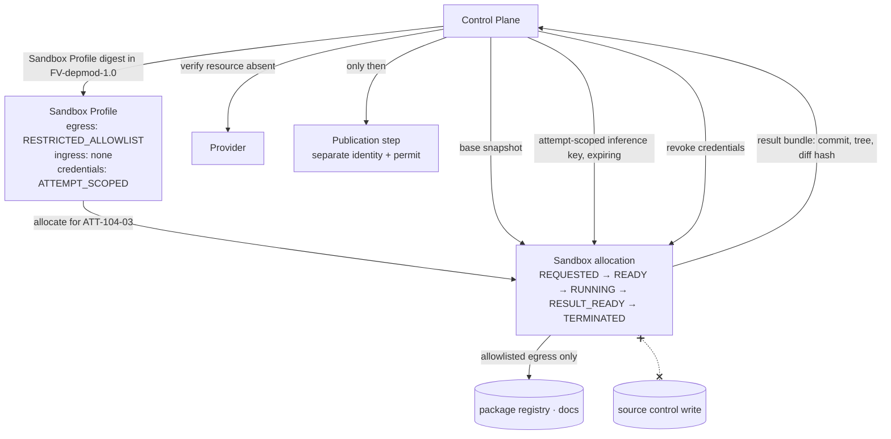

# Sandbox per Work Order

> Effects stay bounded. The sandbox never pushes its own branch.

## Problem

Agents run on a developer laptop, a shared CI runner, or a long-lived VM. They inherit the host's credentials, its network, its other checkouts, and its leftover state from the previous job. A misbehaving Attempt deletes a sibling workspace, exfiltrates a token through an outbound call, or leaves a half-applied migration that the next Attempt builds on. When the Attempt finishes, nobody can prove the environment is gone.

## Context

Apply at Delivery Loop step 5 (Execute) and step 6 (Verify) for every Attempt that can modify a repository, call the network, or spend credentials. The pattern is the Execution Environment layer (L7) mechanism; it composes with [bounded-agent](/patterns/bounded-agent) (what runs inside), [lease-based-worker](/patterns/lease-based-worker) (who owns it), and [publication-permit](/patterns/publication-permit) (how the result leaves).

## Forces

| Force | Pull |
|---|---|
| Persistent workspaces are fast | They accumulate state and credentials |
| Remote sandboxes scale | Remote providers must prove egress control |
| Agents need package registries and docs | Every allowed destination is an exfiltration channel |
| Publication needs a token | A token in the sandbox is a token the agent can misuse |
| Teardown is boring | Unproven teardown is an orphaned resource with live credentials |

## Solution

Allocate one **sandbox** per Attempt from a versioned **Sandbox Profile** frozen into the Factory Version. The profile declares the provider, image, resources, transport, network egress mode (`DENY_ALL`, `RESTRICTED_ALLOWLIST`, `UNRESTRICTED`), no public ingress, credential mode, repository access mode, and spend limits.

Rules:

- **Fresh per Attempt.** Retries and verifier Attempts get new sandboxes. A verifier never reuses the producer's sandbox or worktree.
- **Attempt-scoped credentials only.** Inference keys and tool credentials are issued for the Attempt with an expiry and a revocation state; the sandbox receives no source-control publication identity, no control-plane service credentials, no provider-management keys.
- **Repository access by snapshot.** The sandbox receives a snapshot of the base commit from the control plane; it does not hold clone credentials.
- **Result extraction, not push.** The candidate leaves as a signed result bundle (commit, tree, diff hash, artifacts) pulled by the control plane. The sandbox never pushes its own branch.
- **Credential revocation and resource absence before publication.** Publication of the candidate requires proof that attempt-scoped credentials were revoked and that the provider reports the sandbox resource absent.
- **Classification-gated egress.** Repositories above a data classification threshold may use a remote sandbox only when immutable profile evidence proves provider-enforced egress.
- **Reconciled teardown.** Allocation states are durable; orphaned sandboxes are detected and reconciled; a mismatch is a preservation signal, not a repair instruction.

## Architecture

## When to Use

- Every producer and verifier Attempt on a governed repository.
- Any Attempt that calls network tools or runs untrusted dependencies (package install, test suites).
- Any repository classified Internal or above.
- Maturity L2 and above (L2 requires sandboxes; L4 requires isolation qualification evidence).

## When Not to Use

- Deterministic offline steps with no inference and no network (for example, a digest computation). Use an isolated container with `inference: DENIED` and `network: NONE`; that is still a sandbox, just a stricter one.
- Read-only research over public sources with no repository access. A network-restricted container still applies.

## Failure Modes

| Failure | Symptom | Guard |
|---|---|---|
| Persistent workspace reuse | State from `ATT-104-01` leaks into `ATT-104-03` | Fresh allocation per Attempt; clean initial attestation |
| Token in the box | Agent finds a push token in env | Sandbox receives no publication identity; result extraction only |
| Egress "restricted" by config the agent can edit | Agent edits proxy settings | Provider- or host-enforced egress with proof; classification gating |
| Teardown assumed | Orphaned sandbox with live inference key | Allocation state machine with `ORPHANED → reconciled`; credential revocation state; resource-absence proof |
| Verifier in producer's sandbox | Independence fails silently | Independence check rejects reused sandbox/worktree |
| Ambiguous cleanup | Worktree deleted while its PR is unmerged | Cleanup only after proofs; ambiguity fails closed to preserved |

## Security Considerations

- The sandbox is the primary containment for prompt injection through repository content or tool output: injected instructions can only reach what the sandbox can reach.
- Threat-model the provider: what can a compromised guest do to the host, to other tenants, to the control plane? A sandbox provider is a supply-chain component of the Factory Version and is qualified like one.
- Secret fingerprints, not secrets, appear in records. Credential grants record `ISSUED → REVOCATION_PENDING → REVOKED | EXPIRED`.
- Deny public ingress unconditionally; an agent that can be reached from the internet is an attack surface, not a worker.
- Sandbox capabilities required by a Factory Version are part of worker admission: a worker that cannot offer them is ineligible.

## Example

`FV-depmod-1.0` freezes Sandbox Profile `sp-depmod-restricted`: container image digest, 4 vCPU / 8 GiB (illustrative), `networkEgress: RESTRICTED_ALLOWLIST` (the package registry and the SDK vendor's docs host), `publicIngress: false`, `inferenceCredentialMode: ATTEMPT_SCOPED`, `repositoryAccessMode: CONTROL_PLANE_SNAPSHOT`.

`ATT-104-03` allocates a sandbox, receives the base snapshot at `executionBaseSha` and an inference key expiring with the lease. The agent installs v4 of the SDK from the allowlisted registry, edits under the change budget, runs tests locally, and produces a result bundle. The control plane extracts `CAND-104-03`, revokes the inference key, polls the provider until it reports the resource absent, and records the teardown receipt. Only then may [publication-permit](/patterns/publication-permit) issue a permit for a separate publication identity to open the pull request.

`ATT-104-04` (verifier) gets its own sandbox from the verification profile with `networkEgress: DENY_ALL`; it needs nothing but the candidate snapshot.

## Mission Control Implementation

FDLC requires per-Attempt isolation from a versioned profile, attempt-scoped credentials only, no publication identity in the sandbox, result extraction instead of push, credential revocation and resource absence before publication, classification-gated egress, and reconciled teardown. Mission Control implements this through:

| Element | Mission Control | Status |
|---|---|---|
| Sandbox Profile | `factorySandboxProfiles` (`convex/schema.ts:1222`): `provider: EXE_DEV|FAKE|DOCKER|LOCAL_CONTAINER`, `machineImage`, `networkEgress: UNRESTRICTED|RESTRICTED_ALLOWLIST|DENY_ALL`, `publicIngress: v.literal(false)`, `inferenceCredentialMode: ATTEMPT_SCOPED_OPENROUTER|NONE`, `repositoryAccessMode: CONTROL_PLANE_SNAPSHOT|NONE`, `egressEnforcementProven`, `admissionState` | Experimental (Production-pilot eligible; Preview — egress not provider-enforced in the retained cohort) |
| Allocation lifecycle | `sandboxAllocations` (`convex/schema.ts:1538`): `REQUESTED, ALLOCATING, READY, RUNNING, RESULT_READY, CANCELING, TERMINATING, TERMINATED, FAILED, ORPHANED`; `resourceAbsentAt`, `teardownReceipt`; reconciler `apps/orchestration-server/src/sandboxReconciler.ts` | Experimental |
| Credential grants | `sandboxCredentialGrants` (`convex/schema.ts:1594`): `ISSUED → REVOCATION_PENDING → REVOKED | EXPIRED`, `secretFingerprint` only | Experimental |
| No publication identity; no push | "receives no GitHub App, Mission Control service, provider-management, or long-lived inference credentials"; "The sandbox never pushes its own branch" (`docs/architecture/remote-sandbox-execution.md`) | Available (invariant) |
| Revocation + absence before publication | Execution manifest asserts `credentialsRevokedBeforePublication: true`, `resourceAbsenceRequiredBeforePublication: true` (`convex/lib/executionManifest.ts:132-135`) | Available |
| Classification-gated egress | Non-public repositories cannot use Remote Sandbox unless profile evidence proves provider-enforced egress; readiness check `provider-egress` (`convex/factory/configuration.ts:1367`) | Available |
| Threat model | `docs/security/remote-sandbox-threat-model.md` | Available (document) |

Divergences: (1) Mission Control also supports a `persistent-worker` backend (local worktree on a canonical worker) where isolation is a detached Git worktree rather than a container; FDLC treats that as a weaker isolation mode acceptable only at lower risk tiers with qualification evidence. (2) Doc/schema drift in allocation state names (`PROVISIONING/HEALTH_CHECKING/TEARING_DOWN` vs `ALLOCATING/TERMINATING/CANCELING`); FDLC uses the schema names.

## Related Patterns

- [bounded-agent](/patterns/bounded-agent) — what runs in the sandbox
- [lease-based-worker](/patterns/lease-based-worker) — the lease the sandbox credential expires with
- [publication-permit](/patterns/publication-permit) — how the candidate leaves
- [independent-verifier](/patterns/independent-verifier) — the verifier's separate sandbox
- [tool-grant-and-receipt](/patterns/tool-grant-and-receipt) — tool calls brokered outside the sandbox

## Related Anti-patterns

- [no-sandbox](/anti-patterns/no-sandbox)
- [shared-mutable-workspace](/anti-patterns/shared-mutable-workspace)
- [agent-has-production-credentials](/anti-patterns/agent-has-production-credentials)

## Specification references

- [/specification/v1/attempt](/specification/v1/attempt) — sandbox allocation binding
- [/specification/v1/execution-profile](/specification/v1/execution-profile) — sandbox profile identity and required capabilities
- [/specification/v1/factory-version](/specification/v1/factory-version) — sandbox image and network/credential policy
- [/architecture/sandboxing](/architecture/sandboxing) — isolation requirements
- Manifesto principle 4 ([/framework/principles](/framework/principles))
