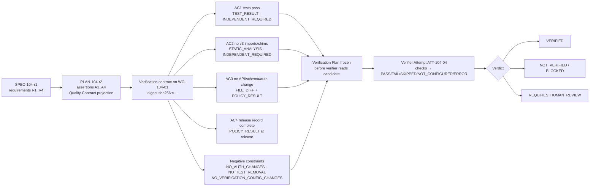

# Verification Contract

> Every acceptance criterion maps to a verifier. Absence of an enforced contract cannot be presented as verified.

## Problem

"Tests pass" is the whole verification strategy. Which tests? On which candidate? Run by whom? Did they cover the acceptance criterion about no public-API changes, or only the ones the agent wrote? A reviewer sees a green check and assumes the criteria were checked; the agent saw the criteria and assumed the tests covered them; nobody wrote down the mapping, so nobody can say the work was verified against its specification rather than against itself.

## Context

Apply at Delivery Loop steps 2–3 (Specify, Plan) where the contract is authored, and at step 6 (Verify) where it is executed. The contract lives on the Work Order (derived from the Plan's Quality Contract projection) and its digest is part of the candidate's identity ([candidate-currentness](/patterns/candidate-currentness)). It tells [independent-verifier](/patterns/independent-verifier) what to run and [evidence-bound-acceptance](/patterns/evidence-bound-acceptance) what to require.

## Forces

| Force | Pull |
|---|---|
| Criteria are written in prose | Verification runs on commands |
| Agents can write tests | Agent-written tests are candidate-dependent evidence |
| Some criteria need humans | "Manual" must still be a named check with a receipt |
| Contracts should be reusable | Each Work Order binds its own digest |
| Waivers are sometimes necessary | Waivers must be explicit, attributable, and per criterion |

## Solution

Author a **verification contract** per Work Order with these parts:

| Part | Content |
|---|---|
| Acceptance criteria | Given/when/then statements, each with an id traced to Specification requirement ids |
| Required evidence per criterion | Evidence category (`TEST_RESULT`, `BUILD_RESULT`, `STATIC_ANALYSIS`, `SECURITY_SCAN`, `FILE_DIFF`, `POLICY_RESULT`, `REVIEW_RESULT`, `BROWSER_RESULT`, `RUNTIME_OBSERVATION`, …), minimum count, and **independence level**: `ANY_VERIFICATION`, `CANDIDATE_DEPENDENT_ALLOWED`, or `INDEPENDENT_REQUIRED` |
| Checks | Named checks by category (`BUILD`, `TYPECHECK`, `UNIT_TEST`, `INTEGRATION_TEST`, `CONTRACT_TEST`, `SECURITY`, `SECRETS`, `DEPENDENCY`, `POLICY`, `CHANGE_BUDGET`, `ACCEPTANCE`, `INDEPENDENT_REVIEW`) with command class, executable, arguments, timeout; each check yields `PASS | FAIL | SKIPPED | NOT_CONFIGURED | ERROR` |
| Required risks | Risk categories the verifier must actively probe (for example, auth regression, dependency vulnerability) and may discover |
| Negative constraints | Typed prohibitions the verifier checks on the diff (`PROTECTED_PATH`, `NO_AUTH_CHANGES`, `NO_SCHEMA_CHANGES`, `NO_TEST_REMOVAL`, `NO_ASSERTION_WEAKENING`, `NO_VERIFICATION_CONFIG_CHANGES`, …) |
| Change budget | Max files, lines, paths, command classes, dependency/schema/migration/infra allowances |
| Independence policy | Minimum boundary (`SEPARATE_ATTEMPT`) and authority policy (which files determine the verdict and must be unchanged by the candidate) |
| Enforcement mode | `OBSERVE_ONLY`, `SHADOW`, `ENFORCED`, `EMERGENCY_BYPASS` (bypass is a recorded exception) |
| Waiver policy | Whether a criterion may be waived, by whom, with what record |

Rules: every mandatory criterion maps to at least one evidence category; denied paths override allowed paths; the contract digest is frozen into the candidate subject; a revised contract invalidates receipts per policy; the verifier freezes a **Verification Plan** from the contract before reading the candidate; only `PASS` satisfies a mandatory check; verdicts are `VERIFIED | NOT_VERIFIED | BLOCKED | REQUIRES_HUMAN_REVIEW`.

## Architecture

## When to Use

- Every Work Order. A Work Order without a verification contract cannot be verified, only executed.
- Specification authoring: criteria that cannot be mapped to a verifier are not acceptance criteria; rewrite them.
- Factory design (Factory Lifecycle stage 3): the Factory Manifest's verification section is the template from which Work Order contracts are derived.
- Objective and Release levels: integration and environment verification contracts follow the same shape.

## When Not to Use

- Do not use a contract to describe *how* the producer should work; that is the implementation policy. The contract describes how the result is judged.
- Do not encode business outcome measurement here; that is the Outcome artifact and its measurement contract.

## Failure Modes

| Failure | Symptom | Guard |
|---|---|---|
| Unmapped criterion | Criterion exists; no check produces evidence for it | Validation: every mandatory criterion → ≥1 evidence category |
| Candidate-dependent evidence counted as independent | Agent-written test satisfies `INDEPENDENT_REQUIRED` | Independence level enforced per criterion; producer evidence marked |
| Verifier reads candidate first | Candidate's README shapes the plan | Verification Plan frozen from the contract before checkout |
| Skipped as pass | Missing security scanner → `NOT_CONFIGURED` → green | Only `PASS` satisfies mandatory checks |
| Contract drift | Work Order revised; old receipts still valid | Contract digest in subject; revision invalidates receipts |
| Silent bypass | Emergency bypass with no record | Bypass is an exception Decision with expiry |
| Allowed path wins | Allowed `src/**` includes denied `src/auth/**` | Denied overrides allowed |

## Security Considerations

- Negative constraints are the enforcement point for the highest-consequence classes of change (auth, schema, secrets, verification config); they are checked by the verifier on the diff, never trusted from the producer.
- The authority policy names the files that determine the verdict; a candidate that touches them fails independence, regardless of test results.
- Required risks make security verification active (probe for auth regression) rather than passive (run whatever scanner exists).
- Waivers are attributable exceptions; a waiver on a `SECURITY` check at High or Critical tier should be prohibited by policy.

## Example

`WO-104-01`'s verification contract (digest `sha256:c…`) maps `SPEC-104-r1`'s criteria: AC1 contract and integration tests → `TEST_RESULT`, min 1, `INDEPENDENT_REQUIRED`, check `CONTRACT_TEST` (`npm run test:contract`, class `TEST`, 15 min); AC2 no v3 imports or shims → `STATIC_ANALYSIS`, `INDEPENDENT_REQUIRED`, check `TYPECHECK` plus a grep policy check; AC3 no public API, schema, or auth changes → `FILE_DIFF` + `POLICY_RESULT`, checks `CHANGE_BUDGET` and `POLICY` with negative constraints `NO_PUBLIC_API_CHANGES`, `NO_SCHEMA_CHANGES`, `NO_AUTH_CHANGES`; AC4 release record → `POLICY_RESULT` at the release Work Order. Required risks: `DEPENDENCY_VULNERABILITY` (check `DEPENDENCY` scan). Independence: `SEPARATE_ATTEMPT`; authority policy: `package.json#scripts`, `.github/**`, `vitest.config.*` must be unchanged. Enforcement `ENFORCED`. Waivers: AC2 waivable by the Factory Owner with reason; AC1 and AC3 not waivable.

`ATT-104-04` freezes the Verification Plan from this contract, then checks out `CAND-104-03`. Results: `CONTRACT_TEST PASS`, `TYPECHECK PASS`, static grep `PASS`, `CHANGE_BUDGET PASS` (31 files), `POLICY PASS`, `DEPENDENCY PASS`, `INDEPENDENT_REVIEW REQUIRES_HUMAN_REVIEW` (shim removal in a hot path flagged for a human). Verdict `REQUIRES_HUMAN_REVIEW`; `VER-104-02` and `EV-104-09` are recorded against contract digest `sha256:c…`. Had the security scanner been absent, `DEPENDENCY` would be `NOT_CONFIGURED` and the verdict `BLOCKED`.

## Mission Control Implementation

FDLC requires criterion → evidence category → independence level mappings, typed negative constraints, change budgets, a frozen Verification Plan, five check statuses with only PASS satisfying, four verdicts, enforcement modes, and revision-driven invalidation. Mission Control implements this through:

| Element | Mission Control | Status |
|---|---|---|
| Work Order contract | `workOrders.acceptanceCriteria[] {givenWhenThen, requiredEvidence[] {category, minimumCount, independent, independenceLevel: ANY_VERIFICATION|CANDIDATE_DEPENDENT_ALLOWED|INDEPENDENT_REQUIRED}}`, `negativeConstraints[]` (typed), `dataBoundaries[]`, `changeBudget`, `verificationContract` (v1|v2; v2 adds `requiredRisks`, `independence.minimumBoundary: "SEPARATE_ATTEMPT"`, `authorityPolicy`, `enforcementMode`) (`convex/schema.ts:2422`; validators `convex/lib/workOrderSpecificationValidators.ts`) | Available (Qualified) |
| Plan assertions and Quality Contract | `missionPlans.assertions[] {verificationMethod: COMMAND|TEST|BROWSER|MANUAL|CHECKLIST, requiresIndependentValidation, waiverAllowed, sourceRequirementIds}`; `qualityContractProjection` + digest (`convex/lib/qualityContract.ts`); "not a separate aggregate ... has no independent mutable status or owner" | Available |
| Verification Plan | `packages/workflow-engine/src/verificationPlan.ts`: `planId`, `planDigest`, `requirements[]`, `requiredRisks[]`, `discoveredRisks[]`, `requiredEvidence[]`, `adversarial?` | Available |
| Check statuses and verdicts | `PASS|FAIL|SKIPPED|NOT_CONFIGURED|ERROR`; `VERIFIED|NOT_VERIFIED|BLOCKED|REQUIRES_HUMAN_REVIEW`; check categories and command classes (`convex/schema.ts:2794`) | Available |
| Rules | "every required criterion maps to ≥1 evidence category; denied paths override allowed; absence of an enforced contract cannot be presented as verified; revisions invalidate affected receipts/approvals per policy" (`docs/software-factory/verification-first-domain-contracts.md`); "Only `PASS` satisfies a mandatory check" | Available |
| Enforcement modes | Quality Gate `mode: OBSERVE_ONLY|SHADOW|ENFORCED|EMERGENCY_BYPASS` (`convex/schema.ts:2912`) | Available |
| Revision materiality | `workOrderRevisions.materiality: NO_ACTION|REVERIFICATION|REAPPROVAL|BOTH|FULL_REOPEN`; `governancePolicies` re-verification triggers | Available |

Divergence: Mission Control splits the contract across the Plan (assertions), the Work Order (criteria, constraints, budget, contract), and the Verification Plan (frozen per run); FDLC treats "verification contract" as the Work Order-level artifact that binds all three by digest. Mission Control's `verificationMethod: MANUAL|CHECKLIST` covers human checks; FDLC requires those to produce a receipt like any other check.

## Related Patterns

- [objective-decomposition](/patterns/objective-decomposition) — where assertions are authored
- [independent-verifier](/patterns/independent-verifier) — who executes the contract
- [evidence-bound-acceptance](/patterns/evidence-bound-acceptance) — who consumes the results
- [candidate-currentness](/patterns/candidate-currentness) — contract digest in the subject
- [bounded-agent](/patterns/bounded-agent) — change budget and negative constraints bound the producer too

## Related Anti-patterns

- [no-evidence-lineage](/anti-patterns/no-evidence-lineage)
- [self-verifying-agent](/anti-patterns/self-verifying-agent)
- [prompt-as-governance](/anti-patterns/prompt-as-governance)

## Specification references

- [/specification/v1/specification](/specification/v1/specification) — acceptance criteria, verification requirements
- [/specification/v1/plan](/specification/v1/plan) — assertions, Quality Contract projection
- [/specification/v1/work-order](/specification/v1/work-order) — verification contract, change budget, negative constraints
- [/specification/v1/verification](/specification/v1/verification) — Verification Plan, check statuses, verdicts
- [/architecture/verification](/architecture/verification) — strategies and hierarchy
- Design principle 5; Manifesto principle 6 ([/framework/principles](/framework/principles))
