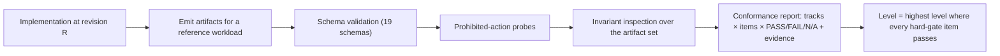

# FDLC Conformance

## What is it

Conformance is the demonstrable satisfaction of the specification's MUST-level requirements by a running implementation, assessed per track (Intent, Execution, Trust, Learning) and summarized as a level (FDLC-L2 to FDLC-L5). A conformance claim names the implementation revision, the tracks, the level, and the evidence. It never claims production certification, fleet scale, zero-touch delivery, or autonomous self-improvement; those are outcomes an organization measures, not properties the specification confers.

## Why it matters

A specification without conformance criteria is a vocabulary. Buyers cannot compare control planes, harness vendors cannot claim compatibility, and enterprises cannot write "FDLC-conformant" into a procurement requirement. The criteria below are written so that most items can be checked by inspecting emitted artifacts and by attempting prohibited actions, in the way the Certified Kubernetes program runs a fixed test suite against a cluster and SLSA levels are verified from the provenance an implementation produces.

## How it works

Three kinds of check:

| Kind | How it is checked | Examples |
|---|---|---|
| **Machine-checkable (artifact)** | Emitted records validate against the JSON Schemas and cross-record assertions hold | Every Attempt has `executionManifestDigest`; every acceptance Decision references a Verification whose `sourceAttemptId ≠ verificationAttemptId` |
| **Machine-checkable (probe)** | The suite attempts a prohibited action and expects refusal | A harness process tries to push a branch; a client with an agent identity calls accept; a stale lease fence reports completion |
| **Evidence-reviewed** | A human assessor reviews evidence at an exact revision | Separation of duty enforced in code; incident restoration requires incident-scoped authority |

## Checklists by track

Items marked **HG** are hard gates for the level in the Level column. Items without HG are required for the level but a single failure produces a documented exception rather than a level failure. "MC" is the machine-checkable class: A (artifact), P (probe), E (evidence-reviewed).

### Track 1 — Intent

| # | Requirement (MUST) | Source page | Level | HG | MC |
|---|---|---|---|---|---|
| I-1 | Every Intent has a human `owner`, `riskClass`, and `stopCondition` before admission; admission is a recorded Decision | Intent | L2 | HG | A |
| I-2 | Under `SERIAL_MUTATIONS` at most one mutating Work Order is active per Intent | Intent, Work Order | L2 | | A |
| I-3 | Intent `DONE` is reachable only via an acceptance Decision for every Work Order; no child state completes the parent | Intent | L2 | HG | A+P |
| I-4 | Specification revisions are insert-only with digest lineage; `FINALIZED` requires a PASS quality evaluation and a human | Specification | L3 | | A |
| I-5 | A finalized Specification carries no execution, verification, publication, or acceptance authority | Specification | L3 | HG | P |
| I-6 | Plan approval binds one revision by digest with the exact Specification and Constitution digests; a newer Specification never rebinds an approved Plan | Plan | L3 | HG | A |
| I-7 | Plan author ≠ approver (separation of duty recorded on the Decision) | Plan, Decision | L3 | HG | A+P |
| I-8 | Plan approval never dispatches, accepts, merges, or deploys; materialization is idempotent | Plan | L3 | HG | P |
| I-9 | The Quality Contract is a digested projection of the approved Plan, not a separately editable record | Plan | L3 | | A |
| I-10 | Every assertion cites a Specification requirement id; every Work Order criterion cites an assertion (traceability chain) | Plan, Work Order | L3 | | A |
| I-11 | Work Orders are created only from an approved Plan; existence ≠ readiness | Work Order | L2 | HG | A |
| I-12 | Every Work Order carries an authority envelope with `publicationAuthority: CONTROL_PLANE_ONLY`, typed negative constraints, a change budget with denied-overrides-allowed, and a verification contract mapping every mandatory check to a verifier | Work Order | L2 | HG | A |
| I-13 | Work Order revision records materiality and invalidates affected receipts and approvals | Work Order | L3 | | A |
| I-14 | CRITICAL risk caps `autonomyLevel` at L2 and is never auto-routed | Work Order, Decision | L2 | HG | A+P |
| I-15 | Work Order blueprints declare `requiredCapabilities` and Objective dependencies for cross-factory planning | Plan | L5 | | A |

### Track 2 — Execution

| # | Requirement (MUST) | Source page | Level | HG | MC |
|---|---|---|---|---|---|
| X-1 | Every Attempt runs under a lease with worker, session, generation, and fence; every material write proves the current fence; stale generations are refused and logged | Attempt | L2 | HG | A+P |
| X-2 | A retry is a new Attempt with `retryOf.reason` and `hypothesis`; history is never rewritten | Attempt | L2 | HG | A |
| X-3 | Every Attempt freezes an execution manifest (causation, repository, intent, harness digests, model route, sandbox, allowed tools with grants, workflow, retry policy, compiled prompt digest) and its digest before execution; incomplete manifests fail closed | Attempt | L3 | HG | A+P |
| X-4 | Lease expiry produces `SUSPECT` → reconciliation against provider truth; `LOST` preserves the workspace; cleanup fails closed to `PRESERVED` | Attempt | L3 | HG | P |
| X-5 | Cancellation follows the protocol (prevent, signal, acknowledge/time out, reconcile, terminate); late success never reopens a terminal Attempt | Attempt | L3 | | P |
| X-6 | Producer completion is a structured handoff (`factory-result/v1`) with explicit unknowns; it is a claim, not proof | Attempt, Candidate | L2 | | A |
| X-7 | Candidates are identified by commit + tree + diff digest + contract digest + source Attempt; the Verification Subject digest is server-reproducible | Candidate | L3 | HG | A |
| X-8 | Changed files are reconciled against the frozen code scope, change budget, negative constraints, and verification-authority surfaces before a Candidate is frozen | Candidate | L3 | HG | A+P |
| X-9 | The harness, sandbox, and agent cannot publish branches, open PRs, merge, deploy, approve, or accept; publication uses a single-use permit bounded by decision, receipt, and lease validity | Candidate, Capability Manifest | L2 | HG | P |
| X-10 | Sandbox holds no publication identity or long-lived credentials; credentials are revoked and resource absence proven before publication | Execution Profile, Attempt | L2 | HG | E+P |
| X-11 | Every tool the Attempt may call is frozen into the manifest with a grant; absent grant = no capability; each call has AUTHORIZATION and COMPLETION receipts; expected vs observed server digests compared | Capability Manifest | L2 | HG | A+P |
| X-12 | Harness Manifests declare capabilities truthfully (SUPPORTED/PARTIAL/UNSUPPORTED), the six prohibited authorities, the five required external controls, and `unattendedModeAdmitted: false`; unsupported required capabilities fail admission | Capability Manifest | L3 | HG | A+P |
| X-13 | Context Packages are frozen and digested before execution with per-item provenance, classification within ceiling, `acceptanceAuthority: false`; verifier packages exclude producer reasoning | Context Package | L3 | | A |
| X-14 | Execution Profiles are immutable, subordinate to a Factory Version, and admitted only through qualification with scope and expiry; dispatch never substitutes components | Execution Profile | L3 | HG | A+P |
| X-15 | Factory Versions are immutable and content-addressed (SHA-256 over every component digest); no floating references | Factory Version | L4 | HG | A |
| X-16 | Routing filters eligibility (policy, authorization, compatibility, qualification, authority, budget, capacity) before ranking; ineligible candidates receive no score; unknown cost with a hard budget fails closed; the routing Decision is recorded and frozen on the Attempt | Decision (routing) | L3 | HG | A+P |
| X-17 | A Factory Version is `ACTIVE` only with a current Qualification Record for the environment scope, a current readiness assessment, and a named restoration target; `RESTRICTED` only narrows | Factory Version | L4 | HG | A |
| X-18 | A running Attempt never re-resolves the live Factory Version or repository policy files | Attempt | L3 | | P |
| X-19 | Unknown telemetry (tokens, cost, model requests, retries) remains `null` | Attempt | L2 | | A |
| X-20 | A factory registry exposes Factory Manifests by `capabilities[]` for Objective routing across factories | Factory Manifest | L5 | | A |

### Track 3 — Trust

| # | Requirement (MUST) | Source page | Level | HG | MC |
|---|---|---|---|---|---|
| T-1 | Every Evidence record binds subject (candidate/subject digest, commit, tree, contract, source Attempt, Work Order revision), producer (actor, role, independence), integrity digest, validity assumptions, and provenance class | Evidence | L2 | HG | A |
| T-2 | Only `PASS` satisfies a mandatory check; `UNKNOWN`, `SKIPPED`, `NOT_CONFIGURED`, `ERROR` never coerce to pass; `WAIVED` never renders as pass | Evidence, Verification | L2 | HG | A+P |
| T-3 | Only `LIVE` provenance counts toward acceptance or qualification | Evidence | L2 | HG | A |
| T-4 | Evidence is append-only; corrections supersede; staleness is derived from validity assumptions, never set manually | Evidence | L3 | | A+P |
| T-5 | Evidence exchanged across a trust boundary is wrapped as an in-toto Statement with `https://fdlc.ai/attestation/evidence/v1` and the Candidate subjects | Evidence | L4 | | A |
| T-6 | Verification runs in a separate Attempt with a separate lease, invocation, worktree, and Factory Version of purpose VERIFICATION; the independence result records lineage and standard, and `authorityStatus` absent is not PASS | Verification | L3 | HG | A+P |
| T-7 | The Verification Plan is frozen before the verifier starts and cannot weaken the contract | Verification | L3 | HG | A+P |
| T-8 | Currentness is a deterministic function: newest candidate-ready source Attempt, newest exact-bound verifier Attempt, matching decision-input digests, unexpired receipt, all evidence bound to lineage, provider head equal to subject; never an older pass | Verification | L3 | HG | A+P |
| T-9 | The Quality Gate is append-only with `acceptanceAuthority: false`; OBSERVE_ONLY/SHADOW are labeled and never enforce; EMERGENCY_BYPASS is a recorded exception with expiry | Verification | L3 | HG | A |
| T-10 | Every Decision is server-authorized with a named permission and policy version; the actor is human or policy; client labels never determine authority | Decision | L2 | HG | A+P |
| T-11 | Acceptance is the only path to Work Order `DONE`; it recomputes currentness at decision time, requires zero active Attempts, and names the exact Candidate, Verification, and receipt | Decision, Work Order | L2 | HG | A+P |
| T-12 | HIGH and CRITICAL acceptance, CRITICAL release authorization, restoration, and exception Decisions are human-only; exceptions carry scope, compensating control, expiry, and cannot override hard gates | Decision | L2 | HG | A+P |
| T-13 | Every authoritative transition records the Transition fields (subject, prior version, actor + identity source, reason, policy version, idempotency key, timestamp, evidence ids, invalidated dependents) | all | L2 | | A |
| T-14 | Release requires an accepted Candidate, a release-authorization Decision distinct from acceptance and merge, `rollback.ready` with owner and conditions, current policy, and release-level evidence before `VERIFIED`; production uses bounded rollout with canary evidence | Release | L4 | HG | A |
| T-15 | Qualification Records carry all 18 dimensions; `UNKNOWN` on a hard gate fails; the assessor is independent of the Factory Owner; scope and expiry are enforced at routing | Qualification Record | L4 | HG | A |
| T-16 | Restoration after suspension requires its own incident-scoped Decision; acknowledgments are not containment | Decision, Factory Version | L4 | HG | E+P |
| T-17 | Objective-level Verification of an `INTEGRATED_CANDIDATE` exists and is not inferred from Work Order passes | Verification | L5 | HG | A |
| T-18 | Required spans, trace context, and cost attribution are present on every Attempt and Verification | Attempt, Factory Manifest | L2 | | A |

### Track 4 — Learning

| # | Requirement (MUST) | Source page | Level | HG | MC |
|---|---|---|---|---|---|
| L-1 | Every Outcome measures against a contract frozen before the window; contract metrics without measurements are `UNKNOWN`, never inferred | Outcome | L4 | HG | A |
| L-2 | Cost includes failed and retried Attempts; unknown cost stays `UNKNOWN` with coverage; the three denominators are reported separately | Outcome | L4 | HG | A |
| L-3 | Lead time runs from Intent admission to validated value; `changeFailure` follows the definition | Outcome | L4 | | A |
| L-4 | Learning Signals cite ≥1 Evidence id and a Factory Version, carry `acceptanceAuthority: false` and `mutatesProduction: false`, and are human-reviewed before promotion | Learning Signal | L3 | HG | A+P |
| L-5 | Improvement Candidates carry `autoPromote: false`; experiments never promote; acceptance is a human Decision | Improvement Candidate | L4 | HG | A+P |
| L-6 | A candidate reaches production only as a new Factory Version through a Qualification Record that includes its regression cases and a promotion Decision | Improvement Candidate, Factory Version | L4 | HG | A+P |
| L-7 | The learning subsystem cannot accept, verify, route, activate, or mutate repositories (probe: any such write from the learning identity is refused) | Learning Signal, Improvement Candidate | L3 | HG | P |
| L-8 | Post-promotion measurement is recorded against the expected effect; a MISSED verdict leads to restoration or a new candidate | Improvement Candidate | L4 | | A |
| L-9 | Evaluation datasets are versioned and digested, with held-out, adversarial, and negative-control cases | Improvement Candidate, Qualification Record | L4 | | A |
| L-10 | Cross-factory evaluation datasets and per-version governed promotion exist for the ecosystem | Improvement Candidate | L5 | | E |

## Machine-checkable summary

The five headline checks a suite can run without human judgment:

| Check | Assertion over the artifact set |
|---|---|
| **Emits artifacts with required fields** | Every record validates against its 2020-12 schema; every referenced id resolves; every `…Digest` matches a recomputation over the referenced record's projection |
| **Verification ≠ producer enforced** | For every Verification: `sourceAttemptId ≠ verificationAttemptId`; the two Attempts have different `lease.leaseId`, `executorInvocationId`, `worktree`, `factoryVersionId`; verifier `purpose = VERIFICATION`; `independence.passed` implies `standard.authorityStatus = PASS`; probe: a verifier Attempt reusing the producer lease is refused |
| **Factory Version immutable** | `compositionDigest` recomputes from component digests; no two records with the same id differ; probe: an update to an `ACTIVE` version's composition is refused and produces a new version |
| **Decisions server-authorized** | Every Decision has `authorization.serverAuthorized = true` and `actor.kind ∈ {human, policy}`; probe: a client presenting an agent identity, a spoofed display name, or a browser-only label cannot produce a Decision |
| **Evidence bound and current** | Every Evidence cited by an acceptance Decision has `provenance.class = LIVE`, `state = CURRENT` at `decidedAt`, subject digest equal to the accepted Candidate's, and `validity.validUntil > decidedAt`; probe: moving the provider head after verification makes the gate `STALE` |

## Levels

| Level | Earned when | Corresponds to |
|---|---|---|
| **FDLC-L2 Governed Agents** | All L2 hard gates pass in Intent, Execution, Trust | Maturity L2: bounded identities, permissions, sandboxes; evidence retained; human approves |
| **FDLC-L3 Orchestrated Delivery** | L2 plus all L3 hard gates in all four tracks | Maturity L3: durable Plans, Work Orders, Attempts, leases, recovery; independent verification on ≥1 workflow |
| **FDLC-L4 Qualified Factory** | L3 plus all L4 hard gates | Maturity L4: immutable Factory Versions; qualification; evidence-bound acceptance; release controls; outcome measurement |
| **FDLC-L5 Factory Ecosystem** | L4 plus all L5 hard gates, assessed across ≥2 factories under one control plane | Maturity L5: shared control plane; three-level routing; registries; cross-factory learning |

The level is the minimum over tracks. Track-level badges (for example "FDLC-L3 Trust") MAY be claimed separately and MUST name the track.

## Self-assessment procedure

1. **Pin the revision.** Name the implementation and an exact commit or release. All evidence refers to that revision.
2. **Run a reference workload.** Execute at least one Intent end to end (Receive → Learn) on a synthetic or real repository, producing the full artifact chain. Retain every record.
3. **Validate.** Run the schema validator over every emitted record; run the cross-record assertions in the machine-checkable summary.
4. **Probe.** Execute the prohibited-action probes for each track at the target level. Record refusal evidence (error, audit event, unchanged state).
5. **Review.** For evidence-reviewed items, an assessor who did not build the implementation records PASS/FAIL with evidence references.
6. **Score.** Compute per-track results; the level is the highest at which every hard gate passes in every named track.
7. **Publish.** Produce a conformance report: implementation, revision, date, tracks, level, per-item results, evidence locations, exceptions, and known gaps. Statements MUST NOT claim capabilities the report does not evidence.
8. **Re-assess** on any MAJOR specification change, on any change to the implementation's authority, verification, or lease code, and at least annually.

## Conformance suite roadmap

Modeled on the Certified Kubernetes program (a fixed, versioned test suite run against a live system; results published; a mark granted per version) and on SLSA (levels earned by the provenance an implementation produces, verifiable by consumers).

| Phase | Deliverable | Scope |
|---|---|---|
| 0 (now) | Schema validation script; nineteen schema/example pairs | Artifact shape |
| 1 | Cross-record assertion library (digest recomputation, lineage resolution, the five headline checks) over an exported artifact set | Machine-checkable (A) |
| 2 | Probe harness: a reference workload driver plus prohibited-action probes with expected refusals; runs against any control plane exposing the artifact read API and the action endpoints | Machine-checkable (P) |
| 3 | Assessor guide and report template for evidence-reviewed items; public registry of self-assessment reports pinned to revisions | Evidence-reviewed (E) |
| 4 | Conformance mark policy (see [/project/governance](/project/governance)): per-version marks, expiry, revocation, trademark rules | Program |
| 5 | Harness adapter conformance profile (capability truthfulness, cancellation races, resume, redaction, prohibited authorities) as a separately claimable sub-track | Vendor interoperability |

## Worked self-assessment: Mission Control

Assessed against the Mission Control study at runtime contract v58 (audit `02-mission-control-study.md`, 2026-09-11). Statuses are Mission Control's own ledger terms mapped to Available (A), Experimental (E), Planned (P), Proposed (Pr). This is an illustrative self-assessment by the specification authors, not a certification. Result: **partial conformance — FDLC-L3 in Intent and Trust with documented exceptions; FDLC-L2 in Execution; below L3 in Learning at the L4 gate; L4 not earned in any track.**

### Intent

| Item | Result | Evidence / gap |
|---|---|---|
| I-1 | PARTIAL | `missions` requires `stopCondition`, `executionPolicy`; owner optional; no explicit admission Decision (DRAFT → PLANNING). Gap: admission record. |
| I-2 | PASS | `executionPolicy: "SERIAL_MUTATIONS"`; one active mutating Attempt per repository (`OVERVIEW.md:674-675`). |
| I-3 | PASS | Mission `DONE` only via `missions.accept`; "Task completion does not accept a WorkOrder, and WorkOrder completion does not accept a Mission." |
| I-4, I-5 | PASS (E, default off) | `missionSpecRevisions`, `missionSpecQualityEvaluations`, `missionSpecDecisions.decisionType: FINALIZED`. Feature flag `missions.spec-intake-v1` off by default. |
| I-6, I-8, I-9 | PASS | `missionPlans` digest lineage; approval compiles Quality Contract projection and releases Work Orders idempotently (VF-002). |
| I-7 | PASS | "a submitted plan cannot be approved by its author". |
| I-10 | PASS | `assertions[].sourceRequirementIds`; Work Order criteria cite assertions. |
| I-11, I-12 | PASS | `workOrders` released from approved Plans; typed `negativeConstraints`, `changeBudget`, `verificationContract` v2; publication authority in manifest `pullRequestAuthority: CONTROL_PLANE_ONLY`. Authority envelope is distributed, not one field (documented divergence). |
| I-13 | PASS | `workOrderRevisions` materiality. |
| I-14 | PASS | "RED/critical WorkOrders are never auto-routed in V1". |
| I-15 | FAIL (P) | No `requiredCapabilities` on blueprints; no Objective planner across factories (audit §5.3). L5 item. |

Intent: **FDLC-L3** with exception on I-1 (admission Decision).

### Execution

| Item | Result | Evidence / gap |
|---|---|---|
| X-1 | PASS | `workflowRuns.lease {leaseId, workerId, workerSessionId, workerGeneration, …}`; renewal only for the complete identity; hardened mutations re-check registration. |
| X-2 | PASS | "Retries, corrections, and recovery create new Attempts"; retry reason ≥10 chars. |
| X-3 | PASS | `factory-execution-manifest/v1..v4`, digest on the Attempt; compile fails closed on missing bindings. |
| X-4 | PASS | `runtimeDisposition` LOST/RECOVERABLE; six-proof cleanup; "ambiguity fails closed to PRESERVED". |
| X-5 | PASS | Cancel/retry/fail/success chain evidence (PR #62). |
| X-6 | PASS | `factory-result/v1` with unknown criterion ids. |
| X-7 | PASS | `verificationSubject.ts` v2 pre-publication subject with `rawDiffSha256`. |
| X-8 | PARTIAL | Scope reconciliation contracted; "exact post-run changed-file enforcement is a stated gap" (Guide ch13 at studied commits); verification-authority check present. |
| X-9 | PASS | Permit-gated publication; harness `git.remotePublication: UNSUPPORTED`; sandbox never pushes. |
| X-10 | PASS (E) | `credentialsRevokedBeforePublication: true`, `resourceAbsenceRequiredBeforePublication: true`; egress not yet provider-enforced for all profiles (Preview). |
| X-11 | PARTIAL (E) | Governed MCP chain complete for one read-only operation; native harness tools "still lack the same canonical authority". |
| X-12 | PASS | `harness-capability-manifest/v1`; `prohibitedAuthorities`, `requiredExternalControls`; unattended mode not admitted. |
| X-13 | PASS (E) | `factoryContextPackages` frozen, `acceptanceAuthority: false`; flag-gated. |
| X-14 | PASS (E) | `factoryExecutionProfiles` immutable; admission DISABLED → eligible → REVOKED; no independent routing. |
| X-15 | PARTIAL | Immutable versions; digest is FNV-1a `factory-v1-<8hex>`, not SHA-256 (documented divergence). |
| X-16 | PASS (gated) | Eligibility-before-score; unknown contributes no favorable score; hard budget fails closed; Guarded Auto disabled. |
| X-17 | PARTIAL | Activation requires current readiness PASS for the exact digest; previous version preserved; no behavioral Qualification Record; no explicit restoration target per activation. |
| X-18 | PASS | Executor snapshot; Attempt reads only the frozen manifest. |
| X-19 | PASS | "never invents zeroes". |
| X-20 | FAIL (P) | No factory registry; routing repository-scoped. L5 item. |

Execution: **FDLC-L2** earned; L3 hard gates X-8 (partial enforcement) and X-11 (tool authority generalized) block L3; X-15 and X-17 block L4.

### Trust

| Item | Result | Evidence / gap |
|---|---|---|
| T-1 | PASS | `evidenceEnvelopes` producer/subject/independence/provenance fields. |
| T-2 | PASS | "Only PASS satisfies a mandatory check"; waivers recorded as WAIVED. |
| T-3 | PASS | Only `provenance === "LIVE"` counts (`currentVerification.ts:143-148`). |
| T-4 | PARTIAL | Receipt-level invalidation and `validUntil`; the six-state evidence lifecycle is documented, not a schema column (audit §5.8). |
| T-5 | PARTIAL | Digests pervasive; in-toto/DSSE wrapper not normalized ("Supply-chain provenance — Strong partial"). L4 item. |
| T-6 | PASS | `deriveVerificationIndependence` with lineage and `authorityStatus`; absent ≠ PASS. |
| T-7 | PASS | `freezeVerificationPlan`; plan immutable after RUNNING; may not weaken the contract. |
| T-8 | PASS | `evaluateCurrentVerificationEligibility` — the ordered algorithm. |
| T-9 | PASS | `qualityGateDecisions` append-only, `metadata.authoritative: false`, modes incl. EMERGENCY_BYPASS. |
| T-10 | PASS (partial scope) | `companyAccess.ts` permissions; accept requires HUMAN; Mission/WorkOrder human-vs-service golden-path security slice still pending per authorization matrix. |
| T-11 | PASS | `workOrders.accept`: human-only, idempotent, refuses active runs, recomputes currentness. |
| T-12 | PASS | Human-only accept; incident restoration requires incident-scoped authorization; waivers need an ApprovalDecision. |
| T-13 | PASS (doctrine) | Transition audit contract in `verification-and-gate-state-machines.md:151-153`; not a declarative table (audit §5.12). |
| T-14 | PARTIAL (E) | `factoryReleases` staging/production machines; merge human; no separate release-authorization Decision record; rollout steps not modeled. L4 item. |
| T-15 | FAIL (P) | Readiness assessment is configuration readiness; no 18-dimension behavioral record. L4 item. |
| T-16 | PASS | Incident command: command/ack/effect separation; restoration authority (one operation production-qualified). |
| T-17 | FAIL (P) | No integration-level subject. L5 item. |
| T-18 | PASS (diagnostic) | `traces`, `traceObservations`; cost attribution partial. |

Trust: **FDLC-L3** earned with exceptions on T-4 (evidence state column) and T-10 (pending security slice); L4 blocked by T-14, T-15.

### Learning

| Item | Result | Evidence / gap |
|---|---|---|
| L-1, L-2, L-3 | PARTIAL (E) | `factoryOutcomeEvents`, `factoryOutcomeProjections` with coverage and confidence; no measurement contract or observation window; governed inference accounting default off; cost per accepted outcome `null` in retained V3 evidence. L4 items. |
| L-4 | PASS | `learningSignals.acceptanceAuthority: false`; evidence refs; human review. |
| L-5 | PASS | `metaLoopSuggestions`; `autoPromote: false`; `statisticallySignificant: false`. |
| L-6 | FAIL (P) | Pipeline stops at a submitted Mission Plan; no candidate Factory Version → qualification → promotion (audit §5.4). L4 item. |
| L-7 | PASS | Release blocker rule on any learning-subsystem mutation; typed `false` literals. |
| L-8 | PASS (mechanism) | `measurement {baseline, result, target, verdict}` on suggestions. |
| L-9 | PARTIAL | Golden suite with negative controls exists; datasets not bound to candidates. |
| L-10 | FAIL (P) | Single-factory learning. L5 item. |

Learning: **FDLC-L3** earned (L-4, L-7 pass); L4 blocked by L-1/L-2 (contract, cost coverage) and L-6.

### Summary

| Track | Level earned | Blocking items for the next level |
|---|---|---|
| Intent | L3 (exception I-1) | I-15 (L5) |
| Execution | L2 | X-8, X-11 (L3); X-15, X-17 (L4) |
| Trust | L3 (exceptions T-4, T-10) | T-14, T-15 (L4) |
| Learning | L3 | L-1, L-2, L-6 (L4) |
| **Overall** | **FDLC-L2** (minimum over tracks) | — |

This matches Mission Control's own positioning: a control plane with substantial deterministic qualification of the verification and authority core, gated or experimental execution surfaces, and learning that is advisory by design. It does not claim, and this assessment does not grant, production certification, fleet scale, zero-touch delivery, or autonomous self-improvement.

## How you know it worked

A conformance program is working when three things are true: independent implementations pass the same suite at the same revision of the specification; a buyer can read two reports and see the same items; and a failed probe in production (a harness that pushed, an agent that accepted) traces to a listed item that the report should have caught. Track the number of published reports, the distribution of levels, and the rate at which field incidents map to existing checklist items versus new ones.

## What can go wrong

- **Self-certification without probes.** Artifact validation passes while the authority boundary is a UI toggle. The probe class exists to catch this.
- **Level inflation.** Claiming a track badge as an overall level. Overall is the minimum.
- **Frozen suite, moving spec.** Suite versions MUST be pinned to specification versions.
- **Synthetic-only evidence.** A reference workload on a synthetic repository proves mechanism, not operation. Reports MUST say which.

## How it scales

Per-track badges let harness vendors, verification services, and registries claim what they implement without claiming the whole. Enterprise platforms compose conformant components and assess the composition at L4–L5. The registry of reports becomes the input to procurement language and, over time, to the annual measurement contract in [/benchmarks](/benchmarks).

## Related

- [/specification](/specification) — index, identifiers, invariants
- [/framework/maturity](/framework/maturity) — the maturity model the levels map to (D24)
- [/mission-control](/mission-control) — capability ledger and worked flows
- [/project/governance](/project/governance) — conformance mark policy, working groups
- Spec pages: [/specification/v1/verification](/specification/v1/verification) · [/specification/v1/decision](/specification/v1/decision) · [/specification/v1/factory-version](/specification/v1/factory-version) · [/specification/v1/evidence](/specification/v1/evidence)
