# FDLC Project Governance

## What is it

This page proposes how the FDLC specification is licensed, versioned, changed, and stewarded, and how conformance claims are governed. Everything here is a recommendation for the pre-standardization period (v1.0-draft). It becomes binding when the technical steering group described below ratifies it through the first RFC.

## Why it matters

A specification another company can implement needs three guarantees: that the text and schemas can be used without legal friction, that changes are predictable and reviewable, and that "conformant" means something a third party can check. Governance is where those guarantees are written down. Without it, FDLC is one vendor's documentation.

## How it works

```mermaid
%% Governance flow: RFC lifecycle and release train
flowchart LR
    Idea["Problem or proposal"] --> RFC["RFC: proposal document"]
    RFC --> Discuss["Public discussion (min. 14 days)"]
    Discuss --> WG["Owning working group review"]
    WG --> TSG["Technical steering decision"]
    TSG --> DR["Decision record (accepted / rejected / deferred)"]
    DR --> Impl["Schema + page changes on a release branch"]
    Impl --> Suite["Conformance suite updated at the same version"]
    Suite --> Release["Tagged release + CHANGELOG entry"]
```



### License (recommendation)

| Asset | License | Why |
|---|---|---|
| Specification text, artifact pages, framework, architecture, guides, diagrams (`*.md`, SVG) | Creative Commons Attribution 4.0 International (CC BY 4.0) | Anyone may implement, quote, translate, and build derivative documentation with attribution. The same license used by SLSA and many OWASP projects. |
| JSON Schemas, examples, conformance suite, validation tooling, reference adapters | Apache License 2.0 | Permissive for commercial implementation; includes an express patent grant, which matters for schemas that vendors embed. |
| The FDLC name and conformance marks | Trademark policy below | Names are governed separately from content so that "FDLC-conformant" keeps its meaning. |

Mission Control, the reference implementation, keeps its own repository license; FDLC content that describes it cites file paths under CC BY 4.0.

### Versioning

- The specification follows semantic versioning as defined in [/specification](/specification): MAJOR for breaking changes to fields, states, or digest projections; MINOR for additive changes; PATCH for editorial.
- Site content that is not the specification (framework pages, architecture pages, guides, essays) is **dated**, not versioned. Each page carries `status` and a last-reviewed date in its front matter; the specification pages carry `schemaVersion`.
- Mission Control mappings on specification pages are pinned to a study date and runtime contract version; they are updated by PATCH releases as the reference implementation moves.
- The conformance suite version equals the specification version it tests.

### Changelog policy

- One `CHANGELOG.md` at the specification root, in Keep-a-Changelog form: Added / Changed / Deprecated / Removed / Fixed / Security, plus an FDLC-specific **Invariants** section for any change to a MUST.
- Every entry links its RFC and decision record.
- Breaking changes are listed first and carry a migration note.
- Unreleased changes accumulate under `[Unreleased]` and are cut at release time; the seed for v0.1 → v1.0-draft is below.

### RFC process

| Stage | Who | Output | Time box |
|---|---|---|---|
| **Proposal** | Anyone | An RFC document: motivation, proposed change (fields, states, invariants, schema diff), alternatives, migration, conformance impact, Mission Control impact | — |
| **Discussion** | Public | Threaded comments on the proposal; the author revises | Minimum 14 days; 30 for MAJOR |
| **Decision record** | Owning working group recommends; technical steering decides | An ADR-style record: context, decision, consequences, dissent | Within 14 days of discussion close |
| **Release** | Editors | Schema and page changes, suite changes, CHANGELOG entry, tagged release | Batched on the release train |

RFC classes: **Editorial** (no schema change; the working group may merge), **Additive** (MINOR; steering decision), **Breaking** (MAJOR; steering decision plus a migration section and a dual-read window), **Invariant** (any change to a MUST in the global invariants list; steering decision with recorded rationale and at least one implementation's evidence that the invariant is unnecessary or wrong).

### Technical steering

- A technical steering group (TSG) of five to seven people: the specification editor, the Mission Control maintainer, one representative per working group, and at least two members from organizations that implement FDLC but do not maintain the reference implementation.
- The TSG decides RFCs by consensus; failing consensus, by two-thirds vote with dissent recorded.
- No single organization holds a majority of seats.
- The TSG owns the conformance mark policy and the release calendar.

### Working groups

| Working group | Owns | First tasks |
|---|---|---|
| **Artifacts** | Families A, C, E pages and schemas; identifier scheme; extension policy | Field naming review for 1.0; Task sub-record; Signal-before-Intent proposal |
| **Verification & Evidence** | Verification, Evidence, Decision, Release, Outcome pages; in-toto/SLSA alignment; currentness algorithm | Publish the currentness function as a reference implementation; evidence predicate type registration; verifier calibration profile |
| **Factory Versioning & Qualification** | Factory Manifest, Factory Version, Execution Profile, Capability Manifest, Qualification Record; the Qualification Standard | Qualification suite profiles per specialization; Harness Manifest conformance sub-track; SHA-256 composition digest reference |
| **Enterprise** | Multi-factory routing, identity and tenancy in Actors, registry requirements, L5 criteria | Factory registry API proposal; integration-level Verification Subject; enterprise identity crosswalk |

Each working group has a chair, a public meeting cadence, and a queue of RFCs it owns.

### Contribution guide

1. Read the [author brief and canon](/framework): names, sequences, and state names are fixed unless an RFC changes them.
2. Open an RFC for any change to a schema, a state, an invariant, or a Mission Control status claim. Editorial fixes may go straight to review.
3. Every schema change ships with an updated example that validates, and a conformance suite change when a MUST changes.
4. Mission Control claims cite a file path and a ledger status (Available / Experimental / Planned / Proposed). Never "MC does X" without a status.
5. No pricing, no infrastructure identifiers, no invented benchmark numbers; illustrative numbers are labeled.
6. Sign off commits with a Developer Certificate of Origin. Contributions are accepted under the asset's license above.
7. Reviews: one working-group reviewer for editorial changes; two, one from outside the author's organization, for additive or breaking changes.

### Trademark and conformance-mark policy (recommendation)

- "FDLC" and "Factory Development Lifecycle" are used freely to refer to the specification.
- "FDLC-conformant", "FDLC-L2" … "FDLC-L5", and any conformance badge may be used only for an implementation with a published self-assessment or suite result at a named specification version and implementation revision, following [/specification/conformance](/specification/conformance).
- Marks are per version. A claim ages out when the specification reaches its next MINOR unless re-assessed; it is revoked if a published report is shown to be false.
- Track badges MUST name the track. Overall level is the minimum over tracks.
- No mark implies production certification, fleet scale, zero-touch delivery, or autonomous self-improvement.

### Relationship to AAIF, OWASP, and OpenSSF

Align, contribute, do not compete.

| Body | Relationship | Concrete alignment |
|---|---|---|
| **AAIF** (Agentic AI Foundation) | FDLC sits above agent SDKs and protocols; MCP is the tool transport FDLC's Tool Manifest binds to | Tool Manifest `mcpBinding` uses MCP server identity; governed broker and two-phase receipts are FDLC additions layered on MCP, proposed back as an interoperability profile |
| **OWASP** | OWASP LLM Top 10 and agentic security guidance define the threats; FDLC's authority, sandbox, and context invariants are controls | Map each FDLC invariant to OWASP LLM01 (prompt injection → context as untrusted data), LLM06 (excessive agency → authority envelope, prohibited authorities); contribute the Work Order negative-constraint taxonomy |
| **OpenSSF** | SLSA and in-toto define provenance and attestation; Sigstore defines signing | Evidence exchanged as in-toto Statements; build provenance references SLSA v1; Release `provenanceRef` and `sbomRef`; FDLC registers its predicate types rather than inventing a new envelope |
| **CNCF / Kubernetes conformance** | Program model | The conformance suite and mark policy follow the Certified Kubernetes pattern: fixed versioned suite, published results, per-version marks |
| **OpenTelemetry** | Trace context | `traceRefs` and W3C `traceparent` on Attempts, Evidence, Verification |

FDLC does not define agent protocols, provenance envelopes, signing, or telemetry formats. Where an FDLC record needs one, it references the existing standard and adds only the binding.

## Governance

The TSG reviews this page annually and on any change to the license recommendation. Changes to this page are RFCs of class Editorial (wording) or Invariant (anything that changes who may decide what).

## How you know it worked

RFCs from organizations other than the reference implementation's maintainer are accepted; at least two independent implementations publish conformance reports; the CHANGELOG contains no unexplained breaking change; conformance marks in the wild trace to published reports.

## What can go wrong

- **Single-vendor capture.** Mitigated by the seat rule and the outside-reviewer rule.
- **Spec drift from the reference implementation.** Mitigated by pinned Mission Control mappings and PATCH releases; the reference implementation does not define the spec.
- **Marks without reports.** Mitigated by the per-version, published-report rule and revocation.
- **Invariant erosion by convenience.** Mitigated by the Invariant RFC class requiring evidence.

## How it scales

Working groups add members per family; specialization profiles (dependency upgrade, security remediation, code review) become sub-working-groups under Factory Versioning & Qualification; national or sector profiles of the Qualification Standard are published as `fdlc-qualification-standard/<v>+<profile>` without forking the core.

## CHANGELOG seed

The seed below is published as `CHANGELOG.md` at the specification root.

```markdown
# Changelog

All notable changes to the FDLC specification are recorded here.
Format: Keep a Changelog. Versioning: semantic (see /specification).

## [1.0.0-draft] — 2026-09-11

Pre-standardization draft for public review. Supersedes the informal
v0.1 site content (nine-step runtime lifecycle, seven-stage factory
lifecycle, eleven protocol artifacts).

### Added
- Delivery Loop step 4 **Route** between Plan and Execute; Work Order
  state `ROUTED`; Decision kind `routing` with eligibility-before-ranking.
- Factory Lifecycle stages **Define** and **Qualify** (Design split into
  Define + Design; Validate renamed Qualify).
- Eight new artifacts, bringing the model to nineteen in five families:
  **Factory Manifest**, **Factory Version**, **Execution Profile**,
  **Capability Manifest**, **Qualification Record**, **Context Package**,
  **Candidate**, **Improvement Candidate**.
- JSON Schema 2020-12 for all nineteen artifacts at
  `https://fdlc.ai/schemas/v1/<slug>.schema.json`, with validated examples
  from the dependency-modernization worked example.
- Identifier scheme `fdlc://v1/<artifact>`, `namespace`, RFC 8785 + SHA-256
  content addressing, common `Actor`, `Ref`, `Transition`, `CostRecord`
  definitions.
- Evidence six-state lifecycle (MISSING, PENDING, CURRENT, STALE,
  CONFLICTING, SUPERSEDED) and in-toto Statement wrapper with predicate
  type `https://fdlc.ai/attestation/evidence/v1`.
- Qualification Standard with eighteen dimensions and scoped, expiring
  Qualification Records.
- Four conformance tracks (Intent, Execution, Trust, Learning), levels
  FDLC-L2 to FDLC-L5, self-assessment procedure, suite roadmap, and a
  worked Mission Control self-assessment.
- Extension policy (`x-` namespaced fields), versioning and deprecation
  policy, RFC process, working groups, license recommendation.

### Changed
- **Decision** replaces "Approval" as artifact #8; approvals, acceptance,
  routing, admission, release authorization, promotion, restoration, and
  exceptions are Decision kinds.
- Responsibility area 2 renamed from **Harness** to **Execution**
  (contains Orchestrator, Runtime, Sandbox; Harness remains an L5 term).
- Maturity level names: L3 "Orchestrated Workflows" → **Orchestrated
  Delivery**; L4 "Verified Factory Lines" → **Qualified Factory**;
  L5 "Continuously Learning Factory" → **Factory Ecosystem**.
- Verification Run → **Verification Attempt** (an Attempt with role
  verifier); Learning Proposal → **Improvement Candidate** (alias kept).
- Work Order spelled as two words in prose; `WorkOrder` in code.
- Factory Version state machine replaces the earlier version lifecycle and
  decision-06 sequences: DRAFT → CANDIDATE → QUALIFIED → ACTIVE →
  RESTRICTED / SUSPENDED → DEPRECATED → RETIRED; REJECTED.
- Composition digests MUST be SHA-256 over canonical JSON (Mission
  Control's FNV-1a configuration digest is recorded as a divergence).

### Deprecated
- "Factory line" as a synonym for a specialized factory (alias only).
- "AI harness", "inner/outer/meta-harness", "meta-factory control plane"
  (non-canonical aliases with warning).
- "Requester" for the human role (alias of Builder).

### Removed
- The eight-stage guide value stream as a lifecycle (its "Define Agent"
  and "Apply Skills" steps become mechanics inside Route/Execute).
- "Approval" and "Acceptance" as separate artifacts.

### Invariants
- Thirty global invariants published in /specification, attributed to
  Mission Control doctrine where taken from it; every MUST on an artifact
  page traces to one of them or to the page's own Invariants section.

## [0.1] — site content prior to 2026-09

Informal. Nine-step runtime lifecycle, seven-stage factory lifecycle,
eleven protocol artifacts, twelve Factory Definition concerns, ten-field
Factory Definition builder. Superseded by 1.0.0-draft; mappings in the
canon reconciliation table.
```

## Related

- [/specification](/specification) · [/specification/conformance](/specification/conformance)
- [/project](/project) — roadmap, contributing
- [/mission-control](/mission-control) — reference implementation and its own maturity ledger
- [/compare](/compare) — FDLC versus adjacent standards and bodies
- [/about](/about)
