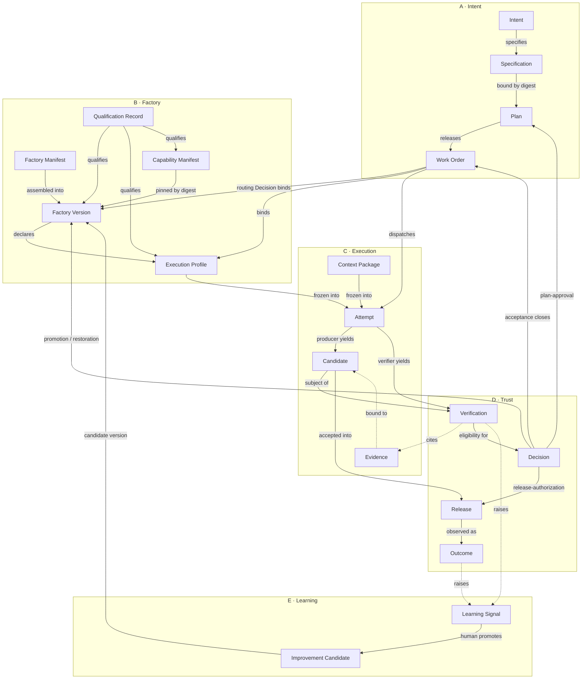

# FDLC Specification v1

## Purpose

This specification defines the artifacts an AI Software Factory produces and consumes, the states those artifacts pass through, the invariants that hold across them, and the evidence each transition requires. It exists so that a control plane, a harness vendor, a verification service, or an enterprise platform team can implement FDLC independently and interoperate on the same records. Mission Control is the reference implementation; it is not the definition. Every artifact page states what FDLC requires and then what Mission Control implements, with status.

The specification covers the record layer of FDLC. It does not prescribe databases, queues, SDKs, or models. Two systems conform when they emit the same artifacts with the same meaning, enforce the same invariants, and can exchange evidence.

## Status

**Version 1.0-draft.** Pre-standardization. This document and the nineteen artifact pages are a proposal for public review under the [RFC process](/project/governance). Field names, enumerations, and state names may change before 1.0. What will not change: the artifact set, the family structure, the non-collapsible state boundaries, and the invariants listed at the end of this page.

Honesty note: the worked example (`INT-104` … `IC-104-01`) is illustrative. Its digests, timestamps, metrics, and identifiers are constructed for the specification. They are not a production case study or a benchmark result. Mission Control statuses on every page use Mission Control's own capability ledger vocabulary mapped to Available / Experimental / Planned / Proposed; where a capability is code without qualification evidence, it is not called Available.

## Conformance language

The key words MUST, MUST NOT, REQUIRED, SHALL, SHALL NOT, SHOULD, SHOULD NOT, RECOMMENDED, MAY, and OPTIONAL are to be interpreted as described in RFC 2119 and RFC 8174 when, and only when, they appear in all capitals. Text outside the Invariants, Identity, Fields, and Evidence requirements sections of an artifact page is explanatory unless it uses these words.

## Identifier scheme

| Element | Rule |
|---|---|
| Artifact type URI | `fdlc://v1/<artifact>` where `<artifact>` is one of the nineteen slugs below. The URI names the type and the specification major version. |
| Instance id | A string of 1–200 characters matching `^[A-Za-z0-9][A-Za-z0-9._:/@-]*$`, unique within the issuing `namespace`. The worked example uses human-readable prefixes (`INT-104`, `WO-104-01`, `FV-depmod-1.0`, `EP-depmod-1.0-prod`, `ATT-104-01-p1`, `CAND-104-01-p1`, `EV-104-09`, `VER-104-02`, `DEC-104-01`, `REL-104-01`, `OUT-104-01`, `LS-104-01`, `IC-104-01`). Implementations MAY use opaque ids. |
| Global id | `<namespace>` + `fdlc://v1/<artifact>/<id>`. `namespace` is the URI of the issuing control plane or organization and MUST be present on every record. |
| Revisions | Revisioned artifacts (Specification, Plan, Work Order) carry `revisionNumber`; Specification and Plan also carry a `lineageId` shared across revisions. References to a revisioned artifact MUST include the revision number or the digest. |
| Digest | `sha256:<64 lowercase hex>` computed over the RFC 8785 (JSON Canonicalization Scheme) serialization of the artifact's digested projection. Each page names its projection. Non-cryptographic hashes MUST NOT be used for content addressing. |
| Content addressing | Immutable artifacts (Factory Version, Execution Profile, Capability Manifest, Candidate, Evidence, Qualification Record, Context Package, frozen Attempt manifest) are addressed by digest. Two records with equal digests are the same content. Downstream references bind the digest, not only the id. |
| Git identities | Commit and tree ids are full lowercase object ids (40 hex for SHA-1 repositories, 64 for SHA-256). Diff identity is `sha256` over the raw unified diff. |
| Timestamps | RFC 3339 in UTC. |
| Actors | `{kind: human \| policy \| service \| agent \| system, id, identitySource, displayName?, delegationRef?}`. `identitySource` (authenticated, workload-identity, service-command, development-fallback) is set by the control plane, never by the client. |
| References | `{type, id, digest?, revisionNumber?}` (the `Ref` definition) or typed id fields (`workOrderId`) with an adjacent `…Digest` field where binding matters. |
| Transitions | Every authoritative state change records a `Transition`: subject, prior version, from/to state, actor, reason, policy version, idempotency key, timestamp, required evidence ids, Decision id, invalidated dependents. |

## The nineteen artifacts

| Family | Artifact | One-line definition | Page |
|---|---|---|---|
| A Intent | **Intent** | The requested outcome: goal, constraints, owner, risk, stop condition, budget. Admitted → Objective. | [/specification/v1/intent](/specification/v1/intent) |
| A | **Specification** | Immutable, versioned statement of what must be true. Finalized ≠ approved. | [/specification/v1/specification](/specification/v1/specification) |
| A | **Plan** | Governed decomposition: Work Graph, blueprints, verification strategy, budgets. Approval binds one revision. | [/specification/v1/plan](/specification/v1/plan) |
| A | **Work Order** | The bounded, authorized unit of work and of acceptance; contains Tasks. | [/specification/v1/work-order](/specification/v1/work-order) |
| B Factory | **Factory Manifest** | The declarative definition of a factory across 24 sections. | [/specification/v1/factory-manifest](/specification/v1/factory-manifest) |
| B | **Factory Version** | Immutable, content-addressed composition; qualified per scope; activated per environment. | [/specification/v1/factory-version](/specification/v1/factory-version) |
| B | **Execution Profile** | The admitted per-Attempt composition with autonomy ceiling and limits. | [/specification/v1/execution-profile](/specification/v1/execution-profile) |
| B | **Capability Manifest** | Registry entry for an agent, skill, tool, model-route, harness, verifier, or context-source. | [/specification/v1/capability-manifest](/specification/v1/capability-manifest) |
| B | **Qualification Record** | Scoped, expiring, evidence-backed determination against the 18-dimension standard. | [/specification/v1/qualification-record](/specification/v1/qualification-record) |
| C Execution | **Context Package** | Frozen, digested, authorized context for one Attempt. Advisory. | [/specification/v1/context-package](/specification/v1/context-package) |
| C | **Attempt** | One immutable execution under a fenced lease and frozen manifest; producer or verifier. | [/specification/v1/attempt](/specification/v1/attempt) |
| C | **Candidate** | The exact output of a producer Attempt by commit, tree, diff digest, contract, source Attempt. | [/specification/v1/candidate](/specification/v1/candidate) |
| C | **Evidence** | Attributable record bound to an exact subject; six states; in-toto exchangeable. | [/specification/v1/evidence](/specification/v1/evidence) |
| D Trust | **Verification** | Independent verifier Attempt on a frozen subject and plan; result, receipt, currentness, Quality Gate. | [/specification/v1/verification](/specification/v1/verification) |
| D | **Decision** | Server-authorized exercise of authority in eight kinds. Replaces "Approval". | [/specification/v1/decision](/specification/v1/decision) |
| D | **Release** | Promotion of an exact accepted artifact into an environment with rollback readiness. | [/specification/v1/release](/specification/v1/release) |
| D | **Outcome** | Observed result over a window against a measurement contract, with cost attribution. | [/specification/v1/outcome](/specification/v1/outcome) |
| E Learning | **Learning Signal** | Attributable, reviewed, advisory signal that something should change. | [/specification/v1/learning-signal](/specification/v1/learning-signal) |
| E | **Improvement Candidate** | Proposed factory change with regression cases; enters Qualify as a candidate version. | [/specification/v1/improvement-candidate](/specification/v1/improvement-candidate) |

Every page has the same sections in the same order: Purpose · Identity · Fields · Lifecycle · Invariants · Evidence requirements · Extension points · Mission Control mapping · JSON Schema · Example instance · Related.

## Artifact relationships

Solid arrows are authority or lineage flowing forward; dashed arrows are evidence flowing back. No arrow implies completion: a Candidate does not complete a Work Order, a Verification does not accept, a Release does not prove an Outcome, a Learning Signal does not change a Factory Version.

## Conformance tracks and levels

Conformance is assessed per track. Each track is a checklist of MUSTs drawn from the artifact pages; [/specification/conformance](/specification/conformance) holds the full lists, the machine-checkable items, and a worked self-assessment of Mission Control.

| Track | Artifacts | Capabilities covered (canon §6.1) |
|---|---|---|
| **Intent** | Intent, Specification, Plan, Work Order | 1 defined intent · 2 machine-readable specification · 3 planning/decomposition · 15 acceptance criteria |
| **Execution** | Factory Manifest, Factory Version, Execution Profile, Capability Manifest, Context Package, Attempt, Candidate | 4 context acquisition · 5 capability discovery · 6 factory selection · 7 model/agent routing · 8 governed execution · 9 isolated environments · 10 tool access · 11 credential boundaries · 12 durable state · 19 recovery |
| **Trust** | Evidence, Verification, Decision, Release, Qualification Record | 13 evidence production · 14 independent verification · 16 human authority · 17 release controls · 18 observability |
| **Learning** | Outcome, Learning Signal, Improvement Candidate | 20 outcome measurement · 21 governed learning |

Levels map to the maturity model ([/framework/maturity](/framework/maturity)). A level is earned only when every hard-gate item at that level passes in every track it names.

| Level | Name | Intent | Execution | Trust | Learning |
|---|---|---|---|---|---|
| **FDLC-L2** | Governed Agents | Intent + Work Order with authority envelope and negative constraints | Attempt under lease; Capability Manifests for tools with grants; sandbox and credential policy | Evidence retained and bound; Decision (acceptance) server-authorized and human | — |
| **FDLC-L3** | Orchestrated Delivery | Specification and Plan with author ≠ approver; Work Graph | Durable Attempts with fencing and reconciliation; Execution Profiles; Context Package frozen; routing Decision with eligibility-before-ranking | Independent Verification with currentness on ≥1 workflow; Quality Gate | Learning Signals recorded and attributed |
| **FDLC-L4** | Qualified Factory | Objective-level dependencies | Immutable Factory Versions with composition digests; Qualification Records with all 18 dimensions; promotion and restoration Decisions | Release with rollback readiness and release-level verification; Outcome with measurement contract and cost cohort | Improvement Candidates through Qualify; no self-promotion |
| **FDLC-L5** | Factory Ecosystem | Objective routing across factories from `requiredCapabilities` | Factory registry; three-level routing; cross-factory Capability Manifests | Objective/integration Verification (`INTEGRATED_CANDIDATE`); enterprise identity in every Actor | Cross-factory evaluation datasets; governed promotion per version |

## Versioning policy

- The specification uses semantic versioning: `MAJOR.MINOR.PATCH`. The artifact type URI carries only the major (`fdlc://v1/…`); records carry `schemaVersion` as `MAJOR.MINOR`.
- **PATCH**: editorial fixes, clarified descriptions, added examples. No schema change.
- **MINOR**: additive changes: new optional fields, new enum values that do not change the meaning of existing ones, new `$defs`. A conforming 1.x consumer MUST tolerate unknown optional fields from a later 1.y producer (tolerant reader).
- **MAJOR**: removed or renamed fields, changed state semantics, new required fields, changed digest projections. A new major gets a new URI (`fdlc://v2/…`) and a dual-read/dual-write migration window.
- **Namespaces**: `https://fdlc.ai/schemas/v1/<slug>.schema.json` for JSON Schemas; `https://fdlc.ai/attestation/<name>/v1` for in-toto predicate types; `fdlc-qualification-standard/<v>` for the qualification dimension set; `fdlc-execution-manifest/<v>` for the Attempt manifest.
- **Deprecation**: a field or enum value is marked `deprecated` in the schema for at least one MINOR release before removal in the next MAJOR. Deprecated values remain valid input; producers SHOULD stop emitting them.
- State machines are contract-level: adding a state is MAJOR; adding a transition between existing states is MINOR; removing a transition is MAJOR.

## Extension policy

- Implementations MAY add fields whose names match `^x-[a-z0-9]+(-[a-z0-9]+)*$` at the top level of any artifact and inside any object marked as an extension point on its page. Schemas reject non-namespaced additional fields.
- Extensions MUST NOT change the meaning of any canonical field, state, or transition. An implementation that needs a canonical field to mean something else is non-conforming, not extended.
- Extensions MUST NOT be required to interpret the canonical fields correctly. A reader that ignores every `x-` field MUST still be able to evaluate the invariants.
- Where an extension participates in a digest (the Attempt's execution manifest, a Factory Version's composition), the implementation's conformance statement MUST say so.
- Closed enumerations (`kind`, `state`, `riskClass`, `outcome`, side-effect classes) MUST NOT be extended. Each page names the escape hatch (`CUSTOM` + `x-…`, nearest value + `x-…-family`).
- Extensions that prove useful across implementations SHOULD be proposed as RFCs for inclusion in a MINOR release.

## Schema formats

| Artifact class | Authoring format | Exchange format | Schema |
|---|---|---|---|
| Records emitted by the control plane (Intent, Specification, Plan, Work Order, Qualification Record, Context Package, Attempt, Candidate, Evidence, Verification, Decision, Release, Outcome, Learning Signal, Improvement Candidate) | Machine-generated | JSON | JSON Schema 2020-12 at `https://fdlc.ai/schemas/v1/<slug>.schema.json` |
| Manifests authored by humans (Factory Manifest, Factory Version composition, Execution Profile, Capability Manifest) | YAML | JSON (YAML 1.2 is a JSON superset for this purpose; anchors and custom tags MUST NOT be used) | Same JSON Schema; YAML examples on the pages |
| Evidence for cross-boundary exchange | — | in-toto Statement v1 with predicate type `https://fdlc.ai/attestation/evidence/v1`, optionally in a DSSE envelope; subjects carry `sha256`, `gitCommit`, `gitTree` digests; build provenance references SLSA v1 attestations | Evidence schema `attestation` object |
| Trace context | — | W3C `traceparent`; OpenTelemetry trace and span ids in `traceRefs` | — |

All nineteen schemas and examples are downloadable from [/specification/schemas](/specification/schemas). Each example validates against its schema under `Draft202012Validator` with format checking; the validation script is part of the conformance roadmap.

## Change process

Changes to this specification follow the RFC process defined in [/project/governance](/project/governance): proposal → public discussion → decision record → release. An RFC that changes an invariant, a state machine, or a digest projection is a MAJOR proposal and requires a migration section. An RFC that adds an artifact is out of scope for v1.x; the artifact set is fixed until v2. Editorial RFCs may be merged by the working group that owns the affected family.

## Global invariants

The following MUST hold across every conforming implementation. Where an invariant is taken from Mission Control doctrine, it is quoted and attributed (line references are to the Mission Control repository as studied in the audit).

**Authority separation**

1. Execution completed ≠ verified ≠ current-gate eligible ≠ accepted ≠ merged ≠ released ≠ outcome proven. "execution completed ≠ verification passed / verification passed ≠ exact-current gate eligible / gate eligible ≠ WorkOrder accepted / WorkOrder accepted ≠ pull request merged / pull request merged ≠ production verified" — Mission Control `README.md:194-200`.
2. "The actor that produced a material change cannot be the sole authority that certifies it." — `README.md:132-133`.
3. "No lower state silently completes its parent." — `README.md:138-139`. "No subsystem gains a later authority merely because it completed an earlier step." — `docs/OVERVIEW.md:718-719`.
4. There is exactly one acceptance boundary per Work Order, and it is a server-authorized Decision. "`workOrders.accept` is the canonical WorkOrder acceptance boundary and the only implementation that writes the `WORK_ORDER_ACCEPTED` transition." — `docs/OVERVIEW.md:734-736`.
5. Plan approval permits materialization and nothing else. "Approval never dispatches an agent, starts a WorkflowRun, satisfies a WorkOrder risk approval, merges code, or deploys software." — `governed-missions-contract.md:33-34`.
6. A finalized Specification carries no authority. "`FINALIZED` means planning-ready only." — `convex/schema.ts:2333-2334`.
7. Publication requires a short-lived, candidate-bound, lease-bound permit issued immediately before the provider mutation. "Verification eligibility does not itself authorize GitHub writes." — Mission Control VF-008.
8. "Advisory stays advisory. Memory, traces, evals, and learning cannot become evidence or authority by implication." — `docs/OVERVIEW.md:1166-1167`. Advisory records MUST carry `acceptanceAuthority: false`.

**Fail-closed evidence**

9. "Missing, stale, skipped, unconfigured, errored, insufficiently independent, or conflicting proof cannot become verified success." — `docs/OVERVIEW.md:465-466`. "Only `PASS` satisfies a mandatory check." — `verification-and-gate-state-machines.md:83`.
10. "Evidence never accepts work. It supports or refutes a claim evaluated by policy." — `verification-first-domain-contracts.md:135`.
11. "Never borrow proof from another Attempt, candidate, pull-request head, WorkOrder revision, verifier, or policy." — `docs/OVERVIEW.md:1168-1169`.
12. Currentness chooses the newest candidate and the newest exact-bound verification before looking at any verdict. "It never falls back to an older pass." — `verificationCurrentness.ts:125-127`. "A moved pull-request head invalidates current eligibility until a new exact subject and verification lineage pass." — `docs/OVERVIEW.md:466-467`.
13. Unknown stays unknown. "Missing token, cost, model-request, or retry telemetry remains `null`; Mission Control never invents zeroes." — `docs/OVERVIEW.md:514-516`. "Missing facts are represented as `unknown`, never inferred." — `governed-missions-contract.md:98`.

**Independence**

14. Independence is proven by lineage and by standard. "Lineage isolation (separate Attempt, lease, worktree, invocation) proves the verifier was a *different process*. It does not prove the verifier applied a *different standard*." — `verificationIndependence.ts:67-70`. "The candidate modified files that determine its own verification verdict; isolation cannot make that independent." — `:138-139`.
15. "A worker handoff is never proof of pass." — `governed-missions-contract.md:16`.

**Immutability and lineage**

16. "Retries, corrections, and recovery create new Attempts rather than rewriting history." — `FACTORY_VOCABULARY.md:87-88`. "Newer data supersedes history; it does not rewrite it." — `docs/OVERVIEW.md:1161-1162`.
17. "Material changes create a new version and leave the previous version auditable." — `docs/OVERVIEW.md:485-486`. A Factory Version is immutable and content-addressed; production routes only to qualified immutable versions.
18. "Every authoritative transition records subject and prior version, actor and identity source, reason, policy/contract version, idempotency key, timestamp, required evidence IDs, before/after state, and invalidated dependent records." — `verification-and-gate-state-machines.md:151-153`.

**Admission and routing**

19. "Readiness is derived from current repository, worker, runtime, policy, and qualification evidence; it is not an operator-set status." — `README.md:250-252`. "Qualification alone does not activate the version or authorize a particular WorkOrder." — `FACTORY_VOCABULARY.md:63-64`.
20. Eligibility is filtered before ranking. "An ineligible candidate never receives a score." — `execution-routing-v1.md:84`. "A hard budget with unknown estimated cost fails closed." — `:137`. Critical-risk Work Orders are never auto-routed. "Unknown or stale authority fails closed." — `README.md:128`.
21. Dispatch never constructs an arbitrary composition. "Mission Control never constructs an arbitrary Cartesian product of model, harness, runtime, and backend components at dispatch time." — `execution-routing-v1.md:16-18`. "An installed adapter with a different executable or image is not the same admitted runtime." — `generic-harness-contract-v1.md:108-109`.

**Capabilities, tools, context**

22. "MCP server discovery is descriptive input, not authority." "Tool output is untrusted content, not policy." "An Attempt may invoke only the exact tool operation frozen into its governed execution configuration." — `governed-mcp-tool-capability.md:44,50,52`. An absent grant means `NO_TOOL_CAPABILITY`.
23. "Retrieval from it is context, not evidence." — `FACTORY_VOCABULARY.md:52`. "Retrieved content is untrusted data. It cannot grant tool, identity, permission, execution, approval, or acceptance authority." — `factory-memory-context-intelligence.md:123-125`.

**Durability, recovery, sandbox**

24. "A stale process cannot report evidence or authorize publication after expiry, replacement, cancellation, or session/generation change." — `worker-runtime-operations.md:70-71`. "Unknown or expired execution ownership becomes `LOST`, preserves the workspace, and requires a new Attempt." — `docs/OVERVIEW.md:533-535`.
25. "A mismatch is a preservation signal, not a repair instruction." — `worker-runtime-operations.md:100-101`. "Repeating the same failed action without new evidence is prohibited." — `mission-control-north-star.md:150-151`. "Inability to prove absence is not permission to retry." — `operating-contract-evidence-map.md:48`.
26. "The sandbox never pushes its own branch." — `remote-sandbox-execution.md:152`. Publication identity and long-lived credentials MUST NOT exist in the sandbox; credentials are revoked and resource absence proven before publication.

**Learning and incidents**

27. "The system improving the factory is subject to the same policy, verification, and acceptance controls as the work the factory performs." — `FACTORY_VOCABULARY.md:201-204`. "The loop may not self-authorize, mutate governance, bypass verification, or become a token sink." — `:198-199`. Learning creates Improvement Candidates; it never mutates or activates production behavior.
28. "An acknowledgment is diagnostic evidence; it cannot certify containment." "Restoration is a new consequential action and requires its own current, incident-scoped authority." — `README.md:516-518`.

**Economics and maturity discipline**

29. "Unavailable cost remains `null` with a reason and coverage impact; it cannot support an efficiency claim." — `docs/OVERVIEW.md:706-707`. "Failed and retried Attempt spend remains part of the denominator cost." — `execution-routing-v1.md:115-116`.
30. "No family is labeled AVAILABLE merely because current main contains code." — Mission Control capability-maturity ledger:61. Conformance claims MUST be backed by evidence at an exact revision.

## Related

- [/specification/conformance](/specification/conformance) — criteria, checklists, levels, self-assessment, suite roadmap
- [/specification/schemas](/specification/schemas) — downloadable JSON Schemas and examples
- [/framework](/framework) · [/framework/delivery-loop](/framework/delivery-loop) · [/framework/factory-lifecycle](/framework/factory-lifecycle) · [/framework/maturity](/framework/maturity)
- [/architecture](/architecture) · [/architecture/verification](/architecture/verification) · [/architecture/evidence](/architecture/evidence) · [/architecture/authority](/architecture/authority) · [/architecture/factory-versioning](/architecture/factory-versioning)
- [/mission-control](/mission-control) — reference implementation and capability ledger
- [/project/governance](/project/governance) — license, RFC process, working groups
- [/glossary](/glossary)
