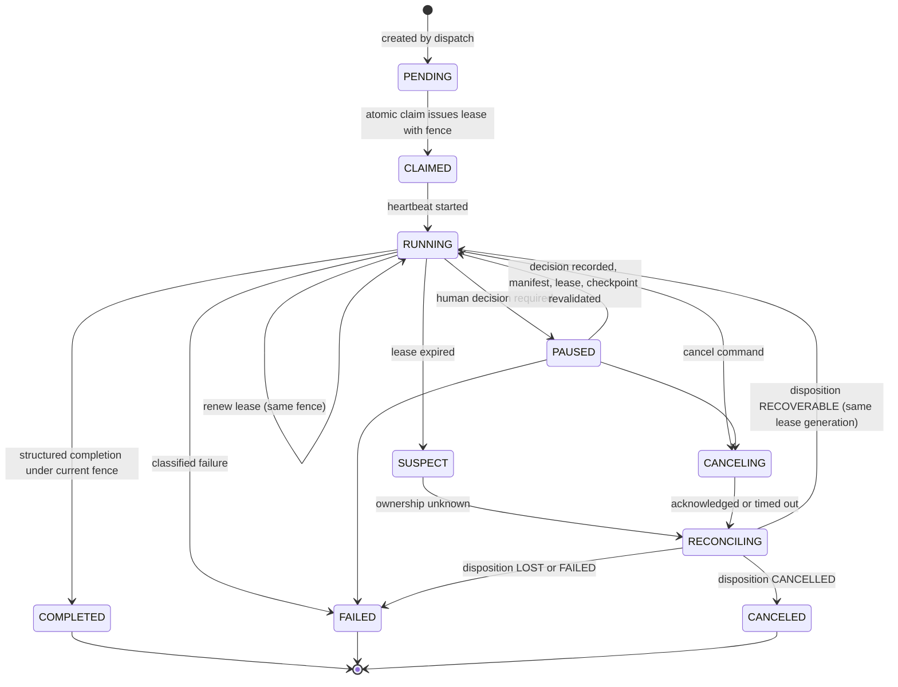

# Attempt

`fdlc://v1/attempt` · Family C (Execution) · Delivery Loop steps 5–6, **Execute** (producer) and **Verify** (verifier)

## Purpose

An Attempt is one immutable execution of a Task under a fenced lease and a frozen execution manifest. Retries, corrections, and recovery create new Attempts; they never rewrite history. An Attempt has a role: a **producer** Attempt yields a Candidate; a **verifier** Attempt yields a Verification. Both are the same artifact type with different bindings, so independence can be proven by comparing two Attempts.

## Identity

| Rule | Value |
|---|---|
| Type URI | `fdlc://v1/attempt` |
| Instance id | `ATT-<work-order>-<role><n>` (`ATT-104-01-p1` producer, `ATT-104-01-v1` verifier). |
| Mutability | The frozen part (manifest, bindings, role, attempt number) is immutable at claim. State, lease heartbeat, checkpoints, disposition, and cost append. |
| Digest | `digest` = SHA-256 over `{id, workOrderId, workOrderRevisionNumber, role, purpose, attemptNumber, factoryVersionDigest, executionProfileDigest, executionManifestDigest, contextPackageDigest}`. `executionManifestDigest` = SHA-256 over the canonical manifest. |
| Engine identity | `executorInvocationId` is the engine-native session id. It MUST be new on every Attempt; a retry never reuses it. |

## Fields

| Field | Type | Req | Description |
|---|---|---|---|
| `schemaVersion`, `type`, `id`, `namespace` | — | MUST | Common identity. |
| `workOrderId`, `workOrderRevisionNumber`, `workOrderDigest`, `taskId`, `intentId` | — | MUST / SHOULD | Lineage. |
| `role` | producer / verifier | MUST | Producer purpose IMPLEMENTATION/AUTOMATION; verifier purpose VERIFICATION. |
| `purpose` | IMPLEMENTATION / VERIFICATION / AUTOMATION | MUST | — |
| `attemptNumber`, `retryOf` | int, {attemptId, reason ≥10 chars, hypothesis, failureClass} | MUST / MUST if n ≥ 2 | A retry records what changed. |
| `factoryVersionId/Digest`, `executionProfileId/Digest` | Id, Digest | MUST | Frozen composition. |
| `routingDecisionId`, `admissionDecisionId` | Id | SHOULD | The Decisions that bound and admitted this Attempt. |
| `contextPackageId`, `contextPackageDigest` | Id, Digest | SHOULD | Frozen context. |
| `executionManifest` | ExecutionManifest | MUST | `causation`, `repository` (base SHA, branch, worktree, code scopes, allowed/excluded paths), `intent`, `workOrderSpecificationDigest`, `harness` (adapter, manifest/config/runtime digests, isolation, `completionContract: factory-result/v1`, `publicationAuthority: CONTROL_PLANE_ONLY`), `modelRoute`, `backend`, `sandbox` (profile, credential grants with `secretValueIncluded: false`, teardown rules), `allowedTools[]` with grants, `skills[]`, `contextPackageDigest`, `workflow` steps, `retryPolicy`, `lease`, `compiledPromptDigest`, orchestrator-minted `idempotencyKeys`. |
| `executionManifestDigest` | Digest | MUST | — |
| `executorInvocationId` | string | SHOULD | Engine session identity. |
| `lease` | Lease | MUST while claimed | `leaseId`, `workerId`, `sessionId`, `generation`, `fence` (random ≥16 chars), `claimedAt`, `heartbeatAt`, `expiresAt`, `durationMs`. |
| `checkpointLease` | Lease | MAY | Historical owner at a pause; never an active lease. |
| `checkpoints[]` | Checkpoint | SHOULD | `checkpointId`, `leaseId`, `stepId`, artifact ref, `compactionBoundary`, `safeToResume`. |
| `state` | see lifecycle | MUST | — |
| `phase` | CLAIMED / PREPARING / EXECUTING / VALIDATING / AWAITING_HUMAN_REVIEW / AWAITING_VERIFICATION / PUBLISHING / TERMINAL | SHOULD | Finer progress inside RUNNING/PAUSED. |
| `disposition` | RETRYABLE / RECOVERABLE / LOST / PRESERVED / CANCELLED / FAILED | MUST when terminal | Runtime disposition after reconciliation. |
| `dispositionReason`, `reconciledAt` | string, Timestamp | SHOULD | — |
| `quarantine` | object | MAY | Repeated stale-lease loss or contradictory evidence. |
| `failure` | {class, retryable, code, stage, reason, signature} | MUST when FAILED | Failure domain classification. |
| `cancellation` | {requestedAt, requestedBy, acknowledgedAt, reason} | MUST when CANCELING/CANCELED | — |
| `candidateId` | Id | MUST for completed producer | — |
| `verificationId`, `verificationBinding` | Id, object | MUST for verifier | Exact subject tuple frozen before execution. |
| `handoff` | Handoff (`factory-result/v1`) | MUST for completed producer | Structured completion: status, completed/incomplete/unknown criterion ids, verification commands, known risks, next action, candidate SHA. A claim, never proof. |
| `cost`, `usage` | CostRecord, object | MUST / SHOULD | Unknown telemetry stays `null`. |
| `evidenceIds[]`, `eventLogDigest`, `traceContext` | — | SHOULD | Evidence and forensic links. |
| `worktree` | string | SHOULD | — |
| `createdAt`, `claimedAt`, `startedAt`, `completedAt`, `createdBy`, `digest`, `history[]` | — | MUST / SHOULD | Common audit fields. |

## Lifecycle



| Transition | Who | MUST record |
|---|---|---|
| `PENDING → CLAIMED` | Worker via control-plane claim (atomic) | Admission Decision (registration, heartbeat, readiness, repository access, executor, isolation, required harness capabilities, digests, model route, sandbox capabilities, backend, profile qualification, Factory Version binding, server-counted leases); lease with new generation and fence |
| `RUNNING → RUNNING` (renew) | Same worker, session, generation | Heartbeat; a stale generation is refused and logged |
| `RUNNING → COMPLETED` | Worker holding the current fence | Handoff, Candidate id (producer) or Verification (verifier), cost, event log digest |
| `RUNNING → SUSPECT → RECONCILING` | Control plane | Lease expiry; provider-truth reconciliation per idempotency key |
| `→ FAILED` | Control plane | `failure.class`, signature, `disposition` |
| `RUNNING → CANCELING → CANCELED` | Authorized human or policy | Cancellation protocol: prevent new work, signal, acknowledge or time out, reconcile, terminate |
| `PAUSED → RUNNING` | Control plane after Decision | Revalidation of manifest, source versions, policy, grants, lease, checkpoint |

Dispositions (from Mission Control's reconciliation table, `worker-runtime-operations.md:105-115`):

| Disposition | Meaning | Next |
|---|---|---|
| `RETRYABLE` | Transient failure of idempotent work | New Attempt after backoff |
| `RECOVERABLE` | Durable checkpoint and current lease allow continuation | Resume in place |
| `LOST` | Ownership unknown or expired; workspace preserved | New Attempt; never adopt the old process |
| `PRESERVED` | Cleanup could not prove safety; nothing deleted | Human or reconciler decides |
| `CANCELLED` | Cancellation completed | Terminal |
| `FAILED` | Non-retryable result | Terminal; retry needs a changed hypothesis |

## Invariants

- A retry MUST be a new Attempt with `retryOf.reason` and `retryOf.hypothesis`. "Retries, corrections, and recovery create new Attempts rather than rewriting history." (`FACTORY_VOCABULARY.md:87-88`) "Repeating the same failed action without new evidence is prohibited." (`mission-control-north-star.md:150-151`)
- Every material write (completion, evidence report, publication request) MUST prove the current lease fence, worker, session, and generation. "A stale process cannot report evidence or authorize publication after expiry, replacement, cancellation, or session/generation change." (`worker-runtime-operations.md:70-71`)
- The worker MUST read only the frozen execution manifest. It MUST NOT re-resolve the live Factory Version, repository policy files, or registry entries during execution.
- An incomplete manifest MUST fail closed at compile time. Runtime defaults MUST NOT fill gaps.
- Lease expiry MUST make the Attempt `SUSPECT`, not `FAILED`; reconciliation against provider truth MUST precede any retry. "Inability to prove absence is not permission to retry." (`operating-contract-evidence-map.md:48`)
- Unknown or expired ownership MUST become `LOST`, preserve the workspace, and require a new Attempt. A manifest PID MUST never be used to adopt or kill a process after restart.
- Cleanup MUST prove safety before deleting anything; ambiguity fails closed to `PRESERVED`. "A mismatch is a preservation signal, not a repair instruction." (`worker-runtime-operations.md:100-101`)
- Cancellation MUST prevent new authority even if late success arrives; late events are retained for audit and MUST NOT reopen a terminal Attempt.
- A producer Attempt's handoff is a claim. "A worker handoff is never proof of pass." (`governed-missions-contract.md:16`) Completion freezes a Candidate; it does not accept, publish, merge, or release.
- A verifier Attempt MUST have a different Attempt id, lease, invocation, and worktree from its source Attempt, and MUST run under a Factory Version whose purpose is VERIFICATION.
- At most one active mutating Attempt MAY exist per repository unless parallelism is explicit in the Plan.
- Missing token, cost, model-request, or retry telemetry MUST remain `null`.
- Idempotency keys for side effects MUST be minted by the orchestrator, tied to the logical operation, and persisted before execution.

## Evidence requirements

| Transition | Evidence |
|---|---|
| Claim | Admission Decision with checks; manifest digest reproducible by the server |
| Completion | Handoff (`factory-result/v1`); event log digest; artifact digests; for producers, scope reconciliation of changed files against the frozen code scope |
| Reconciliation | Provider-truth query results per idempotency key; disposition reason |
| Pause/resume | Decision id; revalidation results |
| Cancellation | Command, acknowledgment or timeout, reconciliation outcome |

## Extension points

- `x-` fields at top level and inside `executionManifest` (e.g. `x-acme-cost-center`). Extension fields inside the manifest ARE part of `executionManifestDigest`.
- `failure.class` is closed; `failure.code` is implementation-defined.
- `phase` values are closed; finer engine phases MUST be recorded as events, not states.

## Mission Control mapping

| FDLC | Mission Control | Status | Divergence |
|---|---|---|---|
| Attempt | `workflowRuns` (`convex/schema.ts:5233`), "the Attempt system of record"; `convex/factory/attempts.ts` | Available (Qualified) | Direct. |
| `state` | `status` PENDING/RUNNING/COMPLETED/FAILED/PAUSED/CANCELED; recovery states in `executionRecovery.ts` (WAITING, ACTIVE, CANCELING, RECOVERABLE, EXHAUSTED, RECOVERED, TERMINAL) | Available | FDLC adds explicit `CLAIMED`, `SUSPECT`, `CANCELING`, `RECONCILING` states; MC expresses them through `executionPhase`, lease expiry, and recovery library states. |
| `disposition` | `runtimeDisposition` RETRYABLE/LOST/CANCELLED/FAILED/RECOVERABLE; `PRESERVED` is the cleanup outcome | Available | FDLC lists `PRESERVED` as a disposition. |
| `lease` | `workflowRuns.lease {leaseId, ownerId, workerId, workerSessionId, workerGeneration, claimedAt, heartbeatAt, expiresAt}` | Available | MC's random `leaseId` is the fence; FDLC names `fence` separately. |
| `executionManifest` | `factory-execution-manifest/v1..v4` (`convex/lib/executionManifest.ts`) | Available | FDLC manifest is a normalized projection of MC v2–v4 sections (causation, repository, intent, workOrderSpecification, harness, modelRoute, sandbox, workflow, retryPolicy, compiledPromptHash). |
| `handoff` | `factory-result/v1` completion contract; `returnHandoff` | Available | Direct. |
| `role` / `purpose` | `attemptPurpose` IMPLEMENTATION/VERIFICATION/AUTOMATION; `missionRole` | Available | Direct. |
| `checkpoints[]` | `executionCheckpoint`, `checkpointLease` | Available | Direct. |
| `quarantine` | `executionQuarantine` | Available | Direct. |

## JSON Schema

```json
{
  "$schema": "https://json-schema.org/draft/2020-12/schema",
  "$id": "https://fdlc.ai/schemas/v1/attempt.schema.json",
  "title": "FDLC Attempt",
  "description": "One immutable execution of a Task under a fenced lease and frozen execution manifest. Retries create new Attempts. role: producer | verifier.",
  "type": "object",
  "properties": {
    "schemaVersion": {
      "type": "string",
      "const": "1.0"
    },
    "type": {
      "type": "string",
      "const": "fdlc://v1/attempt"
    },
    "id": {
      "$ref": "#/$defs/Id"
    },
    "namespace": {
      "$ref": "#/$defs/Namespace"
    },
    "workOrderId": {
      "$ref": "#/$defs/Id"
    },
    "workOrderRevisionNumber": {
      "type": "integer",
      "minimum": 1
    },
    "workOrderDigest": {
      "$ref": "#/$defs/Digest"
    },
    "taskId": {
      "$ref": "#/$defs/Id"
    },
    "intentId": {
      "$ref": "#/$defs/Id"
    },
    "role": {
      "type": "string",
      "enum": [
        "producer",
        "verifier"
      ]
    },
    "purpose": {
      "type": "string",
      "enum": [
        "IMPLEMENTATION",
        "VERIFICATION",
        "AUTOMATION"
      ]
    },
    "attemptNumber": {
      "type": "integer",
      "minimum": 1
    },
    "retryOf": {
      "type": "object",
      "description": "A retry is a new Attempt with a recorded reason and a changed hypothesis. Never rewrite the prior Attempt.",
      "properties": {
        "attemptId": {
          "$ref": "#/$defs/Id"
        },
        "reason": {
          "type": "string",
          "minLength": 10
        },
        "hypothesis": {
          "type": "string",
          "minLength": 1
        },
        "failureClass": {
          "type": "string"
        }
      },
      "required": [
        "attemptId",
        "reason",
        "hypothesis"
      ],
      "additionalProperties": false
    },
    "factoryVersionId": {
      "$ref": "#/$defs/Id"
    },
    "factoryVersionDigest": {
      "$ref": "#/$defs/Digest"
    },
    "executionProfileId": {
      "$ref": "#/$defs/Id"
    },
    "executionProfileDigest": {
      "$ref": "#/$defs/Digest"
    },
    "routingDecisionId": {
      "$ref": "#/$defs/Id"
    },
    "admissionDecisionId": {
      "$ref": "#/$defs/Id"
    },
    "contextPackageId": {
      "$ref": "#/$defs/Id"
    },
    "contextPackageDigest": {
      "$ref": "#/$defs/Digest"
    },
    "executionManifest": {
      "$ref": "#/$defs/ExecutionManifest"
    },
    "executionManifestDigest": {
      "$ref": "#/$defs/Digest"
    },
    "executorInvocationId": {
      "type": "string",
      "description": "Engine-native identity for this invocation. New on every Attempt."
    },
    "lease": {
      "$ref": "#/$defs/Lease"
    },
    "checkpointLease": {
      "$ref": "#/$defs/Lease",
      "description": "Historical workspace owner at a pause; never an active lease or authority."
    },
    "checkpoints": {
      "type": "array",
      "items": {
        "$ref": "#/$defs/Checkpoint"
      }
    },
    "state": {
      "type": "string",
      "enum": [
        "PENDING",
        "CLAIMED",
        "RUNNING",
        "PAUSED",
        "SUSPECT",
        "CANCELING",
        "RECONCILING",
        "COMPLETED",
        "FAILED",
        "CANCELED"
      ]
    },
    "phase": {
      "type": "string",
      "enum": [
        "CLAIMED",
        "PREPARING",
        "EXECUTING",
        "VALIDATING",
        "AWAITING_HUMAN_REVIEW",
        "AWAITING_VERIFICATION",
        "PUBLISHING",
        "TERMINAL"
      ]
    },
    "disposition": {
      "type": "string",
      "enum": [
        "RETRYABLE",
        "RECOVERABLE",
        "LOST",
        "PRESERVED",
        "CANCELLED",
        "FAILED"
      ],
      "description": "Runtime disposition after reconciliation. LOST: ownership unknown or expired; workspace preserved; new Attempt required. RECOVERABLE: durable checkpoint and current lease allow continuation. PRESERVED: cleanup could not prove safety; nothing deleted."
    },
    "dispositionReason": {
      "type": "string"
    },
    "reconciledAt": {
      "$ref": "#/$defs/Timestamp"
    },
    "quarantine": {
      "type": "object",
      "properties": {
        "code": {
          "type": "string"
        },
        "reason": {
          "type": "string"
        },
        "quarantinedAt": {
          "$ref": "#/$defs/Timestamp"
        },
        "actor": {
          "$ref": "#/$defs/Actor"
        },
        "staleRecoveryCount": {
          "type": "integer",
          "minimum": 0
        }
      },
      "required": [
        "code",
        "reason",
        "quarantinedAt",
        "actor"
      ],
      "additionalProperties": false
    },
    "failure": {
      "type": "object",
      "properties": {
        "class": {
          "type": "string",
          "enum": [
            "AUTHORIZATION",
            "CONFIGURATION",
            "CAPACITY",
            "PROVIDER",
            "EXECUTOR",
            "VALIDATION",
            "REPOSITORY",
            "INTERNAL",
            "UNKNOWN"
          ]
        },
        "retryable": {
          "type": "boolean"
        },
        "code": {
          "type": "string"
        },
        "stage": {
          "type": "string"
        },
        "reason": {
          "type": "string"
        },
        "signature": {
          "type": "string",
          "description": "Normalized fingerprint used to detect repeated equivalent failure."
        }
      },
      "required": [
        "class",
        "retryable",
        "reason"
      ],
      "additionalProperties": false
    },
    "cancellation": {
      "type": "object",
      "properties": {
        "requestedAt": {
          "$ref": "#/$defs/Timestamp"
        },
        "requestedBy": {
          "$ref": "#/$defs/Actor"
        },
        "acknowledgedAt": {
          "$ref": "#/$defs/Timestamp"
        },
        "reason": {
          "type": "string"
        }
      },
      "required": [
        "requestedAt",
        "requestedBy",
        "reason"
      ],
      "additionalProperties": false
    },
    "candidateId": {
      "$ref": "#/$defs/Id",
      "description": "Producer Attempts: the Candidate produced."
    },
    "verificationId": {
      "$ref": "#/$defs/Id",
      "description": "Verifier Attempts: the Verification produced."
    },
    "verificationBinding": {
      "type": "object",
      "description": "Verifier Attempts: exact subject tuple frozen before execution.",
      "properties": {
        "sourceAttemptId": {
          "$ref": "#/$defs/Id"
        },
        "candidateId": {
          "$ref": "#/$defs/Id"
        },
        "subjectDigest": {
          "$ref": "#/$defs/Digest"
        },
        "verificationContractDigest": {
          "$ref": "#/$defs/Digest"
        },
        "verificationPlanDigest": {
          "$ref": "#/$defs/Digest"
        }
      },
      "required": [
        "sourceAttemptId",
        "candidateId",
        "subjectDigest",
        "verificationContractDigest"
      ],
      "additionalProperties": false
    },
    "handoff": {
      "$ref": "#/$defs/Handoff"
    },
    "cost": {
      "$ref": "#/$defs/CostRecord"
    },
    "usage": {
      "type": "object",
      "properties": {
        "inputTokens": {
          "type": [
            "integer",
            "null"
          ]
        },
        "outputTokens": {
          "type": [
            "integer",
            "null"
          ]
        },
        "modelRequests": {
          "type": [
            "integer",
            "null"
          ]
        },
        "toolCalls": {
          "type": [
            "integer",
            "null"
          ]
        },
        "retries": {
          "type": [
            "integer",
            "null"
          ]
        },
        "wallClockMs": {
          "type": [
            "integer",
            "null"
          ]
        }
      },
      "additionalProperties": false,
      "description": "Unknown telemetry stays null. Never invent zeroes."
    },
    "evidenceIds": {
      "type": "array",
      "items": {
        "$ref": "#/$defs/Id"
      }
    },
    "eventLogDigest": {
      "$ref": "#/$defs/Digest",
      "description": "Digest over the ordered run event stream."
    },
    "traceContext": {
      "type": "object",
      "properties": {
        "traceId": {
          "type": "string"
        },
        "spanId": {
          "type": "string"
        }
      },
      "additionalProperties": false
    },
    "worktree": {
      "type": "string"
    },
    "createdAt": {
      "$ref": "#/$defs/Timestamp"
    },
    "claimedAt": {
      "$ref": "#/$defs/Timestamp"
    },
    "startedAt": {
      "$ref": "#/$defs/Timestamp"
    },
    "completedAt": {
      "$ref": "#/$defs/Timestamp"
    },
    "createdBy": {
      "$ref": "#/$defs/Actor"
    },
    "digest": {
      "$ref": "#/$defs/Digest",
      "description": "Digest over the frozen part: (id, workOrderId, workOrderRevisionNumber, role, purpose, attemptNumber, factoryVersionDigest, executionProfileDigest, executionManifestDigest, contextPackageDigest)."
    },
    "history": {
      "type": "array",
      "items": {
        "$ref": "#/$defs/Transition"
      }
    }
  },
  "required": [
    "schemaVersion",
    "type",
    "id",
    "namespace",
    "workOrderId",
    "workOrderRevisionNumber",
    "role",
    "purpose",
    "attemptNumber",
    "factoryVersionId",
    "factoryVersionDigest",
    "executionProfileId",
    "executionProfileDigest",
    "executionManifest",
    "executionManifestDigest",
    "state",
    "cost",
    "createdAt",
    "createdBy",
    "digest"
  ],
  "allOf": [
    {
      "if": {
        "properties": {
          "role": {
            "const": "producer"
          }
        }
      },
      "then": {
        "properties": {
          "purpose": {
            "enum": [
              "IMPLEMENTATION",
              "AUTOMATION"
            ]
          }
        }
      }
    },
    {
      "if": {
        "properties": {
          "role": {
            "const": "verifier"
          }
        }
      },
      "then": {
        "properties": {
          "purpose": {
            "const": "VERIFICATION"
          }
        },
        "required": [
          "verificationBinding"
        ]
      }
    },
    {
      "if": {
        "properties": {
          "state": {
            "enum": [
              "CLAIMED",
              "RUNNING",
              "PAUSED",
              "SUSPECT",
              "CANCELING",
              "RECONCILING"
            ]
          }
        }
      },
      "then": {
        "required": [
          "lease",
          "claimedAt"
        ]
      }
    },
    {
      "if": {
        "properties": {
          "state": {
            "enum": [
              "COMPLETED",
              "FAILED",
              "CANCELED"
            ]
          }
        }
      },
      "then": {
        "required": [
          "completedAt",
          "disposition"
        ]
      }
    },
    {
      "if": {
        "properties": {
          "state": {
            "const": "COMPLETED"
          },
          "role": {
            "const": "producer"
          }
        }
      },
      "then": {
        "required": [
          "candidateId",
          "handoff"
        ]
      }
    },
    {
      "if": {
        "properties": {
          "state": {
            "const": "FAILED"
          }
        }
      },
      "then": {
        "required": [
          "failure"
        ]
      }
    },
    {
      "if": {
        "properties": {
          "attemptNumber": {
            "minimum": 2
          }
        }
      },
      "then": {
        "required": [
          "retryOf"
        ]
      }
    }
  ],
  "$defs": {
    "Id": {
      "type": "string",
      "minLength": 1,
      "maxLength": 200,
      "pattern": "^[A-Za-z0-9][A-Za-z0-9._:/@-]*$",
      "description": "Instance identifier. Unique within the issuing namespace; combined with `namespace` it is globally unique."
    },
    "ArtifactUri": {
      "type": "string",
      "pattern": "^fdlc://v1/(intent|specification|plan|work-order|factory-manifest|factory-version|execution-profile|capability-manifest|qualification-record|context-package|attempt|candidate|evidence|verification|decision|release|outcome|learning-signal|improvement-candidate)(/[A-Za-z0-9][A-Za-z0-9._:@-]*)?$",
      "description": "Artifact type URI (`fdlc://v1/<artifact>`), optionally suffixed with an instance id."
    },
    "Namespace": {
      "type": "string",
      "format": "uri",
      "description": "URI of the issuing control plane or organization. Scopes every `id` in this record."
    },
    "Digest": {
      "type": "string",
      "pattern": "^sha256:[a-f0-9]{64}$",
      "description": "SHA-256 over the RFC 8785 (JCS) canonical JSON of the digested projection."
    },
    "GitSha": {
      "type": "string",
      "pattern": "^[a-f0-9]{40}$|^[a-f0-9]{64}$",
      "description": "Lowercase full Git object id (SHA-1 or SHA-256 repository)."
    },
    "Timestamp": {
      "type": "string",
      "format": "date-time",
      "description": "RFC 3339 timestamp in UTC."
    },
    "Semver": {
      "type": "string",
      "pattern": "^(0|[1-9]\\d*)\\.(0|[1-9]\\d*)\\.(0|[1-9]\\d*)(-[0-9A-Za-z.-]+)?(\\+[0-9A-Za-z.-]+)?$"
    },
    "RiskClass": {
      "type": "string",
      "enum": [
        "LOW",
        "MEDIUM",
        "HIGH",
        "CRITICAL"
      ]
    },
    "AutonomyLevel": {
      "type": "string",
      "enum": [
        "L0",
        "L1",
        "L2",
        "L3",
        "L4",
        "L5"
      ],
      "description": "HITL spectrum position. Effective autonomy is min(factory, objective, work order, policy, trust)."
    },
    "Actor": {
      "type": "object",
      "description": "Attributable identity. `identitySource` says how the control plane established it; never inferred from a client label.",
      "properties": {
        "kind": {
          "type": "string",
          "enum": [
            "human",
            "policy",
            "service",
            "agent",
            "system"
          ]
        },
        "id": {
          "$ref": "#/$defs/Id"
        },
        "identitySource": {
          "type": "string",
          "enum": [
            "authenticated",
            "workload-identity",
            "service-command",
            "development-fallback"
          ]
        },
        "displayName": {
          "type": "string"
        },
        "delegationRef": {
          "$ref": "#/$defs/Id",
          "description": "Reference to the delegation record that grants this actor its authority."
        }
      },
      "required": [
        "kind",
        "id",
        "identitySource"
      ],
      "additionalProperties": false
    },
    "Ref": {
      "type": "object",
      "description": "Reference to another FDLC artifact instance, optionally pinned to a digest.",
      "properties": {
        "type": {
          "$ref": "#/$defs/ArtifactUri"
        },
        "id": {
          "$ref": "#/$defs/Id"
        },
        "digest": {
          "$ref": "#/$defs/Digest"
        },
        "revisionNumber": {
          "type": "integer",
          "minimum": 1
        }
      },
      "required": [
        "type",
        "id"
      ],
      "additionalProperties": false
    },
    "Money": {
      "type": "object",
      "properties": {
        "amount": {
          "type": "number",
          "minimum": 0
        },
        "currency": {
          "type": "string",
          "pattern": "^[A-Z]{3}$"
        }
      },
      "required": [
        "amount",
        "currency"
      ],
      "additionalProperties": false
    },
    "CostRecord": {
      "type": "object",
      "description": "Cost with an honesty class. UNKNOWN cost stays UNKNOWN; implementations MUST NOT invent zeroes.",
      "properties": {
        "status": {
          "type": "string",
          "enum": [
            "MEASURED",
            "ESTIMATED",
            "UNKNOWN"
          ]
        },
        "amount": {
          "type": "number",
          "minimum": 0
        },
        "currency": {
          "type": "string",
          "pattern": "^[A-Z]{3}$"
        },
        "coverage": {
          "type": "number",
          "minimum": 0,
          "maximum": 1,
          "description": "Fraction of contributing cost items that were measured."
        },
        "reason": {
          "type": "string"
        }
      },
      "required": [
        "status"
      ],
      "additionalProperties": false
    },
    "Transition": {
      "type": "object",
      "description": "Audit record of one authoritative state transition. Every field listed here MUST be recorded.",
      "properties": {
        "transitionId": {
          "$ref": "#/$defs/Id"
        },
        "subjectId": {
          "$ref": "#/$defs/Id"
        },
        "priorVersion": {
          "type": "integer",
          "minimum": 0
        },
        "fromState": {
          "type": "string"
        },
        "toState": {
          "type": "string"
        },
        "actor": {
          "$ref": "#/$defs/Actor"
        },
        "reason": {
          "type": "string"
        },
        "policyVersion": {
          "type": "string"
        },
        "idempotencyKey": {
          "type": "string"
        },
        "occurredAt": {
          "$ref": "#/$defs/Timestamp"
        },
        "requiredEvidenceIds": {
          "type": "array",
          "items": {
            "$ref": "#/$defs/Id"
          }
        },
        "decisionId": {
          "$ref": "#/$defs/Id"
        },
        "invalidatedDependents": {
          "type": "array",
          "items": {
            "$ref": "#/$defs/Ref"
          }
        }
      },
      "required": [
        "subjectId",
        "fromState",
        "toState",
        "actor",
        "reason",
        "idempotencyKey",
        "occurredAt"
      ],
      "additionalProperties": false
    },
    "ArtifactRef": {
      "type": "object",
      "description": "Content-addressed reference to a stored artifact (diff, log, screenshot, bundle).",
      "properties": {
        "artifactId": {
          "$ref": "#/$defs/Id"
        },
        "kind": {
          "type": "string"
        },
        "mediaType": {
          "type": "string"
        },
        "digest": {
          "$ref": "#/$defs/Digest"
        },
        "sizeBytes": {
          "type": "integer",
          "minimum": 0
        },
        "storageRef": {
          "type": "string"
        }
      },
      "required": [
        "artifactId",
        "digest"
      ],
      "additionalProperties": false
    },
    "Lease": {
      "type": "object",
      "description": "Temporary execution ownership. The fence is a random token bound to worker, session, and generation; it is not a credential.",
      "properties": {
        "leaseId": {
          "$ref": "#/$defs/Id"
        },
        "workerId": {
          "type": "string"
        },
        "sessionId": {
          "type": "string"
        },
        "generation": {
          "type": "integer",
          "minimum": 0
        },
        "fence": {
          "type": "string",
          "minLength": 16
        },
        "claimedAt": {
          "$ref": "#/$defs/Timestamp"
        },
        "heartbeatAt": {
          "$ref": "#/$defs/Timestamp"
        },
        "expiresAt": {
          "$ref": "#/$defs/Timestamp"
        },
        "durationMs": {
          "type": "integer",
          "minimum": 1000
        }
      },
      "required": [
        "leaseId",
        "workerId",
        "sessionId",
        "generation",
        "fence",
        "claimedAt",
        "heartbeatAt",
        "expiresAt"
      ],
      "additionalProperties": false
    },
    "Checkpoint": {
      "type": "object",
      "properties": {
        "checkpointId": {
          "$ref": "#/$defs/Id"
        },
        "leaseId": {
          "$ref": "#/$defs/Id"
        },
        "stepId": {
          "type": "string"
        },
        "artifact": {
          "$ref": "#/$defs/ArtifactRef"
        },
        "createdAt": {
          "$ref": "#/$defs/Timestamp"
        },
        "summary": {
          "type": "string"
        },
        "compactionBoundary": {
          "type": "boolean"
        },
        "safeToResume": {
          "type": "boolean"
        }
      },
      "required": [
        "checkpointId",
        "leaseId",
        "artifact",
        "createdAt",
        "safeToResume"
      ],
      "additionalProperties": false
    },
    "ExecutionManifest": {
      "type": "object",
      "description": "Immutable, Attempt-specific compilation of the Work Order revision and the Factory Version. The worker reads only this.",
      "properties": {
        "manifestVersion": {
          "type": "string",
          "pattern": "^fdlc-execution-manifest/"
        },
        "causation": {
          "type": "object",
          "properties": {
            "intentId": {
              "$ref": "#/$defs/Id"
            },
            "planId": {
              "$ref": "#/$defs/Id"
            },
            "planDigest": {
              "$ref": "#/$defs/Digest"
            },
            "qualityContractDigest": {
              "$ref": "#/$defs/Digest"
            },
            "workOrderId": {
              "$ref": "#/$defs/Id"
            },
            "workOrderRevisionNumber": {
              "type": "integer"
            },
            "taskId": {
              "$ref": "#/$defs/Id"
            },
            "attemptId": {
              "$ref": "#/$defs/Id"
            },
            "factoryVersionId": {
              "$ref": "#/$defs/Id"
            },
            "factoryVersionDigest": {
              "$ref": "#/$defs/Digest"
            },
            "executionProfileId": {
              "$ref": "#/$defs/Id"
            },
            "executionProfileDigest": {
              "$ref": "#/$defs/Digest"
            },
            "purpose": {
              "type": "string",
              "enum": [
                "IMPLEMENTATION",
                "VERIFICATION",
                "AUTOMATION"
              ]
            }
          },
          "required": [
            "intentId",
            "planId",
            "planDigest",
            "qualityContractDigest",
            "workOrderId",
            "workOrderRevisionNumber",
            "attemptId",
            "factoryVersionId",
            "factoryVersionDigest",
            "executionProfileId",
            "executionProfileDigest",
            "purpose"
          ],
          "additionalProperties": false
        },
        "repository": {
          "type": "object",
          "properties": {
            "repositoryId": {
              "$ref": "#/$defs/Id"
            },
            "name": {
              "type": "string"
            },
            "dataClassification": {
              "type": "string",
              "enum": [
                "PUBLIC",
                "INTERNAL",
                "CONFIDENTIAL",
                "RESTRICTED"
              ]
            },
            "baseSha": {
              "$ref": "#/$defs/GitSha"
            },
            "baseRef": {
              "type": "string"
            },
            "branch": {
              "type": "string"
            },
            "worktree": {
              "type": "string"
            },
            "codeScopeIds": {
              "type": "array",
              "items": {
                "$ref": "#/$defs/Id"
              }
            },
            "allowedPaths": {
              "type": "array",
              "items": {
                "type": "string"
              }
            },
            "excludedPaths": {
              "type": "array",
              "items": {
                "type": "string"
              }
            },
            "verificationPublicationOrder": {
              "type": "string",
              "const": "VERIFY_BEFORE_PUBLICATION"
            }
          },
          "required": [
            "repositoryId",
            "name",
            "dataClassification",
            "baseSha",
            "branch",
            "codeScopeIds",
            "allowedPaths",
            "excludedPaths"
          ],
          "additionalProperties": false
        },
        "intent": {
          "type": "object",
          "properties": {
            "title": {
              "type": "string"
            },
            "desiredOutcome": {
              "type": "string"
            },
            "acceptanceCriterionIds": {
              "type": "array",
              "items": {
                "$ref": "#/$defs/Id"
              }
            },
            "selectedTask": {
              "type": "object",
              "properties": {
                "title": {
                  "type": "string"
                },
                "description": {
                  "type": "string"
                }
              },
              "required": [
                "title"
              ],
              "additionalProperties": false
            }
          },
          "required": [
            "title",
            "desiredOutcome",
            "acceptanceCriterionIds"
          ],
          "additionalProperties": false
        },
        "workOrderSpecificationDigest": {
          "$ref": "#/$defs/Digest"
        },
        "harness": {
          "type": "object",
          "properties": {
            "adapterId": {
              "type": "string"
            },
            "adapterVersion": {
              "type": "string"
            },
            "harnessId": {
              "type": "string"
            },
            "harnessVersion": {
              "type": "string"
            },
            "capabilityManifestDigest": {
              "$ref": "#/$defs/Digest"
            },
            "effectiveConfigDigest": {
              "$ref": "#/$defs/Digest"
            },
            "runtimeArtifactDigest": {
              "$ref": "#/$defs/Digest"
            },
            "isolation": {
              "type": "string",
              "enum": [
                "READ_ONLY",
                "WORKSPACE_WRITE"
              ]
            },
            "timeoutMs": {
              "type": "integer",
              "minimum": 1
            },
            "completionContract": {
              "type": "string",
              "const": "factory-result/v1"
            },
            "publicationAuthority": {
              "type": "string",
              "const": "CONTROL_PLANE_ONLY"
            }
          },
          "required": [
            "adapterId",
            "adapterVersion",
            "harnessId",
            "harnessVersion",
            "capabilityManifestDigest",
            "effectiveConfigDigest",
            "runtimeArtifactDigest",
            "isolation",
            "timeoutMs",
            "completionContract",
            "publicationAuthority"
          ],
          "additionalProperties": false
        },
        "modelRoute": {
          "type": "object",
          "properties": {
            "routeId": {
              "type": "string"
            },
            "provider": {
              "type": "string"
            },
            "modelId": {
              "type": "string"
            },
            "routeDigest": {
              "$ref": "#/$defs/Digest"
            },
            "qualificationDigest": {
              "$ref": "#/$defs/Digest"
            },
            "inferenceMode": {
              "type": "string",
              "enum": [
                "ALLOWED",
                "DENIED"
              ]
            }
          },
          "required": [
            "routeId",
            "provider",
            "modelId",
            "routeDigest",
            "qualificationDigest",
            "inferenceMode"
          ],
          "additionalProperties": false
        },
        "backend": {
          "type": "string",
          "enum": [
            "persistent-worker",
            "remote-sandbox",
            "isolated-container"
          ]
        },
        "sandbox": {
          "type": "object",
          "properties": {
            "profileId": {
              "$ref": "#/$defs/Id"
            },
            "profileDigest": {
              "$ref": "#/$defs/Digest"
            },
            "resourceName": {
              "type": "string"
            },
            "credentialGrants": {
              "type": "array",
              "items": {
                "type": "object",
                "properties": {
                  "kind": {
                    "type": "string"
                  },
                  "secretValueIncluded": {
                    "type": "boolean",
                    "const": false
                  },
                  "publicationAuthority": {
                    "type": "string",
                    "const": "NONE"
                  }
                },
                "required": [
                  "kind",
                  "secretValueIncluded",
                  "publicationAuthority"
                ],
                "additionalProperties": false
              }
            },
            "teardown": {
              "type": "object",
              "properties": {
                "credentialsRevokedBeforePublication": {
                  "type": "boolean",
                  "const": true
                },
                "resourceAbsenceRequiredBeforePublication": {
                  "type": "boolean",
                  "const": true
                }
              },
              "required": [
                "credentialsRevokedBeforePublication",
                "resourceAbsenceRequiredBeforePublication"
              ],
              "additionalProperties": false
            }
          },
          "required": [
            "profileId",
            "profileDigest",
            "credentialGrants",
            "teardown"
          ],
          "additionalProperties": false
        },
        "allowedTools": {
          "type": "array",
          "items": {
            "type": "object",
            "properties": {
              "capabilityId": {
                "$ref": "#/$defs/Id"
              },
              "operations": {
                "type": "array",
                "items": {
                  "type": "string"
                }
              },
              "grantId": {
                "$ref": "#/$defs/Id"
              },
              "grantDigest": {
                "$ref": "#/$defs/Digest"
              }
            },
            "required": [
              "capabilityId",
              "operations",
              "grantId",
              "grantDigest"
            ],
            "additionalProperties": false
          }
        },
        "skills": {
          "type": "array",
          "items": {
            "type": "object",
            "properties": {
              "capabilityId": {
                "$ref": "#/$defs/Id"
              },
              "version": {
                "type": "string"
              },
              "digest": {
                "$ref": "#/$defs/Digest"
              }
            },
            "required": [
              "capabilityId",
              "version",
              "digest"
            ],
            "additionalProperties": false
          }
        },
        "contextPackageDigest": {
          "$ref": "#/$defs/Digest"
        },
        "workflow": {
          "type": "object",
          "properties": {
            "workflowId": {
              "type": "string"
            },
            "version": {
              "type": "integer"
            },
            "digest": {
              "$ref": "#/$defs/Digest"
            },
            "steps": {
              "type": "array",
              "items": {
                "type": "object",
                "properties": {
                  "stepId": {
                    "type": "string"
                  },
                  "kind": {
                    "type": "string",
                    "enum": [
                      "AGENT",
                      "DETERMINISTIC",
                      "VERIFY",
                      "GATE",
                      "ROUTER",
                      "REDUCE"
                    ]
                  },
                  "agentCapabilityId": {
                    "$ref": "#/$defs/Id"
                  },
                  "promptBundleDigest": {
                    "$ref": "#/$defs/Digest"
                  },
                  "timeoutMs": {
                    "type": "integer"
                  },
                  "outputSchemaDigest": {
                    "$ref": "#/$defs/Digest"
                  }
                },
                "required": [
                  "stepId",
                  "kind",
                  "timeoutMs"
                ],
                "additionalProperties": false
              }
            }
          },
          "required": [
            "workflowId",
            "version",
            "digest",
            "steps"
          ],
          "additionalProperties": false
        },
        "retryPolicy": {
          "type": "object",
          "properties": {
            "maxAttempts": {
              "type": "integer",
              "minimum": 1
            },
            "maxTotalWallClockMs": {
              "type": "integer",
              "minimum": 1
            },
            "maxCost": {
              "$ref": "#/$defs/Money"
            },
            "retryableFailureClasses": {
              "type": "array",
              "items": {
                "type": "string"
              }
            },
            "failClosedFailureClasses": {
              "type": "array",
              "items": {
                "type": "string"
              }
            }
          },
          "required": [
            "maxAttempts",
            "maxTotalWallClockMs",
            "maxCost",
            "retryableFailureClasses",
            "failClosedFailureClasses"
          ],
          "additionalProperties": false
        },
        "lease": {
          "type": "object",
          "properties": {
            "durationMs": {
              "type": "integer"
            },
            "heartbeatIntervalMs": {
              "type": "integer"
            }
          },
          "required": [
            "durationMs",
            "heartbeatIntervalMs"
          ],
          "additionalProperties": false
        },
        "compiledPromptDigest": {
          "$ref": "#/$defs/Digest"
        },
        "idempotencyKeys": {
          "type": "object",
          "additionalProperties": {
            "type": "string"
          },
          "description": "Orchestrator-minted keys for every side-effect boundary (commit, push, publish)."
        }
      },
      "required": [
        "manifestVersion",
        "causation",
        "repository",
        "intent",
        "workOrderSpecificationDigest",
        "harness",
        "modelRoute",
        "backend",
        "allowedTools",
        "workflow",
        "retryPolicy",
        "lease",
        "compiledPromptDigest"
      ],
      "additionalProperties": false
    },
    "Handoff": {
      "type": "object",
      "description": "Structured completion (factory-result/v1). A claim, never proof. Unknowns are represented, never inferred.",
      "properties": {
        "schema": {
          "type": "string",
          "const": "factory-result/v1"
        },
        "status": {
          "type": "string",
          "enum": [
            "COMPLETED",
            "BLOCKED",
            "FAILED"
          ]
        },
        "summary": {
          "type": "string"
        },
        "completedAcceptanceCriterionIds": {
          "type": "array",
          "items": {
            "$ref": "#/$defs/Id"
          }
        },
        "incompleteAcceptanceCriterionIds": {
          "type": "array",
          "items": {
            "$ref": "#/$defs/Id"
          }
        },
        "unknownAcceptanceCriterionIds": {
          "type": "array",
          "items": {
            "$ref": "#/$defs/Id"
          }
        },
        "verificationCommands": {
          "type": "array",
          "items": {
            "type": "string"
          }
        },
        "knownRisks": {
          "type": "array",
          "items": {
            "type": "string"
          }
        },
        "nextAction": {
          "type": "string"
        },
        "candidateSha": {
          "$ref": "#/$defs/GitSha"
        }
      },
      "required": [
        "schema",
        "status",
        "summary",
        "completedAcceptanceCriterionIds",
        "incompleteAcceptanceCriterionIds",
        "unknownAcceptanceCriterionIds",
        "verificationCommands",
        "knownRisks",
        "nextAction"
      ],
      "additionalProperties": false
    }
  },
  "patternProperties": {
    "^x-[a-z0-9]+(-[a-z0-9]+)*$": {}
  },
  "additionalProperties": false
}
```

## Example instance

```json
{
  "schemaVersion": "1.0",
  "type": "fdlc://v1/attempt",
  "id": "ATT-104-01-p1",
  "namespace": "https://acme.example/factories/checkout",
  "workOrderId": "WO-104-01",
  "workOrderRevisionNumber": 1,
  "workOrderDigest": "sha256:c71cd9ffb858a2246f0ac88f48da89110aecef031b15bbbc675c2a2370e8ac93",
  "taskId": "TASK-104-01-2",
  "intentId": "INT-104",
  "role": "producer",
  "purpose": "IMPLEMENTATION",
  "attemptNumber": 1,
  "factoryVersionId": "FV-depmod-1.0",
  "factoryVersionDigest": "sha256:ce6706f3f86d3e77ddd2e266cc1cbf88480a25bb535e2845eda36be5d98bec7f",
  "executionProfileId": "EP-depmod-1.0-prod",
  "executionProfileDigest": "sha256:d93145737892842c402a5765ae03045cf0b9b685a678cd76d1bc52faec829b04",
  "routingDecisionId": "DEC-104-R1",
  "admissionDecisionId": "DEC-104-A1",
  "contextPackageId": "CTX-104-01-p1",
  "contextPackageDigest": "sha256:591bd3b4b63f1270096128cd9ee09266c91703666ea6ac49bc0a716d66ffcc23",
  "executionManifest": {
    "manifestVersion": "fdlc-execution-manifest/1.0",
    "causation": {
      "intentId": "INT-104",
      "planId": "PLAN-104-r2",
      "planDigest": "sha256:0dc4b958e05409dbf3e0541a7c45bd9777d60c5e464e17e00910fe0d323a4b37",
      "qualityContractDigest": "sha256:dc8ccbf7d977e52efff8403f63b12e0889313b0deb0e14d4ac62866efe11ca16",
      "workOrderId": "WO-104-01",
      "workOrderRevisionNumber": 1,
      "taskId": "TASK-104-01-2",
      "attemptId": "ATT-104-01-p1",
      "factoryVersionId": "FV-depmod-1.0",
      "factoryVersionDigest": "sha256:ce6706f3f86d3e77ddd2e266cc1cbf88480a25bb535e2845eda36be5d98bec7f",
      "executionProfileId": "EP-depmod-1.0-prod",
      "executionProfileDigest": "sha256:d93145737892842c402a5765ae03045cf0b9b685a678cd76d1bc52faec829b04",
      "purpose": "IMPLEMENTATION"
    },
    "repository": {
      "repositoryId": "repo:checkout-api",
      "name": "acme/checkout-api",
      "dataClassification": "INTERNAL",
      "baseSha": "1405df66cbe219b0bf6355bc3d60361a8376b6b4",
      "baseRef": "main",
      "branch": "factory/WO-104-01/ATT-104-01-p1",
      "worktree": "/work/attempts/ATT-104-01-p1",
      "codeScopeIds": [
        "scope:checkout-api/deploy"
      ],
      "allowedPaths": [
        "services/checkout-api/**"
      ],
      "excludedPaths": [
        "services/checkout-api/api/public/**",
        "services/checkout-api/auth/**",
        "services/checkout-api/config/secrets/**",
        "services/checkout-api/schema/**"
      ],
      "verificationPublicationOrder": "VERIFY_BEFORE_PUBLICATION"
    },
    "intent": {
      "title": "Implement bounded SDK v4 upgrade",
      "desiredOutcome": "checkout-api on acme-payments-sdk 4.x with unchanged public API, schema, and authorization behavior.",
      "acceptanceCriterionIds": [
        "AC-104-01",
        "AC-104-02",
        "AC-104-03",
        "AC-104-04"
      ],
      "selectedTask": {
        "title": "Implement bounded upgrade",
        "description": "Upgrade the manifest and lockfile, migrate call sites in services/checkout-api/payments, run tests."
      }
    },
    "workOrderSpecificationDigest": "sha256:c71cd9ffb858a2246f0ac88f48da89110aecef031b15bbbc675c2a2370e8ac93",
    "harness": {
      "adapterId": "codex",
      "adapterVersion": "v1",
      "harnessId": "codex-cli",
      "harnessVersion": "0.146.0",
      "capabilityManifestDigest": "sha256:d0313f6a3c7a6d72d91025c8ad5fc0b4575076f88756c15c418f563c2525a571",
      "effectiveConfigDigest": "sha256:6b4d36371a4fa3a0c70536c873112a7f5220fcf695927bf6a8e847790a2c68cc",
      "runtimeArtifactDigest": "sha256:8d18901b3b5dc6f87e1c9ce2795119d6bd3bea620ab184201f392604d63136e7",
      "isolation": "WORKSPACE_WRITE",
      "timeoutMs": 5400000,
      "completionContract": "factory-result/v1",
      "publicationAuthority": "CONTROL_PLANE_ONLY"
    },
    "modelRoute": {
      "routeId": "implement-workhorse",
      "provider": "acme-gateway",
      "modelId": "workhorse-a",
      "routeDigest": "sha256:b2cd54e494af6ca42d7cafc364c079baa6d9b7489d314d2a3a96090e9b72d378",
      "qualificationDigest": "sha256:ee8587fb49c7639baf1f2c13ee087683ae3bf15e319bb8ca19bc2503c92c6d57",
      "inferenceMode": "ALLOWED"
    },
    "backend": "remote-sandbox",
    "sandbox": {
      "profileId": "SBX-acme-remote-4",
      "profileDigest": "sha256:6dc87bf3ac7649b799be35cdd8b3a0bdae66a0447c69c286e01df5c87c589859",
      "resourceName": "fdlc-attempt-3f1c9a2b7d0e4c61",
      "credentialGrants": [
        {
          "kind": "INFERENCE",
          "secretValueIncluded": false,
          "publicationAuthority": "NONE"
        }
      ],
      "teardown": {
        "credentialsRevokedBeforePublication": true,
        "resourceAbsenceRequiredBeforePublication": true
      }
    },
    "allowedTools": [
      {
        "capabilityId": "CAP-tool-git-1.4.0",
        "operations": [
          "status",
          "diff",
          "commit",
          "branch"
        ],
        "grantId": "GRANT-depmod-git-7",
        "grantDigest": "sha256:e576cca6bde452b6ae7abc66e3bed499b4f8e5e18e50e4d069ceae30f26bd557"
      },
      {
        "capabilityId": "CAP-tool-package-registry-1.2.0",
        "operations": [
          "resolve-version",
          "audit"
        ],
        "grantId": "GRANT-depmod-registry-3",
        "grantDigest": "sha256:73bdee11f3db288e7b57344d2eb4d38cd176aa4cb712d9e59448625ea12df3d1"
      },
      {
        "capabilityId": "CAP-tool-test-runner-3.0.1",
        "operations": [
          "run"
        ],
        "grantId": "GRANT-depmod-tests-2",
        "grantDigest": "sha256:15f1263faa1c7787558c407fea770f9b9817bff0c69c0613d72c932203e1d01a"
      }
    ],
    "skills": [
      {
        "capabilityId": "CAP-skill-sdk-migration-2.1.0",
        "version": "2.1.0",
        "digest": "sha256:1de2d7eebb2f58d843990420e5b256acc04cda13c7feea1878e58a501769a5b3"
      },
      {
        "capabilityId": "CAP-skill-lockfile-hygiene-1.0.3",
        "version": "1.0.3",
        "digest": "sha256:058c32224b4114b10ae6bf009404c1db204c25040ba892d2709b60b7644a79fd"
      }
    ],
    "contextPackageDigest": "sha256:591bd3b4b63f1270096128cd9ee09266c91703666ea6ac49bc0a716d66ffcc23",
    "workflow": {
      "workflowId": "depmod-upgrade",
      "version": 4,
      "digest": "sha256:c74a39daf117663c6c5a324dd5d322e137c5ea7f3c85e790591ca847a533ffb6",
      "steps": [
        {
          "stepId": "research",
          "kind": "AGENT",
          "agentCapabilityId": "CAP-agent-repo-researcher-1.2.0",
          "promptBundleDigest": "sha256:03d50314af8367d5c487df203500cd90fbdf188819ef03a2bc7610c28ef6ed53",
          "timeoutMs": 900000
        },
        {
          "stepId": "implement",
          "kind": "AGENT",
          "agentCapabilityId": "CAP-agent-upgrade-implementer-1.6.0",
          "promptBundleDigest": "sha256:aec5b08b1e0f0295a1412790d1f8286ba9078950f7db7e8325fb876d518cf24e",
          "timeoutMs": 3600000,
          "outputSchemaDigest": "sha256:c74a39daf117663c6c5a324dd5d322e137c5ea7f3c85e790591ca847a533ffb6"
        }
      ]
    },
    "retryPolicy": {
      "maxAttempts": 3,
      "maxTotalWallClockMs": 5400000,
      "maxCost": {
        "amount": 25,
        "currency": "USD"
      },
      "retryableFailureClasses": [
        "CAPACITY",
        "PROVIDER",
        "EXECUTOR"
      ],
      "failClosedFailureClasses": [
        "AUTHORIZATION",
        "CONFIGURATION",
        "VALIDATION",
        "UNKNOWN"
      ]
    },
    "lease": {
      "durationMs": 300000,
      "heartbeatIntervalMs": 30000
    },
    "compiledPromptDigest": "sha256:aec5b08b1e0f0295a1412790d1f8286ba9078950f7db7e8325fb876d518cf24e",
    "idempotencyKeys": {
      "commit": "commit:WO-104-01:ATT-104-01-p1",
      "publish": "publish:WO-104-01:1405df66cbe219b0bf6355bc3d60361a8376b6b4"
    }
  },
  "executionManifestDigest": "sha256:061b3bf427e9111d287436c02a5e3ce9ebbe23b2b6f7bfb928c56329eae13692",
  "executorInvocationId": "codex-session-8b2e6f1a",
  "lease": {
    "leaseId": "LEASE-104-01-p1-1",
    "workerId": "worker-h7",
    "sessionId": "sess-2026-09-03-h7-01",
    "generation": 12,
    "fence": "f3c0a9e17b5d4e2c9a1b8d6f0e4c2a7b",
    "claimedAt": "2026-09-03T08:00:40Z",
    "heartbeatAt": "2026-09-03T09:02:10Z",
    "expiresAt": "2026-09-03T09:07:10Z",
    "durationMs": 300000
  },
  "checkpoints": [
    {
      "checkpointId": "CKPT-104-01-p1-1",
      "leaseId": "LEASE-104-01-p1-1",
      "stepId": "research",
      "artifact": {
        "artifactId": "ART-104-01-p1-ckpt1",
        "kind": "CHECKPOINT",
        "mediaType": "application/json",
        "digest": "sha256:44f35f3abdfd36766845d37589dc013ee003812fa449e3138ae120f525eb190d"
      },
      "createdAt": "2026-09-03T08:19:00Z",
      "summary": "Dependency surface inventoried: 14 call sites in payments/.",
      "compactionBoundary": false,
      "safeToResume": true
    }
  ],
  "state": "COMPLETED",
  "phase": "TERMINAL",
  "disposition": "PRESERVED",
  "dispositionReason": "Completed; worktree preserved until publication and verification lineage are reconciled.",
  "reconciledAt": "2026-09-03T09:03:30Z",
  "candidateId": "CAND-104-01-p1",
  "handoff": {
    "schema": "factory-result/v1",
    "status": "COMPLETED",
    "summary": "Upgraded acme-payments-sdk to 4.2.1, migrated 14 call sites, removed compat shim, updated lockfile. Local contract and integration suites pass.",
    "completedAcceptanceCriterionIds": [
      "AC-104-01",
      "AC-104-02",
      "AC-104-03",
      "AC-104-04"
    ],
    "incompleteAcceptanceCriterionIds": [],
    "unknownAcceptanceCriterionIds": [],
    "verificationCommands": [
      "pnpm test --filter checkout-api -- --grep 'CT-|IT-'",
      "acme-depscan --fail-on acme-payments-sdk@3 --fail-on-new"
    ],
    "knownRisks": [
      "Idempotency-key header now set by SDK; covered by CT-PAY-014."
    ],
    "nextAction": "Independent verification by the verification factory.",
    "candidateSha": "4015b57a143aec5156fd1444a017a32137a3fd0f"
  },
  "cost": {
    "status": "MEASURED",
    "amount": 11.2,
    "currency": "USD",
    "coverage": 1.0
  },
  "usage": {
    "inputTokens": 212400,
    "outputTokens": 38900,
    "modelRequests": 41,
    "toolCalls": 63,
    "retries": null,
    "wallClockMs": 3740000
  },
  "evidenceIds": [
    "EV-104-03",
    "EV-104-04"
  ],
  "eventLogDigest": "sha256:f2ed27c8ca426586709ff95c1e7e001941d31b6d83229dbd421eab2f0da5c14a",
  "traceContext": {
    "traceId": "4bf92f3577b34da6a3ce929d0e0e4736",
    "spanId": "00f067aa0ba902b7"
  },
  "worktree": "/work/attempts/ATT-104-01-p1",
  "createdAt": "2026-09-03T08:00:31Z",
  "claimedAt": "2026-09-03T08:00:40Z",
  "startedAt": "2026-09-03T08:01:20Z",
  "completedAt": "2026-09-03T09:03:00Z",
  "createdBy": {
    "kind": "system",
    "id": "system:orchestrator",
    "identitySource": "workload-identity"
  },
  "digest": "sha256:061b3bf427e9111d287436c02a5e3ce9ebbe23b2b6f7bfb928c56329eae13692",
  "history": [
    {
      "subjectId": "ATT-104-01-p1",
      "fromState": "PENDING",
      "toState": "CLAIMED",
      "actor": {
        "kind": "service",
        "id": "svc:worker-h7",
        "identitySource": "workload-identity"
      },
      "reason": "Atomic claim; admission checks passed (registration, heartbeat, repository access, executor, profile qualification, Factory Version binding).",
      "policyVersion": "admission-policy/4",
      "idempotencyKey": "ATT-104-01-p1:claim:1",
      "occurredAt": "2026-09-03T08:00:40Z",
      "decisionId": "DEC-104-A1"
    },
    {
      "subjectId": "ATT-104-01-p1",
      "fromState": "RUNNING",
      "toState": "COMPLETED",
      "actor": {
        "kind": "service",
        "id": "svc:worker-h7",
        "identitySource": "workload-identity"
      },
      "reason": "Structured completion received under current fence; candidate 4015b57a frozen.",
      "policyVersion": "admission-policy/4",
      "idempotencyKey": "ATT-104-01-p1:complete:1",
      "occurredAt": "2026-09-03T09:03:00Z"
    }
  ]
}
```

## Related

- Spec: [/specification/v1/work-order](/specification/v1/work-order) · [/specification/v1/execution-profile](/specification/v1/execution-profile) · [/specification/v1/context-package](/specification/v1/context-package) · [/specification/v1/candidate](/specification/v1/candidate) · [/specification/v1/verification](/specification/v1/verification) · [/specification/v1/decision](/specification/v1/decision) (kind `admission`)
- Architecture: [/architecture/execution-vocabulary](/architecture/execution-vocabulary) (Runtime, Sandbox, Harness, Orchestrator) · [/architecture/sandboxing](/architecture/sandboxing) · [/architecture/observability](/architecture/observability) (D23)
- Patterns: fenced lease; new Attempt per retry; six-proof cleanup; cancellation protocol
- Glossary: Attempt, Lease, Fence, Execution manifest, Disposition, Checkpoint
