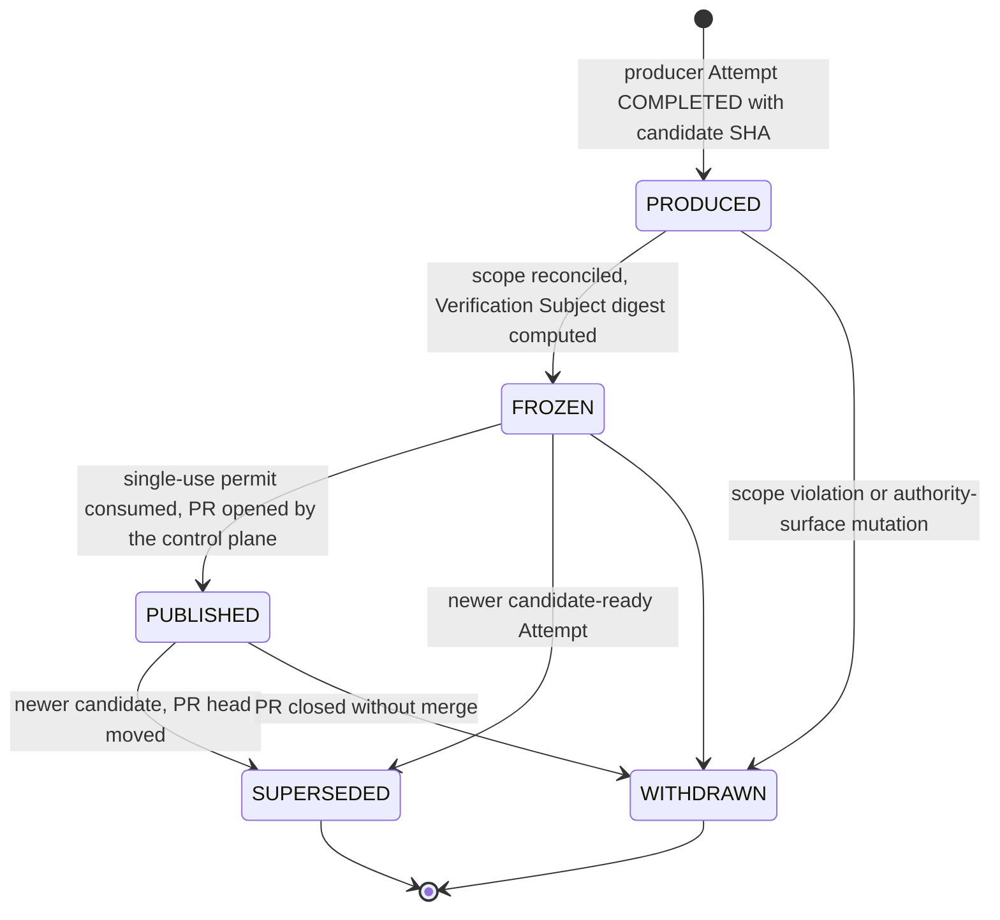

# Candidate

`fdlc://v1/candidate` · Family C (Execution) · Delivery Loop step 5 output, **Execute → Verify**

## Purpose

A Candidate is exactly what a producer Attempt produced, identified by content: commit, tree, diff digest, verification contract digest, and source Attempt. It is an output, not a success declaration. It is unpublished until a permit allows publication, and it is superseded the moment a newer candidate-ready Attempt exists. The Candidate is the thing evidence binds to; if it changes, the evidence no longer applies.

## Identity

| Rule | Value |
|---|---|
| Type URI | `fdlc://v1/candidate` |
| Instance id | `CAND-<work-order>-<attempt suffix>` (`CAND-104-01-p1`). |
| Mutability | Immutable. A new commit is a new Candidate. |
| Digest | `digest` = SHA-256 over canonical JSON of `{sourceAttemptId, workOrderId, workOrderRevisionNumber, verificationContractDigest, kind, git | outputSnapshot}`. |
| Subject | `subject.digest` is the Verification Subject digest derived from the Candidate (`verification-subject/git/v2` in Mission Control terms); `subject.subjectId = verification-subject:<hex>`. It is server-reproducible from the identity fields; no caller-supplied field participates. |
| Git identity | `git.commitSha`, `git.treeSha` MUST be lowercase full object ids; `git.diffDigest` = SHA-256 of the raw unified diff base..commit. `baseSha ≠ commitSha`; `baseRef ≠ headRef`. |

## Fields

| Field | Type | Req | Description |
|---|---|---|---|
| `schemaVersion`, `type`, `id`, `namespace` | — | MUST | Common identity. |
| `sourceAttemptId`, `workOrderId`, `workOrderRevisionNumber`, `intentId` | — | MUST / SHOULD | Lineage. |
| `verificationContractDigest`, `qualityContractDigest`, `executionManifestDigest` | Digest | MUST | The contract this Candidate will be judged against and the manifest it was produced under. |
| `kind` | GIT_CANDIDATE / ARTIFACT_BUNDLE / AUTOMATION_OUTPUT | MUST | — |
| `git` | object | MUST for GIT_CANDIDATE | Repository, provider ids, `baseSha`, `commitSha`, `treeSha`, `diffDigest`, refs, `changedFiles[]` with status and counts. |
| `artifacts[]` | ArtifactRef | SHOULD | Diff, logs, screenshots, bundles by digest. |
| `outputSnapshot` | object | MUST for AUTOMATION_OUTPUT | Immutable output snapshot identity. |
| `scopeReconciliation` | object | MUST | `status` IN_SCOPE/OUT_OF_SCOPE/UNKNOWN, `violations[]` (path out of scope, denied path, file/line budget, negative constraint, verification-authority surface), counts, `verificationAuthorityStatus` PASS/FAIL/UNKNOWN, time. |
| `subject` | {subjectId, subjectVersion, digest, frozenAt} | MUST once FROZEN | Verification Subject identity. |
| `publication` | object | MUST | `state` UNPUBLISHED/AUTHORIZED/PUBLISHED/CLOSED; when PUBLISHED: `permitId`, `permitLeaseId`, `permitValidUntil`, `decisionId`, `verificationReceiptId`, `pullRequest {provider, providerPullRequestId, number, url, refs, headSha, draftAtPublication}`, `publishedAt`, `bindingDigest`. |
| `state` | PRODUCED / FROZEN / PUBLISHED / SUPERSEDED / WITHDRAWN | MUST | — |
| `supersededById`, `readyAt` | Id, Timestamp | SHOULD / MUST | Newest-candidate ordering uses `readyAt`. |
| `digest`, `createdAt`, `createdBy`, `history[]` | — | MUST / SHOULD | Common audit fields. |

## Lifecycle



| Transition | Who | MUST record |
|---|---|---|
| `PRODUCED` | Control plane on Attempt completion (never the harness) | Commit, tree, diff digest, changed files, artifacts |
| `PRODUCED → FROZEN` | Control plane | `scopeReconciliation`, `subject.digest`, `subject.frozenAt` |
| `FROZEN → PUBLISHED` | Control plane publisher only, after a Decision and a current verification receipt | Permit id + lease id, `permitValidUntil`, Decision id, receipt id, PR identity, `bindingDigest` |
| `→ SUPERSEDED` | Control plane | `supersededById` |
| `→ WITHDRAWN` | Control plane or human | Reason (violation ids or PR closure) |

## Invariants

- A Candidate MUST NOT be read as success. "Producer completion freezes a subject; it does not accept, publish, merge, or release it." (`FACTORY_VOCABULARY.md:89-92`)
- The Verification Subject digest MUST be server-reproducible from identity fields alone. A subject whose recomputed digest differs from `subject.digest` MUST be treated as not canonical.
- A Candidate with `scopeReconciliation.status` other than `IN_SCOPE` or with `verificationAuthorityStatus: FAIL` MUST NOT be frozen for verification unless the contract's `authorityPolicy` explicitly allows the mutated surface.
- Publication MUST happen only through the control plane's publisher under a short-lived, candidate-bound, lease-bound permit issued immediately before the provider mutation. "Verification eligibility does not itself authorize GitHub writes." (Mission Control VF-008) The sandbox and the harness MUST NOT push branches or open pull requests.
- Permit validity MUST be bounded by `min(decision.expiresAt, receipt.validUntil, lease.expiresAt)` minus a safety window.
- Before publication, sandbox credentials MUST be revoked and provider resource absence MUST be proven.
- Evidence binds to `subject.digest`. A new commit on the same branch is a new Candidate; old evidence is history. "A changed head preserves old evidence as history and blocks acceptance until a new exact lineage passes." (`docs/OVERVIEW.md:663-664`)
- The newest candidate-ready Candidate for a Work Order revision is the only one eligible for verification-current decisions. Older passing candidates MUST NOT be reused.
- `publication.pullRequest.headSha` MUST equal `git.commitSha` at publication; a moved head MUST supersede the Candidate.

## Evidence requirements

| Transition | Evidence |
|---|---|
| Freeze | Scope reconciliation output (control-plane derived from the frozen diff, not the agent's claim) |
| Publish | Decision (human review or policy within envelope), current independent verification receipt, permit consumption record, credential revocation receipts, resource-absence proof |
| Supersede | Provider head projection showing the moved head, or the new Attempt's completion |

## Extension points

- `x-` fields at top level and within `git` and `artifacts[]`.
- `kind: ARTIFACT_BUNDLE` for non-git outputs; the identity rule then uses `artifacts[]` digests in canonical order.
- Provider-specific PR fields go under `publication.x-provider`.

## Mission Control mapping

| FDLC | Mission Control | Status | Divergence |
|---|---|---|---|
| Candidate | `workflowRuns.verificationSubject`, `executionBaseSha`, `headSha`, `treeSha`, `candidateReadyAt`, `subjectPublicationBinding` (`convex/schema.ts:5518-5531`) | Available (Qualified) | MC stores the Candidate on the Attempt row; FDLC makes it a separate artifact with the same identity. |
| `subject` | `createPrepublicationGitVerificationSubject` (`verificationSubject.ts:138-156`) — v2 subject with `baseSha`, `candidateSha`, `treeSha`, `rawDiffSha256`, refs, no PR | Available | Direct. `subjectId = verification-subject:<hex>`. |
| `publication` | permit-gated `authorizePublicationInternal` (`attempts.ts:1136-1328`); `factoryContinuation` states AWAITING_HUMAN_REVIEW → READY_TO_PUBLISH → PUBLICATION_AUTHORIZED → PUBLISHED; `gitSubjectPublicationBinding` | Available | Direct; `bindingDigest` = MC publication binding digest. |
| `scopeReconciliation` | changed-file reconciliation against frozen code scope; `verificationAuthority` check | Available (contracted; post-run enforcement partially enforced per Guide ch13) | FDLC requires it before FROZEN. |
| `AUTOMATION_OUTPUT` | `automationVerificationSubject` | Available | Direct. |

## JSON Schema

```json
{
  "$schema": "https://json-schema.org/draft/2020-12/schema",
  "$id": "https://fdlc.ai/schemas/v1/candidate.schema.json",
  "title": "FDLC Candidate",
  "description": "The exact output of a Producer Attempt, identified by commit + tree + diff hash + contract digest + source Attempt. Unpublished until permitted. A Candidate is an output, not a success declaration.",
  "type": "object",
  "properties": {
    "schemaVersion": {
      "type": "string",
      "const": "1.0"
    },
    "type": {
      "type": "string",
      "const": "fdlc://v1/candidate"
    },
    "id": {
      "$ref": "#/$defs/Id"
    },
    "namespace": {
      "$ref": "#/$defs/Namespace"
    },
    "sourceAttemptId": {
      "$ref": "#/$defs/Id"
    },
    "workOrderId": {
      "$ref": "#/$defs/Id"
    },
    "workOrderRevisionNumber": {
      "type": "integer",
      "minimum": 1
    },
    "intentId": {
      "$ref": "#/$defs/Id"
    },
    "verificationContractDigest": {
      "$ref": "#/$defs/Digest"
    },
    "qualityContractDigest": {
      "$ref": "#/$defs/Digest"
    },
    "executionManifestDigest": {
      "$ref": "#/$defs/Digest"
    },
    "kind": {
      "type": "string",
      "enum": [
        "GIT_CANDIDATE",
        "ARTIFACT_BUNDLE",
        "AUTOMATION_OUTPUT"
      ]
    },
    "git": {
      "type": "object",
      "properties": {
        "repositoryId": {
          "$ref": "#/$defs/Id"
        },
        "provider": {
          "type": "string"
        },
        "providerRepositoryId": {
          "type": "string"
        },
        "baseSha": {
          "$ref": "#/$defs/GitSha"
        },
        "commitSha": {
          "$ref": "#/$defs/GitSha"
        },
        "treeSha": {
          "$ref": "#/$defs/GitSha"
        },
        "diffDigest": {
          "$ref": "#/$defs/Digest",
          "description": "SHA-256 of the raw unified diff base..commit."
        },
        "baseRef": {
          "type": "string"
        },
        "headRef": {
          "type": "string"
        },
        "changedFiles": {
          "type": "array",
          "items": {
            "type": "object",
            "properties": {
              "path": {
                "type": "string"
              },
              "status": {
                "type": "string",
                "enum": [
                  "ADDED",
                  "MODIFIED",
                  "DELETED",
                  "RENAMED"
                ]
              },
              "additions": {
                "type": "integer",
                "minimum": 0
              },
              "deletions": {
                "type": "integer",
                "minimum": 0
              },
              "blobDigest": {
                "type": "string"
              }
            },
            "required": [
              "path",
              "status"
            ],
            "additionalProperties": false
          }
        }
      },
      "required": [
        "repositoryId",
        "provider",
        "baseSha",
        "commitSha",
        "treeSha",
        "diffDigest",
        "baseRef",
        "headRef",
        "changedFiles"
      ],
      "additionalProperties": false
    },
    "artifacts": {
      "type": "array",
      "items": {
        "$ref": "#/$defs/ArtifactRef"
      }
    },
    "outputSnapshot": {
      "type": "object",
      "description": "AUTOMATION_OUTPUT candidates: immutable output snapshot identity.",
      "properties": {
        "artifactId": {
          "$ref": "#/$defs/Id"
        },
        "contentDigest": {
          "$ref": "#/$defs/Digest"
        },
        "outputContractDigest": {
          "$ref": "#/$defs/Digest"
        }
      },
      "required": [
        "artifactId",
        "contentDigest"
      ],
      "additionalProperties": false
    },
    "scopeReconciliation": {
      "type": "object",
      "description": "Changed files compared with the frozen code scope, change budget, and negative constraints before anything is review-ready.",
      "properties": {
        "status": {
          "type": "string",
          "enum": [
            "IN_SCOPE",
            "OUT_OF_SCOPE",
            "UNKNOWN"
          ]
        },
        "violations": {
          "type": "array",
          "items": {
            "type": "object",
            "properties": {
              "kind": {
                "type": "string",
                "enum": [
                  "PATH_OUT_OF_SCOPE",
                  "DENIED_PATH",
                  "FILE_BUDGET",
                  "LINE_BUDGET",
                  "NEGATIVE_CONSTRAINT",
                  "VERIFICATION_AUTHORITY_SURFACE"
                ]
              },
              "path": {
                "type": "string"
              },
              "constraintId": {
                "$ref": "#/$defs/Id"
              },
              "detail": {
                "type": "string"
              }
            },
            "required": [
              "kind"
            ],
            "additionalProperties": false
          }
        },
        "filesChanged": {
          "type": "integer",
          "minimum": 0
        },
        "linesChanged": {
          "type": "integer",
          "minimum": 0
        },
        "verificationAuthorityStatus": {
          "type": "string",
          "enum": [
            "PASS",
            "FAIL",
            "UNKNOWN"
          ],
          "description": "FAIL when the candidate modified files that determine its own verification verdict."
        },
        "reconciledAt": {
          "$ref": "#/$defs/Timestamp"
        }
      },
      "required": [
        "status",
        "violations",
        "verificationAuthorityStatus",
        "reconciledAt"
      ],
      "additionalProperties": false
    },
    "subject": {
      "type": "object",
      "description": "Verification Subject identity derived from this Candidate; frozen at FROZEN.",
      "properties": {
        "subjectId": {
          "$ref": "#/$defs/Id"
        },
        "subjectVersion": {
          "type": "integer",
          "minimum": 1
        },
        "digest": {
          "$ref": "#/$defs/Digest"
        },
        "frozenAt": {
          "$ref": "#/$defs/Timestamp"
        }
      },
      "required": [
        "subjectId",
        "subjectVersion",
        "digest",
        "frozenAt"
      ],
      "additionalProperties": false
    },
    "publication": {
      "type": "object",
      "properties": {
        "state": {
          "type": "string",
          "enum": [
            "UNPUBLISHED",
            "AUTHORIZED",
            "PUBLISHED",
            "CLOSED"
          ]
        },
        "permitId": {
          "$ref": "#/$defs/Id"
        },
        "permitLeaseId": {
          "$ref": "#/$defs/Id"
        },
        "permitValidUntil": {
          "$ref": "#/$defs/Timestamp"
        },
        "decisionId": {
          "$ref": "#/$defs/Id"
        },
        "verificationReceiptId": {
          "$ref": "#/$defs/Id"
        },
        "pullRequest": {
          "type": "object",
          "properties": {
            "provider": {
              "type": "string"
            },
            "providerPullRequestId": {
              "type": "string"
            },
            "number": {
              "type": "integer",
              "minimum": 1
            },
            "url": {
              "type": "string",
              "format": "uri"
            },
            "baseRef": {
              "type": "string"
            },
            "headRef": {
              "type": "string"
            },
            "headSha": {
              "$ref": "#/$defs/GitSha"
            },
            "draftAtPublication": {
              "type": "boolean"
            }
          },
          "required": [
            "provider",
            "providerPullRequestId",
            "number",
            "url",
            "headSha",
            "draftAtPublication"
          ],
          "additionalProperties": false
        },
        "publishedAt": {
          "$ref": "#/$defs/Timestamp"
        },
        "bindingDigest": {
          "$ref": "#/$defs/Digest"
        }
      },
      "required": [
        "state"
      ],
      "additionalProperties": false
    },
    "state": {
      "type": "string",
      "enum": [
        "PRODUCED",
        "FROZEN",
        "PUBLISHED",
        "SUPERSEDED",
        "WITHDRAWN"
      ]
    },
    "supersededById": {
      "$ref": "#/$defs/Id"
    },
    "readyAt": {
      "$ref": "#/$defs/Timestamp"
    },
    "digest": {
      "$ref": "#/$defs/Digest",
      "description": "Digest over (sourceAttemptId, workOrderId, workOrderRevisionNumber, verificationContractDigest, kind, git|outputSnapshot)."
    },
    "createdAt": {
      "$ref": "#/$defs/Timestamp"
    },
    "createdBy": {
      "$ref": "#/$defs/Actor"
    },
    "history": {
      "type": "array",
      "items": {
        "$ref": "#/$defs/Transition"
      }
    }
  },
  "required": [
    "schemaVersion",
    "type",
    "id",
    "namespace",
    "sourceAttemptId",
    "workOrderId",
    "workOrderRevisionNumber",
    "verificationContractDigest",
    "qualityContractDigest",
    "executionManifestDigest",
    "kind",
    "scopeReconciliation",
    "publication",
    "state",
    "readyAt",
    "digest",
    "createdAt",
    "createdBy"
  ],
  "allOf": [
    {
      "if": {
        "properties": {
          "kind": {
            "const": "GIT_CANDIDATE"
          }
        }
      },
      "then": {
        "required": [
          "git"
        ]
      }
    },
    {
      "if": {
        "properties": {
          "kind": {
            "const": "AUTOMATION_OUTPUT"
          }
        }
      },
      "then": {
        "required": [
          "outputSnapshot"
        ]
      }
    },
    {
      "if": {
        "properties": {
          "state": {
            "enum": [
              "FROZEN",
              "PUBLISHED",
              "SUPERSEDED"
            ]
          }
        }
      },
      "then": {
        "required": [
          "subject"
        ]
      }
    },
    {
      "if": {
        "properties": {
          "state": {
            "const": "PUBLISHED"
          }
        }
      },
      "then": {
        "properties": {
          "publication": {
            "required": [
              "permitId",
              "permitLeaseId",
              "decisionId",
              "verificationReceiptId",
              "pullRequest",
              "publishedAt",
              "bindingDigest"
            ],
            "properties": {
              "state": {
                "const": "PUBLISHED"
              }
            }
          }
        }
      }
    },
    {
      "if": {
        "properties": {
          "state": {
            "enum": [
              "PRODUCED",
              "FROZEN"
            ]
          }
        }
      },
      "then": {
        "properties": {
          "publication": {
            "properties": {
              "state": {
                "enum": [
                  "UNPUBLISHED",
                  "AUTHORIZED"
                ]
              }
            }
          }
        }
      }
    }
  ],
  "$defs": {
    "Id": {
      "type": "string",
      "minLength": 1,
      "maxLength": 200,
      "pattern": "^[A-Za-z0-9][A-Za-z0-9._:/@-]*$",
      "description": "Instance identifier. Unique within the issuing namespace; combined with `namespace` it is globally unique."
    },
    "ArtifactUri": {
      "type": "string",
      "pattern": "^fdlc://v1/(intent|specification|plan|work-order|factory-manifest|factory-version|execution-profile|capability-manifest|qualification-record|context-package|attempt|candidate|evidence|verification|decision|release|outcome|learning-signal|improvement-candidate)(/[A-Za-z0-9][A-Za-z0-9._:@-]*)?$",
      "description": "Artifact type URI (`fdlc://v1/<artifact>`), optionally suffixed with an instance id."
    },
    "Namespace": {
      "type": "string",
      "format": "uri",
      "description": "URI of the issuing control plane or organization. Scopes every `id` in this record."
    },
    "Digest": {
      "type": "string",
      "pattern": "^sha256:[a-f0-9]{64}$",
      "description": "SHA-256 over the RFC 8785 (JCS) canonical JSON of the digested projection."
    },
    "GitSha": {
      "type": "string",
      "pattern": "^[a-f0-9]{40}$|^[a-f0-9]{64}$",
      "description": "Lowercase full Git object id (SHA-1 or SHA-256 repository)."
    },
    "Timestamp": {
      "type": "string",
      "format": "date-time",
      "description": "RFC 3339 timestamp in UTC."
    },
    "Semver": {
      "type": "string",
      "pattern": "^(0|[1-9]\\d*)\\.(0|[1-9]\\d*)\\.(0|[1-9]\\d*)(-[0-9A-Za-z.-]+)?(\\+[0-9A-Za-z.-]+)?$"
    },
    "RiskClass": {
      "type": "string",
      "enum": [
        "LOW",
        "MEDIUM",
        "HIGH",
        "CRITICAL"
      ]
    },
    "AutonomyLevel": {
      "type": "string",
      "enum": [
        "L0",
        "L1",
        "L2",
        "L3",
        "L4",
        "L5"
      ],
      "description": "HITL spectrum position. Effective autonomy is min(factory, objective, work order, policy, trust)."
    },
    "Actor": {
      "type": "object",
      "description": "Attributable identity. `identitySource` says how the control plane established it; never inferred from a client label.",
      "properties": {
        "kind": {
          "type": "string",
          "enum": [
            "human",
            "policy",
            "service",
            "agent",
            "system"
          ]
        },
        "id": {
          "$ref": "#/$defs/Id"
        },
        "identitySource": {
          "type": "string",
          "enum": [
            "authenticated",
            "workload-identity",
            "service-command",
            "development-fallback"
          ]
        },
        "displayName": {
          "type": "string"
        },
        "delegationRef": {
          "$ref": "#/$defs/Id",
          "description": "Reference to the delegation record that grants this actor its authority."
        }
      },
      "required": [
        "kind",
        "id",
        "identitySource"
      ],
      "additionalProperties": false
    },
    "Ref": {
      "type": "object",
      "description": "Reference to another FDLC artifact instance, optionally pinned to a digest.",
      "properties": {
        "type": {
          "$ref": "#/$defs/ArtifactUri"
        },
        "id": {
          "$ref": "#/$defs/Id"
        },
        "digest": {
          "$ref": "#/$defs/Digest"
        },
        "revisionNumber": {
          "type": "integer",
          "minimum": 1
        }
      },
      "required": [
        "type",
        "id"
      ],
      "additionalProperties": false
    },
    "Money": {
      "type": "object",
      "properties": {
        "amount": {
          "type": "number",
          "minimum": 0
        },
        "currency": {
          "type": "string",
          "pattern": "^[A-Z]{3}$"
        }
      },
      "required": [
        "amount",
        "currency"
      ],
      "additionalProperties": false
    },
    "CostRecord": {
      "type": "object",
      "description": "Cost with an honesty class. UNKNOWN cost stays UNKNOWN; implementations MUST NOT invent zeroes.",
      "properties": {
        "status": {
          "type": "string",
          "enum": [
            "MEASURED",
            "ESTIMATED",
            "UNKNOWN"
          ]
        },
        "amount": {
          "type": "number",
          "minimum": 0
        },
        "currency": {
          "type": "string",
          "pattern": "^[A-Z]{3}$"
        },
        "coverage": {
          "type": "number",
          "minimum": 0,
          "maximum": 1,
          "description": "Fraction of contributing cost items that were measured."
        },
        "reason": {
          "type": "string"
        }
      },
      "required": [
        "status"
      ],
      "additionalProperties": false
    },
    "Transition": {
      "type": "object",
      "description": "Audit record of one authoritative state transition. Every field listed here MUST be recorded.",
      "properties": {
        "transitionId": {
          "$ref": "#/$defs/Id"
        },
        "subjectId": {
          "$ref": "#/$defs/Id"
        },
        "priorVersion": {
          "type": "integer",
          "minimum": 0
        },
        "fromState": {
          "type": "string"
        },
        "toState": {
          "type": "string"
        },
        "actor": {
          "$ref": "#/$defs/Actor"
        },
        "reason": {
          "type": "string"
        },
        "policyVersion": {
          "type": "string"
        },
        "idempotencyKey": {
          "type": "string"
        },
        "occurredAt": {
          "$ref": "#/$defs/Timestamp"
        },
        "requiredEvidenceIds": {
          "type": "array",
          "items": {
            "$ref": "#/$defs/Id"
          }
        },
        "decisionId": {
          "$ref": "#/$defs/Id"
        },
        "invalidatedDependents": {
          "type": "array",
          "items": {
            "$ref": "#/$defs/Ref"
          }
        }
      },
      "required": [
        "subjectId",
        "fromState",
        "toState",
        "actor",
        "reason",
        "idempotencyKey",
        "occurredAt"
      ],
      "additionalProperties": false
    },
    "ArtifactRef": {
      "type": "object",
      "description": "Content-addressed reference to a stored artifact (diff, log, screenshot, bundle).",
      "properties": {
        "artifactId": {
          "$ref": "#/$defs/Id"
        },
        "kind": {
          "type": "string"
        },
        "mediaType": {
          "type": "string"
        },
        "digest": {
          "$ref": "#/$defs/Digest"
        },
        "sizeBytes": {
          "type": "integer",
          "minimum": 0
        },
        "storageRef": {
          "type": "string"
        }
      },
      "required": [
        "artifactId",
        "digest"
      ],
      "additionalProperties": false
    }
  },
  "patternProperties": {
    "^x-[a-z0-9]+(-[a-z0-9]+)*$": {}
  },
  "additionalProperties": false
}
```

## Example instance

```json
{
  "schemaVersion": "1.0",
  "type": "fdlc://v1/candidate",
  "id": "CAND-104-01-p1",
  "namespace": "https://acme.example/factories/checkout",
  "sourceAttemptId": "ATT-104-01-p1",
  "workOrderId": "WO-104-01",
  "workOrderRevisionNumber": 1,
  "intentId": "INT-104",
  "verificationContractDigest": "sha256:7578cc0498d5fccce37655a6d0f8a0a07eec696427228335d6656cbe1148be78",
  "qualityContractDigest": "sha256:dc8ccbf7d977e52efff8403f63b12e0889313b0deb0e14d4ac62866efe11ca16",
  "executionManifestDigest": "sha256:061b3bf427e9111d287436c02a5e3ce9ebbe23b2b6f7bfb928c56329eae13692",
  "kind": "GIT_CANDIDATE",
  "git": {
    "repositoryId": "repo:checkout-api",
    "provider": "github",
    "providerRepositoryId": "R_example_checkout",
    "baseSha": "1405df66cbe219b0bf6355bc3d60361a8376b6b4",
    "commitSha": "4015b57a143aec5156fd1444a017a32137a3fd0f",
    "treeSha": "80655da8d80aaaf92ce5357e7828dc09adb00993",
    "diffDigest": "sha256:6793803b255f9bbd0a9943b129a67af9650328c54451b76790a7be08d4c65bb3",
    "baseRef": "main",
    "headRef": "factory/WO-104-01/ATT-104-01-p1",
    "changedFiles": [
      {
        "path": "services/checkout-api/package.json",
        "status": "MODIFIED",
        "additions": 1,
        "deletions": 1
      },
      {
        "path": "services/checkout-api/pnpm-lock.yaml",
        "status": "MODIFIED",
        "additions": 22,
        "deletions": 19
      },
      {
        "path": "services/checkout-api/payments/client.ts",
        "status": "MODIFIED",
        "additions": 41,
        "deletions": 57
      },
      {
        "path": "services/checkout-api/payments/compat/v3-shim.ts",
        "status": "DELETED",
        "additions": 0,
        "deletions": 88
      },
      {
        "path": "services/checkout-api/payments/refunds.ts",
        "status": "MODIFIED",
        "additions": 12,
        "deletions": 12
      },
      {
        "path": "services/checkout-api/payments/webhooks.ts",
        "status": "MODIFIED",
        "additions": 9,
        "deletions": 11
      }
    ]
  },
  "artifacts": [
    {
      "artifactId": "ART-104-01-p1-diff",
      "kind": "CODE_DIFF",
      "mediaType": "text/x-diff",
      "digest": "sha256:6793803b255f9bbd0a9943b129a67af9650328c54451b76790a7be08d4c65bb3",
      "sizeBytes": 18422,
      "storageRef": "artifact://checkout/ATT-104-01-p1/diff.patch"
    },
    {
      "artifactId": "ART-104-01-p1-log",
      "kind": "LOG_BUNDLE",
      "mediaType": "application/x-ndjson",
      "digest": "sha256:f2ed27c8ca426586709ff95c1e7e001941d31b6d83229dbd421eab2f0da5c14a",
      "sizeBytes": 402118,
      "storageRef": "artifact://checkout/ATT-104-01-p1/events.ndjson"
    }
  ],
  "scopeReconciliation": {
    "status": "IN_SCOPE",
    "violations": [],
    "filesChanged": 6,
    "linesChanged": 273,
    "verificationAuthorityStatus": "PASS",
    "reconciledAt": "2026-09-03T09:03:20Z"
  },
  "subject": {
    "subjectId": "verification-subject:bc9e58be15d0abe0a8159ff375752bc65adca6c6a02fcde0ad02283db510641f",
    "subjectVersion": 2,
    "digest": "sha256:bc9e58be15d0abe0a8159ff375752bc65adca6c6a02fcde0ad02283db510641f",
    "frozenAt": "2026-09-03T09:03:25Z"
  },
  "publication": {
    "state": "PUBLISHED",
    "permitId": "PERMIT-104-01-p1-1",
    "permitLeaseId": "LEASE-104-01-p1-1",
    "permitValidUntil": "2026-09-04T12:10:00Z",
    "decisionId": "DEC-104-PUB1",
    "verificationReceiptId": "RCPT-104-02",
    "pullRequest": {
      "provider": "github",
      "providerPullRequestId": "PR_example_104",
      "number": 118,
      "url": "https://git.acme.example/acme/checkout-api/pull/118",
      "baseRef": "main",
      "headRef": "factory/WO-104-01/ATT-104-01-p1",
      "headSha": "4015b57a143aec5156fd1444a017a32137a3fd0f",
      "draftAtPublication": true
    },
    "publishedAt": "2026-09-04T11:42:00Z",
    "bindingDigest": "sha256:ce27a4c7cde6fdb8f69e2b1619d75aeb1e3a68b14137a0552e2d77cb49bb7601"
  },
  "state": "PUBLISHED",
  "readyAt": "2026-09-03T09:03:00Z",
  "digest": "sha256:ce27a4c7cde6fdb8f69e2b1619d75aeb1e3a68b14137a0552e2d77cb49bb7601",
  "createdAt": "2026-09-03T09:03:00Z",
  "createdBy": {
    "kind": "system",
    "id": "system:orchestrator",
    "identitySource": "workload-identity"
  }
}
```

## Related

- Spec: [/specification/v1/attempt](/specification/v1/attempt) · [/specification/v1/verification](/specification/v1/verification) · [/specification/v1/evidence](/specification/v1/evidence) · [/specification/v1/decision](/specification/v1/decision) · [/specification/v1/release](/specification/v1/release)
- Architecture: [/architecture/verification](/architecture/verification) (currentness) · [/architecture/evidence](/architecture/evidence) (D14) · [/framework](/framework) (D32 non-collapsible states)
- Anti-patterns: candidate read as success; stale evidence merged
- Glossary: Candidate, Verification Subject, Publication permit, Currentness
