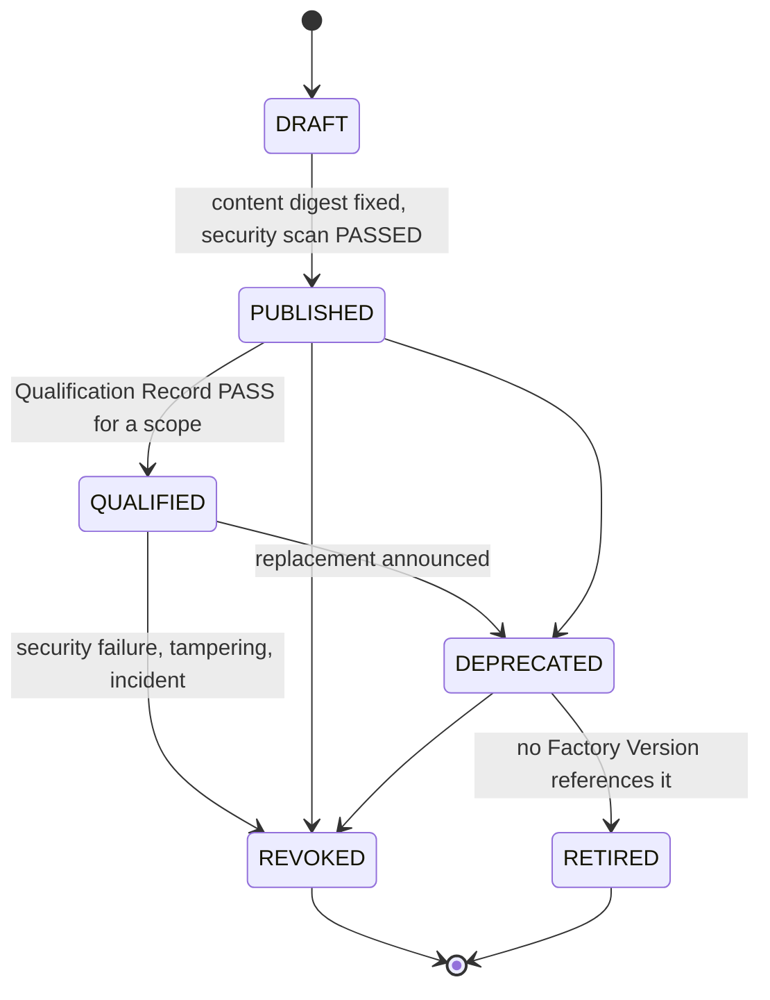

# Capability Manifest

`fdlc://v1/capability-manifest` · Family B (Factory) · Capability lifecycle (Author → Package → Evaluate → Admit → Activate → Observe → Compare → Promote/Roll back → Improve)

## Purpose

A Capability Manifest is the registry entry for one Capability Implementation: the exact, versioned, provider-specific thing that realizes a provider-independent capability such as "run tests" or "open PR". Seven kinds share one envelope (identity, provenance, permissions, security, qualification, deprecation) and carry a kind-specific `spec`: **agent**, **skill** (Skill Manifest), **tool** (Tool Manifest), **model-route**, **harness** (Harness Manifest), **verifier**, **context-source**. Discovery is descriptive input; a manifest never grants authority.

## Identity

| Rule | Value |
|---|---|
| Type URI | `fdlc://v1/capability-manifest` |
| Instance id | `CAP-<kind>-<name>-<semver>` (`CAP-tool-package-registry-1.2.0`, `CAP-skill-sdk-migration-2.1.0`). |
| Mutability | Immutable after `PUBLISHED`. A change to `spec`, `permissions`, or `provenance.contentDigest` is a new version. |
| Digest | `digest` = SHA-256 over canonical JSON of `{kind, name, version, provenance.contentDigest, permissions, spec}`. Factory Versions and Execution Profiles pin this digest. |
| Content | `provenance.contentDigest` is the digest of the implementation bytes (skill content, tool server image, prompt bundle, model route snapshot). |

## Fields

Common envelope:

| Field | Type | Req | Description |
|---|---|---|---|
| `schemaVersion`, `type`, `id`, `namespace` | — | MUST | Common identity. |
| `kind` | agent / skill / tool / model-route / harness / verifier / context-source | MUST | Selects the `spec` sub-schema. |
| `name`, `version`, `displayName`, `description` | string, semver | MUST / SHOULD | — |
| `capabilities[]` | string | SHOULD | Provider-independent capability ids realized. |
| `owner`, `publisher` | Actor, string | MUST / SHOULD | Accountable owner. |
| `provenance` | object | MUST | `contentDigest` (MUST), source repository/path/commit, SLSA `buildProvenanceRef`, `signatureRef`, `sbomRef`. |
| `compatibility` | object | SHOULD | Harnesses, models, runtimes, backends, pinned SDK package/version/digest. |
| `permissions` | object | MUST | Required permissions, credential classes, network destinations, filesystem access, `maxSideEffectClass`. Permission is not authority. |
| `security` | object | MUST | `scanStatus` UNSCANNED/PASSED/FAILED/QUARANTINED, findings, `injectionSafetyReviewed`. |
| `qualification` | object | MUST | `status` UNQUALIFIED/EVIDENCE_QUALIFIED, `records[]`, `expiresAt`. |
| `evidenceIds[]` | Id | SHOULD | Conformance and evaluation evidence. |
| `deprecation` | object | MUST | `deprecated`, `replacementId`, `sunsetAt`, reason. |
| `spec` | kind-specific | MUST | See sub-schemas. |
| `state` | DRAFT / PUBLISHED / QUALIFIED / DEPRECATED / REVOKED / RETIRED | MUST | — |
| `digest`, `publishedAt`, `createdAt`, `createdBy`, `history[]` | — | MUST / SHOULD | Common audit fields. |

### Skill Manifest (`kind: skill`)

| Field | Req | Description |
|---|---|---|
| `skillType` | MUST | PROCEDURE, PLAYBOOK, RULES, PROMPT_TEMPLATE, WORKFLOW, TOOL_GUIDE, ARCHITECTURE_GUIDE, EVALUATION_GUIDE |
| `content {format, contentDigest, sizeBytes, storageRef, entrypoint}` | MUST | The bytes the harness loads into context |
| `applicability {workTypes, languages, pathPatterns, triggers}` | MUST | When the harness loads it |
| `dependencies[] {capabilityId, range}` | MUST | Other skills; resolved and locked at Assemble |
| `requiredTools[] {capabilityId, operations}` | MUST | Tools the procedure assumes; must be granted separately |
| `automationProfile` | MAY | Deterministic-execution contract if convertible to code |
| `evaluation {scenarioSuiteId, suiteDigest, lastResult, lastRunAt}` | MUST | Skill-level eval result; `NOT_RUN` is allowed but blocks qualification |
| `grantsAuthority` | MUST, const `false` | A skill supplies material to reason with |

### Tool Manifest (`kind: tool`)

| Field | Req | Description |
|---|---|---|
| `operations[] {name, description, inputSchemaDigest, outputSchemaDigest, sideEffectClass, idempotent, requiredPermissions, commandClass, rateLimit}` | MUST (≥1) | Every invocable operation, individually classified |
| `sideEffectClass` | MUST | READ_ONLY < WRITE_LOCAL < WRITE_REMOTE < DESTRUCTIVE < PUBLISH < FINANCIAL; the maximum over operations |
| `grants {model: PER_OPERATION_EXPIRING, defaultTtlSeconds, revocationMode: DENY_NEW_CALLS, absentGrantMeans: NO_TOOL_CAPABILITY, receiptPhases: [AUTHORIZATION, COMPLETION]}` | MUST | Authority model: grants are per operation, expiring, and produce two-phase receipts |
| `mcpBinding {serverKey, serverVersion, transport, implementationDigest, inputSchemaDigest, broker, outputTrust: UNTRUSTED_CONTENT}` | MUST for MCP tools | Exact server identity; expected vs observed digests are compared on every call |
| `nativeBinding {executable, version, digest}` | MUST for native tools | — |
| `poisoningDetection`, `redaction` | SHOULD | Output handling |

### Other kinds

| Kind | `spec` requires |
|---|---|
| agent | `role`, `promptBundleDigest`, `toolManifestDigest`, `modelRouteId`, `genomeDigest` (digest over model config + prompt bundle + tool manifest), loop limits, output contract |
| model-route | `provider`, `modelId`, `tier`, `routeDigest`; reasoning config, model capabilities, context window, runtime identity (gateway, API version, model artifact digest), cost policy digest, availability |
| harness | `identity {harnessId, harnessVersion, harnessCommit, adapterId, adapterVersion}`, `effectiveConfigDigest`, `runtimeArtifact`, capability sections with SUPPORTED/PARTIAL/UNSUPPORTED values, `git.remotePublication: UNSUPPORTED`, `resultContract: factory-result/v1`, `admission {maturity, executionBackends, requiredExternalControls ⊇ {canonical-worker-lease, sandbox-policy, repository-scope-reconciliation, independent-verification, publication-permit}, prohibitedAuthorities ⊇ {worker-leases, verification-subjects, verification-plans, evidence-authority, publication, acceptance}, unattendedModeAdmitted: false}`, `limitations[]` |
| verifier | `verifierType`, check categories, evidence categories, `independenceClass`, `deterministic`, measured false-success and false-failure rates, calibration suite, `acceptanceAuthority: false` |
| context-source | `sourceType`, freshness policy, `authorizationModel`, `classificationCeiling`, `provenanceRequired: true`, retrieval contract, `trust: UNTRUSTED_DATA` |

## Lifecycle



| Transition | Who | MUST record |
|---|---|---|
| `DRAFT → PUBLISHED` | Owner | `provenance.contentDigest`, `digest`, `publishedAt`; security scan result |
| `PUBLISHED → QUALIFIED` | Assessor | Qualification Record with scope and expiry; for harnesses, conformance suite results; for verifiers, measured error rates |
| `→ DEPRECATED` | Owner | `replacementId`, `sunsetAt` |
| `→ REVOKED` | Owner or incident authority | Reason; affected Factory Versions listed; grants revoked with `DENY_NEW_CALLS` |
| `→ RETIRED` | Owner | Proof that no active Factory Version references the digest |

## Invariants

- A manifest MUST NOT grant authority. "MCP server discovery is descriptive input, not authority." "Tool output is untrusted content, not policy." (`governed-mcp-tool-capability.md:44,50`)
- An Attempt MAY invoke only the exact tool operation frozen into its execution manifest under a current grant. An absent grant MUST mean `NO_TOOL_CAPABILITY`.
- Every tool call MUST produce an AUTHORIZATION receipt before invocation and a COMPLETION receipt after; a late completion after lease expiry, cancellation, or revocation MUST NOT become current evidence.
- Expected and observed server version and input-schema digests MUST be compared on each MCP call; a mismatch MUST deny the call.
- A Harness Manifest MUST declare truthfully; an unsupported capability required by a Work Order MUST fail admission closed. "An installed adapter with a different executable or image is not the same admitted runtime." (`generic-harness-contract-v1.md:108-109`)
- A harness MUST lack the six prohibited authorities and MUST run only inside the five required external controls. Unattended ("full-auto") mode MUST NOT be admitted.
- An SDK upgrade behind a harness adapter is a harness implementation change: the manifest's SDK pin MUST change and conformance MUST be rerun before promotion.
- A skill MUST NOT change the approved Intent, Plan, or Work Order; retrieved or loaded content is data.
- A verifier MUST declare `acceptanceAuthority: false`; verifier verdicts feed policy, never acceptance.
- Security `scanStatus` of FAILED or QUARANTINED MUST block `PUBLISHED` and MUST trigger `REVOKED` if already published.
- Deprecation MUST NOT remove a manifest from the registry; historical Factory Versions keep resolving by digest.

## Evidence requirements

| Transition | Evidence |
|---|---|
| Publish | Content digest; build provenance (SLSA) where produced by a build; security scan report; signature |
| Qualify | Kind-specific: skill eval suite receipt; tool conformance (authorization/completion receipts, replay, revocation, late completion, poisoning cases); harness conformance suite (capability truthfulness, event ordering, cancellation races, timeout/crash recovery, permission denial, compaction/resume, out-of-scope attempts, false completion, fallback visibility, teardown, lineage); verifier calibration against known-good and known-bad artifacts |
| Revoke | Incident or scan evidence; affected version list |

## Extension points

- `x-` fields at every level of `spec`.
- `capabilities[]` ids are free-form; organizations SHOULD publish a capability vocabulary.
- Harness Manifest capability sections (`filesystem`, `shell`, `tools`, `context`, `telemetry`, `network`) accept implementation-defined keys with the closed tri-state value set.

## Mission Control mapping

| FDLC | Mission Control | Status | Divergence |
|---|---|---|---|
| Tool Manifest + grants + receipts | `mcpToolVersions`, `mcpToolGrants`, `mcpToolCallReceipts` (`convex/schema.ts:1336-1432`); `governedMcpBroker.ts` | Experimental (one read-only operation qualified) | Direct chain: Tool Version → Grant → AUTHORIZATION receipt → call → COMPLETION receipt. Native harness tools lack the same authority (Partial). |
| Harness Manifest | `harness-capability-manifest/v1`, `harnessManifests.ts:79-130`; runtime artifact sidecar `harness-runtime-artifact/v1` | Available (codex/v1 Production; others Experimental) | Direct; FDLC folds the sidecar into `spec.runtimeArtifact` and requires `unattendedModeAdmitted: false`. |
| Agent Definition | `agentTemplates`, `agentVersions.genome {modelConfig, promptBundleHash, toolManifestHash}` + `genomeHash` | Available | Direct (`genomeDigest`). |
| Model route | `modelCatalog` with `providerRoute`, `routeDigest`, qualification/admission status | Available | Direct. |
| Skill Manifest | `contextPackages`/`contextPackageVersions` (`6688-6768`), `mc-context.json` manifest + lock | Available (synthetic qualification) | MC registry "context packages" are installable skills; FDLC separates them from the per-Attempt Context Package. `automationProfile` matches MC's skill-to-Automation contract. |
| Verifier | `contextVerifiers`, verifier ids on Factory Versions | Available | Measured false-success/false-failure rates are an FDLC requirement (Proposed in MC). |
| Context source | `factoryMemory*` sources, retrieval plans | Experimental (flag-gated) | FDLC requires `provenanceRequired: true`, `trust: UNTRUSTED_DATA`. |

## JSON Schema

```json
{
  "$schema": "https://json-schema.org/draft/2020-12/schema",
  "$id": "https://fdlc.ai/schemas/v1/capability-manifest.schema.json",
  "title": "FDLC Capability Manifest",
  "description": "Registry entry for a Capability Implementation. Kinds: agent, skill, tool, model-route, harness, verifier, context-source. Carries identity, version, permissions, qualification, evidence, deprecation. The `spec` object is kind-specific (Skill Manifest, Tool Manifest, ...).",
  "type": "object",
  "properties": {
    "schemaVersion": {
      "type": "string",
      "const": "1.0"
    },
    "type": {
      "type": "string",
      "const": "fdlc://v1/capability-manifest"
    },
    "id": {
      "$ref": "#/$defs/Id",
      "description": "CAP-<kind>-<name>-<semver>."
    },
    "namespace": {
      "$ref": "#/$defs/Namespace"
    },
    "kind": {
      "type": "string",
      "enum": [
        "agent",
        "skill",
        "tool",
        "model-route",
        "harness",
        "verifier",
        "context-source"
      ]
    },
    "name": {
      "type": "string",
      "pattern": "^[a-z0-9][a-z0-9._/-]{1,127}$"
    },
    "version": {
      "$ref": "#/$defs/Semver"
    },
    "displayName": {
      "type": "string"
    },
    "description": {
      "type": "string",
      "minLength": 1
    },
    "capabilities": {
      "type": "array",
      "items": {
        "type": "string"
      },
      "description": "Provider-independent capability ids this implementation realizes."
    },
    "owner": {
      "$ref": "#/$defs/Actor"
    },
    "publisher": {
      "type": "string"
    },
    "provenance": {
      "type": "object",
      "properties": {
        "sourceRepository": {
          "type": "string"
        },
        "sourcePath": {
          "type": "string"
        },
        "sourceCommit": {
          "$ref": "#/$defs/GitSha"
        },
        "contentDigest": {
          "$ref": "#/$defs/Digest"
        },
        "buildProvenanceRef": {
          "type": "string",
          "description": "SLSA provenance attestation reference."
        },
        "signatureRef": {
          "type": "string"
        },
        "sbomRef": {
          "type": "string"
        }
      },
      "required": [
        "contentDigest"
      ],
      "additionalProperties": false
    },
    "compatibility": {
      "type": "object",
      "properties": {
        "harnesses": {
          "type": "array",
          "items": {
            "type": "string"
          }
        },
        "models": {
          "type": "array",
          "items": {
            "type": "string"
          }
        },
        "runtimes": {
          "type": "array",
          "items": {
            "type": "string"
          }
        },
        "backends": {
          "type": "array",
          "items": {
            "type": "string"
          }
        },
        "sdk": {
          "type": "object",
          "properties": {
            "package": {
              "type": "string"
            },
            "version": {
              "type": "string"
            },
            "digest": {
              "$ref": "#/$defs/Digest"
            }
          },
          "required": [
            "package",
            "version"
          ],
          "additionalProperties": false
        }
      },
      "additionalProperties": false
    },
    "permissions": {
      "type": "object",
      "description": "What invoking this implementation may require or cause. Permission is not authority.",
      "properties": {
        "required": {
          "type": "array",
          "items": {
            "type": "string"
          }
        },
        "credentialClasses": {
          "type": "array",
          "items": {
            "type": "string"
          }
        },
        "networkDestinations": {
          "type": "array",
          "items": {
            "type": "string"
          }
        },
        "filesystem": {
          "type": "string",
          "enum": [
            "NONE",
            "READ",
            "WRITE_WORKTREE"
          ]
        },
        "maxSideEffectClass": {
          "$ref": "#/$defs/SideEffectClass"
        }
      },
      "required": [
        "maxSideEffectClass"
      ],
      "additionalProperties": false
    },
    "security": {
      "type": "object",
      "properties": {
        "scanStatus": {
          "type": "string",
          "enum": [
            "UNSCANNED",
            "PASSED",
            "FAILED",
            "QUARANTINED"
          ]
        },
        "scannedAt": {
          "$ref": "#/$defs/Timestamp"
        },
        "findings": {
          "type": "array",
          "items": {
            "type": "string"
          }
        },
        "injectionSafetyReviewed": {
          "type": "boolean"
        }
      },
      "required": [
        "scanStatus"
      ],
      "additionalProperties": false
    },
    "qualification": {
      "type": "object",
      "properties": {
        "status": {
          "type": "string",
          "enum": [
            "UNQUALIFIED",
            "EVIDENCE_QUALIFIED"
          ]
        },
        "records": {
          "type": "array",
          "items": {
            "type": "object",
            "properties": {
              "qualificationRecordId": {
                "$ref": "#/$defs/Id"
              },
              "digest": {
                "$ref": "#/$defs/Digest"
              },
              "scope": {
                "type": "string"
              },
              "expiresAt": {
                "$ref": "#/$defs/Timestamp"
              }
            },
            "required": [
              "qualificationRecordId"
            ],
            "additionalProperties": false
          }
        },
        "expiresAt": {
          "$ref": "#/$defs/Timestamp"
        }
      },
      "required": [
        "status",
        "records"
      ],
      "additionalProperties": false
    },
    "evidenceIds": {
      "type": "array",
      "items": {
        "$ref": "#/$defs/Id"
      }
    },
    "deprecation": {
      "type": "object",
      "properties": {
        "deprecated": {
          "type": "boolean"
        },
        "replacementId": {
          "$ref": "#/$defs/Id"
        },
        "sunsetAt": {
          "$ref": "#/$defs/Timestamp"
        },
        "reason": {
          "type": "string"
        }
      },
      "required": [
        "deprecated"
      ],
      "additionalProperties": false
    },
    "spec": {
      "type": "object",
      "description": "Kind-specific manifest (see allOf)."
    },
    "state": {
      "type": "string",
      "enum": [
        "DRAFT",
        "PUBLISHED",
        "QUALIFIED",
        "DEPRECATED",
        "REVOKED",
        "RETIRED"
      ]
    },
    "digest": {
      "$ref": "#/$defs/Digest",
      "description": "Digest over (kind, name, version, provenance.contentDigest, permissions, spec). Immutable after PUBLISHED."
    },
    "publishedAt": {
      "$ref": "#/$defs/Timestamp"
    },
    "createdAt": {
      "$ref": "#/$defs/Timestamp"
    },
    "createdBy": {
      "$ref": "#/$defs/Actor"
    },
    "history": {
      "type": "array",
      "items": {
        "$ref": "#/$defs/Transition"
      }
    }
  },
  "required": [
    "schemaVersion",
    "type",
    "id",
    "namespace",
    "kind",
    "name",
    "version",
    "description",
    "owner",
    "provenance",
    "permissions",
    "security",
    "qualification",
    "deprecation",
    "spec",
    "state",
    "digest",
    "createdAt",
    "createdBy"
  ],
  "allOf": [
    {
      "if": {
        "properties": {
          "kind": {
            "const": "skill"
          }
        }
      },
      "then": {
        "properties": {
          "spec": {
            "$ref": "#/$defs/SkillManifest"
          }
        }
      }
    },
    {
      "if": {
        "properties": {
          "kind": {
            "const": "tool"
          }
        }
      },
      "then": {
        "properties": {
          "spec": {
            "$ref": "#/$defs/ToolManifest"
          }
        }
      }
    },
    {
      "if": {
        "properties": {
          "kind": {
            "const": "agent"
          }
        }
      },
      "then": {
        "properties": {
          "spec": {
            "$ref": "#/$defs/AgentDefinition"
          }
        }
      }
    },
    {
      "if": {
        "properties": {
          "kind": {
            "const": "model-route"
          }
        }
      },
      "then": {
        "properties": {
          "spec": {
            "$ref": "#/$defs/ModelRouteManifest"
          }
        }
      }
    },
    {
      "if": {
        "properties": {
          "kind": {
            "const": "harness"
          }
        }
      },
      "then": {
        "properties": {
          "spec": {
            "$ref": "#/$defs/HarnessManifest"
          }
        }
      }
    },
    {
      "if": {
        "properties": {
          "kind": {
            "const": "verifier"
          }
        }
      },
      "then": {
        "properties": {
          "spec": {
            "$ref": "#/$defs/VerifierManifest"
          }
        }
      }
    },
    {
      "if": {
        "properties": {
          "kind": {
            "const": "context-source"
          }
        }
      },
      "then": {
        "properties": {
          "spec": {
            "$ref": "#/$defs/ContextSourceManifest"
          }
        }
      }
    },
    {
      "if": {
        "properties": {
          "state": {
            "enum": [
              "PUBLISHED",
              "QUALIFIED",
              "DEPRECATED",
              "REVOKED",
              "RETIRED"
            ]
          }
        }
      },
      "then": {
        "required": [
          "publishedAt"
        ]
      }
    },
    {
      "if": {
        "properties": {
          "state": {
            "const": "QUALIFIED"
          }
        }
      },
      "then": {
        "properties": {
          "qualification": {
            "properties": {
              "status": {
                "const": "EVIDENCE_QUALIFIED"
              },
              "records": {
                "minItems": 1
              }
            }
          }
        }
      }
    }
  ],
  "$defs": {
    "Id": {
      "type": "string",
      "minLength": 1,
      "maxLength": 200,
      "pattern": "^[A-Za-z0-9][A-Za-z0-9._:/@-]*$",
      "description": "Instance identifier. Unique within the issuing namespace; combined with `namespace` it is globally unique."
    },
    "ArtifactUri": {
      "type": "string",
      "pattern": "^fdlc://v1/(intent|specification|plan|work-order|factory-manifest|factory-version|execution-profile|capability-manifest|qualification-record|context-package|attempt|candidate|evidence|verification|decision|release|outcome|learning-signal|improvement-candidate)(/[A-Za-z0-9][A-Za-z0-9._:@-]*)?$",
      "description": "Artifact type URI (`fdlc://v1/<artifact>`), optionally suffixed with an instance id."
    },
    "Namespace": {
      "type": "string",
      "format": "uri",
      "description": "URI of the issuing control plane or organization. Scopes every `id` in this record."
    },
    "Digest": {
      "type": "string",
      "pattern": "^sha256:[a-f0-9]{64}$",
      "description": "SHA-256 over the RFC 8785 (JCS) canonical JSON of the digested projection."
    },
    "GitSha": {
      "type": "string",
      "pattern": "^[a-f0-9]{40}$|^[a-f0-9]{64}$",
      "description": "Lowercase full Git object id (SHA-1 or SHA-256 repository)."
    },
    "Timestamp": {
      "type": "string",
      "format": "date-time",
      "description": "RFC 3339 timestamp in UTC."
    },
    "Semver": {
      "type": "string",
      "pattern": "^(0|[1-9]\\d*)\\.(0|[1-9]\\d*)\\.(0|[1-9]\\d*)(-[0-9A-Za-z.-]+)?(\\+[0-9A-Za-z.-]+)?$"
    },
    "RiskClass": {
      "type": "string",
      "enum": [
        "LOW",
        "MEDIUM",
        "HIGH",
        "CRITICAL"
      ]
    },
    "AutonomyLevel": {
      "type": "string",
      "enum": [
        "L0",
        "L1",
        "L2",
        "L3",
        "L4",
        "L5"
      ],
      "description": "HITL spectrum position. Effective autonomy is min(factory, objective, work order, policy, trust)."
    },
    "Actor": {
      "type": "object",
      "description": "Attributable identity. `identitySource` says how the control plane established it; never inferred from a client label.",
      "properties": {
        "kind": {
          "type": "string",
          "enum": [
            "human",
            "policy",
            "service",
            "agent",
            "system"
          ]
        },
        "id": {
          "$ref": "#/$defs/Id"
        },
        "identitySource": {
          "type": "string",
          "enum": [
            "authenticated",
            "workload-identity",
            "service-command",
            "development-fallback"
          ]
        },
        "displayName": {
          "type": "string"
        },
        "delegationRef": {
          "$ref": "#/$defs/Id",
          "description": "Reference to the delegation record that grants this actor its authority."
        }
      },
      "required": [
        "kind",
        "id",
        "identitySource"
      ],
      "additionalProperties": false
    },
    "Ref": {
      "type": "object",
      "description": "Reference to another FDLC artifact instance, optionally pinned to a digest.",
      "properties": {
        "type": {
          "$ref": "#/$defs/ArtifactUri"
        },
        "id": {
          "$ref": "#/$defs/Id"
        },
        "digest": {
          "$ref": "#/$defs/Digest"
        },
        "revisionNumber": {
          "type": "integer",
          "minimum": 1
        }
      },
      "required": [
        "type",
        "id"
      ],
      "additionalProperties": false
    },
    "Money": {
      "type": "object",
      "properties": {
        "amount": {
          "type": "number",
          "minimum": 0
        },
        "currency": {
          "type": "string",
          "pattern": "^[A-Z]{3}$"
        }
      },
      "required": [
        "amount",
        "currency"
      ],
      "additionalProperties": false
    },
    "CostRecord": {
      "type": "object",
      "description": "Cost with an honesty class. UNKNOWN cost stays UNKNOWN; implementations MUST NOT invent zeroes.",
      "properties": {
        "status": {
          "type": "string",
          "enum": [
            "MEASURED",
            "ESTIMATED",
            "UNKNOWN"
          ]
        },
        "amount": {
          "type": "number",
          "minimum": 0
        },
        "currency": {
          "type": "string",
          "pattern": "^[A-Z]{3}$"
        },
        "coverage": {
          "type": "number",
          "minimum": 0,
          "maximum": 1,
          "description": "Fraction of contributing cost items that were measured."
        },
        "reason": {
          "type": "string"
        }
      },
      "required": [
        "status"
      ],
      "additionalProperties": false
    },
    "Transition": {
      "type": "object",
      "description": "Audit record of one authoritative state transition. Every field listed here MUST be recorded.",
      "properties": {
        "transitionId": {
          "$ref": "#/$defs/Id"
        },
        "subjectId": {
          "$ref": "#/$defs/Id"
        },
        "priorVersion": {
          "type": "integer",
          "minimum": 0
        },
        "fromState": {
          "type": "string"
        },
        "toState": {
          "type": "string"
        },
        "actor": {
          "$ref": "#/$defs/Actor"
        },
        "reason": {
          "type": "string"
        },
        "policyVersion": {
          "type": "string"
        },
        "idempotencyKey": {
          "type": "string"
        },
        "occurredAt": {
          "$ref": "#/$defs/Timestamp"
        },
        "requiredEvidenceIds": {
          "type": "array",
          "items": {
            "$ref": "#/$defs/Id"
          }
        },
        "decisionId": {
          "$ref": "#/$defs/Id"
        },
        "invalidatedDependents": {
          "type": "array",
          "items": {
            "$ref": "#/$defs/Ref"
          }
        }
      },
      "required": [
        "subjectId",
        "fromState",
        "toState",
        "actor",
        "reason",
        "idempotencyKey",
        "occurredAt"
      ],
      "additionalProperties": false
    },
    "ArtifactRef": {
      "type": "object",
      "description": "Content-addressed reference to a stored artifact (diff, log, screenshot, bundle).",
      "properties": {
        "artifactId": {
          "$ref": "#/$defs/Id"
        },
        "kind": {
          "type": "string"
        },
        "mediaType": {
          "type": "string"
        },
        "digest": {
          "$ref": "#/$defs/Digest"
        },
        "sizeBytes": {
          "type": "integer",
          "minimum": 0
        },
        "storageRef": {
          "type": "string"
        }
      },
      "required": [
        "artifactId",
        "digest"
      ],
      "additionalProperties": false
    },
    "SideEffectClass": {
      "type": "string",
      "enum": [
        "READ_ONLY",
        "WRITE_LOCAL",
        "WRITE_REMOTE",
        "DESTRUCTIVE",
        "PUBLISH",
        "FINANCIAL"
      ]
    },
    "Support": {
      "type": "string",
      "enum": [
        "SUPPORTED",
        "PARTIAL",
        "UNSUPPORTED"
      ]
    },
    "SkillManifest": {
      "type": "object",
      "description": "A reusable, versioned, domain-specific procedure or playbook loaded into an agent's context by the harness.",
      "properties": {
        "skillType": {
          "type": "string",
          "enum": [
            "PROCEDURE",
            "PLAYBOOK",
            "RULES",
            "PROMPT_TEMPLATE",
            "WORKFLOW",
            "TOOL_GUIDE",
            "ARCHITECTURE_GUIDE",
            "EVALUATION_GUIDE"
          ]
        },
        "content": {
          "type": "object",
          "properties": {
            "format": {
              "type": "string"
            },
            "contentDigest": {
              "$ref": "#/$defs/Digest"
            },
            "sizeBytes": {
              "type": "integer",
              "minimum": 0
            },
            "storageRef": {
              "type": "string"
            },
            "entrypoint": {
              "type": "string"
            }
          },
          "required": [
            "format",
            "contentDigest",
            "sizeBytes"
          ],
          "additionalProperties": false
        },
        "applicability": {
          "type": "object",
          "properties": {
            "workTypes": {
              "type": "array",
              "items": {
                "type": "string"
              }
            },
            "languages": {
              "type": "array",
              "items": {
                "type": "string"
              }
            },
            "pathPatterns": {
              "type": "array",
              "items": {
                "type": "string"
              }
            },
            "triggers": {
              "type": "array",
              "items": {
                "type": "string"
              }
            }
          },
          "additionalProperties": false
        },
        "dependencies": {
          "type": "array",
          "items": {
            "type": "object",
            "properties": {
              "capabilityId": {
                "$ref": "#/$defs/Id"
              },
              "range": {
                "type": "string"
              }
            },
            "required": [
              "capabilityId",
              "range"
            ],
            "additionalProperties": false
          }
        },
        "requiredTools": {
          "type": "array",
          "items": {
            "type": "object",
            "properties": {
              "capabilityId": {
                "$ref": "#/$defs/Id"
              },
              "operations": {
                "type": "array",
                "items": {
                  "type": "string"
                }
              }
            },
            "required": [
              "capabilityId",
              "operations"
            ],
            "additionalProperties": false
          }
        },
        "automationProfile": {
          "type": "object",
          "description": "Deterministic-execution contract if this skill can be converted to code."
        },
        "evaluation": {
          "type": "object",
          "properties": {
            "scenarioSuiteId": {
              "$ref": "#/$defs/Id"
            },
            "suiteDigest": {
              "$ref": "#/$defs/Digest"
            },
            "lastResult": {
              "type": "string",
              "enum": [
                "PASS",
                "WARN",
                "FAIL",
                "INVALID",
                "NOT_RUN"
              ]
            },
            "lastRunAt": {
              "$ref": "#/$defs/Timestamp"
            }
          },
          "required": [
            "lastResult"
          ],
          "additionalProperties": false
        },
        "grantsAuthority": {
          "type": "boolean",
          "const": false,
          "description": "A skill supplies material to reason with; it never grants authority."
        }
      },
      "required": [
        "skillType",
        "content",
        "applicability",
        "dependencies",
        "requiredTools",
        "evaluation",
        "grantsAuthority"
      ],
      "additionalProperties": false
    },
    "ToolOperation": {
      "type": "object",
      "properties": {
        "name": {
          "type": "string"
        },
        "description": {
          "type": "string"
        },
        "inputSchemaDigest": {
          "$ref": "#/$defs/Digest"
        },
        "outputSchemaDigest": {
          "$ref": "#/$defs/Digest"
        },
        "sideEffectClass": {
          "$ref": "#/$defs/SideEffectClass"
        },
        "idempotent": {
          "type": "boolean"
        },
        "requiredPermissions": {
          "type": "array",
          "items": {
            "type": "string"
          }
        },
        "commandClass": {
          "type": "string"
        },
        "rateLimit": {
          "type": "object",
          "properties": {
            "calls": {
              "type": "integer"
            },
            "perSeconds": {
              "type": "integer"
            }
          },
          "additionalProperties": false
        }
      },
      "required": [
        "name",
        "description",
        "inputSchemaDigest",
        "sideEffectClass",
        "idempotent",
        "requiredPermissions"
      ],
      "additionalProperties": false
    },
    "ToolManifest": {
      "type": "object",
      "description": "A capability the agent may invoke (API, CLI, MCP operation) under a grant. Discovery is descriptive input, never authority.",
      "properties": {
        "operations": {
          "type": "array",
          "minItems": 1,
          "items": {
            "$ref": "#/$defs/ToolOperation"
          }
        },
        "sideEffectClass": {
          "$ref": "#/$defs/SideEffectClass",
          "description": "Maximum over operations."
        },
        "grants": {
          "type": "object",
          "properties": {
            "model": {
              "type": "string",
              "enum": [
                "PER_OPERATION_EXPIRING"
              ]
            },
            "defaultTtlSeconds": {
              "type": "integer",
              "minimum": 1
            },
            "revocationMode": {
              "type": "string",
              "enum": [
                "DENY_NEW_CALLS"
              ]
            },
            "absentGrantMeans": {
              "type": "string",
              "const": "NO_TOOL_CAPABILITY"
            },
            "receiptPhases": {
              "type": "array",
              "items": {
                "type": "string",
                "enum": [
                  "AUTHORIZATION",
                  "COMPLETION"
                ]
              },
              "minItems": 2
            }
          },
          "required": [
            "model",
            "defaultTtlSeconds",
            "revocationMode",
            "absentGrantMeans",
            "receiptPhases"
          ],
          "additionalProperties": false
        },
        "mcpBinding": {
          "type": "object",
          "properties": {
            "serverKey": {
              "type": "string"
            },
            "serverVersion": {
              "type": "string"
            },
            "transport": {
              "type": "string",
              "enum": [
                "stdio",
                "streamable-http",
                "sse"
              ]
            },
            "implementationDigest": {
              "$ref": "#/$defs/Digest"
            },
            "inputSchemaDigest": {
              "$ref": "#/$defs/Digest"
            },
            "broker": {
              "type": "string",
              "enum": [
                "GOVERNED_BROKER",
                "DIRECT"
              ]
            },
            "outputTrust": {
              "type": "string",
              "const": "UNTRUSTED_CONTENT"
            }
          },
          "required": [
            "serverKey",
            "serverVersion",
            "transport",
            "implementationDigest",
            "inputSchemaDigest",
            "broker",
            "outputTrust"
          ],
          "additionalProperties": false
        },
        "nativeBinding": {
          "type": "object",
          "properties": {
            "executable": {
              "type": "string"
            },
            "version": {
              "type": "string"
            },
            "digest": {
              "$ref": "#/$defs/Digest"
            }
          },
          "required": [
            "executable",
            "version",
            "digest"
          ],
          "additionalProperties": false
        },
        "poisoningDetection": {
          "type": "boolean"
        },
        "redaction": {
          "$ref": "#/$defs/Support"
        }
      },
      "required": [
        "operations",
        "sideEffectClass",
        "grants"
      ],
      "additionalProperties": false,
      "anyOf": [
        {
          "required": [
            "mcpBinding"
          ]
        },
        {
          "required": [
            "nativeBinding"
          ]
        }
      ]
    },
    "AgentDefinition": {
      "type": "object",
      "properties": {
        "role": {
          "type": "string"
        },
        "promptBundleDigest": {
          "$ref": "#/$defs/Digest"
        },
        "toolManifestDigest": {
          "$ref": "#/$defs/Digest"
        },
        "modelRouteId": {
          "type": "string"
        },
        "genomeDigest": {
          "$ref": "#/$defs/Digest",
          "description": "Digest over (modelConfig, promptBundleDigest, toolManifestDigest)."
        },
        "skillIds": {
          "type": "array",
          "items": {
            "$ref": "#/$defs/Id"
          }
        },
        "allowedToolIds": {
          "type": "array",
          "items": {
            "$ref": "#/$defs/Id"
          }
        },
        "loopLimits": {
          "type": "object",
          "properties": {
            "maxTurns": {
              "type": "integer"
            },
            "maxToolCalls": {
              "type": "integer"
            },
            "maxTokens": {
              "type": "integer"
            }
          },
          "additionalProperties": false
        },
        "outputContract": {
          "type": "string"
        }
      },
      "required": [
        "role",
        "promptBundleDigest",
        "toolManifestDigest",
        "modelRouteId",
        "genomeDigest"
      ],
      "additionalProperties": false
    },
    "ModelRouteManifest": {
      "type": "object",
      "properties": {
        "provider": {
          "type": "string"
        },
        "modelId": {
          "type": "string"
        },
        "tier": {
          "type": "string",
          "enum": [
            "FRONTIER",
            "WORKHORSE",
            "SMALL",
            "LOCAL"
          ]
        },
        "reasoningConfig": {
          "type": "object",
          "properties": {
            "temperature": {
              "type": "number"
            },
            "maxTokens": {
              "type": "integer"
            },
            "effort": {
              "type": "string"
            }
          },
          "additionalProperties": false
        },
        "modelCapabilities": {
          "type": "array",
          "items": {
            "type": "string"
          }
        },
        "contextWindowTokens": {
          "type": "integer"
        },
        "runtimeIdentity": {
          "type": "object",
          "properties": {
            "gateway": {
              "type": "string"
            },
            "apiVersion": {
              "type": "string"
            },
            "modelArtifactDigest": {
              "$ref": "#/$defs/Digest"
            }
          },
          "additionalProperties": false
        },
        "costPolicyDigest": {
          "$ref": "#/$defs/Digest"
        },
        "routeDigest": {
          "$ref": "#/$defs/Digest"
        },
        "availability": {
          "type": "string",
          "enum": [
            "HEALTHY",
            "DEGRADED",
            "RATE_LIMITED",
            "UNAVAILABLE"
          ]
        }
      },
      "required": [
        "provider",
        "modelId",
        "tier",
        "routeDigest"
      ],
      "additionalProperties": false
    },
    "HarnessManifest": {
      "type": "object",
      "description": "Truthful declaration of what an Agent Harness adapter supports, what it must not hold, and what the control plane must supply around it.",
      "properties": {
        "identity": {
          "type": "object",
          "properties": {
            "harnessId": {
              "type": "string"
            },
            "harnessVersion": {
              "type": "string"
            },
            "harnessCommit": {
              "type": "string"
            },
            "adapterId": {
              "type": "string"
            },
            "adapterVersion": {
              "type": "string"
            }
          },
          "required": [
            "harnessId",
            "harnessVersion",
            "adapterId",
            "adapterVersion"
          ],
          "additionalProperties": false
        },
        "effectiveConfigDigest": {
          "$ref": "#/$defs/Digest"
        },
        "runtimeArtifact": {
          "type": "object",
          "properties": {
            "kind": {
              "type": "string",
              "enum": [
                "EXECUTABLE",
                "CONTAINER_IMAGE"
              ]
            },
            "name": {
              "type": "string"
            },
            "version": {
              "type": "string"
            },
            "digest": {
              "$ref": "#/$defs/Digest"
            }
          },
          "required": [
            "kind",
            "name",
            "version",
            "digest"
          ],
          "additionalProperties": false
        },
        "models": {
          "type": "object",
          "properties": {
            "providerSelection": {
              "$ref": "#/$defs/Support"
            },
            "modelSelection": {
              "$ref": "#/$defs/Support"
            },
            "reasoningControls": {
              "$ref": "#/$defs/Support"
            },
            "supported": {
              "type": "array",
              "items": {
                "type": "object",
                "properties": {
                  "provider": {
                    "type": "string"
                  },
                  "modelId": {
                    "type": "string"
                  },
                  "selection": {
                    "type": "string",
                    "enum": [
                      "ADVERTISED",
                      "PASSTHROUGH"
                    ]
                  }
                },
                "required": [
                  "provider",
                  "modelId",
                  "selection"
                ],
                "additionalProperties": false
              }
            }
          },
          "additionalProperties": false
        },
        "filesystem": {
          "type": "object",
          "additionalProperties": {
            "$ref": "#/$defs/Support"
          }
        },
        "shell": {
          "type": "object",
          "additionalProperties": {
            "$ref": "#/$defs/Support"
          }
        },
        "git": {
          "type": "object",
          "properties": {
            "status": {
              "$ref": "#/$defs/Support"
            },
            "diff": {
              "$ref": "#/$defs/Support"
            },
            "commit": {
              "$ref": "#/$defs/Support"
            },
            "branch": {
              "$ref": "#/$defs/Support"
            },
            "remotePublication": {
              "type": "string",
              "const": "UNSUPPORTED"
            }
          },
          "required": [
            "remotePublication"
          ],
          "additionalProperties": false
        },
        "tools": {
          "type": "object",
          "additionalProperties": {
            "$ref": "#/$defs/Support"
          }
        },
        "context": {
          "type": "object",
          "additionalProperties": {
            "$ref": "#/$defs/Support"
          }
        },
        "headless": {
          "type": "object",
          "properties": {
            "support": {
              "$ref": "#/$defs/Support"
            },
            "mode": {
              "type": "string"
            }
          },
          "required": [
            "support"
          ],
          "additionalProperties": false
        },
        "cancellation": {
          "type": "object",
          "properties": {
            "support": {
              "$ref": "#/$defs/Support"
            },
            "mode": {
              "type": "string"
            },
            "idempotentCleanup": {
              "type": "boolean"
            }
          },
          "required": [
            "support",
            "idempotentCleanup"
          ],
          "additionalProperties": false
        },
        "sandbox": {
          "type": "object",
          "properties": {
            "isolationModes": {
              "type": "array",
              "items": {
                "type": "string",
                "enum": [
                  "READ_ONLY",
                  "WORKSPACE_WRITE"
                ]
              }
            },
            "externalSandboxRecommended": {
              "type": "boolean"
            },
            "requirements": {
              "type": "array",
              "items": {
                "type": "string"
              }
            }
          },
          "required": [
            "isolationModes"
          ],
          "additionalProperties": false
        },
        "network": {
          "type": "object",
          "additionalProperties": true
        },
        "credentials": {
          "type": "object",
          "properties": {
            "classes": {
              "type": "array",
              "items": {
                "type": "string"
              }
            },
            "passedToToolProcesses": {
              "type": "boolean"
            },
            "redaction": {
              "$ref": "#/$defs/Support"
            }
          },
          "additionalProperties": false
        },
        "telemetry": {
          "type": "object",
          "additionalProperties": {
            "$ref": "#/$defs/Support"
          }
        },
        "resultContract": {
          "type": "string",
          "const": "factory-result/v1"
        },
        "admission": {
          "type": "object",
          "properties": {
            "maturity": {
              "type": "string",
              "enum": [
                "EXPERIMENTAL",
                "PILOT",
                "PRODUCTION"
              ]
            },
            "executionBackends": {
              "type": "array",
              "minItems": 1,
              "items": {
                "type": "string"
              }
            },
            "requiredExternalControls": {
              "type": "array",
              "items": {
                "type": "string"
              },
              "allOf": [
                {
                  "contains": {
                    "const": "canonical-worker-lease"
                  }
                },
                {
                  "contains": {
                    "const": "sandbox-policy"
                  }
                },
                {
                  "contains": {
                    "const": "repository-scope-reconciliation"
                  }
                },
                {
                  "contains": {
                    "const": "independent-verification"
                  }
                },
                {
                  "contains": {
                    "const": "publication-permit"
                  }
                }
              ]
            },
            "prohibitedAuthorities": {
              "type": "array",
              "items": {
                "type": "string"
              },
              "allOf": [
                {
                  "contains": {
                    "const": "worker-leases"
                  }
                },
                {
                  "contains": {
                    "const": "verification-subjects"
                  }
                },
                {
                  "contains": {
                    "const": "verification-plans"
                  }
                },
                {
                  "contains": {
                    "const": "evidence-authority"
                  }
                },
                {
                  "contains": {
                    "const": "publication"
                  }
                },
                {
                  "contains": {
                    "const": "acceptance"
                  }
                }
              ]
            },
            "unattendedModeAdmitted": {
              "type": "boolean",
              "const": false
            }
          },
          "required": [
            "maturity",
            "executionBackends",
            "requiredExternalControls",
            "prohibitedAuthorities",
            "unattendedModeAdmitted"
          ],
          "additionalProperties": false
        },
        "limitations": {
          "type": "array",
          "items": {
            "type": "string"
          }
        }
      },
      "required": [
        "identity",
        "effectiveConfigDigest",
        "runtimeArtifact",
        "git",
        "headless",
        "cancellation",
        "sandbox",
        "resultContract",
        "admission",
        "limitations"
      ],
      "additionalProperties": false
    },
    "VerifierManifest": {
      "type": "object",
      "properties": {
        "verifierType": {
          "type": "string",
          "enum": [
            "DETERMINISTIC",
            "STATIC_ANALYSIS",
            "DYNAMIC_ANALYSIS",
            "SECURITY_SCAN",
            "POLICY",
            "MODEL_JUDGE",
            "HUMAN",
            "EXTERNAL"
          ]
        },
        "checkCategories": {
          "type": "array",
          "minItems": 1,
          "items": {
            "type": "string"
          }
        },
        "evidenceCategories": {
          "type": "array",
          "minItems": 1,
          "items": {
            "type": "string"
          }
        },
        "independenceClass": {
          "type": "string",
          "enum": [
            "SEPARATE_ATTEMPT",
            "SEPARATE_FACTORY",
            "SEPARATE_MODEL_FAMILY",
            "HUMAN"
          ]
        },
        "deterministic": {
          "type": "boolean"
        },
        "measuredFalseSuccessRate": {
          "type": "number",
          "minimum": 0,
          "maximum": 1
        },
        "measuredFalseFailureRate": {
          "type": "number",
          "minimum": 0,
          "maximum": 1
        },
        "calibrationSuiteId": {
          "$ref": "#/$defs/Id"
        },
        "acceptanceAuthority": {
          "type": "boolean",
          "const": false
        }
      },
      "required": [
        "verifierType",
        "checkCategories",
        "evidenceCategories",
        "independenceClass",
        "deterministic",
        "acceptanceAuthority"
      ],
      "additionalProperties": false
    },
    "ContextSourceManifest": {
      "type": "object",
      "properties": {
        "sourceType": {
          "type": "string",
          "enum": [
            "REPOSITORY",
            "DOCUMENTATION",
            "KNOWLEDGE_GRAPH",
            "VECTOR_INDEX",
            "ISSUE_TRACKER",
            "RUNBOOK",
            "API"
          ]
        },
        "freshnessPolicy": {
          "type": "object",
          "properties": {
            "maxAgeHours": {
              "type": "integer"
            },
            "revisionTracked": {
              "type": "boolean"
            }
          },
          "additionalProperties": false
        },
        "authorizationModel": {
          "type": "string",
          "enum": [
            "SUBJECT_IDENTITY",
            "FACTORY_IDENTITY"
          ]
        },
        "classificationCeiling": {
          "type": "string",
          "enum": [
            "PUBLIC",
            "INTERNAL",
            "CONFIDENTIAL",
            "RESTRICTED"
          ]
        },
        "provenanceRequired": {
          "type": "boolean",
          "const": true
        },
        "retrievalContract": {
          "type": "object",
          "properties": {
            "maxItems": {
              "type": "integer"
            },
            "maxTokens": {
              "type": "integer"
            },
            "strategies": {
              "type": "array",
              "items": {
                "type": "string"
              }
            }
          },
          "additionalProperties": false
        },
        "trust": {
          "type": "string",
          "const": "UNTRUSTED_DATA"
        }
      },
      "required": [
        "sourceType",
        "authorizationModel",
        "classificationCeiling",
        "provenanceRequired",
        "trust"
      ],
      "additionalProperties": false
    }
  },
  "patternProperties": {
    "^x-[a-z0-9]+(-[a-z0-9]+)*$": {}
  },
  "additionalProperties": false
}
```

## Example instance

```yaml
# Capability Manifest — kind: tool (Tool Manifest with MCP binding). Worked example, illustrative digests.
schemaVersion: "1.0"
type: fdlc://v1/capability-manifest
id: CAP-tool-package-registry-1.2.0
namespace: https://acme.example/factories/checkout
kind: tool
name: package-registry
version: 1.2.0
displayName: Package Registry Tool
description: >-
  Read-only access to the internal package registry: resolve a dependency version and audit a
  dependency graph for known-vulnerable or end-of-support artifacts.
capabilities: [dependency-resolution, dependency-audit]
owner: {kind: human, id: "user:sam.reyes", identitySource: authenticated, displayName: Sam Reyes}
publisher: platform-engineering
provenance:
  sourceRepository: https://git.acme.example/platform/mcp-package-registry
  sourcePath: servers/package-registry
  sourceCommit: b9759359b0d6d70a6593146e72040391245e204f
  contentDigest: sha256:d00c0a4eaad4392eac3867625ffa0e3c78665fe66b1df8743333530bd224bef3
  buildProvenanceRef: attestation://acme/slsa/mcp-package-registry@1.2.0
  signatureRef: sigstore://acme/mcp-package-registry@1.2.0
compatibility:
  harnesses: [CAP-harness-codex-adapter-1.0.0]
  backends: [persistent-worker, remote-sandbox]
permissions:
  required: [registry:read]
  credentialClasses: [registry:read-token:attempt-scoped]
  networkDestinations: [registry.acme.example]
  filesystem: NONE
  maxSideEffectClass: READ_ONLY
security:
  scanStatus: PASSED
  scannedAt: "2026-08-15T09:00:00Z"
  findings: []
  injectionSafetyReviewed: true
qualification:
  status: EVIDENCE_QUALIFIED
  records:
    - qualificationRecordId: QUAL-cap-package-registry-1.2.0-01
      digest: sha256:73bdee11f3db288e7b57344d2eb4d38cd176aa4cb712d9e59448625ea12df3d1
      scope: "read-only operations; staging and production"
      expiresAt: "2026-11-15T00:00:00Z"
  expiresAt: "2026-11-15T00:00:00Z"
evidenceIds: [EV-cap-package-registry-1.2.0-conformance]
deprecation: {deprecated: false}

spec:
  operations:
    - name: resolve-version
      description: Resolve the highest version of a package satisfying a range within the internal registry.
      inputSchemaDigest: sha256:82d28700a095c34b413248b7b9726b502a520f545c1565a9f5b39add9d8b1067
      outputSchemaDigest: sha256:3ac66b4aca00d8a3bb2ff9f4cae23a83b7b2506bb4bbe2be82d08c77707af180
      sideEffectClass: READ_ONLY
      idempotent: true
      requiredPermissions: [registry:read]
      rateLimit: {calls: 60, perSeconds: 60}
    - name: audit
      description: Report known-vulnerable or end-of-support artifacts in a lockfile.
      inputSchemaDigest: sha256:1678691fbf26ce98f9b8c97b9aaea32b5b448bc790c8739a70a8f51ea4db0519
      outputSchemaDigest: sha256:400a71103aa91e58aba2bdb7bd0b1957f10b2036c0a8300632f9da43e66353db
      sideEffectClass: READ_ONLY
      idempotent: true
      requiredPermissions: [registry:read]
      commandClass: DEPENDENCY_SCAN
  sideEffectClass: READ_ONLY
  grants:
    model: PER_OPERATION_EXPIRING
    defaultTtlSeconds: 7776000
    revocationMode: DENY_NEW_CALLS
    absentGrantMeans: NO_TOOL_CAPABILITY
    receiptPhases: [AUTHORIZATION, COMPLETION]
  mcpBinding:
    serverKey: acme/package-registry
    serverVersion: 1.2.0
    transport: stdio
    implementationDigest: sha256:d00c0a4eaad4392eac3867625ffa0e3c78665fe66b1df8743333530bd224bef3
    inputSchemaDigest: sha256:44f35f3abdfd36766845d37589dc013ee003812fa449e3138ae120f525eb190d
    broker: GOVERNED_BROKER
    outputTrust: UNTRUSTED_CONTENT
  poisoningDetection: true
  redaction: SUPPORTED

state: QUALIFIED
digest: sha256:d00c0a4eaad4392eac3867625ffa0e3c78665fe66b1df8743333530bd224bef3
publishedAt: "2026-08-15T10:00:00Z"
createdAt: "2026-08-14T16:20:00Z"
createdBy: {kind: human, id: "user:sam.reyes", identitySource: authenticated}
```

## Related

- Spec: [/specification/v1/factory-version](/specification/v1/factory-version) · [/specification/v1/execution-profile](/specification/v1/execution-profile) · [/specification/v1/qualification-record](/specification/v1/qualification-record) · [/specification/v1/context-package](/specification/v1/context-package)
- Architecture: [/architecture/agents-skills-tools-harnesses](/architecture/agents-skills-tools-harnesses) (D19) · [/architecture/execution-vocabulary](/architecture/execution-vocabulary) · [/architecture/context](/architecture/context)
- Patterns: two-phase tool receipts; lockfile-style skill pinning; harness conformance suite
- Glossary: Capability, Capability Implementation, Skill, Tool, Harness, Grant
