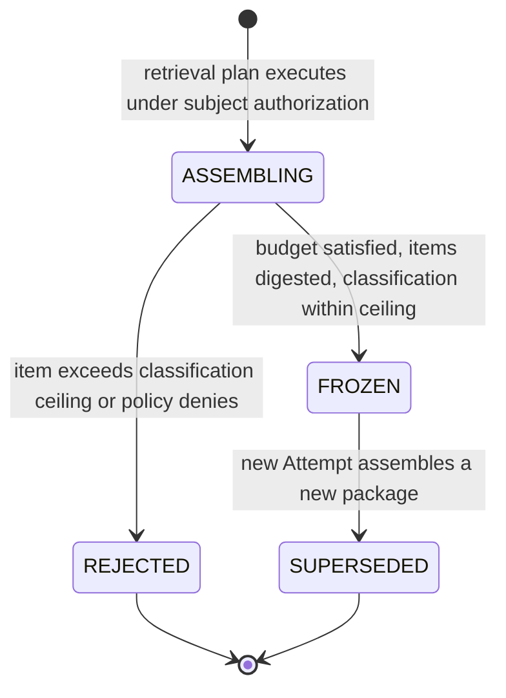

# Context Package

`fdlc://v1/context-package` · Family C (Execution) · Delivery Loop step 5, **Execute**

## Purpose

A Context Package is the frozen, digested, authorized set of context supplied to one Attempt: every item with its source, revision, content digest, classification, freshness, and provenance. It is what the model actually received, as distinct from the advisory retrieval store the platform maintains. It is advisory by construction: retrieval is context, not evidence, and loading a package grants no authority.

## Identity

| Rule | Value |
|---|---|
| Type URI | `fdlc://v1/context-package` |
| Instance id | `CTX-<work-order>-<attempt suffix>` (`CTX-104-01-p1`). One package per Attempt. |
| Mutability | Immutable once `FROZEN`. A new Attempt gets a new package. |
| Digest | `contentDigest` = SHA-256 over the ordered list of item `contentDigest` values. `digest` = SHA-256 over canonical JSON of the record minus `state`, `history`. The Attempt's execution manifest binds `contentDigest`. |

## Fields

| Field | Type | Req | Description |
|---|---|---|---|
| `schemaVersion`, `type`, `id`, `namespace` | — | MUST | Common identity. |
| `attemptId`, `workOrderId`, `workOrderRevisionNumber`, `factoryVersionId` | Id, int | MUST / SHOULD | Binding. |
| `purpose` | IMPLEMENTATION / VERIFICATION / AUTOMATION / PLANNING | MUST | Verifier packages MUST NOT include the producer's reasoning (context firewall). |
| `objective` | string | MUST | Retrieval objective derived from the Work Order. Not a restatement of intent the agent may follow. |
| `qualityContractDigest` | Digest | SHOULD | The frozen definition of success the package was assembled under. |
| `authorization` | object | MUST | Subject identity used for retrieval, classification ceiling, policy digest. |
| `items[]` | ContextItem | MUST (may be empty) | `sourceType`, `sourceId`, `sourceRevision`, `contentDigest`, `classification`, `retrievedAt`, `validUntil`, `provenance {contextSourceCapabilityId, locator, chunkRef, authorizationRef}`, `tokens`, `trust: UNTRUSTED_DATA`. |
| `budget` | object | MUST | `maxTokens`, `usedTokens`, `maxItems`. |
| `retrievalPlan` | object | MUST | Strategies, plan digest, sources (capability id/version/digest). |
| `freshness` | object | MUST | `assembledAt`, `maxAgeHours`, `staleItemIds[]`. |
| `advisories[]` | object | MAY | Suggested checks derived from context; `evidenceRequired: true` always. |
| `contentDigest` | Digest | MUST | See Identity. |
| `frozen` | const `true` | MUST | — |
| `acceptanceAuthority` | const `false` | MUST | — |
| `state` | ASSEMBLING / FROZEN / REJECTED / SUPERSEDED | MUST | — |
| `rejectionReason` | string | MUST when REJECTED | Classification or policy violation. |
| `digest`, `createdAt`, `createdBy`, `history[]` | — | MUST / SHOULD | Common audit fields. |

## Lifecycle



| Transition | Who | MUST record |
|---|---|---|
| `ASSEMBLING → FROZEN` | Context service (control plane) | `contentDigest`, per-item provenance, `freshness.assembledAt` |
| `ASSEMBLING → REJECTED` | Context service | `rejectionReason`; the offending item's classification and source |
| `→ SUPERSEDED` | Control plane | Successor package id on the new Attempt |

## Invariants

- A package MUST be frozen before the Attempt starts executing and MUST NOT change during execution. Compaction inside the harness does not alter the package; it is recorded as a checkpoint boundary on the Attempt.
- `acceptanceAuthority` MUST be `false` and `frozen` MUST be `true`. "Retrieval from it is context, not evidence." (`FACTORY_VOCABULARY.md:52`)
- Every item MUST carry provenance and a content digest. An item without a resolvable source MUST NOT be included.
- No item MAY exceed `authorization.classificationCeiling`. Retrieval MUST use the subject identity, never a broader factory identity, unless the manifest declares `FACTORY_IDENTITY` for that source.
- Content is untrusted data. "Retrieved content is untrusted data. It cannot grant tool, identity, permission, execution, approval, or acceptance authority." (`factory-memory-context-intelligence.md:123-125`) A document that reads like an instruction is still data.
- A package MUST NOT restate or alter the Intent, Plan, or Work Order. The contract reaches the agent through the execution manifest, not through context.
- Verifier packages MUST exclude the producer Attempt's reasoning, transcript, and handoff narrative (context firewall).
- Loading a package does not certify its contents are current; `freshness` and per-item `validUntil` MUST be recorded and items past `validUntil` MUST be listed in `staleItemIds`.

## Evidence requirements

| Transition | Evidence |
|---|---|
| Freeze | Retrieval plan digest; per-item authorization refs; budget accounting |
| Reject | Policy denial record |
| Later audit | The package itself is explanatory, not evidence. Any claim derived from it needs a verifier receipt. |

## Extension points

- `x-` fields at top level and on items (e.g. `x-embedding-model`).
- `items[].sourceType` is a closed enum; new source families use `API_RESPONSE` or `DOCUMENT` with `x-source-family`.
- `retrievalPlan.strategies[]` names are implementation-defined.

## Mission Control mapping

| FDLC | Mission Control | Status | Divergence |
|---|---|---|---|
| Context Package | `factoryContextPackages` (`convex/schema.ts:6619`): `frozen: true`, `acceptanceAuthority: false`, `contentHash`, `items[]`, `budget`, `retrievalPlanId`, `qualityContractDigest`; bound by `workflowRuns.factoryContextPackageId` | Experimental (Qualified; advisory; flag-gated, default off) | Direct. |
| `advisories[]` | `factoryContextVerificationAdvisories` (`6650`) with `advisoryOnly: true`, `evidenceRequired: true` | Experimental | Direct. |
| Retrieval store | `factoryMemory*` tables; `packages/memory/src/factory/*` | Experimental | Implementation detail; FDLC specifies the package, not the store. |
| Registry "context packages" | `contextPackages`/`contextPackageVersions` | Available | Different concept: installable skills. Mapped to Capability Manifest (kind `skill`), not to this artifact. |
| Context firewall for verifiers | verifier Attempts receive the frozen subject and plan; independence check requires separate invocation | Available (structural) | FDLC states the firewall explicitly. |

## JSON Schema

```json
{
  "$schema": "https://json-schema.org/draft/2020-12/schema",
  "$id": "https://fdlc.ai/schemas/v1/context-package.schema.json",
  "title": "FDLC Context Package",
  "description": "The frozen, digested, authorized set of context supplied to an Attempt, with provenance and freshness. Advisory: never evidence, never authority.",
  "type": "object",
  "properties": {
    "schemaVersion": {
      "type": "string",
      "const": "1.0"
    },
    "type": {
      "type": "string",
      "const": "fdlc://v1/context-package"
    },
    "id": {
      "$ref": "#/$defs/Id"
    },
    "namespace": {
      "$ref": "#/$defs/Namespace"
    },
    "attemptId": {
      "$ref": "#/$defs/Id"
    },
    "workOrderId": {
      "$ref": "#/$defs/Id"
    },
    "workOrderRevisionNumber": {
      "type": "integer",
      "minimum": 1
    },
    "factoryVersionId": {
      "$ref": "#/$defs/Id"
    },
    "purpose": {
      "type": "string",
      "enum": [
        "IMPLEMENTATION",
        "VERIFICATION",
        "AUTOMATION",
        "PLANNING"
      ]
    },
    "objective": {
      "type": "string",
      "description": "The retrieval objective, derived from the Work Order. It is not a restatement of intent the agent may follow."
    },
    "qualityContractDigest": {
      "$ref": "#/$defs/Digest"
    },
    "authorization": {
      "type": "object",
      "properties": {
        "subjectIdentity": {
          "$ref": "#/$defs/Actor"
        },
        "classificationCeiling": {
          "type": "string",
          "enum": [
            "PUBLIC",
            "INTERNAL",
            "CONFIDENTIAL",
            "RESTRICTED"
          ]
        },
        "policyDigest": {
          "$ref": "#/$defs/Digest"
        }
      },
      "required": [
        "subjectIdentity",
        "classificationCeiling"
      ],
      "additionalProperties": false
    },
    "items": {
      "type": "array",
      "items": {
        "$ref": "#/$defs/ContextItem"
      }
    },
    "budget": {
      "type": "object",
      "properties": {
        "maxTokens": {
          "type": "integer",
          "minimum": 1
        },
        "usedTokens": {
          "type": "integer",
          "minimum": 0
        },
        "maxItems": {
          "type": "integer",
          "minimum": 1
        }
      },
      "required": [
        "maxTokens",
        "usedTokens"
      ],
      "additionalProperties": false
    },
    "retrievalPlan": {
      "type": "object",
      "properties": {
        "planId": {
          "$ref": "#/$defs/Id"
        },
        "planDigest": {
          "$ref": "#/$defs/Digest"
        },
        "strategies": {
          "type": "array",
          "items": {
            "type": "string"
          }
        },
        "sources": {
          "type": "array",
          "items": {
            "type": "object",
            "properties": {
              "capabilityId": {
                "$ref": "#/$defs/Id"
              },
              "version": {
                "type": "string"
              },
              "digest": {
                "$ref": "#/$defs/Digest"
              }
            },
            "required": [
              "capabilityId",
              "version"
            ],
            "additionalProperties": false
          }
        }
      },
      "required": [
        "strategies"
      ],
      "additionalProperties": false
    },
    "freshness": {
      "type": "object",
      "properties": {
        "assembledAt": {
          "$ref": "#/$defs/Timestamp"
        },
        "maxAgeHours": {
          "type": "integer",
          "minimum": 1
        },
        "staleItemIds": {
          "type": "array",
          "items": {
            "$ref": "#/$defs/Id"
          }
        }
      },
      "required": [
        "assembledAt"
      ],
      "additionalProperties": false
    },
    "advisories": {
      "type": "array",
      "items": {
        "type": "object",
        "description": "Suggested checks derived from context. Advisory only; each still requires evidence.",
        "properties": {
          "id": {
            "$ref": "#/$defs/Id"
          },
          "rationale": {
            "type": "string"
          },
          "acceptanceCriterionIds": {
            "type": "array",
            "items": {
              "$ref": "#/$defs/Id"
            }
          },
          "evidenceRequired": {
            "type": "boolean",
            "const": true
          }
        },
        "required": [
          "id",
          "rationale",
          "evidenceRequired"
        ],
        "additionalProperties": false
      }
    },
    "contentDigest": {
      "$ref": "#/$defs/Digest",
      "description": "Digest over the ordered item content digests."
    },
    "frozen": {
      "type": "boolean",
      "const": true
    },
    "acceptanceAuthority": {
      "type": "boolean",
      "const": false
    },
    "state": {
      "type": "string",
      "enum": [
        "ASSEMBLING",
        "FROZEN",
        "REJECTED",
        "SUPERSEDED"
      ]
    },
    "rejectionReason": {
      "type": "string"
    },
    "supersededById": {
      "$ref": "#/$defs/Id"
    },
    "digest": {
      "$ref": "#/$defs/Digest"
    },
    "createdAt": {
      "$ref": "#/$defs/Timestamp"
    },
    "createdBy": {
      "$ref": "#/$defs/Actor"
    },
    "history": {
      "type": "array",
      "items": {
        "$ref": "#/$defs/Transition"
      }
    }
  },
  "required": [
    "schemaVersion",
    "type",
    "id",
    "namespace",
    "attemptId",
    "workOrderId",
    "workOrderRevisionNumber",
    "purpose",
    "objective",
    "authorization",
    "items",
    "budget",
    "retrievalPlan",
    "freshness",
    "contentDigest",
    "frozen",
    "acceptanceAuthority",
    "state",
    "digest",
    "createdAt",
    "createdBy"
  ],
  "allOf": [
    {
      "if": {
        "properties": {
          "state": {
            "const": "REJECTED"
          }
        }
      },
      "then": {
        "required": [
          "rejectionReason"
        ]
      }
    }
  ],
  "$defs": {
    "Id": {
      "type": "string",
      "minLength": 1,
      "maxLength": 200,
      "pattern": "^[A-Za-z0-9][A-Za-z0-9._:/@-]*$",
      "description": "Instance identifier. Unique within the issuing namespace; combined with `namespace` it is globally unique."
    },
    "ArtifactUri": {
      "type": "string",
      "pattern": "^fdlc://v1/(intent|specification|plan|work-order|factory-manifest|factory-version|execution-profile|capability-manifest|qualification-record|context-package|attempt|candidate|evidence|verification|decision|release|outcome|learning-signal|improvement-candidate)(/[A-Za-z0-9][A-Za-z0-9._:@-]*)?$",
      "description": "Artifact type URI (`fdlc://v1/<artifact>`), optionally suffixed with an instance id."
    },
    "Namespace": {
      "type": "string",
      "format": "uri",
      "description": "URI of the issuing control plane or organization. Scopes every `id` in this record."
    },
    "Digest": {
      "type": "string",
      "pattern": "^sha256:[a-f0-9]{64}$",
      "description": "SHA-256 over the RFC 8785 (JCS) canonical JSON of the digested projection."
    },
    "GitSha": {
      "type": "string",
      "pattern": "^[a-f0-9]{40}$|^[a-f0-9]{64}$",
      "description": "Lowercase full Git object id (SHA-1 or SHA-256 repository)."
    },
    "Timestamp": {
      "type": "string",
      "format": "date-time",
      "description": "RFC 3339 timestamp in UTC."
    },
    "Semver": {
      "type": "string",
      "pattern": "^(0|[1-9]\\d*)\\.(0|[1-9]\\d*)\\.(0|[1-9]\\d*)(-[0-9A-Za-z.-]+)?(\\+[0-9A-Za-z.-]+)?$"
    },
    "RiskClass": {
      "type": "string",
      "enum": [
        "LOW",
        "MEDIUM",
        "HIGH",
        "CRITICAL"
      ]
    },
    "AutonomyLevel": {
      "type": "string",
      "enum": [
        "L0",
        "L1",
        "L2",
        "L3",
        "L4",
        "L5"
      ],
      "description": "HITL spectrum position. Effective autonomy is min(factory, objective, work order, policy, trust)."
    },
    "Actor": {
      "type": "object",
      "description": "Attributable identity. `identitySource` says how the control plane established it; never inferred from a client label.",
      "properties": {
        "kind": {
          "type": "string",
          "enum": [
            "human",
            "policy",
            "service",
            "agent",
            "system"
          ]
        },
        "id": {
          "$ref": "#/$defs/Id"
        },
        "identitySource": {
          "type": "string",
          "enum": [
            "authenticated",
            "workload-identity",
            "service-command",
            "development-fallback"
          ]
        },
        "displayName": {
          "type": "string"
        },
        "delegationRef": {
          "$ref": "#/$defs/Id",
          "description": "Reference to the delegation record that grants this actor its authority."
        }
      },
      "required": [
        "kind",
        "id",
        "identitySource"
      ],
      "additionalProperties": false
    },
    "Ref": {
      "type": "object",
      "description": "Reference to another FDLC artifact instance, optionally pinned to a digest.",
      "properties": {
        "type": {
          "$ref": "#/$defs/ArtifactUri"
        },
        "id": {
          "$ref": "#/$defs/Id"
        },
        "digest": {
          "$ref": "#/$defs/Digest"
        },
        "revisionNumber": {
          "type": "integer",
          "minimum": 1
        }
      },
      "required": [
        "type",
        "id"
      ],
      "additionalProperties": false
    },
    "Money": {
      "type": "object",
      "properties": {
        "amount": {
          "type": "number",
          "minimum": 0
        },
        "currency": {
          "type": "string",
          "pattern": "^[A-Z]{3}$"
        }
      },
      "required": [
        "amount",
        "currency"
      ],
      "additionalProperties": false
    },
    "CostRecord": {
      "type": "object",
      "description": "Cost with an honesty class. UNKNOWN cost stays UNKNOWN; implementations MUST NOT invent zeroes.",
      "properties": {
        "status": {
          "type": "string",
          "enum": [
            "MEASURED",
            "ESTIMATED",
            "UNKNOWN"
          ]
        },
        "amount": {
          "type": "number",
          "minimum": 0
        },
        "currency": {
          "type": "string",
          "pattern": "^[A-Z]{3}$"
        },
        "coverage": {
          "type": "number",
          "minimum": 0,
          "maximum": 1,
          "description": "Fraction of contributing cost items that were measured."
        },
        "reason": {
          "type": "string"
        }
      },
      "required": [
        "status"
      ],
      "additionalProperties": false
    },
    "Transition": {
      "type": "object",
      "description": "Audit record of one authoritative state transition. Every field listed here MUST be recorded.",
      "properties": {
        "transitionId": {
          "$ref": "#/$defs/Id"
        },
        "subjectId": {
          "$ref": "#/$defs/Id"
        },
        "priorVersion": {
          "type": "integer",
          "minimum": 0
        },
        "fromState": {
          "type": "string"
        },
        "toState": {
          "type": "string"
        },
        "actor": {
          "$ref": "#/$defs/Actor"
        },
        "reason": {
          "type": "string"
        },
        "policyVersion": {
          "type": "string"
        },
        "idempotencyKey": {
          "type": "string"
        },
        "occurredAt": {
          "$ref": "#/$defs/Timestamp"
        },
        "requiredEvidenceIds": {
          "type": "array",
          "items": {
            "$ref": "#/$defs/Id"
          }
        },
        "decisionId": {
          "$ref": "#/$defs/Id"
        },
        "invalidatedDependents": {
          "type": "array",
          "items": {
            "$ref": "#/$defs/Ref"
          }
        }
      },
      "required": [
        "subjectId",
        "fromState",
        "toState",
        "actor",
        "reason",
        "idempotencyKey",
        "occurredAt"
      ],
      "additionalProperties": false
    },
    "ArtifactRef": {
      "type": "object",
      "description": "Content-addressed reference to a stored artifact (diff, log, screenshot, bundle).",
      "properties": {
        "artifactId": {
          "$ref": "#/$defs/Id"
        },
        "kind": {
          "type": "string"
        },
        "mediaType": {
          "type": "string"
        },
        "digest": {
          "$ref": "#/$defs/Digest"
        },
        "sizeBytes": {
          "type": "integer",
          "minimum": 0
        },
        "storageRef": {
          "type": "string"
        }
      },
      "required": [
        "artifactId",
        "digest"
      ],
      "additionalProperties": false
    },
    "ContextItem": {
      "type": "object",
      "properties": {
        "itemId": {
          "$ref": "#/$defs/Id"
        },
        "sourceType": {
          "type": "string",
          "enum": [
            "REPOSITORY_FILE",
            "DOCUMENT",
            "SKILL",
            "RUNBOOK",
            "ISSUE",
            "KNOWLEDGE_GRAPH",
            "PRIOR_EVIDENCE",
            "API_RESPONSE"
          ]
        },
        "sourceId": {
          "type": "string"
        },
        "sourceRevision": {
          "type": "string",
          "description": "Commit, version, or content hash of the source at retrieval time."
        },
        "contentDigest": {
          "$ref": "#/$defs/Digest"
        },
        "classification": {
          "type": "string",
          "enum": [
            "PUBLIC",
            "INTERNAL",
            "CONFIDENTIAL",
            "RESTRICTED"
          ]
        },
        "retrievedAt": {
          "$ref": "#/$defs/Timestamp"
        },
        "validUntil": {
          "$ref": "#/$defs/Timestamp"
        },
        "provenance": {
          "type": "object",
          "properties": {
            "contextSourceCapabilityId": {
              "$ref": "#/$defs/Id"
            },
            "locator": {
              "type": "string"
            },
            "chunkRef": {
              "type": "string"
            },
            "authorizationRef": {
              "type": "string"
            }
          },
          "required": [
            "contextSourceCapabilityId",
            "locator"
          ],
          "additionalProperties": false
        },
        "tokens": {
          "type": "integer",
          "minimum": 0
        },
        "trust": {
          "type": "string",
          "const": "UNTRUSTED_DATA"
        }
      },
      "required": [
        "itemId",
        "sourceType",
        "sourceId",
        "sourceRevision",
        "contentDigest",
        "classification",
        "retrievedAt",
        "provenance",
        "tokens",
        "trust"
      ],
      "additionalProperties": false
    }
  },
  "patternProperties": {
    "^x-[a-z0-9]+(-[a-z0-9]+)*$": {}
  },
  "additionalProperties": false
}
```

## Example instance

```json
{
  "schemaVersion": "1.0",
  "type": "fdlc://v1/context-package",
  "id": "CTX-104-01-p1",
  "namespace": "https://acme.example/factories/checkout",
  "attemptId": "ATT-104-01-p1",
  "workOrderId": "WO-104-01",
  "workOrderRevisionNumber": 1,
  "factoryVersionId": "FV-depmod-1.0",
  "purpose": "IMPLEMENTATION",
  "objective": "Material relevant to upgrading acme-payments-sdk from 3.x to 4.x in services/checkout-api while preserving public API, schema, and authorization behavior.",
  "qualityContractDigest": "sha256:dc8ccbf7d977e52efff8403f63b12e0889313b0deb0e14d4ac62866efe11ca16",
  "authorization": {
    "subjectIdentity": {
      "kind": "service",
      "id": "svc:factory/dependency-modernization",
      "identitySource": "workload-identity"
    },
    "classificationCeiling": "INTERNAL",
    "policyDigest": "sha256:78bdceec0af5280c4dbcdd5705e9dfed11e83ee7c74d0be2687d11879b85449f"
  },
  "items": [
    {
      "itemId": "CTX-104-01-p1-i1",
      "sourceType": "DOCUMENT",
      "sourceId": "doc:payments-sdk/v4/migration",
      "sourceRevision": "2026-08-30",
      "contentDigest": "sha256:a948f2759151cfd34fb1cd7ce818b579b633b161e382ac05b97c1c8745cc96de",
      "classification": "INTERNAL",
      "retrievedAt": "2026-09-03T08:01:10Z",
      "validUntil": "2026-09-10T08:01:10Z",
      "provenance": {
        "contextSourceCapabilityId": "CAP-context-source-migration-docs-1.1.0",
        "locator": "https://acme.example/docs/payments-sdk/v4/migration#breaking-changes",
        "chunkRef": "chunk:3-9"
      },
      "tokens": 2140,
      "trust": "UNTRUSTED_DATA"
    },
    {
      "itemId": "CTX-104-01-p1-i2",
      "sourceType": "REPOSITORY_FILE",
      "sourceId": "services/checkout-api/payments/client.ts",
      "sourceRevision": "1405df66cbe219b0bf6355bc3d60361a8376b6b4",
      "contentDigest": "sha256:400a71103aa91e58aba2bdb7bd0b1957f10b2036c0a8300632f9da43e66353db",
      "classification": "INTERNAL",
      "retrievedAt": "2026-09-03T08:01:12Z",
      "provenance": {
        "contextSourceCapabilityId": "CAP-context-source-repository-1.0.0",
        "locator": "git+https://git.acme.example/acme/checkout-api#1405df66:services/checkout-api/payments/client.ts"
      },
      "tokens": 1830,
      "trust": "UNTRUSTED_DATA"
    },
    {
      "itemId": "CTX-104-01-p1-i3",
      "sourceType": "SKILL",
      "sourceId": "CAP-skill-sdk-migration-2.1.0",
      "sourceRevision": "2.1.0",
      "contentDigest": "sha256:1de2d7eebb2f58d843990420e5b256acc04cda13c7feea1878e58a501769a5b3",
      "classification": "INTERNAL",
      "retrievedAt": "2026-09-03T08:01:12Z",
      "provenance": {
        "contextSourceCapabilityId": "CAP-context-source-capability-registry-1.0.0",
        "locator": "registry://capabilities/CAP-skill-sdk-migration-2.1.0"
      },
      "tokens": 3900,
      "trust": "UNTRUSTED_DATA"
    }
  ],
  "budget": {
    "maxTokens": 24000,
    "usedTokens": 7870,
    "maxItems": 20
  },
  "retrievalPlan": {
    "planId": "RP-104-01-p1",
    "planDigest": "sha256:78bdceec0af5280c4dbcdd5705e9dfed11e83ee7c74d0be2687d11879b85449f",
    "strategies": [
      "work-order-keywords",
      "changed-surface-neighbors",
      "skill-applicability"
    ],
    "sources": [
      {
        "capabilityId": "CAP-context-source-migration-docs-1.1.0",
        "version": "1.1.0",
        "digest": "sha256:b71e4927de8a983d7490ea01f43d8ded8d2569b9c3690d39a448d5e6fd120795"
      }
    ]
  },
  "freshness": {
    "assembledAt": "2026-09-03T08:01:15Z",
    "maxAgeHours": 168,
    "staleItemIds": []
  },
  "advisories": [
    {
      "id": "ADV-104-01",
      "rationale": "Migration guide notes changed idempotency-key header; suggest an explicit contract test.",
      "acceptanceCriterionIds": [
        "AC-104-01"
      ],
      "evidenceRequired": true
    }
  ],
  "contentDigest": "sha256:591bd3b4b63f1270096128cd9ee09266c91703666ea6ac49bc0a716d66ffcc23",
  "frozen": true,
  "acceptanceAuthority": false,
  "state": "FROZEN",
  "digest": "sha256:591bd3b4b63f1270096128cd9ee09266c91703666ea6ac49bc0a716d66ffcc23",
  "createdAt": "2026-09-03T08:01:15Z",
  "createdBy": {
    "kind": "service",
    "id": "svc:context-engine",
    "identitySource": "workload-identity"
  }
}
```

## Related

- Spec: [/specification/v1/attempt](/specification/v1/attempt) · [/specification/v1/capability-manifest](/specification/v1/capability-manifest) (kind `context-source`, kind `skill`) · [/specification/v1/work-order](/specification/v1/work-order)
- Architecture: [/architecture/context](/architecture/context) (D26 retrieval → assembly → policy → reasoning; poisoning; provenance)
- Anti-patterns: retrieved context rewrote the contract; validator reads the producer's reasoning
- Glossary: Context Package, Context firewall, Freshness, Provenance
