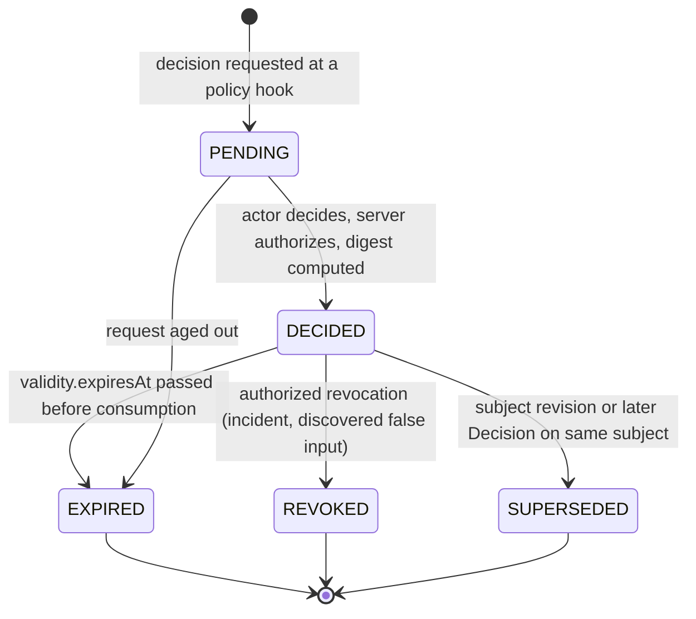

# Decision

`fdlc://v1/decision` · Family D (Trust) · Delivery Loop steps 1, 3, 4, 5, 7, 8 and Factory Lifecycle stages 6–8

## Purpose

A Decision is the attributable, reasoned, authorized record of one exercise of authority. Eight kinds cover every consequential boundary: `plan-approval`, `routing`, `admission`, `acceptance`, `release-authorization`, `promotion`, `restoration`, `exception`. The actor is a human or a policy engine acting within delegated bounds; the control plane authorizes the actor server-side. Capability ≠ permission ≠ authority: a Decision is where authority is spent. It replaces "Approval" as the canonical artifact.

## Identity

| Rule | Value |
|---|---|
| Type URI | `fdlc://v1/decision` |
| Instance id | `DEC-<work-order or subject>-<seq>` (`DEC-104-01`). |
| Mutability | Immutable once `DECIDED`. Expiry, revocation, supersession append. |
| Digest | `digest` = SHA-256 over `{kind, subject, actor.id, outcome, conditions, inputs, <kind block>, validity.decidedAt}`. |
| Idempotency | `idempotencyKey` MUST be unique per (kind, subject, revision, actor); a replay returns the recorded Decision. |

## Fields

| Field | Type | Req | Description |
|---|---|---|---|
| `schemaVersion`, `type`, `id`, `namespace` | — | MUST | Common identity. |
| `kind` | enum (8) | MUST | See per-kind table. |
| `subject` | Ref {type, id, digest, revisionNumber} | MUST | The exact artifact revision reviewed. |
| `actor` | Actor (human or policy) | MUST | Who decided; `identitySource` from the server. |
| `authorization` | object | MUST | `serverAuthorized: true`, `permission` consumed, `delegationRef`, `policyVersion`, `scope`, `separationOfDuty {authorId, checked}`. |
| `riskClass` | RiskClass | MUST | Governs which actor kinds are permitted. |
| `outcome` | APPROVED / REJECTED / CONDITIONAL / REVISION_REQUESTED / DEFERRED | MUST once DECIDED | — |
| `conditions[]` | string | MUST when CONDITIONAL | Re-checked by the next gate as data. |
| `rationale` | string | MUST | Free-text reason. |
| `inputs` | object | MUST | Evidence ids, verification id, gate state, `decisionInputDigest`, review package digest, qualification record, currentness result: what the decider saw. |
| `transition` | {fromState, toState, priorVersion} | SHOULD | The subject transition this Decision authorizes. |
| `validity` | object | MUST | `decidedAt`, `expiresAt`, `revokedAt/By`, `supersededById`, `invalidatedBy`. |
| kind block | object | MUST for the kind | `planApproval`, `routing`, `admission`, `acceptance`, `releaseAuthorization`, `promotion`, `restoration`, `exception`. |
| `state` | PENDING / DECIDED / EXPIRED / REVOKED / SUPERSEDED | MUST | — |
| `idempotencyKey`, `digest`, `createdAt`, `createdBy`, `history[]` | — | MUST / SHOULD | Common audit fields. |

### Kinds: required fields and permitted actors

| Kind | Subject | Required fields | Permitted actor | Notes |
|---|---|---|---|---|
| `plan-approval` | Plan revision | `planId`, `planDigest`, `specificationDigest`, `authorId`, `dispatches: false`; `authorization.separationOfDuty.checked: true` | Human; policy within envelope for LOW risk | Author ≠ approver. Approval never dispatches. |
| `routing` | Work Order (or Objective, Task) | `level`, `factoryVersionId/Digest`, `mode` ADVISORY/GUARDED_AUTO/PINNED/HUMAN, `eligibilityFilters[]`, `eligibleCandidateIds[]`, `algorithmVersion`; optional ranking with `unknownInputs` | Policy (Factory Router / Capability Router); human for PINNED/HUMAN | CRITICAL risk MUST be PINNED or HUMAN. Eligibility before ranking; ineligible candidates never scored. |
| `admission` | Intent, Attempt, Execution Profile, Capability, or worker | `subjectKind`, `checks[] {id, status, detail}`; for Attempts `leaseId`, `executionManifestDigest` | Policy | Fail-closed; unknown or stale authority is denial. |
| `acceptance` | Work Order revision | `workOrderId`, `workOrderRevisionNumber`, `candidateId`, `subjectDigest`, `verificationId`, `receiptId`, `currentnessEvaluatedAt`, `current: true`, `activeAttempts: 0` | Human for HIGH/CRITICAL; policy within envelope for LOW/MEDIUM | The single acceptance boundary. Recomputes currentness at decision time. |
| `release-authorization` | Release | `releaseId`, `artifactDigest`, `environment`, `rolloutScope`, `rollbackPlanDigest`, `acceptanceDecisionId` | Human for CRITICAL; policy otherwise per approval policy | Distinct from merge authority. |
| `promotion` | Factory Version (or Execution Profile, Capability) | `factoryVersionId`, `compositionDigest`, `fromState`, `toState`, `qualificationRecordId/Digest`; for activation `environment`, `restorationTargetVersionId`, readiness time | Human with promotion permission; policy for LOW-risk factories within envelope | Requires a current Qualification Record. |
| `restoration` | Factory Version (target) | `targetFactoryVersionId`, `fromFactoryVersionId`, `environment`, `incidentId`, `containmentEvidenceIds[]`, `targetQualificationRecordId`, incident-scoped authorization | Human only | A new consequential action; never implied by recovery or acknowledgment. |
| `exception` | Verification check(s) or qualification dimension | `waivedCheckIds[]`, `scope`, `compensatingControl`, `expiresAt`, `reviewAt`, `hardGateOverride: false` | Human only | WAIVED stays WAIVED; hard gates cannot be waived. |

## Lifecycle



| Transition | Who | MUST record |
|---|---|---|
| `PENDING` | Control plane at a policy hook (before dispatch, before tool side effect, before publication, before merge, before release, before promotion, on resume) | Subject ref with digest; required actor kind; inputs offered |
| `PENDING → DECIDED` | Human (authenticated) or policy (workload identity), authorized server-side | Outcome, rationale, `inputs`, kind block, `decidedAt`, `expiresAt` where policy sets validity |
| `DECIDED → EXPIRED` | Control plane (derived) | Time |
| `DECIDED → REVOKED` | Authorized human | Reason; downstream artifacts invalidated |
| `DECIDED → SUPERSEDED` | Control plane | `supersededById` |

## Invariants

- Every Decision MUST be server-authorized (`authorization.serverAuthorized: true`). "Human approval is not a decorative UI state. It is a server-enforced authority boundary." (Mission Control README:217-218) "Browser actor labels never determine authority or audit attribution." (`CONTINUOUS_LEARNING.md:140-141`)
- The actor MUST be human or policy. Agents propose; they MUST NOT decide. Services MAY record Decisions on behalf of policy only under workload identity with a named policy version.
- A Decision MUST name the exact subject revision and digest it reviewed. A Decision on revision *n* MUST NOT apply to revision *n+1*.
- `inputs` MUST be recorded so the Decision can be audited against the evidence the decider saw. A Decision whose recorded inputs are later shown stale is `SUPERSEDED`, not edited.
- Plan approval MUST enforce separation of duty (author ≠ approver) and MUST NOT dispatch.
- Acceptance MUST recompute currentness at decision time, MUST require zero active Attempts, and MUST be the only path to Work Order `DONE`. "`workOrders.accept` is the canonical WorkOrder acceptance boundary…" (`docs/OVERVIEW.md:734-736`)
- Routing MUST filter eligibility (policy, authorization, compatibility, qualification, authority, budget, capacity) before ranking. "An ineligible candidate never receives a score." (`execution-routing-v1.md:84`) An unknown component contributes no favorable score. A hard budget with unknown estimated cost fails closed.
- Restoration MUST be a separate Decision with incident-scoped authority. "An acknowledgment is diagnostic evidence; it cannot certify containment." (Mission Control README:516-517)
- Exceptions MUST carry scope, compensating control, and expiry, and MUST NOT override a hard gate. An expired exception reverts the check to its underlying result.
- Advisory systems (context, traces, evals, learning, residual AI review) MUST NOT be the actor of any Decision.
- No Decision grants a later authority by implication. "No subsystem gains a later authority merely because it completed an earlier step." (`docs/OVERVIEW.md:718-719`)

## Evidence requirements

| Kind | Evidence in `inputs` |
|---|---|
| plan-approval | Coverage projection; Specification and Constitution digests; separation-of-duty check |
| routing | Eligibility filter results per candidate; qualification records and expiry; evidence-window scores with unknowns listed |
| admission | Every admission check with status; manifest digest reproducibility |
| acceptance | Current Verification (VERIFIED, independent), receipt (PASSED, unexpired), gate ELIGIBLE, provider head match, review package digest |
| release-authorization | Acceptance Decision; environment validation; rollback plan digest; policy bundle currentness |
| promotion | Qualification Record (current, scope covers environment); readiness; restoration target |
| restoration | Containment `EFFECT_OBSERVED` receipts; target version qualification; incident record |
| exception | The failed or missing evidence being waived; compensating control evidence |

## Extension points

- `x-` fields at top level and inside any kind block.
- New kinds MUST NOT be added; an organization-specific decision MUST be expressed as `exception` (for waivers) or as an `admission` with an `x-subject-kind`, and documented in the conformance statement.
- `authorization.permission` names are implementation-defined; RECOMMENDED names follow `<domain>.<verb>` (`delivery.approve`, `factory.promote`).

## Mission Control mapping

| FDLC kind | Mission Control | Status | Divergence |
|---|---|---|---|
| plan-approval | `missionPlans.approvedBy/decidedBy/decisionReason`; author≠approver rule | Available (Qualified) | Fields on the Plan row, not a separate record. |
| routing | `modelRoutingDecisions` (`convex/schema.ts:1904`): source, mode SHADOW/ENFORCED/KILLED/EXHAUSTED, alternatives, algorithm version, `decisionDigest`; `executionRoutingSnapshot` frozen on the Attempt; Guarded Auto promotion with kill switch | Implemented, gated (Guarded Auto disabled) | FDLC `mode` ADVISORY/GUARDED_AUTO/PINNED/HUMAN maps to MC policy `executionRouting.mode` + `executionRoutingPin`. |
| admission | `attempts.claim` checks; worker registration; execution-profile admission; `factoryPackageImports` | Available | Distributed across mutations; FDLC records one Decision. |
| acceptance | `workOrders.accept` (`convex/workOrders.ts:5279-5589`), human-only, idempotent, recomputes currentness, appends gate decision; `approvalDecisions` (`2695`) for risk approvals | Available (Qualified) | MC has five approval stores (audit §7); FDLC keeps one Decision type. |
| release-authorization | `factoryReleases.deploymentApproval*`, `productionApproval*` | Experimental/Partial | Fields on the release row. |
| promotion | `configuration.activate` (readiness-gated pointer); profile `promotedBy/At`; route promotion | Available | No Decision record; FDLC requires one. |
| restoration | `factoryIncidentControlAuthorizations` (`8827`), `RESUME_REPOSITORY_DISPATCH` with expiring incident-scoped authorization | Available (one operation production-qualified) | Direct. |
| exception | `verificationReceipts.waiverApprovalDecisionId`; gate `WAIVER_REQUIRED`; `EMERGENCY_BYPASS` mode | Available (mechanism) | Direct. |
| Server authorization | `convex/lib/companyAccess.ts` permissions; `human-service-authorization-matrix.md` | Available (enforced for company/workspace/factory paths; Mission/WorkOrder human-vs-service split pending golden-path slice) | — |

## JSON Schema

```json
{
  "$schema": "https://json-schema.org/draft/2020-12/schema",
  "$id": "https://fdlc.ai/schemas/v1/decision.schema.json",
  "title": "FDLC Decision",
  "description": "An attributable, reasoned, authorized decision record. Kinds: plan-approval, routing, admission, acceptance, release-authorization, promotion, restoration, exception. Human or policy actor; always server-authorized.",
  "type": "object",
  "properties": {
    "schemaVersion": {
      "type": "string",
      "const": "1.0"
    },
    "type": {
      "type": "string",
      "const": "fdlc://v1/decision"
    },
    "id": {
      "$ref": "#/$defs/Id"
    },
    "namespace": {
      "$ref": "#/$defs/Namespace"
    },
    "kind": {
      "type": "string",
      "enum": [
        "plan-approval",
        "routing",
        "admission",
        "acceptance",
        "release-authorization",
        "promotion",
        "restoration",
        "exception"
      ]
    },
    "subject": {
      "$ref": "#/$defs/Ref",
      "description": "The artifact this decision is about, pinned to the exact digest/revision that was reviewed."
    },
    "actor": {
      "$ref": "#/$defs/Actor",
      "description": "Who decided. Only human or policy actors may hold decision authority."
    },
    "authorization": {
      "type": "object",
      "description": "How the control plane established that this actor may make this decision. A browser label or client claim is never sufficient.",
      "properties": {
        "serverAuthorized": {
          "type": "boolean",
          "const": true
        },
        "permission": {
          "type": "string",
          "description": "Named permission consumed (e.g. delivery.approve, factory.approve)."
        },
        "delegationRef": {
          "$ref": "#/$defs/Id"
        },
        "policyVersion": {
          "type": "string"
        },
        "scope": {
          "type": "object",
          "properties": {
            "tenant": {
              "type": "string"
            },
            "workspace": {
              "type": "string"
            },
            "repository": {
              "type": "string"
            },
            "environment": {
              "type": "string"
            }
          },
          "additionalProperties": false
        },
        "separationOfDuty": {
          "type": "object",
          "properties": {
            "authorId": {
              "$ref": "#/$defs/Id"
            },
            "checked": {
              "type": "boolean"
            }
          },
          "required": [
            "checked"
          ],
          "additionalProperties": false
        }
      },
      "required": [
        "serverAuthorized",
        "permission",
        "policyVersion"
      ],
      "additionalProperties": false
    },
    "riskClass": {
      "$ref": "#/$defs/RiskClass"
    },
    "outcome": {
      "type": "string",
      "enum": [
        "APPROVED",
        "REJECTED",
        "CONDITIONAL",
        "REVISION_REQUESTED",
        "DEFERRED"
      ]
    },
    "conditions": {
      "type": "array",
      "items": {
        "type": "string"
      }
    },
    "rationale": {
      "type": "string",
      "minLength": 1
    },
    "inputs": {
      "type": "object",
      "description": "What the decider saw. Recorded so the decision can be audited against the exact evidence.",
      "properties": {
        "evidenceIds": {
          "type": "array",
          "items": {
            "$ref": "#/$defs/Id"
          }
        },
        "verificationId": {
          "$ref": "#/$defs/Id"
        },
        "qualityGateState": {
          "type": "string",
          "enum": [
            "ELIGIBLE",
            "INELIGIBLE",
            "UNKNOWN",
            "STALE",
            "WAIVER_REQUIRED",
            "AWAITING_HUMAN"
          ]
        },
        "decisionInputDigest": {
          "$ref": "#/$defs/Digest"
        },
        "reviewPackageDigest": {
          "$ref": "#/$defs/Digest"
        },
        "qualificationRecordId": {
          "$ref": "#/$defs/Id"
        },
        "currentnessResult": {
          "type": "boolean"
        }
      },
      "additionalProperties": false
    },
    "transition": {
      "type": "object",
      "properties": {
        "fromState": {
          "type": "string"
        },
        "toState": {
          "type": "string"
        },
        "priorVersion": {
          "type": "integer",
          "minimum": 0
        }
      },
      "required": [
        "fromState",
        "toState"
      ],
      "additionalProperties": false
    },
    "validity": {
      "type": "object",
      "properties": {
        "decidedAt": {
          "$ref": "#/$defs/Timestamp"
        },
        "expiresAt": {
          "$ref": "#/$defs/Timestamp"
        },
        "revokedAt": {
          "$ref": "#/$defs/Timestamp"
        },
        "revokedBy": {
          "$ref": "#/$defs/Actor"
        },
        "supersededById": {
          "$ref": "#/$defs/Id"
        },
        "invalidatedBy": {
          "$ref": "#/$defs/Ref"
        }
      },
      "required": [
        "decidedAt"
      ],
      "additionalProperties": false
    },
    "planApproval": {
      "type": "object",
      "properties": {
        "planId": {
          "$ref": "#/$defs/Id"
        },
        "planDigest": {
          "$ref": "#/$defs/Digest"
        },
        "specificationDigest": {
          "$ref": "#/$defs/Digest"
        },
        "constitutionDigest": {
          "$ref": "#/$defs/Digest"
        },
        "qualityContractDigest": {
          "$ref": "#/$defs/Digest"
        },
        "authorId": {
          "$ref": "#/$defs/Id"
        },
        "releasedWorkOrderIds": {
          "type": "array",
          "items": {
            "$ref": "#/$defs/Id"
          }
        },
        "dispatches": {
          "type": "boolean",
          "const": false
        }
      },
      "required": [
        "planId",
        "planDigest",
        "specificationDigest",
        "authorId",
        "dispatches"
      ],
      "additionalProperties": false
    },
    "routing": {
      "type": "object",
      "properties": {
        "level": {
          "type": "string",
          "enum": [
            "OBJECTIVE",
            "WORK_ORDER",
            "TASK"
          ]
        },
        "workOrderId": {
          "$ref": "#/$defs/Id"
        },
        "factoryVersionId": {
          "$ref": "#/$defs/Id"
        },
        "factoryVersionDigest": {
          "$ref": "#/$defs/Digest"
        },
        "executionProfileId": {
          "$ref": "#/$defs/Id"
        },
        "executionProfileDigest": {
          "$ref": "#/$defs/Digest"
        },
        "mode": {
          "type": "string",
          "enum": [
            "ADVISORY",
            "GUARDED_AUTO",
            "PINNED",
            "HUMAN"
          ]
        },
        "eligibilityFilters": {
          "type": "array",
          "items": {
            "type": "string",
            "enum": [
              "POLICY",
              "AUTHORIZATION",
              "COMPATIBILITY",
              "QUALIFICATION",
              "AUTHORITY",
              "BUDGET",
              "CAPACITY"
            ]
          }
        },
        "eligibleCandidateIds": {
          "type": "array",
          "items": {
            "$ref": "#/$defs/Id"
          }
        },
        "rejectedCandidates": {
          "type": "array",
          "items": {
            "type": "object",
            "properties": {
              "id": {
                "$ref": "#/$defs/Id"
              },
              "reason": {
                "type": "string"
              }
            },
            "required": [
              "id",
              "reason"
            ],
            "additionalProperties": false
          }
        },
        "ranking": {
          "type": "array",
          "items": {
            "type": "object",
            "properties": {
              "id": {
                "$ref": "#/$defs/Id"
              },
              "score": {
                "type": [
                  "number",
                  "null"
                ]
              },
              "unknownInputs": {
                "type": "array",
                "items": {
                  "type": "string"
                }
              }
            },
            "required": [
              "id",
              "score"
            ],
            "additionalProperties": false
          }
        },
        "algorithmVersion": {
          "type": "string"
        },
        "evidenceWindowDays": {
          "type": "integer"
        },
        "fallbackPrequalified": {
          "type": "boolean"
        }
      },
      "required": [
        "level",
        "factoryVersionId",
        "factoryVersionDigest",
        "mode",
        "eligibilityFilters",
        "eligibleCandidateIds",
        "algorithmVersion"
      ],
      "additionalProperties": false
    },
    "admission": {
      "type": "object",
      "properties": {
        "subjectKind": {
          "type": "string",
          "enum": [
            "intent",
            "attempt",
            "execution-profile",
            "capability-manifest",
            "worker"
          ]
        },
        "checks": {
          "type": "array",
          "items": {
            "type": "object",
            "properties": {
              "id": {
                "type": "string"
              },
              "status": {
                "type": "string",
                "enum": [
                  "PASS",
                  "FAIL",
                  "NOT_APPLICABLE"
                ]
              },
              "detail": {
                "type": "string"
              }
            },
            "required": [
              "id",
              "status"
            ],
            "additionalProperties": false
          }
        },
        "leaseId": {
          "$ref": "#/$defs/Id"
        },
        "executionManifestDigest": {
          "$ref": "#/$defs/Digest"
        }
      },
      "required": [
        "subjectKind",
        "checks"
      ],
      "additionalProperties": false
    },
    "acceptance": {
      "type": "object",
      "properties": {
        "workOrderId": {
          "$ref": "#/$defs/Id"
        },
        "workOrderRevisionNumber": {
          "type": "integer",
          "minimum": 1
        },
        "candidateId": {
          "$ref": "#/$defs/Id"
        },
        "subjectDigest": {
          "$ref": "#/$defs/Digest"
        },
        "verificationId": {
          "$ref": "#/$defs/Id"
        },
        "receiptId": {
          "$ref": "#/$defs/Id"
        },
        "currentnessEvaluatedAt": {
          "$ref": "#/$defs/Timestamp"
        },
        "current": {
          "type": "boolean",
          "const": true
        },
        "activeAttempts": {
          "type": "integer",
          "const": 0
        },
        "publicationBindingDigest": {
          "$ref": "#/$defs/Digest"
        }
      },
      "required": [
        "workOrderId",
        "workOrderRevisionNumber",
        "candidateId",
        "subjectDigest",
        "verificationId",
        "receiptId",
        "currentnessEvaluatedAt",
        "current",
        "activeAttempts"
      ],
      "additionalProperties": false
    },
    "releaseAuthorization": {
      "type": "object",
      "properties": {
        "releaseId": {
          "$ref": "#/$defs/Id"
        },
        "candidateId": {
          "$ref": "#/$defs/Id"
        },
        "artifactDigest": {
          "$ref": "#/$defs/Digest"
        },
        "environment": {
          "type": "string"
        },
        "rolloutScope": {
          "type": "string"
        },
        "rollbackPlanDigest": {
          "$ref": "#/$defs/Digest"
        },
        "acceptanceDecisionId": {
          "$ref": "#/$defs/Id"
        },
        "policyBundleDigest": {
          "$ref": "#/$defs/Digest"
        },
        "mergeAuthority": {
          "type": "string",
          "enum": [
            "HUMAN",
            "POLICY_WITHIN_ENVELOPE"
          ]
        }
      },
      "required": [
        "releaseId",
        "artifactDigest",
        "environment",
        "rolloutScope",
        "rollbackPlanDigest",
        "acceptanceDecisionId"
      ],
      "additionalProperties": false
    },
    "promotion": {
      "type": "object",
      "properties": {
        "factoryVersionId": {
          "$ref": "#/$defs/Id"
        },
        "compositionDigest": {
          "$ref": "#/$defs/Digest"
        },
        "fromState": {
          "type": "string"
        },
        "toState": {
          "type": "string"
        },
        "environment": {
          "type": "string"
        },
        "qualificationRecordId": {
          "$ref": "#/$defs/Id"
        },
        "qualificationDigest": {
          "$ref": "#/$defs/Digest"
        },
        "readinessAssessedAt": {
          "$ref": "#/$defs/Timestamp"
        },
        "restorationTargetVersionId": {
          "$ref": "#/$defs/Id"
        },
        "rolloutCohort": {
          "type": "string"
        },
        "improvementCandidateId": {
          "$ref": "#/$defs/Id"
        }
      },
      "required": [
        "factoryVersionId",
        "compositionDigest",
        "fromState",
        "toState",
        "qualificationRecordId",
        "qualificationDigest"
      ],
      "additionalProperties": false
    },
    "restoration": {
      "type": "object",
      "properties": {
        "targetFactoryVersionId": {
          "$ref": "#/$defs/Id"
        },
        "fromFactoryVersionId": {
          "$ref": "#/$defs/Id"
        },
        "environment": {
          "type": "string"
        },
        "incidentId": {
          "$ref": "#/$defs/Id"
        },
        "containmentEvidenceIds": {
          "type": "array",
          "items": {
            "$ref": "#/$defs/Id"
          }
        },
        "targetQualificationRecordId": {
          "$ref": "#/$defs/Id"
        },
        "incidentScopedAuthorizationId": {
          "$ref": "#/$defs/Id"
        }
      },
      "required": [
        "targetFactoryVersionId",
        "fromFactoryVersionId",
        "environment",
        "incidentId",
        "containmentEvidenceIds",
        "targetQualificationRecordId"
      ],
      "additionalProperties": false
    },
    "exception": {
      "type": "object",
      "properties": {
        "waivedCheckIds": {
          "type": "array",
          "minItems": 1,
          "items": {
            "$ref": "#/$defs/Id"
          }
        },
        "scope": {
          "type": "string"
        },
        "compensatingControl": {
          "type": "string"
        },
        "expiresAt": {
          "$ref": "#/$defs/Timestamp"
        },
        "reviewAt": {
          "$ref": "#/$defs/Timestamp"
        },
        "hardGateOverride": {
          "type": "boolean",
          "const": false
        },
        "evidenceIds": {
          "type": "array",
          "items": {
            "$ref": "#/$defs/Id"
          }
        }
      },
      "required": [
        "waivedCheckIds",
        "scope",
        "compensatingControl",
        "expiresAt",
        "reviewAt",
        "hardGateOverride"
      ],
      "additionalProperties": false
    },
    "state": {
      "type": "string",
      "enum": [
        "PENDING",
        "DECIDED",
        "EXPIRED",
        "REVOKED",
        "SUPERSEDED"
      ]
    },
    "idempotencyKey": {
      "type": "string"
    },
    "digest": {
      "$ref": "#/$defs/Digest",
      "description": "Digest over (kind, subject, actor.id, outcome, conditions, inputs, kind-specific block, validity.decidedAt)."
    },
    "createdAt": {
      "$ref": "#/$defs/Timestamp"
    },
    "createdBy": {
      "$ref": "#/$defs/Actor"
    },
    "history": {
      "type": "array",
      "items": {
        "$ref": "#/$defs/Transition"
      }
    }
  },
  "required": [
    "schemaVersion",
    "type",
    "id",
    "namespace",
    "kind",
    "subject",
    "actor",
    "authorization",
    "riskClass",
    "rationale",
    "inputs",
    "validity",
    "state",
    "idempotencyKey",
    "createdAt",
    "createdBy"
  ],
  "allOf": [
    {
      "properties": {
        "actor": {
          "properties": {
            "kind": {
              "enum": [
                "human",
                "policy"
              ]
            }
          }
        }
      }
    },
    {
      "if": {
        "properties": {
          "state": {
            "enum": [
              "DECIDED",
              "EXPIRED",
              "REVOKED",
              "SUPERSEDED"
            ]
          }
        }
      },
      "then": {
        "required": [
          "outcome",
          "digest"
        ]
      }
    },
    {
      "if": {
        "properties": {
          "outcome": {
            "const": "CONDITIONAL"
          }
        }
      },
      "then": {
        "required": [
          "conditions"
        ],
        "properties": {
          "conditions": {
            "minItems": 1
          }
        }
      }
    },
    {
      "if": {
        "properties": {
          "kind": {
            "const": "plan-approval"
          }
        }
      },
      "then": {
        "required": [
          "planApproval"
        ]
      }
    },
    {
      "if": {
        "properties": {
          "kind": {
            "const": "routing"
          }
        }
      },
      "then": {
        "required": [
          "routing"
        ]
      }
    },
    {
      "if": {
        "properties": {
          "kind": {
            "const": "admission"
          }
        }
      },
      "then": {
        "required": [
          "admission"
        ]
      }
    },
    {
      "if": {
        "properties": {
          "kind": {
            "const": "acceptance"
          }
        }
      },
      "then": {
        "required": [
          "acceptance"
        ]
      }
    },
    {
      "if": {
        "properties": {
          "kind": {
            "const": "release-authorization"
          }
        }
      },
      "then": {
        "required": [
          "releaseAuthorization"
        ]
      }
    },
    {
      "if": {
        "properties": {
          "kind": {
            "const": "promotion"
          }
        }
      },
      "then": {
        "required": [
          "promotion"
        ]
      }
    },
    {
      "if": {
        "properties": {
          "kind": {
            "const": "restoration"
          }
        }
      },
      "then": {
        "required": [
          "restoration"
        ],
        "properties": {
          "actor": {
            "properties": {
              "kind": {
                "const": "human"
              }
            }
          }
        }
      }
    },
    {
      "if": {
        "properties": {
          "kind": {
            "const": "exception"
          }
        }
      },
      "then": {
        "required": [
          "exception"
        ],
        "properties": {
          "actor": {
            "properties": {
              "kind": {
                "const": "human"
              }
            }
          }
        }
      }
    },
    {
      "if": {
        "properties": {
          "kind": {
            "const": "acceptance"
          },
          "riskClass": {
            "enum": [
              "HIGH",
              "CRITICAL"
            ]
          }
        }
      },
      "then": {
        "properties": {
          "actor": {
            "properties": {
              "kind": {
                "const": "human"
              }
            }
          }
        }
      }
    },
    {
      "if": {
        "properties": {
          "kind": {
            "const": "release-authorization"
          },
          "riskClass": {
            "const": "CRITICAL"
          }
        }
      },
      "then": {
        "properties": {
          "actor": {
            "properties": {
              "kind": {
                "const": "human"
              }
            }
          }
        }
      }
    },
    {
      "if": {
        "properties": {
          "kind": {
            "const": "routing"
          },
          "riskClass": {
            "const": "CRITICAL"
          }
        }
      },
      "then": {
        "properties": {
          "routing": {
            "properties": {
              "mode": {
                "enum": [
                  "PINNED",
                  "HUMAN"
                ]
              }
            }
          }
        }
      }
    },
    {
      "if": {
        "properties": {
          "kind": {
            "const": "plan-approval"
          }
        }
      },
      "then": {
        "properties": {
          "authorization": {
            "properties": {
              "separationOfDuty": {
                "properties": {
                  "checked": {
                    "const": true
                  }
                }
              }
            },
            "required": [
              "separationOfDuty"
            ]
          }
        }
      }
    }
  ],
  "$defs": {
    "Id": {
      "type": "string",
      "minLength": 1,
      "maxLength": 200,
      "pattern": "^[A-Za-z0-9][A-Za-z0-9._:/@-]*$",
      "description": "Instance identifier. Unique within the issuing namespace; combined with `namespace` it is globally unique."
    },
    "ArtifactUri": {
      "type": "string",
      "pattern": "^fdlc://v1/(intent|specification|plan|work-order|factory-manifest|factory-version|execution-profile|capability-manifest|qualification-record|context-package|attempt|candidate|evidence|verification|decision|release|outcome|learning-signal|improvement-candidate)(/[A-Za-z0-9][A-Za-z0-9._:@-]*)?$",
      "description": "Artifact type URI (`fdlc://v1/<artifact>`), optionally suffixed with an instance id."
    },
    "Namespace": {
      "type": "string",
      "format": "uri",
      "description": "URI of the issuing control plane or organization. Scopes every `id` in this record."
    },
    "Digest": {
      "type": "string",
      "pattern": "^sha256:[a-f0-9]{64}$",
      "description": "SHA-256 over the RFC 8785 (JCS) canonical JSON of the digested projection."
    },
    "GitSha": {
      "type": "string",
      "pattern": "^[a-f0-9]{40}$|^[a-f0-9]{64}$",
      "description": "Lowercase full Git object id (SHA-1 or SHA-256 repository)."
    },
    "Timestamp": {
      "type": "string",
      "format": "date-time",
      "description": "RFC 3339 timestamp in UTC."
    },
    "Semver": {
      "type": "string",
      "pattern": "^(0|[1-9]\\d*)\\.(0|[1-9]\\d*)\\.(0|[1-9]\\d*)(-[0-9A-Za-z.-]+)?(\\+[0-9A-Za-z.-]+)?$"
    },
    "RiskClass": {
      "type": "string",
      "enum": [
        "LOW",
        "MEDIUM",
        "HIGH",
        "CRITICAL"
      ]
    },
    "AutonomyLevel": {
      "type": "string",
      "enum": [
        "L0",
        "L1",
        "L2",
        "L3",
        "L4",
        "L5"
      ],
      "description": "HITL spectrum position. Effective autonomy is min(factory, objective, work order, policy, trust)."
    },
    "Actor": {
      "type": "object",
      "description": "Attributable identity. `identitySource` says how the control plane established it; never inferred from a client label.",
      "properties": {
        "kind": {
          "type": "string",
          "enum": [
            "human",
            "policy",
            "service",
            "agent",
            "system"
          ]
        },
        "id": {
          "$ref": "#/$defs/Id"
        },
        "identitySource": {
          "type": "string",
          "enum": [
            "authenticated",
            "workload-identity",
            "service-command",
            "development-fallback"
          ]
        },
        "displayName": {
          "type": "string"
        },
        "delegationRef": {
          "$ref": "#/$defs/Id",
          "description": "Reference to the delegation record that grants this actor its authority."
        }
      },
      "required": [
        "kind",
        "id",
        "identitySource"
      ],
      "additionalProperties": false
    },
    "Ref": {
      "type": "object",
      "description": "Reference to another FDLC artifact instance, optionally pinned to a digest.",
      "properties": {
        "type": {
          "$ref": "#/$defs/ArtifactUri"
        },
        "id": {
          "$ref": "#/$defs/Id"
        },
        "digest": {
          "$ref": "#/$defs/Digest"
        },
        "revisionNumber": {
          "type": "integer",
          "minimum": 1
        }
      },
      "required": [
        "type",
        "id"
      ],
      "additionalProperties": false
    },
    "Money": {
      "type": "object",
      "properties": {
        "amount": {
          "type": "number",
          "minimum": 0
        },
        "currency": {
          "type": "string",
          "pattern": "^[A-Z]{3}$"
        }
      },
      "required": [
        "amount",
        "currency"
      ],
      "additionalProperties": false
    },
    "CostRecord": {
      "type": "object",
      "description": "Cost with an honesty class. UNKNOWN cost stays UNKNOWN; implementations MUST NOT invent zeroes.",
      "properties": {
        "status": {
          "type": "string",
          "enum": [
            "MEASURED",
            "ESTIMATED",
            "UNKNOWN"
          ]
        },
        "amount": {
          "type": "number",
          "minimum": 0
        },
        "currency": {
          "type": "string",
          "pattern": "^[A-Z]{3}$"
        },
        "coverage": {
          "type": "number",
          "minimum": 0,
          "maximum": 1,
          "description": "Fraction of contributing cost items that were measured."
        },
        "reason": {
          "type": "string"
        }
      },
      "required": [
        "status"
      ],
      "additionalProperties": false
    },
    "Transition": {
      "type": "object",
      "description": "Audit record of one authoritative state transition. Every field listed here MUST be recorded.",
      "properties": {
        "transitionId": {
          "$ref": "#/$defs/Id"
        },
        "subjectId": {
          "$ref": "#/$defs/Id"
        },
        "priorVersion": {
          "type": "integer",
          "minimum": 0
        },
        "fromState": {
          "type": "string"
        },
        "toState": {
          "type": "string"
        },
        "actor": {
          "$ref": "#/$defs/Actor"
        },
        "reason": {
          "type": "string"
        },
        "policyVersion": {
          "type": "string"
        },
        "idempotencyKey": {
          "type": "string"
        },
        "occurredAt": {
          "$ref": "#/$defs/Timestamp"
        },
        "requiredEvidenceIds": {
          "type": "array",
          "items": {
            "$ref": "#/$defs/Id"
          }
        },
        "decisionId": {
          "$ref": "#/$defs/Id"
        },
        "invalidatedDependents": {
          "type": "array",
          "items": {
            "$ref": "#/$defs/Ref"
          }
        }
      },
      "required": [
        "subjectId",
        "fromState",
        "toState",
        "actor",
        "reason",
        "idempotencyKey",
        "occurredAt"
      ],
      "additionalProperties": false
    },
    "ArtifactRef": {
      "type": "object",
      "description": "Content-addressed reference to a stored artifact (diff, log, screenshot, bundle).",
      "properties": {
        "artifactId": {
          "$ref": "#/$defs/Id"
        },
        "kind": {
          "type": "string"
        },
        "mediaType": {
          "type": "string"
        },
        "digest": {
          "$ref": "#/$defs/Digest"
        },
        "sizeBytes": {
          "type": "integer",
          "minimum": 0
        },
        "storageRef": {
          "type": "string"
        }
      },
      "required": [
        "artifactId",
        "digest"
      ],
      "additionalProperties": false
    }
  },
  "patternProperties": {
    "^x-[a-z0-9]+(-[a-z0-9]+)*$": {}
  },
  "additionalProperties": false
}
```

## Example instance

```json
{
  "schemaVersion": "1.0",
  "type": "fdlc://v1/decision",
  "id": "DEC-104-01",
  "namespace": "https://acme.example/factories/checkout",
  "kind": "acceptance",
  "subject": {
    "type": "fdlc://v1/work-order",
    "id": "WO-104-01",
    "digest": "sha256:c71cd9ffb858a2246f0ac88f48da89110aecef031b15bbbc675c2a2370e8ac93",
    "revisionNumber": 1
  },
  "actor": {
    "kind": "human",
    "id": "user:dana.okafor",
    "identitySource": "authenticated",
    "displayName": "Dana Okafor"
  },
  "authorization": {
    "serverAuthorized": true,
    "permission": "delivery.approve",
    "delegationRef": "DELEG-checkout-owners-2026",
    "policyVersion": "approval-policy/3",
    "scope": {
      "tenant": "acme",
      "workspace": "checkout",
      "repository": "repo:checkout-api"
    },
    "separationOfDuty": {
      "checked": true
    }
  },
  "riskClass": "MEDIUM",
  "outcome": "APPROVED",
  "conditions": [],
  "rationale": "Exact-current verification VER-104-02 is VERIFIED and independent; Quality Gate ELIGIBLE under ENFORCED mode; PR #118 head matches the frozen subject; no active Attempts. Accepting revision 1 of WO-104-01.",
  "inputs": {
    "evidenceIds": [
      "EV-104-09",
      "EV-104-10",
      "EV-104-11",
      "EV-104-12"
    ],
    "verificationId": "VER-104-02",
    "qualityGateState": "ELIGIBLE",
    "decisionInputDigest": "sha256:ee6be7457bdd596f69d88c82fa75ffcefc22736ddea6ac7f33fa6c8a66313781",
    "reviewPackageDigest": "sha256:0bb2241e31a9f7ebb93aa43f08ad5057a9870d0334e00f4887961630198ee551",
    "currentnessResult": true
  },
  "transition": {
    "fromState": "AWAITING_VERIFICATION",
    "toState": "DONE",
    "priorVersion": 14
  },
  "validity": {
    "decidedAt": "2026-09-09T16:40:00Z",
    "expiresAt": "2026-09-16T16:40:00Z"
  },
  "acceptance": {
    "workOrderId": "WO-104-01",
    "workOrderRevisionNumber": 1,
    "candidateId": "CAND-104-01-p1",
    "subjectDigest": "sha256:bc9e58be15d0abe0a8159ff375752bc65adca6c6a02fcde0ad02283db510641f",
    "verificationId": "VER-104-02",
    "receiptId": "RCPT-104-02",
    "currentnessEvaluatedAt": "2026-09-09T16:38:00Z",
    "current": true,
    "activeAttempts": 0,
    "publicationBindingDigest": "sha256:ce27a4c7cde6fdb8f69e2b1619d75aeb1e3a68b14137a0552e2d77cb49bb7601"
  },
  "state": "DECIDED",
  "idempotencyKey": "accept:WO-104-01:r1:dana.okafor:1",
  "digest": "sha256:491150850eec71f8399ffd639d3dd07ff4cbcb1d60b73f9f66edfb0aa5a7f328",
  "createdAt": "2026-09-09T16:39:50Z",
  "createdBy": {
    "kind": "human",
    "id": "user:dana.okafor",
    "identitySource": "authenticated"
  },
  "history": [
    {
      "subjectId": "DEC-104-01",
      "fromState": "PENDING",
      "toState": "DECIDED",
      "actor": {
        "kind": "human",
        "id": "user:dana.okafor",
        "identitySource": "authenticated"
      },
      "reason": "Acceptance recorded; currentness recomputed at decision time.",
      "policyVersion": "approval-policy/3",
      "idempotencyKey": "accept:WO-104-01:r1:dana.okafor:1",
      "occurredAt": "2026-09-09T16:40:00Z",
      "requiredEvidenceIds": [
        "EV-104-09",
        "EV-104-10",
        "EV-104-11",
        "EV-104-12"
      ]
    }
  ]
}
```

## Related

- Spec: [/specification/v1/plan](/specification/v1/plan) · [/specification/v1/work-order](/specification/v1/work-order) · [/specification/v1/verification](/specification/v1/verification) · [/specification/v1/release](/specification/v1/release) · [/specification/v1/factory-version](/specification/v1/factory-version) · [/specification/v1/attempt](/specification/v1/attempt)
- Architecture: [/architecture/authority](/architecture/authority) (D16 authority model; D17 HITL / risk-tier matrix) · [/architecture/multi-factory](/architecture/multi-factory) (routing)
- Framework: [/framework/delivery-loop](/framework/delivery-loop) step 7 Approve; [/framework/principles](/framework/principles) "The model proposes. The system decides what becomes real."
- Glossary: Decision, Authority, Permission, Separation of duty, Policy hook, Guarded Auto
