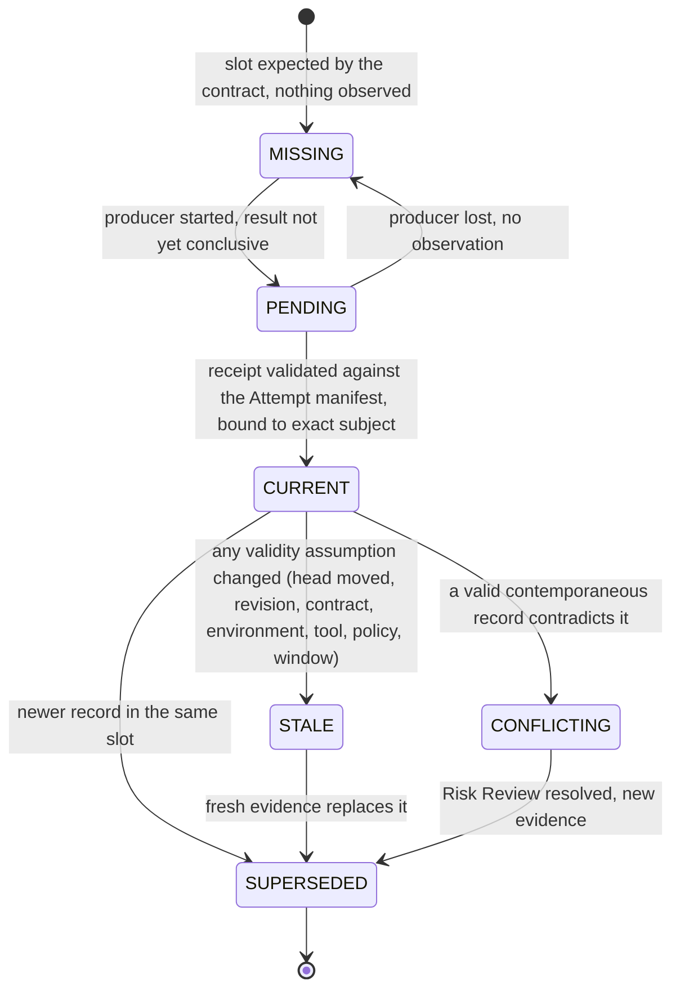

# Evidence

`fdlc://v1/evidence` · Family C (Execution) · Produced at **Execute**, **Verify**, **Release**, **Observe**; consumed at **Verify**, **Approve**, **Qualify**

## Purpose

Evidence is a durable, attributable record of what was authorized, executed, observed, verified, or decided, bound to an exact subject with provenance, integrity, and validity conditions. It proves what ran and what was observed. Verification judges whether it satisfies the Specification; a Decision applies authority. Evidence never accepts work. Claim → Evidence → Verification → Decision → Authority.

## Identity

| Rule | Value |
|---|---|
| Type URI | `fdlc://v1/evidence` |
| Instance id | `EV-<work-order>-<seq>` (`EV-104-09`). |
| Slot key | `evidenceKey` names the expected evidence slot (`<work-order>:<revision>:<check>:<criterion>`), so a `MISSING` record can exist before any observation and a `SUPERSEDED` record can point to its successor in the same slot. |
| Mutability | Append-only. Corrections create superseding records. A failed result stays visible after a later pass. |
| Digest | `digest` = `integrity.contentDigest` = SHA-256 over canonical JSON of the record minus `integrity`, `state`, `supersededById`, `conflictsWith`, `riskReviewId`, `history`. |
| Exchange | As the predicate of an in-toto Statement v1 with `predicateType: https://fdlc.ai/attestation/evidence/v1`, subjects listing the Candidate (and git commit/tree) digests, optionally signed in a DSSE envelope. |

## Fields

| Field | Type | Req | Description |
|---|---|---|---|
| `schemaVersion`, `type`, `id`, `namespace` | — | MUST | Common identity. |
| `evidenceKey` | string | MUST | Expected-slot key. |
| `category` | enum | MUST | TEST_RESULT, BUILD_RESULT, STATIC_ANALYSIS, SECURITY_SCAN, DEPENDENCY_SCAN, COMMAND_LOG, FILE_DIFF, SCREENSHOT, BROWSER_RESULT, PERFORMANCE_RESULT, REVIEW_RESULT, POLICY_RESULT, CI_RESULT, RUNTIME_OBSERVATION, EVALUATION_SCORE, PROVENANCE, TOOL_CALL_RECEIPT, DEPLOYMENT_CHECK, DECISION_RECORD, MODEL_IDENTITY, TRACE. |
| `checkId`, `criterionIds[]`, `requirementIds[]`, `riskIds[]` | Id | MUST / SHOULD | What claim this evidence supports or refutes. |
| **Binding** `subject` | SubjectBinding | MUST | `kind` (CANDIDATE, RELEASE, FACTORY_VERSION, EXECUTION_PROFILE, CAPABILITY, ATTEMPT, DECISION); for CANDIDATE: `candidateId`, `subjectDigest`, `commitSha`, `treeSha`, `diffDigest`, `contractDigest`, `sourceAttemptId`, `workOrderId`, `workOrderRevisionNumber`; `environmentDigest`. |
| **Binding** `producer` | ProducerBinding | MUST once PENDING | `actor`, `role` (verifier, producer, control-plane, provider, human, release-system, observer), `independent`, `attemptId`, `factoryVersionId`, `factoryPurpose`, `executorInvocationId`, `leaseId`, `adapterId`, `verifierCapabilityId`, `reportCapability`. |
| **Binding** `independence` | object | MUST once CURRENT | Policy version, `passed`, reasons, source/verification Attempt ids. |
| `result` | PASS / FAIL / SKIPPED / NOT_CONFIGURED / ERROR / WAIVED / NOT_APPLICABLE / UNKNOWN | MUST once CURRENT | What was observed. Only PASS satisfies a mandatory check. |
| `summary`, `measurements` | string, map | SHOULD | Human summary; machine measurements. |
| `tool` | object | SHOULD | Name, version, command, exit code, duration, environment digest. |
| `artifacts[]` | ArtifactRef | SHOULD | Native outputs by digest (junit, logs, screenshots). |
| **Binding** `integrity` | object | MUST once CURRENT | `contentDigest`; `signature {format dsse/jws/none, keyId, signatureRef, signer, transparencyLogRef}`. |
| **Binding** `validity` | object | MUST once CURRENT | `observedAt`, `validUntil`, `invalidatedAt/By/Reason`, `assumptions[]` (SUBJECT_HEAD, WORK_ORDER_REVISION, VERIFICATION_CONTRACT, PLAN_DIGEST, ENVIRONMENT_DIGEST, TOOL_VERSION, POLICY_VERSION, DEPENDENCY_GRAPH, VALIDITY_WINDOW), `staleReasons[]`. |
| **Binding** `provenance` | object | MUST once PENDING | `class` LIVE/SYNTHETIC/DEMO/IMPORTED/LEGACY; OTel `traceRefs[]`; execution manifest and profile digests; `receiptPacketDigest`. |
| `attestation` | object | SHOULD | in-toto wrapper: `statementType`, `predicateType`, `subjects[] {name, digest {sha256, gitCommit, gitTree}}`, `statementDigest`, `envelopeRef`, `envelopeFormat`. |
| `waiver` | object | MUST when result WAIVED | Exception Decision id, scope, reason, owner, expiry, compensating control, review date. |
| `state` | MISSING / PENDING / CURRENT / STALE / CONFLICTING / SUPERSEDED | MUST | See lifecycle. |
| `supersededById`, `supersedesId`, `conflictsWith[]`, `riskReviewId` | Id | conditional | Supersession and conflict lineage. |
| `recordedAt`, `createdAt`, `createdBy`, `digest`, `history[]` | — | MUST / SHOULD | Common audit fields. |

## Lifecycle



The six states are the currentness axis. `result` (PASS, FAIL, WAIVED, NOT_APPLICABLE, …) is the observation axis. They are independent: a `FAIL` can be `CURRENT`; a `PASS` can be `STALE`.

| Transition | Who | MUST record |
|---|---|---|
| `MISSING` | Control plane when the contract is compiled | `evidenceKey`, `checkId`, `criterionIds`, `subject` |
| `PENDING → CURRENT` | Control plane on ingestion of a receipt packet | Producer binding with lease/fence proof, `integrity`, `validity.assumptions`, provenance class |
| `CURRENT → STALE` | Control plane (derived, never manual) | `staleReasons[]`, `invalidatedBy` (revision, reopen Decision, head move) |
| `CURRENT → CONFLICTING` | Control plane | `conflictsWith[]`; a Risk Review opened (`riskReviewId`) |
| `→ SUPERSEDED` | Control plane | `supersededById` |

## Invariants

- Evidence MUST come from the system performing the check, never the system being checked. A producer's report of "tests passed" is a claim (`category: COMMAND_LOG`, `producer.role: producer`, `independent: false`), not verification evidence.
- Evidence MUST bind its subject, actor, method, environment, source revision, artifact, time, result, and currentness. "Qualifying evidence binds its subject, actor, method, environment, source revision, artifact, time, result, and currentness." (`FACTORY_VOCABULARY.md:102-104`)
- Only `provenance.class: LIVE` evidence MAY count toward acceptance or qualification. SYNTHETIC, DEMO, IMPORTED, LEGACY MUST be excluded from acceptance-current sets.
- Only `PASS` satisfies a mandatory check. "Missing, stale, skipped, unconfigured, errored, insufficiently independent, or conflicting proof cannot become verified success." (`docs/OVERVIEW.md:465-466`)
- `UNKNOWN` MUST NOT coerce to `PASS`. `WAIVED` MUST remain visibly waived in every projection; it MUST NOT render as PASS.
- Evidence MUST NOT be borrowed. "Never borrow proof from another Attempt, candidate, pull-request head, WorkOrder revision, verifier, or policy." (`docs/OVERVIEW.md:1168-1169`)
- A receipt packet that does not match the Attempt's frozen manifest MUST be rejected, not partially trusted. Late evidence after lease expiry, cancellation, or revocation MUST be retained as history and MUST NOT become `CURRENT`.
- Staleness MUST be a derived property of `validity.assumptions` against current facts, never a manually set flag. Selective invalidation MAY preserve unaffected evidence only when the implementation can prove which assumptions held; otherwise invalidate conservatively.
- Conflicting valid evidence MUST raise governance (Risk Review), never be averaged or outvoted.
- Signing proves issuer and integrity, not truth. A signed fabricated result is still fabricated; independence and protected execution remain required.
- Advisory records (context, traces, evaluation scores, learning signals, residual AI review) MUST NOT be presented as evidence for acceptance. Where an implementation stores them alongside evidence, they MUST carry `acceptanceAuthority: false`.

## Evidence requirements

Evidence is the proof; this section states what proof an evidence record itself needs.

| Aspect | Requirement |
|---|---|
| Integrity | `contentDigest` reproducible from the canonical payload; signature RECOMMENDED for cross-boundary exchange (DSSE + in-toto Statement) |
| Attribution | Producer identity from workload identity or authenticated human; never from a client label |
| Lineage | `provenance.executionManifestDigest` and `receiptPacketDigest` so the receipt can be tied to the exact Attempt envelope |
| Forensics | OTel trace references; native artifacts by digest with retention class |

## Extension points

- `x-` fields at top level and under `measurements`, `tool`, `provenance`.
- Additional predicate types MAY be defined under `https://fdlc.ai/attestation/<name>/v1` for non-evidence attestations (e.g. qualification suite receipts); each MUST declare its subject binding rule.
- `category` is closed; new evidence families use the nearest category plus `x-category`.

## Mission Control mapping

| FDLC | Mission Control | Status | Divergence |
|---|---|---|---|
| Evidence | `evidenceEnvelopes` (`convex/schema.ts:2850`): category, result, criterion/requirement/risk ids, `producer {actorType, actorId, role, independent, factoryPurpose, factoryDefinitionVersionId, attemptId, executorInvocationId, executorAdapter}`, tool, independence, artifact ids, source/candidate revision, `contentHash`, `provenance` LIVE/SYNTHETIC/DEMO/IMPORTED/LEGACY | Available (Qualified) | Direct for binding fields. |
| Six states | documented lifecycle `RECORDED → USABLE → STALE \| SUPERSEDED \| REVOKED \| CONFLICTED` (`verification-and-gate-state-machines.md:100-112`) is not a schema column; MC tracks `result` + provenance + receipt-level invalidation | Planned (audit §5.8) | FDLC's MISSING/PENDING/CURRENT/STALE/CONFLICTING/SUPERSEDED replaces MC's documented names; MC `REVOKED` maps to STALE with `invalidatedBy`. |
| Receipts | `verificationReceipts` (`2727`): status PENDING/PASSED/FAILED/WAIVED/STALE, `validUntil`, invalidation by revision/reopen, `evidenceEnvelopeIds[]`, `decisionInputDigest` | Available | FDLC keeps the receipt inside Verification; Evidence records are the envelopes. |
| Currentness | `verificationCurrentness.ts` binds evidence to the exact identity tuple | Available | Direct. |
| in-toto / DSSE wrapper | not normalized ("Supply-chain provenance — Strong partial") | Partial | FDLC adds `attestation`. |
| `LIVE`-only acceptance | `currentVerification.ts:143-148` | Available | Direct. |

## JSON Schema

```json
{
  "$schema": "https://json-schema.org/draft/2020-12/schema",
  "$id": "https://fdlc.ai/schemas/v1/evidence.schema.json",
  "title": "FDLC Evidence",
  "description": "Durable, attributable record of what was authorized, executed, observed, verified, or decided — bound to an exact subject with provenance, integrity, and validity conditions. Six states: MISSING, PENDING, CURRENT, STALE, CONFLICTING, SUPERSEDED. Exchangeable as the predicate of an in-toto Statement.",
  "type": "object",
  "properties": {
    "schemaVersion": {
      "type": "string",
      "const": "1.0"
    },
    "type": {
      "type": "string",
      "const": "fdlc://v1/evidence"
    },
    "id": {
      "$ref": "#/$defs/Id"
    },
    "namespace": {
      "$ref": "#/$defs/Namespace"
    },
    "evidenceKey": {
      "type": "string",
      "description": "Stable key for the expected evidence slot (contract check × criterion). Lets a MISSING record exist before any observation."
    },
    "category": {
      "type": "string",
      "enum": [
        "TEST_RESULT",
        "BUILD_RESULT",
        "STATIC_ANALYSIS",
        "SECURITY_SCAN",
        "DEPENDENCY_SCAN",
        "COMMAND_LOG",
        "FILE_DIFF",
        "SCREENSHOT",
        "BROWSER_RESULT",
        "PERFORMANCE_RESULT",
        "REVIEW_RESULT",
        "POLICY_RESULT",
        "CI_RESULT",
        "RUNTIME_OBSERVATION",
        "EVALUATION_SCORE",
        "PROVENANCE",
        "TOOL_CALL_RECEIPT",
        "DEPLOYMENT_CHECK",
        "DECISION_RECORD",
        "MODEL_IDENTITY",
        "TRACE"
      ]
    },
    "checkId": {
      "$ref": "#/$defs/Id"
    },
    "criterionIds": {
      "type": "array",
      "items": {
        "$ref": "#/$defs/Id"
      }
    },
    "requirementIds": {
      "type": "array",
      "items": {
        "$ref": "#/$defs/Id"
      }
    },
    "riskIds": {
      "type": "array",
      "items": {
        "$ref": "#/$defs/Id"
      }
    },
    "subject": {
      "$ref": "#/$defs/SubjectBinding"
    },
    "producer": {
      "$ref": "#/$defs/ProducerBinding"
    },
    "independence": {
      "type": "object",
      "properties": {
        "policyVersion": {
          "type": "string"
        },
        "passed": {
          "type": "boolean"
        },
        "reasons": {
          "type": "array",
          "items": {
            "type": "string"
          }
        },
        "sourceAttemptId": {
          "$ref": "#/$defs/Id"
        },
        "verificationAttemptId": {
          "$ref": "#/$defs/Id"
        }
      },
      "required": [
        "policyVersion",
        "passed",
        "reasons"
      ],
      "additionalProperties": false
    },
    "result": {
      "type": "string",
      "enum": [
        "PASS",
        "FAIL",
        "SKIPPED",
        "NOT_CONFIGURED",
        "ERROR",
        "WAIVED",
        "NOT_APPLICABLE",
        "UNKNOWN"
      ],
      "description": "What the verifier observed. Only PASS satisfies a mandatory check. WAIVED stays WAIVED; it never renders as PASS."
    },
    "summary": {
      "type": "string"
    },
    "measurements": {
      "type": "object",
      "additionalProperties": {
        "type": [
          "number",
          "string",
          "boolean",
          "null"
        ]
      }
    },
    "tool": {
      "type": "object",
      "properties": {
        "name": {
          "type": "string"
        },
        "version": {
          "type": "string"
        },
        "command": {
          "type": "array",
          "items": {
            "type": "string"
          }
        },
        "exitCode": {
          "type": [
            "integer",
            "null"
          ]
        },
        "durationMs": {
          "type": [
            "integer",
            "null"
          ]
        },
        "environmentDigest": {
          "$ref": "#/$defs/Digest"
        }
      },
      "required": [
        "name"
      ],
      "additionalProperties": false
    },
    "artifacts": {
      "type": "array",
      "items": {
        "$ref": "#/$defs/ArtifactRef"
      }
    },
    "integrity": {
      "type": "object",
      "properties": {
        "contentDigest": {
          "$ref": "#/$defs/Digest",
          "description": "Digest of the canonical evidence payload (everything except integrity, validity.state-derived fields, and history)."
        },
        "signature": {
          "type": "object",
          "properties": {
            "format": {
              "type": "string",
              "enum": [
                "dsse",
                "jws",
                "none"
              ]
            },
            "keyId": {
              "type": "string"
            },
            "signatureRef": {
              "type": "string"
            },
            "signer": {
              "type": "string"
            },
            "transparencyLogRef": {
              "type": "string"
            }
          },
          "required": [
            "format"
          ],
          "additionalProperties": false
        }
      },
      "required": [
        "contentDigest",
        "signature"
      ],
      "additionalProperties": false
    },
    "validity": {
      "type": "object",
      "description": "Currentness conditions. The state is derived from these fields and the subject's current head; it is never set by the producer.",
      "properties": {
        "observedAt": {
          "$ref": "#/$defs/Timestamp"
        },
        "validUntil": {
          "$ref": "#/$defs/Timestamp"
        },
        "invalidatedAt": {
          "$ref": "#/$defs/Timestamp"
        },
        "invalidatedBy": {
          "$ref": "#/$defs/Ref"
        },
        "invalidationReason": {
          "type": "string"
        },
        "assumptions": {
          "type": "array",
          "items": {
            "type": "string",
            "enum": [
              "SUBJECT_HEAD",
              "WORK_ORDER_REVISION",
              "VERIFICATION_CONTRACT",
              "PLAN_DIGEST",
              "ENVIRONMENT_DIGEST",
              "TOOL_VERSION",
              "POLICY_VERSION",
              "DEPENDENCY_GRAPH",
              "VALIDITY_WINDOW"
            ]
          }
        },
        "staleReasons": {
          "type": "array",
          "items": {
            "type": "string"
          }
        }
      },
      "required": [
        "observedAt",
        "assumptions"
      ],
      "additionalProperties": false
    },
    "provenance": {
      "type": "object",
      "properties": {
        "class": {
          "type": "string",
          "enum": [
            "LIVE",
            "SYNTHETIC",
            "DEMO",
            "IMPORTED",
            "LEGACY"
          ],
          "description": "Only LIVE evidence counts toward acceptance."
        },
        "traceRefs": {
          "type": "array",
          "items": {
            "type": "object",
            "properties": {
              "traceId": {
                "type": "string"
              },
              "spanId": {
                "type": "string"
              }
            },
            "required": [
              "traceId"
            ],
            "additionalProperties": false
          }
        },
        "executionManifestDigest": {
          "$ref": "#/$defs/Digest"
        },
        "executionProfileDigest": {
          "$ref": "#/$defs/Digest"
        },
        "receiptPacketDigest": {
          "$ref": "#/$defs/Digest",
          "description": "Digest of the runtime receipt packet this envelope was validated from."
        }
      },
      "required": [
        "class"
      ],
      "additionalProperties": false
    },
    "attestation": {
      "type": "object",
      "description": "in-toto Statement wrapper for exchange. The predicate is this Evidence record (without `attestation` and `history`).",
      "properties": {
        "statementType": {
          "type": "string",
          "const": "https://in-toto.io/Statement/v1"
        },
        "predicateType": {
          "type": "string",
          "const": "https://fdlc.ai/attestation/evidence/v1"
        },
        "subjects": {
          "type": "array",
          "minItems": 1,
          "items": {
            "type": "object",
            "properties": {
              "name": {
                "type": "string"
              },
              "digest": {
                "type": "object",
                "properties": {
                  "sha256": {
                    "type": "string",
                    "pattern": "^[a-f0-9]{64}$"
                  },
                  "gitCommit": {
                    "$ref": "#/$defs/GitSha"
                  },
                  "gitTree": {
                    "$ref": "#/$defs/GitSha"
                  }
                },
                "additionalProperties": false
              }
            },
            "required": [
              "name",
              "digest"
            ],
            "additionalProperties": false
          }
        },
        "statementDigest": {
          "$ref": "#/$defs/Digest"
        },
        "envelopeRef": {
          "type": "string",
          "description": "Locator of the DSSE envelope."
        },
        "envelopeFormat": {
          "type": "string",
          "enum": [
            "dsse",
            "none"
          ]
        }
      },
      "required": [
        "statementType",
        "predicateType",
        "subjects",
        "statementDigest",
        "envelopeFormat"
      ],
      "additionalProperties": false
    },
    "waiver": {
      "type": "object",
      "properties": {
        "decisionId": {
          "$ref": "#/$defs/Id"
        },
        "scope": {
          "type": "string"
        },
        "reason": {
          "type": "string"
        },
        "owner": {
          "$ref": "#/$defs/Actor"
        },
        "expiresAt": {
          "$ref": "#/$defs/Timestamp"
        },
        "compensatingControl": {
          "type": "string"
        },
        "reviewAt": {
          "$ref": "#/$defs/Timestamp"
        }
      },
      "required": [
        "decisionId",
        "scope",
        "reason",
        "owner",
        "expiresAt",
        "compensatingControl"
      ],
      "additionalProperties": false
    },
    "state": {
      "type": "string",
      "enum": [
        "MISSING",
        "PENDING",
        "CURRENT",
        "STALE",
        "CONFLICTING",
        "SUPERSEDED"
      ]
    },
    "supersededById": {
      "$ref": "#/$defs/Id"
    },
    "supersedesId": {
      "$ref": "#/$defs/Id"
    },
    "conflictsWith": {
      "type": "array",
      "items": {
        "$ref": "#/$defs/Id"
      }
    },
    "riskReviewId": {
      "$ref": "#/$defs/Id"
    },
    "recordedAt": {
      "$ref": "#/$defs/Timestamp"
    },
    "createdBy": {
      "$ref": "#/$defs/Actor"
    },
    "createdAt": {
      "$ref": "#/$defs/Timestamp"
    },
    "digest": {
      "$ref": "#/$defs/Digest",
      "description": "Equal to integrity.contentDigest."
    },
    "history": {
      "type": "array",
      "items": {
        "$ref": "#/$defs/Transition"
      }
    }
  },
  "required": [
    "schemaVersion",
    "type",
    "id",
    "namespace",
    "evidenceKey",
    "category",
    "checkId",
    "criterionIds",
    "subject",
    "state",
    "createdAt",
    "createdBy"
  ],
  "allOf": [
    {
      "if": {
        "properties": {
          "state": {
            "enum": [
              "PENDING",
              "CURRENT",
              "STALE",
              "CONFLICTING",
              "SUPERSEDED"
            ]
          }
        }
      },
      "then": {
        "required": [
          "producer",
          "provenance"
        ]
      }
    },
    {
      "if": {
        "properties": {
          "state": {
            "enum": [
              "CURRENT",
              "STALE",
              "CONFLICTING",
              "SUPERSEDED"
            ]
          }
        }
      },
      "then": {
        "required": [
          "result",
          "integrity",
          "validity",
          "recordedAt",
          "digest",
          "independence"
        ]
      }
    },
    {
      "if": {
        "properties": {
          "state": {
            "const": "MISSING"
          }
        }
      },
      "then": {
        "not": {
          "required": [
            "result"
          ]
        }
      }
    },
    {
      "if": {
        "properties": {
          "result": {
            "const": "WAIVED"
          }
        }
      },
      "then": {
        "required": [
          "waiver"
        ]
      }
    },
    {
      "if": {
        "properties": {
          "state": {
            "const": "CONFLICTING"
          }
        }
      },
      "then": {
        "required": [
          "conflictsWith"
        ],
        "properties": {
          "conflictsWith": {
            "minItems": 1
          }
        }
      }
    },
    {
      "if": {
        "properties": {
          "state": {
            "const": "SUPERSEDED"
          }
        }
      },
      "then": {
        "required": [
          "supersededById"
        ]
      }
    },
    {
      "if": {
        "properties": {
          "state": {
            "const": "STALE"
          }
        }
      },
      "then": {
        "properties": {
          "validity": {
            "required": [
              "staleReasons"
            ],
            "properties": {
              "staleReasons": {
                "minItems": 1
              }
            }
          }
        }
      }
    }
  ],
  "$defs": {
    "Id": {
      "type": "string",
      "minLength": 1,
      "maxLength": 200,
      "pattern": "^[A-Za-z0-9][A-Za-z0-9._:/@-]*$",
      "description": "Instance identifier. Unique within the issuing namespace; combined with `namespace` it is globally unique."
    },
    "ArtifactUri": {
      "type": "string",
      "pattern": "^fdlc://v1/(intent|specification|plan|work-order|factory-manifest|factory-version|execution-profile|capability-manifest|qualification-record|context-package|attempt|candidate|evidence|verification|decision|release|outcome|learning-signal|improvement-candidate)(/[A-Za-z0-9][A-Za-z0-9._:@-]*)?$",
      "description": "Artifact type URI (`fdlc://v1/<artifact>`), optionally suffixed with an instance id."
    },
    "Namespace": {
      "type": "string",
      "format": "uri",
      "description": "URI of the issuing control plane or organization. Scopes every `id` in this record."
    },
    "Digest": {
      "type": "string",
      "pattern": "^sha256:[a-f0-9]{64}$",
      "description": "SHA-256 over the RFC 8785 (JCS) canonical JSON of the digested projection."
    },
    "GitSha": {
      "type": "string",
      "pattern": "^[a-f0-9]{40}$|^[a-f0-9]{64}$",
      "description": "Lowercase full Git object id (SHA-1 or SHA-256 repository)."
    },
    "Timestamp": {
      "type": "string",
      "format": "date-time",
      "description": "RFC 3339 timestamp in UTC."
    },
    "Semver": {
      "type": "string",
      "pattern": "^(0|[1-9]\\d*)\\.(0|[1-9]\\d*)\\.(0|[1-9]\\d*)(-[0-9A-Za-z.-]+)?(\\+[0-9A-Za-z.-]+)?$"
    },
    "RiskClass": {
      "type": "string",
      "enum": [
        "LOW",
        "MEDIUM",
        "HIGH",
        "CRITICAL"
      ]
    },
    "AutonomyLevel": {
      "type": "string",
      "enum": [
        "L0",
        "L1",
        "L2",
        "L3",
        "L4",
        "L5"
      ],
      "description": "HITL spectrum position. Effective autonomy is min(factory, objective, work order, policy, trust)."
    },
    "Actor": {
      "type": "object",
      "description": "Attributable identity. `identitySource` says how the control plane established it; never inferred from a client label.",
      "properties": {
        "kind": {
          "type": "string",
          "enum": [
            "human",
            "policy",
            "service",
            "agent",
            "system"
          ]
        },
        "id": {
          "$ref": "#/$defs/Id"
        },
        "identitySource": {
          "type": "string",
          "enum": [
            "authenticated",
            "workload-identity",
            "service-command",
            "development-fallback"
          ]
        },
        "displayName": {
          "type": "string"
        },
        "delegationRef": {
          "$ref": "#/$defs/Id",
          "description": "Reference to the delegation record that grants this actor its authority."
        }
      },
      "required": [
        "kind",
        "id",
        "identitySource"
      ],
      "additionalProperties": false
    },
    "Ref": {
      "type": "object",
      "description": "Reference to another FDLC artifact instance, optionally pinned to a digest.",
      "properties": {
        "type": {
          "$ref": "#/$defs/ArtifactUri"
        },
        "id": {
          "$ref": "#/$defs/Id"
        },
        "digest": {
          "$ref": "#/$defs/Digest"
        },
        "revisionNumber": {
          "type": "integer",
          "minimum": 1
        }
      },
      "required": [
        "type",
        "id"
      ],
      "additionalProperties": false
    },
    "Money": {
      "type": "object",
      "properties": {
        "amount": {
          "type": "number",
          "minimum": 0
        },
        "currency": {
          "type": "string",
          "pattern": "^[A-Z]{3}$"
        }
      },
      "required": [
        "amount",
        "currency"
      ],
      "additionalProperties": false
    },
    "CostRecord": {
      "type": "object",
      "description": "Cost with an honesty class. UNKNOWN cost stays UNKNOWN; implementations MUST NOT invent zeroes.",
      "properties": {
        "status": {
          "type": "string",
          "enum": [
            "MEASURED",
            "ESTIMATED",
            "UNKNOWN"
          ]
        },
        "amount": {
          "type": "number",
          "minimum": 0
        },
        "currency": {
          "type": "string",
          "pattern": "^[A-Z]{3}$"
        },
        "coverage": {
          "type": "number",
          "minimum": 0,
          "maximum": 1,
          "description": "Fraction of contributing cost items that were measured."
        },
        "reason": {
          "type": "string"
        }
      },
      "required": [
        "status"
      ],
      "additionalProperties": false
    },
    "Transition": {
      "type": "object",
      "description": "Audit record of one authoritative state transition. Every field listed here MUST be recorded.",
      "properties": {
        "transitionId": {
          "$ref": "#/$defs/Id"
        },
        "subjectId": {
          "$ref": "#/$defs/Id"
        },
        "priorVersion": {
          "type": "integer",
          "minimum": 0
        },
        "fromState": {
          "type": "string"
        },
        "toState": {
          "type": "string"
        },
        "actor": {
          "$ref": "#/$defs/Actor"
        },
        "reason": {
          "type": "string"
        },
        "policyVersion": {
          "type": "string"
        },
        "idempotencyKey": {
          "type": "string"
        },
        "occurredAt": {
          "$ref": "#/$defs/Timestamp"
        },
        "requiredEvidenceIds": {
          "type": "array",
          "items": {
            "$ref": "#/$defs/Id"
          }
        },
        "decisionId": {
          "$ref": "#/$defs/Id"
        },
        "invalidatedDependents": {
          "type": "array",
          "items": {
            "$ref": "#/$defs/Ref"
          }
        }
      },
      "required": [
        "subjectId",
        "fromState",
        "toState",
        "actor",
        "reason",
        "idempotencyKey",
        "occurredAt"
      ],
      "additionalProperties": false
    },
    "ArtifactRef": {
      "type": "object",
      "description": "Content-addressed reference to a stored artifact (diff, log, screenshot, bundle).",
      "properties": {
        "artifactId": {
          "$ref": "#/$defs/Id"
        },
        "kind": {
          "type": "string"
        },
        "mediaType": {
          "type": "string"
        },
        "digest": {
          "$ref": "#/$defs/Digest"
        },
        "sizeBytes": {
          "type": "integer",
          "minimum": 0
        },
        "storageRef": {
          "type": "string"
        }
      },
      "required": [
        "artifactId",
        "digest"
      ],
      "additionalProperties": false
    },
    "SubjectBinding": {
      "type": "object",
      "description": "Exact subject identity. Evidence bound to a different subject is not evidence for this one.",
      "properties": {
        "kind": {
          "type": "string",
          "enum": [
            "CANDIDATE",
            "RELEASE",
            "FACTORY_VERSION",
            "EXECUTION_PROFILE",
            "CAPABILITY",
            "ATTEMPT",
            "DECISION"
          ]
        },
        "candidateId": {
          "$ref": "#/$defs/Id"
        },
        "subjectDigest": {
          "$ref": "#/$defs/Digest"
        },
        "commitSha": {
          "$ref": "#/$defs/GitSha"
        },
        "treeSha": {
          "$ref": "#/$defs/GitSha"
        },
        "diffDigest": {
          "$ref": "#/$defs/Digest"
        },
        "contractDigest": {
          "$ref": "#/$defs/Digest",
          "description": "Verification contract digest the check was run under."
        },
        "sourceAttemptId": {
          "$ref": "#/$defs/Id"
        },
        "workOrderId": {
          "$ref": "#/$defs/Id"
        },
        "workOrderRevisionNumber": {
          "type": "integer",
          "minimum": 1
        },
        "subjectRef": {
          "$ref": "#/$defs/Ref",
          "description": "For non-candidate subjects (release, factory version, ...)."
        },
        "environmentDigest": {
          "$ref": "#/$defs/Digest"
        }
      },
      "required": [
        "kind"
      ],
      "additionalProperties": false,
      "allOf": [
        {
          "if": {
            "properties": {
              "kind": {
                "const": "CANDIDATE"
              }
            }
          },
          "then": {
            "required": [
              "candidateId",
              "subjectDigest",
              "contractDigest",
              "sourceAttemptId",
              "workOrderId",
              "workOrderRevisionNumber"
            ]
          }
        },
        {
          "if": {
            "properties": {
              "kind": {
                "enum": [
                  "RELEASE",
                  "FACTORY_VERSION",
                  "EXECUTION_PROFILE",
                  "CAPABILITY",
                  "ATTEMPT",
                  "DECISION"
                ]
              }
            }
          },
          "then": {
            "required": [
              "subjectRef"
            ]
          }
        }
      ]
    },
    "ProducerBinding": {
      "type": "object",
      "description": "Who observed this. Evidence comes from the system performing the check, never from the system being checked.",
      "properties": {
        "actor": {
          "$ref": "#/$defs/Actor"
        },
        "role": {
          "type": "string",
          "enum": [
            "verifier",
            "producer",
            "control-plane",
            "provider",
            "human",
            "release-system",
            "observer"
          ]
        },
        "independent": {
          "type": "boolean"
        },
        "attemptId": {
          "$ref": "#/$defs/Id"
        },
        "factoryVersionId": {
          "$ref": "#/$defs/Id"
        },
        "factoryPurpose": {
          "type": "string",
          "enum": [
            "SOFTWARE",
            "VERIFICATION",
            "AUTOMATION"
          ]
        },
        "executorInvocationId": {
          "type": "string"
        },
        "leaseId": {
          "$ref": "#/$defs/Id"
        },
        "adapterId": {
          "type": "string"
        },
        "verifierCapabilityId": {
          "$ref": "#/$defs/Id"
        },
        "reportCapability": {
          "type": "string",
          "description": "e.g. verification:report — the capability through which the evidence entered the control plane."
        }
      },
      "required": [
        "actor",
        "role",
        "independent"
      ],
      "additionalProperties": false
    }
  },
  "patternProperties": {
    "^x-[a-z0-9]+(-[a-z0-9]+)*$": {}
  },
  "additionalProperties": false
}
```

## Example instance

```json
{
  "schemaVersion": "1.0",
  "type": "fdlc://v1/evidence",
  "id": "EV-104-09",
  "namespace": "https://acme.example/factories/checkout",
  "evidenceKey": "WO-104-01:r1:CHK-104-TEST:AC-104-01",
  "category": "TEST_RESULT",
  "checkId": "CHK-104-TEST",
  "criterionIds": [
    "AC-104-01"
  ],
  "requirementIds": [
    "REQ-104-03"
  ],
  "riskIds": [
    "RISK-104-01"
  ],
  "subject": {
    "kind": "CANDIDATE",
    "candidateId": "CAND-104-01-p1",
    "subjectDigest": "sha256:bc9e58be15d0abe0a8159ff375752bc65adca6c6a02fcde0ad02283db510641f",
    "commitSha": "4015b57a143aec5156fd1444a017a32137a3fd0f",
    "treeSha": "80655da8d80aaaf92ce5357e7828dc09adb00993",
    "diffDigest": "sha256:6793803b255f9bbd0a9943b129a67af9650328c54451b76790a7be08d4c65bb3",
    "contractDigest": "sha256:7578cc0498d5fccce37655a6d0f8a0a07eec696427228335d6656cbe1148be78",
    "sourceAttemptId": "ATT-104-01-p1",
    "workOrderId": "WO-104-01",
    "workOrderRevisionNumber": 1,
    "environmentDigest": "sha256:6dc87bf3ac7649b799be35cdd8b3a0bdae66a0447c69c286e01df5c87c589859"
  },
  "producer": {
    "actor": {
      "kind": "service",
      "id": "svc:factory/verification",
      "identitySource": "workload-identity"
    },
    "role": "verifier",
    "independent": true,
    "attemptId": "ATT-104-01-v1",
    "factoryVersionId": "FV-verify-2.3",
    "factoryPurpose": "VERIFICATION",
    "executorInvocationId": "verify-session-c41d0e9f",
    "leaseId": "LEASE-104-01-v1-1",
    "adapterId": "isolated-invocation",
    "verifierCapabilityId": "CAP-verifier-test-runner-3.0.1",
    "reportCapability": "verification:report"
  },
  "independence": {
    "policyVersion": "verification-independence/v1",
    "passed": true,
    "reasons": [
      "Separate Attempt, lease, invocation, worktree, and Factory Version; verifier factory purpose VERIFICATION; verification-authority surfaces untouched by the candidate."
    ],
    "sourceAttemptId": "ATT-104-01-p1",
    "verificationAttemptId": "ATT-104-01-v1"
  },
  "result": "PASS",
  "summary": "CT-* and IT-* suites: 212 passed, 0 failed, 0 skipped against 4015b57a in a fresh clone.",
  "measurements": {
    "testsPassed": 212,
    "testsFailed": 0,
    "testsSkipped": 0,
    "durationMs": 418230
  },
  "tool": {
    "name": "pnpm",
    "version": "9.12.0",
    "command": [
      "pnpm",
      "test",
      "--filter",
      "checkout-api",
      "--",
      "--grep",
      "CT-|IT-"
    ],
    "exitCode": 0,
    "durationMs": 418230,
    "environmentDigest": "sha256:6dc87bf3ac7649b799be35cdd8b3a0bdae66a0447c69c286e01df5c87c589859"
  },
  "artifacts": [
    {
      "artifactId": "ART-104-01-v1-junit",
      "kind": "TEST_OUTPUT",
      "mediaType": "application/xml",
      "digest": "sha256:82d28700a095c34b413248b7b9726b502a520f545c1565a9f5b39add9d8b1067",
      "sizeBytes": 91344,
      "storageRef": "artifact://checkout/ATT-104-01-v1/junit.xml"
    },
    {
      "artifactId": "ART-104-01-v1-log",
      "kind": "COMMAND_LOG",
      "mediaType": "text/plain",
      "digest": "sha256:3ac66b4aca00d8a3bb2ff9f4cae23a83b7b2506bb4bbe2be82d08c77707af180",
      "sizeBytes": 220117,
      "storageRef": "artifact://checkout/ATT-104-01-v1/test.log"
    }
  ],
  "integrity": {
    "contentDigest": "sha256:e586922c54b52d8283f3252853712aa94366e9f0817622a7fb0cd31fe3642fb2",
    "signature": {
      "format": "dsse",
      "keyId": "acme-verification-factory-2026",
      "signatureRef": "attestation://acme/evidence/EV-104-09",
      "signer": "spiffe://acme.example/factory/verification"
    }
  },
  "validity": {
    "observedAt": "2026-09-03T10:11:04Z",
    "validUntil": "2026-09-10T10:11:04Z",
    "assumptions": [
      "SUBJECT_HEAD",
      "WORK_ORDER_REVISION",
      "VERIFICATION_CONTRACT",
      "PLAN_DIGEST",
      "ENVIRONMENT_DIGEST",
      "TOOL_VERSION",
      "VALIDITY_WINDOW"
    ],
    "staleReasons": []
  },
  "provenance": {
    "class": "LIVE",
    "traceRefs": [
      {
        "traceId": "9d1c4a7e2b6f4c0d8e3a5b7c9d1e2f30",
        "spanId": "1a2b3c4d5e6f7081"
      }
    ],
    "executionManifestDigest": "sha256:b7d0c7cf8805254a3fa377a328f6d91751fb25d5dd1de93feb0c3f12a5c8af30",
    "executionProfileDigest": "sha256:5ed7f0866fe74ab23634a68046d35aa7e39c7e45c626ec3007b94300d9d36945",
    "receiptPacketDigest": "sha256:1678691fbf26ce98f9b8c97b9aaea32b5b448bc790c8739a70a8f51ea4db0519"
  },
  "attestation": {
    "statementType": "https://in-toto.io/Statement/v1",
    "predicateType": "https://fdlc.ai/attestation/evidence/v1",
    "subjects": [
      {
        "name": "git+https://git.acme.example/acme/checkout-api",
        "digest": {
          "gitCommit": "4015b57a143aec5156fd1444a017a32137a3fd0f",
          "gitTree": "80655da8d80aaaf92ce5357e7828dc09adb00993"
        }
      },
      {
        "name": "fdlc://v1/candidate/CAND-104-01-p1",
        "digest": {
          "sha256": "ce27a4c7cde6fdb8f69e2b1619d75aeb1e3a68b14137a0552e2d77cb49bb7601"
        }
      }
    ],
    "statementDigest": "sha256:26c4f30edf340bc9f8508308af785e45e321325a122778389b92c11c86476c05",
    "envelopeRef": "attestation://acme/evidence/EV-104-09",
    "envelopeFormat": "dsse"
  },
  "state": "CURRENT",
  "recordedAt": "2026-09-03T10:11:30Z",
  "createdBy": {
    "kind": "service",
    "id": "svc:control-plane",
    "identitySource": "workload-identity"
  },
  "createdAt": "2026-09-03T10:11:30Z",
  "digest": "sha256:e586922c54b52d8283f3252853712aa94366e9f0817622a7fb0cd31fe3642fb2"
}
```

## Related

- Spec: [/specification/v1/candidate](/specification/v1/candidate) · [/specification/v1/verification](/specification/v1/verification) · [/specification/v1/attempt](/specification/v1/attempt) · [/specification/v1/decision](/specification/v1/decision) · [/specification/v1/qualification-record](/specification/v1/qualification-record)
- Architecture: [/architecture/evidence](/architecture/evidence) (D14 Claim → Authority) · [/architecture/verification](/architecture/verification) · [/architecture/observability](/architecture/observability)
- Standards: in-toto Attestation Statement v1, DSSE, SLSA provenance, RFC 8785, OpenTelemetry trace context
- Anti-patterns: unknown coerced to pass; stale evidence reused; claims filed as evidence; waiver shown as pass
- Glossary: Evidence, Receipt, Currentness, Provenance class, Waiver
