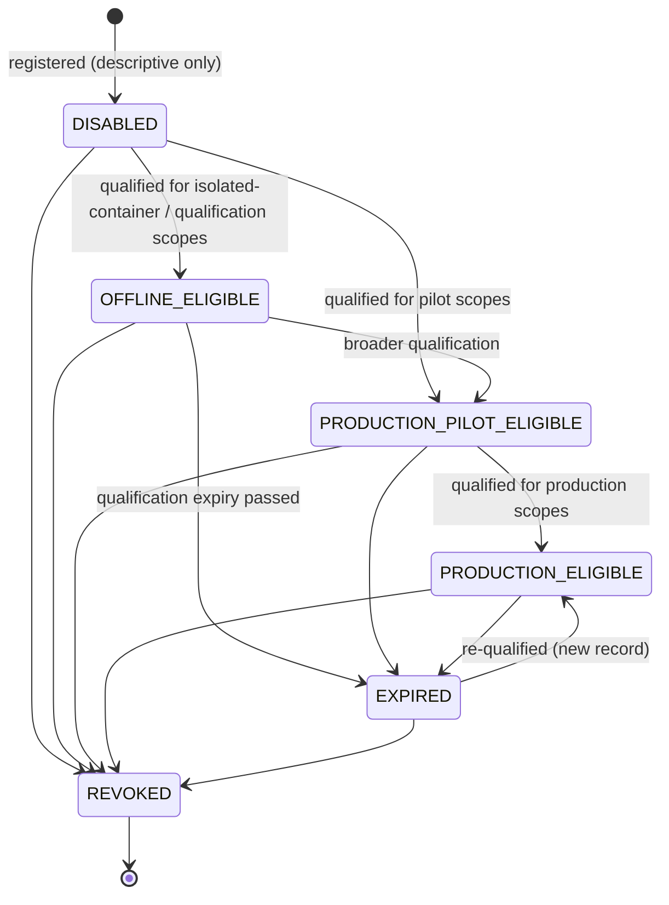

# Execution Profile

`fdlc://v1/execution-profile` · Family B (Factory) · Bound at **Route**, frozen into every **Attempt**

## Purpose

An Execution Profile is the admitted per-Attempt composition: which Model route, Agent Definition, Harness, Work Graph, Runtime, Sandbox, Capability Implementations, and policy identities apply, plus the autonomy ceiling and resource limits. It exists so that dispatch never constructs an arbitrary product of model, harness, runtime, and backend at run time; it selects one exact, qualified tuple that a Factory Version already declares.

## Identity

| Rule | Value |
|---|---|
| Type URI | `fdlc://v1/execution-profile` |
| Instance id | `EP-<factory>-<semver>-<key>` (`EP-depmod-1.0-prod`). `profileKey` + `profileVersion` are unique within the Factory Version. |
| Mutability | Immutable. A change is a new `profileVersion`. Admission status and history are the only mutable parts. |
| Digest | `digest` = SHA-256 over canonical JSON of every field except `admission`, `history`, `createdAt`, `createdBy`, `registrationIdempotencyKey`. Equal digests are the same composition. |
| Subordination | A profile has no active pointer of its own. It MUST NOT be routed or dispatched independently of its Factory Version. |

## Fields

| Field | Type | Req | Description |
|---|---|---|---|
| `schemaVersion`, `type`, `id`, `namespace` | — | MUST | Common identity. |
| `factoryVersionId`, `factoryVersionDigest` | Id, Digest | MUST | Owning version. |
| `profileKey`, `profileVersion`, `description` | string, int | MUST / SHOULD | — |
| `purpose` | SOFTWARE / VERIFICATION / AUTOMATION | MUST | Must equal the Factory Version purpose. |
| `backend` | persistent-worker / remote-sandbox / isolated-container | MUST | Execution backend. |
| `environments[]` | string | MUST (≥1) | Where this profile may run. |
| `harness` | object | MUST | Capability id, harness id/version, adapter id/version, capability manifest digest, effective config digest, runtime artifact {kind, digest}. |
| `agentDefinition` | object | MUST | Capability id, version, digest, prompt bundle digest, tool manifest digest. |
| `modelRoute` | object | MUST | Route id, provider, model id, reasoning config, `routeDigest`, `qualificationDigest`, `inferenceMode` ALLOWED/DENIED. |
| `workGraph` | {workflowId, version, digest} | MUST | — |
| `runtime` | object | MUST | Lease duration, heartbeat interval, checkpoint policy, `supportsResume`, `supportsCancel`. |
| `sandbox` | object | MUST | Profile id/digest, isolation modes, image digest, `networkEgress`, `egressEnforcementProven`, required capabilities, `credentialMode`, `publicationIdentityPresent: false`. |
| `capabilityImplementations[]` | CapabilityImplementation | MUST (may be empty) | Exact skills, tools (with grant id/digest/expiry), context sources, verifiers. |
| `policyIdentities` | object | MUST | Policy bundle, credential, network, filesystem, approval policy digests. |
| `requiredHarnessCapabilities[]` | {capability, minimumSupport} | MUST | What the harness manifest must declare SUPPORTED/PARTIAL. |
| `autonomyCeiling` | L0–L5 | MUST | Upper bound on any Attempt under this profile. |
| `resourceLimits` | object | MUST | `maxCost`, `maxRuntimeMinutes`, `maxAttempts`, optional tokens, tool calls, provider calls. |
| `admission` | object | MUST | `status`, `qualificationStatus`, qualification record id/digest, `scopes[]`, `expiresAt`, promotion/revocation actors and Decision. |
| `immutable` | const `true` | MUST | — |
| `digest`, `createdAt`, `createdBy`, `registrationIdempotencyKey`, `history[]` | — | MUST / SHOULD | Common audit fields. |

## Lifecycle



| Transition | Who | MUST record |
|---|---|---|
| register → `DISABLED` | Factory Engineer | `digest`; `registrationIdempotencyKey`; no admission |
| `→ *_ELIGIBLE` | Human with promotion permission | Decision (kind `promotion`), Qualification Record id/digest, `scopes[]`, `expiresAt` |
| `→ EXPIRED` | Control plane (derived from `expiresAt`) | Expiry time; affected in-flight Attempts unaffected |
| `→ REVOKED` | Human or incident authority | Actor, reason, time. Terminal. The old profile and its receipts are never mutated. |

## Invariants

- Registration MUST be descriptive and disabled. Qualification MUST be the only path to admission. "Registration is descriptive and disabled; qualification is the only path to admission." (`convex/schema.ts:1334-1335`)
- A profile MUST NOT be routed or dispatched independently of a Factory Version, and the Factory Version MUST list it in `composition.executionProfiles[]`.
- The profile's harness, runtime artifact, backend, model route, and sandbox MUST match the Factory Version's composition digests exactly. Neither the router nor the profile MAY substitute another profile, model route, harness, runtime artifact, backend, or adapter at dispatch. (`execution-routing-v1.md:103-105`)
- The model route's qualification MUST admit the exact harness, runtime artifact, and backend tuple. A route qualified with a different runtime artifact is a different qualification.
- `backend: isolated-container` MUST have `modelRoute.inferenceMode: DENIED`.
- `sandbox.publicationIdentityPresent` MUST be `false`. No publication credential may exist in the sandbox.
- A profile revoked or expired after a valid lease was issued MUST NOT rewrite the in-flight Attempt; a retry is a new Attempt and MUST pass current admission. (`execution-routing-v1.md:105-107`)
- An absent tool grant on a profile MUST mean `NO_TOOL_CAPABILITY`, never a default.
- Each Attempt MUST freeze `executionProfileId` and `executionProfileDigest` into its execution manifest.

## Evidence requirements

| Transition | Evidence |
|---|---|
| Register | Digest reproducibility check (server recomputes `digest` from the snapshot) |
| Admission | Qualification Record for the profile (dimensions: model-route-compatibility, sandbox-isolation, credential-handling, tool-permissions at minimum) with scopes; egress enforcement proof for non-public classifications |
| Revocation | Reason; incident id where applicable |

## Extension points

- `x-` fields at top level and within `sandbox`, `runtime`, `capabilityImplementations[]`.
- `requiredHarnessCapabilities[].capability` names are free-form dotted paths into the Harness Manifest (e.g. `git.commit`); the `minimumSupport` enum is closed.
- Additional backends MUST NOT be added to the enum; an implementation MAY map a proprietary backend onto one of the three with an `x-backend-detail` field.

## Mission Control mapping

| FDLC | Mission Control | Status | Divergence |
|---|---|---|---|
| Execution Profile | `factoryExecutionProfiles` (`convex/schema.ts:1278`); `convex/factory/executionProfiles.ts` | Implemented, gated (Experimental) | Direct: immutable rows, `profileKey`+`version`, `profileDigest`, harness manifest/config/runtime digests, backend, sandbox profile, model catalog + route + qualification digests, isolation modes, required capabilities, tool grant. |
| Admission states | `DISABLED → OFFLINE_ELIGIBLE \| PRODUCTION_PILOT_ELIGIBLE → REVOKED` | Available | FDLC adds `PRODUCTION_ELIGIBLE` and explicit `EXPIRED`; MC models expiry via `qualificationExpiresAt`. |
| `admission.qualificationRecordId` | `qualificationSnapshot` + `qualificationDigest` on the row | Available | MC embeds the qualification snapshot; FDLC references a Qualification Record. |
| `autonomyCeiling`, `resourceLimits` | Factory Version `budget`; Work Order `autonomyLevel` | Partial | FDLC places the ceiling on the profile as well. |
| Freezing into the Attempt | `workflowRuns.executionProfile*` and `executionManifest.executionProfile` (`convex/lib/executionManifest.ts:688-786`) | Available | Direct; MC asserts the binding against the profile snapshot. |

## JSON Schema

```json
{
  "$schema": "https://json-schema.org/draft/2020-12/schema",
  "$id": "https://fdlc.ai/schemas/v1/execution-profile.schema.json",
  "title": "FDLC Execution Profile",
  "description": "The admitted per-Attempt composition: which Model, Agent, Harness, Work Graph, Runtime, Sandbox, Capability Implementations, and policy identities apply, plus autonomy ceiling and resource limits. Immutable and subordinate to a Factory Version.",
  "type": "object",
  "properties": {
    "schemaVersion": {
      "type": "string",
      "const": "1.0"
    },
    "type": {
      "type": "string",
      "const": "fdlc://v1/execution-profile"
    },
    "id": {
      "$ref": "#/$defs/Id",
      "description": "EP-<factory>-<semver>-<key>."
    },
    "namespace": {
      "$ref": "#/$defs/Namespace"
    },
    "factoryVersionId": {
      "$ref": "#/$defs/Id"
    },
    "factoryVersionDigest": {
      "$ref": "#/$defs/Digest"
    },
    "profileKey": {
      "type": "string",
      "pattern": "^[a-z0-9][a-z0-9-]{2,63}$"
    },
    "profileVersion": {
      "type": "integer",
      "minimum": 1
    },
    "description": {
      "type": "string"
    },
    "purpose": {
      "type": "string",
      "enum": [
        "SOFTWARE",
        "VERIFICATION",
        "AUTOMATION"
      ]
    },
    "backend": {
      "type": "string",
      "enum": [
        "persistent-worker",
        "remote-sandbox",
        "isolated-container"
      ]
    },
    "environments": {
      "type": "array",
      "minItems": 1,
      "items": {
        "type": "string"
      }
    },
    "harness": {
      "type": "object",
      "properties": {
        "capabilityId": {
          "$ref": "#/$defs/Id"
        },
        "harnessId": {
          "type": "string"
        },
        "harnessVersion": {
          "type": "string"
        },
        "adapterId": {
          "type": "string"
        },
        "adapterVersion": {
          "type": "string"
        },
        "capabilityManifestDigest": {
          "$ref": "#/$defs/Digest"
        },
        "effectiveConfigDigest": {
          "$ref": "#/$defs/Digest"
        },
        "runtimeArtifact": {
          "type": "object",
          "properties": {
            "kind": {
              "type": "string",
              "enum": [
                "EXECUTABLE",
                "CONTAINER_IMAGE"
              ]
            },
            "digest": {
              "$ref": "#/$defs/Digest"
            }
          },
          "required": [
            "kind",
            "digest"
          ],
          "additionalProperties": false
        }
      },
      "required": [
        "capabilityId",
        "harnessId",
        "harnessVersion",
        "adapterId",
        "adapterVersion",
        "capabilityManifestDigest",
        "effectiveConfigDigest",
        "runtimeArtifact"
      ],
      "additionalProperties": false
    },
    "agentDefinition": {
      "type": "object",
      "properties": {
        "capabilityId": {
          "$ref": "#/$defs/Id"
        },
        "version": {
          "type": "string"
        },
        "digest": {
          "$ref": "#/$defs/Digest"
        },
        "promptBundleDigest": {
          "$ref": "#/$defs/Digest"
        },
        "toolManifestDigest": {
          "$ref": "#/$defs/Digest"
        }
      },
      "required": [
        "capabilityId",
        "version",
        "digest"
      ],
      "additionalProperties": false
    },
    "modelRoute": {
      "type": "object",
      "properties": {
        "routeId": {
          "type": "string"
        },
        "capabilityId": {
          "$ref": "#/$defs/Id"
        },
        "provider": {
          "type": "string"
        },
        "modelId": {
          "type": "string"
        },
        "reasoningConfig": {
          "type": "object",
          "properties": {
            "temperature": {
              "type": "number"
            },
            "maxTokens": {
              "type": "integer"
            },
            "effort": {
              "type": "string"
            }
          },
          "additionalProperties": false
        },
        "routeDigest": {
          "$ref": "#/$defs/Digest"
        },
        "qualificationDigest": {
          "$ref": "#/$defs/Digest"
        },
        "inferenceMode": {
          "type": "string",
          "enum": [
            "ALLOWED",
            "DENIED"
          ],
          "description": "DENIED for offline deterministic profiles."
        }
      },
      "required": [
        "routeId",
        "provider",
        "modelId",
        "routeDigest",
        "qualificationDigest",
        "inferenceMode"
      ],
      "additionalProperties": false
    },
    "workGraph": {
      "type": "object",
      "properties": {
        "workflowId": {
          "type": "string"
        },
        "version": {
          "type": "integer",
          "minimum": 1
        },
        "digest": {
          "$ref": "#/$defs/Digest"
        }
      },
      "required": [
        "workflowId",
        "version",
        "digest"
      ],
      "additionalProperties": false
    },
    "runtime": {
      "type": "object",
      "properties": {
        "leaseDurationMs": {
          "type": "integer",
          "minimum": 1000
        },
        "heartbeatIntervalMs": {
          "type": "integer",
          "minimum": 100
        },
        "checkpointPolicy": {
          "type": "string",
          "enum": [
            "NONE",
            "STEP",
            "COMPACTION"
          ]
        },
        "supportsResume": {
          "type": "boolean"
        },
        "supportsCancel": {
          "type": "boolean"
        }
      },
      "required": [
        "leaseDurationMs",
        "heartbeatIntervalMs",
        "supportsCancel"
      ],
      "additionalProperties": false
    },
    "sandbox": {
      "type": "object",
      "properties": {
        "profileId": {
          "$ref": "#/$defs/Id"
        },
        "profileDigest": {
          "$ref": "#/$defs/Digest"
        },
        "isolationModes": {
          "type": "array",
          "minItems": 1,
          "items": {
            "type": "string",
            "enum": [
              "READ_ONLY",
              "WORKSPACE_WRITE"
            ]
          }
        },
        "imageDigest": {
          "$ref": "#/$defs/Digest"
        },
        "networkEgress": {
          "type": "string",
          "enum": [
            "DENY_ALL",
            "RESTRICTED_ALLOWLIST",
            "UNRESTRICTED"
          ]
        },
        "egressEnforcementProven": {
          "type": "boolean"
        },
        "requiredCapabilities": {
          "type": "array",
          "items": {
            "type": "string"
          }
        },
        "credentialMode": {
          "type": "string",
          "enum": [
            "ATTEMPT_SCOPED",
            "NONE"
          ]
        },
        "publicationIdentityPresent": {
          "type": "boolean",
          "const": false
        }
      },
      "required": [
        "profileId",
        "profileDigest",
        "isolationModes",
        "networkEgress",
        "egressEnforcementProven",
        "credentialMode",
        "publicationIdentityPresent"
      ],
      "additionalProperties": false
    },
    "capabilityImplementations": {
      "type": "array",
      "items": {
        "$ref": "#/$defs/CapabilityImplementation"
      }
    },
    "policyIdentities": {
      "type": "object",
      "properties": {
        "policyBundleDigest": {
          "$ref": "#/$defs/Digest"
        },
        "credentialPolicyDigest": {
          "$ref": "#/$defs/Digest"
        },
        "networkPolicyDigest": {
          "$ref": "#/$defs/Digest"
        },
        "filesystemPolicyDigest": {
          "$ref": "#/$defs/Digest"
        },
        "approvalPolicyDigest": {
          "$ref": "#/$defs/Digest"
        }
      },
      "required": [
        "policyBundleDigest",
        "credentialPolicyDigest",
        "networkPolicyDigest"
      ],
      "additionalProperties": false
    },
    "requiredHarnessCapabilities": {
      "type": "array",
      "items": {
        "type": "object",
        "properties": {
          "capability": {
            "type": "string"
          },
          "minimumSupport": {
            "type": "string",
            "enum": [
              "PARTIAL",
              "SUPPORTED"
            ]
          }
        },
        "required": [
          "capability",
          "minimumSupport"
        ],
        "additionalProperties": false
      }
    },
    "autonomyCeiling": {
      "$ref": "#/$defs/AutonomyLevel"
    },
    "resourceLimits": {
      "type": "object",
      "properties": {
        "maxCost": {
          "$ref": "#/$defs/Money"
        },
        "maxRuntimeMinutes": {
          "type": "integer",
          "minimum": 1
        },
        "maxAttempts": {
          "type": "integer",
          "minimum": 1
        },
        "maxTokens": {
          "type": "integer",
          "minimum": 1
        },
        "maxToolCalls": {
          "type": "integer",
          "minimum": 0
        },
        "maxProviderCalls": {
          "type": "integer",
          "minimum": 0
        }
      },
      "required": [
        "maxCost",
        "maxRuntimeMinutes",
        "maxAttempts"
      ],
      "additionalProperties": false
    },
    "admission": {
      "type": "object",
      "properties": {
        "status": {
          "type": "string",
          "enum": [
            "DISABLED",
            "OFFLINE_ELIGIBLE",
            "PRODUCTION_PILOT_ELIGIBLE",
            "PRODUCTION_ELIGIBLE",
            "EXPIRED",
            "REVOKED"
          ]
        },
        "qualificationStatus": {
          "type": "string",
          "enum": [
            "UNQUALIFIED",
            "EVIDENCE_QUALIFIED"
          ]
        },
        "qualificationRecordId": {
          "$ref": "#/$defs/Id"
        },
        "qualificationDigest": {
          "$ref": "#/$defs/Digest"
        },
        "scopes": {
          "type": "array",
          "items": {
            "type": "object",
            "properties": {
              "workloadClass": {
                "type": "string"
              },
              "environment": {
                "type": "string"
              },
              "riskTier": {
                "$ref": "#/$defs/RiskClass"
              },
              "autonomyLevel": {
                "$ref": "#/$defs/AutonomyLevel"
              }
            },
            "required": [
              "workloadClass",
              "environment",
              "riskTier",
              "autonomyLevel"
            ],
            "additionalProperties": false
          }
        },
        "expiresAt": {
          "$ref": "#/$defs/Timestamp"
        },
        "promotedBy": {
          "$ref": "#/$defs/Actor"
        },
        "promotedAt": {
          "$ref": "#/$defs/Timestamp"
        },
        "promotionDecisionId": {
          "$ref": "#/$defs/Id"
        },
        "revokedBy": {
          "$ref": "#/$defs/Actor"
        },
        "revokedAt": {
          "$ref": "#/$defs/Timestamp"
        },
        "revocationReason": {
          "type": "string"
        }
      },
      "required": [
        "status",
        "qualificationStatus"
      ],
      "additionalProperties": false
    },
    "immutable": {
      "type": "boolean",
      "const": true
    },
    "digest": {
      "$ref": "#/$defs/Digest",
      "description": "Digest over every field except admission, history, createdAt, createdBy. Two profiles with the same digest are the same composition."
    },
    "createdAt": {
      "$ref": "#/$defs/Timestamp"
    },
    "createdBy": {
      "$ref": "#/$defs/Actor"
    },
    "registrationIdempotencyKey": {
      "type": "string"
    },
    "history": {
      "type": "array",
      "items": {
        "$ref": "#/$defs/Transition"
      }
    }
  },
  "required": [
    "schemaVersion",
    "type",
    "id",
    "namespace",
    "factoryVersionId",
    "factoryVersionDigest",
    "profileKey",
    "profileVersion",
    "purpose",
    "backend",
    "environments",
    "harness",
    "agentDefinition",
    "modelRoute",
    "workGraph",
    "runtime",
    "sandbox",
    "capabilityImplementations",
    "policyIdentities",
    "requiredHarnessCapabilities",
    "autonomyCeiling",
    "resourceLimits",
    "admission",
    "immutable",
    "digest",
    "createdAt",
    "createdBy"
  ],
  "allOf": [
    {
      "if": {
        "properties": {
          "admission": {
            "properties": {
              "status": {
                "enum": [
                  "OFFLINE_ELIGIBLE",
                  "PRODUCTION_PILOT_ELIGIBLE",
                  "PRODUCTION_ELIGIBLE"
                ]
              }
            }
          }
        }
      },
      "then": {
        "properties": {
          "admission": {
            "required": [
              "qualificationRecordId",
              "qualificationDigest",
              "scopes",
              "expiresAt",
              "promotionDecisionId"
            ],
            "properties": {
              "qualificationStatus": {
                "const": "EVIDENCE_QUALIFIED"
              },
              "scopes": {
                "minItems": 1
              }
            }
          }
        }
      }
    },
    {
      "if": {
        "properties": {
          "admission": {
            "properties": {
              "status": {
                "const": "REVOKED"
              }
            }
          }
        }
      },
      "then": {
        "properties": {
          "admission": {
            "required": [
              "revokedBy",
              "revokedAt",
              "revocationReason"
            ]
          }
        }
      }
    },
    {
      "if": {
        "properties": {
          "backend": {
            "const": "isolated-container"
          }
        }
      },
      "then": {
        "properties": {
          "modelRoute": {
            "properties": {
              "inferenceMode": {
                "const": "DENIED"
              }
            }
          }
        }
      }
    }
  ],
  "$defs": {
    "Id": {
      "type": "string",
      "minLength": 1,
      "maxLength": 200,
      "pattern": "^[A-Za-z0-9][A-Za-z0-9._:/@-]*$",
      "description": "Instance identifier. Unique within the issuing namespace; combined with `namespace` it is globally unique."
    },
    "ArtifactUri": {
      "type": "string",
      "pattern": "^fdlc://v1/(intent|specification|plan|work-order|factory-manifest|factory-version|execution-profile|capability-manifest|qualification-record|context-package|attempt|candidate|evidence|verification|decision|release|outcome|learning-signal|improvement-candidate)(/[A-Za-z0-9][A-Za-z0-9._:@-]*)?$",
      "description": "Artifact type URI (`fdlc://v1/<artifact>`), optionally suffixed with an instance id."
    },
    "Namespace": {
      "type": "string",
      "format": "uri",
      "description": "URI of the issuing control plane or organization. Scopes every `id` in this record."
    },
    "Digest": {
      "type": "string",
      "pattern": "^sha256:[a-f0-9]{64}$",
      "description": "SHA-256 over the RFC 8785 (JCS) canonical JSON of the digested projection."
    },
    "GitSha": {
      "type": "string",
      "pattern": "^[a-f0-9]{40}$|^[a-f0-9]{64}$",
      "description": "Lowercase full Git object id (SHA-1 or SHA-256 repository)."
    },
    "Timestamp": {
      "type": "string",
      "format": "date-time",
      "description": "RFC 3339 timestamp in UTC."
    },
    "Semver": {
      "type": "string",
      "pattern": "^(0|[1-9]\\d*)\\.(0|[1-9]\\d*)\\.(0|[1-9]\\d*)(-[0-9A-Za-z.-]+)?(\\+[0-9A-Za-z.-]+)?$"
    },
    "RiskClass": {
      "type": "string",
      "enum": [
        "LOW",
        "MEDIUM",
        "HIGH",
        "CRITICAL"
      ]
    },
    "AutonomyLevel": {
      "type": "string",
      "enum": [
        "L0",
        "L1",
        "L2",
        "L3",
        "L4",
        "L5"
      ],
      "description": "HITL spectrum position. Effective autonomy is min(factory, objective, work order, policy, trust)."
    },
    "Actor": {
      "type": "object",
      "description": "Attributable identity. `identitySource` says how the control plane established it; never inferred from a client label.",
      "properties": {
        "kind": {
          "type": "string",
          "enum": [
            "human",
            "policy",
            "service",
            "agent",
            "system"
          ]
        },
        "id": {
          "$ref": "#/$defs/Id"
        },
        "identitySource": {
          "type": "string",
          "enum": [
            "authenticated",
            "workload-identity",
            "service-command",
            "development-fallback"
          ]
        },
        "displayName": {
          "type": "string"
        },
        "delegationRef": {
          "$ref": "#/$defs/Id",
          "description": "Reference to the delegation record that grants this actor its authority."
        }
      },
      "required": [
        "kind",
        "id",
        "identitySource"
      ],
      "additionalProperties": false
    },
    "Ref": {
      "type": "object",
      "description": "Reference to another FDLC artifact instance, optionally pinned to a digest.",
      "properties": {
        "type": {
          "$ref": "#/$defs/ArtifactUri"
        },
        "id": {
          "$ref": "#/$defs/Id"
        },
        "digest": {
          "$ref": "#/$defs/Digest"
        },
        "revisionNumber": {
          "type": "integer",
          "minimum": 1
        }
      },
      "required": [
        "type",
        "id"
      ],
      "additionalProperties": false
    },
    "Money": {
      "type": "object",
      "properties": {
        "amount": {
          "type": "number",
          "minimum": 0
        },
        "currency": {
          "type": "string",
          "pattern": "^[A-Z]{3}$"
        }
      },
      "required": [
        "amount",
        "currency"
      ],
      "additionalProperties": false
    },
    "CostRecord": {
      "type": "object",
      "description": "Cost with an honesty class. UNKNOWN cost stays UNKNOWN; implementations MUST NOT invent zeroes.",
      "properties": {
        "status": {
          "type": "string",
          "enum": [
            "MEASURED",
            "ESTIMATED",
            "UNKNOWN"
          ]
        },
        "amount": {
          "type": "number",
          "minimum": 0
        },
        "currency": {
          "type": "string",
          "pattern": "^[A-Z]{3}$"
        },
        "coverage": {
          "type": "number",
          "minimum": 0,
          "maximum": 1,
          "description": "Fraction of contributing cost items that were measured."
        },
        "reason": {
          "type": "string"
        }
      },
      "required": [
        "status"
      ],
      "additionalProperties": false
    },
    "Transition": {
      "type": "object",
      "description": "Audit record of one authoritative state transition. Every field listed here MUST be recorded.",
      "properties": {
        "transitionId": {
          "$ref": "#/$defs/Id"
        },
        "subjectId": {
          "$ref": "#/$defs/Id"
        },
        "priorVersion": {
          "type": "integer",
          "minimum": 0
        },
        "fromState": {
          "type": "string"
        },
        "toState": {
          "type": "string"
        },
        "actor": {
          "$ref": "#/$defs/Actor"
        },
        "reason": {
          "type": "string"
        },
        "policyVersion": {
          "type": "string"
        },
        "idempotencyKey": {
          "type": "string"
        },
        "occurredAt": {
          "$ref": "#/$defs/Timestamp"
        },
        "requiredEvidenceIds": {
          "type": "array",
          "items": {
            "$ref": "#/$defs/Id"
          }
        },
        "decisionId": {
          "$ref": "#/$defs/Id"
        },
        "invalidatedDependents": {
          "type": "array",
          "items": {
            "$ref": "#/$defs/Ref"
          }
        }
      },
      "required": [
        "subjectId",
        "fromState",
        "toState",
        "actor",
        "reason",
        "idempotencyKey",
        "occurredAt"
      ],
      "additionalProperties": false
    },
    "ArtifactRef": {
      "type": "object",
      "description": "Content-addressed reference to a stored artifact (diff, log, screenshot, bundle).",
      "properties": {
        "artifactId": {
          "$ref": "#/$defs/Id"
        },
        "kind": {
          "type": "string"
        },
        "mediaType": {
          "type": "string"
        },
        "digest": {
          "$ref": "#/$defs/Digest"
        },
        "sizeBytes": {
          "type": "integer",
          "minimum": 0
        },
        "storageRef": {
          "type": "string"
        }
      },
      "required": [
        "artifactId",
        "digest"
      ],
      "additionalProperties": false
    },
    "CapabilityImplementation": {
      "type": "object",
      "properties": {
        "capabilityId": {
          "$ref": "#/$defs/Id"
        },
        "kind": {
          "type": "string",
          "enum": [
            "agent",
            "skill",
            "tool",
            "model-route",
            "harness",
            "verifier",
            "context-source"
          ]
        },
        "version": {
          "type": "string"
        },
        "digest": {
          "$ref": "#/$defs/Digest"
        },
        "operations": {
          "type": "array",
          "items": {
            "type": "string"
          }
        },
        "grantId": {
          "$ref": "#/$defs/Id"
        },
        "grantDigest": {
          "$ref": "#/$defs/Digest"
        },
        "grantExpiresAt": {
          "$ref": "#/$defs/Timestamp"
        }
      },
      "required": [
        "capabilityId",
        "kind",
        "version",
        "digest"
      ],
      "additionalProperties": false
    }
  },
  "patternProperties": {
    "^x-[a-z0-9]+(-[a-z0-9]+)*$": {}
  },
  "additionalProperties": false
}
```

## Example instance

```yaml
# Execution Profile — EP-depmod-1.0-prod (worked example, illustrative digests)
schemaVersion: "1.0"
type: fdlc://v1/execution-profile
id: EP-depmod-1.0-prod
namespace: https://acme.example/factories/checkout
factoryVersionId: FV-depmod-1.0
factoryVersionDigest: sha256:ce6706f3f86d3e77ddd2e266cc1cbf88480a25bb535e2845eda36be5d98bec7f
profileKey: prod
profileVersion: 1
description: Remote sandbox execution on the workhorse route; production-eligible for MEDIUM-risk dependency upgrades.
purpose: SOFTWARE
backend: remote-sandbox
environments: [staging, production]

harness:
  capabilityId: CAP-harness-codex-adapter-1.0.0
  harnessId: codex-cli
  harnessVersion: 0.146.0
  adapterId: codex
  adapterVersion: v1
  capabilityManifestDigest: sha256:d0313f6a3c7a6d72d91025c8ad5fc0b4575076f88756c15c418f563c2525a571
  effectiveConfigDigest: sha256:6b4d36371a4fa3a0c70536c873112a7f5220fcf695927bf6a8e847790a2c68cc
  runtimeArtifact: {kind: CONTAINER_IMAGE, digest: sha256:8d18901b3b5dc6f87e1c9ce2795119d6bd3bea620ab184201f392604d63136e7}

agentDefinition:
  capabilityId: CAP-agent-upgrade-implementer-1.6.0
  version: 1.6.0
  digest: sha256:7cd819b2daf42c7a44c899c30a0fee2aa4a964d39891718d06fd8d1f5ac6f30b
  promptBundleDigest: sha256:aec5b08b1e0f0295a1412790d1f8286ba9078950f7db7e8325fb876d518cf24e
  toolManifestDigest: sha256:a72c59753779940ad10ace0408907d37297011ae41c8feeab76fda19c65a6db5

modelRoute:
  routeId: implement-workhorse
  capabilityId: CAP-model-route-workhorse-a-2.0.0
  provider: acme-gateway
  modelId: workhorse-a
  reasoningConfig: {temperature: 0.1, maxTokens: 16000}
  routeDigest: sha256:b2cd54e494af6ca42d7cafc364c079baa6d9b7489d314d2a3a96090e9b72d378
  qualificationDigest: sha256:ee8587fb49c7639baf1f2c13ee087683ae3bf15e319bb8ca19bc2503c92c6d57
  inferenceMode: ALLOWED

workGraph: {workflowId: depmod-upgrade, version: 4, digest: sha256:c74a39daf117663c6c5a324dd5d322e137c5ea7f3c85e790591ca847a533ffb6}

runtime:
  leaseDurationMs: 300000
  heartbeatIntervalMs: 30000
  checkpointPolicy: STEP
  supportsResume: false
  supportsCancel: true

sandbox:
  profileId: SBX-acme-remote-4
  profileDigest: sha256:6dc87bf3ac7649b799be35cdd8b3a0bdae66a0447c69c286e01df5c87c589859
  isolationModes: [WORKSPACE_WRITE]
  imageDigest: sha256:245d1dd5fccb04578faf7af37b197c50058818c4a93b4878e5adb6dd5cb80815
  networkEgress: RESTRICTED_ALLOWLIST
  egressEnforcementProven: true
  requiredCapabilities: [git-worktree, workspace-write, remote-sandbox, "sandbox-provider:acme-sandbox"]
  credentialMode: ATTEMPT_SCOPED
  publicationIdentityPresent: false

capabilityImplementations:
  - {capabilityId: CAP-skill-sdk-migration-2.1.0, kind: skill, version: 2.1.0, digest: sha256:1de2d7eebb2f58d843990420e5b256acc04cda13c7feea1878e58a501769a5b3}
  - {capabilityId: CAP-skill-lockfile-hygiene-1.0.3, kind: skill, version: 1.0.3, digest: sha256:058c32224b4114b10ae6bf009404c1db204c25040ba892d2709b60b7644a79fd}
  - capabilityId: CAP-tool-git-1.4.0
    kind: tool
    version: 1.4.0
    digest: sha256:a72c59753779940ad10ace0408907d37297011ae41c8feeab76fda19c65a6db5
    operations: [status, diff, commit, branch]
    grantId: GRANT-depmod-git-7
    grantDigest: sha256:e576cca6bde452b6ae7abc66e3bed499b4f8e5e18e50e4d069ceae30f26bd557
    grantExpiresAt: "2026-11-24T00:00:00Z"
  - capabilityId: CAP-tool-package-registry-1.2.0
    kind: tool
    version: 1.2.0
    digest: sha256:d00c0a4eaad4392eac3867625ffa0e3c78665fe66b1df8743333530bd224bef3
    operations: [resolve-version, audit]
    grantId: GRANT-depmod-registry-3
    grantDigest: sha256:73bdee11f3db288e7b57344d2eb4d38cd176aa4cb712d9e59448625ea12df3d1
    grantExpiresAt: "2026-11-24T00:00:00Z"
  - {capabilityId: CAP-context-source-migration-docs-1.1.0, kind: context-source, version: 1.1.0, digest: sha256:b71e4927de8a983d7490ea01f43d8ded8d2569b9c3690d39a448d5e6fd120795}

policyIdentities:
  policyBundleDigest: sha256:7c03694221918049ddb99dca78ad81f516b8f3c915c5830b3b9ce1e77ee0cd08
  credentialPolicyDigest: sha256:3b9f3e7efe7aa008f1b7d07c206a7588339548354214bb74b3ac8bda3751b1f9
  networkPolicyDigest: sha256:63e735c1c9565ebda2ea6b77a37dd4dee6e9c20edea9a66ac9a56fac3c7a1a1d
  filesystemPolicyDigest: sha256:4f7bdb740905d5799555848571df58903454361789485f0de3edb94402848194
  approvalPolicyDigest: sha256:edff4763861bfb82ae50a0322f3fdb54d091341c310891bf0192fc97f8153308

requiredHarnessCapabilities:
  - {capability: filesystem.changedFileCapture, minimumSupport: SUPPORTED}
  - {capability: git.commit, minimumSupport: SUPPORTED}
  - {capability: headless.support, minimumSupport: SUPPORTED}
  - {capability: cancellation.support, minimumSupport: PARTIAL}
  - {capability: tools.structuredOutput, minimumSupport: SUPPORTED}

autonomyCeiling: L3
resourceLimits:
  maxCost: {amount: 25, currency: USD}
  maxRuntimeMinutes: 90
  maxAttempts: 3
  maxTokens: 400000
  maxToolCalls: 300
  maxProviderCalls: 1

admission:
  status: PRODUCTION_ELIGIBLE
  qualificationStatus: EVIDENCE_QUALIFIED
  qualificationRecordId: QUAL-depmod-1.0-01
  qualificationDigest: sha256:0febdd713a0bc53e29eec65d7b560ffb3c9bbfa40f08d705d921ae270bd12c40
  scopes:
    - {workloadClass: dependency-upgrade, environment: staging, riskTier: MEDIUM, autonomyLevel: L3}
    - {workloadClass: dependency-upgrade, environment: production, riskTier: MEDIUM, autonomyLevel: L3}
  expiresAt: "2026-11-24T00:00:00Z"
  promotedBy: {kind: human, id: "user:sam.reyes", identitySource: authenticated}
  promotedAt: "2026-08-26T17:00:00Z"
  promotionDecisionId: DEC-EP-depmod-1.0-prod-P1

immutable: true
digest: sha256:d93145737892842c402a5765ae03045cf0b9b685a678cd76d1bc52faec829b04
createdAt: "2026-08-21T12:30:00Z"
createdBy: {kind: human, id: "user:priya.n", identitySource: authenticated}
registrationIdempotencyKey: "ep:FV-depmod-1.0:prod:1"
```

## Related

- Spec: [/specification/v1/factory-version](/specification/v1/factory-version) · [/specification/v1/attempt](/specification/v1/attempt) · [/specification/v1/capability-manifest](/specification/v1/capability-manifest) · [/specification/v1/qualification-record](/specification/v1/qualification-record)
- Architecture: [/architecture/factory-versioning](/architecture/factory-versioning) · [/architecture/sandboxing](/architecture/sandboxing) (D25) · [/architecture/multi-factory](/architecture/multi-factory) (level 2–3 routing)
- Glossary: Execution Profile, Execution backend, Admission
