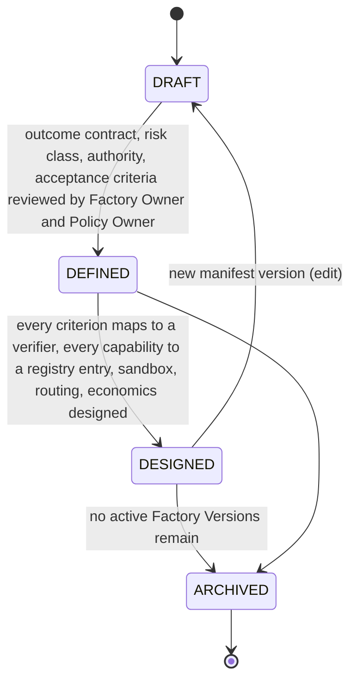

# Factory Manifest

`fdlc://v1/factory-manifest` · Family B (Factory) · Factory Lifecycle stages 2–3, **Define** and **Design**

## Purpose

A Factory Manifest is the declarative, human-authored definition of a factory: what it is for, what it may do, with which capabilities, under which runtime, sandbox, network, and credential policy, how its work is verified and evidenced, who approves what at which risk tier, how it is observed and paid for, how it is qualified, and how its outputs are released. It is the input to Assemble; an immutable Factory Version records the exact manifest digest it was assembled from.

## Identity

| Rule | Value |
|---|---|
| Type URI | `fdlc://v1/factory-manifest` |
| Instance id | Worked-example form `FM-<factory>` (`FM-depmod`). `name` is the machine name used in `FV-<name>-<semver>`. |
| Mutability | Revisioned by `version` (semver). Editing a manifest never changes an existing Factory Version. |
| Digest | `digest` = SHA-256 over canonical JSON of every section except `state`, `reviewedBy`, `factoryVersionIds`, timestamps, and `history`. |
| Format | Authored as YAML; exchanged as JSON. Keys are `snake_case` for the manifest sections listed by the canon (§5) and `camelCase` elsewhere. |

## Fields

The manifest is the union of the canon's section list. Each section is a MUST unless marked otherwise.

| Section | Type | Req | Description |
|---|---|---|---|
| `schemaVersion`, `type`, `id`, `namespace` | — | MUST | Common identity. |
| `name`, `version`, `displayName`, `description` | string, semver | MUST | Identity and manifest revision. |
| `purpose` | SOFTWARE / VERIFICATION / AUTOMATION | MUST | Producer and verifier factories are separate manifests. |
| `specialization` | string | SHOULD | Catalog entry (dependency-upgrade, code-review, security-remediation, …). |
| `owner` | {factoryOwner, policyOwner, team, costCenter} | MUST | Two accountable humans. |
| `risk_class`, `autonomy_ceiling` | RiskClass, L0–L5 | MUST | Highest risk routed here; autonomy ceiling for any Work Order. |
| `capabilities[]` | string | MUST | Provider-independent capabilities (input to Objective routing). |
| `inputs[]`, `outputs[]` | IoContract | MUST | What the factory consumes and produces, by artifact type. |
| `planner` | CapabilityBinding | MUST | Planner capability and version constraint. |
| `work_graph` | {workflowId, versionConstraint, roles} | SHOULD | Topology template. |
| `execution_profiles[]` | ExecutionProfileDeclaration | MUST (≥1) | `key`, `backend`, `autonomyCeiling`, `environments[]`, `modelRouteId`. |
| `model_routes[]` | ModelRouteDeclaration | MUST (≥1) | `routeId`, `role` PLAN/IMPLEMENT/TRANSFORM/VERIFY/REVIEW, `tier` FRONTIER/WORKHORSE/SMALL/LOCAL, `qualifiedProviders[]`, `independentFromProducer`. |
| `agents[]`, `skills[]` | CapabilityBinding | SHOULD | Agent Definitions and Skills by capability id + constraint. |
| `tools[]` | ToolBinding | SHOULD | Operations, grant policy, maximum side-effect class. |
| `context_sources[]` | ContextSourceDeclaration | SHOULD | Freshness, authorization model, `provenanceRequired: true`, classification ceiling. |
| `runtime` | object | MUST | `backend`, `harness` binding, `artifactConstraint`, lease duration, checkpoint policy. |
| `sandbox` | object | MUST | Isolation, provider, image constraint, filesystem, resource limits, `publicIngress: false`, `resourceAbsenceRequiredBeforePublication: true`. |
| `network_policy` | object | MUST | `egress` DENY_ALL/RESTRICTED_ALLOWLIST/UNRESTRICTED, allowlist, `classificationGated`. |
| `credential_policy` | object | MUST | `scoping: ATTEMPT_SCOPED`, `longLivedInSandbox: false`, `publicationIdentityInSandbox: false`, `revokeBeforePublication: true`. |
| `verification` | object | MUST | `contract[]` (criterion class → verifier capability, evidence category, independence), `independence {required, minimumBoundary, verifierFactoryName}`, `levels[]`, `currentnessRule`. |
| `evidence` | object | MUST | Required categories, `statementFormat: in-toto/v1`, retention, trace context. |
| `approval_policy[]` | RiskTierPolicy | MUST (4 tiers) | Per risk class: execution, verification, acceptance, release authorization actor. |
| `observability` | object | MUST | Required spans, metrics, cost attribution. |
| `economics` | object | MUST | Budgets, `costCoverageRule: unknown-cost-is-null`, denominators, `includeFailedAttempts: true`. |
| `qualification` | object | MUST | Standard version, required scopes (workload × environment × risk × autonomy), expiry, hard gates. |
| `release_policy` | object | MUST | Environments, rollout, rollback required, `publicationAuthority: CONTROL_PLANE_ONLY`, merge authority, observation window. |
| `outcome_metrics[]` | string | SHOULD | Metrics the Outcome measurement contract will carry. |
| `state` | DRAFT / DEFINED / DESIGNED / ARCHIVED | MUST | See lifecycle. |
| `reviewedBy[]`, `factoryVersionIds[]` | Actor[], Id[] | SHOULD | Review record; assembled versions. |
| `digest`, `createdAt`, `createdBy`, `updatedAt`, `history[]` | — | MUST / SHOULD | Common audit fields. |

### Reconciliation with the three existing shapes

FDLC.ai has published three partial shapes of "factory definition". This manifest is their union; nothing is lost.

| Manifest section | 10-field builder (`lib/factory-definition.ts`) | 12 concerns (`app/deploy/fde-content.ts`) | Mission Control `factoryDefinitions` / `factoryDefinitionVersions` |
|---|---|---|---|
| `description`, `outputs`, `capabilities` | `intent.outcome`, `intent.workType` | Intent | `name`, `purpose` |
| `verification.contract` (criterion classes) | `acceptanceCriteria[]` | Verification | `verifierIds[]`, verification contract on Work Orders |
| `risk_class`, `autonomy_ceiling`, `credential_policy`, `network_policy` | `planBoundaries[]`, `authority[]` | Policy, Human Authority | `riskBoundary`, `policyEnvelopeId` |
| `work_graph`, `planner` | `candidateWorkOrders[]` | Workflow | `workflowId`, workflow contract |
| `agents`, `skills`, `tools`, `context_sources` | `requiredCapabilities[]` | Agents, Tools, Context | `agentBindings[]`, `harnessCapabilityManifest`, governed MCP grants, context locks |
| `model_routes` | — | Models | `modelCatalogId`, `modelRouteDigest`, `modelQualificationDigest` |
| `runtime`, `sandbox` | — | Execution | `executor`, `executionBackend`, `sandboxProfileId`, `harnessRuntimeArtifact` |
| `approval_policy` | `humanControls[]` | Human Authority | `governancePolicies`, `approvalDecisions` |
| `economics` | `outcomeMetrics[]` (partial) | Economics | `budget {maxCostUsd, maxRuntimeMinutes, maxAttempts}` |
| `outcome_metrics`, `observability` | `outcomeMetrics[]` | Outcomes | `traces`, `factoryOutcomeProjections` |
| `qualification`, `release_policy`, `evidence` | — | — | `factoryReadinessAssessments` (readiness), `factoryReleases` |

The builder's `version: "0.1-draft"` maps to `version`; the builder output is a valid *subset* and SHOULD be upgraded by filling the MUST sections. The 12 concerns are a *view* of the manifest for engagement work; each concern maps to one or more sections above. Mission Control's `factoryDefinitions` row is the manifest identity plus an active-version pointer; the composition detail lives on `factoryDefinitionVersions` and maps to the Factory Version, not the manifest. Two things exist in FDLC that none of the three shapes carry: `qualification` (behavioral, scoped, expiring) and `release_policy` as a factory-level declaration.

## Lifecycle



| Transition | Who | MUST record |
|---|---|---|
| `DRAFT → DEFINED` | Factory Owner and Policy Owner (both humans) | Both reviewers in `reviewedBy`; `risk_class`; `approval_policy` |
| `DEFINED → DESIGNED` | Factory Owner | Verifier mapping completeness; capability registry resolution; manifest `digest` |
| `DESIGNED → DRAFT` | Factory Owner | New `version`; prior digest retained in history |
| `→ ARCHIVED` | Factory Owner | Confirmation that no Factory Version is ACTIVE/RESTRICTED/SUSPENDED |

Assembling a Factory Version from a `DESIGNED` manifest is a Factory Version transition, not a manifest transition. A manifest has no running state; "the factory is running" is not a state anything can be in.

## Invariants

- A manifest MUST name two accountable humans (`factoryOwner`, `policyOwner`).
- Every entry in `verification.contract` MUST name a verifier capability id, and every `capabilities[]` entry MUST be realizable by at least one bound capability, before `DESIGNED`.
- `sandbox.publicIngress` MUST be `false`; `credential_policy.publicationIdentityInSandbox` MUST be `false`; `release_policy.publicationAuthority` MUST be `CONTROL_PLANE_ONLY`.
- `verification.independence.required` MUST be `true` for any manifest whose `risk_class` is MEDIUM or higher; for producer factories the verifier MUST be a different factory (`minimumBoundary` ≥ `SEPARATE_FACTORY`) unless the manifest is itself a VERIFICATION factory.
- `approval_policy` MUST cover all four risk classes and MUST NOT assign `acceptance: POLICY` to HIGH or CRITICAL.
- `economics.includeFailedAttempts` MUST be `true`; `costCoverageRule` MUST be `unknown-cost-is-null`.
- `qualification.requiredScopes` MUST include every environment in `release_policy.environments` at the manifest's `risk_class`.
- Editing a manifest MUST NOT mutate any existing Factory Version. Production routes work to a qualified immutable Factory Version, never to a manifest.

## Evidence requirements

| Transition | Evidence |
|---|---|
| `DEFINED` | Review record by both owners; baseline from Discover (opportunity record) referenced |
| `DESIGNED` | Verifier-coverage check output; capability resolution report against the registry |
| `ARCHIVED` | Factory Version state report showing none active |

## Extension points

- `x-` fields at top level and inside any section (e.g. `x-acme-cost-center-rules` under `economics`).
- Additional `specialization` values are free-form; the canonical catalog names SHOULD be used where they apply.
- `model_routes[].tier` and `approval_policy[].*` are closed enums.

## Mission Control mapping

| FDLC | Mission Control | Status | Divergence |
|---|---|---|---|
| Factory Manifest | `factoryDefinitions` (`convex/schema.ts:1197`) | Available (Qualified) | MC row holds identity, `purpose`, `status` DRAFT/ACTIVE/ARCHIVED, `activeVersionId`. Composition detail lives on versions. MC `ACTIVE` = has an active version pointer; FDLC keeps activity on the Factory Version. |
| Declarative sections | spread across `factoryDefinitionVersions`, `factorySandboxProfiles`, `governancePolicies`, `modelRoutingPolicies`, workflow YAML | Partial | No single manifest document; FDLC requires one. |
| `qualification` | `factoryReadinessAssessments` (configuration readiness) | Partial | Behavioral, scoped qualification is an FDLC requirement (audit §5.1). |
| `release_policy` | `factoryReleases` state machines (code release) | Experimental/Partial | MC has no factory-level release policy declaration. |
| Factory registry across workspaces | none | Planned | Objective routing needs a registry of manifests by `capabilities[]` (audit §5.2). |

## JSON Schema

```json
{
  "$schema": "https://json-schema.org/draft/2020-12/schema",
  "$id": "https://fdlc.ai/schemas/v1/factory-manifest.schema.json",
  "title": "FDLC Factory Manifest",
  "description": "The declarative definition of a factory: identity, capabilities, inputs/outputs, planner, execution profiles, models, skills, tools, context sources, runtime, sandbox, network/credential policy, verification, evidence, approval policy, risk class, observability, economics, qualification, release policy. Authored by humans (YAML); assembled into immutable Factory Versions.",
  "type": "object",
  "properties": {
    "schemaVersion": {
      "type": "string",
      "const": "1.0"
    },
    "type": {
      "type": "string",
      "const": "fdlc://v1/factory-manifest"
    },
    "id": {
      "$ref": "#/$defs/Id"
    },
    "namespace": {
      "$ref": "#/$defs/Namespace"
    },
    "name": {
      "type": "string",
      "pattern": "^[a-z0-9][a-z0-9-]{1,63}$",
      "description": "Stable machine name; the `<factory>` segment of `FV-<factory>-<semver>`."
    },
    "version": {
      "$ref": "#/$defs/Semver",
      "description": "Manifest revision. Each Factory Version records the exact manifest digest it was assembled from."
    },
    "displayName": {
      "type": "string"
    },
    "description": {
      "type": "string",
      "minLength": 1
    },
    "purpose": {
      "type": "string",
      "enum": [
        "SOFTWARE",
        "VERIFICATION",
        "AUTOMATION"
      ]
    },
    "specialization": {
      "type": "string",
      "description": "Catalog entry (e.g. dependency-upgrade, code-review, security-remediation)."
    },
    "owner": {
      "type": "object",
      "properties": {
        "factoryOwner": {
          "$ref": "#/$defs/Actor"
        },
        "policyOwner": {
          "$ref": "#/$defs/Actor"
        },
        "team": {
          "type": "string"
        },
        "costCenter": {
          "type": "string"
        }
      },
      "required": [
        "factoryOwner",
        "policyOwner"
      ],
      "additionalProperties": false
    },
    "risk_class": {
      "$ref": "#/$defs/RiskClass",
      "description": "Highest risk class of work this factory may be routed."
    },
    "autonomy_ceiling": {
      "$ref": "#/$defs/AutonomyLevel"
    },
    "capabilities": {
      "type": "array",
      "minItems": 1,
      "items": {
        "type": "string"
      },
      "description": "Provider-independent capabilities this factory provides (input to Objective routing)."
    },
    "inputs": {
      "type": "array",
      "minItems": 1,
      "items": {
        "$ref": "#/$defs/IoContract"
      }
    },
    "outputs": {
      "type": "array",
      "minItems": 1,
      "items": {
        "$ref": "#/$defs/IoContract"
      }
    },
    "planner": {
      "$ref": "#/$defs/CapabilityBinding"
    },
    "work_graph": {
      "type": "object",
      "properties": {
        "workflowId": {
          "type": "string"
        },
        "versionConstraint": {
          "type": "string"
        },
        "roles": {
          "type": "array",
          "items": {
            "type": "string"
          }
        }
      },
      "required": [
        "workflowId",
        "versionConstraint"
      ],
      "additionalProperties": false
    },
    "execution_profiles": {
      "type": "array",
      "minItems": 1,
      "items": {
        "$ref": "#/$defs/ExecutionProfileDeclaration"
      }
    },
    "model_routes": {
      "type": "array",
      "minItems": 1,
      "items": {
        "$ref": "#/$defs/ModelRouteDeclaration"
      }
    },
    "agents": {
      "type": "array",
      "items": {
        "$ref": "#/$defs/CapabilityBinding"
      }
    },
    "skills": {
      "type": "array",
      "items": {
        "$ref": "#/$defs/CapabilityBinding"
      }
    },
    "tools": {
      "type": "array",
      "items": {
        "$ref": "#/$defs/ToolBinding"
      }
    },
    "context_sources": {
      "type": "array",
      "items": {
        "$ref": "#/$defs/ContextSourceDeclaration"
      }
    },
    "runtime": {
      "type": "object",
      "properties": {
        "backend": {
          "type": "string",
          "enum": [
            "persistent-worker",
            "remote-sandbox",
            "isolated-container"
          ]
        },
        "harness": {
          "$ref": "#/$defs/CapabilityBinding"
        },
        "artifactConstraint": {
          "type": "string",
          "description": "Which runtime artifact kinds are admissible (EXECUTABLE, CONTAINER_IMAGE)."
        },
        "leaseDurationMs": {
          "type": "integer",
          "minimum": 1000
        },
        "checkpointPolicy": {
          "type": "string",
          "enum": [
            "NONE",
            "STEP",
            "COMPACTION"
          ]
        }
      },
      "required": [
        "backend",
        "harness"
      ],
      "additionalProperties": false
    },
    "sandbox": {
      "type": "object",
      "properties": {
        "isolation": {
          "type": "string",
          "enum": [
            "READ_ONLY",
            "WORKSPACE_WRITE"
          ]
        },
        "provider": {
          "type": "string"
        },
        "imageConstraint": {
          "type": "string"
        },
        "filesystem": {
          "type": "string",
          "enum": [
            "WORKTREE_ONLY",
            "SNAPSHOT",
            "EPHEMERAL"
          ]
        },
        "processIsolation": {
          "type": "boolean"
        },
        "resourceLimits": {
          "type": "object",
          "properties": {
            "cpu": {
              "type": "number"
            },
            "memoryMb": {
              "type": "integer"
            },
            "diskGb": {
              "type": "integer"
            },
            "maxRuntimeMs": {
              "type": "integer"
            }
          },
          "additionalProperties": false
        },
        "publicIngress": {
          "type": "boolean",
          "const": false
        },
        "resourceAbsenceRequiredBeforePublication": {
          "type": "boolean",
          "const": true
        }
      },
      "required": [
        "isolation",
        "filesystem",
        "publicIngress",
        "resourceAbsenceRequiredBeforePublication"
      ],
      "additionalProperties": false
    },
    "network_policy": {
      "type": "object",
      "properties": {
        "egress": {
          "type": "string",
          "enum": [
            "DENY_ALL",
            "RESTRICTED_ALLOWLIST",
            "UNRESTRICTED"
          ]
        },
        "allowlist": {
          "type": "array",
          "items": {
            "type": "string"
          }
        },
        "classificationGated": {
          "type": "boolean",
          "description": "Non-public repositories require provider-enforced egress proof."
        }
      },
      "required": [
        "egress"
      ],
      "additionalProperties": false
    },
    "credential_policy": {
      "type": "object",
      "properties": {
        "classes": {
          "type": "array",
          "items": {
            "type": "string"
          }
        },
        "scoping": {
          "type": "string",
          "enum": [
            "ATTEMPT_SCOPED",
            "NONE"
          ]
        },
        "longLivedInSandbox": {
          "type": "boolean",
          "const": false
        },
        "publicationIdentityInSandbox": {
          "type": "boolean",
          "const": false
        },
        "revokeBeforePublication": {
          "type": "boolean",
          "const": true
        }
      },
      "required": [
        "scoping",
        "longLivedInSandbox",
        "publicationIdentityInSandbox",
        "revokeBeforePublication"
      ],
      "additionalProperties": false
    },
    "verification": {
      "type": "object",
      "properties": {
        "contract": {
          "type": "array",
          "minItems": 1,
          "items": {
            "$ref": "#/$defs/CriterionVerifierMap"
          }
        },
        "independence": {
          "type": "object",
          "properties": {
            "required": {
              "type": "boolean"
            },
            "minimumBoundary": {
              "type": "string",
              "enum": [
                "SEPARATE_ATTEMPT",
                "SEPARATE_FACTORY",
                "SEPARATE_MODEL_FAMILY"
              ]
            },
            "verifierFactoryName": {
              "type": "string"
            }
          },
          "required": [
            "required",
            "minimumBoundary"
          ],
          "additionalProperties": false
        },
        "levels": {
          "type": "array",
          "items": {
            "type": "string",
            "enum": [
              "TASK",
              "WORK_ORDER",
              "OBJECTIVE",
              "RELEASE"
            ]
          }
        },
        "currentnessRule": {
          "type": "string",
          "const": "newest-candidate-newest-exact-verification"
        }
      },
      "required": [
        "contract",
        "independence",
        "levels",
        "currentnessRule"
      ],
      "additionalProperties": false
    },
    "evidence": {
      "type": "object",
      "properties": {
        "requiredCategories": {
          "type": "array",
          "items": {
            "type": "string"
          }
        },
        "statementFormat": {
          "type": "string",
          "const": "in-toto/v1"
        },
        "retentionDays": {
          "type": "integer",
          "minimum": 1
        },
        "traceContext": {
          "type": "string",
          "const": "w3c-traceparent"
        }
      },
      "required": [
        "requiredCategories",
        "statementFormat",
        "retentionDays"
      ],
      "additionalProperties": false
    },
    "approval_policy": {
      "type": "array",
      "minItems": 4,
      "items": {
        "$ref": "#/$defs/RiskTierPolicy"
      }
    },
    "observability": {
      "type": "object",
      "properties": {
        "requiredSpans": {
          "type": "array",
          "items": {
            "type": "string"
          }
        },
        "metrics": {
          "type": "array",
          "items": {
            "type": "string"
          }
        },
        "costAttribution": {
          "type": "boolean"
        }
      },
      "required": [
        "requiredSpans",
        "metrics"
      ],
      "additionalProperties": false
    },
    "economics": {
      "type": "object",
      "properties": {
        "budgets": {
          "type": "object",
          "properties": {
            "maxCostPerWorkOrder": {
              "$ref": "#/$defs/Money"
            },
            "maxAttemptsPerWorkOrder": {
              "type": "integer",
              "minimum": 1
            },
            "maxRuntimeMinutes": {
              "type": "integer",
              "minimum": 1
            }
          },
          "additionalProperties": false
        },
        "costCoverageRule": {
          "type": "string",
          "const": "unknown-cost-is-null"
        },
        "denominators": {
          "type": "array",
          "items": {
            "type": "string",
            "enum": [
              "VERIFIED",
              "ACCEPTED",
              "RELEASED"
            ]
          }
        },
        "includeFailedAttempts": {
          "type": "boolean",
          "const": true
        }
      },
      "required": [
        "budgets",
        "costCoverageRule",
        "denominators",
        "includeFailedAttempts"
      ],
      "additionalProperties": false
    },
    "qualification": {
      "type": "object",
      "properties": {
        "standardVersion": {
          "type": "string"
        },
        "requiredScopes": {
          "type": "array",
          "minItems": 1,
          "items": {
            "$ref": "#/$defs/QualificationScope"
          }
        },
        "expiryDays": {
          "type": "integer",
          "minimum": 1
        },
        "hardGates": {
          "type": "array",
          "items": {
            "type": "string"
          }
        }
      },
      "required": [
        "standardVersion",
        "requiredScopes",
        "expiryDays"
      ],
      "additionalProperties": false
    },
    "release_policy": {
      "type": "object",
      "properties": {
        "environments": {
          "type": "array",
          "minItems": 1,
          "items": {
            "type": "string"
          }
        },
        "rollout": {
          "type": "string",
          "enum": [
            "CANARY",
            "PERCENTAGE",
            "REGION",
            "FULL"
          ]
        },
        "rollbackRequired": {
          "type": "boolean"
        },
        "publicationAuthority": {
          "type": "string",
          "const": "CONTROL_PLANE_ONLY"
        },
        "mergeAuthority": {
          "type": "string",
          "enum": [
            "HUMAN",
            "POLICY_WITHIN_ENVELOPE"
          ]
        },
        "observationWindowDays": {
          "type": "integer",
          "minimum": 1
        }
      },
      "required": [
        "environments",
        "rollout",
        "rollbackRequired",
        "publicationAuthority",
        "mergeAuthority",
        "observationWindowDays"
      ],
      "additionalProperties": false
    },
    "outcome_metrics": {
      "type": "array",
      "items": {
        "type": "string"
      }
    },
    "state": {
      "type": "string",
      "enum": [
        "DRAFT",
        "DEFINED",
        "DESIGNED",
        "ARCHIVED"
      ]
    },
    "reviewedBy": {
      "type": "array",
      "items": {
        "$ref": "#/$defs/Actor"
      }
    },
    "factoryVersionIds": {
      "type": "array",
      "items": {
        "$ref": "#/$defs/Id"
      }
    },
    "digest": {
      "$ref": "#/$defs/Digest"
    },
    "createdAt": {
      "$ref": "#/$defs/Timestamp"
    },
    "createdBy": {
      "$ref": "#/$defs/Actor"
    },
    "updatedAt": {
      "$ref": "#/$defs/Timestamp"
    },
    "history": {
      "type": "array",
      "items": {
        "$ref": "#/$defs/Transition"
      }
    }
  },
  "required": [
    "schemaVersion",
    "type",
    "id",
    "namespace",
    "name",
    "version",
    "description",
    "purpose",
    "owner",
    "risk_class",
    "autonomy_ceiling",
    "capabilities",
    "inputs",
    "outputs",
    "planner",
    "execution_profiles",
    "model_routes",
    "runtime",
    "sandbox",
    "network_policy",
    "credential_policy",
    "verification",
    "evidence",
    "approval_policy",
    "observability",
    "economics",
    "qualification",
    "release_policy",
    "state",
    "digest",
    "createdAt",
    "createdBy",
    "updatedAt"
  ],
  "$defs": {
    "Id": {
      "type": "string",
      "minLength": 1,
      "maxLength": 200,
      "pattern": "^[A-Za-z0-9][A-Za-z0-9._:/@-]*$",
      "description": "Instance identifier. Unique within the issuing namespace; combined with `namespace` it is globally unique."
    },
    "ArtifactUri": {
      "type": "string",
      "pattern": "^fdlc://v1/(intent|specification|plan|work-order|factory-manifest|factory-version|execution-profile|capability-manifest|qualification-record|context-package|attempt|candidate|evidence|verification|decision|release|outcome|learning-signal|improvement-candidate)(/[A-Za-z0-9][A-Za-z0-9._:@-]*)?$",
      "description": "Artifact type URI (`fdlc://v1/<artifact>`), optionally suffixed with an instance id."
    },
    "Namespace": {
      "type": "string",
      "format": "uri",
      "description": "URI of the issuing control plane or organization. Scopes every `id` in this record."
    },
    "Digest": {
      "type": "string",
      "pattern": "^sha256:[a-f0-9]{64}$",
      "description": "SHA-256 over the RFC 8785 (JCS) canonical JSON of the digested projection."
    },
    "GitSha": {
      "type": "string",
      "pattern": "^[a-f0-9]{40}$|^[a-f0-9]{64}$",
      "description": "Lowercase full Git object id (SHA-1 or SHA-256 repository)."
    },
    "Timestamp": {
      "type": "string",
      "format": "date-time",
      "description": "RFC 3339 timestamp in UTC."
    },
    "Semver": {
      "type": "string",
      "pattern": "^(0|[1-9]\\d*)\\.(0|[1-9]\\d*)\\.(0|[1-9]\\d*)(-[0-9A-Za-z.-]+)?(\\+[0-9A-Za-z.-]+)?$"
    },
    "RiskClass": {
      "type": "string",
      "enum": [
        "LOW",
        "MEDIUM",
        "HIGH",
        "CRITICAL"
      ]
    },
    "AutonomyLevel": {
      "type": "string",
      "enum": [
        "L0",
        "L1",
        "L2",
        "L3",
        "L4",
        "L5"
      ],
      "description": "HITL spectrum position. Effective autonomy is min(factory, objective, work order, policy, trust)."
    },
    "Actor": {
      "type": "object",
      "description": "Attributable identity. `identitySource` says how the control plane established it; never inferred from a client label.",
      "properties": {
        "kind": {
          "type": "string",
          "enum": [
            "human",
            "policy",
            "service",
            "agent",
            "system"
          ]
        },
        "id": {
          "$ref": "#/$defs/Id"
        },
        "identitySource": {
          "type": "string",
          "enum": [
            "authenticated",
            "workload-identity",
            "service-command",
            "development-fallback"
          ]
        },
        "displayName": {
          "type": "string"
        },
        "delegationRef": {
          "$ref": "#/$defs/Id",
          "description": "Reference to the delegation record that grants this actor its authority."
        }
      },
      "required": [
        "kind",
        "id",
        "identitySource"
      ],
      "additionalProperties": false
    },
    "Ref": {
      "type": "object",
      "description": "Reference to another FDLC artifact instance, optionally pinned to a digest.",
      "properties": {
        "type": {
          "$ref": "#/$defs/ArtifactUri"
        },
        "id": {
          "$ref": "#/$defs/Id"
        },
        "digest": {
          "$ref": "#/$defs/Digest"
        },
        "revisionNumber": {
          "type": "integer",
          "minimum": 1
        }
      },
      "required": [
        "type",
        "id"
      ],
      "additionalProperties": false
    },
    "Money": {
      "type": "object",
      "properties": {
        "amount": {
          "type": "number",
          "minimum": 0
        },
        "currency": {
          "type": "string",
          "pattern": "^[A-Z]{3}$"
        }
      },
      "required": [
        "amount",
        "currency"
      ],
      "additionalProperties": false
    },
    "CostRecord": {
      "type": "object",
      "description": "Cost with an honesty class. UNKNOWN cost stays UNKNOWN; implementations MUST NOT invent zeroes.",
      "properties": {
        "status": {
          "type": "string",
          "enum": [
            "MEASURED",
            "ESTIMATED",
            "UNKNOWN"
          ]
        },
        "amount": {
          "type": "number",
          "minimum": 0
        },
        "currency": {
          "type": "string",
          "pattern": "^[A-Z]{3}$"
        },
        "coverage": {
          "type": "number",
          "minimum": 0,
          "maximum": 1,
          "description": "Fraction of contributing cost items that were measured."
        },
        "reason": {
          "type": "string"
        }
      },
      "required": [
        "status"
      ],
      "additionalProperties": false
    },
    "Transition": {
      "type": "object",
      "description": "Audit record of one authoritative state transition. Every field listed here MUST be recorded.",
      "properties": {
        "transitionId": {
          "$ref": "#/$defs/Id"
        },
        "subjectId": {
          "$ref": "#/$defs/Id"
        },
        "priorVersion": {
          "type": "integer",
          "minimum": 0
        },
        "fromState": {
          "type": "string"
        },
        "toState": {
          "type": "string"
        },
        "actor": {
          "$ref": "#/$defs/Actor"
        },
        "reason": {
          "type": "string"
        },
        "policyVersion": {
          "type": "string"
        },
        "idempotencyKey": {
          "type": "string"
        },
        "occurredAt": {
          "$ref": "#/$defs/Timestamp"
        },
        "requiredEvidenceIds": {
          "type": "array",
          "items": {
            "$ref": "#/$defs/Id"
          }
        },
        "decisionId": {
          "$ref": "#/$defs/Id"
        },
        "invalidatedDependents": {
          "type": "array",
          "items": {
            "$ref": "#/$defs/Ref"
          }
        }
      },
      "required": [
        "subjectId",
        "fromState",
        "toState",
        "actor",
        "reason",
        "idempotencyKey",
        "occurredAt"
      ],
      "additionalProperties": false
    },
    "ArtifactRef": {
      "type": "object",
      "description": "Content-addressed reference to a stored artifact (diff, log, screenshot, bundle).",
      "properties": {
        "artifactId": {
          "$ref": "#/$defs/Id"
        },
        "kind": {
          "type": "string"
        },
        "mediaType": {
          "type": "string"
        },
        "digest": {
          "$ref": "#/$defs/Digest"
        },
        "sizeBytes": {
          "type": "integer",
          "minimum": 0
        },
        "storageRef": {
          "type": "string"
        }
      },
      "required": [
        "artifactId",
        "digest"
      ],
      "additionalProperties": false
    },
    "IoContract": {
      "type": "object",
      "properties": {
        "kind": {
          "type": "string"
        },
        "description": {
          "type": "string"
        },
        "schemaRef": {
          "type": "string"
        },
        "artifactType": {
          "$ref": "#/$defs/ArtifactUri"
        }
      },
      "required": [
        "kind",
        "description"
      ],
      "additionalProperties": false
    },
    "CapabilityBinding": {
      "type": "object",
      "properties": {
        "capabilityId": {
          "$ref": "#/$defs/Id"
        },
        "kind": {
          "type": "string",
          "enum": [
            "agent",
            "skill",
            "tool",
            "model-route",
            "harness",
            "verifier",
            "context-source",
            "planner"
          ]
        },
        "versionConstraint": {
          "type": "string"
        },
        "role": {
          "type": "string"
        }
      },
      "required": [
        "capabilityId",
        "versionConstraint"
      ],
      "additionalProperties": false
    },
    "ToolBinding": {
      "type": "object",
      "properties": {
        "capabilityId": {
          "$ref": "#/$defs/Id"
        },
        "versionConstraint": {
          "type": "string"
        },
        "operations": {
          "type": "array",
          "minItems": 1,
          "items": {
            "type": "string"
          }
        },
        "grantPolicy": {
          "type": "string",
          "enum": [
            "PER_OPERATION_EXPIRING",
            "PER_ATTEMPT"
          ]
        },
        "maxSideEffectClass": {
          "type": "string",
          "enum": [
            "READ_ONLY",
            "WRITE_LOCAL",
            "WRITE_REMOTE",
            "DESTRUCTIVE",
            "PUBLISH"
          ]
        }
      },
      "required": [
        "capabilityId",
        "versionConstraint",
        "operations",
        "grantPolicy",
        "maxSideEffectClass"
      ],
      "additionalProperties": false
    },
    "ExecutionProfileDeclaration": {
      "type": "object",
      "properties": {
        "key": {
          "type": "string",
          "pattern": "^[a-z0-9][a-z0-9-]{2,63}$"
        },
        "description": {
          "type": "string"
        },
        "backend": {
          "type": "string",
          "enum": [
            "persistent-worker",
            "remote-sandbox",
            "isolated-container"
          ]
        },
        "autonomyCeiling": {
          "$ref": "#/$defs/AutonomyLevel"
        },
        "environments": {
          "type": "array",
          "items": {
            "type": "string"
          }
        },
        "modelRouteId": {
          "type": "string"
        }
      },
      "required": [
        "key",
        "backend",
        "autonomyCeiling",
        "environments"
      ],
      "additionalProperties": false
    },
    "ModelRouteDeclaration": {
      "type": "object",
      "properties": {
        "routeId": {
          "type": "string"
        },
        "role": {
          "type": "string",
          "enum": [
            "PLAN",
            "IMPLEMENT",
            "TRANSFORM",
            "VERIFY",
            "REVIEW"
          ]
        },
        "tier": {
          "type": "string",
          "enum": [
            "FRONTIER",
            "WORKHORSE",
            "SMALL",
            "LOCAL"
          ]
        },
        "qualifiedProviders": {
          "type": "array",
          "minItems": 1,
          "items": {
            "type": "string"
          }
        },
        "independentFromProducer": {
          "type": "boolean"
        },
        "constraints": {
          "type": "array",
          "items": {
            "type": "string"
          }
        }
      },
      "required": [
        "routeId",
        "role",
        "tier",
        "qualifiedProviders"
      ],
      "additionalProperties": false
    },
    "ContextSourceDeclaration": {
      "type": "object",
      "properties": {
        "capabilityId": {
          "$ref": "#/$defs/Id"
        },
        "versionConstraint": {
          "type": "string"
        },
        "freshnessMaxAgeHours": {
          "type": "integer",
          "minimum": 1
        },
        "authorization": {
          "type": "string",
          "enum": [
            "SUBJECT_IDENTITY",
            "FACTORY_IDENTITY"
          ]
        },
        "provenanceRequired": {
          "type": "boolean",
          "const": true
        },
        "classificationCeiling": {
          "type": "string",
          "enum": [
            "PUBLIC",
            "INTERNAL",
            "CONFIDENTIAL",
            "RESTRICTED"
          ]
        }
      },
      "required": [
        "capabilityId",
        "versionConstraint",
        "authorization",
        "provenanceRequired"
      ],
      "additionalProperties": false
    },
    "CriterionVerifierMap": {
      "type": "object",
      "properties": {
        "criterionClass": {
          "type": "string"
        },
        "verifierCapabilityId": {
          "$ref": "#/$defs/Id"
        },
        "evidenceCategory": {
          "type": "string"
        },
        "mandatory": {
          "type": "boolean"
        },
        "independence": {
          "type": "string",
          "enum": [
            "ANY_VERIFICATION",
            "CANDIDATE_DEPENDENT_ALLOWED",
            "INDEPENDENT_REQUIRED"
          ]
        }
      },
      "required": [
        "criterionClass",
        "verifierCapabilityId",
        "evidenceCategory",
        "mandatory",
        "independence"
      ],
      "additionalProperties": false
    },
    "RiskTierPolicy": {
      "type": "object",
      "properties": {
        "riskClass": {
          "$ref": "#/$defs/RiskClass"
        },
        "execution": {
          "type": "string",
          "enum": [
            "AUTO",
            "HUMAN_AUTHORIZED"
          ]
        },
        "verification": {
          "type": "string",
          "enum": [
            "AUTO_DETERMINISTIC",
            "INDEPENDENT",
            "INDEPENDENT_PLUS_HUMAN"
          ]
        },
        "acceptance": {
          "type": "string",
          "enum": [
            "POLICY",
            "POLICY_WITHIN_ENVELOPE",
            "HUMAN"
          ]
        },
        "releaseAuthorization": {
          "type": "string",
          "enum": [
            "POLICY",
            "HUMAN"
          ]
        }
      },
      "required": [
        "riskClass",
        "execution",
        "verification",
        "acceptance",
        "releaseAuthorization"
      ],
      "additionalProperties": false
    },
    "QualificationScope": {
      "type": "object",
      "properties": {
        "workloadClass": {
          "type": "string"
        },
        "environment": {
          "type": "string"
        },
        "riskTier": {
          "$ref": "#/$defs/RiskClass"
        },
        "autonomyLevel": {
          "$ref": "#/$defs/AutonomyLevel"
        }
      },
      "required": [
        "workloadClass",
        "environment",
        "riskTier",
        "autonomyLevel"
      ],
      "additionalProperties": false
    }
  },
  "patternProperties": {
    "^x-[a-z0-9]+(-[a-z0-9]+)*$": {}
  },
  "additionalProperties": false
}
```

## Example instance

```yaml
# Factory Manifest — dependency-modernization (worked example, illustrative)
schemaVersion: "1.0"
type: fdlc://v1/factory-manifest
id: FM-depmod
namespace: https://acme.example/factories/checkout
name: dependency-modernization
version: 1.0.0
displayName: Dependency Modernization Factory
description: >-
  Upgrades third-party libraries and SDKs in registered repositories without changing
  public API, schema, or authorization behavior, and proves it with independent evidence.
purpose: SOFTWARE
specialization: dependency-upgrade
owner:
  factoryOwner: {kind: human, id: "user:priya.n", identitySource: authenticated, displayName: Priya Natarajan}
  policyOwner: {kind: human, id: "user:sam.reyes", identitySource: authenticated, displayName: Sam Reyes}
  team: platform-engineering
risk_class: HIGH
autonomy_ceiling: L3

capabilities: [repository-research, dependency-upgrade, run-tests, propose-candidate]

inputs:
  - kind: work-order
    description: A released Work Order of kind SOFTWARE_CHANGE whose blueprint requires dependency-upgrade.
    artifactType: fdlc://v1/work-order
  - kind: repository-snapshot
    description: Control-plane snapshot of the repository at the Plan's base SHA.
outputs:
  - kind: candidate
    description: An unpublished Git candidate (commit + tree + diff digest) bound to the Work Order revision.
    artifactType: fdlc://v1/candidate
  - kind: evidence
    description: Producer-side command logs and diff; never verification evidence.
    artifactType: fdlc://v1/evidence

planner: {capabilityId: CAP-planner-objective-1.3.0, kind: planner, versionConstraint: "~1.3"}
work_graph: {workflowId: depmod-upgrade, versionConstraint: "4", roles: [researcher, implementer]}

execution_profiles:
  - key: prod
    description: Remote sandbox, workhorse route, production-eligible.
    backend: remote-sandbox
    autonomyCeiling: L3
    environments: [staging, production]
    modelRouteId: implement-workhorse
  - key: offline-qual
    description: Deterministic isolated-container profile used only for qualification.
    backend: isolated-container
    autonomyCeiling: L2
    environments: [qualification]

model_routes:
  - routeId: research-frontier
    role: PLAN
    tier: FRONTIER
    qualifiedProviders: [acme-gateway/frontier-a]
  - routeId: implement-workhorse
    role: IMPLEMENT
    tier: WORKHORSE
    qualifiedProviders: [acme-gateway/workhorse-a, acme-gateway/workhorse-b]
    constraints: [temperature<=0.2]

agents:
  - {capabilityId: CAP-agent-upgrade-implementer-1.6.0, kind: agent, versionConstraint: "1.6.x", role: implementer}
  - {capabilityId: CAP-agent-repo-researcher-1.2.0, kind: agent, versionConstraint: "1.2.x", role: researcher}
skills:
  - {capabilityId: CAP-skill-sdk-migration-2.1.0, kind: skill, versionConstraint: "^2.1"}
  - {capabilityId: CAP-skill-lockfile-hygiene-1.0.3, kind: skill, versionConstraint: "^1.0"}
tools:
  - capabilityId: CAP-tool-git-1.4.0
    versionConstraint: "1.4.x"
    operations: [status, diff, commit, branch]
    grantPolicy: PER_OPERATION_EXPIRING
    maxSideEffectClass: WRITE_LOCAL
  - capabilityId: CAP-tool-package-registry-1.2.0
    versionConstraint: "1.2.x"
    operations: [resolve-version, audit]
    grantPolicy: PER_OPERATION_EXPIRING
    maxSideEffectClass: READ_ONLY
  - capabilityId: CAP-tool-test-runner-3.0.1
    versionConstraint: "3.0.x"
    operations: [run]
    grantPolicy: PER_ATTEMPT
    maxSideEffectClass: WRITE_LOCAL
context_sources:
  - capabilityId: CAP-context-source-migration-docs-1.1.0
    versionConstraint: "1.1.x"
    freshnessMaxAgeHours: 168
    authorization: FACTORY_IDENTITY
    provenanceRequired: true
    classificationCeiling: INTERNAL

runtime:
  backend: remote-sandbox
  harness: {capabilityId: CAP-harness-codex-adapter-1.0.0, kind: harness, versionConstraint: "1.0.x"}
  artifactConstraint: CONTAINER_IMAGE
  leaseDurationMs: 300000
  checkpointPolicy: STEP
sandbox:
  isolation: WORKSPACE_WRITE
  provider: acme-sandbox
  imageConstraint: "acme/factory-runtime@sha256:*"
  filesystem: WORKTREE_ONLY
  processIsolation: true
  resourceLimits: {cpu: 4, memoryMb: 8192, diskGb: 40, maxRuntimeMs: 5400000}
  publicIngress: false
  resourceAbsenceRequiredBeforePublication: true
network_policy:
  egress: RESTRICTED_ALLOWLIST
  allowlist: [registry.acme.example, gateway.acme.example]
  classificationGated: true
credential_policy:
  classes: [inference:attempt-scoped]
  scoping: ATTEMPT_SCOPED
  longLivedInSandbox: false
  publicationIdentityInSandbox: false
  revokeBeforePublication: true

verification:
  contract:
    - {criterionClass: behavior-preserved, verifierCapabilityId: CAP-verifier-test-runner-3.0.1, evidenceCategory: TEST_RESULT, mandatory: true, independence: INDEPENDENT_REQUIRED}
    - {criterionClass: dependency-graph, verifierCapabilityId: CAP-verifier-dependency-scan-1.7.0, evidenceCategory: DEPENDENCY_SCAN, mandatory: true, independence: INDEPENDENT_REQUIRED}
    - {criterionClass: no-shims, verifierCapabilityId: CAP-verifier-static-rules-2.2.0, evidenceCategory: STATIC_ANALYSIS, mandatory: true, independence: INDEPENDENT_REQUIRED}
    - {criterionClass: scope, verifierCapabilityId: CAP-verifier-scope-reconciler-1.0.0, evidenceCategory: FILE_DIFF, mandatory: true, independence: ANY_VERIFICATION}
  independence: {required: true, minimumBoundary: SEPARATE_FACTORY, verifierFactoryName: verification-factory}
  levels: [WORK_ORDER, RELEASE]
  currentnessRule: newest-candidate-newest-exact-verification
evidence:
  requiredCategories: [TEST_RESULT, DEPENDENCY_SCAN, STATIC_ANALYSIS, FILE_DIFF, COMMAND_LOG, PROVENANCE]
  statementFormat: in-toto/v1
  retentionDays: 730
  traceContext: w3c-traceparent

approval_policy:
  - {riskClass: LOW, execution: AUTO, verification: AUTO_DETERMINISTIC, acceptance: POLICY, releaseAuthorization: POLICY}
  - {riskClass: MEDIUM, execution: AUTO, verification: INDEPENDENT, acceptance: POLICY_WITHIN_ENVELOPE, releaseAuthorization: POLICY}
  - {riskClass: HIGH, execution: AUTO, verification: INDEPENDENT, acceptance: HUMAN, releaseAuthorization: HUMAN}
  - {riskClass: CRITICAL, execution: HUMAN_AUTHORIZED, verification: INDEPENDENT_PLUS_HUMAN, acceptance: HUMAN, releaseAuthorization: HUMAN}

observability:
  requiredSpans: [attempt, step, tool-call, model-request, verification, decision]
  metrics: [verified-completion-rate, first-pass-verification-rate, cost-per-accepted-outcome, cycle-time, human-review-minutes, reopen-rate, rollback-rate]
  costAttribution: true
economics:
  budgets: {maxCostPerWorkOrder: {amount: 25, currency: USD}, maxAttemptsPerWorkOrder: 3, maxRuntimeMinutes: 90}
  costCoverageRule: unknown-cost-is-null
  denominators: [VERIFIED, ACCEPTED, RELEASED]
  includeFailedAttempts: true
qualification:
  standardVersion: fdlc-qualification-standard/1.0
  requiredScopes:
    - {workloadClass: dependency-upgrade, environment: staging, riskTier: MEDIUM, autonomyLevel: L3}
    - {workloadClass: dependency-upgrade, environment: production, riskTier: MEDIUM, autonomyLevel: L3}
  expiryDays: 90
  hardGates: [security, sandbox-isolation, policy-compliance, credential-handling, evidence-completeness]
release_policy:
  environments: [staging, production]
  rollout: CANARY
  rollbackRequired: true
  publicationAuthority: CONTROL_PLANE_ONLY
  mergeAuthority: HUMAN
  observationWindowDays: 7
outcome_metrics: [verified-completion-rate, cost-per-verified-outcome, human-review-minutes, cycle-time, first-pass-verification-rate, reopen-or-rollback-rate]

state: DESIGNED
reviewedBy:
  - {kind: human, id: "user:priya.n", identitySource: authenticated}
  - {kind: human, id: "user:sam.reyes", identitySource: authenticated}
factoryVersionIds: [FV-depmod-1.0]
digest: sha256:8e19ad72519630e0240eac8e07937c7148bf552beb7bbb3697dc3c4a0c29c3ee
createdAt: "2026-08-12T10:00:00Z"
createdBy: {kind: human, id: "user:priya.n", identitySource: authenticated}
updatedAt: "2026-08-20T15:30:00Z"
```

## Related

- Spec: [/specification/v1/factory-version](/specification/v1/factory-version) · [/specification/v1/execution-profile](/specification/v1/execution-profile) · [/specification/v1/capability-manifest](/specification/v1/capability-manifest) · [/specification/v1/qualification-record](/specification/v1/qualification-record)
- Framework: [/framework/factory-lifecycle](/framework/factory-lifecycle) stages Define, Design
- Architecture: [/architecture/factory-versioning](/architecture/factory-versioning) (D11) · [/architecture/sandboxing](/architecture/sandboxing) · [/architecture/economics](/architecture/economics)
- Guides: Factory Definition builder (`/start`), FDE Define stage
- Glossary: Factory, Factory Manifest, Factory Owner, Policy Owner
