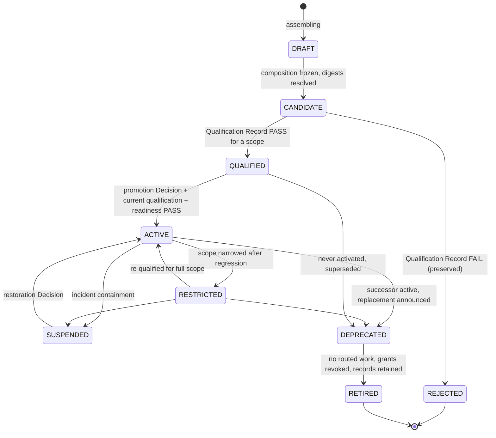

# Factory Version

`fdlc://v1/factory-version` · Family B (Factory) · Factory Lifecycle stages 4–8, **Assemble → Qualify → Deploy → Operate → Improve**

## Purpose

A Factory Version is the immutable, content-addressed composition of exact component identities: planner, agent definitions, harnesses, skills, tools with grants, model routes, context configuration, runtime artifact, sandbox image, network/credential/filesystem policy, verification contract, approval policy, execution profiles, and economics. It is qualified per scope and activated per environment. Production routes work to a qualified immutable Factory Version, never to a mutable factory.

## Identity

| Rule | Value |
|---|---|
| Type URI | `fdlc://v1/factory-version` |
| Instance id | `FV-<factory>-<semver>` (`FV-depmod-1.0`). |
| Mutability | Immutable after `CANDIDATE`. Any change to composition is a new version. |
| Content address | `compositionDigest` = SHA-256 over the sorted list of every component digest in `composition` (planner, each agent, each harness, each skill, each tool + grant, each model route + qualification, context configuration, work graph, runtime artifact, sandbox image + profile, each policy, each execution profile, economics). Two versions with equal `compositionDigest` are the same composition. |
| Digest | `digest` = SHA-256 over `{id, factoryManifestDigest, version, purpose, compositionDigest}`. |
| Algorithm | SHA-256 over RFC 8785 canonical JSON. Non-cryptographic digests (e.g. FNV-1a) MUST NOT be used for content addressing. |

## Fields

| Field | Type | Req | Description |
|---|---|---|---|
| `schemaVersion`, `type`, `id`, `namespace` | — | MUST | Common identity. |
| `factoryManifestId`, `factoryManifestDigest`, `factoryName`, `version` | Id, Digest, string, semver | MUST | Assembled from this exact manifest revision. |
| `purpose`, `riskBoundary` | enum, RiskClass | MUST | Producer/verifier/automation; maximum risk. |
| `composition.planner` | Component | MUST | `capabilityId`, `version`, `digest`. |
| `composition.agentDefinitions[]` | AgentComponent | MUST (≥1) | Adds `promptBundleDigest`, `toolManifestDigest`, `modelRouteId`. |
| `composition.harnesses[]` | HarnessComponent | MUST (≥1) | Adapter id/version, capability manifest digest, effective config digest, runtime artifact digest. |
| `composition.skills[]`, `tools[]` | Component, ToolComponent | MUST (may be empty) | Tools carry `operations[]`, `grantId`, `grantDigest`. |
| `composition.modelRoutes[]` | ModelRouteComponent | MUST (≥1) | Route id, role, provider, model id, reasoning config, `routeDigest`, `qualificationDigest`. |
| `composition.contextConfiguration` | object | MUST | Sources, policy digest, freshness, digest. |
| `composition.workGraph` | {workflowId, version, digest} | MUST | — |
| `composition.runtimeArtifact` | {kind, name, version, digest, closureDigest} | MUST | EXECUTABLE or CONTAINER_IMAGE. |
| `composition.sandboxImage` | {reference, digest, profileDigest} | MUST | — |
| `composition.networkPolicy`, `credentialPolicy`, `filesystemPolicy`, `verificationContract`, `approvalPolicy`, `policyBundle` | PolicyDigest | MUST | `{policyId, version, digest}` each. |
| `composition.executionProfiles[]` | {executionProfileId, key, digest} | MUST (≥1) | Admitted compositions subordinate to this version. |
| `composition.economics` | object | MUST | Budgets + digest. |
| `composition.verifierBindings[]` | Component | SHOULD | Verifiers this version invokes locally (never for its own acceptance). |
| `compositionDigest` | Digest | MUST | Content address. |
| `qualification` | object | MUST | `standardVersion`, `records[] {qualificationRecordId, digest, scope, result, expiresAt}`, `qualifiedScopes[]`. |
| `activations[]` | Activation | MUST (may be empty) | Per environment: promotion Decision, `activatedAt`, `rolloutCohort`, `restorationTargetVersionId`, qualification record. |
| `state` | see lifecycle | MUST | — |
| `restriction`, `suspension` | object | MUST in those states | Narrowed scopes / incident reference and restoration decision. |
| `previousVersionId`, `supersededByVersionId`, `improvementCandidateId` | Id | SHOULD | Lineage. |
| `readiness` | object | SHOULD | Derived configuration readiness (PASS/BLOCKED, expiring checks). Distinct from qualification. |
| `digest`, `createdAt`, `createdBy`, `history[]` | — | MUST / SHOULD | Common audit fields. |

## Lifecycle



| Transition | Who | MUST record |
|---|---|---|
| `DRAFT → CANDIDATE` | Factory Engineer | `compositionDigest`; every component digest resolved; `factoryManifestDigest` |
| `CANDIDATE → QUALIFIED` | Qualification assessor (independent of Factory Owner) | Qualification Record id + digest + scope + expiry |
| `CANDIDATE → REJECTED` | Assessor | Qualification Record FAIL; hard-gate failures |
| `QUALIFIED → ACTIVE` | Human with promotion permission (policy MAY promote within envelope for LOW risk) | Decision (kind `promotion`), environment, `restorationTargetVersionId`, readiness assessment time, rollout cohort |
| `ACTIVE → RESTRICTED` | Policy or human on regression evidence | `restriction {narrowedScopes, reason, decisionId}` |
| `ACTIVE → SUSPENDED` | Incident authority | `suspension {incidentId, reason}`; containment evidence |
| `SUSPENDED → ACTIVE` | Human only | Decision (kind `restoration`) with incident-scoped authorization |
| `→ DEPRECATED`, `→ RETIRED` | Factory Owner | Successor version; grant revocation receipts |

Promotion pipeline (D29): Observe → Propose (Improvement Candidate) → Evaluate → Qualify → Approve → Promote (Activate) → Observe; restoration to a separately identified previous version when thresholds fail.

## Invariants

- Composition MUST be immutable from `CANDIDATE` onward. "Material changes create a new version and leave the previous version auditable." (`docs/OVERVIEW.md:485-486`)
- Every component MUST be pinned by digest. A component reference without a digest MUST fail assembly. A version MUST NOT reference a floating tag, branch, or "latest".
- `ACTIVE` MUST require a current (unexpired, unrevoked) Qualification Record whose scope covers the activation environment, plus a current readiness assessment for this exact `compositionDigest`. "Qualification alone does not activate the version or authorize a particular WorkOrder." (`FACTORY_VOCABULARY.md:63-64`)
- Every activation MUST name a `restorationTargetVersionId` that is itself QUALIFIED or ACTIVE for the same environment; the previous version MUST be preserved as the rollback target.
- Work Orders MUST be routed only to versions in `ACTIVE` (or `RESTRICTED` when the Work Order's scope is inside the narrowed scopes). `DRAFT`, `CANDIDATE`, `QUALIFIED`, `SUSPENDED`, `DEPRECATED`, `RETIRED`, `REJECTED` MUST NOT receive routed work.
- A running Attempt MUST NOT re-resolve the live version; it reads only its frozen execution manifest. Editing, deprecating, or suspending a version MUST NOT alter an in-flight Attempt's authority; it affects the next admission.
- Re-classification of a bound repository or a change to any policy digest MUST produce a new version, never an in-place change.
- `RESTRICTED` MUST narrow, never widen, qualified scopes. Silent authority widening is prohibited.
- Restoration after suspension MUST be a new consequential Decision; "Restoration is a new consequential action and requires its own current, incident-scoped authority." (Mission Control README:517-518)
- Learning MUST NOT mutate or activate a version. A new version reaches `ACTIVE` only through Qualify and a promotion Decision.

## Evidence requirements

| Transition | Evidence |
|---|---|
| `CANDIDATE` | Component digest manifest; SLSA/in-toto provenance for runtime artifact and sandbox image where available |
| `QUALIFIED` | Qualification Record with all 18 dimensions and suite receipts; evidence set digest |
| `ACTIVE` | Promotion Decision inputs: qualification record, readiness assessment, restoration target, rollout plan |
| `RESTRICTED` / `SUSPENDED` | Regression or incident evidence ids; containment `EFFECT_OBSERVED` receipts (not acknowledgments) |
| `ACTIVE` after `SUSPENDED` | Restoration Decision; independent observation that the restored version behaves within thresholds |

## Extension points

- `x-` fields at top level and inside `composition` (e.g. `x-acme-sbom-bundle`).
- Additional component kinds MUST be added under `composition.x-<kind>` and MUST be included in `compositionDigest` computation when they affect behavior; the page's digest rule then MUST be declared in the implementation's conformance statement.
- `readiness.checks[].id` is free-form; the status enum is closed.

## Mission Control mapping

| FDLC | Mission Control | Status | Divergence |
|---|---|---|---|
| Factory Version | `factoryDefinitionVersions` (`convex/schema.ts:1434`) | Available (Qualified) | Freezes repository, purpose, workflow, executor, harness manifest/config/runtime digests, execution profile + qualification, model route + qualification, backend, sandbox profile, code scopes, agent bindings, policy envelope, budget, verifiers, risk boundary, recovery. |
| `compositionDigest` | `configurationDigest` (FNV-1a, `factory-v1-<8hex>`, `convex/lib/factoryConfiguration.ts:79-95`) | Available | FDLC requires SHA-256 over canonical JSON. MC's digest is an implementation detail and non-cryptographic. |
| State machine | none; activity is `factoryDefinitions.activeVersionId` pointer; readiness `PASS/BLOCKED` with expiry | Partial | MC implicit machine: created → assessed → active pointer → superseded. `RESTRICTED`, `SUSPENDED` (incident quarantine of a Factory Version exists as a containment action), `DEPRECATED`, `RETIRED` are FDLC states. |
| `qualification.records[]` | `factoryReadinessAssessments` (configuration readiness) + component-level qualification snapshots | Partial | Behavioral qualification bound to the version is an FDLC requirement (audit §5.1). |
| `activations[]` with restoration target | `activate` (`convex/factory/configuration.ts:1427-1495`) sets pointer; previous version preserved | Available | Explicit `restorationTargetVersionId` per activation is an FDLC addition. |
| `improvementCandidateId` | `experimentVariants.factoryDefinitionVersionId` (optional, unrouted) | Planned | Learning → new version pipeline is manual in MC (audit §5.4). |

## JSON Schema

```json
{
  "$schema": "https://json-schema.org/draft/2020-12/schema",
  "$id": "https://fdlc.ai/schemas/v1/factory-version.schema.json",
  "title": "FDLC Factory Version",
  "description": "Immutable, content-addressed composition of exact identities (planner, agent definitions, harness versions, skills, tools, model routes, runtime artifact, sandbox image, context config, verification config, approval requirements, policy bundle). Qualified per scope; activated per environment.",
  "type": "object",
  "properties": {
    "schemaVersion": {
      "type": "string",
      "const": "1.0"
    },
    "type": {
      "type": "string",
      "const": "fdlc://v1/factory-version"
    },
    "id": {
      "$ref": "#/$defs/Id",
      "description": "FV-<factory>-<semver>."
    },
    "namespace": {
      "$ref": "#/$defs/Namespace"
    },
    "factoryManifestId": {
      "$ref": "#/$defs/Id"
    },
    "factoryManifestDigest": {
      "$ref": "#/$defs/Digest"
    },
    "factoryName": {
      "type": "string",
      "pattern": "^[a-z0-9][a-z0-9-]{1,63}$"
    },
    "version": {
      "$ref": "#/$defs/Semver"
    },
    "purpose": {
      "type": "string",
      "enum": [
        "SOFTWARE",
        "VERIFICATION",
        "AUTOMATION"
      ]
    },
    "riskBoundary": {
      "$ref": "#/$defs/RiskClass"
    },
    "composition": {
      "type": "object",
      "description": "Every component pinned to an exact version and digest. Nothing here may float.",
      "properties": {
        "planner": {
          "$ref": "#/$defs/Component"
        },
        "agentDefinitions": {
          "type": "array",
          "minItems": 1,
          "items": {
            "$ref": "#/$defs/AgentComponent"
          }
        },
        "harnesses": {
          "type": "array",
          "minItems": 1,
          "items": {
            "$ref": "#/$defs/HarnessComponent"
          }
        },
        "skills": {
          "type": "array",
          "items": {
            "$ref": "#/$defs/Component"
          }
        },
        "tools": {
          "type": "array",
          "items": {
            "$ref": "#/$defs/ToolComponent"
          }
        },
        "modelRoutes": {
          "type": "array",
          "minItems": 1,
          "items": {
            "$ref": "#/$defs/ModelRouteComponent"
          }
        },
        "contextConfiguration": {
          "type": "object",
          "properties": {
            "sources": {
              "type": "array",
              "items": {
                "$ref": "#/$defs/Component"
              }
            },
            "policyDigest": {
              "$ref": "#/$defs/Digest"
            },
            "freshnessMaxAgeHours": {
              "type": "integer",
              "minimum": 1
            },
            "digest": {
              "$ref": "#/$defs/Digest"
            }
          },
          "required": [
            "sources",
            "policyDigest",
            "digest"
          ],
          "additionalProperties": false
        },
        "workGraph": {
          "type": "object",
          "properties": {
            "workflowId": {
              "type": "string"
            },
            "version": {
              "type": "integer",
              "minimum": 1
            },
            "digest": {
              "$ref": "#/$defs/Digest"
            }
          },
          "required": [
            "workflowId",
            "version",
            "digest"
          ],
          "additionalProperties": false
        },
        "runtimeArtifact": {
          "type": "object",
          "properties": {
            "kind": {
              "type": "string",
              "enum": [
                "EXECUTABLE",
                "CONTAINER_IMAGE"
              ]
            },
            "name": {
              "type": "string"
            },
            "version": {
              "type": "string"
            },
            "digest": {
              "$ref": "#/$defs/Digest"
            },
            "closureDigest": {
              "$ref": "#/$defs/Digest"
            }
          },
          "required": [
            "kind",
            "name",
            "version",
            "digest"
          ],
          "additionalProperties": false
        },
        "sandboxImage": {
          "type": "object",
          "properties": {
            "reference": {
              "type": "string"
            },
            "digest": {
              "$ref": "#/$defs/Digest"
            },
            "profileDigest": {
              "$ref": "#/$defs/Digest"
            }
          },
          "required": [
            "digest",
            "profileDigest"
          ],
          "additionalProperties": false
        },
        "networkPolicy": {
          "$ref": "#/$defs/PolicyDigest"
        },
        "credentialPolicy": {
          "$ref": "#/$defs/PolicyDigest"
        },
        "filesystemPolicy": {
          "$ref": "#/$defs/PolicyDigest"
        },
        "verificationContract": {
          "$ref": "#/$defs/PolicyDigest"
        },
        "approvalPolicy": {
          "$ref": "#/$defs/PolicyDigest"
        },
        "policyBundle": {
          "$ref": "#/$defs/PolicyDigest"
        },
        "executionProfiles": {
          "type": "array",
          "minItems": 1,
          "items": {
            "type": "object",
            "properties": {
              "executionProfileId": {
                "$ref": "#/$defs/Id"
              },
              "digest": {
                "$ref": "#/$defs/Digest"
              },
              "key": {
                "type": "string"
              }
            },
            "required": [
              "executionProfileId",
              "digest"
            ],
            "additionalProperties": false
          }
        },
        "economics": {
          "type": "object",
          "properties": {
            "maxCostPerWorkOrder": {
              "$ref": "#/$defs/Money"
            },
            "maxAttempts": {
              "type": "integer",
              "minimum": 1
            },
            "maxRuntimeMinutes": {
              "type": "integer",
              "minimum": 1
            },
            "digest": {
              "$ref": "#/$defs/Digest"
            }
          },
          "required": [
            "maxCostPerWorkOrder",
            "maxAttempts",
            "maxRuntimeMinutes",
            "digest"
          ],
          "additionalProperties": false
        },
        "verifierBindings": {
          "type": "array",
          "items": {
            "$ref": "#/$defs/Component"
          }
        }
      },
      "required": [
        "planner",
        "agentDefinitions",
        "harnesses",
        "skills",
        "tools",
        "modelRoutes",
        "contextConfiguration",
        "workGraph",
        "runtimeArtifact",
        "sandboxImage",
        "networkPolicy",
        "credentialPolicy",
        "filesystemPolicy",
        "verificationContract",
        "approvalPolicy",
        "policyBundle",
        "executionProfiles",
        "economics"
      ],
      "additionalProperties": false
    },
    "compositionDigest": {
      "$ref": "#/$defs/Digest",
      "description": "Digest over the sorted set of every component digest in `composition`. This is the content address of the Factory Version."
    },
    "qualification": {
      "type": "object",
      "properties": {
        "standardVersion": {
          "type": "string"
        },
        "records": {
          "type": "array",
          "items": {
            "type": "object",
            "properties": {
              "qualificationRecordId": {
                "$ref": "#/$defs/Id"
              },
              "digest": {
                "$ref": "#/$defs/Digest"
              },
              "scope": {
                "$ref": "#/$defs/QualificationScope"
              },
              "result": {
                "type": "string",
                "enum": [
                  "QUALIFIED",
                  "REJECTED",
                  "EXPIRED",
                  "REVOKED"
                ]
              },
              "expiresAt": {
                "$ref": "#/$defs/Timestamp"
              }
            },
            "required": [
              "qualificationRecordId",
              "scope",
              "result"
            ],
            "additionalProperties": false
          }
        },
        "qualifiedScopes": {
          "type": "array",
          "items": {
            "$ref": "#/$defs/QualificationScope"
          }
        }
      },
      "required": [
        "standardVersion",
        "records",
        "qualifiedScopes"
      ],
      "additionalProperties": false
    },
    "activations": {
      "type": "array",
      "items": {
        "$ref": "#/$defs/Activation"
      }
    },
    "state": {
      "type": "string",
      "enum": [
        "DRAFT",
        "CANDIDATE",
        "QUALIFIED",
        "ACTIVE",
        "RESTRICTED",
        "SUSPENDED",
        "DEPRECATED",
        "RETIRED",
        "REJECTED"
      ]
    },
    "restriction": {
      "type": "object",
      "properties": {
        "narrowedScopes": {
          "type": "array",
          "items": {
            "$ref": "#/$defs/QualificationScope"
          }
        },
        "reason": {
          "type": "string"
        },
        "decisionId": {
          "$ref": "#/$defs/Id"
        },
        "restrictedAt": {
          "$ref": "#/$defs/Timestamp"
        }
      },
      "required": [
        "narrowedScopes",
        "reason",
        "decisionId",
        "restrictedAt"
      ],
      "additionalProperties": false
    },
    "suspension": {
      "type": "object",
      "properties": {
        "incidentId": {
          "$ref": "#/$defs/Id"
        },
        "reason": {
          "type": "string"
        },
        "suspendedAt": {
          "$ref": "#/$defs/Timestamp"
        },
        "restorationDecisionId": {
          "$ref": "#/$defs/Id"
        }
      },
      "required": [
        "reason",
        "suspendedAt"
      ],
      "additionalProperties": false
    },
    "previousVersionId": {
      "$ref": "#/$defs/Id"
    },
    "supersededByVersionId": {
      "$ref": "#/$defs/Id"
    },
    "improvementCandidateId": {
      "$ref": "#/$defs/Id",
      "description": "The Improvement Candidate this version was assembled from, if any."
    },
    "readiness": {
      "type": "object",
      "description": "Configuration readiness (admissibility), derived, expiring. Distinct from behavioral qualification.",
      "properties": {
        "status": {
          "type": "string",
          "enum": [
            "PASS",
            "BLOCKED"
          ]
        },
        "assessedAt": {
          "$ref": "#/$defs/Timestamp"
        },
        "expiresAt": {
          "$ref": "#/$defs/Timestamp"
        },
        "checks": {
          "type": "array",
          "items": {
            "type": "object",
            "properties": {
              "id": {
                "type": "string"
              },
              "status": {
                "type": "string",
                "enum": [
                  "VERIFIED",
                  "MISSING",
                  "STALE",
                  "WAIVED",
                  "NOT_APPLICABLE"
                ]
              },
              "remediation": {
                "type": "string"
              }
            },
            "required": [
              "id",
              "status"
            ],
            "additionalProperties": false
          }
        }
      },
      "required": [
        "status",
        "assessedAt",
        "expiresAt",
        "checks"
      ],
      "additionalProperties": false
    },
    "digest": {
      "$ref": "#/$defs/Digest",
      "description": "Digest over (id, factoryManifestDigest, version, purpose, compositionDigest)."
    },
    "createdAt": {
      "$ref": "#/$defs/Timestamp"
    },
    "createdBy": {
      "$ref": "#/$defs/Actor"
    },
    "history": {
      "type": "array",
      "items": {
        "$ref": "#/$defs/Transition"
      }
    }
  },
  "required": [
    "schemaVersion",
    "type",
    "id",
    "namespace",
    "factoryManifestId",
    "factoryManifestDigest",
    "factoryName",
    "version",
    "purpose",
    "riskBoundary",
    "composition",
    "compositionDigest",
    "qualification",
    "activations",
    "state",
    "digest",
    "createdAt",
    "createdBy"
  ],
  "allOf": [
    {
      "if": {
        "properties": {
          "state": {
            "enum": [
              "QUALIFIED",
              "ACTIVE",
              "RESTRICTED",
              "SUSPENDED",
              "DEPRECATED"
            ]
          }
        }
      },
      "then": {
        "properties": {
          "qualification": {
            "properties": {
              "records": {
                "minItems": 1
              },
              "qualifiedScopes": {
                "minItems": 1
              }
            }
          }
        }
      }
    },
    {
      "if": {
        "properties": {
          "state": {
            "enum": [
              "ACTIVE",
              "RESTRICTED",
              "SUSPENDED"
            ]
          }
        }
      },
      "then": {
        "properties": {
          "activations": {
            "minItems": 1
          }
        }
      }
    },
    {
      "if": {
        "properties": {
          "state": {
            "const": "RESTRICTED"
          }
        }
      },
      "then": {
        "required": [
          "restriction"
        ]
      }
    },
    {
      "if": {
        "properties": {
          "state": {
            "const": "SUSPENDED"
          }
        }
      },
      "then": {
        "required": [
          "suspension"
        ]
      }
    }
  ],
  "$defs": {
    "Id": {
      "type": "string",
      "minLength": 1,
      "maxLength": 200,
      "pattern": "^[A-Za-z0-9][A-Za-z0-9._:/@-]*$",
      "description": "Instance identifier. Unique within the issuing namespace; combined with `namespace` it is globally unique."
    },
    "ArtifactUri": {
      "type": "string",
      "pattern": "^fdlc://v1/(intent|specification|plan|work-order|factory-manifest|factory-version|execution-profile|capability-manifest|qualification-record|context-package|attempt|candidate|evidence|verification|decision|release|outcome|learning-signal|improvement-candidate)(/[A-Za-z0-9][A-Za-z0-9._:@-]*)?$",
      "description": "Artifact type URI (`fdlc://v1/<artifact>`), optionally suffixed with an instance id."
    },
    "Namespace": {
      "type": "string",
      "format": "uri",
      "description": "URI of the issuing control plane or organization. Scopes every `id` in this record."
    },
    "Digest": {
      "type": "string",
      "pattern": "^sha256:[a-f0-9]{64}$",
      "description": "SHA-256 over the RFC 8785 (JCS) canonical JSON of the digested projection."
    },
    "GitSha": {
      "type": "string",
      "pattern": "^[a-f0-9]{40}$|^[a-f0-9]{64}$",
      "description": "Lowercase full Git object id (SHA-1 or SHA-256 repository)."
    },
    "Timestamp": {
      "type": "string",
      "format": "date-time",
      "description": "RFC 3339 timestamp in UTC."
    },
    "Semver": {
      "type": "string",
      "pattern": "^(0|[1-9]\\d*)\\.(0|[1-9]\\d*)\\.(0|[1-9]\\d*)(-[0-9A-Za-z.-]+)?(\\+[0-9A-Za-z.-]+)?$"
    },
    "RiskClass": {
      "type": "string",
      "enum": [
        "LOW",
        "MEDIUM",
        "HIGH",
        "CRITICAL"
      ]
    },
    "AutonomyLevel": {
      "type": "string",
      "enum": [
        "L0",
        "L1",
        "L2",
        "L3",
        "L4",
        "L5"
      ],
      "description": "HITL spectrum position. Effective autonomy is min(factory, objective, work order, policy, trust)."
    },
    "Actor": {
      "type": "object",
      "description": "Attributable identity. `identitySource` says how the control plane established it; never inferred from a client label.",
      "properties": {
        "kind": {
          "type": "string",
          "enum": [
            "human",
            "policy",
            "service",
            "agent",
            "system"
          ]
        },
        "id": {
          "$ref": "#/$defs/Id"
        },
        "identitySource": {
          "type": "string",
          "enum": [
            "authenticated",
            "workload-identity",
            "service-command",
            "development-fallback"
          ]
        },
        "displayName": {
          "type": "string"
        },
        "delegationRef": {
          "$ref": "#/$defs/Id",
          "description": "Reference to the delegation record that grants this actor its authority."
        }
      },
      "required": [
        "kind",
        "id",
        "identitySource"
      ],
      "additionalProperties": false
    },
    "Ref": {
      "type": "object",
      "description": "Reference to another FDLC artifact instance, optionally pinned to a digest.",
      "properties": {
        "type": {
          "$ref": "#/$defs/ArtifactUri"
        },
        "id": {
          "$ref": "#/$defs/Id"
        },
        "digest": {
          "$ref": "#/$defs/Digest"
        },
        "revisionNumber": {
          "type": "integer",
          "minimum": 1
        }
      },
      "required": [
        "type",
        "id"
      ],
      "additionalProperties": false
    },
    "Money": {
      "type": "object",
      "properties": {
        "amount": {
          "type": "number",
          "minimum": 0
        },
        "currency": {
          "type": "string",
          "pattern": "^[A-Z]{3}$"
        }
      },
      "required": [
        "amount",
        "currency"
      ],
      "additionalProperties": false
    },
    "CostRecord": {
      "type": "object",
      "description": "Cost with an honesty class. UNKNOWN cost stays UNKNOWN; implementations MUST NOT invent zeroes.",
      "properties": {
        "status": {
          "type": "string",
          "enum": [
            "MEASURED",
            "ESTIMATED",
            "UNKNOWN"
          ]
        },
        "amount": {
          "type": "number",
          "minimum": 0
        },
        "currency": {
          "type": "string",
          "pattern": "^[A-Z]{3}$"
        },
        "coverage": {
          "type": "number",
          "minimum": 0,
          "maximum": 1,
          "description": "Fraction of contributing cost items that were measured."
        },
        "reason": {
          "type": "string"
        }
      },
      "required": [
        "status"
      ],
      "additionalProperties": false
    },
    "Transition": {
      "type": "object",
      "description": "Audit record of one authoritative state transition. Every field listed here MUST be recorded.",
      "properties": {
        "transitionId": {
          "$ref": "#/$defs/Id"
        },
        "subjectId": {
          "$ref": "#/$defs/Id"
        },
        "priorVersion": {
          "type": "integer",
          "minimum": 0
        },
        "fromState": {
          "type": "string"
        },
        "toState": {
          "type": "string"
        },
        "actor": {
          "$ref": "#/$defs/Actor"
        },
        "reason": {
          "type": "string"
        },
        "policyVersion": {
          "type": "string"
        },
        "idempotencyKey": {
          "type": "string"
        },
        "occurredAt": {
          "$ref": "#/$defs/Timestamp"
        },
        "requiredEvidenceIds": {
          "type": "array",
          "items": {
            "$ref": "#/$defs/Id"
          }
        },
        "decisionId": {
          "$ref": "#/$defs/Id"
        },
        "invalidatedDependents": {
          "type": "array",
          "items": {
            "$ref": "#/$defs/Ref"
          }
        }
      },
      "required": [
        "subjectId",
        "fromState",
        "toState",
        "actor",
        "reason",
        "idempotencyKey",
        "occurredAt"
      ],
      "additionalProperties": false
    },
    "ArtifactRef": {
      "type": "object",
      "description": "Content-addressed reference to a stored artifact (diff, log, screenshot, bundle).",
      "properties": {
        "artifactId": {
          "$ref": "#/$defs/Id"
        },
        "kind": {
          "type": "string"
        },
        "mediaType": {
          "type": "string"
        },
        "digest": {
          "$ref": "#/$defs/Digest"
        },
        "sizeBytes": {
          "type": "integer",
          "minimum": 0
        },
        "storageRef": {
          "type": "string"
        }
      },
      "required": [
        "artifactId",
        "digest"
      ],
      "additionalProperties": false
    },
    "Component": {
      "type": "object",
      "properties": {
        "capabilityId": {
          "$ref": "#/$defs/Id"
        },
        "version": {
          "type": "string"
        },
        "digest": {
          "$ref": "#/$defs/Digest"
        },
        "role": {
          "type": "string"
        }
      },
      "required": [
        "capabilityId",
        "version",
        "digest"
      ],
      "additionalProperties": false
    },
    "AgentComponent": {
      "type": "object",
      "properties": {
        "capabilityId": {
          "$ref": "#/$defs/Id"
        },
        "version": {
          "type": "string"
        },
        "digest": {
          "$ref": "#/$defs/Digest"
        },
        "role": {
          "type": "string"
        },
        "promptBundleDigest": {
          "$ref": "#/$defs/Digest"
        },
        "toolManifestDigest": {
          "$ref": "#/$defs/Digest"
        },
        "modelRouteId": {
          "type": "string"
        }
      },
      "required": [
        "capabilityId",
        "version",
        "digest",
        "role",
        "promptBundleDigest",
        "toolManifestDigest",
        "modelRouteId"
      ],
      "additionalProperties": false
    },
    "HarnessComponent": {
      "type": "object",
      "properties": {
        "capabilityId": {
          "$ref": "#/$defs/Id"
        },
        "version": {
          "type": "string"
        },
        "digest": {
          "$ref": "#/$defs/Digest"
        },
        "adapterId": {
          "type": "string"
        },
        "adapterVersion": {
          "type": "string"
        },
        "capabilityManifestDigest": {
          "$ref": "#/$defs/Digest"
        },
        "effectiveConfigDigest": {
          "$ref": "#/$defs/Digest"
        },
        "runtimeArtifactDigest": {
          "$ref": "#/$defs/Digest"
        }
      },
      "required": [
        "capabilityId",
        "version",
        "digest",
        "adapterId",
        "adapterVersion",
        "capabilityManifestDigest",
        "effectiveConfigDigest",
        "runtimeArtifactDigest"
      ],
      "additionalProperties": false
    },
    "ToolComponent": {
      "type": "object",
      "properties": {
        "capabilityId": {
          "$ref": "#/$defs/Id"
        },
        "version": {
          "type": "string"
        },
        "digest": {
          "$ref": "#/$defs/Digest"
        },
        "operations": {
          "type": "array",
          "minItems": 1,
          "items": {
            "type": "string"
          }
        },
        "grantId": {
          "$ref": "#/$defs/Id"
        },
        "grantDigest": {
          "$ref": "#/$defs/Digest"
        }
      },
      "required": [
        "capabilityId",
        "version",
        "digest",
        "operations",
        "grantId",
        "grantDigest"
      ],
      "additionalProperties": false
    },
    "ModelRouteComponent": {
      "type": "object",
      "properties": {
        "routeId": {
          "type": "string"
        },
        "role": {
          "type": "string",
          "enum": [
            "PLAN",
            "IMPLEMENT",
            "TRANSFORM",
            "VERIFY",
            "REVIEW"
          ]
        },
        "provider": {
          "type": "string"
        },
        "modelId": {
          "type": "string"
        },
        "reasoningConfig": {
          "type": "object",
          "properties": {
            "temperature": {
              "type": "number"
            },
            "maxTokens": {
              "type": "integer"
            },
            "effort": {
              "type": "string"
            }
          },
          "additionalProperties": false
        },
        "routeDigest": {
          "$ref": "#/$defs/Digest"
        },
        "qualificationDigest": {
          "$ref": "#/$defs/Digest"
        }
      },
      "required": [
        "routeId",
        "role",
        "provider",
        "modelId",
        "routeDigest",
        "qualificationDigest"
      ],
      "additionalProperties": false
    },
    "PolicyDigest": {
      "type": "object",
      "properties": {
        "policyId": {
          "$ref": "#/$defs/Id"
        },
        "version": {
          "type": "string"
        },
        "digest": {
          "$ref": "#/$defs/Digest"
        }
      },
      "required": [
        "policyId",
        "version",
        "digest"
      ],
      "additionalProperties": false
    },
    "QualificationScope": {
      "type": "object",
      "properties": {
        "workloadClass": {
          "type": "string"
        },
        "environment": {
          "type": "string"
        },
        "riskTier": {
          "$ref": "#/$defs/RiskClass"
        },
        "autonomyLevel": {
          "$ref": "#/$defs/AutonomyLevel"
        }
      },
      "required": [
        "workloadClass",
        "environment",
        "riskTier",
        "autonomyLevel"
      ],
      "additionalProperties": false
    },
    "Activation": {
      "type": "object",
      "properties": {
        "environment": {
          "type": "string"
        },
        "promotionDecisionId": {
          "$ref": "#/$defs/Id"
        },
        "activatedAt": {
          "$ref": "#/$defs/Timestamp"
        },
        "deactivatedAt": {
          "$ref": "#/$defs/Timestamp"
        },
        "rolloutCohort": {
          "type": "string"
        },
        "restorationTargetVersionId": {
          "$ref": "#/$defs/Id"
        },
        "qualificationRecordId": {
          "$ref": "#/$defs/Id"
        },
        "readinessAssessedAt": {
          "$ref": "#/$defs/Timestamp"
        }
      },
      "required": [
        "environment",
        "promotionDecisionId",
        "activatedAt",
        "restorationTargetVersionId",
        "qualificationRecordId"
      ],
      "additionalProperties": false
    }
  },
  "patternProperties": {
    "^x-[a-z0-9]+(-[a-z0-9]+)*$": {}
  },
  "additionalProperties": false
}
```

## Example instance

```yaml
# Factory Version — FV-depmod-1.0 (worked example, illustrative digests)
schemaVersion: "1.0"
type: fdlc://v1/factory-version
id: FV-depmod-1.0
namespace: https://acme.example/factories/checkout
factoryManifestId: FM-depmod
factoryManifestDigest: sha256:8e19ad72519630e0240eac8e07937c7148bf552beb7bbb3697dc3c4a0c29c3ee
factoryName: dependency-modernization
version: 1.0.0
purpose: SOFTWARE
riskBoundary: HIGH

composition:
  planner: {capabilityId: CAP-planner-objective-1.3.0, version: 1.3.0, digest: sha256:1fbe05d6177dc973ea3d1c514598949572f54842831da956f8a59723e4036611}
  agentDefinitions:
    - capabilityId: CAP-agent-upgrade-implementer-1.6.0
      version: 1.6.0
      digest: sha256:7cd819b2daf42c7a44c899c30a0fee2aa4a964d39891718d06fd8d1f5ac6f30b
      role: implementer
      promptBundleDigest: sha256:aec5b08b1e0f0295a1412790d1f8286ba9078950f7db7e8325fb876d518cf24e
      toolManifestDigest: sha256:a72c59753779940ad10ace0408907d37297011ae41c8feeab76fda19c65a6db5
      modelRouteId: implement-workhorse
    - capabilityId: CAP-agent-repo-researcher-1.2.0
      version: 1.2.0
      digest: sha256:b71e4927de8a983d7490ea01f43d8ded8d2569b9c3690d39a448d5e6fd120795
      role: researcher
      promptBundleDigest: sha256:03d50314af8367d5c487df203500cd90fbdf188819ef03a2bc7610c28ef6ed53
      toolManifestDigest: sha256:92c1b06cceac8b0c0bcd29aaf155528e591c688a3794d6d511907825b2c537af
      modelRouteId: research-frontier
  harnesses:
    - capabilityId: CAP-harness-codex-adapter-1.0.0
      version: 1.0.0
      digest: sha256:9d16af71ed9546b19f74aeb544a65388b5fdf5f5218886d29540086b3763832c
      adapterId: codex
      adapterVersion: v1
      capabilityManifestDigest: sha256:d0313f6a3c7a6d72d91025c8ad5fc0b4575076f88756c15c418f563c2525a571
      effectiveConfigDigest: sha256:6b4d36371a4fa3a0c70536c873112a7f5220fcf695927bf6a8e847790a2c68cc
      runtimeArtifactDigest: sha256:8d18901b3b5dc6f87e1c9ce2795119d6bd3bea620ab184201f392604d63136e7
  skills:
    - {capabilityId: CAP-skill-sdk-migration-2.1.0, version: 2.1.0, digest: sha256:1de2d7eebb2f58d843990420e5b256acc04cda13c7feea1878e58a501769a5b3}
    - {capabilityId: CAP-skill-lockfile-hygiene-1.0.3, version: 1.0.3, digest: sha256:058c32224b4114b10ae6bf009404c1db204c25040ba892d2709b60b7644a79fd}
  tools:
    - capabilityId: CAP-tool-git-1.4.0
      version: 1.4.0
      digest: sha256:a72c59753779940ad10ace0408907d37297011ae41c8feeab76fda19c65a6db5
      operations: [status, diff, commit, branch]
      grantId: GRANT-depmod-git-7
      grantDigest: sha256:e576cca6bde452b6ae7abc66e3bed499b4f8e5e18e50e4d069ceae30f26bd557
    - capabilityId: CAP-tool-package-registry-1.2.0
      version: 1.2.0
      digest: sha256:d00c0a4eaad4392eac3867625ffa0e3c78665fe66b1df8743333530bd224bef3
      operations: [resolve-version, audit]
      grantId: GRANT-depmod-registry-3
      grantDigest: sha256:73bdee11f3db288e7b57344d2eb4d38cd176aa4cb712d9e59448625ea12df3d1
    - capabilityId: CAP-tool-test-runner-3.0.1
      version: 3.0.1
      digest: sha256:92c1b06cceac8b0c0bcd29aaf155528e591c688a3794d6d511907825b2c537af
      operations: [run]
      grantId: GRANT-depmod-tests-2
      grantDigest: sha256:15f1263faa1c7787558c407fea770f9b9817bff0c69c0613d72c932203e1d01a
  modelRoutes:
    - routeId: research-frontier
      role: PLAN
      provider: acme-gateway
      modelId: frontier-a
      routeDigest: sha256:b2cd54e494af6ca42d7cafc364c079baa6d9b7489d314d2a3a96090e9b72d378
      qualificationDigest: sha256:ee8587fb49c7639baf1f2c13ee087683ae3bf15e319bb8ca19bc2503c92c6d57
    - routeId: implement-workhorse
      role: IMPLEMENT
      provider: acme-gateway
      modelId: workhorse-a
      reasoningConfig: {temperature: 0.1, maxTokens: 16000}
      routeDigest: sha256:b2cd54e494af6ca42d7cafc364c079baa6d9b7489d314d2a3a96090e9b72d378
      qualificationDigest: sha256:ee8587fb49c7639baf1f2c13ee087683ae3bf15e319bb8ca19bc2503c92c6d57
  contextConfiguration:
    sources:
      - {capabilityId: CAP-context-source-migration-docs-1.1.0, version: 1.1.0, digest: sha256:b71e4927de8a983d7490ea01f43d8ded8d2569b9c3690d39a448d5e6fd120795}
    policyDigest: sha256:78bdceec0af5280c4dbcdd5705e9dfed11e83ee7c74d0be2687d11879b85449f
    freshnessMaxAgeHours: 168
    digest: sha256:78bdceec0af5280c4dbcdd5705e9dfed11e83ee7c74d0be2687d11879b85449f
  workGraph: {workflowId: depmod-upgrade, version: 4, digest: sha256:c74a39daf117663c6c5a324dd5d322e137c5ea7f3c85e790591ca847a533ffb6}
  runtimeArtifact:
    kind: CONTAINER_IMAGE
    name: acme/factory-runtime
    version: 2026.09.1
    digest: sha256:8d18901b3b5dc6f87e1c9ce2795119d6bd3bea620ab184201f392604d63136e7
  sandboxImage:
    reference: acme/factory-runtime@sha256:245d1dd5fccb04578faf7af37b197c50058818c4a93b4878e5adb6dd5cb80815
    digest: sha256:245d1dd5fccb04578faf7af37b197c50058818c4a93b4878e5adb6dd5cb80815
    profileDigest: sha256:6dc87bf3ac7649b799be35cdd8b3a0bdae66a0447c69c286e01df5c87c589859
  networkPolicy: {policyId: POL-net-restricted-allowlist, version: "3", digest: sha256:63e735c1c9565ebda2ea6b77a37dd4dee6e9c20edea9a66ac9a56fac3c7a1a1d}
  credentialPolicy: {policyId: POL-cred-attempt-scoped, version: "2", digest: sha256:3b9f3e7efe7aa008f1b7d07c206a7588339548354214bb74b3ac8bda3751b1f9}
  filesystemPolicy: {policyId: POL-fs-worktree-only, version: "1", digest: sha256:4f7bdb740905d5799555848571df58903454361789485f0de3edb94402848194}
  verificationContract: {policyId: VC-depmod, version: "2", digest: sha256:c74a39daf117663c6c5a324dd5d322e137c5ea7f3c85e790591ca847a533ffb6}
  approvalPolicy: {policyId: POL-approval-risk-tiers, version: "3", digest: sha256:edff4763861bfb82ae50a0322f3fdb54d091341c310891bf0192fc97f8153308}
  policyBundle: {policyId: POL-bundle-checkout, version: "7", digest: sha256:7c03694221918049ddb99dca78ad81f516b8f3c915c5830b3b9ce1e77ee0cd08}
  executionProfiles:
    - {executionProfileId: EP-depmod-1.0-prod, key: prod, digest: sha256:d93145737892842c402a5765ae03045cf0b9b685a678cd76d1bc52faec829b04}
    - {executionProfileId: EP-depmod-1.0-offline-qual, key: offline-qual, digest: sha256:5ed7f0866fe74ab23634a68046d35aa7e39c7e45c626ec3007b94300d9d36945}
  economics:
    maxCostPerWorkOrder: {amount: 25, currency: USD}
    maxAttempts: 3
    maxRuntimeMinutes: 90
    digest: sha256:2db555ed18aff07dc9b8588f853a72f3fd5180e076fdc44aa9ca4e135fa330ab
  verifierBindings:
    - {capabilityId: CAP-verifier-scope-reconciler-1.0.0, version: 1.0.0, digest: sha256:82d28700a095c34b413248b7b9726b502a520f545c1565a9f5b39add9d8b1067}
compositionDigest: sha256:a10170aa188c2bc965fe62d8dbe5e110e15e2e29ff489583b83d29ea31a3ade0

qualification:
  standardVersion: fdlc-qualification-standard/1.0
  records:
    - qualificationRecordId: QUAL-depmod-1.0-01
      digest: sha256:0febdd713a0bc53e29eec65d7b560ffb3c9bbfa40f08d705d921ae270bd12c40
      scope: {workloadClass: dependency-upgrade, environment: production, riskTier: MEDIUM, autonomyLevel: L3}
      result: QUALIFIED
      expiresAt: "2026-11-24T00:00:00Z"
  qualifiedScopes:
    - {workloadClass: dependency-upgrade, environment: staging, riskTier: MEDIUM, autonomyLevel: L3}
    - {workloadClass: dependency-upgrade, environment: production, riskTier: MEDIUM, autonomyLevel: L3}

activations:
  - environment: production
    promotionDecisionId: DEC-FV-depmod-1.0-P1
    activatedAt: "2026-08-27T09:00:00Z"
    rolloutCohort: checkout-repositories
    restorationTargetVersionId: FV-depmod-0.9
    qualificationRecordId: QUAL-depmod-1.0-01
    readinessAssessedAt: "2026-08-27T08:50:00Z"

readiness:
  status: PASS
  assessedAt: "2026-08-27T08:50:00Z"
  expiresAt: "2026-09-27T08:50:00Z"
  checks:
    - {id: repository, status: VERIFIED}
    - {id: workflow-contract, status: VERIFIED}
    - {id: execution-profile, status: VERIFIED}
    - {id: model-route, status: VERIFIED}
    - {id: agent-manifests, status: VERIFIED}
    - {id: policy, status: VERIFIED}
    - {id: budget, status: VERIFIED}
    - {id: verifiers, status: VERIFIED}
    - {id: sandbox-profile, status: VERIFIED}
    - {id: recovery, status: VERIFIED}

state: ACTIVE
previousVersionId: FV-depmod-0.9
digest: sha256:ce6706f3f86d3e77ddd2e266cc1cbf88480a25bb535e2845eda36be5d98bec7f
createdAt: "2026-08-21T12:00:00Z"
createdBy: {kind: human, id: "user:priya.n", identitySource: authenticated}
history:
  - subjectId: FV-depmod-1.0
    fromState: QUALIFIED
    toState: ACTIVE
    actor: {kind: human, id: "user:priya.n", identitySource: authenticated}
    reason: Qualification QUAL-depmod-1.0-01 current for production scope; readiness PASS; restoration target FV-depmod-0.9 preserved.
    policyVersion: promotion-policy/2
    idempotencyKey: "FV-depmod-1.0:activate:production:1"
    occurredAt: "2026-08-27T09:00:00Z"
    requiredEvidenceIds: [EV-QUAL-depmod-1.0-set]
    decisionId: DEC-FV-depmod-1.0-P1
```

## Related

- Spec: [/specification/v1/factory-manifest](/specification/v1/factory-manifest) · [/specification/v1/execution-profile](/specification/v1/execution-profile) · [/specification/v1/qualification-record](/specification/v1/qualification-record) · [/specification/v1/decision](/specification/v1/decision) (kinds `promotion`, `restoration`) · [/specification/v1/improvement-candidate](/specification/v1/improvement-candidate)
- Framework: [/framework/factory-lifecycle](/framework/factory-lifecycle) stages Assemble, Qualify, Deploy
- Architecture: [/architecture/factory-versioning](/architecture/factory-versioning) (D11, D12, D29) · [/architecture/multi-factory](/architecture/multi-factory)
- Anti-patterns: mutable factory configuration; floating component tags
- Glossary: Factory Version, Composition digest, Restoration target
