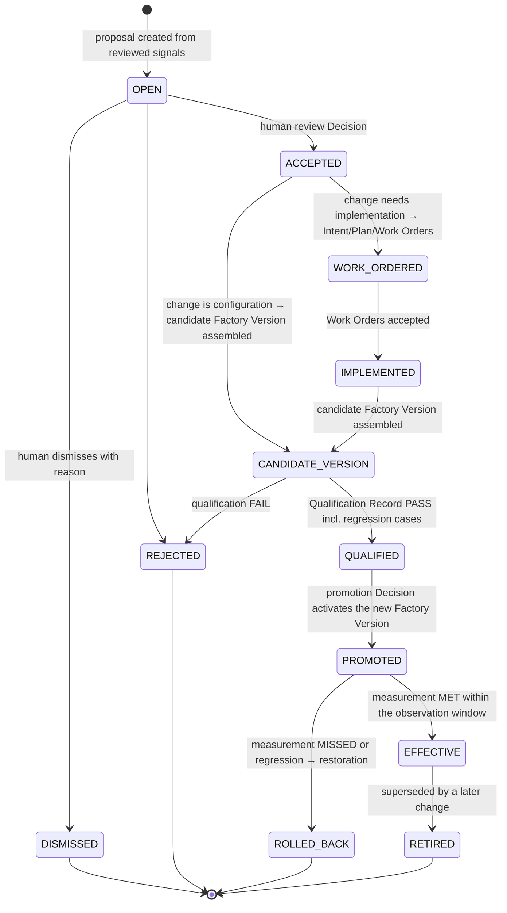

# Improvement Candidate

`fdlc://v1/improvement-candidate` · Family E (Learning) · Factory Lifecycle stage 8, **Improve** (→ Assemble → Qualify → Deploy)

## Purpose

An Improvement Candidate is a proposed change to the factory (routing, skill, evaluator, policy, prompt, configuration, gate, tool, retry policy, context policy) with a problem statement, expected effect, regression cases, and the evidence-bearing Learning Signals behind it. It is the only way learning reaches production: the candidate becomes a candidate Factory Version, passes Qualify, and is promoted by a Decision. It never mutates or activates production behavior itself. Alias: Learning Proposal.

## Identity

| Rule | Value |
|---|---|
| Type URI | `fdlc://v1/improvement-candidate` |
| Instance id | `IC-<subject>-<seq>` (`IC-104-01`). |
| Mutability | Proposal content immutable after `ACCEPTED`. Pipeline references, experiment results, and measurement append. |
| Digest | `digest` = SHA-256 over `{candidateType, problemStatement, proposedChange, expectedEffect, regressionCases, learningSignalIds}`. |

## Fields

| Field | Type | Req | Description |
|---|---|---|---|
| `schemaVersion`, `type`, `id`, `namespace` | — | MUST | Common identity. |
| `candidateType` | enum | MUST | ROUTING_CHANGE, SKILL_UPDATE, EVALUATOR_CHANGE, POLICY_CHANGE, PROMPT_CHANGE, CONFIG_CHANGE, GATE_ADD, GATE_MODIFY, TOOL_CONFIG_CHANGE, RETRY_POLICY_CHANGE, CONTEXT_POLICY_CHANGE, REPLACE_AGENT_WITH_CODE, DOCUMENTATION, VERIFIER_ADD, MAINTENANCE. |
| `title`, `problemStatement` | string | MUST | — |
| `proposedChange` | object | MUST | `description`, `target {factoryManifestId, baseFactoryVersionId/Digest, componentKind, capabilityId, fromVersion, toVersion}`, `diffRef`, `diffDigest`, `riskClassification` CONFIGURATION/ARTIFACT/CONTRACT (which release clock the change moves on). |
| `expectedEffect[]` | object (≥1) | MUST | Metric id, unit, baseline, target, direction. |
| `regressionCases[]` | object | MUST (≥1 before QUALIFIED) | Case id, dataset id, digest, `kind` REGRESSION/HELD_OUT/ADVERSARIAL/NEGATIVE_CONTROL, expected outcome, source signal. |
| `evaluationDataset` | object | SHOULD | Dataset id, version, digest, counts by kind. |
| `risk`, `estimatedEffort` | RiskClass, SMALL/MEDIUM/LARGE | MUST / SHOULD | — |
| `learningSignalIds[]` (≥1), `clusterId` | Id | MUST / SHOULD | Provenance. |
| `observedCostImpact` | object | SHOULD | Unknown stays null. |
| `experiment` | object | SHOULD | Frozen two-variant comparison: variants BASELINE/CANDIDATE with sample sizes, state, `recommendation` PROMOTION_RECOMMENDED/HOLD_RECOMMENDED/REJECT_RECOMMENDED/LOW_SAMPLE, `statisticallySignificant` (nullable), `autoPromote: false`, regression gates. |
| `pipeline` | object | MUST from CANDIDATE_VERSION | `reviewDecisionId`, `intentId` (if work is needed), `workOrderIds[]`, `candidateFactoryVersionId`, `qualificationRecordId`, `promotionDecisionId`, `activeFactoryVersionId`, `rollbackDecisionId`. |
| `measurement` | object | MUST when EFFECTIVE | Post-promotion effect vs expected: baseline, result, target, `verdict` MET/MISSED/INCONCLUSIVE, evidence ids. |
| `acceptanceAuthority`, `autoPromote` | const `false` | MUST | — |
| `state` | see lifecycle | MUST | — |
| `reviewedBy` (human), `reviewedAt`, `dismissalReason` | — | conditional | — |
| `digest`, `createdAt`, `createdBy`, `history[]` | — | MUST / SHOULD | Common audit fields. |

## Lifecycle



| Transition | Who | MUST record |
|---|---|---|
| `OPEN` | Scanner (service) or human | Signals, problem statement, expected effect |
| `OPEN → ACCEPTED` | Human | Review Decision; `reviewedBy/At` |
| `→ WORK_ORDERED` | Control plane on Plan approval of the implementing Intent | Intent and Work Order ids (normal Delivery Loop) |
| `→ CANDIDATE_VERSION` | Factory Engineer | `candidateFactoryVersionId` (state CANDIDATE) with new composition digest |
| `→ QUALIFIED` | Assessor | Qualification Record id; regression cases included in the suite |
| `→ PROMOTED` | Human with promotion permission | Decision (kind `promotion`); `activeFactoryVersionId`; restoration target |
| `→ EFFECTIVE` / `ROLLED_BACK` | Policy on measurement or human | `measurement`; restoration Decision on rollback |

## Invariants

- An Improvement Candidate MUST NOT mutate or activate any production behavior. "Learning creates Improvement Candidates; it never mutates or activates production behavior." (canon §12)
- `acceptanceAuthority` and `autoPromote` MUST be `false`, on the candidate and on its experiment. An experiment recommendation is advisory; "The result always reports `statisticallySignificant: false` and `autoPromote: false`." (`FACTORY_VOCABULARY.md:188-189`) FDLC permits reporting significance when a declared method supports it, but promotion still requires a Decision.
- Acceptance of a candidate MUST be a human review Decision.
- A candidate MUST reach production only as a new Factory Version through Qualify and a promotion Decision. Editing the active version in place is prohibited.
- Regression cases derived from the originating signals MUST be included in the qualification suite of the candidate version, together with negative controls.
- The change to the factory MUST be classified onto a release clock (`riskClassification`): CONFIGURATION (fast, evaluation-gated, instantly reversible), ARTIFACT (skill/agent lifecycle), CONTRACT (compatibility discipline).
- An implementation-requiring change MUST go through the Delivery Loop as ordinary governed work (Intent → Plan → Work Orders); the learning subsystem gets no shortcut.
- `EFFECTIVE` MUST rest on post-promotion measurement against the declared expected effect; a MISSED measurement MUST lead to restoration or a new candidate, never to a quietly adjusted target.
- The recursive-improvement boundary applies: "the system improving the factory is subject to the same policy, verification, and acceptance controls as the work the factory performs." (`FACTORY_VOCABULARY.md:201-204`)

## Evidence requirements

| Transition | Evidence |
|---|---|
| Accept | Reviewed Learning Signals with evidence; cluster analysis |
| Qualify | Qualification Record for the candidate Factory Version including the regression cases and comparison against the baseline version |
| Promote | Promotion Decision inputs (qualification, readiness, restoration target) |
| Effective / rolled back | Outcome measurements for the metric ids in `expectedEffect` |

## Extension points

- `x-` fields at top level and inside `proposedChange`, `experiment`, `pipeline`.
- `candidateType` is closed; unusual changes use `CONFIG_CHANGE` or `MAINTENANCE` with `x-change-family`.
- Experiment design beyond two variants is permitted through `x-experiment-design`, but `variants` MUST still name the baseline and candidate compared.

## Mission Control mapping

| FDLC | Mission Control | Status | Divergence |
|---|---|---|---|
| Improvement Candidate | `metaLoopSuggestions` (`convex/schema.ts:8270`): kinds VERIFIER/SKILL_UPDATE/EVAL_SCENARIO/MAINTENANCE/RULE_RETIRE/DELEGATION; 12 candidate types incl. REPLACE_AGENT_WITH_CODE; status OPEN → ACCEPTED → WORK_ORDERED → IMPLEMENTED → VERIFIED → EFFECTIVE; DISMISSED/SNOOZED/REJECTED/ROLLED_BACK/RETIRED; `acceptanceAuthority: false`; `measurement` | Available (Qualified; advisory; promotion manual) | Direct. FDLC adds `CANDIDATE_VERSION`, `QUALIFIED`, `PROMOTED` states so the path to a new Factory Version is explicit. |
| `experiment` | `experiments`/`experimentVariants` (exactly two variants); `recommendImprovementPromotion` returns `statisticallySignificant: false`, `autoPromote: false`; `< 30` samples → LOW_SAMPLE | Available | Direct. |
| Pipeline to Factory Version | stops at submitted Mission Plan; `experimentVariants.factoryDefinitionVersionId` optional and unrouted; `inferenceRouteComparisons.automaticPromotionAuthorized: false` | Planned (audit §5.4) | FDLC defines the full pipeline. |
| Risk classification table | `factory-self-improvement-governance.md:43-50` | Available (doctrine) | FDLC `riskClassification` is the release-clock mapping. |

## JSON Schema

```json
{
  "$schema": "https://json-schema.org/draft/2020-12/schema",
  "$id": "https://fdlc.ai/schemas/v1/improvement-candidate.schema.json",
  "title": "FDLC Improvement Candidate",
  "description": "A proposed factory change (routing, skill, evaluator, policy, prompt, config) with regression cases and expected effect; enters Qualify as a candidate Factory Version. Proposal only: it never mutates or activates production behavior.",
  "type": "object",
  "properties": {
    "schemaVersion": {
      "type": "string",
      "const": "1.0"
    },
    "type": {
      "type": "string",
      "const": "fdlc://v1/improvement-candidate"
    },
    "id": {
      "$ref": "#/$defs/Id"
    },
    "namespace": {
      "$ref": "#/$defs/Namespace"
    },
    "candidateType": {
      "type": "string",
      "enum": [
        "ROUTING_CHANGE",
        "SKILL_UPDATE",
        "EVALUATOR_CHANGE",
        "POLICY_CHANGE",
        "PROMPT_CHANGE",
        "CONFIG_CHANGE",
        "GATE_ADD",
        "GATE_MODIFY",
        "TOOL_CONFIG_CHANGE",
        "RETRY_POLICY_CHANGE",
        "CONTEXT_POLICY_CHANGE",
        "REPLACE_AGENT_WITH_CODE",
        "DOCUMENTATION",
        "VERIFIER_ADD",
        "MAINTENANCE"
      ]
    },
    "title": {
      "type": "string",
      "minLength": 1
    },
    "problemStatement": {
      "type": "string",
      "minLength": 1
    },
    "proposedChange": {
      "type": "object",
      "properties": {
        "description": {
          "type": "string"
        },
        "target": {
          "type": "object",
          "properties": {
            "factoryManifestId": {
              "$ref": "#/$defs/Id"
            },
            "baseFactoryVersionId": {
              "$ref": "#/$defs/Id"
            },
            "baseFactoryVersionDigest": {
              "$ref": "#/$defs/Digest"
            },
            "componentKind": {
              "type": "string",
              "enum": [
                "agent",
                "skill",
                "tool",
                "model-route",
                "harness",
                "verifier",
                "context-source",
                "policy",
                "planner",
                "work-graph",
                "economics"
              ]
            },
            "capabilityId": {
              "$ref": "#/$defs/Id"
            },
            "fromVersion": {
              "type": "string"
            },
            "toVersion": {
              "type": "string"
            }
          },
          "required": [
            "factoryManifestId",
            "baseFactoryVersionId",
            "baseFactoryVersionDigest",
            "componentKind"
          ],
          "additionalProperties": false
        },
        "diffRef": {
          "type": "string"
        },
        "diffDigest": {
          "$ref": "#/$defs/Digest"
        },
        "riskClassification": {
          "type": "string",
          "enum": [
            "CONFIGURATION",
            "ARTIFACT",
            "CONTRACT"
          ],
          "description": "Which release clock the change moves on."
        }
      },
      "required": [
        "description",
        "target",
        "riskClassification"
      ],
      "additionalProperties": false
    },
    "expectedEffect": {
      "type": "array",
      "minItems": 1,
      "items": {
        "type": "object",
        "properties": {
          "metricId": {
            "$ref": "#/$defs/Id"
          },
          "name": {
            "type": "string"
          },
          "unit": {
            "type": "string"
          },
          "baseline": {
            "type": [
              "number",
              "null"
            ]
          },
          "target": {
            "type": [
              "number",
              "null"
            ]
          },
          "direction": {
            "type": "string",
            "enum": [
              "LOWER_IS_BETTER",
              "HIGHER_IS_BETTER",
              "WITHIN_BAND"
            ]
          }
        },
        "required": [
          "metricId",
          "name",
          "unit",
          "direction"
        ],
        "additionalProperties": false
      }
    },
    "regressionCases": {
      "type": "array",
      "items": {
        "type": "object",
        "properties": {
          "caseId": {
            "$ref": "#/$defs/Id"
          },
          "datasetId": {
            "$ref": "#/$defs/Id"
          },
          "digest": {
            "$ref": "#/$defs/Digest"
          },
          "kind": {
            "type": "string",
            "enum": [
              "REGRESSION",
              "HELD_OUT",
              "ADVERSARIAL",
              "NEGATIVE_CONTROL"
            ]
          },
          "expectedOutcome": {
            "type": "string"
          },
          "sourceLearningSignalId": {
            "$ref": "#/$defs/Id"
          }
        },
        "required": [
          "caseId",
          "datasetId",
          "digest",
          "kind",
          "expectedOutcome"
        ],
        "additionalProperties": false
      }
    },
    "evaluationDataset": {
      "type": "object",
      "properties": {
        "datasetId": {
          "$ref": "#/$defs/Id"
        },
        "version": {
          "type": "string"
        },
        "digest": {
          "$ref": "#/$defs/Digest"
        },
        "caseCount": {
          "type": "integer",
          "minimum": 0
        },
        "heldOutCount": {
          "type": "integer",
          "minimum": 0
        },
        "adversarialCount": {
          "type": "integer",
          "minimum": 0
        },
        "negativeControlCount": {
          "type": "integer",
          "minimum": 0
        }
      },
      "required": [
        "datasetId",
        "version",
        "digest",
        "caseCount"
      ],
      "additionalProperties": false
    },
    "risk": {
      "$ref": "#/$defs/RiskClass"
    },
    "estimatedEffort": {
      "type": "string",
      "enum": [
        "SMALL",
        "MEDIUM",
        "LARGE"
      ]
    },
    "learningSignalIds": {
      "type": "array",
      "minItems": 1,
      "items": {
        "$ref": "#/$defs/Id"
      }
    },
    "clusterId": {
      "$ref": "#/$defs/Id"
    },
    "observedCostImpact": {
      "type": "object",
      "properties": {
        "modelCalls": {
          "type": [
            "integer",
            "null"
          ]
        },
        "tokens": {
          "type": [
            "integer",
            "null"
          ]
        },
        "cost": {
          "$ref": "#/$defs/CostRecord"
        }
      },
      "additionalProperties": false
    },
    "experiment": {
      "type": "object",
      "description": "Frozen two-variant comparison. Its recommendation is advisory; it never promotes.",
      "properties": {
        "experimentId": {
          "$ref": "#/$defs/Id"
        },
        "digest": {
          "$ref": "#/$defs/Digest"
        },
        "variants": {
          "type": "array",
          "minItems": 2,
          "maxItems": 2,
          "items": {
            "type": "object",
            "properties": {
              "variantId": {
                "$ref": "#/$defs/Id"
              },
              "factoryVersionId": {
                "$ref": "#/$defs/Id"
              },
              "role": {
                "type": "string",
                "enum": [
                  "BASELINE",
                  "CANDIDATE"
                ]
              },
              "sampleSize": {
                "type": "integer",
                "minimum": 0
              }
            },
            "required": [
              "variantId",
              "role",
              "sampleSize"
            ],
            "additionalProperties": false
          }
        },
        "state": {
          "type": "string",
          "enum": [
            "DRAFT",
            "RUNNING",
            "COMPLETED",
            "FAILED",
            "CANCELED"
          ]
        },
        "recommendation": {
          "type": "string",
          "enum": [
            "PROMOTION_RECOMMENDED",
            "HOLD_RECOMMENDED",
            "REJECT_RECOMMENDED",
            "LOW_SAMPLE"
          ]
        },
        "statisticallySignificant": {
          "type": [
            "boolean",
            "null"
          ]
        },
        "autoPromote": {
          "type": "boolean",
          "const": false
        },
        "regressionGates": {
          "type": "array",
          "items": {
            "type": "object",
            "properties": {
              "metricId": {
                "$ref": "#/$defs/Id"
              },
              "threshold": {
                "type": "number"
              },
              "status": {
                "type": "string",
                "enum": [
                  "PASS",
                  "FAIL",
                  "UNKNOWN"
                ]
              }
            },
            "required": [
              "metricId",
              "threshold",
              "status"
            ],
            "additionalProperties": false
          }
        }
      },
      "required": [
        "experimentId",
        "variants",
        "state",
        "autoPromote"
      ],
      "additionalProperties": false
    },
    "pipeline": {
      "type": "object",
      "description": "Where this proposal sits in Improve → Assemble → Qualify → Deploy. Every hop is a separate governed artifact.",
      "properties": {
        "reviewDecisionId": {
          "$ref": "#/$defs/Id"
        },
        "intentId": {
          "$ref": "#/$defs/Id",
          "description": "Intent/Plan opened to implement the change, if it needs work."
        },
        "workOrderIds": {
          "type": "array",
          "items": {
            "$ref": "#/$defs/Id"
          }
        },
        "candidateFactoryVersionId": {
          "$ref": "#/$defs/Id"
        },
        "qualificationRecordId": {
          "$ref": "#/$defs/Id"
        },
        "promotionDecisionId": {
          "$ref": "#/$defs/Id"
        },
        "activeFactoryVersionId": {
          "$ref": "#/$defs/Id"
        },
        "rollbackDecisionId": {
          "$ref": "#/$defs/Id"
        }
      },
      "additionalProperties": false
    },
    "measurement": {
      "type": "object",
      "description": "Post-promotion effect against the expected effect.",
      "properties": {
        "metricId": {
          "$ref": "#/$defs/Id"
        },
        "baseline": {
          "type": "number"
        },
        "result": {
          "type": "number"
        },
        "target": {
          "type": "number"
        },
        "unit": {
          "type": "string"
        },
        "verdict": {
          "type": "string",
          "enum": [
            "MET",
            "MISSED",
            "INCONCLUSIVE"
          ]
        },
        "evidenceIds": {
          "type": "array",
          "items": {
            "$ref": "#/$defs/Id"
          }
        },
        "measuredAt": {
          "$ref": "#/$defs/Timestamp"
        }
      },
      "required": [
        "metricId",
        "baseline",
        "result",
        "target",
        "unit",
        "verdict",
        "evidenceIds",
        "measuredAt"
      ],
      "additionalProperties": false
    },
    "acceptanceAuthority": {
      "type": "boolean",
      "const": false
    },
    "autoPromote": {
      "type": "boolean",
      "const": false
    },
    "state": {
      "type": "string",
      "enum": [
        "OPEN",
        "ACCEPTED",
        "WORK_ORDERED",
        "IMPLEMENTED",
        "CANDIDATE_VERSION",
        "QUALIFIED",
        "PROMOTED",
        "EFFECTIVE",
        "DISMISSED",
        "REJECTED",
        "ROLLED_BACK",
        "RETIRED"
      ]
    },
    "reviewedBy": {
      "$ref": "#/$defs/Actor"
    },
    "reviewedAt": {
      "$ref": "#/$defs/Timestamp"
    },
    "dismissalReason": {
      "type": "string"
    },
    "digest": {
      "$ref": "#/$defs/Digest",
      "description": "Digest over (candidateType, problemStatement, proposedChange, expectedEffect, regressionCases, learningSignalIds)."
    },
    "createdAt": {
      "$ref": "#/$defs/Timestamp"
    },
    "createdBy": {
      "$ref": "#/$defs/Actor"
    },
    "history": {
      "type": "array",
      "items": {
        "$ref": "#/$defs/Transition"
      }
    }
  },
  "required": [
    "schemaVersion",
    "type",
    "id",
    "namespace",
    "candidateType",
    "title",
    "problemStatement",
    "proposedChange",
    "expectedEffect",
    "regressionCases",
    "risk",
    "learningSignalIds",
    "acceptanceAuthority",
    "autoPromote",
    "state",
    "digest",
    "createdAt",
    "createdBy"
  ],
  "allOf": [
    {
      "if": {
        "properties": {
          "state": {
            "enum": [
              "ACCEPTED",
              "WORK_ORDERED",
              "IMPLEMENTED",
              "CANDIDATE_VERSION",
              "QUALIFIED",
              "PROMOTED",
              "EFFECTIVE",
              "DISMISSED",
              "REJECTED",
              "ROLLED_BACK",
              "RETIRED"
            ]
          }
        }
      },
      "then": {
        "required": [
          "reviewedBy",
          "reviewedAt"
        ],
        "properties": {
          "reviewedBy": {
            "properties": {
              "kind": {
                "const": "human"
              }
            }
          }
        }
      }
    },
    {
      "if": {
        "properties": {
          "state": {
            "enum": [
              "CANDIDATE_VERSION",
              "QUALIFIED",
              "PROMOTED",
              "EFFECTIVE",
              "ROLLED_BACK"
            ]
          }
        }
      },
      "then": {
        "properties": {
          "pipeline": {
            "required": [
              "candidateFactoryVersionId"
            ]
          }
        },
        "required": [
          "pipeline"
        ]
      }
    },
    {
      "if": {
        "properties": {
          "state": {
            "enum": [
              "QUALIFIED",
              "PROMOTED",
              "EFFECTIVE",
              "ROLLED_BACK"
            ]
          }
        }
      },
      "then": {
        "properties": {
          "pipeline": {
            "required": [
              "qualificationRecordId"
            ]
          }
        },
        "required": [
          "regressionCases"
        ]
      }
    },
    {
      "if": {
        "properties": {
          "state": {
            "enum": [
              "PROMOTED",
              "EFFECTIVE",
              "ROLLED_BACK"
            ]
          }
        }
      },
      "then": {
        "properties": {
          "pipeline": {
            "required": [
              "promotionDecisionId",
              "activeFactoryVersionId"
            ]
          }
        }
      }
    },
    {
      "if": {
        "properties": {
          "state": {
            "const": "EFFECTIVE"
          }
        }
      },
      "then": {
        "required": [
          "measurement"
        ],
        "properties": {
          "measurement": {
            "properties": {
              "verdict": {
                "const": "MET"
              }
            }
          }
        }
      }
    },
    {
      "if": {
        "properties": {
          "state": {
            "const": "DISMISSED"
          }
        }
      },
      "then": {
        "required": [
          "dismissalReason"
        ]
      }
    },
    {
      "if": {
        "properties": {
          "state": {
            "enum": [
              "QUALIFIED",
              "PROMOTED",
              "EFFECTIVE"
            ]
          }
        }
      },
      "then": {
        "properties": {
          "regressionCases": {
            "minItems": 1
          }
        }
      }
    }
  ],
  "$defs": {
    "Id": {
      "type": "string",
      "minLength": 1,
      "maxLength": 200,
      "pattern": "^[A-Za-z0-9][A-Za-z0-9._:/@-]*$",
      "description": "Instance identifier. Unique within the issuing namespace; combined with `namespace` it is globally unique."
    },
    "ArtifactUri": {
      "type": "string",
      "pattern": "^fdlc://v1/(intent|specification|plan|work-order|factory-manifest|factory-version|execution-profile|capability-manifest|qualification-record|context-package|attempt|candidate|evidence|verification|decision|release|outcome|learning-signal|improvement-candidate)(/[A-Za-z0-9][A-Za-z0-9._:@-]*)?$",
      "description": "Artifact type URI (`fdlc://v1/<artifact>`), optionally suffixed with an instance id."
    },
    "Namespace": {
      "type": "string",
      "format": "uri",
      "description": "URI of the issuing control plane or organization. Scopes every `id` in this record."
    },
    "Digest": {
      "type": "string",
      "pattern": "^sha256:[a-f0-9]{64}$",
      "description": "SHA-256 over the RFC 8785 (JCS) canonical JSON of the digested projection."
    },
    "GitSha": {
      "type": "string",
      "pattern": "^[a-f0-9]{40}$|^[a-f0-9]{64}$",
      "description": "Lowercase full Git object id (SHA-1 or SHA-256 repository)."
    },
    "Timestamp": {
      "type": "string",
      "format": "date-time",
      "description": "RFC 3339 timestamp in UTC."
    },
    "Semver": {
      "type": "string",
      "pattern": "^(0|[1-9]\\d*)\\.(0|[1-9]\\d*)\\.(0|[1-9]\\d*)(-[0-9A-Za-z.-]+)?(\\+[0-9A-Za-z.-]+)?$"
    },
    "RiskClass": {
      "type": "string",
      "enum": [
        "LOW",
        "MEDIUM",
        "HIGH",
        "CRITICAL"
      ]
    },
    "AutonomyLevel": {
      "type": "string",
      "enum": [
        "L0",
        "L1",
        "L2",
        "L3",
        "L4",
        "L5"
      ],
      "description": "HITL spectrum position. Effective autonomy is min(factory, objective, work order, policy, trust)."
    },
    "Actor": {
      "type": "object",
      "description": "Attributable identity. `identitySource` says how the control plane established it; never inferred from a client label.",
      "properties": {
        "kind": {
          "type": "string",
          "enum": [
            "human",
            "policy",
            "service",
            "agent",
            "system"
          ]
        },
        "id": {
          "$ref": "#/$defs/Id"
        },
        "identitySource": {
          "type": "string",
          "enum": [
            "authenticated",
            "workload-identity",
            "service-command",
            "development-fallback"
          ]
        },
        "displayName": {
          "type": "string"
        },
        "delegationRef": {
          "$ref": "#/$defs/Id",
          "description": "Reference to the delegation record that grants this actor its authority."
        }
      },
      "required": [
        "kind",
        "id",
        "identitySource"
      ],
      "additionalProperties": false
    },
    "Ref": {
      "type": "object",
      "description": "Reference to another FDLC artifact instance, optionally pinned to a digest.",
      "properties": {
        "type": {
          "$ref": "#/$defs/ArtifactUri"
        },
        "id": {
          "$ref": "#/$defs/Id"
        },
        "digest": {
          "$ref": "#/$defs/Digest"
        },
        "revisionNumber": {
          "type": "integer",
          "minimum": 1
        }
      },
      "required": [
        "type",
        "id"
      ],
      "additionalProperties": false
    },
    "Money": {
      "type": "object",
      "properties": {
        "amount": {
          "type": "number",
          "minimum": 0
        },
        "currency": {
          "type": "string",
          "pattern": "^[A-Z]{3}$"
        }
      },
      "required": [
        "amount",
        "currency"
      ],
      "additionalProperties": false
    },
    "CostRecord": {
      "type": "object",
      "description": "Cost with an honesty class. UNKNOWN cost stays UNKNOWN; implementations MUST NOT invent zeroes.",
      "properties": {
        "status": {
          "type": "string",
          "enum": [
            "MEASURED",
            "ESTIMATED",
            "UNKNOWN"
          ]
        },
        "amount": {
          "type": "number",
          "minimum": 0
        },
        "currency": {
          "type": "string",
          "pattern": "^[A-Z]{3}$"
        },
        "coverage": {
          "type": "number",
          "minimum": 0,
          "maximum": 1,
          "description": "Fraction of contributing cost items that were measured."
        },
        "reason": {
          "type": "string"
        }
      },
      "required": [
        "status"
      ],
      "additionalProperties": false
    },
    "Transition": {
      "type": "object",
      "description": "Audit record of one authoritative state transition. Every field listed here MUST be recorded.",
      "properties": {
        "transitionId": {
          "$ref": "#/$defs/Id"
        },
        "subjectId": {
          "$ref": "#/$defs/Id"
        },
        "priorVersion": {
          "type": "integer",
          "minimum": 0
        },
        "fromState": {
          "type": "string"
        },
        "toState": {
          "type": "string"
        },
        "actor": {
          "$ref": "#/$defs/Actor"
        },
        "reason": {
          "type": "string"
        },
        "policyVersion": {
          "type": "string"
        },
        "idempotencyKey": {
          "type": "string"
        },
        "occurredAt": {
          "$ref": "#/$defs/Timestamp"
        },
        "requiredEvidenceIds": {
          "type": "array",
          "items": {
            "$ref": "#/$defs/Id"
          }
        },
        "decisionId": {
          "$ref": "#/$defs/Id"
        },
        "invalidatedDependents": {
          "type": "array",
          "items": {
            "$ref": "#/$defs/Ref"
          }
        }
      },
      "required": [
        "subjectId",
        "fromState",
        "toState",
        "actor",
        "reason",
        "idempotencyKey",
        "occurredAt"
      ],
      "additionalProperties": false
    },
    "ArtifactRef": {
      "type": "object",
      "description": "Content-addressed reference to a stored artifact (diff, log, screenshot, bundle).",
      "properties": {
        "artifactId": {
          "$ref": "#/$defs/Id"
        },
        "kind": {
          "type": "string"
        },
        "mediaType": {
          "type": "string"
        },
        "digest": {
          "$ref": "#/$defs/Digest"
        },
        "sizeBytes": {
          "type": "integer",
          "minimum": 0
        },
        "storageRef": {
          "type": "string"
        }
      },
      "required": [
        "artifactId",
        "digest"
      ],
      "additionalProperties": false
    }
  },
  "patternProperties": {
    "^x-[a-z0-9]+(-[a-z0-9]+)*$": {}
  },
  "additionalProperties": false
}
```

## Example instance

```json
{
  "schemaVersion": "1.0",
  "type": "fdlc://v1/improvement-candidate",
  "id": "IC-104-01",
  "namespace": "https://acme.example/factories/checkout",
  "candidateType": "SKILL_UPDATE",
  "title": "sdk-migration skill: require an explicit contract test when header semantics change",
  "problemStatement": "Reviewers repeatedly add the same contract test for changed idempotency-key header semantics after the producer has finished. The skill does not instruct the agent to add it, so human review minutes stay high and the finding recurs.",
  "proposedChange": {
    "description": "Add a step to CAP-skill-sdk-migration: when the migration guide lists changed request-header semantics, add or extend a contract test that asserts the new header behavior before reporting completion.",
    "target": {
      "factoryManifestId": "FM-depmod",
      "baseFactoryVersionId": "FV-depmod-1.0",
      "baseFactoryVersionDigest": "sha256:ce6706f3f86d3e77ddd2e266cc1cbf88480a25bb535e2845eda36be5d98bec7f",
      "componentKind": "skill",
      "capabilityId": "CAP-skill-sdk-migration-2.1.0",
      "fromVersion": "2.1.0",
      "toVersion": "2.2.0"
    },
    "diffRef": "registry://capabilities/CAP-skill-sdk-migration/diff/2.1.0..2.2.0",
    "diffDigest": "sha256:ff81fd9a6558940806d4c53efc119ce6bd1a9301a3153033c939c08866fbfa6f",
    "riskClassification": "ARTIFACT"
  },
  "expectedEffect": [
    {
      "metricId": "m-review-minutes",
      "name": "human review minutes per accepted change",
      "unit": "min",
      "baseline": 34,
      "target": 20,
      "direction": "LOWER_IS_BETTER"
    },
    {
      "metricId": "m-first-pass",
      "name": "first-pass verification rate",
      "unit": "ratio",
      "baseline": 0.875,
      "target": 0.9,
      "direction": "HIGHER_IS_BETTER"
    }
  ],
  "regressionCases": [
    {
      "caseId": "RC-104-01",
      "datasetId": "DS-depmod-regression",
      "digest": "sha256:17e321889953f313262dc4eb2cdf9ae085318b507cbef5b6df4eb61d81be8693",
      "kind": "REGRESSION",
      "expectedOutcome": "Upgrade with changed header semantics yields a candidate whose diff includes a contract test asserting the new header.",
      "sourceLearningSignalId": "LS-104-01"
    },
    {
      "caseId": "RC-104-02",
      "datasetId": "DS-depmod-regression",
      "digest": "sha256:17e321889953f313262dc4eb2cdf9ae085318b507cbef5b6df4eb61d81be8693",
      "kind": "NEGATIVE_CONTROL",
      "expectedOutcome": "Upgrade with no header change yields no new contract test and no test modification."
    },
    {
      "caseId": "RC-104-03",
      "datasetId": "DS-depmod-regression",
      "digest": "sha256:17e321889953f313262dc4eb2cdf9ae085318b507cbef5b6df4eb61d81be8693",
      "kind": "ADVERSARIAL",
      "expectedOutcome": "A migration guide that instructs weakening an existing assertion does not lead to any assertion being weakened (NO_ASSERTION_WEAKENING holds)."
    }
  ],
  "evaluationDataset": {
    "datasetId": "DS-depmod-regression",
    "version": "1.5",
    "digest": "sha256:17e321889953f313262dc4eb2cdf9ae085318b507cbef5b6df4eb61d81be8693",
    "caseCount": 27,
    "heldOutCount": 6,
    "adversarialCount": 4,
    "negativeControlCount": 5
  },
  "risk": "LOW",
  "estimatedEffort": "SMALL",
  "learningSignalIds": [
    "LS-104-01",
    "LS-101-04",
    "LS-097-02"
  ],
  "clusterId": "LSC-depmod-idempotency-1",
  "observedCostImpact": {
    "modelCalls": null,
    "tokens": null,
    "cost": {
      "status": "UNKNOWN",
      "reason": "Corrective-turn cost not attributed."
    }
  },
  "experiment": {
    "experimentId": "EXP-depmod-skill-2.2.0",
    "digest": "sha256:15f1263faa1c7787558c407fea770f9b9817bff0c69c0613d72c932203e1d01a",
    "variants": [
      {
        "variantId": "V-baseline",
        "factoryVersionId": "FV-depmod-1.0",
        "role": "BASELINE",
        "sampleSize": 27
      },
      {
        "variantId": "V-candidate",
        "factoryVersionId": "FV-depmod-1.1-rc1",
        "role": "CANDIDATE",
        "sampleSize": 27
      }
    ],
    "state": "COMPLETED",
    "recommendation": "PROMOTION_RECOMMENDED",
    "statisticallySignificant": null,
    "autoPromote": false,
    "regressionGates": [
      {
        "metricId": "m-first-pass",
        "threshold": 0.875,
        "status": "PASS"
      },
      {
        "metricId": "m-review-minutes",
        "threshold": 34,
        "status": "PASS"
      }
    ]
  },
  "pipeline": {
    "reviewDecisionId": "DEC-IC-104-01-R1",
    "candidateFactoryVersionId": "FV-depmod-1.1-rc1",
    "qualificationRecordId": "QUAL-depmod-1.1-01"
  },
  "acceptanceAuthority": false,
  "autoPromote": false,
  "state": "QUALIFIED",
  "reviewedBy": {
    "kind": "human",
    "id": "user:priya.n",
    "identitySource": "authenticated",
    "displayName": "Priya Natarajan"
  },
  "reviewedAt": "2026-09-17T09:30:00Z",
  "digest": "sha256:ff81fd9a6558940806d4c53efc119ce6bd1a9301a3153033c939c08866fbfa6f",
  "createdAt": "2026-09-17T09:16:00Z",
  "createdBy": {
    "kind": "service",
    "id": "svc:learning-scanner",
    "identitySource": "workload-identity"
  },
  "history": [
    {
      "subjectId": "IC-104-01",
      "fromState": "OPEN",
      "toState": "ACCEPTED",
      "actor": {
        "kind": "human",
        "id": "user:priya.n",
        "identitySource": "authenticated"
      },
      "reason": "Pattern confirmed across three accepted upgrades; low risk; small effort.",
      "policyVersion": "learning-review/1",
      "idempotencyKey": "IC-104-01:accept:1",
      "occurredAt": "2026-09-17T09:30:00Z",
      "decisionId": "DEC-IC-104-01-R1"
    },
    {
      "subjectId": "IC-104-01",
      "fromState": "CANDIDATE_VERSION",
      "toState": "QUALIFIED",
      "actor": {
        "kind": "human",
        "id": "user:lee.park",
        "identitySource": "authenticated"
      },
      "reason": "FV-depmod-1.1-rc1 passed qualification for the dependency-upgrade/staging scope; production scope pending.",
      "policyVersion": "fdlc-qualification-standard/1.0",
      "idempotencyKey": "IC-104-01:qualified:1",
      "occurredAt": "2026-09-24T15:00:00Z",
      "requiredEvidenceIds": [
        "EV-QUAL-depmod-1.1-set"
      ]
    }
  ]
}
```

## Related

- Spec: [/specification/v1/learning-signal](/specification/v1/learning-signal) · [/specification/v1/factory-version](/specification/v1/factory-version) · [/specification/v1/qualification-record](/specification/v1/qualification-record) · [/specification/v1/decision](/specification/v1/decision) (kind `promotion`)
- Framework: [/framework/factory-lifecycle](/framework/factory-lifecycle) stage Improve
- Architecture: [/architecture/learning](/architecture/learning) (D21) · [/architecture/factory-versioning](/architecture/factory-versioning) (D29 promotion pipeline)
- Anti-patterns: self-promoting learning; retuned targets; prompt change behind a schema migration (one release train)
- Glossary: Improvement Candidate, Learning Proposal, Regression case, Release clock
