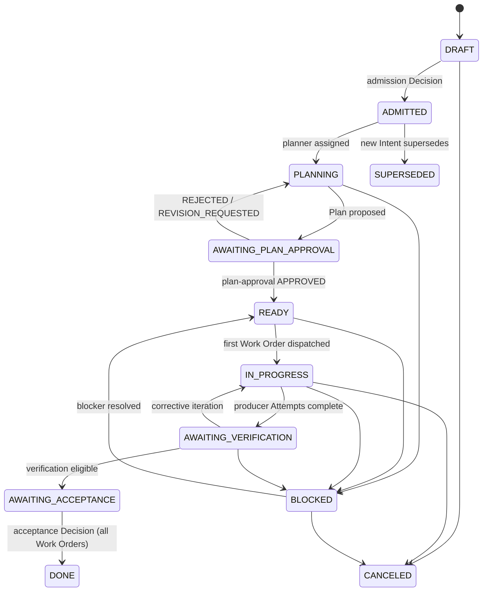

# Intent

`fdlc://v1/intent` · Family A (Intent) · Delivery Loop step 1, **Receive**

## Purpose

An Intent is the requested outcome: goal, constraints, owner, risk, stop condition, and budget. It is the unit of intent that everything downstream traces back to. An Intent that passes admission becomes the **Objective** of its Plan; routing level 1 operates on Objectives.

## Identity

| Rule | Value |
|---|---|
| Type URI | `fdlc://v1/intent` |
| Instance id | Implementation-chosen, unique within `namespace`. Worked-example form `INT-<n>` (`INT-104`). Global form `fdlc://v1/intent/INT-104` under the namespace. |
| Mutability | Mutable operational record (state, budget spend, blockers). The admitted content is frozen. |
| Digest | `admittedDigest` = SHA-256 over the RFC 8785 canonical JSON of `{title, goal, rationale, constraints, scope, riskClass, stopCondition, budget.costLimit, owner.id}`, computed at `ADMITTED`. Any change to those fields after admission MUST create a new Intent that supersedes this one. |
| Alias | Mission (Mission Control). |

## Fields

| Field | Type | Req | Description |
|---|---|---|---|
| `schemaVersion` | const `"1.0"` | MUST | Spec version this record conforms to. |
| `type` | const `fdlc://v1/intent` | MUST | Artifact type. |
| `id` | Id | MUST | Instance id. |
| `namespace` | URI | MUST | Issuing control plane; scopes `id`. |
| `title`, `goal` | string | MUST | Outcome stated as a result, not an activity. |
| `rationale` | string | SHOULD | Business reason. |
| `owner` | Actor (kind `human`) | MUST | Accountable Builder. Never an agent. |
| `requester` | Actor | MAY | Who asked; may differ from the owner. |
| `signalRefs[]` | SourceRef | MAY | Observable events that preceded the Intent (issue, incident, finding). |
| `constraints[]`, `sourcesOfTruth[]` | string / SourceRef | SHOULD | Boundaries and authoritative inputs (with digests where content matters). |
| `scope` | object | SHOULD | Repositories (with code scopes and data classification), environments, non-goals. |
| `riskClass` | LOW–CRITICAL | MUST | Server-owned minimum classification. A client MAY raise it; only policy MAY lower it. |
| `stopCondition` | string | MUST | When the factory MUST stop pursuing this Intent. |
| `budget` | object | SHOULD | `costLimit`, `spent` (CostRecord), `maxCorrectiveIterations`, `maxReadOnlyConcurrency`, `deadline`. |
| `executionPolicy` | `SERIAL_MUTATIONS` \| `EXPLICIT_PARALLEL` | MUST | Under `SERIAL_MUTATIONS`, at most one repository-mutating Work Order is active at a time. |
| `state` | enum | MUST | See lifecycle. |
| `admissionDecisionId` | Id | MUST once ADMITTED | The Decision (kind `admission`) that made this Intent an Objective. |
| `currentSpecificationId/Digest`, `currentPlanId/Digest` | Id, Digest | SHOULD | Exact bound revisions. |
| `activeWorkOrderId`, `workOrderIds[]` | Id | SHOULD | Released Work Orders. |
| `acceptanceDecisionId` | Id | MUST when DONE | Decision (kind `acceptance`) that closed the Objective. |
| `blockingReason`, `requiredHumanAction` | string | MAY | What prevents progress and who resolves it. |
| `admittedDigest` | Digest | MUST once ADMITTED | See Identity. |
| `createdAt`, `updatedAt`, `admittedAt`, `acceptedAt` | Timestamp | MUST / SHOULD | RFC 3339 UTC. |
| `createdBy` | Actor | MUST | Includes `identitySource`. |
| `idempotencyKey` | string | SHOULD | Creation idempotency. |
| `history[]` | Transition | SHOULD | Audit record of every authoritative transition. |

## Lifecycle



| Transition | Who may transition | MUST record |
|---|---|---|
| `DRAFT → ADMITTED` | Policy or human with intake permission | Decision (kind `admission`), `admittedDigest`, `riskClass` as classified by the server |
| `AWAITING_PLAN_APPROVAL → READY` | Human (or policy within envelope for LOW risk) | Decision (kind `plan-approval`), exact Plan digest |
| `AWAITING_VERIFICATION → AWAITING_ACCEPTANCE` | Control plane (derived) | Verification id and currentness result |
| `AWAITING_ACCEPTANCE → DONE` | Human (HIGH/CRITICAL) or policy (LOW/MEDIUM within envelope) | Decision (kind `acceptance`) for every Work Order; `acceptedAt` |
| `* → BLOCKED` | Control plane | `blockingReason`, `requiredHumanAction` |
| `* → CANCELED` | Owner or authorized human | Reason; stop condition invoked |
| `* → SUPERSEDED` | Owner | `supersededById` |

Every transition MUST record the `Transition` fields: subject and prior version, actor with identity source, reason, policy version, idempotency key, timestamp, required evidence ids, before/after state, and invalidated dependents.

## Invariants

- An Intent MUST have a human owner, a risk class, and a stop condition before admission. An Intent without a stop condition MUST NOT be admitted.
- Admission MUST be a recorded Decision. Existence of an Intent MUST NOT imply eligibility for planning.
- Under `SERIAL_MUTATIONS`, exactly one repository-mutating Work Order MAY be active per Intent at a time.
- Work Orders MUST be created only from an approved Plan bound to this Intent (`currentPlanDigest`).
- An Intent MUST stop on acceptance, cancellation, budget exhaustion, `maxCorrectiveIterations`, or explicit block. A model MUST NOT negotiate past a stop.
- `DONE` MUST be reached only through an acceptance Decision. No child state (Work Order `DONE`, Attempt `COMPLETED`) MAY complete the Intent by implication. "No lower state silently completes its parent." (Mission Control README, quoted in audit §4.)
- `budget.spent` with unknown cost MUST remain `UNKNOWN`; implementations MUST NOT invent zeroes.
- A material change to admitted content MUST create a new Intent (`SUPERSEDED`), never an in-place edit.

## Evidence requirements

| Transition | Evidence that MUST accompany it |
|---|---|
| Admission | Intake policy evaluation result; risk classification reasons |
| Plan approval | Plan digest, Specification digest, coverage projection |
| Acceptance | For each Work Order: current Verification (VERIFIED, independent), Quality Gate `ELIGIBLE`, acceptance Decision |
| Block | Blocking evidence id (failed check, budget fence, policy denial) |

## Extension points

- `x-` prefixed top-level fields (e.g. `x-acme-ticket`). Extensions MUST NOT alter the meaning of any canonical field or state.
- `signalRefs[].kind` MAY be extended by an implementation through an `x-` field on the SourceRef; canonical kinds MUST keep their meaning.
- Additional states MUST NOT be added. Implementations that need finer operational states MUST project them onto the canonical set.

## Mission Control mapping

| FDLC | Mission Control | Status | Divergence |
|---|---|---|---|
| Intent | `missions` (`convex/schema.ts:1969`; `convex/missions.ts`) | Available (ledger: Qualified) | MC has no explicit `ADMITTED` state; `DRAFT → PLANNING` implies admission. FDLC requires a recorded admission Decision. |
| `AWAITING_VERIFICATION` | `AWAITING_VALIDATION` | Available | Naming: MC uses "validation" at Mission tier. |
| `executionPolicy` | `executionPolicy: "SERIAL_MUTATIONS"` (only literal) | Available | FDLC adds `EXPLICIT_PARALLEL`; MC does not implement it. |
| `budget`, `stopCondition`, `maxCorrectiveIterations` | same-named fields | Available | Direct. |
| `owner` (human) | `owner`, `ownerMemberId` | Available | MC permits an optional owner; FDLC requires a human owner. |
| `SUPERSEDED` | declared in schema | Uncertain | Audit could not locate the writer (§1.1). |
| Signals before Intent | none | Proposed | `signalRefs` is an FDLC addition. |

## JSON Schema

```json
{
  "$schema": "https://json-schema.org/draft/2020-12/schema",
  "$id": "https://fdlc.ai/schemas/v1/intent.schema.json",
  "title": "FDLC Intent",
  "description": "The requested outcome: goal, constraints, owner, risk, stop condition, budget. An Intent admitted for planning is the Objective of its Plan.",
  "type": "object",
  "properties": {
    "schemaVersion": {
      "type": "string",
      "const": "1.0"
    },
    "type": {
      "type": "string",
      "const": "fdlc://v1/intent"
    },
    "id": {
      "$ref": "#/$defs/Id"
    },
    "namespace": {
      "$ref": "#/$defs/Namespace"
    },
    "title": {
      "type": "string",
      "minLength": 1,
      "maxLength": 200
    },
    "goal": {
      "type": "string",
      "minLength": 1,
      "description": "The outcome that matters, stated as a result, not an activity."
    },
    "rationale": {
      "type": "string",
      "description": "Business reason. Why this outcome, why now."
    },
    "owner": {
      "$ref": "#/$defs/Actor",
      "description": "Accountable Builder. MUST be a human actor."
    },
    "requester": {
      "$ref": "#/$defs/Actor"
    },
    "signalRefs": {
      "type": "array",
      "items": {
        "$ref": "#/$defs/SourceRef"
      },
      "description": "Observable events that preceded this Intent (issue, incident, telemetry, finding)."
    },
    "constraints": {
      "type": "array",
      "items": {
        "type": "string"
      }
    },
    "sourcesOfTruth": {
      "type": "array",
      "items": {
        "$ref": "#/$defs/SourceRef"
      }
    },
    "scope": {
      "type": "object",
      "properties": {
        "repositories": {
          "type": "array",
          "items": {
            "$ref": "#/$defs/RepositoryScope"
          }
        },
        "environments": {
          "type": "array",
          "items": {
            "type": "string"
          }
        },
        "nonGoals": {
          "type": "array",
          "items": {
            "type": "string"
          }
        }
      },
      "additionalProperties": false
    },
    "riskClass": {
      "$ref": "#/$defs/RiskClass",
      "description": "Server-owned minimum classification. A client may raise it; only policy may lower it."
    },
    "riskReasons": {
      "type": "array",
      "items": {
        "type": "string"
      }
    },
    "stopCondition": {
      "type": "string",
      "minLength": 1,
      "description": "The condition under which the factory MUST stop pursuing this Intent."
    },
    "budget": {
      "type": "object",
      "properties": {
        "costLimit": {
          "$ref": "#/$defs/Money"
        },
        "spent": {
          "$ref": "#/$defs/CostRecord"
        },
        "maxCorrectiveIterations": {
          "type": "integer",
          "minimum": 0
        },
        "maxReadOnlyConcurrency": {
          "type": "integer",
          "minimum": 1
        },
        "deadline": {
          "$ref": "#/$defs/Timestamp"
        }
      },
      "additionalProperties": false
    },
    "executionPolicy": {
      "type": "string",
      "enum": [
        "SERIAL_MUTATIONS",
        "EXPLICIT_PARALLEL"
      ],
      "description": "SERIAL_MUTATIONS: at most one repository-mutating Work Order active at a time."
    },
    "correctiveIterations": {
      "type": "integer",
      "minimum": 0
    },
    "state": {
      "type": "string",
      "enum": [
        "DRAFT",
        "ADMITTED",
        "PLANNING",
        "AWAITING_PLAN_APPROVAL",
        "READY",
        "IN_PROGRESS",
        "BLOCKED",
        "AWAITING_VERIFICATION",
        "AWAITING_ACCEPTANCE",
        "DONE",
        "CANCELED",
        "SUPERSEDED"
      ]
    },
    "admissionDecisionId": {
      "$ref": "#/$defs/Id",
      "description": "Decision (kind: admission) that made this Intent an Objective."
    },
    "currentSpecificationId": {
      "$ref": "#/$defs/Id"
    },
    "currentSpecificationDigest": {
      "$ref": "#/$defs/Digest"
    },
    "currentPlanId": {
      "$ref": "#/$defs/Id"
    },
    "currentPlanDigest": {
      "$ref": "#/$defs/Digest"
    },
    "activeWorkOrderId": {
      "$ref": "#/$defs/Id"
    },
    "workOrderIds": {
      "type": "array",
      "items": {
        "$ref": "#/$defs/Id"
      }
    },
    "acceptanceDecisionId": {
      "$ref": "#/$defs/Id"
    },
    "blockingReason": {
      "type": "string"
    },
    "requiredHumanAction": {
      "type": "string"
    },
    "supersededById": {
      "$ref": "#/$defs/Id"
    },
    "admittedDigest": {
      "$ref": "#/$defs/Digest",
      "description": "Digest of the admitted projection (title, goal, rationale, constraints, scope, riskClass, stopCondition, budget.costLimit, owner.id). Frozen at ADMITTED."
    },
    "createdAt": {
      "$ref": "#/$defs/Timestamp"
    },
    "createdBy": {
      "$ref": "#/$defs/Actor"
    },
    "updatedAt": {
      "$ref": "#/$defs/Timestamp"
    },
    "admittedAt": {
      "$ref": "#/$defs/Timestamp"
    },
    "acceptedAt": {
      "$ref": "#/$defs/Timestamp"
    },
    "idempotencyKey": {
      "type": "string"
    },
    "history": {
      "type": "array",
      "items": {
        "$ref": "#/$defs/Transition"
      }
    }
  },
  "required": [
    "schemaVersion",
    "type",
    "id",
    "namespace",
    "title",
    "goal",
    "owner",
    "riskClass",
    "stopCondition",
    "executionPolicy",
    "state",
    "createdAt",
    "createdBy",
    "updatedAt"
  ],
  "allOf": [
    {
      "if": {
        "properties": {
          "state": {
            "enum": [
              "ADMITTED",
              "PLANNING",
              "AWAITING_PLAN_APPROVAL",
              "READY",
              "IN_PROGRESS",
              "BLOCKED",
              "AWAITING_VERIFICATION",
              "AWAITING_ACCEPTANCE",
              "DONE"
            ]
          }
        }
      },
      "then": {
        "required": [
          "admissionDecisionId",
          "admittedDigest",
          "admittedAt"
        ]
      }
    },
    {
      "if": {
        "properties": {
          "state": {
            "const": "DONE"
          }
        }
      },
      "then": {
        "required": [
          "acceptanceDecisionId",
          "acceptedAt"
        ]
      }
    },
    {
      "properties": {
        "owner": {
          "properties": {
            "kind": {
              "const": "human"
            }
          }
        }
      }
    }
  ],
  "$defs": {
    "Id": {
      "type": "string",
      "minLength": 1,
      "maxLength": 200,
      "pattern": "^[A-Za-z0-9][A-Za-z0-9._:/@-]*$",
      "description": "Instance identifier. Unique within the issuing namespace; combined with `namespace` it is globally unique."
    },
    "ArtifactUri": {
      "type": "string",
      "pattern": "^fdlc://v1/(intent|specification|plan|work-order|factory-manifest|factory-version|execution-profile|capability-manifest|qualification-record|context-package|attempt|candidate|evidence|verification|decision|release|outcome|learning-signal|improvement-candidate)(/[A-Za-z0-9][A-Za-z0-9._:@-]*)?$",
      "description": "Artifact type URI (`fdlc://v1/<artifact>`), optionally suffixed with an instance id."
    },
    "Namespace": {
      "type": "string",
      "format": "uri",
      "description": "URI of the issuing control plane or organization. Scopes every `id` in this record."
    },
    "Digest": {
      "type": "string",
      "pattern": "^sha256:[a-f0-9]{64}$",
      "description": "SHA-256 over the RFC 8785 (JCS) canonical JSON of the digested projection."
    },
    "GitSha": {
      "type": "string",
      "pattern": "^[a-f0-9]{40}$|^[a-f0-9]{64}$",
      "description": "Lowercase full Git object id (SHA-1 or SHA-256 repository)."
    },
    "Timestamp": {
      "type": "string",
      "format": "date-time",
      "description": "RFC 3339 timestamp in UTC."
    },
    "Semver": {
      "type": "string",
      "pattern": "^(0|[1-9]\\d*)\\.(0|[1-9]\\d*)\\.(0|[1-9]\\d*)(-[0-9A-Za-z.-]+)?(\\+[0-9A-Za-z.-]+)?$"
    },
    "RiskClass": {
      "type": "string",
      "enum": [
        "LOW",
        "MEDIUM",
        "HIGH",
        "CRITICAL"
      ]
    },
    "AutonomyLevel": {
      "type": "string",
      "enum": [
        "L0",
        "L1",
        "L2",
        "L3",
        "L4",
        "L5"
      ],
      "description": "HITL spectrum position. Effective autonomy is min(factory, objective, work order, policy, trust)."
    },
    "Actor": {
      "type": "object",
      "description": "Attributable identity. `identitySource` says how the control plane established it; never inferred from a client label.",
      "properties": {
        "kind": {
          "type": "string",
          "enum": [
            "human",
            "policy",
            "service",
            "agent",
            "system"
          ]
        },
        "id": {
          "$ref": "#/$defs/Id"
        },
        "identitySource": {
          "type": "string",
          "enum": [
            "authenticated",
            "workload-identity",
            "service-command",
            "development-fallback"
          ]
        },
        "displayName": {
          "type": "string"
        },
        "delegationRef": {
          "$ref": "#/$defs/Id",
          "description": "Reference to the delegation record that grants this actor its authority."
        }
      },
      "required": [
        "kind",
        "id",
        "identitySource"
      ],
      "additionalProperties": false
    },
    "Ref": {
      "type": "object",
      "description": "Reference to another FDLC artifact instance, optionally pinned to a digest.",
      "properties": {
        "type": {
          "$ref": "#/$defs/ArtifactUri"
        },
        "id": {
          "$ref": "#/$defs/Id"
        },
        "digest": {
          "$ref": "#/$defs/Digest"
        },
        "revisionNumber": {
          "type": "integer",
          "minimum": 1
        }
      },
      "required": [
        "type",
        "id"
      ],
      "additionalProperties": false
    },
    "Money": {
      "type": "object",
      "properties": {
        "amount": {
          "type": "number",
          "minimum": 0
        },
        "currency": {
          "type": "string",
          "pattern": "^[A-Z]{3}$"
        }
      },
      "required": [
        "amount",
        "currency"
      ],
      "additionalProperties": false
    },
    "CostRecord": {
      "type": "object",
      "description": "Cost with an honesty class. UNKNOWN cost stays UNKNOWN; implementations MUST NOT invent zeroes.",
      "properties": {
        "status": {
          "type": "string",
          "enum": [
            "MEASURED",
            "ESTIMATED",
            "UNKNOWN"
          ]
        },
        "amount": {
          "type": "number",
          "minimum": 0
        },
        "currency": {
          "type": "string",
          "pattern": "^[A-Z]{3}$"
        },
        "coverage": {
          "type": "number",
          "minimum": 0,
          "maximum": 1,
          "description": "Fraction of contributing cost items that were measured."
        },
        "reason": {
          "type": "string"
        }
      },
      "required": [
        "status"
      ],
      "additionalProperties": false
    },
    "Transition": {
      "type": "object",
      "description": "Audit record of one authoritative state transition. Every field listed here MUST be recorded.",
      "properties": {
        "transitionId": {
          "$ref": "#/$defs/Id"
        },
        "subjectId": {
          "$ref": "#/$defs/Id"
        },
        "priorVersion": {
          "type": "integer",
          "minimum": 0
        },
        "fromState": {
          "type": "string"
        },
        "toState": {
          "type": "string"
        },
        "actor": {
          "$ref": "#/$defs/Actor"
        },
        "reason": {
          "type": "string"
        },
        "policyVersion": {
          "type": "string"
        },
        "idempotencyKey": {
          "type": "string"
        },
        "occurredAt": {
          "$ref": "#/$defs/Timestamp"
        },
        "requiredEvidenceIds": {
          "type": "array",
          "items": {
            "$ref": "#/$defs/Id"
          }
        },
        "decisionId": {
          "$ref": "#/$defs/Id"
        },
        "invalidatedDependents": {
          "type": "array",
          "items": {
            "$ref": "#/$defs/Ref"
          }
        }
      },
      "required": [
        "subjectId",
        "fromState",
        "toState",
        "actor",
        "reason",
        "idempotencyKey",
        "occurredAt"
      ],
      "additionalProperties": false
    },
    "ArtifactRef": {
      "type": "object",
      "description": "Content-addressed reference to a stored artifact (diff, log, screenshot, bundle).",
      "properties": {
        "artifactId": {
          "$ref": "#/$defs/Id"
        },
        "kind": {
          "type": "string"
        },
        "mediaType": {
          "type": "string"
        },
        "digest": {
          "$ref": "#/$defs/Digest"
        },
        "sizeBytes": {
          "type": "integer",
          "minimum": 0
        },
        "storageRef": {
          "type": "string"
        }
      },
      "required": [
        "artifactId",
        "digest"
      ],
      "additionalProperties": false
    },
    "SourceRef": {
      "type": "object",
      "properties": {
        "kind": {
          "type": "string",
          "enum": [
            "repo",
            "doc",
            "prd",
            "issue",
            "url",
            "incident",
            "telemetry",
            "finding"
          ]
        },
        "label": {
          "type": "string"
        },
        "location": {
          "type": "string"
        },
        "digest": {
          "$ref": "#/$defs/Digest"
        }
      },
      "required": [
        "kind",
        "label",
        "location"
      ],
      "additionalProperties": false
    },
    "RepositoryScope": {
      "type": "object",
      "properties": {
        "repositoryId": {
          "$ref": "#/$defs/Id"
        },
        "provider": {
          "type": "string"
        },
        "name": {
          "type": "string"
        },
        "defaultBranch": {
          "type": "string"
        },
        "codeScopes": {
          "type": "array",
          "items": {
            "type": "string"
          },
          "description": "Governed path allowlist identifiers; frozen into the execution manifest."
        },
        "dataClassification": {
          "type": "string",
          "enum": [
            "PUBLIC",
            "INTERNAL",
            "CONFIDENTIAL",
            "RESTRICTED"
          ]
        }
      },
      "required": [
        "repositoryId",
        "name"
      ],
      "additionalProperties": false
    }
  },
  "patternProperties": {
    "^x-[a-z0-9]+(-[a-z0-9]+)*$": {}
  },
  "additionalProperties": false
}
```

## Example instance

```json
{
  "schemaVersion": "1.0",
  "type": "fdlc://v1/intent",
  "id": "INT-104",
  "namespace": "https://acme.example/factories/checkout",
  "title": "Upgrade Acme Payments SDK v3 to v4 in checkout-api",
  "goal": "checkout-api runs on Acme Payments SDK v4 with no change in public API, schema, or authorization behavior.",
  "rationale": "SDK v3 leaves support in Q4. The upgrade is repetitive, high-volume, risk-bearing, and objectively verifiable, which makes it a strong lighthouse workload for the dependency-modernization factory.",
  "owner": {
    "kind": "human",
    "id": "user:dana.okafor",
    "identitySource": "authenticated",
    "displayName": "Dana Okafor"
  },
  "requester": {
    "kind": "human",
    "id": "user:dana.okafor",
    "identitySource": "authenticated"
  },
  "signalRefs": [
    {
      "kind": "finding",
      "label": "Dependency audit: acme-payments-sdk 3.x end of support",
      "location": "https://acme.example/security/findings/DEP-2211"
    }
  ],
  "constraints": [
    "No public API, schema, or authorization behavior changes.",
    "No new runtime dependencies beyond the SDK upgrade itself.",
    "Work stays inside services/checkout-api."
  ],
  "sourcesOfTruth": [
    {
      "kind": "repo",
      "label": "checkout-api",
      "location": "https://git.acme.example/acme/checkout-api"
    },
    {
      "kind": "doc",
      "label": "Acme Payments SDK v4 migration guide",
      "location": "https://acme.example/docs/payments-sdk/v4/migration",
      "digest": "sha256:a948f2759151cfd34fb1cd7ce818b579b633b161e382ac05b97c1c8745cc96de"
    }
  ],
  "scope": {
    "repositories": [
      {
        "repositoryId": "repo:checkout-api",
        "provider": "github",
        "name": "acme/checkout-api",
        "defaultBranch": "main",
        "codeScopes": [
          "scope:checkout-api/deploy"
        ],
        "dataClassification": "INTERNAL"
      }
    ],
    "environments": [
      "staging",
      "production"
    ],
    "nonGoals": [
      "Refactoring unrelated payment flows",
      "Changing retry semantics"
    ]
  },
  "riskClass": "MEDIUM",
  "riskReasons": [
    "payments-adjacent",
    "dependency-change"
  ],
  "stopCondition": "Stop when an accepted Work Order upgrades the SDK with all acceptance criteria verified, or when the cost limit, three corrective iterations, or any authorization boundary is reached.",
  "budget": {
    "costLimit": {
      "amount": 60,
      "currency": "USD"
    },
    "spent": {
      "status": "MEASURED",
      "amount": 18.4,
      "currency": "USD",
      "coverage": 1.0
    },
    "maxCorrectiveIterations": 3,
    "maxReadOnlyConcurrency": 2,
    "deadline": "2026-09-30T00:00:00Z"
  },
  "executionPolicy": "SERIAL_MUTATIONS",
  "correctiveIterations": 0,
  "state": "DONE",
  "admissionDecisionId": "DEC-104-A0",
  "currentSpecificationId": "SPEC-104-r1",
  "currentSpecificationDigest": "sha256:b0a338f1f6b50109c098b5b605e4c3bed903c6f121be84bde77508807d0451b0",
  "currentPlanId": "PLAN-104-r2",
  "currentPlanDigest": "sha256:0dc4b958e05409dbf3e0541a7c45bd9777d60c5e464e17e00910fe0d323a4b37",
  "workOrderIds": [
    "WO-104-01"
  ],
  "acceptanceDecisionId": "DEC-104-01",
  "admittedDigest": "sha256:574a225a9ebda0686b36949efd0f20a7d6019eb4243ddb1a6aa6f28ac2ad7459",
  "createdAt": "2026-09-01T09:12:00Z",
  "createdBy": {
    "kind": "human",
    "id": "user:dana.okafor",
    "identitySource": "authenticated"
  },
  "updatedAt": "2026-09-09T16:40:00Z",
  "admittedAt": "2026-09-01T09:30:00Z",
  "acceptedAt": "2026-09-09T16:40:00Z",
  "idempotencyKey": "intent:acme/checkout-api:payments-sdk-v4",
  "history": [
    {
      "subjectId": "INT-104",
      "fromState": "DRAFT",
      "toState": "ADMITTED",
      "actor": {
        "kind": "policy",
        "id": "policy:intake/2",
        "identitySource": "workload-identity"
      },
      "reason": "Well-formed, owned, in scope; risk class MEDIUM confirmed by policy.",
      "policyVersion": "intake-policy/2",
      "idempotencyKey": "INT-104:admit:1",
      "occurredAt": "2026-09-01T09:30:00Z",
      "decisionId": "DEC-104-A0"
    },
    {
      "subjectId": "INT-104",
      "fromState": "AWAITING_ACCEPTANCE",
      "toState": "DONE",
      "actor": {
        "kind": "human",
        "id": "user:dana.okafor",
        "identitySource": "authenticated"
      },
      "reason": "WO-104-01 accepted on current evidence; stop condition satisfied.",
      "policyVersion": "approval-policy/3",
      "idempotencyKey": "INT-104:accept:1",
      "occurredAt": "2026-09-09T16:40:00Z",
      "requiredEvidenceIds": [
        "EV-104-09"
      ],
      "decisionId": "DEC-104-01"
    }
  ]
}
```

## Related

- Spec: [/specification/v1/specification](/specification/v1/specification) · [/specification/v1/plan](/specification/v1/plan) · [/specification/v1/decision](/specification/v1/decision)
- Framework: [/framework/delivery-loop](/framework/delivery-loop) step 1 Receive
- Architecture: [/architecture/authority](/architecture/authority) · [/architecture/multi-factory](/architecture/multi-factory) (Objective routing)
- Glossary: Intent, Objective, Builder, Stop condition
- Mission Control: [/mission-control](/mission-control) admission model
