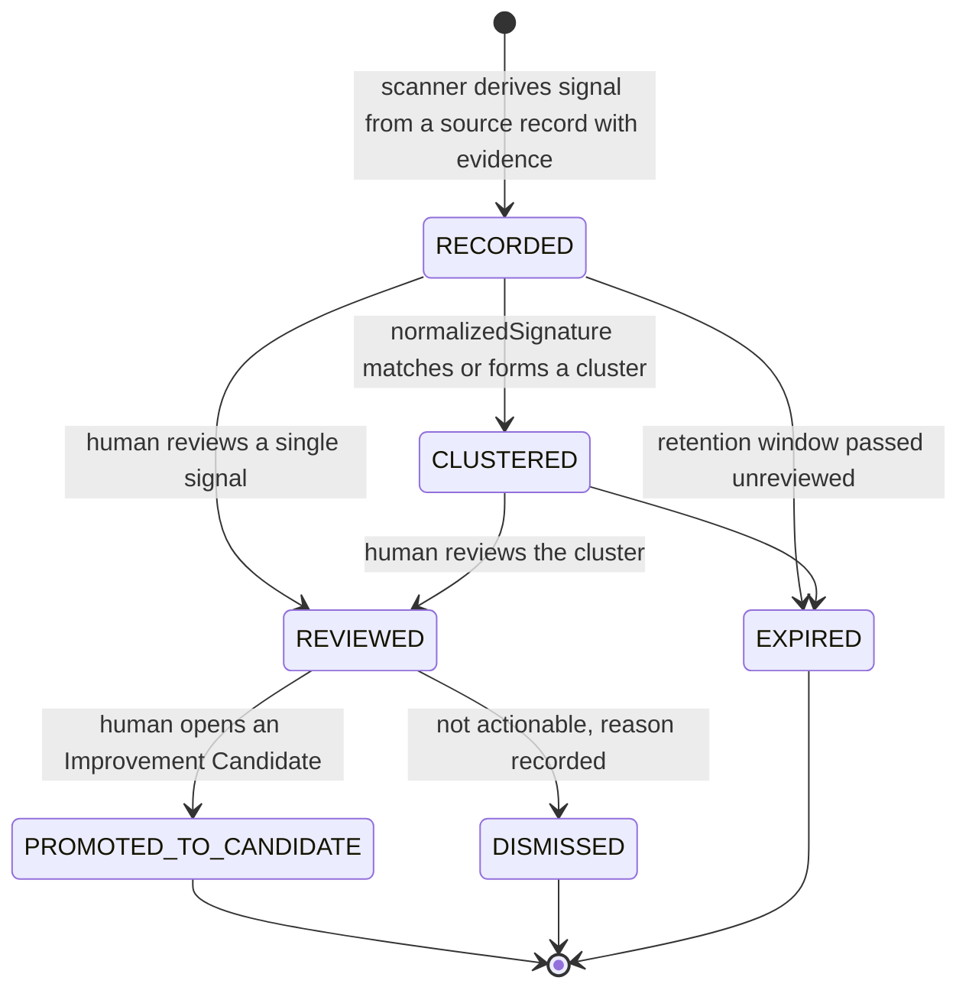

# Learning Signal

`fdlc://v1/learning-signal` · Family E (Learning) · Delivery Loop step 10, **Learn**

## Purpose

A Learning Signal is an attributable, reviewed observation that something in the factory should change: a repeated human correction, a verification failure pattern, a retry or recovery, a context miss, a routing mismatch, wasted tokens, an outcome regression, a verifier disagreement. Signals are advisory. They carry no acceptance authority, mutate nothing, and become effective only by becoming an Improvement Candidate that passes Qualify. Memory is not learning; model confidence is not evidence.

## Identity

| Rule | Value |
|---|---|
| Type URI | `fdlc://v1/learning-signal` |
| Instance id | `LS-<subject>-<seq>` (`LS-104-01`). |
| Mutability | Immutable observation. Review state and cluster membership append. |
| Digest | `digest` = SHA-256 over `{signalType, source, subject, normalizedSignature, evidenceFingerprint, observedAt}`. |
| Dedupe | `idempotencyKey` and `normalizedSignature` allow deterministic deduplication and clustering. |

## Fields

| Field | Type | Req | Description |
|---|---|---|---|
| `schemaVersion`, `type`, `id`, `namespace` | — | MUST | Common identity. |
| `signalType` | enum | MUST | HUMAN_CORRECTION, REPEATED_INSTRUCTION, VERIFICATION_FAILURE, DETERMINISTIC_GATE_FAILURE, RETRY_REQUIRED, RECOVERY_REQUIRED, CONTEXT_MISS, CONTEXT_OVERLOAD, MODEL_ROUTING_MISMATCH, TOOL_SELECTION_MISMATCH, PROMPT_AMBIGUITY, AGENT_CONFIG_DRIFT, UNNECESSARY_AGENT_USAGE, TOKEN_WASTE, HUMAN_INTERVENTION, REPEATED_REVIEW_FINDING, OUTCOME_REGRESSION, ROLLBACK, ESCAPED_DEFECT, COST_ANOMALY, LATENCY_ANOMALY, VERIFIER_DISAGREEMENT, VERIFIER_FALSE_SUCCESS, VERIFIER_FALSE_FAILURE, INCIDENT, POLICY_VIOLATION, SPEC_QUALITY_FINDING. |
| `source` | {sourceType, sourceId, sourceDigest} | MUST | The record the signal was derived from (Verification, Evidence, Attempt, Decision, Outcome, Release, Incident, registry, Specification, Qualification Record). |
| `subject` | object | MUST | `factoryVersionId` (MUST), `affectedComponent` (MUST: ROUTING, SKILL, EVALUATOR, POLICY, PROMPT, CONFIG, TOOL, CONTEXT, HARNESS, MODEL_ROUTE, SPECIFICATION, UNKNOWN), plus Work Order, Attempt, Intent, Release, capability, route digest, repository. |
| `reasonCode`, `summary` | string | MUST | Machine code and human summary. |
| `normalizedSignature`, `clusterKey`, `clusterId` | string, Id | MUST / SHOULD / MUST when CLUSTERED | Deterministic pattern fingerprint and cluster. |
| `evidenceIds[]` (≥1), `evidenceFingerprint` | Id[], Digest | MUST / SHOULD | The evidence the signal rests on. |
| `confidence` | 0–1 | MUST | Scanner confidence; never a substitute for evidence. |
| `severity` | RiskClass | MUST | — |
| `observed` | object | SHOULD | Model calls, tokens, cost (CostRecord), human minutes, retries; unknown stays null. |
| `review` | {status UNREVIEWED/REVIEWED/DISMISSED, reviewedBy, reviewedAt, note} | MUST | Human review record. |
| `acceptanceAuthority` | const `false` | MUST | — |
| `mutatesProduction` | const `false` | MUST | — |
| `improvementCandidateId` | Id | MUST when PROMOTED_TO_CANDIDATE | — |
| `state` | RECORDED / CLUSTERED / REVIEWED / PROMOTED_TO_CANDIDATE / DISMISSED / EXPIRED | MUST | — |
| `observedAt`, `expiresAt`, `idempotencyKey`, `digest`, `createdAt`, `createdBy`, `history[]` | — | MUST / SHOULD | Common audit fields. |

## Lifecycle



| Transition | Who | MUST record |
|---|---|---|
| `RECORDED` | Learning scanner (service) | Source record + digest, evidence ids, normalized signature, confidence, `acceptanceAuthority: false` |
| `→ CLUSTERED` | Scanner (deterministic clustering) | `clusterId`, `clusterKey` |
| `→ REVIEWED` / `DISMISSED` | Human | `review.reviewedBy/At`, note or dismissal reason |
| `→ PROMOTED_TO_CANDIDATE` | Human | `improvementCandidateId` |
| `→ EXPIRED` | Control plane | Retention policy version |

## Invariants

- A signal MUST cite ≥1 Evidence id and MUST name the Factory Version it is attributed to. An unattributed signal is noise and MUST NOT be recorded.
- `acceptanceAuthority` and `mutatesProduction` MUST be `false`. "`LearningSignalInput.acceptanceAuthority` is typed as the literal `false`, so the type system itself refuses a signal that claims otherwise." (`FACTORY_VOCABULARY.md:132-134`)
- A signal MUST NOT change routing, skills, prompts, policy, evaluators, or any Factory Version. "The loop may not self-authorize, mutate governance, bypass verification, or become a token sink." (`FACTORY_VOCABULARY.md:198-199`)
- Promotion to an Improvement Candidate MUST be a human action.
- `confidence` MUST NOT be used as evidence. A high-confidence signal with no evidence ids is invalid.
- Signals derived from advisory sources (traces, evals, memory) MUST still cite Evidence records for the underlying facts; an eval score alone is not evidence.
- Unknown telemetry in `observed` MUST stay `null`.
- The learning subsystem MUST be subject to the same policy, verification, and acceptance controls as the work the factory performs. "Any evidence of acceptance, verification, routing, Factory Version, or repository mutation from the learning subsystem is a release blocker." (`factory-learning-continuous-improvement.md:173-174`)

## Evidence requirements

| Element | Evidence |
|---|---|
| Observation | The source record digest and the Evidence records it references (verification checks, decisions, outcome measurements, incident records) |
| Cost impact | Cost records with status; coverage |
| Review | Human review Decision or review note with authenticated actor |

## Extension points

- `x-` fields at top level and under `observed`, `subject`.
- `signalType` is closed; organization-specific patterns use the nearest type plus `reasonCode` and `x-signal-family`.
- Clustering algorithm and `clusterKey` format are implementation-defined; determinism is required.

## Mission Control mapping

| FDLC | Mission Control | Status | Divergence |
|---|---|---|---|
| Learning Signal | `learningSignals` (`convex/schema.ts:7457`): 17 signal types, 9 source types, `normalizedSignature`, `deterministicKey`, `clusterKey`, `evidenceFingerprint`, `evidenceRefs[]`, `confidence`, `severity`, observed model calls/tokens/cost, `acceptanceAuthority: false` | Available (Qualified; advisory) | Direct. FDLC adds outcome-, release-, verifier-, and incident-derived signal types. |
| Clusters | `learningSignalClusters` BELOW_THRESHOLD/ACTIVE/CANDIDATE_CREATED/SNOOZED/CLOSED | Available | FDLC folds cluster membership into the signal's `clusterId`. |
| Scanner | `convex/lib/metaLoopSignals.ts`; 30-day window; no LLM calls in V1 | Available | Implementation detail. |
| Review | `reviewedAt/By` on suggestions; human review before experiment | Available | Direct. |

## JSON Schema

```json
{
  "$schema": "https://json-schema.org/draft/2020-12/schema",
  "$id": "https://fdlc.ai/schemas/v1/learning-signal.schema.json",
  "title": "FDLC Learning Signal",
  "description": "An attributable, reviewed signal from executions, failures, retries, verifications, overrides, cost, incidents, outcomes. Advisory: it carries no acceptance authority and mutates nothing.",
  "type": "object",
  "properties": {
    "schemaVersion": {
      "type": "string",
      "const": "1.0"
    },
    "type": {
      "type": "string",
      "const": "fdlc://v1/learning-signal"
    },
    "id": {
      "$ref": "#/$defs/Id"
    },
    "namespace": {
      "$ref": "#/$defs/Namespace"
    },
    "signalType": {
      "type": "string",
      "enum": [
        "HUMAN_CORRECTION",
        "REPEATED_INSTRUCTION",
        "VERIFICATION_FAILURE",
        "DETERMINISTIC_GATE_FAILURE",
        "RETRY_REQUIRED",
        "RECOVERY_REQUIRED",
        "CONTEXT_MISS",
        "CONTEXT_OVERLOAD",
        "MODEL_ROUTING_MISMATCH",
        "TOOL_SELECTION_MISMATCH",
        "PROMPT_AMBIGUITY",
        "AGENT_CONFIG_DRIFT",
        "UNNECESSARY_AGENT_USAGE",
        "TOKEN_WASTE",
        "HUMAN_INTERVENTION",
        "REPEATED_REVIEW_FINDING",
        "OUTCOME_REGRESSION",
        "ROLLBACK",
        "ESCAPED_DEFECT",
        "COST_ANOMALY",
        "LATENCY_ANOMALY",
        "VERIFIER_DISAGREEMENT",
        "VERIFIER_FALSE_SUCCESS",
        "VERIFIER_FALSE_FAILURE",
        "INCIDENT",
        "POLICY_VIOLATION",
        "SPEC_QUALITY_FINDING"
      ]
    },
    "source": {
      "type": "object",
      "properties": {
        "sourceType": {
          "type": "string",
          "enum": [
            "VERIFICATION",
            "EVIDENCE",
            "ATTEMPT",
            "RUN_EVENT",
            "TRACE",
            "DECISION",
            "OUTCOME",
            "RELEASE",
            "INCIDENT",
            "CAPABILITY_REGISTRY",
            "SPECIFICATION",
            "QUALIFICATION_RECORD"
          ]
        },
        "sourceId": {
          "$ref": "#/$defs/Id"
        },
        "sourceDigest": {
          "$ref": "#/$defs/Digest"
        }
      },
      "required": [
        "sourceType",
        "sourceId"
      ],
      "additionalProperties": false
    },
    "subject": {
      "type": "object",
      "description": "What the signal is about. Attribution is required; an unattributed signal is noise.",
      "properties": {
        "factoryVersionId": {
          "$ref": "#/$defs/Id"
        },
        "factoryVersionDigest": {
          "$ref": "#/$defs/Digest"
        },
        "executionProfileId": {
          "$ref": "#/$defs/Id"
        },
        "workOrderId": {
          "$ref": "#/$defs/Id"
        },
        "attemptId": {
          "$ref": "#/$defs/Id"
        },
        "intentId": {
          "$ref": "#/$defs/Id"
        },
        "releaseId": {
          "$ref": "#/$defs/Id"
        },
        "capabilityId": {
          "$ref": "#/$defs/Id"
        },
        "modelRouteDigest": {
          "$ref": "#/$defs/Digest"
        },
        "repositoryId": {
          "$ref": "#/$defs/Id"
        },
        "affectedComponent": {
          "type": "string",
          "enum": [
            "ROUTING",
            "SKILL",
            "EVALUATOR",
            "POLICY",
            "PROMPT",
            "CONFIG",
            "TOOL",
            "CONTEXT",
            "HARNESS",
            "MODEL_ROUTE",
            "SPECIFICATION",
            "UNKNOWN"
          ]
        }
      },
      "required": [
        "factoryVersionId",
        "affectedComponent"
      ],
      "additionalProperties": false
    },
    "reasonCode": {
      "type": "string"
    },
    "summary": {
      "type": "string",
      "minLength": 1
    },
    "normalizedSignature": {
      "type": "string",
      "description": "Deterministic fingerprint of the failure or friction pattern, used for clustering and dedupe."
    },
    "clusterKey": {
      "type": "string"
    },
    "clusterId": {
      "$ref": "#/$defs/Id"
    },
    "evidenceIds": {
      "type": "array",
      "items": {
        "$ref": "#/$defs/Id"
      }
    },
    "evidenceFingerprint": {
      "$ref": "#/$defs/Digest"
    },
    "confidence": {
      "type": "number",
      "minimum": 0,
      "maximum": 1
    },
    "severity": {
      "$ref": "#/$defs/RiskClass"
    },
    "observed": {
      "type": "object",
      "properties": {
        "modelCalls": {
          "type": [
            "integer",
            "null"
          ]
        },
        "tokens": {
          "type": [
            "integer",
            "null"
          ]
        },
        "cost": {
          "$ref": "#/$defs/CostRecord"
        },
        "humanMinutes": {
          "type": [
            "number",
            "null"
          ]
        },
        "retries": {
          "type": [
            "integer",
            "null"
          ]
        }
      },
      "additionalProperties": false
    },
    "review": {
      "type": "object",
      "properties": {
        "status": {
          "type": "string",
          "enum": [
            "UNREVIEWED",
            "REVIEWED",
            "DISMISSED"
          ]
        },
        "reviewedBy": {
          "$ref": "#/$defs/Actor"
        },
        "reviewedAt": {
          "$ref": "#/$defs/Timestamp"
        },
        "note": {
          "type": "string"
        }
      },
      "required": [
        "status"
      ],
      "additionalProperties": false
    },
    "acceptanceAuthority": {
      "type": "boolean",
      "const": false
    },
    "mutatesProduction": {
      "type": "boolean",
      "const": false
    },
    "improvementCandidateId": {
      "$ref": "#/$defs/Id"
    },
    "state": {
      "type": "string",
      "enum": [
        "RECORDED",
        "CLUSTERED",
        "REVIEWED",
        "PROMOTED_TO_CANDIDATE",
        "DISMISSED",
        "EXPIRED"
      ]
    },
    "observedAt": {
      "$ref": "#/$defs/Timestamp"
    },
    "expiresAt": {
      "$ref": "#/$defs/Timestamp"
    },
    "idempotencyKey": {
      "type": "string"
    },
    "digest": {
      "$ref": "#/$defs/Digest",
      "description": "Digest over (signalType, source, subject, normalizedSignature, evidenceFingerprint, observedAt)."
    },
    "createdAt": {
      "$ref": "#/$defs/Timestamp"
    },
    "createdBy": {
      "$ref": "#/$defs/Actor"
    },
    "history": {
      "type": "array",
      "items": {
        "$ref": "#/$defs/Transition"
      }
    }
  },
  "required": [
    "schemaVersion",
    "type",
    "id",
    "namespace",
    "signalType",
    "source",
    "subject",
    "reasonCode",
    "summary",
    "normalizedSignature",
    "evidenceIds",
    "confidence",
    "severity",
    "review",
    "acceptanceAuthority",
    "mutatesProduction",
    "state",
    "observedAt",
    "idempotencyKey",
    "digest",
    "createdAt",
    "createdBy"
  ],
  "allOf": [
    {
      "if": {
        "properties": {
          "state": {
            "enum": [
              "REVIEWED",
              "PROMOTED_TO_CANDIDATE",
              "DISMISSED"
            ]
          }
        }
      },
      "then": {
        "properties": {
          "review": {
            "required": [
              "reviewedBy",
              "reviewedAt"
            ],
            "properties": {
              "status": {
                "enum": [
                  "REVIEWED",
                  "DISMISSED"
                ]
              }
            }
          }
        }
      }
    },
    {
      "if": {
        "properties": {
          "state": {
            "const": "PROMOTED_TO_CANDIDATE"
          }
        }
      },
      "then": {
        "required": [
          "improvementCandidateId"
        ]
      }
    },
    {
      "if": {
        "properties": {
          "state": {
            "const": "CLUSTERED"
          }
        }
      },
      "then": {
        "required": [
          "clusterId"
        ]
      }
    },
    {
      "properties": {
        "evidenceIds": {
          "minItems": 1
        }
      }
    }
  ],
  "$defs": {
    "Id": {
      "type": "string",
      "minLength": 1,
      "maxLength": 200,
      "pattern": "^[A-Za-z0-9][A-Za-z0-9._:/@-]*$",
      "description": "Instance identifier. Unique within the issuing namespace; combined with `namespace` it is globally unique."
    },
    "ArtifactUri": {
      "type": "string",
      "pattern": "^fdlc://v1/(intent|specification|plan|work-order|factory-manifest|factory-version|execution-profile|capability-manifest|qualification-record|context-package|attempt|candidate|evidence|verification|decision|release|outcome|learning-signal|improvement-candidate)(/[A-Za-z0-9][A-Za-z0-9._:@-]*)?$",
      "description": "Artifact type URI (`fdlc://v1/<artifact>`), optionally suffixed with an instance id."
    },
    "Namespace": {
      "type": "string",
      "format": "uri",
      "description": "URI of the issuing control plane or organization. Scopes every `id` in this record."
    },
    "Digest": {
      "type": "string",
      "pattern": "^sha256:[a-f0-9]{64}$",
      "description": "SHA-256 over the RFC 8785 (JCS) canonical JSON of the digested projection."
    },
    "GitSha": {
      "type": "string",
      "pattern": "^[a-f0-9]{40}$|^[a-f0-9]{64}$",
      "description": "Lowercase full Git object id (SHA-1 or SHA-256 repository)."
    },
    "Timestamp": {
      "type": "string",
      "format": "date-time",
      "description": "RFC 3339 timestamp in UTC."
    },
    "Semver": {
      "type": "string",
      "pattern": "^(0|[1-9]\\d*)\\.(0|[1-9]\\d*)\\.(0|[1-9]\\d*)(-[0-9A-Za-z.-]+)?(\\+[0-9A-Za-z.-]+)?$"
    },
    "RiskClass": {
      "type": "string",
      "enum": [
        "LOW",
        "MEDIUM",
        "HIGH",
        "CRITICAL"
      ]
    },
    "AutonomyLevel": {
      "type": "string",
      "enum": [
        "L0",
        "L1",
        "L2",
        "L3",
        "L4",
        "L5"
      ],
      "description": "HITL spectrum position. Effective autonomy is min(factory, objective, work order, policy, trust)."
    },
    "Actor": {
      "type": "object",
      "description": "Attributable identity. `identitySource` says how the control plane established it; never inferred from a client label.",
      "properties": {
        "kind": {
          "type": "string",
          "enum": [
            "human",
            "policy",
            "service",
            "agent",
            "system"
          ]
        },
        "id": {
          "$ref": "#/$defs/Id"
        },
        "identitySource": {
          "type": "string",
          "enum": [
            "authenticated",
            "workload-identity",
            "service-command",
            "development-fallback"
          ]
        },
        "displayName": {
          "type": "string"
        },
        "delegationRef": {
          "$ref": "#/$defs/Id",
          "description": "Reference to the delegation record that grants this actor its authority."
        }
      },
      "required": [
        "kind",
        "id",
        "identitySource"
      ],
      "additionalProperties": false
    },
    "Ref": {
      "type": "object",
      "description": "Reference to another FDLC artifact instance, optionally pinned to a digest.",
      "properties": {
        "type": {
          "$ref": "#/$defs/ArtifactUri"
        },
        "id": {
          "$ref": "#/$defs/Id"
        },
        "digest": {
          "$ref": "#/$defs/Digest"
        },
        "revisionNumber": {
          "type": "integer",
          "minimum": 1
        }
      },
      "required": [
        "type",
        "id"
      ],
      "additionalProperties": false
    },
    "Money": {
      "type": "object",
      "properties": {
        "amount": {
          "type": "number",
          "minimum": 0
        },
        "currency": {
          "type": "string",
          "pattern": "^[A-Z]{3}$"
        }
      },
      "required": [
        "amount",
        "currency"
      ],
      "additionalProperties": false
    },
    "CostRecord": {
      "type": "object",
      "description": "Cost with an honesty class. UNKNOWN cost stays UNKNOWN; implementations MUST NOT invent zeroes.",
      "properties": {
        "status": {
          "type": "string",
          "enum": [
            "MEASURED",
            "ESTIMATED",
            "UNKNOWN"
          ]
        },
        "amount": {
          "type": "number",
          "minimum": 0
        },
        "currency": {
          "type": "string",
          "pattern": "^[A-Z]{3}$"
        },
        "coverage": {
          "type": "number",
          "minimum": 0,
          "maximum": 1,
          "description": "Fraction of contributing cost items that were measured."
        },
        "reason": {
          "type": "string"
        }
      },
      "required": [
        "status"
      ],
      "additionalProperties": false
    },
    "Transition": {
      "type": "object",
      "description": "Audit record of one authoritative state transition. Every field listed here MUST be recorded.",
      "properties": {
        "transitionId": {
          "$ref": "#/$defs/Id"
        },
        "subjectId": {
          "$ref": "#/$defs/Id"
        },
        "priorVersion": {
          "type": "integer",
          "minimum": 0
        },
        "fromState": {
          "type": "string"
        },
        "toState": {
          "type": "string"
        },
        "actor": {
          "$ref": "#/$defs/Actor"
        },
        "reason": {
          "type": "string"
        },
        "policyVersion": {
          "type": "string"
        },
        "idempotencyKey": {
          "type": "string"
        },
        "occurredAt": {
          "$ref": "#/$defs/Timestamp"
        },
        "requiredEvidenceIds": {
          "type": "array",
          "items": {
            "$ref": "#/$defs/Id"
          }
        },
        "decisionId": {
          "$ref": "#/$defs/Id"
        },
        "invalidatedDependents": {
          "type": "array",
          "items": {
            "$ref": "#/$defs/Ref"
          }
        }
      },
      "required": [
        "subjectId",
        "fromState",
        "toState",
        "actor",
        "reason",
        "idempotencyKey",
        "occurredAt"
      ],
      "additionalProperties": false
    },
    "ArtifactRef": {
      "type": "object",
      "description": "Content-addressed reference to a stored artifact (diff, log, screenshot, bundle).",
      "properties": {
        "artifactId": {
          "$ref": "#/$defs/Id"
        },
        "kind": {
          "type": "string"
        },
        "mediaType": {
          "type": "string"
        },
        "digest": {
          "$ref": "#/$defs/Digest"
        },
        "sizeBytes": {
          "type": "integer",
          "minimum": 0
        },
        "storageRef": {
          "type": "string"
        }
      },
      "required": [
        "artifactId",
        "digest"
      ],
      "additionalProperties": false
    }
  },
  "patternProperties": {
    "^x-[a-z0-9]+(-[a-z0-9]+)*$": {}
  },
  "additionalProperties": false
}
```

## Example instance

```json
{
  "schemaVersion": "1.0",
  "type": "fdlc://v1/learning-signal",
  "id": "LS-104-01",
  "namespace": "https://acme.example/factories/checkout",
  "signalType": "REPEATED_REVIEW_FINDING",
  "source": {
    "sourceType": "DECISION",
    "sourceId": "DEC-104-01",
    "sourceDigest": "sha256:491150850eec71f8399ffd639d3dd07ff4cbcb1d60b73f9f66edfb0aa5a7f328"
  },
  "subject": {
    "factoryVersionId": "FV-depmod-1.0",
    "factoryVersionDigest": "sha256:ce6706f3f86d3e77ddd2e266cc1cbf88480a25bb535e2845eda36be5d98bec7f",
    "executionProfileId": "EP-depmod-1.0-prod",
    "workOrderId": "WO-104-01",
    "attemptId": "ATT-104-01-p1",
    "intentId": "INT-104",
    "releaseId": "REL-104-01",
    "capabilityId": "CAP-skill-sdk-migration-2.1.0",
    "repositoryId": "repo:checkout-api",
    "affectedComponent": "SKILL"
  },
  "reasonCode": "REVIEW_FINDING_IDEMPOTENCY_HEADER_UNDOCUMENTED",
  "summary": "In three of the last five accepted SDK upgrades the reviewer asked the producer to add an explicit contract test for changed idempotency-key header semantics. The migration skill does not instruct the agent to add one; the reviewer supplies it each time.",
  "normalizedSignature": "review-finding:idempotency-header-contract-test:skill=sdk-migration",
  "clusterKey": "depmod:review-findings:idempotency",
  "clusterId": "LSC-depmod-idempotency-1",
  "evidenceIds": [
    "EV-104-33",
    "EV-101-27",
    "EV-097-19"
  ],
  "evidenceFingerprint": "sha256:303e1be635859aecd3ac94b31a83bcc256b86cddde4d1edfff948cf541029125",
  "confidence": 0.82,
  "severity": "LOW",
  "observed": {
    "modelCalls": null,
    "tokens": null,
    "cost": {
      "status": "UNKNOWN",
      "reason": "Reviewer minutes are measured; model cost of the corrective turns was not attributed to the finding."
    },
    "humanMinutes": 14,
    "retries": 0
  },
  "review": {
    "status": "REVIEWED",
    "reviewedBy": {
      "kind": "human",
      "id": "user:priya.n",
      "identitySource": "authenticated"
    },
    "reviewedAt": "2026-09-17T09:15:00Z",
    "note": "Real pattern; promote to an Improvement Candidate for the sdk-migration skill."
  },
  "acceptanceAuthority": false,
  "mutatesProduction": false,
  "improvementCandidateId": "IC-104-01",
  "state": "PROMOTED_TO_CANDIDATE",
  "observedAt": "2026-09-16T20:35:00Z",
  "expiresAt": "2026-12-16T20:35:00Z",
  "idempotencyKey": "ls:DEC-104-01:REVIEW_FINDING_IDEMPOTENCY_HEADER_UNDOCUMENTED",
  "digest": "sha256:303e1be635859aecd3ac94b31a83bcc256b86cddde4d1edfff948cf541029125",
  "createdAt": "2026-09-16T20:36:00Z",
  "createdBy": {
    "kind": "service",
    "id": "svc:learning-scanner",
    "identitySource": "workload-identity"
  }
}
```

## Related

- Spec: [/specification/v1/outcome](/specification/v1/outcome) · [/specification/v1/improvement-candidate](/specification/v1/improvement-candidate) · [/specification/v1/evidence](/specification/v1/evidence)
- Framework: [/framework/delivery-loop](/framework/delivery-loop) step 10 Learn; [/framework/principles](/framework/principles) "Learning can be autonomous. Promotion should be governed."
- Architecture: [/architecture/learning](/architecture/learning) (D21 governed learning loop)
- Anti-patterns: memory as learning; self-authorizing loop; token sink
- Glossary: Learning Signal, Cluster, Advisory
