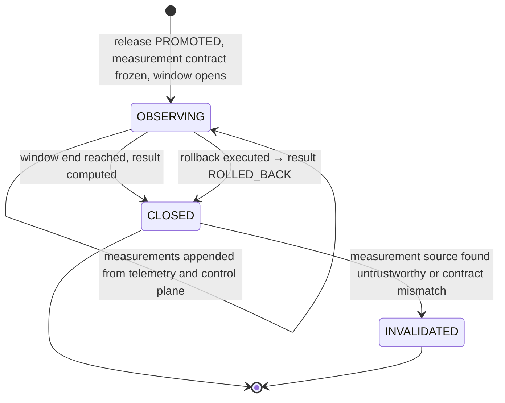

# Outcome

`fdlc://v1/outcome` · Family D (Trust) · Delivery Loop step 9, **Observe**

## Purpose

An Outcome is the observed technical, operational, and business result of a Release over a declared observation window, measured against a measurement contract declared before observation began, and attributed to the release, the Factory Version, and the cost cohort that produced it. It is where the lead-time clock stops: not at merge, not at deploy, but at validated value. Outcomes are the input to Learning Signals and the denominator of factory economics.

## Identity

| Rule | Value |
|---|---|
| Type URI | `fdlc://v1/outcome` |
| Instance id | `OUT-<intent>-<seq>` (`OUT-104-01`). |
| Mutability | Measurements append while `OBSERVING`. Immutable at `CLOSED`. |
| Digest | `digest` = SHA-256 over `{releaseDigest, measurementContract.digest, measurements, cost, attribution, result}`, computed at `CLOSED`. |
| Contract | `measurementContract.digest` MUST be fixed before `observationWindow.start`. |

## Fields

| Field | Type | Req | Description |
|---|---|---|---|
| `schemaVersion`, `type`, `id`, `namespace` | — | MUST | Common identity. |
| `releaseId`, `releaseDigest`, `intentId`, `workOrderIds[]`, `candidateId` | — | MUST / SHOULD | Attribution to the exact release. |
| `observationWindow` | {start, end, status OPEN/CLOSED/EXTENDED, extendedReason} | MUST | Declared window; extensions are recorded, never silent. |
| `measurementContract` | object | MUST | `contractId`, `digest`, `metrics[] {metricId, name, unit, dimension TECHNICAL/OPERATIONAL/BUSINESS/ECONOMIC, baseline, target, direction, rollbackThreshold, source}`. |
| `measurements[]` | object | MUST | `metricId`, `value` (nullable), `unit`, `observedAt`, `source`, `evidenceId`, `confidence` HIGH/LOW/NONE, `status` MEASURED/ESTIMATED/UNKNOWN. |
| `technical` | object | SHOULD | Health checks, error-rate and latency deltas, `canaryComparison`. |
| `operational` | object | MUST | `rolledBack`, `hotfixRequired`, `incidentIds[]`, `escapedDefects`, `reopenCount`, `humanReviewMinutes`, `changeFailure`. |
| `business` | object | SHOULD | Value measure ids, `valueConfirmed`, `leadTimeToValidatedValueMs` (from Intent `admittedAt`; null until confirmed). |
| `cost` | object | MUST | `cohortDigest`, `total` CostRecord, `includesFailedAttempts: true`, `attemptIds[]`, `byDenominator {perVerifiedOutcome, perAcceptedOutcome, perReleasedOutcome}`, `formulaVersion`. |
| `attribution` | object | MUST | Factory Version id/digest, Execution Profile, model route digests, environment. |
| `result` | HELD / REGRESSED / ROLLED_BACK / INCONCLUSIVE | MUST once CLOSED | — |
| `state` | OBSERVING / CLOSED / INVALIDATED | MUST | — |
| `learningSignalIds[]` | Id | SHOULD | Signals raised from this Outcome. |
| `closedAt`, `closedBy`, `digest`, `createdAt`, `createdBy`, `history[]` | — | MUST once CLOSED / SHOULD | Common audit fields. |

## Lifecycle



| Transition | Who | MUST record |
|---|---|---|
| `OBSERVING` | Control plane on Release `PROMOTED` | Contract digest, window, cohort digest, attempt ids in the cost cohort |
| append measurement | Telemetry integration or control plane (service) | Source, evidence id, confidence, status; `UNKNOWN` stays null |
| `OBSERVING → CLOSED` | Policy (observation policy) or human | `result`, `closedBy`, digest; every contract metric has a measurement or an explicit `UNKNOWN` |
| `CLOSED → INVALIDATED` | Human | Reason; affected Learning Signals flagged |

## Invariants

- The measurement contract MUST be declared before observation starts. Metrics not in the contract are advisory and MUST NOT determine `result`.
- Every contract metric MUST have a measurement at close; a missing value MUST be recorded as `UNKNOWN`, never inferred. "Missing facts are represented as `unknown`, never inferred." (`governed-missions-contract.md:98`)
- Cost MUST include failed and retried Attempt spend. "Failed and retried Attempt spend remains part of the denominator cost." (`execution-routing-v1.md:115-116`) Unknown cost MUST remain `UNKNOWN` with a coverage figure; "it cannot support an efficiency claim." (`docs/OVERVIEW.md:706-707`)
- The three economic denominators (verified, accepted, released) MUST be reported separately when reported at all.
- `changeFailure` MUST be true if the deployment required rollback, hotfix, or emergency intervention, or caused a customer-impacting regression, reliability incident, security incident, or SLO violation within the window. One deployment counts once.
- Lead time MUST be measured from Intent admission to validated value; a merged pull request MUST NOT stop the clock.
- `result: ROLLED_BACK` MUST be recorded when `operational.rolledBack` is true.
- Attribution MUST name the exact Factory Version digest so the Outcome can feed the qualification and regression comparison of that version.
- An Outcome MUST NOT be edited after `CLOSED`; corrections are `INVALIDATED` plus a new Outcome.

## Evidence requirements

| Element | Evidence |
|---|---|
| Technical measurements | `RUNTIME_OBSERVATION` evidence from telemetry with source identity and trace refs |
| Operational | Incident records; rollback receipts; reopen Decisions |
| Business | Value measure evidence per the contract's `source` |
| Cost | Provider usage receipts reconciled to Attempts; coverage computed from receipt completeness |

## Extension points

- `x-` fields at top level and in `measurements[]`, `business`.
- `measurementContract.metrics[].dimension` is closed; metric ids and names are organization-defined. The RECOMMENDED core set: verified completion rate, first-pass verification rate, cost per verified/accepted/released outcome, cycle time, human review minutes, reopen rate, rollback rate, escaped defects.

## Mission Control mapping

| FDLC | Mission Control | Status | Divergence |
|---|---|---|---|
| Outcome | `factoryOutcomeEvents` (stages VERIFICATION_PASSED → HUMAN_ACCEPTED → MERGED → DEPLOYED → PRODUCTION_VERIFIED \| INCIDENT \| ROLLED_BACK \| REJECTED \| ABANDONED), `factoryOutcomeProjections` (`convex/schema.ts:4514-4559`) | Experimental ("Cost per accepted outcome — Partial"; production feedback Partial) | MC records outcome stages and an economics projection per Attempt; FDLC adds the measurement contract and observation window. |
| `cost` | `factoryOutcomeProjections {formulaVersion accepted-outcome-economics/v1\|v2, costCoverage, costCompleteness, confidence HIGH/LOW/NONE}`; inference receipts with MEASURED/ESTIMATED/UNKNOWN | Experimental (governed inference accounting default off) | Direct in shape; coverage and confidence match. |
| `operational.changeFailure` | not computed | Proposed | FDLC definition follows the Guide's change-failure rule. |
| `business.leadTimeToValidatedValueMs` | not computed | Proposed | — |
| Observation feeding learning | "Observe one real release and feed rollback/customer outcome into governed learning" is the next MC gate | Planned (audit §5.6) | — |

## JSON Schema

```json
{
  "$schema": "https://json-schema.org/draft/2020-12/schema",
  "$id": "https://fdlc.ai/schemas/v1/outcome.schema.json",
  "title": "FDLC Outcome",
  "description": "The observed technical, operational, and business result over an observation window, attributed to the release and its cost cohort. Merge is not an outcome; the clock stops on verified value.",
  "type": "object",
  "properties": {
    "schemaVersion": {
      "type": "string",
      "const": "1.0"
    },
    "type": {
      "type": "string",
      "const": "fdlc://v1/outcome"
    },
    "id": {
      "$ref": "#/$defs/Id"
    },
    "namespace": {
      "$ref": "#/$defs/Namespace"
    },
    "releaseId": {
      "$ref": "#/$defs/Id"
    },
    "releaseDigest": {
      "$ref": "#/$defs/Digest"
    },
    "intentId": {
      "$ref": "#/$defs/Id"
    },
    "workOrderIds": {
      "type": "array",
      "minItems": 1,
      "items": {
        "$ref": "#/$defs/Id"
      }
    },
    "candidateId": {
      "$ref": "#/$defs/Id"
    },
    "observationWindow": {
      "type": "object",
      "properties": {
        "start": {
          "$ref": "#/$defs/Timestamp"
        },
        "end": {
          "$ref": "#/$defs/Timestamp"
        },
        "status": {
          "type": "string",
          "enum": [
            "OPEN",
            "CLOSED",
            "EXTENDED"
          ]
        },
        "extendedReason": {
          "type": "string"
        }
      },
      "required": [
        "start",
        "end",
        "status"
      ],
      "additionalProperties": false
    },
    "measurementContract": {
      "type": "object",
      "description": "Declared before observation. Metrics observed outside the contract are advisory.",
      "properties": {
        "contractId": {
          "$ref": "#/$defs/Id"
        },
        "digest": {
          "$ref": "#/$defs/Digest"
        },
        "metrics": {
          "type": "array",
          "minItems": 1,
          "items": {
            "type": "object",
            "properties": {
              "metricId": {
                "$ref": "#/$defs/Id"
              },
              "name": {
                "type": "string"
              },
              "unit": {
                "type": "string"
              },
              "dimension": {
                "type": "string",
                "enum": [
                  "TECHNICAL",
                  "OPERATIONAL",
                  "BUSINESS",
                  "ECONOMIC"
                ]
              },
              "baseline": {
                "type": [
                  "number",
                  "null"
                ]
              },
              "target": {
                "type": [
                  "number",
                  "null"
                ]
              },
              "direction": {
                "type": "string",
                "enum": [
                  "LOWER_IS_BETTER",
                  "HIGHER_IS_BETTER",
                  "WITHIN_BAND"
                ]
              },
              "rollbackThreshold": {
                "type": [
                  "number",
                  "null"
                ]
              },
              "source": {
                "type": "string"
              }
            },
            "required": [
              "metricId",
              "name",
              "unit",
              "dimension",
              "direction"
            ],
            "additionalProperties": false
          }
        }
      },
      "required": [
        "contractId",
        "digest",
        "metrics"
      ],
      "additionalProperties": false
    },
    "measurements": {
      "type": "array",
      "items": {
        "type": "object",
        "properties": {
          "metricId": {
            "$ref": "#/$defs/Id"
          },
          "value": {
            "type": [
              "number",
              "null"
            ]
          },
          "unit": {
            "type": "string"
          },
          "observedAt": {
            "$ref": "#/$defs/Timestamp"
          },
          "source": {
            "type": "string"
          },
          "evidenceId": {
            "$ref": "#/$defs/Id"
          },
          "confidence": {
            "type": "string",
            "enum": [
              "HIGH",
              "LOW",
              "NONE"
            ]
          },
          "status": {
            "type": "string",
            "enum": [
              "MEASURED",
              "ESTIMATED",
              "UNKNOWN"
            ]
          }
        },
        "required": [
          "metricId",
          "value",
          "observedAt",
          "source",
          "status"
        ],
        "additionalProperties": false
      }
    },
    "technical": {
      "type": "object",
      "properties": {
        "healthChecksPassed": {
          "type": [
            "boolean",
            "null"
          ]
        },
        "errorRateDelta": {
          "type": [
            "number",
            "null"
          ]
        },
        "latencyP95DeltaMs": {
          "type": [
            "number",
            "null"
          ]
        },
        "canaryComparison": {
          "type": "string",
          "enum": [
            "WITHIN_BAND",
            "REGRESSED",
            "IMPROVED",
            "INCONCLUSIVE",
            "NOT_RUN"
          ]
        }
      },
      "additionalProperties": false
    },
    "operational": {
      "type": "object",
      "properties": {
        "rolledBack": {
          "type": "boolean"
        },
        "hotfixRequired": {
          "type": "boolean"
        },
        "incidentIds": {
          "type": "array",
          "items": {
            "$ref": "#/$defs/Id"
          }
        },
        "escapedDefects": {
          "type": [
            "integer",
            "null"
          ]
        },
        "reopenCount": {
          "type": [
            "integer",
            "null"
          ]
        },
        "humanReviewMinutes": {
          "type": [
            "number",
            "null"
          ]
        },
        "changeFailure": {
          "type": "boolean",
          "description": "True if the deployment required rollback, hotfix, or caused a customer-impacting regression within the window."
        }
      },
      "required": [
        "rolledBack",
        "hotfixRequired",
        "changeFailure"
      ],
      "additionalProperties": false
    },
    "business": {
      "type": "object",
      "properties": {
        "valueMeasureIds": {
          "type": "array",
          "items": {
            "$ref": "#/$defs/Id"
          }
        },
        "valueConfirmed": {
          "type": [
            "boolean",
            "null"
          ]
        },
        "leadTimeToValidatedValueMs": {
          "type": [
            "integer",
            "null"
          ],
          "description": "From Intent admittedAt to validated customer value; null until confirmed."
        }
      },
      "additionalProperties": false
    },
    "cost": {
      "type": "object",
      "description": "Cost per accepted/released outcome. Includes failed and retried Attempt spend. Unknown cost stays null with coverage impact.",
      "properties": {
        "cohortDigest": {
          "$ref": "#/$defs/Digest"
        },
        "total": {
          "$ref": "#/$defs/CostRecord"
        },
        "includesFailedAttempts": {
          "type": "boolean",
          "const": true
        },
        "attemptIds": {
          "type": "array",
          "items": {
            "$ref": "#/$defs/Id"
          }
        },
        "byDenominator": {
          "type": "object",
          "properties": {
            "perVerifiedOutcome": {
              "$ref": "#/$defs/CostRecord"
            },
            "perAcceptedOutcome": {
              "$ref": "#/$defs/CostRecord"
            },
            "perReleasedOutcome": {
              "$ref": "#/$defs/CostRecord"
            }
          },
          "additionalProperties": false
        },
        "formulaVersion": {
          "type": "string"
        }
      },
      "required": [
        "cohortDigest",
        "total",
        "includesFailedAttempts",
        "attemptIds",
        "formulaVersion"
      ],
      "additionalProperties": false
    },
    "attribution": {
      "type": "object",
      "properties": {
        "factoryVersionId": {
          "$ref": "#/$defs/Id"
        },
        "factoryVersionDigest": {
          "$ref": "#/$defs/Digest"
        },
        "executionProfileId": {
          "$ref": "#/$defs/Id"
        },
        "modelRouteDigests": {
          "type": "array",
          "items": {
            "$ref": "#/$defs/Digest"
          }
        },
        "environment": {
          "type": "string"
        }
      },
      "required": [
        "factoryVersionId",
        "factoryVersionDigest",
        "environment"
      ],
      "additionalProperties": false
    },
    "result": {
      "type": "string",
      "enum": [
        "HELD",
        "REGRESSED",
        "ROLLED_BACK",
        "INCONCLUSIVE"
      ]
    },
    "state": {
      "type": "string",
      "enum": [
        "OBSERVING",
        "CLOSED",
        "INVALIDATED"
      ]
    },
    "learningSignalIds": {
      "type": "array",
      "items": {
        "$ref": "#/$defs/Id"
      }
    },
    "closedAt": {
      "$ref": "#/$defs/Timestamp"
    },
    "closedBy": {
      "$ref": "#/$defs/Actor"
    },
    "digest": {
      "$ref": "#/$defs/Digest",
      "description": "Digest over (releaseDigest, measurementContract.digest, measurements, cost, attribution, result). Computed at CLOSED."
    },
    "createdAt": {
      "$ref": "#/$defs/Timestamp"
    },
    "createdBy": {
      "$ref": "#/$defs/Actor"
    },
    "history": {
      "type": "array",
      "items": {
        "$ref": "#/$defs/Transition"
      }
    }
  },
  "required": [
    "schemaVersion",
    "type",
    "id",
    "namespace",
    "releaseId",
    "releaseDigest",
    "intentId",
    "workOrderIds",
    "observationWindow",
    "measurementContract",
    "measurements",
    "operational",
    "cost",
    "attribution",
    "state",
    "createdAt",
    "createdBy"
  ],
  "allOf": [
    {
      "if": {
        "properties": {
          "state": {
            "const": "CLOSED"
          }
        }
      },
      "then": {
        "required": [
          "result",
          "closedAt",
          "closedBy",
          "digest"
        ],
        "properties": {
          "observationWindow": {
            "properties": {
              "status": {
                "const": "CLOSED"
              }
            }
          }
        }
      }
    },
    {
      "if": {
        "properties": {
          "operational": {
            "properties": {
              "rolledBack": {
                "const": true
              }
            }
          },
          "state": {
            "const": "CLOSED"
          }
        }
      },
      "then": {
        "properties": {
          "result": {
            "const": "ROLLED_BACK"
          }
        }
      }
    }
  ],
  "$defs": {
    "Id": {
      "type": "string",
      "minLength": 1,
      "maxLength": 200,
      "pattern": "^[A-Za-z0-9][A-Za-z0-9._:/@-]*$",
      "description": "Instance identifier. Unique within the issuing namespace; combined with `namespace` it is globally unique."
    },
    "ArtifactUri": {
      "type": "string",
      "pattern": "^fdlc://v1/(intent|specification|plan|work-order|factory-manifest|factory-version|execution-profile|capability-manifest|qualification-record|context-package|attempt|candidate|evidence|verification|decision|release|outcome|learning-signal|improvement-candidate)(/[A-Za-z0-9][A-Za-z0-9._:@-]*)?$",
      "description": "Artifact type URI (`fdlc://v1/<artifact>`), optionally suffixed with an instance id."
    },
    "Namespace": {
      "type": "string",
      "format": "uri",
      "description": "URI of the issuing control plane or organization. Scopes every `id` in this record."
    },
    "Digest": {
      "type": "string",
      "pattern": "^sha256:[a-f0-9]{64}$",
      "description": "SHA-256 over the RFC 8785 (JCS) canonical JSON of the digested projection."
    },
    "GitSha": {
      "type": "string",
      "pattern": "^[a-f0-9]{40}$|^[a-f0-9]{64}$",
      "description": "Lowercase full Git object id (SHA-1 or SHA-256 repository)."
    },
    "Timestamp": {
      "type": "string",
      "format": "date-time",
      "description": "RFC 3339 timestamp in UTC."
    },
    "Semver": {
      "type": "string",
      "pattern": "^(0|[1-9]\\d*)\\.(0|[1-9]\\d*)\\.(0|[1-9]\\d*)(-[0-9A-Za-z.-]+)?(\\+[0-9A-Za-z.-]+)?$"
    },
    "RiskClass": {
      "type": "string",
      "enum": [
        "LOW",
        "MEDIUM",
        "HIGH",
        "CRITICAL"
      ]
    },
    "AutonomyLevel": {
      "type": "string",
      "enum": [
        "L0",
        "L1",
        "L2",
        "L3",
        "L4",
        "L5"
      ],
      "description": "HITL spectrum position. Effective autonomy is min(factory, objective, work order, policy, trust)."
    },
    "Actor": {
      "type": "object",
      "description": "Attributable identity. `identitySource` says how the control plane established it; never inferred from a client label.",
      "properties": {
        "kind": {
          "type": "string",
          "enum": [
            "human",
            "policy",
            "service",
            "agent",
            "system"
          ]
        },
        "id": {
          "$ref": "#/$defs/Id"
        },
        "identitySource": {
          "type": "string",
          "enum": [
            "authenticated",
            "workload-identity",
            "service-command",
            "development-fallback"
          ]
        },
        "displayName": {
          "type": "string"
        },
        "delegationRef": {
          "$ref": "#/$defs/Id",
          "description": "Reference to the delegation record that grants this actor its authority."
        }
      },
      "required": [
        "kind",
        "id",
        "identitySource"
      ],
      "additionalProperties": false
    },
    "Ref": {
      "type": "object",
      "description": "Reference to another FDLC artifact instance, optionally pinned to a digest.",
      "properties": {
        "type": {
          "$ref": "#/$defs/ArtifactUri"
        },
        "id": {
          "$ref": "#/$defs/Id"
        },
        "digest": {
          "$ref": "#/$defs/Digest"
        },
        "revisionNumber": {
          "type": "integer",
          "minimum": 1
        }
      },
      "required": [
        "type",
        "id"
      ],
      "additionalProperties": false
    },
    "Money": {
      "type": "object",
      "properties": {
        "amount": {
          "type": "number",
          "minimum": 0
        },
        "currency": {
          "type": "string",
          "pattern": "^[A-Z]{3}$"
        }
      },
      "required": [
        "amount",
        "currency"
      ],
      "additionalProperties": false
    },
    "CostRecord": {
      "type": "object",
      "description": "Cost with an honesty class. UNKNOWN cost stays UNKNOWN; implementations MUST NOT invent zeroes.",
      "properties": {
        "status": {
          "type": "string",
          "enum": [
            "MEASURED",
            "ESTIMATED",
            "UNKNOWN"
          ]
        },
        "amount": {
          "type": "number",
          "minimum": 0
        },
        "currency": {
          "type": "string",
          "pattern": "^[A-Z]{3}$"
        },
        "coverage": {
          "type": "number",
          "minimum": 0,
          "maximum": 1,
          "description": "Fraction of contributing cost items that were measured."
        },
        "reason": {
          "type": "string"
        }
      },
      "required": [
        "status"
      ],
      "additionalProperties": false
    },
    "Transition": {
      "type": "object",
      "description": "Audit record of one authoritative state transition. Every field listed here MUST be recorded.",
      "properties": {
        "transitionId": {
          "$ref": "#/$defs/Id"
        },
        "subjectId": {
          "$ref": "#/$defs/Id"
        },
        "priorVersion": {
          "type": "integer",
          "minimum": 0
        },
        "fromState": {
          "type": "string"
        },
        "toState": {
          "type": "string"
        },
        "actor": {
          "$ref": "#/$defs/Actor"
        },
        "reason": {
          "type": "string"
        },
        "policyVersion": {
          "type": "string"
        },
        "idempotencyKey": {
          "type": "string"
        },
        "occurredAt": {
          "$ref": "#/$defs/Timestamp"
        },
        "requiredEvidenceIds": {
          "type": "array",
          "items": {
            "$ref": "#/$defs/Id"
          }
        },
        "decisionId": {
          "$ref": "#/$defs/Id"
        },
        "invalidatedDependents": {
          "type": "array",
          "items": {
            "$ref": "#/$defs/Ref"
          }
        }
      },
      "required": [
        "subjectId",
        "fromState",
        "toState",
        "actor",
        "reason",
        "idempotencyKey",
        "occurredAt"
      ],
      "additionalProperties": false
    },
    "ArtifactRef": {
      "type": "object",
      "description": "Content-addressed reference to a stored artifact (diff, log, screenshot, bundle).",
      "properties": {
        "artifactId": {
          "$ref": "#/$defs/Id"
        },
        "kind": {
          "type": "string"
        },
        "mediaType": {
          "type": "string"
        },
        "digest": {
          "$ref": "#/$defs/Digest"
        },
        "sizeBytes": {
          "type": "integer",
          "minimum": 0
        },
        "storageRef": {
          "type": "string"
        }
      },
      "required": [
        "artifactId",
        "digest"
      ],
      "additionalProperties": false
    }
  },
  "patternProperties": {
    "^x-[a-z0-9]+(-[a-z0-9]+)*$": {}
  },
  "additionalProperties": false
}
```

## Example instance

```json
{
  "schemaVersion": "1.0",
  "type": "fdlc://v1/outcome",
  "id": "OUT-104-01",
  "namespace": "https://acme.example/factories/checkout",
  "releaseId": "REL-104-01",
  "releaseDigest": "sha256:964bf3fc5ddc785d7081ac0dc088bc1c39f971c538fb7ed9bbf1f269dcbe166b",
  "intentId": "INT-104",
  "workOrderIds": [
    "WO-104-01"
  ],
  "candidateId": "CAND-104-01-p1",
  "observationWindow": {
    "start": "2026-09-09T20:30:00Z",
    "end": "2026-09-16T20:30:00Z",
    "status": "CLOSED"
  },
  "measurementContract": {
    "contractId": "MC-depmod-checkout-1",
    "digest": "sha256:0bb2241e31a9f7ebb93aa43f08ad5057a9870d0334e00f4887961630198ee551",
    "metrics": [
      {
        "metricId": "m-error-rate",
        "name": "checkout-api 5xx error rate",
        "unit": "ratio",
        "dimension": "TECHNICAL",
        "baseline": 0.0021,
        "target": 0.0021,
        "direction": "WITHIN_BAND",
        "rollbackThreshold": 0.005,
        "source": "telemetry:checkout-api"
      },
      {
        "metricId": "m-latency-p95",
        "name": "payment authorization p95 latency",
        "unit": "ms",
        "dimension": "TECHNICAL",
        "baseline": 310,
        "target": 310,
        "direction": "WITHIN_BAND",
        "rollbackThreshold": 450,
        "source": "telemetry:checkout-api"
      },
      {
        "metricId": "m-auth-failures",
        "name": "payment authorization failures",
        "unit": "count/day",
        "dimension": "BUSINESS",
        "baseline": 14,
        "target": 14,
        "direction": "WITHIN_BAND",
        "rollbackThreshold": 40,
        "source": "telemetry:payments"
      },
      {
        "metricId": "m-review-minutes",
        "name": "human review minutes per accepted change",
        "unit": "min",
        "dimension": "OPERATIONAL",
        "baseline": 95,
        "target": 40,
        "direction": "LOWER_IS_BETTER",
        "source": "control-plane"
      },
      {
        "metricId": "m-cost-accepted",
        "name": "cost per accepted outcome",
        "unit": "USD",
        "dimension": "ECONOMIC",
        "baseline": null,
        "target": 25,
        "direction": "LOWER_IS_BETTER",
        "source": "control-plane"
      }
    ]
  },
  "measurements": [
    {
      "metricId": "m-error-rate",
      "value": 0.0019,
      "unit": "ratio",
      "observedAt": "2026-09-16T20:30:00Z",
      "source": "telemetry:checkout-api",
      "evidenceId": "EV-104-31",
      "confidence": "HIGH",
      "status": "MEASURED"
    },
    {
      "metricId": "m-latency-p95",
      "value": 298,
      "unit": "ms",
      "observedAt": "2026-09-16T20:30:00Z",
      "source": "telemetry:checkout-api",
      "evidenceId": "EV-104-31",
      "confidence": "HIGH",
      "status": "MEASURED"
    },
    {
      "metricId": "m-auth-failures",
      "value": 12,
      "unit": "count/day",
      "observedAt": "2026-09-16T20:30:00Z",
      "source": "telemetry:payments",
      "evidenceId": "EV-104-32",
      "confidence": "HIGH",
      "status": "MEASURED"
    },
    {
      "metricId": "m-review-minutes",
      "value": 34,
      "unit": "min",
      "observedAt": "2026-09-09T16:40:00Z",
      "source": "control-plane",
      "evidenceId": "EV-104-33",
      "confidence": "HIGH",
      "status": "MEASURED"
    },
    {
      "metricId": "m-cost-accepted",
      "value": 18.4,
      "unit": "USD",
      "observedAt": "2026-09-16T20:30:00Z",
      "source": "control-plane",
      "evidenceId": "EV-104-34",
      "confidence": "HIGH",
      "status": "MEASURED"
    }
  ],
  "technical": {
    "healthChecksPassed": true,
    "errorRateDelta": -0.0002,
    "latencyP95DeltaMs": -12,
    "canaryComparison": "WITHIN_BAND"
  },
  "operational": {
    "rolledBack": false,
    "hotfixRequired": false,
    "incidentIds": [],
    "escapedDefects": 0,
    "reopenCount": 0,
    "humanReviewMinutes": 34,
    "changeFailure": false
  },
  "business": {
    "valueMeasureIds": [
      "m-auth-failures"
    ],
    "valueConfirmed": true,
    "leadTimeToValidatedValueMs": 1336800000
  },
  "cost": {
    "cohortDigest": "sha256:b41d1e54c16e3998ab88601e0b183b5d68509945a1e7ded0181410916a02da1e",
    "total": {
      "status": "MEASURED",
      "amount": 18.4,
      "currency": "USD",
      "coverage": 1.0
    },
    "includesFailedAttempts": true,
    "attemptIds": [
      "ATT-104-01-p1",
      "ATT-104-01-v1"
    ],
    "byDenominator": {
      "perVerifiedOutcome": {
        "status": "MEASURED",
        "amount": 18.4,
        "currency": "USD",
        "coverage": 1.0
      },
      "perAcceptedOutcome": {
        "status": "MEASURED",
        "amount": 18.4,
        "currency": "USD",
        "coverage": 1.0
      },
      "perReleasedOutcome": {
        "status": "MEASURED",
        "amount": 18.4,
        "currency": "USD",
        "coverage": 1.0
      }
    },
    "formulaVersion": "accepted-outcome-economics/1.0"
  },
  "attribution": {
    "factoryVersionId": "FV-depmod-1.0",
    "factoryVersionDigest": "sha256:ce6706f3f86d3e77ddd2e266cc1cbf88480a25bb535e2845eda36be5d98bec7f",
    "executionProfileId": "EP-depmod-1.0-prod",
    "modelRouteDigests": [
      "sha256:b2cd54e494af6ca42d7cafc364c079baa6d9b7489d314d2a3a96090e9b72d378"
    ],
    "environment": "production"
  },
  "result": "HELD",
  "state": "CLOSED",
  "learningSignalIds": [
    "LS-104-01"
  ],
  "closedAt": "2026-09-16T20:35:00Z",
  "closedBy": {
    "kind": "policy",
    "id": "policy:observation/1",
    "identitySource": "workload-identity"
  },
  "digest": "sha256:de9e8ae78801319a879c0387bdbf778691274200c8578ab0d1fa3413f37d8b65",
  "createdAt": "2026-09-09T20:30:00Z",
  "createdBy": {
    "kind": "service",
    "id": "svc:control-plane",
    "identitySource": "workload-identity"
  }
}
```

## Related

- Spec: [/specification/v1/release](/specification/v1/release) · [/specification/v1/learning-signal](/specification/v1/learning-signal) · [/specification/v1/evidence](/specification/v1/evidence)
- Framework: [/framework/delivery-loop](/framework/delivery-loop) step 9 Observe
- Architecture: [/architecture/economics](/architecture/economics) (D22 cost denominators) · [/architecture/observability](/architecture/observability)
- Benchmarks: [/benchmarks](/benchmarks) measurement contract
- Glossary: Outcome, Observation window, Measurement contract, Change failure, Cost per accepted outcome
