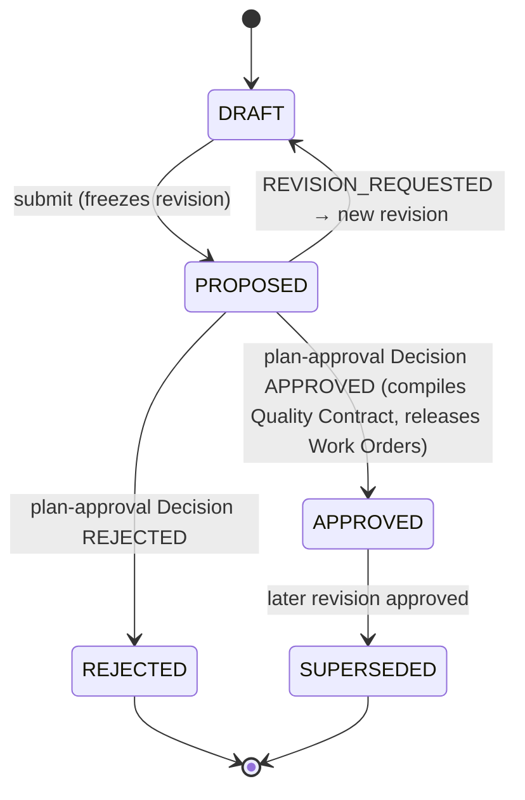

# Plan

`fdlc://v1/plan` · Family A (Intent) · Delivery Loop step 3, **Plan**

## Purpose

A Plan is the governed, versioned decomposition of an Objective: the Work Graph, Work Order blueprints, assertions, verification strategy, dependencies, budgets, rollback approach, and decision points. Approval freezes exactly one revision and permits its blueprints to be materialized as Work Orders. Approval does nothing else: it does not dispatch, satisfy a Work Order's own risk approval, accept evidence, merge, or deploy.

## Identity

| Rule | Value |
|---|---|
| Type URI | `fdlc://v1/plan` |
| Instance id | Revision id; worked-example form `PLAN-<n>-r<rev>` (`PLAN-104-r2`); `lineageId` `PLAN-104`. |
| Mutability | Editable only in `DRAFT`. Submission freezes the revision. A change after submission is a new revision. |
| Digest | `digest` = SHA-256 over canonical JSON of `{workGraph, workOrderBlueprints, assertions, verificationStrategy, budgets, rollbackApproach, decisionPoints, specificationDigest, constitutionDigest}`. |
| Quality Contract | `qualityContract.digest` = digest of the machine-readable projection compiled from the approved revision. It is a projection, not a separate aggregate; it has no independent status or owner. |

## Fields

| Field | Type | Req | Description |
|---|---|---|---|
| `schemaVersion`, `type`, `id`, `namespace` | — | MUST | Common identity. |
| `lineageId`, `revisionNumber`, `basePlanId` | Id, int, Id | MUST / MUST if rev ≥ 2 | Revision lineage. |
| `intentId` | Id | MUST | The Objective. |
| `specificationId`, `specificationDigest`, `constitutionDigest` | Id, Digest | MUST / SHOULD | Exact bound Specification and Constitution. |
| `summary`, `unknowns[]` | string | MUST / SHOULD | Human-readable intent and open questions. |
| `planningProvenance` | object | SHOULD | Planner capability + version, planning Attempt, repository SHA, research packet digest. |
| `workGraph.nodes[]` | GraphNode | MUST (≥1) | `kind` WORK_ORDER/GATE/JOIN/HUMAN_WAIT/DETERMINISTIC/VERIFY, `dependsOn[]`, `onFailure`. |
| `workOrderBlueprints[]` | WorkOrderBlueprint | MUST (≥1) | `role` PRODUCER/VERIFIER, `kind`, `isMutating`, `riskClass`, `requiredCapabilities[]` (input to Objective routing), optional `factoryManifestId`, `implementationPolicy` (attempts, timeout, stop condition, budget), `dependsOnBlueprintIds[]`, `assertionIds[]`. |
| `assertions[]` | Assertion | MUST (≥1) | Testable claims: method, pass condition, required evidence, `requiresIndependentVerification`, `waiverAllowed`, `criticality`, source requirement ids. |
| `verificationStrategy` | object | MUST | `levels[]`, `independence {required, minimumBoundary}`, verifier factory, `integrationVerification`. |
| `budgets` | object | SHOULD | Estimated and maximum cost, attempts, runtime. |
| `rollbackApproach` | string | MUST | How the outcome is reversed. |
| `decisionPoints[]` | DecisionPoint | SHOULD | Where a Decision of which kind, by which actor kind, is required. |
| `qualityContract` | {digest, projectionVersion, compiledAt, projection?} | MUST once APPROVED | Compiled atomically with approval. |
| `requirementsCoverage` | object | SHOULD | Covered/uncovered requirement ids; coverage ratio. |
| `state` | DRAFT / PROPOSED / APPROVED / REJECTED / SUPERSEDED | MUST | See lifecycle. |
| `submittedBy/At` | Actor, Timestamp | MUST once PROPOSED | Author of the submission. |
| `approvalDecisionId`, `approvedBy/At`, `decisionRationale` | — | MUST once APPROVED | Decision (kind `plan-approval`); approver is human or policy, never the author. |
| `releasedWorkOrderIds[]`, `releasedAt` | Id[], Timestamp | SHOULD | Idempotent materialization result. |
| `supersededById` | Id | MUST once SUPERSEDED | — |
| `digest`, `createdAt`, `createdBy`, `idempotencyKey`, `history[]` | — | MUST / SHOULD | Common audit fields. |

## Lifecycle



| Transition | Who | MUST record |
|---|---|---|
| `DRAFT → PROPOSED` | Author (agent planner or human) | `submittedBy/At`, `digest`, bound `specificationDigest` |
| `PROPOSED → APPROVED` | Human, or policy within envelope for LOW risk; never the author | Decision (kind `plan-approval`) with `separationOfDuty.checked = true`; `qualityContract.digest`; `releasedWorkOrderIds` |
| `PROPOSED → REJECTED` | Same as approval | Rationale (required) |
| `APPROVED → SUPERSEDED` | Control plane | `supersededById`; new Quality Contract digest on the successor |

## Invariants

- A submitted Plan MUST NOT be approved by its author. (`factory-learning-continuous-improvement.md:94-95`)
- Approval MUST bind exactly one revision by digest, together with the exact Specification and Constitution digests it was reviewed against. "A newer Spec never silently rebinds an existing Plan." (`docs/OVERVIEW.md:415-417`)
- Approval MUST NOT dispatch an agent, start an Attempt, satisfy a Work Order's risk approval, merge, or deploy. It MAY only permit materialization of Work Orders.
- Approval and materialization MUST be idempotent under `idempotencyKey`; re-approval MUST NOT create duplicate Work Orders.
- The Quality Contract MUST be a projection compiled from the approved revision; it MUST NOT be edited independently. "A new approved Plan revision creates a new projection and digest." (`verification-first-domain-contracts.md:60-61`)
- Every requirement in the bound Specification SHOULD be covered by ≥1 assertion; uncovered MUST requirements MUST be listed in `requirementsCoverage.uncoveredRequirementIds` and SHOULD block approval.
- Every assertion MUST cite ≥1 source requirement id (traceability: Spec requirement → Plan assertion → Work Order criterion → check → evidence).
- Verifier blueprints (`role: VERIFIER`) MUST be non-mutating.
- A planning agent's output is a proposal. It MUST NOT submit on its own authority when the risk class requires human submission, and it MUST NOT approve.

## Evidence requirements

| Transition | Evidence |
|---|---|
| Submit | Planner provenance (capability version, repository SHA, research packet digest) |
| Approve | Coverage projection; separation-of-duty check; Quality Contract digest; decision rationale |
| Supersede | Digest of superseding revision; list of Work Orders invalidated or carried forward with materiality |

## Extension points

- `x-` fields at top level, on blueprints, and on assertions.
- `GraphNode.kind` and `DecisionPoint.kind` are closed enums; implementation-specific node types MUST be expressed as `DETERMINISTIC` with an `x-operation` qualifier.
- `qualityContract.projection` is implementation-defined content; its digest rules are normative, its shape is not.

## Mission Control mapping

| FDLC | Mission Control | Status | Divergence |
|---|---|---|---|
| Plan revision | `missionPlans` (`convex/schema.ts:2029`); `convex/missionPlanning.ts` | Available (Qualified) | Direct: `basePlanId`, `revisionNumber`, `status`, author≠approver, idempotent release. |
| `assertions[]` | `missionPlans.assertions[]`, `validationAssertions` (`2201`) | Available | Direct; MC verification methods COMMAND/TEST/BROWSER/MANUAL/CHECKLIST (FDLC adds ANALYSIS). |
| `workOrderBlueprints[]` | `missionPlans.workOrderBlueprints[]` (`2086`) | Available | MC role `WORKER`/`VALIDATOR` → FDLC `PRODUCER`/`VERIFIER`. `requiredCapabilities` and `factoryManifestId` are FDLC additions for Objective routing (MC routing is repository-scoped; audit §5.2). |
| `qualityContract` | `qualityContractProjection` + `qualityContractDigest` (`2062`); `convex/lib/qualityContract.ts` | Available | Direct (projection, not aggregate). |
| `workGraph` | workflow definitions bound on the Factory Version, not on the Plan | Partial | MC's Plan lists blueprints with `dependsOnBlueprintIds`; the explicit Work Graph with GATE/HUMAN_WAIT nodes is an FDLC requirement. |
| `planningProvenance` | `planningRunId`, `planningRepositorySha`, `planningResearchPacketDigest` (`2043-2046`) | Available | Direct. |
| Objective Planner across factories | none (`missionPlanningRuns` plans one Mission for one repository) | Planned | FDLC defines; MC does not implement (audit §5.3). |

## JSON Schema

```json
{
  "$schema": "https://json-schema.org/draft/2020-12/schema",
  "$id": "https://fdlc.ai/schemas/v1/plan.schema.json",
  "title": "FDLC Plan",
  "description": "Governed, versioned decomposition of an Objective: Work Graph, Work Order blueprints, verification strategy, dependencies, budgets, decision points. Approval binds one exact revision.",
  "type": "object",
  "properties": {
    "schemaVersion": {
      "type": "string",
      "const": "1.0"
    },
    "type": {
      "type": "string",
      "const": "fdlc://v1/plan"
    },
    "id": {
      "$ref": "#/$defs/Id",
      "description": "Revision id (e.g. PLAN-104-r2)."
    },
    "namespace": {
      "$ref": "#/$defs/Namespace"
    },
    "lineageId": {
      "$ref": "#/$defs/Id"
    },
    "intentId": {
      "$ref": "#/$defs/Id",
      "description": "The Objective this Plan achieves."
    },
    "specificationId": {
      "$ref": "#/$defs/Id"
    },
    "specificationDigest": {
      "$ref": "#/$defs/Digest"
    },
    "constitutionDigest": {
      "$ref": "#/$defs/Digest"
    },
    "revisionNumber": {
      "type": "integer",
      "minimum": 1
    },
    "basePlanId": {
      "$ref": "#/$defs/Id"
    },
    "summary": {
      "type": "string",
      "minLength": 1
    },
    "unknowns": {
      "type": "array",
      "items": {
        "type": "string"
      }
    },
    "planningProvenance": {
      "type": "object",
      "properties": {
        "planner": {
          "$ref": "#/$defs/ComponentRef",
          "description": "Planner capability that produced the draft (an agent may propose; it never approves)."
        },
        "planningAttemptId": {
          "$ref": "#/$defs/Id"
        },
        "repositorySha": {
          "$ref": "#/$defs/GitSha"
        },
        "researchPacketDigest": {
          "$ref": "#/$defs/Digest"
        },
        "candidateDigest": {
          "$ref": "#/$defs/Digest"
        }
      },
      "additionalProperties": false
    },
    "workGraph": {
      "type": "object",
      "description": "Topology of the work: nodes, dependencies, gates, joins, human waits.",
      "properties": {
        "nodes": {
          "type": "array",
          "minItems": 1,
          "items": {
            "$ref": "#/$defs/GraphNode"
          }
        },
        "maxConcurrency": {
          "type": "integer",
          "minimum": 1
        }
      },
      "required": [
        "nodes"
      ],
      "additionalProperties": false
    },
    "workOrderBlueprints": {
      "type": "array",
      "minItems": 1,
      "items": {
        "$ref": "#/$defs/WorkOrderBlueprint"
      }
    },
    "assertions": {
      "type": "array",
      "minItems": 1,
      "items": {
        "$ref": "#/$defs/Assertion"
      }
    },
    "verificationStrategy": {
      "type": "object",
      "properties": {
        "levels": {
          "type": "array",
          "items": {
            "type": "string",
            "enum": [
              "TASK",
              "WORK_ORDER",
              "OBJECTIVE",
              "RELEASE"
            ]
          }
        },
        "independence": {
          "type": "object",
          "properties": {
            "required": {
              "type": "boolean"
            },
            "minimumBoundary": {
              "type": "string",
              "enum": [
                "SEPARATE_ATTEMPT",
                "SEPARATE_FACTORY",
                "SEPARATE_MODEL_FAMILY"
              ]
            }
          },
          "required": [
            "required",
            "minimumBoundary"
          ],
          "additionalProperties": false
        },
        "verifierFactoryManifestId": {
          "$ref": "#/$defs/Id"
        },
        "integrationVerification": {
          "type": "boolean",
          "description": "Objective-level verification of the integrated candidate across Work Orders."
        }
      },
      "required": [
        "levels",
        "independence"
      ],
      "additionalProperties": false
    },
    "budgets": {
      "type": "object",
      "properties": {
        "estimatedCost": {
          "$ref": "#/$defs/Money"
        },
        "maxCost": {
          "$ref": "#/$defs/Money"
        },
        "maxAttemptsPerWorkOrder": {
          "type": "integer",
          "minimum": 1
        },
        "maxRuntimeMinutes": {
          "type": "integer",
          "minimum": 1
        }
      },
      "additionalProperties": false
    },
    "rollbackApproach": {
      "type": "string",
      "minLength": 1
    },
    "decisionPoints": {
      "type": "array",
      "items": {
        "$ref": "#/$defs/DecisionPoint"
      }
    },
    "qualityContract": {
      "type": "object",
      "description": "Machine-readable projection of this approved revision. Not a separate aggregate; it has no independent status or owner.",
      "properties": {
        "digest": {
          "$ref": "#/$defs/Digest"
        },
        "projectionVersion": {
          "type": "string"
        },
        "compiledAt": {
          "$ref": "#/$defs/Timestamp"
        },
        "projection": {
          "type": "object"
        }
      },
      "required": [
        "digest",
        "projectionVersion",
        "compiledAt"
      ],
      "additionalProperties": false
    },
    "requirementsCoverage": {
      "type": "object",
      "properties": {
        "coveredRequirementIds": {
          "type": "array",
          "items": {
            "$ref": "#/$defs/Id"
          }
        },
        "uncoveredRequirementIds": {
          "type": "array",
          "items": {
            "$ref": "#/$defs/Id"
          }
        },
        "coverage": {
          "type": "number",
          "minimum": 0,
          "maximum": 1
        }
      },
      "required": [
        "coveredRequirementIds",
        "uncoveredRequirementIds",
        "coverage"
      ],
      "additionalProperties": false
    },
    "state": {
      "type": "string",
      "enum": [
        "DRAFT",
        "PROPOSED",
        "APPROVED",
        "REJECTED",
        "SUPERSEDED"
      ]
    },
    "submittedBy": {
      "$ref": "#/$defs/Actor"
    },
    "submittedAt": {
      "$ref": "#/$defs/Timestamp"
    },
    "approvalDecisionId": {
      "$ref": "#/$defs/Id"
    },
    "approvedBy": {
      "$ref": "#/$defs/Actor"
    },
    "approvedAt": {
      "$ref": "#/$defs/Timestamp"
    },
    "decisionRationale": {
      "type": "string"
    },
    "releasedWorkOrderIds": {
      "type": "array",
      "items": {
        "$ref": "#/$defs/Id"
      }
    },
    "releasedAt": {
      "$ref": "#/$defs/Timestamp"
    },
    "supersededById": {
      "$ref": "#/$defs/Id"
    },
    "digest": {
      "$ref": "#/$defs/Digest",
      "description": "Digest over the frozen projection: workGraph, workOrderBlueprints, assertions, verificationStrategy, budgets, rollbackApproach, decisionPoints, specificationDigest, constitutionDigest."
    },
    "createdAt": {
      "$ref": "#/$defs/Timestamp"
    },
    "createdBy": {
      "$ref": "#/$defs/Actor"
    },
    "idempotencyKey": {
      "type": "string"
    },
    "history": {
      "type": "array",
      "items": {
        "$ref": "#/$defs/Transition"
      }
    }
  },
  "required": [
    "schemaVersion",
    "type",
    "id",
    "namespace",
    "lineageId",
    "intentId",
    "specificationId",
    "specificationDigest",
    "revisionNumber",
    "summary",
    "workGraph",
    "workOrderBlueprints",
    "assertions",
    "verificationStrategy",
    "rollbackApproach",
    "state",
    "digest",
    "createdAt",
    "createdBy"
  ],
  "allOf": [
    {
      "if": {
        "properties": {
          "state": {
            "enum": [
              "PROPOSED",
              "APPROVED",
              "REJECTED",
              "SUPERSEDED"
            ]
          }
        }
      },
      "then": {
        "required": [
          "submittedBy",
          "submittedAt"
        ]
      }
    },
    {
      "if": {
        "properties": {
          "state": {
            "enum": [
              "APPROVED",
              "SUPERSEDED"
            ]
          }
        }
      },
      "then": {
        "required": [
          "approvalDecisionId",
          "approvedBy",
          "approvedAt",
          "qualityContract"
        ],
        "properties": {
          "approvedBy": {
            "properties": {
              "kind": {
                "enum": [
                  "human",
                  "policy"
                ]
              }
            }
          }
        }
      }
    },
    {
      "if": {
        "properties": {
          "revisionNumber": {
            "minimum": 2
          }
        }
      },
      "then": {
        "required": [
          "basePlanId"
        ]
      }
    }
  ],
  "$defs": {
    "Id": {
      "type": "string",
      "minLength": 1,
      "maxLength": 200,
      "pattern": "^[A-Za-z0-9][A-Za-z0-9._:/@-]*$",
      "description": "Instance identifier. Unique within the issuing namespace; combined with `namespace` it is globally unique."
    },
    "ArtifactUri": {
      "type": "string",
      "pattern": "^fdlc://v1/(intent|specification|plan|work-order|factory-manifest|factory-version|execution-profile|capability-manifest|qualification-record|context-package|attempt|candidate|evidence|verification|decision|release|outcome|learning-signal|improvement-candidate)(/[A-Za-z0-9][A-Za-z0-9._:@-]*)?$",
      "description": "Artifact type URI (`fdlc://v1/<artifact>`), optionally suffixed with an instance id."
    },
    "Namespace": {
      "type": "string",
      "format": "uri",
      "description": "URI of the issuing control plane or organization. Scopes every `id` in this record."
    },
    "Digest": {
      "type": "string",
      "pattern": "^sha256:[a-f0-9]{64}$",
      "description": "SHA-256 over the RFC 8785 (JCS) canonical JSON of the digested projection."
    },
    "GitSha": {
      "type": "string",
      "pattern": "^[a-f0-9]{40}$|^[a-f0-9]{64}$",
      "description": "Lowercase full Git object id (SHA-1 or SHA-256 repository)."
    },
    "Timestamp": {
      "type": "string",
      "format": "date-time",
      "description": "RFC 3339 timestamp in UTC."
    },
    "Semver": {
      "type": "string",
      "pattern": "^(0|[1-9]\\d*)\\.(0|[1-9]\\d*)\\.(0|[1-9]\\d*)(-[0-9A-Za-z.-]+)?(\\+[0-9A-Za-z.-]+)?$"
    },
    "RiskClass": {
      "type": "string",
      "enum": [
        "LOW",
        "MEDIUM",
        "HIGH",
        "CRITICAL"
      ]
    },
    "AutonomyLevel": {
      "type": "string",
      "enum": [
        "L0",
        "L1",
        "L2",
        "L3",
        "L4",
        "L5"
      ],
      "description": "HITL spectrum position. Effective autonomy is min(factory, objective, work order, policy, trust)."
    },
    "Actor": {
      "type": "object",
      "description": "Attributable identity. `identitySource` says how the control plane established it; never inferred from a client label.",
      "properties": {
        "kind": {
          "type": "string",
          "enum": [
            "human",
            "policy",
            "service",
            "agent",
            "system"
          ]
        },
        "id": {
          "$ref": "#/$defs/Id"
        },
        "identitySource": {
          "type": "string",
          "enum": [
            "authenticated",
            "workload-identity",
            "service-command",
            "development-fallback"
          ]
        },
        "displayName": {
          "type": "string"
        },
        "delegationRef": {
          "$ref": "#/$defs/Id",
          "description": "Reference to the delegation record that grants this actor its authority."
        }
      },
      "required": [
        "kind",
        "id",
        "identitySource"
      ],
      "additionalProperties": false
    },
    "Ref": {
      "type": "object",
      "description": "Reference to another FDLC artifact instance, optionally pinned to a digest.",
      "properties": {
        "type": {
          "$ref": "#/$defs/ArtifactUri"
        },
        "id": {
          "$ref": "#/$defs/Id"
        },
        "digest": {
          "$ref": "#/$defs/Digest"
        },
        "revisionNumber": {
          "type": "integer",
          "minimum": 1
        }
      },
      "required": [
        "type",
        "id"
      ],
      "additionalProperties": false
    },
    "Money": {
      "type": "object",
      "properties": {
        "amount": {
          "type": "number",
          "minimum": 0
        },
        "currency": {
          "type": "string",
          "pattern": "^[A-Z]{3}$"
        }
      },
      "required": [
        "amount",
        "currency"
      ],
      "additionalProperties": false
    },
    "CostRecord": {
      "type": "object",
      "description": "Cost with an honesty class. UNKNOWN cost stays UNKNOWN; implementations MUST NOT invent zeroes.",
      "properties": {
        "status": {
          "type": "string",
          "enum": [
            "MEASURED",
            "ESTIMATED",
            "UNKNOWN"
          ]
        },
        "amount": {
          "type": "number",
          "minimum": 0
        },
        "currency": {
          "type": "string",
          "pattern": "^[A-Z]{3}$"
        },
        "coverage": {
          "type": "number",
          "minimum": 0,
          "maximum": 1,
          "description": "Fraction of contributing cost items that were measured."
        },
        "reason": {
          "type": "string"
        }
      },
      "required": [
        "status"
      ],
      "additionalProperties": false
    },
    "Transition": {
      "type": "object",
      "description": "Audit record of one authoritative state transition. Every field listed here MUST be recorded.",
      "properties": {
        "transitionId": {
          "$ref": "#/$defs/Id"
        },
        "subjectId": {
          "$ref": "#/$defs/Id"
        },
        "priorVersion": {
          "type": "integer",
          "minimum": 0
        },
        "fromState": {
          "type": "string"
        },
        "toState": {
          "type": "string"
        },
        "actor": {
          "$ref": "#/$defs/Actor"
        },
        "reason": {
          "type": "string"
        },
        "policyVersion": {
          "type": "string"
        },
        "idempotencyKey": {
          "type": "string"
        },
        "occurredAt": {
          "$ref": "#/$defs/Timestamp"
        },
        "requiredEvidenceIds": {
          "type": "array",
          "items": {
            "$ref": "#/$defs/Id"
          }
        },
        "decisionId": {
          "$ref": "#/$defs/Id"
        },
        "invalidatedDependents": {
          "type": "array",
          "items": {
            "$ref": "#/$defs/Ref"
          }
        }
      },
      "required": [
        "subjectId",
        "fromState",
        "toState",
        "actor",
        "reason",
        "idempotencyKey",
        "occurredAt"
      ],
      "additionalProperties": false
    },
    "ArtifactRef": {
      "type": "object",
      "description": "Content-addressed reference to a stored artifact (diff, log, screenshot, bundle).",
      "properties": {
        "artifactId": {
          "$ref": "#/$defs/Id"
        },
        "kind": {
          "type": "string"
        },
        "mediaType": {
          "type": "string"
        },
        "digest": {
          "$ref": "#/$defs/Digest"
        },
        "sizeBytes": {
          "type": "integer",
          "minimum": 0
        },
        "storageRef": {
          "type": "string"
        }
      },
      "required": [
        "artifactId",
        "digest"
      ],
      "additionalProperties": false
    },
    "ComponentRef": {
      "type": "object",
      "properties": {
        "capabilityId": {
          "$ref": "#/$defs/Id"
        },
        "version": {
          "type": "string"
        },
        "digest": {
          "$ref": "#/$defs/Digest"
        }
      },
      "required": [
        "capabilityId",
        "version"
      ],
      "additionalProperties": false
    },
    "GraphNode": {
      "type": "object",
      "properties": {
        "id": {
          "$ref": "#/$defs/Id"
        },
        "kind": {
          "type": "string",
          "enum": [
            "WORK_ORDER",
            "GATE",
            "JOIN",
            "HUMAN_WAIT",
            "DETERMINISTIC",
            "VERIFY"
          ]
        },
        "blueprintId": {
          "$ref": "#/$defs/Id"
        },
        "dependsOn": {
          "type": "array",
          "items": {
            "$ref": "#/$defs/Id"
          }
        },
        "decisionPointId": {
          "$ref": "#/$defs/Id"
        },
        "onFailure": {
          "type": "string",
          "enum": [
            "BLOCK",
            "RETRY",
            "CONTINUE",
            "ESCALATE"
          ]
        }
      },
      "required": [
        "id",
        "kind",
        "dependsOn"
      ],
      "additionalProperties": false
    },
    "WorkOrderBlueprint": {
      "type": "object",
      "properties": {
        "id": {
          "$ref": "#/$defs/Id"
        },
        "title": {
          "type": "string"
        },
        "desiredOutcome": {
          "type": "string"
        },
        "role": {
          "type": "string",
          "enum": [
            "PRODUCER",
            "VERIFIER"
          ]
        },
        "kind": {
          "type": "string",
          "enum": [
            "SOFTWARE_CHANGE",
            "VERIFICATION",
            "AUTOMATION"
          ]
        },
        "isMutating": {
          "type": "boolean"
        },
        "sequence": {
          "type": "integer",
          "minimum": 1
        },
        "riskClass": {
          "$ref": "#/$defs/RiskClass"
        },
        "requiredCapabilities": {
          "type": "array",
          "items": {
            "type": "string"
          },
          "description": "Capability ids (provider-independent) the routed factory must provide. Input to Objective routing."
        },
        "factoryManifestId": {
          "$ref": "#/$defs/Id",
          "description": "Optional pre-selection of a factory by the Objective Planner; Work Order routing still selects the qualified version."
        },
        "branchStrategy": {
          "type": "string"
        },
        "constraints": {
          "type": "array",
          "items": {
            "type": "string"
          }
        },
        "requiredApprovals": {
          "type": "array",
          "items": {
            "type": "string"
          }
        },
        "estimatedCost": {
          "$ref": "#/$defs/Money"
        },
        "implementationPolicy": {
          "type": "object",
          "properties": {
            "allowedCommandClasses": {
              "type": "array",
              "items": {
                "type": "string"
              }
            },
            "maxFilesChanged": {
              "type": "integer",
              "minimum": 0
            },
            "maxLinesChanged": {
              "type": "integer",
              "minimum": 0
            },
            "maxCost": {
              "$ref": "#/$defs/Money"
            },
            "maxAttempts": {
              "type": "integer",
              "minimum": 1
            },
            "timeoutMinutes": {
              "type": "integer",
              "minimum": 1
            },
            "stopCondition": {
              "type": "string"
            }
          },
          "required": [
            "maxAttempts",
            "timeoutMinutes",
            "stopCondition"
          ],
          "additionalProperties": false
        },
        "dependsOnBlueprintIds": {
          "type": "array",
          "items": {
            "$ref": "#/$defs/Id"
          }
        },
        "assertionIds": {
          "type": "array",
          "minItems": 1,
          "items": {
            "$ref": "#/$defs/Id"
          }
        }
      },
      "required": [
        "id",
        "title",
        "desiredOutcome",
        "role",
        "kind",
        "isMutating",
        "sequence",
        "riskClass",
        "requiredCapabilities",
        "dependsOnBlueprintIds",
        "assertionIds"
      ],
      "additionalProperties": false
    },
    "Assertion": {
      "type": "object",
      "description": "Testable claim derived from a Specification requirement; becomes an acceptance criterion on the released Work Order.",
      "properties": {
        "id": {
          "$ref": "#/$defs/Id"
        },
        "title": {
          "type": "string"
        },
        "outcome": {
          "type": "string"
        },
        "verificationMethod": {
          "type": "string",
          "enum": [
            "COMMAND",
            "TEST",
            "BROWSER",
            "MANUAL",
            "CHECKLIST",
            "ANALYSIS"
          ]
        },
        "passCondition": {
          "type": "string"
        },
        "requiredEvidence": {
          "type": "array",
          "items": {
            "type": "string"
          }
        },
        "requiresIndependentVerification": {
          "type": "boolean"
        },
        "waiverAllowed": {
          "type": "boolean"
        },
        "criticality": {
          "type": "string",
          "enum": [
            "BLOCKING",
            "IMPORTANT",
            "INFORMATIONAL"
          ]
        },
        "sourceRequirementIds": {
          "type": "array",
          "minItems": 1,
          "items": {
            "$ref": "#/$defs/Id"
          }
        },
        "sourceAcceptanceExpectationIds": {
          "type": "array",
          "items": {
            "$ref": "#/$defs/Id"
          }
        },
        "sourceVerificationExpectationIds": {
          "type": "array",
          "items": {
            "$ref": "#/$defs/Id"
          }
        }
      },
      "required": [
        "id",
        "title",
        "outcome",
        "verificationMethod",
        "passCondition",
        "requiredEvidence",
        "requiresIndependentVerification",
        "waiverAllowed",
        "criticality",
        "sourceRequirementIds"
      ],
      "additionalProperties": false
    },
    "DecisionPoint": {
      "type": "object",
      "properties": {
        "id": {
          "$ref": "#/$defs/Id"
        },
        "kind": {
          "type": "string",
          "enum": [
            "plan-approval",
            "routing",
            "admission",
            "acceptance",
            "release-authorization",
            "promotion",
            "restoration",
            "exception"
          ]
        },
        "riskClass": {
          "$ref": "#/$defs/RiskClass"
        },
        "requiredActorKind": {
          "type": "string",
          "enum": [
            "human",
            "policy"
          ]
        },
        "requiredRole": {
          "type": "string"
        },
        "afterNodeId": {
          "$ref": "#/$defs/Id"
        }
      },
      "required": [
        "id",
        "kind",
        "riskClass",
        "requiredActorKind"
      ],
      "additionalProperties": false
    }
  },
  "patternProperties": {
    "^x-[a-z0-9]+(-[a-z0-9]+)*$": {}
  },
  "additionalProperties": false
}
```

## Example instance

```json
{
  "schemaVersion": "1.0",
  "type": "fdlc://v1/plan",
  "id": "PLAN-104-r2",
  "namespace": "https://acme.example/factories/checkout",
  "lineageId": "PLAN-104",
  "intentId": "INT-104",
  "specificationId": "SPEC-104-r1",
  "specificationDigest": "sha256:b0a338f1f6b50109c098b5b605e4c3bed903c6f121be84bde77508807d0451b0",
  "constitutionDigest": "sha256:a948f2759151cfd34fb1cd7ce818b579b633b161e382ac05b97c1c8745cc96de",
  "revisionNumber": 2,
  "basePlanId": "PLAN-104-r1",
  "summary": "Single bounded upgrade Work Order in services/checkout-api, independently verified by the verification factory, then human acceptance and canary release. Revision 2 narrows allowed paths after r1 review.",
  "unknowns": [
    "Whether the v4 client retries on HTTP 409 differently; covered by contract tests CT-PAY-*."
  ],
  "planningProvenance": {
    "planner": {
      "capabilityId": "CAP-planner-objective-1.3.0",
      "version": "1.3.0",
      "digest": "sha256:1fbe05d6177dc973ea3d1c514598949572f54842831da956f8a59723e4036611"
    },
    "planningAttemptId": "ATT-104-plan-2",
    "repositorySha": "1405df66cbe219b0bf6355bc3d60361a8376b6b4",
    "researchPacketDigest": "sha256:78bdceec0af5280c4dbcdd5705e9dfed11e83ee7c74d0be2687d11879b85449f"
  },
  "workGraph": {
    "nodes": [
      {
        "id": "N1",
        "kind": "WORK_ORDER",
        "blueprintId": "BP-104-01",
        "dependsOn": [],
        "onFailure": "BLOCK"
      },
      {
        "id": "N2",
        "kind": "VERIFY",
        "blueprintId": "BP-104-V1",
        "dependsOn": [
          "N1"
        ],
        "onFailure": "BLOCK"
      },
      {
        "id": "N3",
        "kind": "HUMAN_WAIT",
        "dependsOn": [
          "N2"
        ],
        "decisionPointId": "DP-104-ACCEPT"
      },
      {
        "id": "N4",
        "kind": "GATE",
        "dependsOn": [
          "N3"
        ],
        "decisionPointId": "DP-104-RELEASE"
      }
    ],
    "maxConcurrency": 1
  },
  "workOrderBlueprints": [
    {
      "id": "BP-104-01",
      "title": "Implement bounded SDK v4 upgrade",
      "desiredOutcome": "checkout-api on acme-payments-sdk 4.x with unchanged behavior.",
      "role": "PRODUCER",
      "kind": "SOFTWARE_CHANGE",
      "isMutating": true,
      "sequence": 1,
      "riskClass": "MEDIUM",
      "requiredCapabilities": [
        "repository-research",
        "dependency-upgrade",
        "run-tests",
        "propose-candidate"
      ],
      "factoryManifestId": "FM-depmod",
      "branchStrategy": "feature/payments-sdk-v4",
      "constraints": [
        "Stay inside services/checkout-api",
        "No changes under api/public, schema, auth"
      ],
      "requiredApprovals": [
        "acceptance:human"
      ],
      "estimatedCost": {
        "amount": 25,
        "currency": "USD"
      },
      "implementationPolicy": {
        "allowedCommandClasses": [
          "BUILD",
          "TYPECHECK",
          "TEST",
          "LINT",
          "DEPENDENCY_SCAN"
        ],
        "maxFilesChanged": 40,
        "maxLinesChanged": 1200,
        "maxCost": {
          "amount": 25,
          "currency": "USD"
        },
        "maxAttempts": 3,
        "timeoutMinutes": 90,
        "stopCondition": "Stop after three Attempts or when the change budget would be exceeded."
      },
      "dependsOnBlueprintIds": [],
      "assertionIds": [
        "AS-104-01",
        "AS-104-02",
        "AS-104-03",
        "AS-104-04"
      ]
    },
    {
      "id": "BP-104-V1",
      "title": "Independently verify the upgrade candidate",
      "desiredOutcome": "Exact candidate verified against the frozen contract.",
      "role": "VERIFIER",
      "kind": "VERIFICATION",
      "isMutating": false,
      "sequence": 2,
      "riskClass": "LOW",
      "requiredCapabilities": [
        "independent-verification",
        "run-tests",
        "dependency-scan",
        "static-analysis"
      ],
      "factoryManifestId": "FM-verify",
      "dependsOnBlueprintIds": [
        "BP-104-01"
      ],
      "implementationPolicy": {
        "allowedCommandClasses": [
          "BUILD",
          "TYPECHECK",
          "TEST",
          "LINT",
          "DEPENDENCY_SCAN"
        ],
        "maxAttempts": 2,
        "timeoutMinutes": 45,
        "stopCondition": "Stop after two verifier Attempts."
      },
      "assertionIds": [
        "AS-104-01",
        "AS-104-02",
        "AS-104-03",
        "AS-104-04"
      ]
    }
  ],
  "assertions": [
    {
      "id": "AS-104-01",
      "title": "Contract and integration tests pass",
      "outcome": "All contract and integration tests pass against the exact candidate.",
      "verificationMethod": "TEST",
      "passCondition": "0 failures, 0 skipped in CT-* and IT-* suites",
      "requiredEvidence": [
        "TEST_RESULT"
      ],
      "requiresIndependentVerification": true,
      "waiverAllowed": false,
      "criticality": "BLOCKING",
      "sourceRequirementIds": [
        "REQ-104-03"
      ],
      "sourceAcceptanceExpectationIds": [
        "AE-104-01"
      ],
      "sourceVerificationExpectationIds": [
        "VE-104-01"
      ]
    },
    {
      "id": "AS-104-02",
      "title": "No v3 artifacts",
      "outcome": "Dependency graph contains only acme-payments-sdk 4.x; no new dependencies.",
      "verificationMethod": "COMMAND",
      "passCondition": "dependency-scan reports 0 matches for acme-payments-sdk@3 and 0 new packages",
      "requiredEvidence": [
        "DEPENDENCY_SCAN"
      ],
      "requiresIndependentVerification": true,
      "waiverAllowed": false,
      "criticality": "BLOCKING",
      "sourceRequirementIds": [
        "REQ-104-01"
      ],
      "sourceAcceptanceExpectationIds": [
        "AE-104-02"
      ]
    },
    {
      "id": "AS-104-03",
      "title": "No compatibility shims",
      "outcome": "No imports from acme_payments.v3 or *.compat.",
      "verificationMethod": "ANALYSIS",
      "passCondition": "static-analysis rule DEP-V3-IMPORT reports 0 findings",
      "requiredEvidence": [
        "STATIC_ANALYSIS"
      ],
      "requiresIndependentVerification": true,
      "waiverAllowed": false,
      "criticality": "BLOCKING",
      "sourceRequirementIds": [
        "REQ-104-02"
      ],
      "sourceAcceptanceExpectationIds": [
        "AE-104-03"
      ]
    },
    {
      "id": "AS-104-04",
      "title": "Protected paths untouched",
      "outcome": "Diff touches nothing under api/public, schema, auth.",
      "verificationMethod": "ANALYSIS",
      "passCondition": "scope reconciliation reports 0 violations",
      "requiredEvidence": [
        "FILE_DIFF"
      ],
      "requiresIndependentVerification": false,
      "waiverAllowed": false,
      "criticality": "BLOCKING",
      "sourceRequirementIds": [
        "REQ-104-03"
      ],
      "sourceAcceptanceExpectationIds": [
        "AE-104-04"
      ]
    },
    {
      "id": "AS-104-05",
      "title": "Release readiness",
      "outcome": "Release record carries rollback conditions and owner.",
      "verificationMethod": "CHECKLIST",
      "passCondition": "rollback.ready == true and rollback.owner present",
      "requiredEvidence": [
        "DEPLOYMENT_CHECK"
      ],
      "requiresIndependentVerification": false,
      "waiverAllowed": false,
      "criticality": "BLOCKING",
      "sourceRequirementIds": [
        "REQ-104-04"
      ],
      "sourceAcceptanceExpectationIds": [
        "AE-104-05"
      ]
    }
  ],
  "verificationStrategy": {
    "levels": [
      "WORK_ORDER",
      "RELEASE"
    ],
    "independence": {
      "required": true,
      "minimumBoundary": "SEPARATE_FACTORY"
    },
    "verifierFactoryManifestId": "FM-verify",
    "integrationVerification": false
  },
  "budgets": {
    "estimatedCost": {
      "amount": 32,
      "currency": "USD"
    },
    "maxCost": {
      "amount": 60,
      "currency": "USD"
    },
    "maxAttemptsPerWorkOrder": 3,
    "maxRuntimeMinutes": 90
  },
  "rollbackApproach": "Revert the merge commit and redeploy the previous release; SDK v3 remains installable until 2026-12-31.",
  "decisionPoints": [
    {
      "id": "DP-104-PLAN",
      "kind": "plan-approval",
      "riskClass": "MEDIUM",
      "requiredActorKind": "human",
      "requiredRole": "engineering-lead"
    },
    {
      "id": "DP-104-ACCEPT",
      "kind": "acceptance",
      "riskClass": "MEDIUM",
      "requiredActorKind": "human",
      "requiredRole": "work-order-owner",
      "afterNodeId": "N2"
    },
    {
      "id": "DP-104-RELEASE",
      "kind": "release-authorization",
      "riskClass": "MEDIUM",
      "requiredActorKind": "policy",
      "afterNodeId": "N3"
    }
  ],
  "qualityContract": {
    "digest": "sha256:dc8ccbf7d977e52efff8403f63b12e0889313b0deb0e14d4ac62866efe11ca16",
    "projectionVersion": "quality-contract/1.0",
    "compiledAt": "2026-09-02T14:05:00Z"
  },
  "requirementsCoverage": {
    "coveredRequirementIds": [
      "REQ-104-01",
      "REQ-104-02",
      "REQ-104-03",
      "REQ-104-04"
    ],
    "uncoveredRequirementIds": [],
    "coverage": 1.0
  },
  "state": "APPROVED",
  "submittedBy": {
    "kind": "agent",
    "id": "agent:objective-planner",
    "identitySource": "workload-identity"
  },
  "submittedAt": "2026-09-02T13:40:00Z",
  "approvalDecisionId": "DEC-104-00",
  "approvedBy": {
    "kind": "human",
    "id": "user:priya.n",
    "identitySource": "authenticated",
    "displayName": "Priya Natarajan"
  },
  "approvedAt": "2026-09-02T14:05:00Z",
  "decisionRationale": "Coverage complete; allowed paths narrowed per r1 review; verifier factory independent.",
  "releasedWorkOrderIds": [
    "WO-104-01"
  ],
  "releasedAt": "2026-09-02T14:05:00Z",
  "digest": "sha256:0dc4b958e05409dbf3e0541a7c45bd9777d60c5e464e17e00910fe0d323a4b37",
  "createdAt": "2026-09-02T13:22:00Z",
  "createdBy": {
    "kind": "agent",
    "id": "agent:objective-planner",
    "identitySource": "workload-identity"
  },
  "idempotencyKey": "plan:INT-104:r2"
}
```

## Related

- Spec: [/specification/v1/specification](/specification/v1/specification) · [/specification/v1/work-order](/specification/v1/work-order) · [/specification/v1/decision](/specification/v1/decision) (kind `plan-approval`)
- Framework: [/framework/delivery-loop](/framework/delivery-loop) step 3 Plan
- Architecture: [/architecture/multi-factory](/architecture/multi-factory) (Objective routing, D28) · [/architecture/verification](/architecture/verification)
- Glossary: Plan, Work Graph, Quality Contract, Objective Planner
- Mission Control: [/mission-control](/mission-control)
