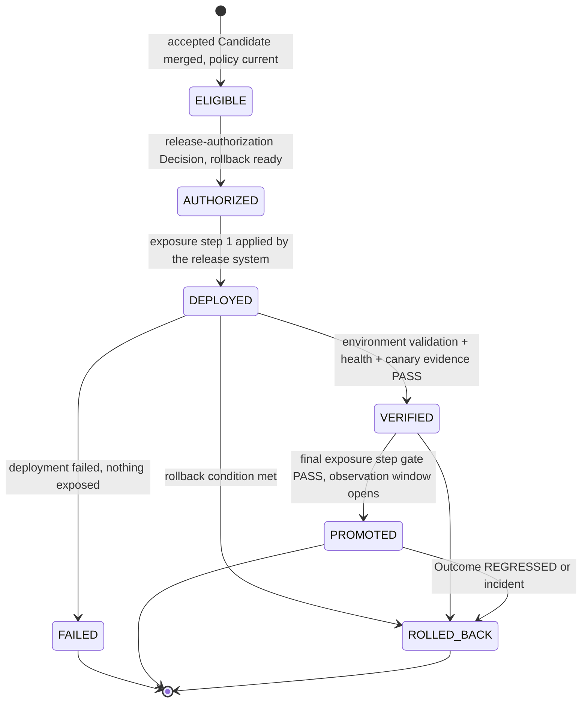

# Release

`fdlc://v1/release` · Family D (Trust) · Delivery Loop step 8, **Release**

## Purpose

A Release is the promotion of an exact accepted artifact into an environment under current policy, with a declared rollout scope and rollback readiness. Release promotes a *software* artifact; Deploy (Factory Lifecycle stage 6) promotes a *Factory Version*. Neither transition creates its own authority. Merge, deploy, verify, and promote are distinct stages with distinct evidence; "merged" is not "released", and "released" is not "outcome proven".

## Identity

| Rule | Value |
|---|---|
| Type URI | `fdlc://v1/release` |
| Instance id | `REL-<intent>-<seq>` (`REL-104-01`). |
| Mutability | Artifact identity, environment, and policy binding are immutable at `AUTHORIZED`. Rollout steps, verification evidence, and state append. |
| Digest | `digest` = SHA-256 over `{candidateDigest, artifact.digest, environment.id, policy.policyBundleDigest, rollout.strategy, rollback.planDigest}`. |
| Artifact identity | `artifact.digest` is the content address of the thing promoted (merge commit, image, package). `artifact.sourceHeadSha` MUST equal the Candidate's commit. |

## Fields

| Field | Type | Req | Description |
|---|---|---|---|
| `schemaVersion`, `type`, `id`, `namespace` | — | MUST | Common identity. |
| `intentId`, `workOrderIds[]`, `candidateId`, `candidateDigest` | — | MUST | What is being released. |
| `acceptanceDecisionId` | Id | MUST | The accepted Work Order(s) behind the artifact. |
| `releaseAuthorizationDecisionId` | Id | MUST once AUTHORIZED | Decision (kind `release-authorization`). |
| `factoryVersionId` | Id | SHOULD | Attribution. |
| `artifact` | object | MUST | `kind` MERGE_COMMIT/CONTAINER_IMAGE/PACKAGE/BUNDLE/CONFIGURATION, `digest`, `mergeCommitSha`, `sourceHeadSha`, `buildDigest`, `packageRef`, `sbomRef`, `provenanceRef` (SLSA), `mergedAt`, `mergeActor`, `pullRequest`. |
| `environment` | {id, name, tier REVIEW/STAGING/PRODUCTION, digest} | MUST | — |
| `policy` | {policyBundleDigest, currentAt, approvalPolicyDigest} | MUST | Policy MUST be current at authorization. |
| `rollout` | object | MUST | `strategy` CANARY/PERCENTAGE/REGION/FULL, `cohort`, `steps[] {step, exposure, gate, status, decisionId, evidenceIds}`, provider refs. |
| `rollback` | object | MUST | `ready`, `strategy` ROLLBACK/ROLL_FORWARD/CONTAINMENT/HUMAN_DIRECTED, `target`, `conditions[]`, `planDigest`, `owner`, execution fields. |
| `verification` | object | MUST | Evidence ids for environment validation, smoke, health, canary comparison, production verification; `verificationId` (level RELEASE); attempt count. |
| `observationWindow` | {start, end, outcomeId} | MUST once PROMOTED | Hands off to Outcome. |
| `state` | ELIGIBLE / AUTHORIZED / DEPLOYED / VERIFIED / PROMOTED / ROLLED_BACK / FAILED | MUST | — |
| `blockingIssue`, `requiredHumanAction` | string | MAY | — |
| `authorizedAt`, `deployedAt`, `verifiedAt`, `promotedAt`, `rolledBackAt` | Timestamp | conditional | Stage timestamps. |
| `digest`, `createdAt`, `createdBy`, `history[]` | — | MUST / SHOULD | Common audit fields. |

## Lifecycle



| Transition | Who | MUST record |
|---|---|---|
| `ELIGIBLE` | Control plane after merge | Merge commit, source head = candidate commit, provenance ref |
| `ELIGIBLE → AUTHORIZED` | Human (CRITICAL) or policy per approval policy | Decision (kind `release-authorization`), `rollback.ready: true`, policy currency |
| `AUTHORIZED → DEPLOYED` | Release system (service) under the Decision | Provider deployment ref; step 1 evidence |
| `DEPLOYED → VERIFIED` | Control plane on release-level Verification | Environment validation, health, canary evidence ids (LIVE, bound to `artifact.digest` and environment digest) |
| `VERIFIED → PROMOTED` | Policy per rollout gates; human where the manifest requires | Each step's gate evidence and Decision; `observationWindow` |
| `→ ROLLED_BACK` | Policy on rollback conditions or human | `rollback.executedAt`, restored commit/artifact, provider ref |

## Invariants

- A Release MUST promote only an accepted Candidate (acceptance Decision present) whose `artifact.sourceHeadSha` equals the Candidate commit. An unaccepted or superseded Candidate MUST NOT be released.
- Release authorization MUST be a separate Decision from acceptance and from merge. Merge authority and release authority are distinct grants held by possibly different people.
- `rollback.ready` MUST be `true` before `AUTHORIZED`, with a named human owner and explicit conditions. Rollback MAY be unsafe for irreversible effects; the strategy MUST say so (`ROLL_FORWARD`, `CONTAINMENT`, `HUMAN_DIRECTED`).
- Production releases MUST use a bounded rollout (CANARY, PERCENTAGE, or REGION) with a gate between exposure steps, and MUST carry canary comparison evidence before `VERIFIED`.
- Policy MUST be current at authorization (`policy.currentAt`); a policy bundle digest change after authorization but before deployment MUST re-authorize.
- `VERIFIED` MUST rest on release-level Evidence records bound to the artifact digest and environment. Deployment success is not verification.
- `PROMOTED` MUST open an observation window and MUST NOT be read as outcome proven.
- Rollback MUST restore a separately identified previous artifact (`rollback.target`), not "whatever was there".
- A Release MUST NOT change a Factory Version; a Factory Version change is a `promotion` Decision on the Factory Version.

## Evidence requirements

| Stage | Evidence |
|---|---|
| Eligible | Merge record; SLSA build provenance; SBOM reference |
| Authorized | Release-authorization Decision; rollback plan digest; policy bundle digest |
| Deployed | Provider deployment receipt (`DEPLOYMENT_CHECK`) |
| Verified | Environment validation, smoke, health, canary-vs-control comparison (`RUNTIME_OBSERVATION`) |
| Promoted | Per-step gate evidence; production verification |
| Rolled back | Rollback execution receipt; restored artifact identity |

## Extension points

- `x-` fields at top level and in `rollout`, `rollback`, `artifact`.
- `artifact.kind` is closed; new artifact families use `BUNDLE` with `x-artifact-kind`.
- Provider-specific deployment references go in `rollout.providerDeploymentRef` and `x-provider`.

## Mission Control mapping

| FDLC | Mission Control | Status | Divergence |
|---|---|---|---|
| Release | `factoryReleases` (`convex/schema.ts:8658`), `factoryReleaseEvidence` (`8733`); `convex/lib/factoryRelease.ts` | Experimental / Partial ("Release and production feedback — Partial") | MC has two machines: staging `MERGED → DEPLOYED → VERIFIED \| ROLLED_BACK` and production `ELIGIBLE → DEPLOYED → VERIFIED → PROMOTED → ROLLED_BACK`. FDLC unifies them with an explicit `AUTHORIZED` state and per-environment records. |
| `releaseAuthorizationDecisionId` | `deploymentApprovalStatus/ApprovedBy`, `productionApprovalStatus/ApprovedBy` | Experimental | Fields on the row; FDLC requires a Decision. |
| `rollout.steps` | not modeled; production eligibility requires ≥3 verified staging releases (`factoryRelease.ts:105-113`) | Partial | FDLC requires canary/percentage/region steps for production. |
| `rollback` | `rolledBackAt`, `restoredCommitSha`, `productionRestoredCommitSha` | Experimental | FDLC requires `ready`, strategy, owner, conditions before authorization. |
| Release-level verification evidence | `factoryReleaseEvidence.kind` MERGE, DEPLOYMENT_APPROVAL, DEPLOYMENT, PROVENANCE, SMOKE_TEST, HEALTH_CHECK, ROLLBACK, PRODUCTION_* | Experimental | Direct mapping to evidence categories. |
| Merge authority | human-only in V1 (`docs/OVERVIEW.md:1135`) | Available | FDLC permits policy merge within envelope where the manifest declares it. |

## JSON Schema

```json
{
  "$schema": "https://json-schema.org/draft/2020-12/schema",
  "$id": "https://fdlc.ai/schemas/v1/release.schema.json",
  "title": "FDLC Release",
  "description": "Promotion of an exact accepted artifact into an environment with current policy, rollout scope, and rollback readiness. Release promotes a software artifact; Deploy (Factory Lifecycle) promotes a Factory Version.",
  "type": "object",
  "properties": {
    "schemaVersion": {
      "type": "string",
      "const": "1.0"
    },
    "type": {
      "type": "string",
      "const": "fdlc://v1/release"
    },
    "id": {
      "$ref": "#/$defs/Id"
    },
    "namespace": {
      "$ref": "#/$defs/Namespace"
    },
    "intentId": {
      "$ref": "#/$defs/Id"
    },
    "workOrderIds": {
      "type": "array",
      "minItems": 1,
      "items": {
        "$ref": "#/$defs/Id"
      }
    },
    "candidateId": {
      "$ref": "#/$defs/Id"
    },
    "candidateDigest": {
      "$ref": "#/$defs/Digest"
    },
    "acceptanceDecisionId": {
      "$ref": "#/$defs/Id"
    },
    "releaseAuthorizationDecisionId": {
      "$ref": "#/$defs/Id"
    },
    "factoryVersionId": {
      "$ref": "#/$defs/Id"
    },
    "artifact": {
      "type": "object",
      "description": "The exact thing promoted. Every identity here is content-addressed.",
      "properties": {
        "kind": {
          "type": "string",
          "enum": [
            "MERGE_COMMIT",
            "CONTAINER_IMAGE",
            "PACKAGE",
            "BUNDLE",
            "CONFIGURATION"
          ]
        },
        "digest": {
          "$ref": "#/$defs/Digest"
        },
        "mergeCommitSha": {
          "$ref": "#/$defs/GitSha"
        },
        "sourceHeadSha": {
          "$ref": "#/$defs/GitSha"
        },
        "buildDigest": {
          "$ref": "#/$defs/Digest"
        },
        "packageRef": {
          "type": "string"
        },
        "sbomRef": {
          "type": "string"
        },
        "provenanceRef": {
          "type": "string",
          "description": "SLSA provenance attestation for the build."
        },
        "mergedAt": {
          "$ref": "#/$defs/Timestamp"
        },
        "mergeActor": {
          "$ref": "#/$defs/Actor"
        },
        "pullRequest": {
          "type": "object",
          "properties": {
            "provider": {
              "type": "string"
            },
            "number": {
              "type": "integer"
            },
            "url": {
              "type": "string",
              "format": "uri"
            }
          },
          "required": [
            "provider",
            "number",
            "url"
          ],
          "additionalProperties": false
        }
      },
      "required": [
        "kind",
        "digest"
      ],
      "additionalProperties": false
    },
    "environment": {
      "type": "object",
      "properties": {
        "id": {
          "$ref": "#/$defs/Id"
        },
        "name": {
          "type": "string"
        },
        "tier": {
          "type": "string",
          "enum": [
            "REVIEW",
            "STAGING",
            "PRODUCTION"
          ]
        },
        "digest": {
          "$ref": "#/$defs/Digest"
        }
      },
      "required": [
        "id",
        "name",
        "tier"
      ],
      "additionalProperties": false
    },
    "policy": {
      "type": "object",
      "properties": {
        "policyBundleDigest": {
          "$ref": "#/$defs/Digest"
        },
        "currentAt": {
          "$ref": "#/$defs/Timestamp"
        },
        "approvalPolicyDigest": {
          "$ref": "#/$defs/Digest"
        }
      },
      "required": [
        "policyBundleDigest",
        "currentAt"
      ],
      "additionalProperties": false
    },
    "rollout": {
      "type": "object",
      "properties": {
        "strategy": {
          "type": "string",
          "enum": [
            "CANARY",
            "PERCENTAGE",
            "REGION",
            "FULL"
          ]
        },
        "cohort": {
          "type": "string"
        },
        "steps": {
          "type": "array",
          "items": {
            "type": "object",
            "properties": {
              "step": {
                "type": "integer",
                "minimum": 1
              },
              "exposure": {
                "type": "string"
              },
              "gate": {
                "type": "string"
              },
              "status": {
                "type": "string",
                "enum": [
                  "PENDING",
                  "PASSED",
                  "FAILED",
                  "SKIPPED"
                ]
              },
              "decisionId": {
                "$ref": "#/$defs/Id"
              },
              "evidenceIds": {
                "type": "array",
                "items": {
                  "$ref": "#/$defs/Id"
                }
              }
            },
            "required": [
              "step",
              "exposure",
              "gate",
              "status"
            ],
            "additionalProperties": false
          }
        },
        "provider": {
          "type": "string"
        },
        "providerDeploymentRef": {
          "type": "string"
        },
        "deploymentUrl": {
          "type": "string"
        }
      },
      "required": [
        "strategy",
        "steps"
      ],
      "additionalProperties": false
    },
    "rollback": {
      "type": "object",
      "properties": {
        "ready": {
          "type": "boolean"
        },
        "strategy": {
          "type": "string",
          "enum": [
            "ROLLBACK",
            "ROLL_FORWARD",
            "CONTAINMENT",
            "HUMAN_DIRECTED"
          ]
        },
        "target": {
          "type": "object",
          "properties": {
            "commitSha": {
              "$ref": "#/$defs/GitSha"
            },
            "artifactDigest": {
              "$ref": "#/$defs/Digest"
            },
            "releaseId": {
              "$ref": "#/$defs/Id"
            }
          },
          "additionalProperties": false
        },
        "conditions": {
          "type": "array",
          "items": {
            "type": "string"
          }
        },
        "planDigest": {
          "$ref": "#/$defs/Digest"
        },
        "owner": {
          "$ref": "#/$defs/Actor"
        },
        "executedAt": {
          "$ref": "#/$defs/Timestamp"
        },
        "restoredCommitSha": {
          "$ref": "#/$defs/GitSha"
        },
        "providerRef": {
          "type": "string"
        }
      },
      "required": [
        "ready",
        "strategy",
        "conditions",
        "planDigest",
        "owner"
      ],
      "additionalProperties": false
    },
    "verification": {
      "type": "object",
      "description": "Release-level verification: environment validation, canary/production verification. Evidence ids, not claims.",
      "properties": {
        "environmentValidationEvidenceIds": {
          "type": "array",
          "items": {
            "$ref": "#/$defs/Id"
          }
        },
        "smokeEvidenceIds": {
          "type": "array",
          "items": {
            "$ref": "#/$defs/Id"
          }
        },
        "healthEvidenceIds": {
          "type": "array",
          "items": {
            "$ref": "#/$defs/Id"
          }
        },
        "canaryComparisonEvidenceIds": {
          "type": "array",
          "items": {
            "$ref": "#/$defs/Id"
          }
        },
        "productionVerificationEvidenceIds": {
          "type": "array",
          "items": {
            "$ref": "#/$defs/Id"
          }
        },
        "verificationId": {
          "$ref": "#/$defs/Id"
        },
        "verificationAttemptCount": {
          "type": "integer",
          "minimum": 0
        }
      },
      "required": [
        "verificationAttemptCount"
      ],
      "additionalProperties": false
    },
    "observationWindow": {
      "type": "object",
      "properties": {
        "start": {
          "$ref": "#/$defs/Timestamp"
        },
        "end": {
          "$ref": "#/$defs/Timestamp"
        },
        "outcomeId": {
          "$ref": "#/$defs/Id"
        }
      },
      "required": [
        "start",
        "end"
      ],
      "additionalProperties": false
    },
    "state": {
      "type": "string",
      "enum": [
        "ELIGIBLE",
        "AUTHORIZED",
        "DEPLOYED",
        "VERIFIED",
        "PROMOTED",
        "ROLLED_BACK",
        "FAILED"
      ]
    },
    "blockingIssue": {
      "type": "string"
    },
    "requiredHumanAction": {
      "type": "string"
    },
    "authorizedAt": {
      "$ref": "#/$defs/Timestamp"
    },
    "deployedAt": {
      "$ref": "#/$defs/Timestamp"
    },
    "verifiedAt": {
      "$ref": "#/$defs/Timestamp"
    },
    "promotedAt": {
      "$ref": "#/$defs/Timestamp"
    },
    "rolledBackAt": {
      "$ref": "#/$defs/Timestamp"
    },
    "digest": {
      "$ref": "#/$defs/Digest",
      "description": "Digest over (candidateDigest, artifact.digest, environment.id, policy.policyBundleDigest, rollout.strategy, rollback.planDigest)."
    },
    "createdAt": {
      "$ref": "#/$defs/Timestamp"
    },
    "createdBy": {
      "$ref": "#/$defs/Actor"
    },
    "history": {
      "type": "array",
      "items": {
        "$ref": "#/$defs/Transition"
      }
    }
  },
  "required": [
    "schemaVersion",
    "type",
    "id",
    "namespace",
    "intentId",
    "workOrderIds",
    "candidateId",
    "candidateDigest",
    "acceptanceDecisionId",
    "artifact",
    "environment",
    "policy",
    "rollout",
    "rollback",
    "verification",
    "state",
    "digest",
    "createdAt",
    "createdBy"
  ],
  "allOf": [
    {
      "if": {
        "properties": {
          "state": {
            "enum": [
              "AUTHORIZED",
              "DEPLOYED",
              "VERIFIED",
              "PROMOTED",
              "ROLLED_BACK"
            ]
          }
        }
      },
      "then": {
        "required": [
          "releaseAuthorizationDecisionId",
          "authorizedAt"
        ],
        "properties": {
          "rollback": {
            "properties": {
              "ready": {
                "const": true
              }
            }
          }
        }
      }
    },
    {
      "if": {
        "properties": {
          "state": {
            "enum": [
              "DEPLOYED",
              "VERIFIED",
              "PROMOTED"
            ]
          }
        }
      },
      "then": {
        "required": [
          "deployedAt"
        ]
      }
    },
    {
      "if": {
        "properties": {
          "state": {
            "enum": [
              "VERIFIED",
              "PROMOTED"
            ]
          }
        }
      },
      "then": {
        "required": [
          "verifiedAt"
        ],
        "properties": {
          "verification": {
            "required": [
              "healthEvidenceIds",
              "environmentValidationEvidenceIds"
            ],
            "properties": {
              "healthEvidenceIds": {
                "minItems": 1
              },
              "environmentValidationEvidenceIds": {
                "minItems": 1
              }
            }
          }
        }
      }
    },
    {
      "if": {
        "properties": {
          "state": {
            "const": "PROMOTED"
          }
        }
      },
      "then": {
        "required": [
          "promotedAt",
          "observationWindow"
        ]
      }
    },
    {
      "if": {
        "properties": {
          "state": {
            "const": "ROLLED_BACK"
          }
        }
      },
      "then": {
        "required": [
          "rolledBackAt"
        ],
        "properties": {
          "rollback": {
            "required": [
              "executedAt"
            ]
          }
        }
      }
    },
    {
      "if": {
        "properties": {
          "environment": {
            "properties": {
              "tier": {
                "const": "PRODUCTION"
              }
            }
          }
        }
      },
      "then": {
        "properties": {
          "verification": {
            "required": [
              "canaryComparisonEvidenceIds"
            ]
          },
          "rollout": {
            "properties": {
              "strategy": {
                "enum": [
                  "CANARY",
                  "PERCENTAGE",
                  "REGION"
                ]
              }
            }
          }
        }
      }
    }
  ],
  "$defs": {
    "Id": {
      "type": "string",
      "minLength": 1,
      "maxLength": 200,
      "pattern": "^[A-Za-z0-9][A-Za-z0-9._:/@-]*$",
      "description": "Instance identifier. Unique within the issuing namespace; combined with `namespace` it is globally unique."
    },
    "ArtifactUri": {
      "type": "string",
      "pattern": "^fdlc://v1/(intent|specification|plan|work-order|factory-manifest|factory-version|execution-profile|capability-manifest|qualification-record|context-package|attempt|candidate|evidence|verification|decision|release|outcome|learning-signal|improvement-candidate)(/[A-Za-z0-9][A-Za-z0-9._:@-]*)?$",
      "description": "Artifact type URI (`fdlc://v1/<artifact>`), optionally suffixed with an instance id."
    },
    "Namespace": {
      "type": "string",
      "format": "uri",
      "description": "URI of the issuing control plane or organization. Scopes every `id` in this record."
    },
    "Digest": {
      "type": "string",
      "pattern": "^sha256:[a-f0-9]{64}$",
      "description": "SHA-256 over the RFC 8785 (JCS) canonical JSON of the digested projection."
    },
    "GitSha": {
      "type": "string",
      "pattern": "^[a-f0-9]{40}$|^[a-f0-9]{64}$",
      "description": "Lowercase full Git object id (SHA-1 or SHA-256 repository)."
    },
    "Timestamp": {
      "type": "string",
      "format": "date-time",
      "description": "RFC 3339 timestamp in UTC."
    },
    "Semver": {
      "type": "string",
      "pattern": "^(0|[1-9]\\d*)\\.(0|[1-9]\\d*)\\.(0|[1-9]\\d*)(-[0-9A-Za-z.-]+)?(\\+[0-9A-Za-z.-]+)?$"
    },
    "RiskClass": {
      "type": "string",
      "enum": [
        "LOW",
        "MEDIUM",
        "HIGH",
        "CRITICAL"
      ]
    },
    "AutonomyLevel": {
      "type": "string",
      "enum": [
        "L0",
        "L1",
        "L2",
        "L3",
        "L4",
        "L5"
      ],
      "description": "HITL spectrum position. Effective autonomy is min(factory, objective, work order, policy, trust)."
    },
    "Actor": {
      "type": "object",
      "description": "Attributable identity. `identitySource` says how the control plane established it; never inferred from a client label.",
      "properties": {
        "kind": {
          "type": "string",
          "enum": [
            "human",
            "policy",
            "service",
            "agent",
            "system"
          ]
        },
        "id": {
          "$ref": "#/$defs/Id"
        },
        "identitySource": {
          "type": "string",
          "enum": [
            "authenticated",
            "workload-identity",
            "service-command",
            "development-fallback"
          ]
        },
        "displayName": {
          "type": "string"
        },
        "delegationRef": {
          "$ref": "#/$defs/Id",
          "description": "Reference to the delegation record that grants this actor its authority."
        }
      },
      "required": [
        "kind",
        "id",
        "identitySource"
      ],
      "additionalProperties": false
    },
    "Ref": {
      "type": "object",
      "description": "Reference to another FDLC artifact instance, optionally pinned to a digest.",
      "properties": {
        "type": {
          "$ref": "#/$defs/ArtifactUri"
        },
        "id": {
          "$ref": "#/$defs/Id"
        },
        "digest": {
          "$ref": "#/$defs/Digest"
        },
        "revisionNumber": {
          "type": "integer",
          "minimum": 1
        }
      },
      "required": [
        "type",
        "id"
      ],
      "additionalProperties": false
    },
    "Money": {
      "type": "object",
      "properties": {
        "amount": {
          "type": "number",
          "minimum": 0
        },
        "currency": {
          "type": "string",
          "pattern": "^[A-Z]{3}$"
        }
      },
      "required": [
        "amount",
        "currency"
      ],
      "additionalProperties": false
    },
    "CostRecord": {
      "type": "object",
      "description": "Cost with an honesty class. UNKNOWN cost stays UNKNOWN; implementations MUST NOT invent zeroes.",
      "properties": {
        "status": {
          "type": "string",
          "enum": [
            "MEASURED",
            "ESTIMATED",
            "UNKNOWN"
          ]
        },
        "amount": {
          "type": "number",
          "minimum": 0
        },
        "currency": {
          "type": "string",
          "pattern": "^[A-Z]{3}$"
        },
        "coverage": {
          "type": "number",
          "minimum": 0,
          "maximum": 1,
          "description": "Fraction of contributing cost items that were measured."
        },
        "reason": {
          "type": "string"
        }
      },
      "required": [
        "status"
      ],
      "additionalProperties": false
    },
    "Transition": {
      "type": "object",
      "description": "Audit record of one authoritative state transition. Every field listed here MUST be recorded.",
      "properties": {
        "transitionId": {
          "$ref": "#/$defs/Id"
        },
        "subjectId": {
          "$ref": "#/$defs/Id"
        },
        "priorVersion": {
          "type": "integer",
          "minimum": 0
        },
        "fromState": {
          "type": "string"
        },
        "toState": {
          "type": "string"
        },
        "actor": {
          "$ref": "#/$defs/Actor"
        },
        "reason": {
          "type": "string"
        },
        "policyVersion": {
          "type": "string"
        },
        "idempotencyKey": {
          "type": "string"
        },
        "occurredAt": {
          "$ref": "#/$defs/Timestamp"
        },
        "requiredEvidenceIds": {
          "type": "array",
          "items": {
            "$ref": "#/$defs/Id"
          }
        },
        "decisionId": {
          "$ref": "#/$defs/Id"
        },
        "invalidatedDependents": {
          "type": "array",
          "items": {
            "$ref": "#/$defs/Ref"
          }
        }
      },
      "required": [
        "subjectId",
        "fromState",
        "toState",
        "actor",
        "reason",
        "idempotencyKey",
        "occurredAt"
      ],
      "additionalProperties": false
    },
    "ArtifactRef": {
      "type": "object",
      "description": "Content-addressed reference to a stored artifact (diff, log, screenshot, bundle).",
      "properties": {
        "artifactId": {
          "$ref": "#/$defs/Id"
        },
        "kind": {
          "type": "string"
        },
        "mediaType": {
          "type": "string"
        },
        "digest": {
          "$ref": "#/$defs/Digest"
        },
        "sizeBytes": {
          "type": "integer",
          "minimum": 0
        },
        "storageRef": {
          "type": "string"
        }
      },
      "required": [
        "artifactId",
        "digest"
      ],
      "additionalProperties": false
    }
  },
  "patternProperties": {
    "^x-[a-z0-9]+(-[a-z0-9]+)*$": {}
  },
  "additionalProperties": false
}
```

## Example instance

```json
{
  "schemaVersion": "1.0",
  "type": "fdlc://v1/release",
  "id": "REL-104-01",
  "namespace": "https://acme.example/factories/checkout",
  "intentId": "INT-104",
  "workOrderIds": [
    "WO-104-01"
  ],
  "candidateId": "CAND-104-01-p1",
  "candidateDigest": "sha256:ce27a4c7cde6fdb8f69e2b1619d75aeb1e3a68b14137a0552e2d77cb49bb7601",
  "acceptanceDecisionId": "DEC-104-01",
  "releaseAuthorizationDecisionId": "DEC-104-03",
  "factoryVersionId": "FV-depmod-1.0",
  "artifact": {
    "kind": "MERGE_COMMIT",
    "digest": "sha256:964bf3fc5ddc785d7081ac0dc088bc1c39f971c538fb7ed9bbf1f269dcbe166b",
    "mergeCommitSha": "14091a9f2461267ee7e02525b4f1f2923f1c9849",
    "sourceHeadSha": "4015b57a143aec5156fd1444a017a32137a3fd0f",
    "buildDigest": "sha256:245d1dd5fccb04578faf7af37b197c50058818c4a93b4878e5adb6dd5cb80815",
    "provenanceRef": "attestation://acme/slsa/checkout-api@14091a9f",
    "sbomRef": "artifact://checkout/releases/REL-104-01/sbom.spdx.json",
    "mergedAt": "2026-09-09T17:05:00Z",
    "mergeActor": {
      "kind": "human",
      "id": "user:dana.okafor",
      "identitySource": "authenticated"
    },
    "pullRequest": {
      "provider": "github",
      "number": 118,
      "url": "https://git.acme.example/acme/checkout-api/pull/118"
    }
  },
  "environment": {
    "id": "env:production",
    "name": "production",
    "tier": "PRODUCTION",
    "digest": "sha256:ec813cc13f7b811c07e37b88ed53acf1d22c0b30e81dc3475d69d75dee4be81c"
  },
  "policy": {
    "policyBundleDigest": "sha256:7c03694221918049ddb99dca78ad81f516b8f3c915c5830b3b9ce1e77ee0cd08",
    "currentAt": "2026-09-09T17:10:00Z",
    "approvalPolicyDigest": "sha256:edff4763861bfb82ae50a0322f3fdb54d091341c310891bf0192fc97f8153308"
  },
  "rollout": {
    "strategy": "CANARY",
    "cohort": "checkout-canary-5pct",
    "steps": [
      {
        "step": 1,
        "exposure": "5%",
        "gate": "error-rate and p95 latency within band for 60 min",
        "status": "PASSED",
        "decisionId": "DEC-104-03",
        "evidenceIds": [
          "EV-104-21"
        ]
      },
      {
        "step": 2,
        "exposure": "50%",
        "gate": "error-rate and p95 latency within band for 120 min",
        "status": "PASSED",
        "decisionId": "DEC-104-04",
        "evidenceIds": [
          "EV-104-22"
        ]
      },
      {
        "step": 3,
        "exposure": "100%",
        "gate": "production verification checks",
        "status": "PASSED",
        "decisionId": "DEC-104-05",
        "evidenceIds": [
          "EV-104-23"
        ]
      }
    ],
    "provider": "acme-deploy",
    "providerDeploymentRef": "deploy:checkout-api:2026-09-09-3"
  },
  "rollback": {
    "ready": true,
    "strategy": "ROLLBACK",
    "target": {
      "commitSha": "b9759359b0d6d70a6593146e72040391245e204f",
      "releaseId": "REL-103-02"
    },
    "conditions": [
      "error-rate > 0.5% over 10 min",
      "payment-authorization failures > baseline + 2σ",
      "any SEV1/SEV2 incident linked to checkout-api"
    ],
    "planDigest": "sha256:41daeac3572f783a84524da017c8566fe84e7e835693ee2cd9390f352af19b9d",
    "owner": {
      "kind": "human",
      "id": "user:dana.okafor",
      "identitySource": "authenticated"
    }
  },
  "verification": {
    "environmentValidationEvidenceIds": [
      "EV-104-20"
    ],
    "smokeEvidenceIds": [
      "EV-104-21"
    ],
    "healthEvidenceIds": [
      "EV-104-22"
    ],
    "canaryComparisonEvidenceIds": [
      "EV-104-22"
    ],
    "productionVerificationEvidenceIds": [
      "EV-104-23"
    ],
    "verificationId": "VER-104-03",
    "verificationAttemptCount": 1
  },
  "observationWindow": {
    "start": "2026-09-09T20:30:00Z",
    "end": "2026-09-16T20:30:00Z",
    "outcomeId": "OUT-104-01"
  },
  "state": "PROMOTED",
  "authorizedAt": "2026-09-09T17:10:00Z",
  "deployedAt": "2026-09-09T17:25:00Z",
  "verifiedAt": "2026-09-09T20:30:00Z",
  "promotedAt": "2026-09-09T20:30:00Z",
  "digest": "sha256:964bf3fc5ddc785d7081ac0dc088bc1c39f971c538fb7ed9bbf1f269dcbe166b",
  "createdAt": "2026-09-09T17:06:00Z",
  "createdBy": {
    "kind": "service",
    "id": "svc:release-system",
    "identitySource": "workload-identity"
  },
  "history": [
    {
      "subjectId": "REL-104-01",
      "fromState": "ELIGIBLE",
      "toState": "AUTHORIZED",
      "actor": {
        "kind": "policy",
        "id": "policy:release/2",
        "identitySource": "workload-identity"
      },
      "reason": "MEDIUM risk: policy authorizes canary release within envelope; rollback plan present with owner.",
      "policyVersion": "release-policy/2",
      "idempotencyKey": "REL-104-01:authorize:1",
      "occurredAt": "2026-09-09T17:10:00Z",
      "decisionId": "DEC-104-03"
    },
    {
      "subjectId": "REL-104-01",
      "fromState": "VERIFIED",
      "toState": "PROMOTED",
      "actor": {
        "kind": "policy",
        "id": "policy:release/2",
        "identitySource": "workload-identity"
      },
      "reason": "Production verification checks PASS at 100% exposure.",
      "policyVersion": "release-policy/2",
      "idempotencyKey": "REL-104-01:promote:1",
      "occurredAt": "2026-09-09T20:30:00Z",
      "requiredEvidenceIds": [
        "EV-104-23"
      ],
      "decisionId": "DEC-104-05"
    }
  ]
}
```

## Related

- Spec: [/specification/v1/candidate](/specification/v1/candidate) · [/specification/v1/decision](/specification/v1/decision) (kind `release-authorization`) · [/specification/v1/verification](/specification/v1/verification) (level RELEASE) · [/specification/v1/outcome](/specification/v1/outcome) · [/specification/v1/evidence](/specification/v1/evidence)
- Framework: [/framework/delivery-loop](/framework/delivery-loop) step 8 Release; [/framework/factory-lifecycle](/framework/factory-lifecycle) stage Deploy (contrast)
- Architecture: [/architecture/authority](/architecture/authority) (merge vs release authority) · [/architecture/factory-versioning](/architecture/factory-versioning) (D29)
- Glossary: Release, Rollout, Rollback readiness, Production verification
