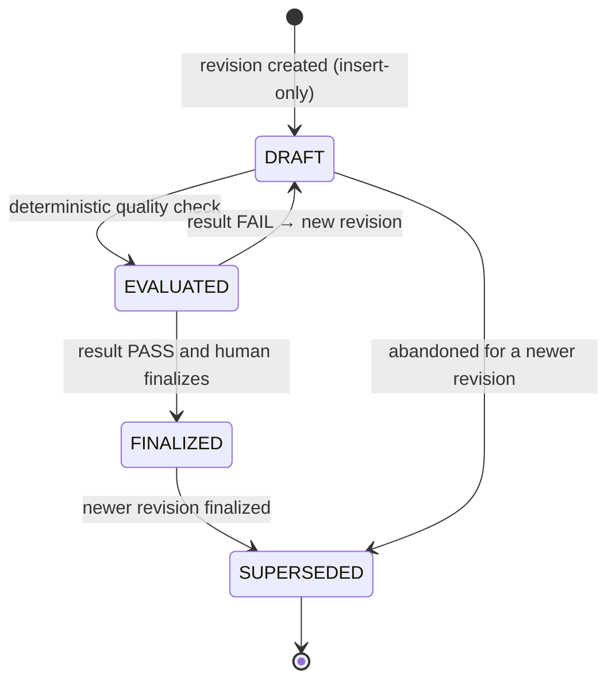

# Specification

`fdlc://v1/specification` · Family A (Intent) · Delivery Loop step 2, **Specify**

## Purpose

A Specification is the immutable, versioned statement of what must be true for an Intent to be satisfied: requirements with stable ids, acceptance expectations, verification expectations, non-goals, constraints, and repository scope. It is separate from the Intent because the Intent's operating state changes constantly while its meaning must not. **Finalized ≠ approved**: a finalized Specification is planning-ready and carries no execution, verification, publication, or acceptance authority.

## Identity

| Rule | Value |
|---|---|
| Type URI | `fdlc://v1/specification` |
| Instance id | Revision id; worked-example form `SPEC-<n>-r<rev>` (`SPEC-104-r1`). `lineageId` (`SPEC-104`) is shared by all revisions. |
| Mutability | Insert-only. Any change to `content` MUST create a new revision with `baseRevisionId` set. |
| Digest | `digest` = SHA-256 over canonical JSON of `content` plus `constitution.digest`. Downstream artifacts bind this digest, not the id. |
| Alias | Mission Spec (Mission Control). Companion: Project Constitution (bound by digest). |

## Fields

| Field | Type | Req | Description |
|---|---|---|---|
| `schemaVersion`, `type`, `id`, `namespace` | — | MUST | Common identity. |
| `lineageId` | Id | MUST | Stable id across revisions. |
| `intentId` | Id | MUST | The Intent this specifies. |
| `revisionNumber`, `baseRevisionId` | int, Id | MUST / MUST if rev ≥ 2 | Revision lineage. |
| `constitution` | {id, revisionNumber, digest} | SHOULD | Durable rules agents may not reinterpret; bound by exact digest. |
| `content.outcome` | string | MUST | Measurable outcome. |
| `content.requirements[]` | Requirement | MUST (≥1) | `id`, `statement`, `type` FUNCTIONAL/NON_FUNCTIONAL, `category`, `priority` MUST/SHOULD/MAY, `measurable`. |
| `content.acceptanceExpectations[]` | AcceptanceExpectation | MUST (≥1) | Each cites ≥1 requirement id and a verification method. |
| `content.verificationExpectations[]` | VerificationExpectation | SHOULD | Evidence category, independence level, verification level (TASK/WORK_ORDER/OBJECTIVE/RELEASE). |
| `content.nonGoals[]`, `constraints[]`, `risks[]`, `clarifications[]` | — | SHOULD | Explicit boundaries; unresolved clarifications block finalization. |
| `content.repositoryScope` | object | SHOULD | Repository ids, include/exclude paths. |
| `contributions[]` | Contribution | MAY | Append-only role proposals (PRODUCT, QA, DESIGN, ENGINEERING, SECURITY_OPERATIONS, DOMAIN); `decision` ACCEPTED/REJECTED is human-only. |
| `qualityEvaluation` | object | MUST once EVALUATED | Deterministic spec-quality check: `result` PASS/FAIL, `rulesetVersion`, `findings[]`, evaluator actor, timestamp. |
| `state` | DRAFT / EVALUATED / FINALIZED / SUPERSEDED | MUST | See lifecycle. |
| `finalizedBy`, `finalizedAt`, `finalizationRationale` | Actor (human), Timestamp | MUST once FINALIZED | Who declared planning-readiness. |
| `supersededById` | Id | MUST once SUPERSEDED | Next revision. |
| `digest` | Digest | MUST | See Identity. |
| `createdAt`, `createdBy`, `idempotencyKey`, `history[]` | — | MUST / SHOULD | Common audit fields. |

## Lifecycle



| Transition | Who | MUST record |
|---|---|---|
| create revision | Human owner; agents MAY draft via `contributions` | `baseRevisionId`, `constitution.digest`, `digest` |
| `DRAFT → EVALUATED` | Deterministic evaluator (service) | `qualityEvaluation` with ruleset version and findings |
| `EVALUATED → FINALIZED` | Human only | `finalizedBy`, rationale; evaluation MUST be PASS |
| `→ SUPERSEDED` | Control plane on finalization of a later revision | `supersededById` |

## Invariants

- Content MUST be immutable after creation. A revision MUST NOT be patched; a change is a new revision.
- `FINALIZED` MUST NOT be reachable when `qualityEvaluation.result` is `FAIL` or any clarification is unresolved. A failed check blocks planning; it MUST NOT ask the planner to guess.
- Every acceptance expectation MUST reference at least one requirement id. Requirement ids MUST be unique within the revision.
- Finalization MUST NOT dispatch, verify, publish, or accept anything. "`FINALIZED` means planning-ready only. It is intentionally not APPROVED and carries no execution, verification, publication, or acceptance authority." (`convex/schema.ts:2333-2334`)
- A Plan MUST bind the exact `digest` of the Specification it was approved against. A newer revision MUST NOT silently rebind an existing Plan.
- Contribution decisions MUST be human-only and append-only; an agent MAY propose, never accept.
- The Project Constitution MUST be bound by digest and attached to the Plan; it MUST NOT be recalled from model memory.

## Evidence requirements

| Transition | Evidence |
|---|---|
| Evaluation | The evaluator's findings record with ruleset version (deterministic; reproducible from content + ruleset) |
| Finalization | Passing evaluation id; resolution record for every clarification; contribution decisions |
| Supersession | Digest of the superseding revision |

## Extension points

- `x-` fields at top level and inside `content` (e.g. `x-acme-compliance-refs`).
- Additional `category` values for requirements MAY be introduced through `x-category`; the canonical enum MUST be used for interoperability.
- Additional contribution roles MUST use `DOMAIN` with an `x-role` qualifier.

## Mission Control mapping

| FDLC | Mission Control | Status | Divergence |
|---|---|---|---|
| Specification revision | `missionSpecRevisions` (`convex/schema.ts:2292`) | Experimental (merged and qualified; default off behind `missions.spec-intake-v1`) | Direct: insert-only, `baseRevisionId`, `digest`, constitution digest lineage. |
| `constitution` | `projectConstitutionRevisions` (`schema.ts:2271`) | Experimental | Direct. |
| `qualityEvaluation` | `missionSpecQualityEvaluations` (`2311`) | Experimental | Direct (`PASS`/`FAIL`, `rulesetVersion`, findings). |
| `FINALIZED` | `missionSpecDecisions.decisionType: "FINALIZED"` (`2335`) | Experimental | Direct; MC has only the FINALIZED decision type. |
| `contributions` | `missionIntentContributions` + decisions (`2354`, `2403`) | Preview, default off | Direct; roles and target sections match. |
| `verificationExpectations[].verificationLevel` | not modeled | Proposed | FDLC addition for the verification hierarchy. |

## JSON Schema

```json
{
  "$schema": "https://json-schema.org/draft/2020-12/schema",
  "$id": "https://fdlc.ai/schemas/v1/specification.schema.json",
  "title": "FDLC Specification",
  "description": "Immutable, versioned statement of what must be true: acceptance criteria, boundaries, verification requirements. Finalized ≠ approved.",
  "type": "object",
  "properties": {
    "schemaVersion": {
      "type": "string",
      "const": "1.0"
    },
    "type": {
      "type": "string",
      "const": "fdlc://v1/specification"
    },
    "id": {
      "$ref": "#/$defs/Id",
      "description": "Revision id (e.g. SPEC-104-r1)."
    },
    "namespace": {
      "$ref": "#/$defs/Namespace"
    },
    "lineageId": {
      "$ref": "#/$defs/Id",
      "description": "Stable id shared by all revisions (e.g. SPEC-104)."
    },
    "intentId": {
      "$ref": "#/$defs/Id"
    },
    "revisionNumber": {
      "type": "integer",
      "minimum": 1
    },
    "baseRevisionId": {
      "$ref": "#/$defs/Id"
    },
    "constitution": {
      "type": "object",
      "description": "Durable rules agents may not reinterpret (Project Constitution). Bound by exact digest.",
      "properties": {
        "id": {
          "$ref": "#/$defs/Id"
        },
        "revisionNumber": {
          "type": "integer",
          "minimum": 1
        },
        "digest": {
          "$ref": "#/$defs/Digest"
        }
      },
      "required": [
        "id",
        "digest"
      ],
      "additionalProperties": false
    },
    "content": {
      "type": "object",
      "properties": {
        "outcome": {
          "type": "string",
          "minLength": 1
        },
        "requirements": {
          "type": "array",
          "minItems": 1,
          "items": {
            "$ref": "#/$defs/Requirement"
          }
        },
        "acceptanceExpectations": {
          "type": "array",
          "minItems": 1,
          "items": {
            "$ref": "#/$defs/AcceptanceExpectation"
          }
        },
        "verificationExpectations": {
          "type": "array",
          "items": {
            "$ref": "#/$defs/VerificationExpectation"
          }
        },
        "nonGoals": {
          "type": "array",
          "items": {
            "type": "string"
          }
        },
        "constraints": {
          "type": "array",
          "items": {
            "type": "string"
          }
        },
        "risks": {
          "type": "array",
          "items": {
            "$ref": "#/$defs/Risk"
          }
        },
        "clarifications": {
          "type": "array",
          "items": {
            "$ref": "#/$defs/Clarification"
          }
        },
        "repositoryScope": {
          "type": "object",
          "properties": {
            "repositoryIds": {
              "type": "array",
              "items": {
                "$ref": "#/$defs/Id"
              }
            },
            "includePaths": {
              "type": "array",
              "items": {
                "type": "string"
              }
            },
            "excludePaths": {
              "type": "array",
              "items": {
                "type": "string"
              }
            }
          },
          "additionalProperties": false
        }
      },
      "required": [
        "outcome",
        "requirements",
        "acceptanceExpectations"
      ],
      "additionalProperties": false
    },
    "contributions": {
      "type": "array",
      "items": {
        "$ref": "#/$defs/Contribution"
      },
      "description": "Append-only proposals from roles (product, QA, design, engineering, security). Accepted only by a human."
    },
    "qualityEvaluation": {
      "type": "object",
      "description": "Deterministic spec-quality check. FAIL blocks planning; it never asks the planner to guess.",
      "properties": {
        "result": {
          "type": "string",
          "enum": [
            "PASS",
            "FAIL"
          ]
        },
        "rulesetVersion": {
          "type": "string"
        },
        "findings": {
          "type": "array",
          "items": {
            "$ref": "#/$defs/Finding"
          }
        },
        "evaluatedBy": {
          "$ref": "#/$defs/Actor"
        },
        "evaluatedAt": {
          "$ref": "#/$defs/Timestamp"
        }
      },
      "required": [
        "result",
        "rulesetVersion",
        "findings",
        "evaluatedBy",
        "evaluatedAt"
      ],
      "additionalProperties": false
    },
    "state": {
      "type": "string",
      "enum": [
        "DRAFT",
        "EVALUATED",
        "FINALIZED",
        "SUPERSEDED"
      ]
    },
    "finalizedBy": {
      "$ref": "#/$defs/Actor"
    },
    "finalizedAt": {
      "$ref": "#/$defs/Timestamp"
    },
    "finalizationRationale": {
      "type": "string"
    },
    "supersededById": {
      "$ref": "#/$defs/Id"
    },
    "digest": {
      "$ref": "#/$defs/Digest",
      "description": "Digest over `content` plus `constitution.digest`. Any change to content is a new revision."
    },
    "createdAt": {
      "$ref": "#/$defs/Timestamp"
    },
    "createdBy": {
      "$ref": "#/$defs/Actor"
    },
    "idempotencyKey": {
      "type": "string"
    },
    "history": {
      "type": "array",
      "items": {
        "$ref": "#/$defs/Transition"
      }
    }
  },
  "required": [
    "schemaVersion",
    "type",
    "id",
    "namespace",
    "lineageId",
    "intentId",
    "revisionNumber",
    "content",
    "state",
    "digest",
    "createdAt",
    "createdBy"
  ],
  "allOf": [
    {
      "if": {
        "properties": {
          "state": {
            "enum": [
              "EVALUATED",
              "FINALIZED",
              "SUPERSEDED"
            ]
          }
        }
      },
      "then": {
        "required": [
          "qualityEvaluation"
        ]
      }
    },
    {
      "if": {
        "properties": {
          "state": {
            "enum": [
              "FINALIZED",
              "SUPERSEDED"
            ]
          }
        }
      },
      "then": {
        "required": [
          "finalizedBy",
          "finalizedAt"
        ],
        "properties": {
          "qualityEvaluation": {
            "properties": {
              "result": {
                "const": "PASS"
              }
            }
          },
          "finalizedBy": {
            "properties": {
              "kind": {
                "const": "human"
              }
            }
          }
        }
      }
    },
    {
      "if": {
        "properties": {
          "revisionNumber": {
            "minimum": 2
          }
        }
      },
      "then": {
        "required": [
          "baseRevisionId"
        ]
      }
    }
  ],
  "$defs": {
    "Id": {
      "type": "string",
      "minLength": 1,
      "maxLength": 200,
      "pattern": "^[A-Za-z0-9][A-Za-z0-9._:/@-]*$",
      "description": "Instance identifier. Unique within the issuing namespace; combined with `namespace` it is globally unique."
    },
    "ArtifactUri": {
      "type": "string",
      "pattern": "^fdlc://v1/(intent|specification|plan|work-order|factory-manifest|factory-version|execution-profile|capability-manifest|qualification-record|context-package|attempt|candidate|evidence|verification|decision|release|outcome|learning-signal|improvement-candidate)(/[A-Za-z0-9][A-Za-z0-9._:@-]*)?$",
      "description": "Artifact type URI (`fdlc://v1/<artifact>`), optionally suffixed with an instance id."
    },
    "Namespace": {
      "type": "string",
      "format": "uri",
      "description": "URI of the issuing control plane or organization. Scopes every `id` in this record."
    },
    "Digest": {
      "type": "string",
      "pattern": "^sha256:[a-f0-9]{64}$",
      "description": "SHA-256 over the RFC 8785 (JCS) canonical JSON of the digested projection."
    },
    "GitSha": {
      "type": "string",
      "pattern": "^[a-f0-9]{40}$|^[a-f0-9]{64}$",
      "description": "Lowercase full Git object id (SHA-1 or SHA-256 repository)."
    },
    "Timestamp": {
      "type": "string",
      "format": "date-time",
      "description": "RFC 3339 timestamp in UTC."
    },
    "Semver": {
      "type": "string",
      "pattern": "^(0|[1-9]\\d*)\\.(0|[1-9]\\d*)\\.(0|[1-9]\\d*)(-[0-9A-Za-z.-]+)?(\\+[0-9A-Za-z.-]+)?$"
    },
    "RiskClass": {
      "type": "string",
      "enum": [
        "LOW",
        "MEDIUM",
        "HIGH",
        "CRITICAL"
      ]
    },
    "AutonomyLevel": {
      "type": "string",
      "enum": [
        "L0",
        "L1",
        "L2",
        "L3",
        "L4",
        "L5"
      ],
      "description": "HITL spectrum position. Effective autonomy is min(factory, objective, work order, policy, trust)."
    },
    "Actor": {
      "type": "object",
      "description": "Attributable identity. `identitySource` says how the control plane established it; never inferred from a client label.",
      "properties": {
        "kind": {
          "type": "string",
          "enum": [
            "human",
            "policy",
            "service",
            "agent",
            "system"
          ]
        },
        "id": {
          "$ref": "#/$defs/Id"
        },
        "identitySource": {
          "type": "string",
          "enum": [
            "authenticated",
            "workload-identity",
            "service-command",
            "development-fallback"
          ]
        },
        "displayName": {
          "type": "string"
        },
        "delegationRef": {
          "$ref": "#/$defs/Id",
          "description": "Reference to the delegation record that grants this actor its authority."
        }
      },
      "required": [
        "kind",
        "id",
        "identitySource"
      ],
      "additionalProperties": false
    },
    "Ref": {
      "type": "object",
      "description": "Reference to another FDLC artifact instance, optionally pinned to a digest.",
      "properties": {
        "type": {
          "$ref": "#/$defs/ArtifactUri"
        },
        "id": {
          "$ref": "#/$defs/Id"
        },
        "digest": {
          "$ref": "#/$defs/Digest"
        },
        "revisionNumber": {
          "type": "integer",
          "minimum": 1
        }
      },
      "required": [
        "type",
        "id"
      ],
      "additionalProperties": false
    },
    "Money": {
      "type": "object",
      "properties": {
        "amount": {
          "type": "number",
          "minimum": 0
        },
        "currency": {
          "type": "string",
          "pattern": "^[A-Z]{3}$"
        }
      },
      "required": [
        "amount",
        "currency"
      ],
      "additionalProperties": false
    },
    "CostRecord": {
      "type": "object",
      "description": "Cost with an honesty class. UNKNOWN cost stays UNKNOWN; implementations MUST NOT invent zeroes.",
      "properties": {
        "status": {
          "type": "string",
          "enum": [
            "MEASURED",
            "ESTIMATED",
            "UNKNOWN"
          ]
        },
        "amount": {
          "type": "number",
          "minimum": 0
        },
        "currency": {
          "type": "string",
          "pattern": "^[A-Z]{3}$"
        },
        "coverage": {
          "type": "number",
          "minimum": 0,
          "maximum": 1,
          "description": "Fraction of contributing cost items that were measured."
        },
        "reason": {
          "type": "string"
        }
      },
      "required": [
        "status"
      ],
      "additionalProperties": false
    },
    "Transition": {
      "type": "object",
      "description": "Audit record of one authoritative state transition. Every field listed here MUST be recorded.",
      "properties": {
        "transitionId": {
          "$ref": "#/$defs/Id"
        },
        "subjectId": {
          "$ref": "#/$defs/Id"
        },
        "priorVersion": {
          "type": "integer",
          "minimum": 0
        },
        "fromState": {
          "type": "string"
        },
        "toState": {
          "type": "string"
        },
        "actor": {
          "$ref": "#/$defs/Actor"
        },
        "reason": {
          "type": "string"
        },
        "policyVersion": {
          "type": "string"
        },
        "idempotencyKey": {
          "type": "string"
        },
        "occurredAt": {
          "$ref": "#/$defs/Timestamp"
        },
        "requiredEvidenceIds": {
          "type": "array",
          "items": {
            "$ref": "#/$defs/Id"
          }
        },
        "decisionId": {
          "$ref": "#/$defs/Id"
        },
        "invalidatedDependents": {
          "type": "array",
          "items": {
            "$ref": "#/$defs/Ref"
          }
        }
      },
      "required": [
        "subjectId",
        "fromState",
        "toState",
        "actor",
        "reason",
        "idempotencyKey",
        "occurredAt"
      ],
      "additionalProperties": false
    },
    "ArtifactRef": {
      "type": "object",
      "description": "Content-addressed reference to a stored artifact (diff, log, screenshot, bundle).",
      "properties": {
        "artifactId": {
          "$ref": "#/$defs/Id"
        },
        "kind": {
          "type": "string"
        },
        "mediaType": {
          "type": "string"
        },
        "digest": {
          "$ref": "#/$defs/Digest"
        },
        "sizeBytes": {
          "type": "integer",
          "minimum": 0
        },
        "storageRef": {
          "type": "string"
        }
      },
      "required": [
        "artifactId",
        "digest"
      ],
      "additionalProperties": false
    },
    "Requirement": {
      "type": "object",
      "properties": {
        "id": {
          "$ref": "#/$defs/Id"
        },
        "title": {
          "type": "string"
        },
        "statement": {
          "type": "string"
        },
        "type": {
          "type": "string",
          "enum": [
            "FUNCTIONAL",
            "NON_FUNCTIONAL"
          ]
        },
        "category": {
          "type": "string",
          "enum": [
            "FUNCTIONAL",
            "SECURITY",
            "RELIABILITY",
            "PERFORMANCE",
            "ACCESSIBILITY",
            "PRIVACY",
            "OPERABILITY",
            "ARCHITECTURE",
            "COMPATIBILITY"
          ]
        },
        "priority": {
          "type": "string",
          "enum": [
            "MUST",
            "SHOULD",
            "MAY"
          ]
        },
        "measurable": {
          "type": "boolean"
        }
      },
      "required": [
        "id",
        "statement",
        "type",
        "priority"
      ],
      "additionalProperties": false
    },
    "AcceptanceExpectation": {
      "type": "object",
      "properties": {
        "id": {
          "$ref": "#/$defs/Id"
        },
        "statement": {
          "type": "string"
        },
        "requirementIds": {
          "type": "array",
          "minItems": 1,
          "items": {
            "$ref": "#/$defs/Id"
          }
        },
        "verificationMethod": {
          "type": "string",
          "enum": [
            "COMMAND",
            "TEST",
            "BROWSER",
            "MANUAL",
            "CHECKLIST",
            "ANALYSIS"
          ]
        },
        "testable": {
          "type": "boolean"
        }
      },
      "required": [
        "id",
        "statement",
        "requirementIds"
      ],
      "additionalProperties": false
    },
    "VerificationExpectation": {
      "type": "object",
      "properties": {
        "id": {
          "$ref": "#/$defs/Id"
        },
        "statement": {
          "type": "string"
        },
        "acceptanceExpectationIds": {
          "type": "array",
          "items": {
            "$ref": "#/$defs/Id"
          }
        },
        "evidenceCategory": {
          "type": "string"
        },
        "independence": {
          "type": "string",
          "enum": [
            "ANY_VERIFICATION",
            "CANDIDATE_DEPENDENT_ALLOWED",
            "INDEPENDENT_REQUIRED"
          ]
        },
        "verificationLevel": {
          "type": "string",
          "enum": [
            "TASK",
            "WORK_ORDER",
            "OBJECTIVE",
            "RELEASE"
          ]
        }
      },
      "required": [
        "id",
        "statement",
        "evidenceCategory",
        "independence"
      ],
      "additionalProperties": false
    },
    "Risk": {
      "type": "object",
      "properties": {
        "id": {
          "$ref": "#/$defs/Id"
        },
        "description": {
          "type": "string"
        },
        "severity": {
          "$ref": "#/$defs/RiskClass"
        },
        "affectedAreas": {
          "type": "array",
          "items": {
            "type": "string"
          }
        }
      },
      "required": [
        "id",
        "description",
        "severity"
      ],
      "additionalProperties": false
    },
    "Clarification": {
      "type": "object",
      "properties": {
        "id": {
          "$ref": "#/$defs/Id"
        },
        "question": {
          "type": "string"
        },
        "answer": {
          "type": "string"
        },
        "resolved": {
          "type": "boolean"
        },
        "answeredBy": {
          "$ref": "#/$defs/Actor"
        }
      },
      "required": [
        "id",
        "question",
        "resolved"
      ],
      "additionalProperties": false
    },
    "Contribution": {
      "type": "object",
      "properties": {
        "id": {
          "$ref": "#/$defs/Id"
        },
        "role": {
          "type": "string",
          "enum": [
            "PRODUCT",
            "QA",
            "DESIGN",
            "ENGINEERING",
            "SECURITY_OPERATIONS",
            "DOMAIN"
          ]
        },
        "targetSection": {
          "type": "string",
          "enum": [
            "OUTCOME",
            "REQUIREMENTS",
            "NON_FUNCTIONAL_REQUIREMENTS",
            "ACCEPTANCE_EXPECTATIONS",
            "VERIFICATION_EXPECTATIONS",
            "NON_GOALS",
            "CONSTRAINTS",
            "RISKS",
            "REPOSITORY_SCOPE"
          ]
        },
        "proposal": {
          "type": "string"
        },
        "author": {
          "$ref": "#/$defs/Actor"
        },
        "decision": {
          "type": "string",
          "enum": [
            "PENDING",
            "ACCEPTED",
            "REJECTED"
          ]
        },
        "decidedBy": {
          "$ref": "#/$defs/Actor"
        },
        "decidedAt": {
          "$ref": "#/$defs/Timestamp"
        }
      },
      "required": [
        "id",
        "role",
        "targetSection",
        "proposal",
        "author",
        "decision"
      ],
      "additionalProperties": false
    },
    "Finding": {
      "type": "object",
      "properties": {
        "code": {
          "type": "string"
        },
        "severity": {
          "type": "string",
          "enum": [
            "BLOCKING",
            "WARNING",
            "INFO"
          ]
        },
        "message": {
          "type": "string"
        },
        "path": {
          "type": "string"
        }
      },
      "required": [
        "code",
        "severity",
        "message"
      ],
      "additionalProperties": false
    }
  },
  "patternProperties": {
    "^x-[a-z0-9]+(-[a-z0-9]+)*$": {}
  },
  "additionalProperties": false
}
```

## Example instance

```json
{
  "schemaVersion": "1.0",
  "type": "fdlc://v1/specification",
  "id": "SPEC-104-r1",
  "namespace": "https://acme.example/factories/checkout",
  "lineageId": "SPEC-104",
  "intentId": "INT-104",
  "revisionNumber": 1,
  "constitution": {
    "id": "CONST-checkout-api",
    "revisionNumber": 3,
    "digest": "sha256:a948f2759151cfd34fb1cd7ce818b579b633b161e382ac05b97c1c8745cc96de"
  },
  "content": {
    "outcome": "checkout-api compiles, tests, and runs against Acme Payments SDK v4 with identical externally observable behavior.",
    "requirements": [
      {
        "id": "REQ-104-01",
        "title": "SDK upgraded to v4",
        "statement": "The manifest and lockfile pin acme-payments-sdk to the 4.x line and no 3.x artifact remains in the dependency graph.",
        "type": "FUNCTIONAL",
        "category": "COMPATIBILITY",
        "priority": "MUST",
        "measurable": true
      },
      {
        "id": "REQ-104-02",
        "title": "No compatibility shims",
        "statement": "No deprecated v3 imports or compatibility shims remain in services/checkout-api.",
        "type": "FUNCTIONAL",
        "category": "ARCHITECTURE",
        "priority": "MUST",
        "measurable": true
      },
      {
        "id": "REQ-104-03",
        "title": "Behavior preserved",
        "statement": "Public API, persisted schema, and authorization behavior are unchanged.",
        "type": "NON_FUNCTIONAL",
        "category": "COMPATIBILITY",
        "priority": "MUST",
        "measurable": true
      },
      {
        "id": "REQ-104-04",
        "title": "Release readiness",
        "statement": "The release record includes rollback conditions and an accountable owner.",
        "type": "NON_FUNCTIONAL",
        "category": "OPERABILITY",
        "priority": "MUST",
        "measurable": true
      }
    ],
    "acceptanceExpectations": [
      {
        "id": "AE-104-01",
        "statement": "All existing contract and integration tests pass against the exact candidate.",
        "requirementIds": [
          "REQ-104-03"
        ],
        "verificationMethod": "TEST",
        "testable": true
      },
      {
        "id": "AE-104-02",
        "statement": "Dependency scan shows no 3.x acme-payments-sdk artifact and no new dependencies.",
        "requirementIds": [
          "REQ-104-01"
        ],
        "verificationMethod": "COMMAND",
        "testable": true
      },
      {
        "id": "AE-104-03",
        "statement": "Static analysis finds no import from acme_payments.v3 or *.compat.",
        "requirementIds": [
          "REQ-104-02"
        ],
        "verificationMethod": "ANALYSIS",
        "testable": true
      },
      {
        "id": "AE-104-04",
        "statement": "Diff touches no files under api/public, schema/, or auth/.",
        "requirementIds": [
          "REQ-104-03"
        ],
        "verificationMethod": "ANALYSIS",
        "testable": true
      },
      {
        "id": "AE-104-05",
        "statement": "The Release carries rollback conditions and an owner.",
        "requirementIds": [
          "REQ-104-04"
        ],
        "verificationMethod": "CHECKLIST",
        "testable": true
      }
    ],
    "verificationExpectations": [
      {
        "id": "VE-104-01",
        "statement": "Test evidence must be produced by an independent verifier Attempt.",
        "acceptanceExpectationIds": [
          "AE-104-01"
        ],
        "evidenceCategory": "TEST_RESULT",
        "independence": "INDEPENDENT_REQUIRED",
        "verificationLevel": "WORK_ORDER"
      },
      {
        "id": "VE-104-02",
        "statement": "Dependency and static-analysis evidence must be independent.",
        "acceptanceExpectationIds": [
          "AE-104-02",
          "AE-104-03"
        ],
        "evidenceCategory": "DEPENDENCY_SCAN",
        "independence": "INDEPENDENT_REQUIRED",
        "verificationLevel": "WORK_ORDER"
      },
      {
        "id": "VE-104-03",
        "statement": "Scope evidence is derived by the control plane from the frozen diff.",
        "acceptanceExpectationIds": [
          "AE-104-04"
        ],
        "evidenceCategory": "FILE_DIFF",
        "independence": "ANY_VERIFICATION",
        "verificationLevel": "WORK_ORDER"
      }
    ],
    "nonGoals": [
      "Refactoring unrelated payment flows",
      "Changing retry semantics"
    ],
    "constraints": [
      "Work stays inside services/checkout-api",
      "No new runtime dependencies beyond the SDK upgrade"
    ],
    "risks": [
      {
        "id": "RISK-104-01",
        "description": "v4 changes idempotency-key header semantics.",
        "severity": "MEDIUM",
        "affectedAreas": [
          "services/checkout-api/payments"
        ]
      }
    ],
    "clarifications": [
      {
        "id": "CL-104-01",
        "question": "Does v4's async client replace the sync client?",
        "answer": "No. Keep the sync client; async migration is out of scope.",
        "resolved": true,
        "answeredBy": {
          "kind": "human",
          "id": "user:dana.okafor",
          "identitySource": "authenticated"
        }
      }
    ],
    "repositoryScope": {
      "repositoryIds": [
        "repo:checkout-api"
      ],
      "includePaths": [
        "services/checkout-api/**"
      ],
      "excludePaths": [
        "services/checkout-api/api/public/**",
        "services/checkout-api/schema/**",
        "services/checkout-api/auth/**"
      ]
    }
  },
  "contributions": [
    {
      "id": "CTR-104-01",
      "role": "SECURITY_OPERATIONS",
      "targetSection": "RISKS",
      "proposal": "Add idempotency-key header semantics as a tracked risk.",
      "author": {
        "kind": "human",
        "id": "user:lee.park",
        "identitySource": "authenticated"
      },
      "decision": "ACCEPTED",
      "decidedBy": {
        "kind": "human",
        "id": "user:dana.okafor",
        "identitySource": "authenticated"
      },
      "decidedAt": "2026-09-01T11:05:00Z"
    }
  ],
  "qualityEvaluation": {
    "result": "PASS",
    "rulesetVersion": "spec-quality/1.2",
    "findings": [
      {
        "code": "SQ-INFO-NONGOALS",
        "severity": "INFO",
        "message": "Non-goals present and explicit."
      }
    ],
    "evaluatedBy": {
      "kind": "service",
      "id": "svc:spec-quality-evaluator",
      "identitySource": "workload-identity"
    },
    "evaluatedAt": "2026-09-01T11:20:00Z"
  },
  "state": "FINALIZED",
  "finalizedBy": {
    "kind": "human",
    "id": "user:dana.okafor",
    "identitySource": "authenticated"
  },
  "finalizedAt": "2026-09-01T11:30:00Z",
  "finalizationRationale": "Requirements identifiable, outcomes measurable, clarifications resolved, acceptance testable. Planning-ready; not approved.",
  "digest": "sha256:b0a338f1f6b50109c098b5b605e4c3bed903c6f121be84bde77508807d0451b0",
  "createdAt": "2026-09-01T10:02:00Z",
  "createdBy": {
    "kind": "human",
    "id": "user:dana.okafor",
    "identitySource": "authenticated"
  },
  "idempotencyKey": "spec:INT-104:r1"
}
```

## Related

- Spec: [/specification/v1/intent](/specification/v1/intent) · [/specification/v1/plan](/specification/v1/plan) · [/specification/v1/work-order](/specification/v1/work-order)
- Framework: [/framework/delivery-loop](/framework/delivery-loop) step 2 Specify
- Architecture: [/architecture/verification](/architecture/verification) (traceability chain requirement → check)
- Glossary: Specification, Project Constitution, Finalized
- Mission Control: [/mission-control](/mission-control) spec-driven intake
