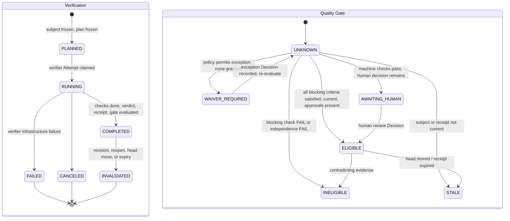

# Verification

`fdlc://v1/verification` · Family D (Trust) · Delivery Loop step 6, **Verify**

## Purpose

A Verification is an independent verifier Attempt run against a frozen Verification Subject under a frozen Verification Plan, producing a Result, a receipt, a currentness evaluation, and a Quality Gate decision. Independence is proven by lineage (a different process) and by standard (a different definition of success). Verification makes work *eligible*; it never accepts. Execution success ≠ Task success ≠ Verification success ≠ Business outcome.

## Identity

| Rule | Value |
|---|---|
| Type URI | `fdlc://v1/verification` |
| Instance id | `VER-<work-order>-<seq>` (`VER-104-02`). |
| Mutability | The subject and plan are immutable once `RUNNING`. Result, receipt, currentness, and gate append. Invalidation appends. |
| Digest | `digest` = SHA-256 over `{subject.digest, plan.planDigest, verificationAttemptId, result.decisionInputDigest}`. |
| Subject | `subject.digest` is server-reproducible from the Candidate identity fields; `subjectId = verification-subject:<hex>`. |
| Plan | `plan.planDigest` = SHA-256 over the canonical plan draft; `planId = verification-plan:<hex>`. |
| Decision input | `result.decisionInputDigest` = SHA-256 over `{subject.digest, plan.planDigest, checks, evidenceSetDigest, independence}`. The receipt and the gate MUST carry the same value. |

## Fields

| Field | Type | Req | Description |
|---|---|---|---|
| `schemaVersion`, `type`, `id`, `namespace` | — | MUST | Common identity. |
| `level` | TASK / WORK_ORDER / OBJECTIVE / RELEASE | MUST | Position in the verification hierarchy. WORK_ORDER is the unit of acceptance. |
| `workOrderId`, `workOrderRevisionNumber`, `intentId` | — | MUST / SHOULD | — |
| `verificationContractDigest`, `qualityContractDigest` | Digest | MUST / SHOULD | What is being verified against. |
| `sourceAttemptId`, `verificationAttemptId`, `verifierFactoryVersionId` | Id | MUST | Producer Attempt, verifier Attempt (different), verifier Factory Version (purpose VERIFICATION). |
| **Verification Subject** `subject` | object | MUST | `subjectId`, `subjectVersion`, `kind` (GIT_CANDIDATE, AUTOMATION_OUTPUT, RELEASE_ARTIFACT, INTEGRATED_CANDIDATE), `candidateId` or `candidateIds[]`, Work Order revision, contract digest, source Attempt, repository, base/commit/tree SHAs, diff digest, refs, `digest`, `frozenAt`. |
| **Verification Plan** `plan` | object | MUST | `planId`, `planVersion`, `planDigest`, `subjectDigest`, `generatedBy {factoryVersionId, attemptId, executorInvocationId}`, `requirements[]` (source, criticality), `requiredRisks[]`, `discoveredRisks[]`, `requiredEvidence[]` (→ checks), `adversarial`, `frozenAt`. |
| **Independence result** `independence` | object | MUST once COMPLETED | `policyVersion`, `passed`, `reasons[]`, `lineage {separateAttempt, separateLease, separateInvocation, separateWorktree, separateFactoryVersion, verifierFactoryPurpose: VERIFICATION, reportCapability, separateModelFamily}`, `standard {authorityStatus PASS/FAIL/UNKNOWN, mutatedAuthoritySurfaces[], contextFirewall}`, `evaluatedAt`. |
| `isolationAttestation` | object | MUST once COMPLETED | Mode (DETACHED_GIT_WORKTREE, FRESH_CLONE, REMOTE_SANDBOX, ISOLATED_CONTAINER, AUTOMATION_SNAPSHOT), sandbox id, server-reproducible root binding digest, subject digest, roots, `initialClean`, `finalSubjectMatch`, head/tree SHAs. |
| `checks[]` | CheckResult | MUST once COMPLETED | Per check: category, verifier capability, `mandatory`, `status` PASS/FAIL/SKIPPED/NOT_CONFIGURED/ERROR, criterion ids, evidence ids, timing, violations. |
| `coverage` | object | MUST once COMPLETED | Requirement, evidence, risk coverage ratios; per-criterion EVIDENCED/MISSING. |
| `result` | object | MUST once COMPLETED | `verdict` VERIFIED / NOT_VERIFIED / BLOCKED / REQUIRES_HUMAN_REVIEW, reasons, counts, `decisionInputDigest`, `evidenceSetDigest`, `evidenceIds[]`, `evaluatedAt`. |
| `receipt` | object | MUST once COMPLETED | `receiptId`, `status` PENDING/PASSED/FAILED/WAIVED/STALE, `recordedAt`, `validUntil`, invalidation fields, human-review or waiver Decision ids, `digest`. |
| **Currentness** `currentness` | object | MUST once COMPLETED | `rule: newest-candidate-newest-exact-verification`, `current`, `eligible`, reasons, `exactIdentity` tuple, `providerHead` projection. |
| **Quality Gate** `qualityGate` | object | MUST once COMPLETED | `gateDecisionId`, `state` ELIGIBLE / INELIGIBLE / UNKNOWN / STALE / WAIVER_REQUIRED / AWAITING_HUMAN, `mode` OBSERVE_ONLY / SHADOW / ENFORCED / EMERGENCY_BYPASS, reasons, blocking finding ids, required Decision ids, digests, policy version, `acceptanceAuthority: false`. |
| `state` | PLANNED / RUNNING / COMPLETED / FAILED / CANCELED / INVALIDATED | MUST | — |
| `startedAt`, `completedAt`, `invalidatedAt`, `digest`, `createdAt`, `createdBy`, `history[]` | — | MUST / SHOULD | Common audit fields. |

## Lifecycle



| Transition | Who | MUST record |
|---|---|---|
| `PLANNED` | Control plane | Subject digest; plan digest; verifier Attempt binding tuple |
| `PLANNED → RUNNING` | Verifier Attempt claim | Lease; isolation attestation start |
| `RUNNING → COMPLETED` | Verifier Attempt under current fence, through the `verification:report` capability | Checks, evidence set digest, independence result, verdict, `decisionInputDigest`, receipt with `validUntil`, currentness, gate decision |
| `COMPLETED → INVALIDATED` | Control plane (derived) | `invalidatedAt`, invalidating record (revision, reopen Decision, provider head) |
| Gate transitions | Control plane policy (append-only) | New gate decision row with reasons and digests; never edit a prior row |

## Invariants

- The verifier Attempt MUST differ from the source Attempt in Attempt id, lease, executor invocation, worktree, and Factory Version, and the verifier Factory Version purpose MUST be VERIFICATION. "Verification must use a separate executor invocation." "…a separate execution lease." (`verificationIndependence.ts:130,134`)
- Independence by lineage is necessary, not sufficient. "Lineage isolation (separate Attempt, lease, worktree, invocation) proves the verifier was a *different process*. It does not prove the verifier applied a *different standard*." (`verificationIndependence.ts:67-70`) `standard.authorityStatus` MUST be PASS; absent is not PASS. "The candidate modified files that determine its own verification verdict; isolation cannot make that independent." (`:138-139`)
- The Verification Plan MUST be frozen before the verifier starts and MUST NOT weaken the contract: required requirements, risks, and evidence MUST be present unchanged; a frozen plan MUST NOT be replaced, only a new verifier Attempt created.
- Currentness MUST be evaluated as a deterministic function: choose the newest candidate-ready source Attempt, then the newest exact-bound verifier Attempt; require COMPLETED status, matching decision-input digests on result and receipt, an unexpired receipt with `independenceValid`, every evidence id bound to the exact lineage, and a provider head equal to the subject commit. "It never falls back to an older pass." (`verificationCurrentness.ts:125-127`)
- Only `PASS` satisfies a mandatory check. SKIPPED, NOT_CONFIGURED, ERROR MUST NOT count as PASS.
- A `VERIFIED` verdict with `independence.passed: false` MUST NOT produce a PASSED receipt.
- The Quality Gate MUST be append-only and MUST carry `acceptanceAuthority: false`. "Acceptance must never read this projection back as authority." (`currentVerification.ts:190-192`) An acceptance Decision recomputes currentness at decision time.
- `OBSERVE_ONLY` and `SHADOW` modes MUST be visibly labeled and MUST NOT produce an enforced eligibility. `EMERGENCY_BYPASS` MUST be a recorded exception Decision with expiry.
- A moved provider head, a Work Order revision, or a reopen MUST invalidate the Verification (`INVALIDATED`) and the gate (`STALE`).
- `REQUIRES_HUMAN_REVIEW` MUST pause the flow for a human review Decision; it MUST NOT be auto-resolved by policy.
- OBJECTIVE-level verification of an `INTEGRATED_CANDIDATE` MUST NOT be inferred from WORK_ORDER-level passes; several local passes do not establish an objective pass.

## Evidence requirements

| Element | Evidence |
|---|---|
| Independence | Isolation attestation with server-reproducible `rootBindingDigest`; lease and invocation ids of both Attempts; verification-authority analysis of the candidate diff |
| Checks | One or more `CURRENT`, `LIVE` Evidence records per mandatory check, bound to `subject.digest` |
| Receipt | Evidence set digest over sorted unique evidence ids; `decisionInputDigest` equality with the result |
| Currentness | Provider head projection from a trusted integration (signed webhook or App query), unexpired |
| Gate | Policy version; required Decision ids for AWAITING_HUMAN / WAIVER_REQUIRED |

## Extension points

- `x-` fields at top level, in `plan`, `checks[]`, `currentness`, `qualityGate`.
- `subject.kind: INTEGRATED_CANDIDATE` and `RELEASE_ARTIFACT` are defined for OBJECTIVE and RELEASE levels; their identity rules are the sorted constituent candidate digests and the release artifact digest respectively.
- `isolationAttestation.mode` is closed; a new isolation technology MUST map onto one mode and describe itself in `x-isolation-detail`.

## Mission Control mapping

| FDLC | Mission Control | Status | Divergence |
|---|---|---|---|
| Verification | `verificationRuns` (`convex/schema.ts:2794`) + `verificationReceipts` (`2727`) + `qualityGateDecisions` (`2912`) | Available (Qualified; System V2) | FDLC folds run, receipt, currentness, and gate into one artifact with sub-objects; MC keeps separate tables. |
| `subject` | `verificationSubjectValidator`; `verificationSubject.ts` | Available | Direct (v1 GitHub/local, v2 pre-publication, automation). |
| `plan` | `verificationPlanValidator`; `freezeVerificationPlan` (`verificationPlan.ts:87-101`) | Available | Direct, including "plan is immutable after verification begins" and "may not weaken the contract". |
| `independence` | `deriveVerificationIndependence` (`verificationIndependence.ts:93-198`), 20+ enumerated reasons | Available | FDLC groups reasons into `lineage` and `standard`. |
| `currentness` | `evaluateCurrentVerificationEligibility` (`verificationCurrentness.ts:146-383`) | Available | Direct; the ordered algorithm is normative. |
| `qualityGate` | `qualityGateDecisions` states ELIGIBLE/INELIGIBLE/UNKNOWN/STALE/WAIVER_REQUIRED/AWAITING_HUMAN; modes OBSERVE_ONLY/SHADOW/ENFORCED/EMERGENCY_BYPASS; `metadata.authoritative: false` | Available (V1) | Direct. |
| `state` | `PLANNED, RUNNING, COMPLETED, FAILED, CANCELED` (schema); doc says PENDING/ERROR (drift, audit §7) | Available | FDLC adds `INVALIDATED` (MC: `invalidatedAt` field). |
| `level` OBJECTIVE / RELEASE | not implemented (per Work Order only) | Planned (audit §5.5) | FDLC defines the hierarchy. |
| Verifier false-success/false-failure calibration | none | Proposed | See Capability Manifest (verifier). |

## JSON Schema

```json
{
  "$schema": "https://json-schema.org/draft/2020-12/schema",
  "$id": "https://fdlc.ai/schemas/v1/verification.schema.json",
  "title": "FDLC Verification",
  "description": "An independent Verification Attempt against a frozen Verification Subject and Plan, producing a Result and a Quality Gate decision. Independence is proven by lineage and by standard. Verification makes work eligible; it never accepts.",
  "type": "object",
  "properties": {
    "schemaVersion": {
      "type": "string",
      "const": "1.0"
    },
    "type": {
      "type": "string",
      "const": "fdlc://v1/verification"
    },
    "id": {
      "$ref": "#/$defs/Id"
    },
    "namespace": {
      "$ref": "#/$defs/Namespace"
    },
    "level": {
      "type": "string",
      "enum": [
        "TASK",
        "WORK_ORDER",
        "OBJECTIVE",
        "RELEASE"
      ]
    },
    "workOrderId": {
      "$ref": "#/$defs/Id"
    },
    "workOrderRevisionNumber": {
      "type": "integer",
      "minimum": 1
    },
    "intentId": {
      "$ref": "#/$defs/Id"
    },
    "verificationContractDigest": {
      "$ref": "#/$defs/Digest"
    },
    "qualityContractDigest": {
      "$ref": "#/$defs/Digest"
    },
    "sourceAttemptId": {
      "$ref": "#/$defs/Id"
    },
    "verificationAttemptId": {
      "$ref": "#/$defs/Id"
    },
    "verifierFactoryVersionId": {
      "$ref": "#/$defs/Id"
    },
    "subject": {
      "$ref": "#/$defs/VerificationSubject"
    },
    "plan": {
      "$ref": "#/$defs/VerificationPlan"
    },
    "independence": {
      "$ref": "#/$defs/IndependenceResult"
    },
    "isolationAttestation": {
      "type": "object",
      "properties": {
        "mode": {
          "type": "string",
          "enum": [
            "DETACHED_GIT_WORKTREE",
            "FRESH_CLONE",
            "REMOTE_SANDBOX",
            "ISOLATED_CONTAINER",
            "AUTOMATION_SNAPSHOT"
          ]
        },
        "sandboxId": {
          "type": "string"
        },
        "rootBindingDigest": {
          "$ref": "#/$defs/Digest"
        },
        "subjectDigest": {
          "$ref": "#/$defs/Digest"
        },
        "verifierRoot": {
          "type": "string"
        },
        "sourceRoot": {
          "type": "string"
        },
        "initialClean": {
          "type": "boolean"
        },
        "finalSubjectMatch": {
          "type": "boolean"
        },
        "headSha": {
          "$ref": "#/$defs/GitSha"
        },
        "treeSha": {
          "$ref": "#/$defs/GitSha"
        },
        "attestedAt": {
          "$ref": "#/$defs/Timestamp"
        }
      },
      "required": [
        "mode",
        "sandboxId",
        "rootBindingDigest",
        "subjectDigest",
        "initialClean",
        "finalSubjectMatch",
        "attestedAt"
      ],
      "additionalProperties": false
    },
    "checks": {
      "type": "array",
      "items": {
        "$ref": "#/$defs/CheckResult"
      }
    },
    "coverage": {
      "type": "object",
      "properties": {
        "requiredRequirementCoverage": {
          "type": "number",
          "minimum": 0,
          "maximum": 1
        },
        "requiredEvidenceCoverage": {
          "type": "number",
          "minimum": 0,
          "maximum": 1
        },
        "requiredRiskCoverage": {
          "type": "number",
          "minimum": 0,
          "maximum": 1
        },
        "criteria": {
          "type": "array",
          "items": {
            "type": "object",
            "properties": {
              "criterionId": {
                "$ref": "#/$defs/Id"
              },
              "status": {
                "type": "string",
                "enum": [
                  "EVIDENCED",
                  "MISSING"
                ]
              },
              "requiredEvidenceCount": {
                "type": "integer"
              },
              "usableEvidenceCount": {
                "type": "integer"
              },
              "evidenceIds": {
                "type": "array",
                "items": {
                  "$ref": "#/$defs/Id"
                }
              }
            },
            "required": [
              "criterionId",
              "status",
              "requiredEvidenceCount",
              "usableEvidenceCount",
              "evidenceIds"
            ],
            "additionalProperties": false
          }
        }
      },
      "required": [
        "requiredRequirementCoverage",
        "requiredEvidenceCoverage",
        "criteria"
      ],
      "additionalProperties": false
    },
    "result": {
      "type": "object",
      "properties": {
        "verdict": {
          "type": "string",
          "enum": [
            "VERIFIED",
            "NOT_VERIFIED",
            "BLOCKED",
            "REQUIRES_HUMAN_REVIEW"
          ]
        },
        "reasons": {
          "type": "array",
          "items": {
            "type": "string"
          }
        },
        "requirementsPassed": {
          "type": "integer",
          "minimum": 0
        },
        "requirementsFailed": {
          "type": "integer",
          "minimum": 0
        },
        "violations": {
          "type": "array",
          "items": {
            "type": "string"
          }
        },
        "decisionInputDigest": {
          "$ref": "#/$defs/Digest",
          "description": "Digest over (subject digest, plan digest, check results, evidence set digest, independence result)."
        },
        "evidenceSetDigest": {
          "$ref": "#/$defs/Digest"
        },
        "evidenceIds": {
          "type": "array",
          "items": {
            "$ref": "#/$defs/Id"
          }
        },
        "evaluatedAt": {
          "$ref": "#/$defs/Timestamp"
        }
      },
      "required": [
        "verdict",
        "reasons",
        "decisionInputDigest",
        "evidenceSetDigest",
        "evidenceIds",
        "evaluatedAt"
      ],
      "additionalProperties": false
    },
    "receipt": {
      "type": "object",
      "description": "Work Order-scope receipt: the durable, expiring statement of this verification's verdict.",
      "properties": {
        "receiptId": {
          "$ref": "#/$defs/Id"
        },
        "status": {
          "type": "string",
          "enum": [
            "PENDING",
            "PASSED",
            "FAILED",
            "WAIVED",
            "STALE"
          ]
        },
        "recordedAt": {
          "$ref": "#/$defs/Timestamp"
        },
        "validUntil": {
          "$ref": "#/$defs/Timestamp"
        },
        "invalidatedAt": {
          "$ref": "#/$defs/Timestamp"
        },
        "invalidatedBy": {
          "$ref": "#/$defs/Ref"
        },
        "invalidationReason": {
          "type": "string"
        },
        "humanReviewDecisionId": {
          "$ref": "#/$defs/Id"
        },
        "waiverDecisionId": {
          "$ref": "#/$defs/Id"
        },
        "digest": {
          "$ref": "#/$defs/Digest"
        }
      },
      "required": [
        "receiptId",
        "status",
        "recordedAt",
        "digest"
      ],
      "additionalProperties": false
    },
    "currentness": {
      "$ref": "#/$defs/CurrentnessResult"
    },
    "qualityGate": {
      "$ref": "#/$defs/QualityGateDecision"
    },
    "state": {
      "type": "string",
      "enum": [
        "PLANNED",
        "RUNNING",
        "COMPLETED",
        "FAILED",
        "CANCELED",
        "INVALIDATED"
      ]
    },
    "startedAt": {
      "$ref": "#/$defs/Timestamp"
    },
    "completedAt": {
      "$ref": "#/$defs/Timestamp"
    },
    "invalidatedAt": {
      "$ref": "#/$defs/Timestamp"
    },
    "digest": {
      "$ref": "#/$defs/Digest",
      "description": "Digest over (subject.digest, plan.planDigest, verificationAttemptId, result.decisionInputDigest)."
    },
    "createdAt": {
      "$ref": "#/$defs/Timestamp"
    },
    "createdBy": {
      "$ref": "#/$defs/Actor"
    },
    "history": {
      "type": "array",
      "items": {
        "$ref": "#/$defs/Transition"
      }
    }
  },
  "required": [
    "schemaVersion",
    "type",
    "id",
    "namespace",
    "level",
    "workOrderId",
    "workOrderRevisionNumber",
    "verificationContractDigest",
    "sourceAttemptId",
    "verificationAttemptId",
    "verifierFactoryVersionId",
    "subject",
    "plan",
    "state",
    "createdAt",
    "createdBy"
  ],
  "allOf": [
    {
      "if": {
        "properties": {
          "state": {
            "enum": [
              "COMPLETED",
              "INVALIDATED"
            ]
          }
        }
      },
      "then": {
        "required": [
          "independence",
          "isolationAttestation",
          "checks",
          "coverage",
          "result",
          "receipt",
          "currentness",
          "qualityGate",
          "completedAt",
          "digest"
        ]
      }
    },
    {
      "if": {
        "properties": {
          "state": {
            "const": "INVALIDATED"
          }
        }
      },
      "then": {
        "required": [
          "invalidatedAt"
        ]
      }
    }
  ],
  "$defs": {
    "Id": {
      "type": "string",
      "minLength": 1,
      "maxLength": 200,
      "pattern": "^[A-Za-z0-9][A-Za-z0-9._:/@-]*$",
      "description": "Instance identifier. Unique within the issuing namespace; combined with `namespace` it is globally unique."
    },
    "ArtifactUri": {
      "type": "string",
      "pattern": "^fdlc://v1/(intent|specification|plan|work-order|factory-manifest|factory-version|execution-profile|capability-manifest|qualification-record|context-package|attempt|candidate|evidence|verification|decision|release|outcome|learning-signal|improvement-candidate)(/[A-Za-z0-9][A-Za-z0-9._:@-]*)?$",
      "description": "Artifact type URI (`fdlc://v1/<artifact>`), optionally suffixed with an instance id."
    },
    "Namespace": {
      "type": "string",
      "format": "uri",
      "description": "URI of the issuing control plane or organization. Scopes every `id` in this record."
    },
    "Digest": {
      "type": "string",
      "pattern": "^sha256:[a-f0-9]{64}$",
      "description": "SHA-256 over the RFC 8785 (JCS) canonical JSON of the digested projection."
    },
    "GitSha": {
      "type": "string",
      "pattern": "^[a-f0-9]{40}$|^[a-f0-9]{64}$",
      "description": "Lowercase full Git object id (SHA-1 or SHA-256 repository)."
    },
    "Timestamp": {
      "type": "string",
      "format": "date-time",
      "description": "RFC 3339 timestamp in UTC."
    },
    "Semver": {
      "type": "string",
      "pattern": "^(0|[1-9]\\d*)\\.(0|[1-9]\\d*)\\.(0|[1-9]\\d*)(-[0-9A-Za-z.-]+)?(\\+[0-9A-Za-z.-]+)?$"
    },
    "RiskClass": {
      "type": "string",
      "enum": [
        "LOW",
        "MEDIUM",
        "HIGH",
        "CRITICAL"
      ]
    },
    "AutonomyLevel": {
      "type": "string",
      "enum": [
        "L0",
        "L1",
        "L2",
        "L3",
        "L4",
        "L5"
      ],
      "description": "HITL spectrum position. Effective autonomy is min(factory, objective, work order, policy, trust)."
    },
    "Actor": {
      "type": "object",
      "description": "Attributable identity. `identitySource` says how the control plane established it; never inferred from a client label.",
      "properties": {
        "kind": {
          "type": "string",
          "enum": [
            "human",
            "policy",
            "service",
            "agent",
            "system"
          ]
        },
        "id": {
          "$ref": "#/$defs/Id"
        },
        "identitySource": {
          "type": "string",
          "enum": [
            "authenticated",
            "workload-identity",
            "service-command",
            "development-fallback"
          ]
        },
        "displayName": {
          "type": "string"
        },
        "delegationRef": {
          "$ref": "#/$defs/Id",
          "description": "Reference to the delegation record that grants this actor its authority."
        }
      },
      "required": [
        "kind",
        "id",
        "identitySource"
      ],
      "additionalProperties": false
    },
    "Ref": {
      "type": "object",
      "description": "Reference to another FDLC artifact instance, optionally pinned to a digest.",
      "properties": {
        "type": {
          "$ref": "#/$defs/ArtifactUri"
        },
        "id": {
          "$ref": "#/$defs/Id"
        },
        "digest": {
          "$ref": "#/$defs/Digest"
        },
        "revisionNumber": {
          "type": "integer",
          "minimum": 1
        }
      },
      "required": [
        "type",
        "id"
      ],
      "additionalProperties": false
    },
    "Money": {
      "type": "object",
      "properties": {
        "amount": {
          "type": "number",
          "minimum": 0
        },
        "currency": {
          "type": "string",
          "pattern": "^[A-Z]{3}$"
        }
      },
      "required": [
        "amount",
        "currency"
      ],
      "additionalProperties": false
    },
    "CostRecord": {
      "type": "object",
      "description": "Cost with an honesty class. UNKNOWN cost stays UNKNOWN; implementations MUST NOT invent zeroes.",
      "properties": {
        "status": {
          "type": "string",
          "enum": [
            "MEASURED",
            "ESTIMATED",
            "UNKNOWN"
          ]
        },
        "amount": {
          "type": "number",
          "minimum": 0
        },
        "currency": {
          "type": "string",
          "pattern": "^[A-Z]{3}$"
        },
        "coverage": {
          "type": "number",
          "minimum": 0,
          "maximum": 1,
          "description": "Fraction of contributing cost items that were measured."
        },
        "reason": {
          "type": "string"
        }
      },
      "required": [
        "status"
      ],
      "additionalProperties": false
    },
    "Transition": {
      "type": "object",
      "description": "Audit record of one authoritative state transition. Every field listed here MUST be recorded.",
      "properties": {
        "transitionId": {
          "$ref": "#/$defs/Id"
        },
        "subjectId": {
          "$ref": "#/$defs/Id"
        },
        "priorVersion": {
          "type": "integer",
          "minimum": 0
        },
        "fromState": {
          "type": "string"
        },
        "toState": {
          "type": "string"
        },
        "actor": {
          "$ref": "#/$defs/Actor"
        },
        "reason": {
          "type": "string"
        },
        "policyVersion": {
          "type": "string"
        },
        "idempotencyKey": {
          "type": "string"
        },
        "occurredAt": {
          "$ref": "#/$defs/Timestamp"
        },
        "requiredEvidenceIds": {
          "type": "array",
          "items": {
            "$ref": "#/$defs/Id"
          }
        },
        "decisionId": {
          "$ref": "#/$defs/Id"
        },
        "invalidatedDependents": {
          "type": "array",
          "items": {
            "$ref": "#/$defs/Ref"
          }
        }
      },
      "required": [
        "subjectId",
        "fromState",
        "toState",
        "actor",
        "reason",
        "idempotencyKey",
        "occurredAt"
      ],
      "additionalProperties": false
    },
    "ArtifactRef": {
      "type": "object",
      "description": "Content-addressed reference to a stored artifact (diff, log, screenshot, bundle).",
      "properties": {
        "artifactId": {
          "$ref": "#/$defs/Id"
        },
        "kind": {
          "type": "string"
        },
        "mediaType": {
          "type": "string"
        },
        "digest": {
          "$ref": "#/$defs/Digest"
        },
        "sizeBytes": {
          "type": "integer",
          "minimum": 0
        },
        "storageRef": {
          "type": "string"
        }
      },
      "required": [
        "artifactId",
        "digest"
      ],
      "additionalProperties": false
    },
    "VerificationSubject": {
      "type": "object",
      "description": "The exact thing to be examined: Candidate identity + Work Order revision + contract digest + source Attempt. Digest-addressed.",
      "properties": {
        "subjectId": {
          "$ref": "#/$defs/Id"
        },
        "subjectVersion": {
          "type": "integer",
          "minimum": 1
        },
        "kind": {
          "type": "string",
          "enum": [
            "GIT_CANDIDATE",
            "AUTOMATION_OUTPUT",
            "RELEASE_ARTIFACT",
            "INTEGRATED_CANDIDATE"
          ]
        },
        "candidateId": {
          "$ref": "#/$defs/Id"
        },
        "candidateIds": {
          "type": "array",
          "items": {
            "$ref": "#/$defs/Id"
          },
          "description": "INTEGRATED_CANDIDATE: constituent candidates across Work Orders."
        },
        "workOrderId": {
          "$ref": "#/$defs/Id"
        },
        "workOrderRevisionNumber": {
          "type": "integer",
          "minimum": 1
        },
        "verificationContractDigest": {
          "$ref": "#/$defs/Digest"
        },
        "sourceAttemptId": {
          "$ref": "#/$defs/Id"
        },
        "repositoryId": {
          "$ref": "#/$defs/Id"
        },
        "provider": {
          "type": "string"
        },
        "providerRepositoryId": {
          "type": "string"
        },
        "baseSha": {
          "$ref": "#/$defs/GitSha"
        },
        "commitSha": {
          "$ref": "#/$defs/GitSha"
        },
        "treeSha": {
          "$ref": "#/$defs/GitSha"
        },
        "diffDigest": {
          "$ref": "#/$defs/Digest"
        },
        "baseRef": {
          "type": "string"
        },
        "headRef": {
          "type": "string"
        },
        "outputSnapshotContentHash": {
          "$ref": "#/$defs/Digest"
        },
        "artifactDigest": {
          "$ref": "#/$defs/Digest"
        },
        "digest": {
          "$ref": "#/$defs/Digest",
          "description": "Server-reproducible digest over the identity fields. subjectId = verification-subject:<hex>."
        },
        "frozenAt": {
          "$ref": "#/$defs/Timestamp"
        }
      },
      "required": [
        "subjectId",
        "subjectVersion",
        "kind",
        "workOrderId",
        "workOrderRevisionNumber",
        "verificationContractDigest",
        "sourceAttemptId",
        "digest",
        "frozenAt"
      ],
      "additionalProperties": false,
      "allOf": [
        {
          "if": {
            "properties": {
              "kind": {
                "const": "GIT_CANDIDATE"
              }
            }
          },
          "then": {
            "required": [
              "candidateId",
              "repositoryId",
              "commitSha",
              "treeSha",
              "diffDigest"
            ]
          }
        }
      ]
    },
    "VerificationPlan": {
      "type": "object",
      "description": "Which checks run, with which methods, against which assertions. Frozen before the verifier starts; immutable once RUNNING. It may not weaken the contract.",
      "properties": {
        "planId": {
          "$ref": "#/$defs/Id"
        },
        "planVersion": {
          "type": "integer",
          "minimum": 1
        },
        "planDigest": {
          "$ref": "#/$defs/Digest"
        },
        "subjectDigest": {
          "$ref": "#/$defs/Digest"
        },
        "generatedBy": {
          "type": "object",
          "properties": {
            "factoryVersionId": {
              "$ref": "#/$defs/Id"
            },
            "attemptId": {
              "$ref": "#/$defs/Id"
            },
            "executorInvocationId": {
              "type": "string"
            }
          },
          "required": [
            "factoryVersionId",
            "attemptId"
          ],
          "additionalProperties": false
        },
        "requirements": {
          "type": "array",
          "minItems": 1,
          "items": {
            "type": "object",
            "properties": {
              "id": {
                "$ref": "#/$defs/Id"
              },
              "description": {
                "type": "string"
              },
              "source": {
                "type": "string",
                "enum": [
                  "WORK_ORDER",
                  "ACCEPTANCE_CRITERION",
                  "POLICY",
                  "MANUAL"
                ]
              },
              "sourceReference": {
                "type": "string"
              },
              "criticality": {
                "type": "string",
                "enum": [
                  "REQUIRED",
                  "IMPORTANT",
                  "INFORMATIONAL"
                ]
              }
            },
            "required": [
              "id",
              "description",
              "source",
              "criticality"
            ],
            "additionalProperties": false
          }
        },
        "requiredRisks": {
          "type": "array",
          "items": {
            "type": "object",
            "properties": {
              "id": {
                "$ref": "#/$defs/Id"
              },
              "description": {
                "type": "string"
              },
              "severity": {
                "$ref": "#/$defs/RiskClass"
              },
              "source": {
                "type": "string",
                "enum": [
                  "WORK_ORDER",
                  "POLICY",
                  "HUMAN_APPROVED"
                ]
              },
              "affectedAreas": {
                "type": "array",
                "items": {
                  "type": "string"
                }
              }
            },
            "required": [
              "id",
              "description",
              "severity",
              "source"
            ],
            "additionalProperties": false
          }
        },
        "discoveredRisks": {
          "type": "array",
          "items": {
            "type": "object",
            "properties": {
              "id": {
                "$ref": "#/$defs/Id"
              },
              "description": {
                "type": "string"
              },
              "severity": {
                "$ref": "#/$defs/RiskClass"
              },
              "discoveredBy": {
                "type": "string"
              }
            },
            "required": [
              "id",
              "description",
              "severity",
              "discoveredBy"
            ],
            "additionalProperties": false
          }
        },
        "requiredEvidence": {
          "type": "array",
          "minItems": 1,
          "items": {
            "type": "object",
            "properties": {
              "id": {
                "$ref": "#/$defs/Id"
              },
              "requirementIds": {
                "type": "array",
                "items": {
                  "$ref": "#/$defs/Id"
                }
              },
              "riskIds": {
                "type": "array",
                "items": {
                  "$ref": "#/$defs/Id"
                }
              },
              "description": {
                "type": "string"
              },
              "evidenceType": {
                "type": "string"
              },
              "required": {
                "type": "boolean"
              },
              "checkId": {
                "$ref": "#/$defs/Id"
              }
            },
            "required": [
              "id",
              "requirementIds",
              "description",
              "evidenceType",
              "required"
            ],
            "additionalProperties": false
          }
        },
        "adversarial": {
          "type": "object",
          "properties": {
            "enabled": {
              "type": "boolean"
            },
            "scenarios": {
              "type": "array",
              "items": {
                "type": "object",
                "properties": {
                  "id": {
                    "$ref": "#/$defs/Id"
                  },
                  "description": {
                    "type": "string"
                  },
                  "requirementIds": {
                    "type": "array",
                    "items": {
                      "$ref": "#/$defs/Id"
                    }
                  }
                },
                "required": [
                  "id",
                  "description"
                ],
                "additionalProperties": false
              }
            }
          },
          "required": [
            "enabled"
          ],
          "additionalProperties": false
        },
        "frozenAt": {
          "$ref": "#/$defs/Timestamp"
        }
      },
      "required": [
        "planId",
        "planVersion",
        "planDigest",
        "subjectDigest",
        "generatedBy",
        "requirements",
        "requiredEvidence",
        "frozenAt"
      ],
      "additionalProperties": false
    },
    "IndependenceResult": {
      "type": "object",
      "description": "Independence by lineage (different process) AND by standard (different definition of success). Absent authority status is not PASS.",
      "properties": {
        "policyVersion": {
          "type": "string"
        },
        "passed": {
          "type": "boolean"
        },
        "reasons": {
          "type": "array",
          "items": {
            "type": "string"
          }
        },
        "lineage": {
          "type": "object",
          "properties": {
            "separateAttempt": {
              "type": "boolean"
            },
            "separateLease": {
              "type": "boolean"
            },
            "separateInvocation": {
              "type": "boolean"
            },
            "separateWorktree": {
              "type": "boolean"
            },
            "separateFactoryVersion": {
              "type": "boolean"
            },
            "verifierFactoryPurpose": {
              "type": "string",
              "const": "VERIFICATION"
            },
            "reportCapability": {
              "type": "string"
            },
            "separateModelFamily": {
              "type": "boolean"
            }
          },
          "required": [
            "separateAttempt",
            "separateLease",
            "separateInvocation",
            "separateWorktree",
            "separateFactoryVersion",
            "verifierFactoryPurpose"
          ],
          "additionalProperties": false
        },
        "standard": {
          "type": "object",
          "properties": {
            "authorityStatus": {
              "type": "string",
              "enum": [
                "PASS",
                "FAIL",
                "UNKNOWN"
              ],
              "description": "FAIL: the candidate modified files that determine its own verdict."
            },
            "mutatedAuthoritySurfaces": {
              "type": "array",
              "items": {
                "type": "string"
              }
            },
            "contextFirewall": {
              "type": "boolean",
              "description": "Verifier did not receive the producer's reasoning."
            }
          },
          "required": [
            "authorityStatus"
          ],
          "additionalProperties": false
        },
        "evaluatedAt": {
          "$ref": "#/$defs/Timestamp"
        }
      },
      "required": [
        "policyVersion",
        "passed",
        "reasons",
        "lineage",
        "standard",
        "evaluatedAt"
      ],
      "additionalProperties": false,
      "allOf": [
        {
          "if": {
            "properties": {
              "passed": {
                "const": true
              }
            }
          },
          "then": {
            "properties": {
              "standard": {
                "properties": {
                  "authorityStatus": {
                    "const": "PASS"
                  }
                }
              }
            }
          }
        }
      ]
    },
    "CheckResult": {
      "type": "object",
      "properties": {
        "checkId": {
          "$ref": "#/$defs/Id"
        },
        "name": {
          "type": "string"
        },
        "category": {
          "type": "string"
        },
        "verifierCapabilityId": {
          "$ref": "#/$defs/Id"
        },
        "mandatory": {
          "type": "boolean"
        },
        "status": {
          "type": "string",
          "enum": [
            "PASS",
            "FAIL",
            "SKIPPED",
            "NOT_CONFIGURED",
            "ERROR"
          ]
        },
        "summary": {
          "type": "string"
        },
        "criterionIds": {
          "type": "array",
          "items": {
            "$ref": "#/$defs/Id"
          }
        },
        "evidenceIds": {
          "type": "array",
          "items": {
            "$ref": "#/$defs/Id"
          }
        },
        "startedAt": {
          "$ref": "#/$defs/Timestamp"
        },
        "completedAt": {
          "$ref": "#/$defs/Timestamp"
        },
        "durationMs": {
          "type": "integer",
          "minimum": 0
        },
        "violations": {
          "type": "array",
          "items": {
            "type": "string"
          }
        }
      },
      "required": [
        "checkId",
        "name",
        "category",
        "verifierCapabilityId",
        "mandatory",
        "status",
        "criterionIds",
        "evidenceIds",
        "startedAt",
        "completedAt"
      ],
      "additionalProperties": false
    },
    "CurrentnessResult": {
      "type": "object",
      "description": "Deterministic evaluation: newest candidate, then newest exact-bound verification, never an older pass.",
      "properties": {
        "rule": {
          "type": "string",
          "const": "newest-candidate-newest-exact-verification"
        },
        "current": {
          "type": "boolean"
        },
        "eligible": {
          "type": "boolean"
        },
        "reasons": {
          "type": "array",
          "items": {
            "type": "string"
          }
        },
        "evaluatedAt": {
          "$ref": "#/$defs/Timestamp"
        },
        "exactIdentity": {
          "type": "object",
          "properties": {
            "workOrderId": {
              "$ref": "#/$defs/Id"
            },
            "workOrderRevisionNumber": {
              "type": "integer"
            },
            "verificationContractDigest": {
              "$ref": "#/$defs/Digest"
            },
            "sourceAttemptId": {
              "$ref": "#/$defs/Id"
            },
            "subjectDigest": {
              "$ref": "#/$defs/Digest"
            }
          },
          "required": [
            "workOrderId",
            "workOrderRevisionNumber",
            "verificationContractDigest",
            "sourceAttemptId",
            "subjectDigest"
          ],
          "additionalProperties": false
        },
        "providerHead": {
          "type": "object",
          "properties": {
            "provider": {
              "type": "string"
            },
            "pullRequestNumber": {
              "type": "integer"
            },
            "state": {
              "type": "string",
              "enum": [
                "OPEN",
                "CLOSED",
                "MERGED"
              ]
            },
            "headSha": {
              "$ref": "#/$defs/GitSha"
            },
            "matchesSubject": {
              "type": "boolean"
            },
            "syncedAt": {
              "$ref": "#/$defs/Timestamp"
            },
            "attestationExpiresAt": {
              "$ref": "#/$defs/Timestamp"
            }
          },
          "required": [
            "provider",
            "headSha",
            "matchesSubject",
            "syncedAt"
          ],
          "additionalProperties": false
        }
      },
      "required": [
        "rule",
        "current",
        "eligible",
        "reasons",
        "evaluatedAt",
        "exactIdentity"
      ],
      "additionalProperties": false
    },
    "QualityGateDecision": {
      "type": "object",
      "description": "Append-only projection of eligibility. It is read by an acceptance Decision; it never accepts and is never read back as authority.",
      "properties": {
        "gateDecisionId": {
          "$ref": "#/$defs/Id"
        },
        "state": {
          "type": "string",
          "enum": [
            "ELIGIBLE",
            "INELIGIBLE",
            "UNKNOWN",
            "STALE",
            "WAIVER_REQUIRED",
            "AWAITING_HUMAN"
          ]
        },
        "mode": {
          "type": "string",
          "enum": [
            "OBSERVE_ONLY",
            "SHADOW",
            "ENFORCED",
            "EMERGENCY_BYPASS"
          ]
        },
        "reasons": {
          "type": "array",
          "items": {
            "type": "string"
          }
        },
        "blockingFindingIds": {
          "type": "array",
          "items": {
            "$ref": "#/$defs/Id"
          }
        },
        "requiredDecisionIds": {
          "type": "array",
          "items": {
            "$ref": "#/$defs/Id"
          }
        },
        "decisionInputDigest": {
          "$ref": "#/$defs/Digest"
        },
        "evidenceSetDigest": {
          "$ref": "#/$defs/Digest"
        },
        "policyVersion": {
          "type": "string"
        },
        "evaluatedAt": {
          "$ref": "#/$defs/Timestamp"
        },
        "acceptanceAuthority": {
          "type": "boolean",
          "const": false
        }
      },
      "required": [
        "gateDecisionId",
        "state",
        "mode",
        "reasons",
        "decisionInputDigest",
        "evaluatedAt",
        "acceptanceAuthority"
      ],
      "additionalProperties": false
    }
  },
  "patternProperties": {
    "^x-[a-z0-9]+(-[a-z0-9]+)*$": {}
  },
  "additionalProperties": false
}
```

## Example instance

```json
{
  "schemaVersion": "1.0",
  "type": "fdlc://v1/verification",
  "id": "VER-104-02",
  "namespace": "https://acme.example/factories/checkout",
  "level": "WORK_ORDER",
  "workOrderId": "WO-104-01",
  "workOrderRevisionNumber": 1,
  "intentId": "INT-104",
  "verificationContractDigest": "sha256:7578cc0498d5fccce37655a6d0f8a0a07eec696427228335d6656cbe1148be78",
  "qualityContractDigest": "sha256:dc8ccbf7d977e52efff8403f63b12e0889313b0deb0e14d4ac62866efe11ca16",
  "sourceAttemptId": "ATT-104-01-p1",
  "verificationAttemptId": "ATT-104-01-v1",
  "verifierFactoryVersionId": "FV-verify-2.3",
  "subject": {
    "subjectId": "verification-subject:bc9e58be15d0abe0a8159ff375752bc65adca6c6a02fcde0ad02283db510641f",
    "subjectVersion": 2,
    "kind": "GIT_CANDIDATE",
    "candidateId": "CAND-104-01-p1",
    "workOrderId": "WO-104-01",
    "workOrderRevisionNumber": 1,
    "verificationContractDigest": "sha256:7578cc0498d5fccce37655a6d0f8a0a07eec696427228335d6656cbe1148be78",
    "sourceAttemptId": "ATT-104-01-p1",
    "repositoryId": "repo:checkout-api",
    "provider": "github",
    "providerRepositoryId": "R_example_checkout",
    "baseSha": "1405df66cbe219b0bf6355bc3d60361a8376b6b4",
    "commitSha": "4015b57a143aec5156fd1444a017a32137a3fd0f",
    "treeSha": "80655da8d80aaaf92ce5357e7828dc09adb00993",
    "diffDigest": "sha256:6793803b255f9bbd0a9943b129a67af9650328c54451b76790a7be08d4c65bb3",
    "baseRef": "main",
    "headRef": "factory/WO-104-01/ATT-104-01-p1",
    "digest": "sha256:bc9e58be15d0abe0a8159ff375752bc65adca6c6a02fcde0ad02283db510641f",
    "frozenAt": "2026-09-03T09:03:25Z"
  },
  "plan": {
    "planId": "verification-plan:5ef42d410ac8a4e517260136f28437d0bb4b6b9a8e1c662b99c371321a134f44",
    "planVersion": 1,
    "planDigest": "sha256:5ef42d410ac8a4e517260136f28437d0bb4b6b9a8e1c662b99c371321a134f44",
    "subjectDigest": "sha256:bc9e58be15d0abe0a8159ff375752bc65adca6c6a02fcde0ad02283db510641f",
    "generatedBy": {
      "factoryVersionId": "FV-verify-2.3",
      "attemptId": "ATT-104-01-v1",
      "executorInvocationId": "verify-session-c41d0e9f"
    },
    "requirements": [
      {
        "id": "VR-104-01",
        "description": "Contract and integration tests pass against the exact candidate.",
        "source": "ACCEPTANCE_CRITERION",
        "sourceReference": "AC-104-01",
        "criticality": "REQUIRED"
      },
      {
        "id": "VR-104-02",
        "description": "No acme-payments-sdk 3.x artifact; no new dependencies.",
        "source": "ACCEPTANCE_CRITERION",
        "sourceReference": "AC-104-02",
        "criticality": "REQUIRED"
      },
      {
        "id": "VR-104-03",
        "description": "No v3 or compat imports.",
        "source": "ACCEPTANCE_CRITERION",
        "sourceReference": "AC-104-03",
        "criticality": "REQUIRED"
      },
      {
        "id": "VR-104-04",
        "description": "Protected paths untouched; change budget respected.",
        "source": "ACCEPTANCE_CRITERION",
        "sourceReference": "AC-104-04",
        "criticality": "REQUIRED"
      }
    ],
    "requiredRisks": [
      {
        "id": "RISK-104-01",
        "description": "v4 idempotency-key header semantics.",
        "severity": "MEDIUM",
        "source": "WORK_ORDER",
        "affectedAreas": [
          "services/checkout-api/payments"
        ]
      }
    ],
    "discoveredRisks": [],
    "requiredEvidence": [
      {
        "id": "RE-104-01",
        "requirementIds": [
          "VR-104-01"
        ],
        "riskIds": [
          "RISK-104-01"
        ],
        "description": "Independent test run in a fresh clone.",
        "evidenceType": "INTEGRATION_TEST",
        "required": true,
        "checkId": "CHK-104-TEST"
      },
      {
        "id": "RE-104-02",
        "requirementIds": [
          "VR-104-02"
        ],
        "riskIds": [],
        "description": "Dependency scan of the candidate lockfile.",
        "evidenceType": "SECURITY_CHECK",
        "required": true,
        "checkId": "CHK-104-DEP"
      },
      {
        "id": "RE-104-03",
        "requirementIds": [
          "VR-104-03"
        ],
        "riskIds": [],
        "description": "Static rule DEP-V3-IMPORT.",
        "evidenceType": "ARTIFACT_INSPECTION",
        "required": true,
        "checkId": "CHK-104-SA"
      },
      {
        "id": "RE-104-04",
        "requirementIds": [
          "VR-104-04"
        ],
        "riskIds": [],
        "description": "Scope reconciliation of the frozen diff.",
        "evidenceType": "ARTIFACT_INSPECTION",
        "required": true,
        "checkId": "CHK-104-SCOPE"
      }
    ],
    "adversarial": {
      "enabled": false
    },
    "frozenAt": "2026-09-03T09:40:00Z"
  },
  "independence": {
    "policyVersion": "verification-independence/v1",
    "passed": true,
    "reasons": [
      "Separate Attempt, lease, invocation, worktree, and Factory Version; verifier purpose VERIFICATION; candidate did not modify verification-authority surfaces beyond PACKAGE_MANIFEST and LOCKFILE, which the contract allows."
    ],
    "lineage": {
      "separateAttempt": true,
      "separateLease": true,
      "separateInvocation": true,
      "separateWorktree": true,
      "separateFactoryVersion": true,
      "verifierFactoryPurpose": "VERIFICATION",
      "reportCapability": "verification:report",
      "separateModelFamily": true
    },
    "standard": {
      "authorityStatus": "PASS",
      "mutatedAuthoritySurfaces": [
        "PACKAGE_MANIFEST",
        "LOCKFILE"
      ],
      "contextFirewall": true
    },
    "evaluatedAt": "2026-09-03T10:12:00Z"
  },
  "isolationAttestation": {
    "mode": "FRESH_CLONE",
    "sandboxId": "sbx-verify-9e21c4",
    "rootBindingDigest": "sha256:6dc87bf3ac7649b799be35cdd8b3a0bdae66a0447c69c286e01df5c87c589859",
    "subjectDigest": "sha256:bc9e58be15d0abe0a8159ff375752bc65adca6c6a02fcde0ad02283db510641f",
    "verifierRoot": "/work/verify/ATT-104-01-v1",
    "sourceRoot": "/work/attempts/ATT-104-01-p1",
    "initialClean": true,
    "finalSubjectMatch": true,
    "headSha": "4015b57a143aec5156fd1444a017a32137a3fd0f",
    "treeSha": "80655da8d80aaaf92ce5357e7828dc09adb00993",
    "attestedAt": "2026-09-03T10:11:50Z"
  },
  "checks": [
    {
      "checkId": "CHK-104-TEST",
      "name": "Contract and integration tests",
      "category": "INTEGRATION_TEST",
      "verifierCapabilityId": "CAP-verifier-test-runner-3.0.1",
      "mandatory": true,
      "status": "PASS",
      "summary": "212 passed, 0 failed, 0 skipped.",
      "criterionIds": [
        "AC-104-01"
      ],
      "evidenceIds": [
        "EV-104-09"
      ],
      "startedAt": "2026-09-03T10:04:00Z",
      "completedAt": "2026-09-03T10:11:04Z",
      "durationMs": 424000,
      "violations": []
    },
    {
      "checkId": "CHK-104-DEP",
      "name": "Dependency scan",
      "category": "DEPENDENCY",
      "verifierCapabilityId": "CAP-verifier-dependency-scan-1.7.0",
      "mandatory": true,
      "status": "PASS",
      "summary": "0 matches for acme-payments-sdk@3; 0 new packages.",
      "criterionIds": [
        "AC-104-02"
      ],
      "evidenceIds": [
        "EV-104-10"
      ],
      "startedAt": "2026-09-03T10:11:10Z",
      "completedAt": "2026-09-03T10:11:31Z",
      "durationMs": 21000,
      "violations": []
    },
    {
      "checkId": "CHK-104-SA",
      "name": "Static analysis for v3 imports",
      "category": "POLICY",
      "verifierCapabilityId": "CAP-verifier-static-rules-2.2.0",
      "mandatory": true,
      "status": "PASS",
      "summary": "DEP-V3-IMPORT: 0 findings.",
      "criterionIds": [
        "AC-104-03"
      ],
      "evidenceIds": [
        "EV-104-11"
      ],
      "startedAt": "2026-09-03T10:11:31Z",
      "completedAt": "2026-09-03T10:11:44Z",
      "durationMs": 13000,
      "violations": []
    },
    {
      "checkId": "CHK-104-SCOPE",
      "name": "Change budget and protected paths",
      "category": "CHANGE_BUDGET",
      "verifierCapabilityId": "CAP-verifier-scope-reconciler-1.0.0",
      "mandatory": true,
      "status": "PASS",
      "summary": "6 files, 273 lines; 0 violations.",
      "criterionIds": [
        "AC-104-04"
      ],
      "evidenceIds": [
        "EV-104-12"
      ],
      "startedAt": "2026-09-03T10:11:44Z",
      "completedAt": "2026-09-03T10:11:46Z",
      "durationMs": 2000,
      "violations": []
    }
  ],
  "coverage": {
    "requiredRequirementCoverage": 1.0,
    "requiredEvidenceCoverage": 1.0,
    "requiredRiskCoverage": 1.0,
    "criteria": [
      {
        "criterionId": "AC-104-01",
        "status": "EVIDENCED",
        "requiredEvidenceCount": 1,
        "usableEvidenceCount": 1,
        "evidenceIds": [
          "EV-104-09"
        ]
      },
      {
        "criterionId": "AC-104-02",
        "status": "EVIDENCED",
        "requiredEvidenceCount": 1,
        "usableEvidenceCount": 1,
        "evidenceIds": [
          "EV-104-10"
        ]
      },
      {
        "criterionId": "AC-104-03",
        "status": "EVIDENCED",
        "requiredEvidenceCount": 1,
        "usableEvidenceCount": 1,
        "evidenceIds": [
          "EV-104-11"
        ]
      },
      {
        "criterionId": "AC-104-04",
        "status": "EVIDENCED",
        "requiredEvidenceCount": 1,
        "usableEvidenceCount": 1,
        "evidenceIds": [
          "EV-104-12"
        ]
      }
    ]
  },
  "result": {
    "verdict": "VERIFIED",
    "reasons": [
      "All four mandatory checks PASS with independent LIVE evidence bound to subject bc9e58be…; required risk RISK-104-01 covered by CT-PAY-014."
    ],
    "requirementsPassed": 4,
    "requirementsFailed": 0,
    "violations": [],
    "decisionInputDigest": "sha256:ee6be7457bdd596f69d88c82fa75ffcefc22736ddea6ac7f33fa6c8a66313781",
    "evidenceSetDigest": "sha256:26c4f30edf340bc9f8508308af785e45e321325a122778389b92c11c86476c05",
    "evidenceIds": [
      "EV-104-09",
      "EV-104-10",
      "EV-104-11",
      "EV-104-12"
    ],
    "evaluatedAt": "2026-09-03T10:12:00Z"
  },
  "receipt": {
    "receiptId": "RCPT-104-02",
    "status": "PASSED",
    "recordedAt": "2026-09-03T10:12:05Z",
    "validUntil": "2026-09-10T10:12:05Z",
    "digest": "sha256:fa571fceeaf1255b26cddde035aeaee44e4267f63dd8d0e391fbe67617461feb"
  },
  "currentness": {
    "rule": "newest-candidate-newest-exact-verification",
    "current": true,
    "eligible": true,
    "reasons": [
      "Newest candidate-ready source Attempt is ATT-104-01-p1 (COMPLETED); newest exact-bound Verification Attempt is ATT-104-01-v1 (COMPLETED); receipt PASSED, unexpired, decision-input digest matches; provider head 4015b57a matches subject."
    ],
    "evaluatedAt": "2026-09-09T16:38:00Z",
    "exactIdentity": {
      "workOrderId": "WO-104-01",
      "workOrderRevisionNumber": 1,
      "verificationContractDigest": "sha256:7578cc0498d5fccce37655a6d0f8a0a07eec696427228335d6656cbe1148be78",
      "sourceAttemptId": "ATT-104-01-p1",
      "subjectDigest": "sha256:bc9e58be15d0abe0a8159ff375752bc65adca6c6a02fcde0ad02283db510641f"
    },
    "providerHead": {
      "provider": "github",
      "pullRequestNumber": 118,
      "state": "OPEN",
      "headSha": "4015b57a143aec5156fd1444a017a32137a3fd0f",
      "matchesSubject": true,
      "syncedAt": "2026-09-09T16:37:40Z",
      "attestationExpiresAt": "2026-09-09T17:37:40Z"
    }
  },
  "qualityGate": {
    "gateDecisionId": "QG-104-01-7",
    "state": "ELIGIBLE",
    "mode": "ENFORCED",
    "reasons": [
      "Every blocking criterion satisfied by current, independent, artifact-bound evidence; no waiver required; human acceptance still required by policy."
    ],
    "blockingFindingIds": [],
    "requiredDecisionIds": [
      "DEC-104-01"
    ],
    "decisionInputDigest": "sha256:ee6be7457bdd596f69d88c82fa75ffcefc22736ddea6ac7f33fa6c8a66313781",
    "evidenceSetDigest": "sha256:26c4f30edf340bc9f8508308af785e45e321325a122778389b92c11c86476c05",
    "policyVersion": "quality-gate-policy/2",
    "evaluatedAt": "2026-09-09T16:38:00Z",
    "acceptanceAuthority": false
  },
  "state": "COMPLETED",
  "startedAt": "2026-09-03T09:40:00Z",
  "completedAt": "2026-09-03T10:12:05Z",
  "digest": "sha256:fa571fceeaf1255b26cddde035aeaee44e4267f63dd8d0e391fbe67617461feb",
  "createdAt": "2026-09-03T09:38:00Z",
  "createdBy": {
    "kind": "system",
    "id": "system:orchestrator",
    "identitySource": "workload-identity"
  }
}
```

## Related

- Spec: [/specification/v1/candidate](/specification/v1/candidate) · [/specification/v1/attempt](/specification/v1/attempt) (role verifier) · [/specification/v1/evidence](/specification/v1/evidence) · [/specification/v1/decision](/specification/v1/decision) (kinds `acceptance`, `exception`) · [/specification/v1/work-order](/specification/v1/work-order)
- Architecture: [/architecture/verification](/architecture/verification) (D15 hierarchy; independence; currentness) · [/architecture/evidence](/architecture/evidence)
- Patterns: verification subject + frozen plan; orchestrator → worker → validator; validate the validator
- Glossary: Verification, Verification Subject, Verification Plan, Independence, Currentness, Quality Gate, Receipt
